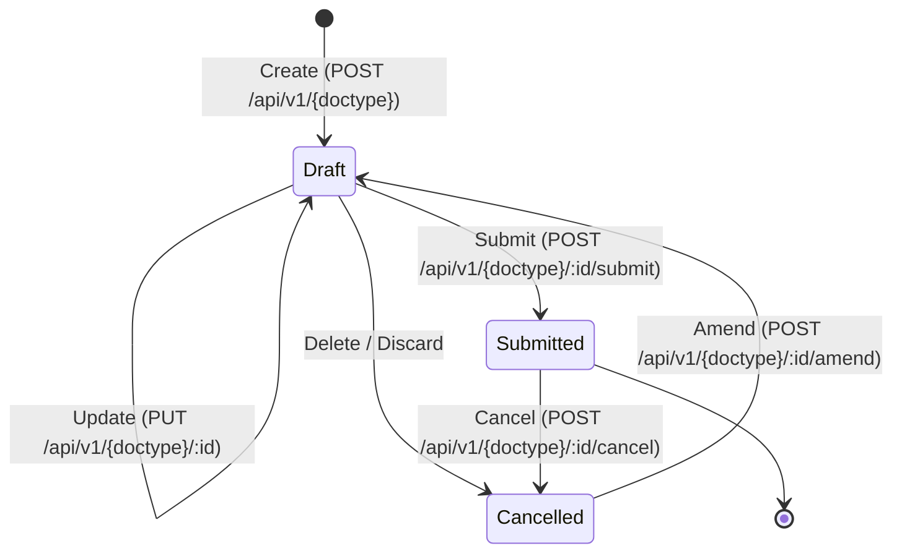

# VyaparSuite REST API Specification
**Version:** 1.0.0  
**Status:** Approved Architecture Standard  
**Base URL:** `https://api.vyaparsuite.com/api/v1` (Cloud) / `http://localhost:3000/api/v1` (Local Dev)  
**Target Platform:** Next.js (App Router), Supabase (PostgreSQL, Auth, Storage)

---

## 1. Architectural Overview & Versioning Strategy

VyaparSuite exposes a deterministic, resource-oriented RESTful API engineered for enterprise ERP operations. The API guarantees strict multi-tenant isolation, immutable audit logging, stateful document lifecycles (Draft → Submitted → Cancelled → Amended), and compliance with statutory financial reporting standards.

### 1.1 URI Path Structure and Versioning Strategy
All API endpoints follow a strict URI prefix contract:
```text
/api/v{major_version}/{module}/{resource}
```

* **Current Stable Version:** `/api/v1`
* **Versioning Policy:**
  * **URI Versioning:** Breaking schema alterations, structural envelope changes, or state machine redesigns increment the major version (e.g., `/api/v2`).
  * **Backward-Compatible Enhancements:** New query parameters, optional request fields, and additional response attributes are introduced within the active version without path mutation.
  * **Deprecation Notice:** Deprecated endpoints return a standard `Deprecation: @<timestamp>` header along with a `Sunset: <date>` header following RFC 8594.
* **Tenant Identification:** Tenants are isolated via PostgreSQL Row-Level Security (RLS) driven by JWT claims or hashed API key resolution. No tenant ID is exposed in the public URI path to prevent information leakage.

---

## 2. Authentication and Authorization

VyaparSuite enforces dual authentication modalities: Supabase JSON Web Tokens (User Interactive sessions) and Cryptographic API Keys (Machine-to-Machine / Headless Integrations).

### 2.1 Supabase JWT Bearer Authentication
Used primarily by frontend applications, mobile clients, and single sign-on (SSO) consumers.
* **Header:** `Authorization: Bearer <supabase_jwt_token>`
* **Token Characteristics:**
  * Issued by Supabase Auth (`gotrue`).
  * Cryptographically signed via EdDSA or asymmetric RS256/symmetric HS256 depending on configuration.
  * JWT Payload contains user metadata:
    ```json
    {
      "sub": "b2c9a184-e3c7-434e-8ce4-927b2cb1e6b3",
      "aud": "authenticated",
      "role": "authenticated",
      "email": "cfo@acmeindustries.in",
      "app_metadata": {
        "tenant_id": "ten_994a3dfb_7c11",
        "roles": ["Accounts Manager", "Tax Auditor"]
      },
      "exp": 1793448000
    }
    ```

### 2.2 Machine-to-Machine API Keys
Used for ERP connectors, logistics systems, e-commerce webhooks, and POS sync.
* **Header:** `X-API-Key: vs_live_<public_identifier>_<secret_entropy>`
* **Structure:**
  * Prefix: `vs_live_` (Production) or `vs_test_` (Sandbox)
  * Public ID: 12-character alphanumeric key identifier for index lookup.
  * Secret: 48-character high-entropy cryptographic token.
* **Security & Verification Flow:**
  * Raw API keys are never stored plaintext in PostgreSQL.
  * The database stores `sha256(secret_entropy)` alongside the tenant linkage and scoped permission arrays.
  * Constant-time comparison (`crypto.timingSafeEqual`) is enforced at the edge/middleware to eliminate timing side-channel attacks.

### 2.3 Scopes and Permissions
Every API request checks the user or API key's assigned permissions against the target Document Type (DocType) and action:
* Format: `{doctype}:{read|write|submit|cancel|amend|delete|export}`
* Example: `sales_invoice:submit`, `stock_entry:write`

---

## 3. Standard Request & Response Envelopes

To maintain client consistency, all responses conform to an invariant JSON envelope structure.

### 3.1 Success Envelope Format
```json
{
  "success": true,
  "data": {},
  "meta": {
    "timestamp": "2026-10-30T14:30:00.124Z",
    "request_id": "req_01JBAC5W9E9F00Z8X52KEMW4V1",
    "version": "v1"
  }
}
```

For list responses:
```json
{
  "success": true,
  "data": [],
  "meta": {
    "timestamp": "2026-10-30T14:30:00.124Z",
    "request_id": "req_01JBAC5W9E9F00Z8X52KEMW4V1",
    "version": "v1",
    "pagination": {
      "has_more": true,
      "total_count": 1420,
      "page": 1,
      "per_page": 50,
      "next_cursor": "eyJpZCI6InNpbnZfMTAwMSIsInZhbHVlIjoxNzYzNDQ4MDAwfQ=="
    }
  }
}
```

---

## 4. Error Response Format (RFC 7807 Extended)

VyaparSuite implements RFC 7807 Problem Details with enterprise ERP extensions providing granular field-level validation errors, statutory rejection codes, and documentation links.

### 4.1 Error Envelope Specification
```json
{
  "success": false,
  "error": {
    "code": "ERR_GST_VALIDATION_FAILED",
    "message": "Place of Supply does not match recipient GSTIN state code.",
    "status": 422,
    "details": [
      {
        "field": "billing_address.gstin",
        "code": "INVALID_GSTIN_STATE_MATCH",
        "message": "Recipient GSTIN '27AABCU9603R1ZM' indicates Maharashtra (27), but place_of_supply specified '29-Karnataka'."
      }
    ],
    "help_url": "https://docs.vyaparsuite.com/errors/ERR_GST_VALIDATION_FAILED",
    "request_id": "req_01JBAC5W9E9F00Z8X52KEMW4V1"
  }
}
```

### 4.2 Standard HTTP Status Codes & Error Catalog
| HTTP Status | Error Code | Description |
| :--- | :--- | :--- |
| `400 Bad Request` | `ERR_MALFORMED_REQUEST` | Syntax error, unparseable JSON payload, or invalid query schema. |
| `401 Unauthorized` | `ERR_AUTHENTICATION_REQUIRED` | Missing, expired, or cryptographically invalid token / API key. |
| `403 Forbidden` | `ERR_PERMISSION_DENIED` | Subject lacks required DocType permission or tenant tenancy mismatch. |
| `404 Not Found` | `ERR_RESOURCE_NOT_FOUND` | Specified Document ID does not exist or has been permanently expunged. |
| `409 Conflict` | `ERR_DOCUMENT_STATE_CONFLICT` | Action invalid for current lifecycle state (e.g., submitting already submitted invoice). |
| `422 Unprocessable` | `ERR_BUSINESS_VALIDATION` | Accounting imbalances, negative stock violations, statutory tax errors. |
| `429 Too Many Req` | `ERR_RATE_LIMIT_EXCEEDED` | Request rate exceeded allowed tier quota. |
| `500 Server Error` | `ERR_INTERNAL_POSTING_FAULT` | Database rollback, ledger write failure, or unexpected exception. |

---

## 5. Pagination, Filtering, Sorting, and Field Selection

List endpoints support both High-Volume Cursor-Based Pagination (recommended for integrations) and Offset-Based Pagination (for admin dashboards).

### 5.1 Pagination Strategies
* **Cursor Pagination (Recommended):**
  * `?pagination_type=cursor&cursor=eyJpZCI6ImFiYzEyMyJ9&limit=50`
  * Returns opaque base64 string `next_cursor` in the meta object.
* **Offset Pagination:**
  * `?pagination_type=offset&page=2&per_page=50`
  * Limit capped at maximum 100 items per request; default is 25 items.

### 5.2 Advanced Filtering Syntax
Filtering uses structured query operators encoded as parameters:
```text
GET /api/v1/sales_invoice?posting_date[gte]=2026-10-01&posting_date[lte]=2026-10-31&doc_status[eq]=1&grand_total[gt]=50000
```
* **Supported Operators:**
  * `eq`: Equal to (`doc_status[eq]=1`)
  * `neq`: Not equal to (`company_id[neq]=comp_01`)
  * `gt`, `gte`: Greater than, Greater than or equal to (`outstanding_amount[gt]=0`)
  * `lt`, `lte`: Less than, Less than or equal to
  * `in`: In array (`workflow_state[in]=Approved,Under Review`)
  * `nin`: Not in array
  * `like`: Wildcard substring match (`customer_name[like]=%Tata%`)
  * `is`: Null check (`tax_id[is]=null` or `tax_id[is]=not_null`)

### 5.3 Sorting Syntax
Multi-column sorting with directional prefix:
```text
GET /api/v1/sales_invoice?sort=-posting_date,+customer_name
```
* `-` denotes descending order (`DESC`).
* `+` or no prefix denotes ascending order (`ASC`).

### 5.4 Field Selection (Sparse Fieldsets)
Optimize network bandwidth and payload size by querying explicit projection arrays:
```text
GET /api/v1/sales_invoice?fields=id,name,customer_id,posting_date,grand_total,items(id,item_code,qty,rate)
```

---

## 6. Rate Limiting and Quota Enforcement

Rate limits are enforced at the API gateway layer (Next.js Middleware + Upstash Redis / Cloudflare Rate Limiter). Rate limits apply on a per-tenant or per-API-key basis.

### 6.1 Standard Rate Limiting Headers
Every API response includes compliant IETF rate limiting headers:
```http
RateLimit-Limit: 1200
RateLimit-Remaining: 1198
RateLimit-Reset: 42
X-RateLimit-Tier: Enterprise
Retry-After: 42
```
* `RateLimit-Limit`: Maximum requests permitted per window (e.g., 1200 per 60 seconds).
* `RateLimit-Remaining`: Remaining request allowance in current sliding window.
* `RateLimit-Reset`: Seconds remaining until quota reset.
* `Retry-After`: Returned with `429 Too Many Requests` indicating wait seconds.

### 6.2 Rate Limit Tiering Matrix
* **Starter:** 120 req/min, burst 200
* **Growth:** 600 req/min, burst 900
* **Enterprise:** 3000 req/min, burst 5000
* **Bulk / Report Endpoints:** Dedicated pool (30 concurrent async executions per tenant).

---

## 7. Idempotency Key Specification

To prevent duplicate postings, double debit/credit entries, and accidental repeated orders during network retries or transient connection timeouts, write operations support Idempotency Keys.

### 7.1 Protocol Behavior
* **Client Request:** Send the HTTP header `Idempotency-Key: <UUIDv4 | String>`.
* **Server Verification:**
  1. The server checks the key in the tenant's cache (`idempotency_store` table / Redis cache) with an expiration TTL of 24 hours.
  2. If the key matches an **in-flight** request, the server returns HTTP `409 Conflict` with `code: "ERR_OPERATION_IN_PROGRESS"`.
  3. If the key matches a **completed** transaction, the server skips processing and immediately returns the cached HTTP response body and status code.
  4. If the key is **new**, the server locks the key, processes the database transaction, caches the final serialized response, and unlocks the record.
* **Payload Mismatch Safety:** If an identical idempotency key is submitted with a altered request payload, the API returns HTTP `422 Unprocessable Entity` with `ERR_IDEMPOTENCY_PAYLOAD_MISMATCH`.

---

## 8. Webhook Specification

VyaparSuite provides high-reliability outbound webhook delivery with HMAC-SHA256 signature verification and exponential backoff retry algorithms.

### 8.1 Webhook Registration Schema
```json
{
  "url": "https://logistics.partner.com/api/v1/events",
  "secret": "whsec_79a2efb4c810d7e6a54",
  "events": [
    "sales_invoice.submitted",
    "delivery_note.created",
    "payment_entry.completed"
  ],
  "is_active": true
}
```

### 8.2 Outbound Webhook Headers
When VyaparSuite fires a webhook, it provides standard verification headers:
```http
Content-Type: application/json
X-Vyapar-Signature: t=1761834600,v1=9f83cf4b2f1e6798e3b2e7d70c40e11894a4c51950e18347
X-Vyapar-Event: sales_invoice.submitted
X-Vyapar-Delivery-Id: dlv_01JBAC5W9E9F00Z8X52KEMW4V1
```

### 8.3 Cryptographic Signature Verification
To authenticate incoming webhooks, subscribers compute the HMAC-SHA256 signature:
1. Extract timestamp `t` and signature `v1` from the `X-Vyapar-Signature` header.
2. Prepare the signed string: `${t}.${raw_request_body}`.
3. Compute `HmacSHA256(signed_string, webhook_secret)`.
4. Validate that the computed hash equals `v1` using constant-time comparison, and reject requests where `abs(currentTime - t) > 300` seconds to prevent replay attacks.

### 8.4 Webhook Retry Strategy
* **Immediate Failover:** On non-2xx status code or timeout (10s connection timeout).
* **Backoff Schedule:** 5 retries with exponential jitter:
  * Retry 1: 30 seconds
  * Retry 2: 5 minutes
  * Retry 3: 30 minutes
  * Retry 4: 2 hours
  * Retry 5: 24 hours
* After 5 consecutive failures, the webhook endpoint is automatically marked `degraded` and tenant admins receive an alert.

---

## 9. Document Lifecycle Endpoints & State Machine

Every transactional document in VyaparSuite follows an immutable state machine pattern:



### Document Status Enum Values:
* `doc_status = 0`: **Draft** (Mutable, no GL/Stock impact)
* `doc_status = 1`: **Submitted** (Immutable, GL posted, Stock reserved/posted, Statutory IRN generated)
* `doc_status = 2`: **Cancelled** (Reversal GL posted, Stock reversed, Linked records unlocked)

---

## 10. Major Document Types: REST Endpoints

### 10.1 Generic DocType REST Endpoints
For any major DocType `{doctype}` (e.g., `sales_invoice`, `purchase_invoice`, `sales_order`, `purchase_order`, `delivery_note`, `purchase_receipt`, `quotation`, `payment_entry`, `journal_entry`, `stock_entry`), the following standard contracts apply:

#### A. List Documents
* **Method & Path:** `GET /api/v1/{doctype}`
* **Query Parameters:** `page`, `per_page`, `cursor`, `fields`, `sort`, `filter expressions`
* **Response:** Envelope containing array of document summaries and pagination metadata.

#### B. Get Document by ID
* **Method & Path:** `GET /api/v1/{doctype}/:id`
* **Response:** Full document tree including child tables (`items`, `taxes`, `payment_schedule`).

#### C. Create Document (Draft)
* **Method & Path:** `POST /api/v1/{doctype}`
* **Headers:** `Idempotency-Key` (Optional, Recommended)
* **Status:** `201 Created`
* **Lifecycle:** Initializes document in `doc_status: 0`.

#### D. Update Document (Draft Only)
* **Method & Path:** `PUT /api/v1/{doctype}/:id`
* **Rules:** Permitted only when `doc_status == 0`. Rejects update with `409 Conflict` if document is submitted.
* **Status:** `200 OK`

#### E. Submit Document
* **Method & Path:** `POST /api/v1/{doctype}/:id/submit`
* **Rules:**
  * Must be in `doc_status == 0`.
  * Triggers validation, statutory check, General Ledger (GL) ledger balance checks, stock ledger entry creation.
  * Transitions `doc_status` to `1`.
* **Status:** `200 OK`

#### F. Cancel Document
* **Method & Path:** `POST /api/v1/{doctype}/:id/cancel`
* **Payload:** `{"reason": "Customer cancelled order before dispatch"}`
* **Rules:**
  * Must be in `doc_status == 1`.
  * Verifies downstream dependencies (e.g., Sales Invoice cannot be cancelled if Payment Entry is reconciled).
  * Automatically creates counter-balancing reversal GL entries and reverses Stock ledger impact.
  * Transitions `doc_status` to `2`.
* **Status:** `200 OK`

#### G. Amend Document
* **Method & Path:** `POST /api/v1/{doctype}/:id/amend`
* **Rules:**
  * Document must be in `doc_status == 2` (Cancelled).
  * Creates a clone of the cancelled record in `doc_status: 0` (Draft) with reference `amended_from: <original_id>`.
  * The new document name appends versioning (e.g., `INV-2026-00042-1`).
* **Status:** `201 Created`

---

### 10.2 Detailed Endpoints by Document Type

---

### Document Type 1: Sales Invoice (`sales_invoice`)
Accounts Receivable invoice generated for customers, supporting Indian GST compliance, E-Invoice, and TCS calculation.

#### `POST /api/v1/sales_invoice`
**Request Payload:**
```json
{
  "customer_id": "cust_9011afb4",
  "posting_date": "2026-10-30",
  "due_date": "2026-11-29",
  "company_id": "comp_mumbai_hq",
  "currency": "INR",
  "conversion_rate": 1.0,
  "place_of_supply": "27-Maharashtra",
  "is_reverse_charge": false,
  "gst_category": "Registered Regular",
  "items": [
    {
      "item_code": "PROD-LAPTOP-01",
      "item_name": "ProBook Ultra 14-inch",
      "hsn_sac": "84713010",
      "qty": 2,
      "uom": "NOS",
      "rate": 75000.00,
      "discount_percentage": 5.0,
      "tax_template_id": "gst_18_pct",
      "warehouse_id": "wh_bhiwandi_central"
    }
  ],
  "payment_terms_template": "NET30",
  "remarks": "Export packing compliant"
}
```

**Response (`201 Created`):**
```json
{
  "success": true,
  "data": {
    "id": "sinv_01JBAC78V2K",
    "name": "SINV-2627-00142",
    "doc_status": 0,
    "customer_id": "cust_9011afb4",
    "net_total": 142500.00,
    "cgst_amount": 12825.00,
    "sgst_amount": 12825.00,
    "igst_amount": 0.00,
    "cess_amount": 0.00,
    "total_tax": 25650.00,
    "grand_total": 168150.00,
    "rounded_total": 168150.00,
    "outstanding_amount": 168150.00,
    "items": [
      {
        "id": "sii_01",
        "item_code": "PROD-LAPTOP-01",
        "qty": 2,
        "rate": 75000.00,
        "amount": 142500.00,
        "cgst_rate": 9.0,
        "cgst_amount": 12825.00,
        "sgst_rate": 9.0,
        "sgst_amount": 12825.00
      }
    ]
  },
  "meta": {
    "timestamp": "2026-10-30T14:32:10.000Z",
    "request_id": "req_01JBAC5W9E9F00Z8X52KEMW4V1"
  }
}
```

#### `POST /api/v1/sales_invoice/:id/submit`
Executes automatic General Ledger posting:
* Dr. Accounts Receivable (Debtors): ₹168,150.00
* Cr. Sales Revenue: ₹142,500.00
* Cr. Output CGST Payable: ₹12,825.00
* Cr. Output SGST Payable: ₹12,825.00
If company exceeds E-Invoice turnover threshold (₹5 Cr), automatically schedules or invokes the IRP gateway to generate IRN and signed QR code.

---

### Document Type 2: Purchase Invoice (`purchase_invoice`)
Accounts Payable liability document generated from vendor bills, handling Input Tax Credit (ITC) eligibility, TDS under GST/Income Tax, and Reverse Charge.

#### `POST /api/v1/purchase_invoice`
**Key Attributes:**
* `supplier_id`: Vendor unique identifier.
* `bill_no`: Vendor's physical tax invoice number.
* `bill_date`: Vendor invoice issuance date.
* `itc_eligibility`: `"Eligible"` | `"Ineligible_17_5"` | `"Capital_Goods"`.
* `is_reverse_charge`: Boolean.
* `tds_category`: e.g., `"194C_Contractor_1_pct"` or `"194J_Professional_10_pct"`.

#### `POST /api/v1/purchase_invoice/:id/submit`
Executes GL posting:
* Dr. Expense / Inventory Valuation: ₹100,000.00
* Dr. Input Tax Credit (CGST/SGST/IGST): ₹18,000.00
* Cr. TDS Payable (Section 194C/J): ₹2,000.00
* Cr. Accounts Payable (Creditors): ₹116,000.00

---

### Document Type 3: Sales Order (`sales_order`)
Commercial contract confirmed by customer prior to delivery and invoicing.

#### `POST /api/v1/sales_order`
**Key Attributes:**
* `customer_id`, `order_date`, `delivery_date`.
* `items`: Array of items, quantities, agreed unit price, and reserve warehouse.
* `doc_status`: 0 (Draft).

#### `POST /api/v1/sales_order/:id/submit`
* Locks customer credit limit availability.
* Updates inventory planning metrics: increments `reserved_qty` on warehouse balance tables.
* Enables downstream creation of `delivery_note` or direct `sales_invoice`.

---

### Document Type 4: Purchase Order (`purchase_order`)
Legally binding procurement commitment issued to external suppliers.

#### `POST /api/v1/purchase_order`
**Key Attributes:**
* `supplier_id`, `schedule_date`, `shipping_address`, `billing_address`.
* `items`: Array of items, required delivery date, target warehouse.

#### `POST /api/v1/purchase_order/:id/submit`
* Updates Material Requirement Planning (MRP) and purchase projections: increments `ordered_qty`.
* Enables creation of downstream `purchase_receipt` (Goods Receipt Note) and `purchase_invoice`.

---

### Document Type 5: Delivery Note (`delivery_note`)
Goods dispatch and packing documentation representing physical outbound shipment.

#### `POST /api/v1/delivery_note`
**Key Attributes:**
* `against_sales_order`: Reference to parent Sales Order.
* `transporter_id`, `vehicle_number`, `distance_km`, `lr_number` (Lorry Receipt).
* `items`: Serial numbers, batch numbers, dispatch quantity.

#### `POST /api/v1/delivery_note/:id/submit`
* Decrements `actual_qty` and `reserved_qty` from `stock_ledger_entry`.
* Automatically records Cost of Goods Sold (COGS) GL entries if continuous stock valuation (Perpetual Inventory) is active:
  * Dr. Cost of Goods Sold: ₹X
  * Cr. Stock In Hand: ₹X
* Can trigger automated E-Way Bill generation via NIC / GSP integration.

---

### Document Type 6: Purchase Receipt (`purchase_receipt` / Goods Receipt Note)
Inbound warehouse physical receipt and inspection document.

#### `POST /api/v1/purchase_receipt`
**Key Attributes:**
* `against_purchase_order`: PO Reference.
* `rejected_warehouse`: Warehouse for damaged/failed quality control goods.
* `items`: `received_qty`, `accepted_qty`, `rejected_qty`, batch numbers, expiry dates.

#### `POST /api/v1/purchase_receipt/:id/submit`
* Posts Stock Ledger Entries increasing `actual_qty`.
* Calculates incoming valuation rate based on moving average or FIFO.
* GL Posting (Continuous Inventory):
  * Dr. Stock In Hand: ₹Y
  * Cr. Stock Received But Not Billed (Provisional Liability): ₹Y

---

### Document Type 7: Quotation (`quotation`)
Pre-sales estimate / commercial offer submitted to a Lead or Customer.

#### `POST /api/v1/quotation`
**Key Attributes:**
* `quotation_to`: `"Customer"` | `"Lead"`.
* `party_name`: Identifier of lead or customer.
* `valid_till`: Expiration date of quotation.
* `pricing_rule_id`: Applicable volume discounts.

#### `POST /api/v1/quotation/:id/submit`
* Freezes quotation terms.
* Allows one-click conversion to Sales Order via `/api/v1/quotation/:id/convert_to_sales_order`.

---

### Document Type 8: Payment Entry (`payment_entry`)
Multi-purpose treasury and cash/bank reconciliation document covering customer receipts, supplier payments, internal transfers, and expense refunds.

#### `POST /api/v1/payment_entry`
**Request Payload:**
```json
{
  "payment_type": "Receive",
  "party_type": "Customer",
  "party_id": "cust_9011afb4",
  "posting_date": "2026-10-31",
  "paid_from": "acc_bank_hdfc_current",
  "paid_to": "acc_debtors_local",
  "paid_amount": 168150.00,
  "received_amount": 168150.00,
  "reference_no": "NEFT/UTR/981240129",
  "reference_date": "2026-10-31",
  "references": [
    {
      "reference_doctype": "sales_invoice",
      "reference_name": "sinv_01JBAC78V2K",
      "allocated_amount": 168150.00
    }
  ]
}
```

#### `POST /api/v1/payment_entry/:id/submit`
* Dr. HDFC Bank Account: ₹168,150.00
* Cr. Accounts Receivable: ₹168,150.00
* Automatically updates `outstanding_amount` on `sinv_01JBAC78V2K` to `0.00`.
* Sets invoice payment status to `Paid`.

---

### Document Type 9: Journal Entry (`journal_entry`)
Direct manual or automated debit/credit financial entry for accruals, adjustments, provisions, and inter-company transfers.

#### `POST /api/v1/journal_entry`
**Request Payload:**
```json
{
  "posting_date": "2026-10-31",
  "voucher_type": "Journal Entry",
  "user_remark": "Accrual for October 2026 Office Lease",
  "accounts": [
    {
      "account_id": "acc_rent_expense",
      "debit": 150000.00,
      "credit": 0.00,
      "cost_center": "cc_admin_mumbai"
    },
    {
      "account_id": "acc_tds_payable_194i",
      "debit": 0.00,
      "credit": 15000.00,
      "party_type": "Supplier",
      "party_id": "supp_landlord_realty"
    },
    {
      "account_id": "acc_rent_payable",
      "debit": 0.00,
      "credit": 135000.00,
      "party_type": "Supplier",
      "party_id": "supp_landlord_realty"
    }
  ]
}
```

#### `POST /api/v1/journal_entry/:id/submit`
* Enforces fundamental accounting rule: `Sum(Debit) === Sum(Credit)`.
* Writes atomic postings to `gl_entry` table.

---

### Document Type 10: Stock Entry (`stock_entry`)
Direct physical stock movement document handling internal transfers, manufacturing material issues/receipts, and inventory balance adjustments.

#### `POST /api/v1/stock_entry`
**Attributes:**
* `stock_entry_type`:
  * `"Material Transfer"`: Move goods between warehouses.
  * `"Material Issue"`: Consumption of stock for R&D/internal use.
  * `"Material Receipt"`: Direct manual entry of initial opening stock.
  * `"Manufacture"`: Consume BOM raw materials and produce finished goods.
* `items`:
  * `s_warehouse`: Source warehouse (for Transfer and Issue).
  * `t_warehouse`: Target warehouse (for Transfer and Receipt).
  * `item_code`, `qty`, `basic_rate`.

#### `POST /api/v1/stock_entry/:id/submit`
* Enforces strict real-time stock balance check (prevents negative stock if company policy is configured to `disallow_negative_stock: true`).
* Computes Valuation Ledger and updates current weighted average cost per warehouse.

---

## 11. Special Purpose Enterprise Endpoints

### 11.1 Report API (`/api/v1/reports/:report_id`)
Asynchronous and synchronous access to real-time financial and analytical data.

* **GET `/api/v1/reports/general_ledger`**
  * Query parameters: `from_date`, `to_date`, `account_id`, `party_id`, `cost_center`, `format` (`json` | `csv` | `xlsx`).
* **GET `/api/v1/reports/balance_sheet`**
  * Query parameters: `as_on_date`, `company_id`, `periodicity` (`Monthly` | `Quarterly` | `Annual`).
* **GET `/api/v1/reports/stock_balance`**
  * Query parameters: `as_on_date`, `warehouse_id`, `item_group`.
* **POST `/api/v1/reports/async_generate`**
  * Initiates background heavy report processing.
  * Returns `{"job_id": "job_gl_export_91240"}` with status polling at `GET /api/v1/reports/jobs/:job_id`.

### 11.2 Bulk Operations API
Perform high-volume batch mutations atomically or in best-effort transactional mode.

* **POST `/api/v1/bulk/execute`**
  * **Payload:**
    ```json
    {
      "mode": "all_or_none",
      "operations": [
        {
          "method": "POST",
          "endpoint": "/api/v1/sales_invoice",
          "idempotency_key": "bulk_inv_001",
          "payload": { ... }
        },
        {
          "method": "POST",
          "endpoint": "/api/v1/payment_entry",
          "idempotency_key": "bulk_pay_001",
          "payload": { ... }
        }
      ]
    }
    ```
  * Modes:
    * `all_or_none`: Executes within a single PostgreSQL transaction block. Reverts everything if any operation fails.
    * `continue_on_error`: Executes each operation independently, returning a detailed result status array for each element.

### 11.3 Import / Export API
High-speed data ingestion and migration engine utilizing streaming Supabase Storage.

* **POST `/api/v1/import/upload`**
  * Uploads CSV or Excel template to secure staging storage.
  * Initiates validation dry-run checking foreign key integrity, mandatory columns, and business logic.
  * Returns validation summary:
    ```json
    {
      "import_id": "imp_7781a",
      "total_rows": 500,
      "valid_rows": 498,
      "invalid_rows": 2,
      "errors": [
        { "row": 12, "column": "item_code", "message": "Item code 'RAW-MTRL-99' does not exist." }
      ]
    }
    ```
* **POST `/api/v1/import/:import_id/commit`**
  * Streams staged data into PostgreSQL with batch chunking (100 rows per transaction) to prevent connection timeouts.
* **POST `/api/v1/export/stream`**
  * Initiates filtered data stream directly into signed Supabase Storage URL for customer download.

---

## 12. Security & Compliance Considerations
* **Transport Layer Security:** Enforced TLS 1.3 only; HTTP calls automatically redirect to HTTPS.
* **CORS Policy:** Strict origin allowlists configurable per tenant.
* **PII Redaction:** Sensitive details (passwords, bank account numbers, tax PAN) are masked in audit logs.
* **Tamper-Evident Ledger:** GL entries once submitted cannot be updated via any API endpoint; correction requires explicit cancellation or contra-journal entries.
