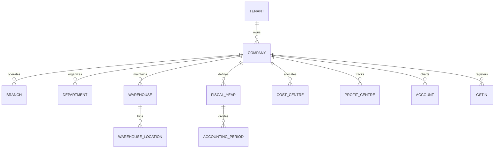
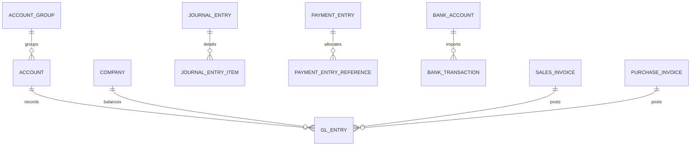
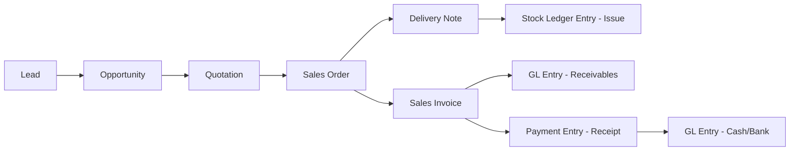
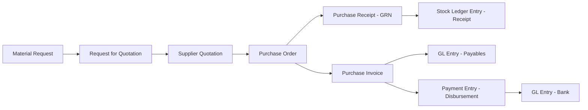
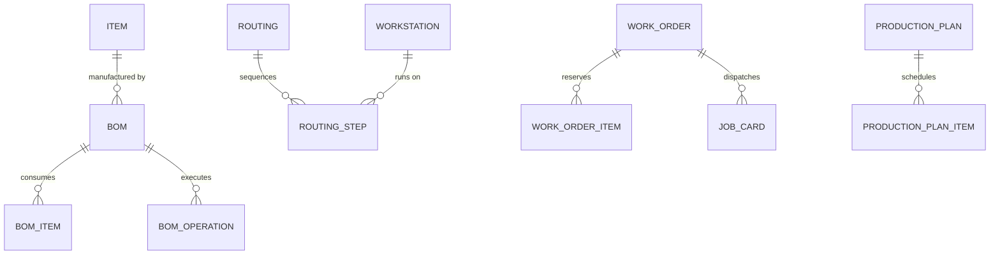

# VyaparSuite — Database Architecture & Comprehensive Schema Reference

> **Universal Relational Data Model for Indian MSMEs & Global Multi-Entity Enterprises**  
> *Document Version: 1.0.0*  
> *Target Engine: PostgreSQL 15+ (Supabase PaaS / Self-Hosted Vanilla PostgreSQL)*  
> *Author: VyaparSuite Core Architecture Group*  
> *Classification: Technical Reference Specification & DDL Source of Truth*

---

## 1. Architectural Principles & Global Conventions

The VyaparSuite database schema is engineered from the ground up for strict transactional integrity, multi-tenant physical/logical data isolation, statutory Indian compliance, and frictionless international enterprise operations. It rejects dynamic runtime typing in favor of strict PostgreSQL schema enforcement.

### 1.1 Universal Column Conventions
Every relational table across all 23 subsystems strictly adheres to the following universal standards:

1. **Primary Keys (`id`):** Every table employs a 128-bit Universally Unique Identifier (`UUID`) generated natively via `gen_random_uuid()`. This prevents enumeration attacks, facilitates distributed offline replication, and eliminates ID collisions during cross-company consolidation.
2. **Tenant Isolation (`tenant_id`):** Multi-tenancy is enforced at the storage engine level. Every table (except `tenant` itself) contains a foreign key `tenant_id UUID NOT NULL REFERENCES tenant(id) ON DELETE RESTRICT`. Under no circumstances are foreign keys cascades permitted on `tenant_id`.
3. **Audit Provenance:** All entities record precise creation and modification chronologies and user actor links:
   - `created_at TIMESTAMPTZ NOT NULL DEFAULT clock_timestamp()`
   - `updated_at TIMESTAMPTZ NOT NULL DEFAULT clock_timestamp()`
   - `created_by UUID REFERENCES auth.users(id) ON DELETE SET NULL`
   - `updated_by UUID REFERENCES auth.users(id) ON DELETE SET NULL`
4. **Mathematical Precision Standards:** Floating-point approximations (`REAL`, `DOUBLE PRECISION`, `FLOAT`) are strictly banned from commercial ledgers to prevent roundoff divergence:
   - **Monetary Valuations:** `NUMERIC(20,6)` provides 14 integer digits and 6 fractional decimal places, accommodating billions in valuation while computing sub-paisa forex rates accurately.
   - **Physical Inventory Quantities:** `NUMERIC(20,6)` supports industrial bulk trade (metric tons) down to milligrams.
   - **Unit Price & Valuation Rates:** `NUMERIC(20,6)` ensures precision costing per unit.
   - **Tax & Percentage Ratios:** `NUMERIC(10,6)` accommodates compound percentages and fractional cess tariffs.
5. **Textual Storage:** Character strings utilize native PostgreSQL `TEXT` rather than legacy arbitrary length `VARCHAR(N)` constraints, avoiding table rewrites when field lengths expand.
6. **Extensibility via Structured JSONB:** Tables provision `custom_fields JSONB NOT NULL DEFAULT '{}'::jsonb` and `metadata JSONB NOT NULL DEFAULT '{}'::jsonb` for low-code extensibility without schema migrations.
7. **Naming Conventions:** All identifiers adhere to lowercase `snake_case`. Table names use singular nouns (e.g., `customer`, `purchase_order`, `stock_ledger_entry`).

### 1.2 Multi-Tenant Row Level Security (RLS) Architecture
Row Level Security is enabled on **100% of all tables**. In VyaparSuite, the application context establishes the active tenant identifier per database session via PostgreSQL session configuration variables or Supabase JWT claims:

```sql
-- Session context helper function
CREATE OR REPLACE FUNCTION get_current_tenant_id()
RETURNS UUID AS $$
BEGIN
    RETURN COALESCE(
        NULLIF(current_setting('app.current_tenant_id', true), '')::uuid,
        (NULLIF(auth.jwt() ->> 'tenant_id', ''))::uuid
    );
END;
$$ LANGUAGE plpgsql STABLE;

-- Standard RLS enforcement policy across tables
CREATE POLICY tenant_isolation_policy ON <table>
    FOR ALL USING (tenant_id = get_current_tenant_id());
```

### 1.3 Immutable Double-Entry Ledgers & Statutory Audit Trail
> [!IMPORTANT]
> **Immutable Ledger Mandate:** General Ledger entries (`gl_entry`) and Stock Ledger entries (`stock_ledger_entry`) are strictly append-only. No `UPDATE` or `DELETE` operations are ever permitted. Any financial or stock correction requires posting an offsetting compensating transaction (`is_cancelled = true`). Database triggers physically abort mutation attempts.

This design guarantees compliance with **Ministry of Corporate Affairs (MCA) CARO 2020** audit trail requirements in India, prohibiting software-level tampering with books of accounts.

## 2. Master Entity Relationship Architecture

### 2.1 Core Multi-Tenant & Organizational Hierarchy


### 2.2 Financial Accounting & General Ledger Flow


### 2.3 Order-to-Cash & Supply Chain Lifecycle


### 2.4 Procure-to-Pay Lifecycle


### 2.5 Manufacturing & Shop-Floor Execution


## 3. Comprehensive Database Schema Reference by Subsystem

### 3.1 Core Platform & Multitenancy Tables

This subsystem contains **23 tables** supporting production business operations.

### `tenant`

**Category:** Core Tables  
**Purpose:** Root multitenancy partition representing a subscriber organization or enterprise group in VyaparSuite.

#### Columns

| Column Name | Data Type | Nullable | Default | Constraints & Description |
| :--- | :--- | :--- | :--- | :--- |
| `id` | `UUID` | No | `gen_random_uuid()` | **PRIMARY KEY** — Globally unique tenant identifier |
| `name` | `TEXT` | No | *None* | Commercial name of the tenant organization |
| `subdomain` | `TEXT` | No | *None* | **UNIQUE** — Subdomain handle for SaaS routing (e.g., 'acme') |
| `custom_domain` | `TEXT` | Yes | *None* | **UNIQUE** — Custom FQDN mapped via CNAME (e.g., 'erp.acme.com') |
| `status` | `TEXT` | No | `'active'` | **CHECK (status IN ('trialing','active','suspended','cancelled','archived'))** — Lifecycle state of the tenant |
| `edition` | `TEXT` | No | `'standard'` | **CHECK (edition IN ('starter','standard','enterprise','custom'))** — Subscribed platform edition tier |
| `storage_limit_bytes` | `BIGINT` | No | `5368709120` | Storage quota allocated in bytes (default 5GB) |
| `storage_used_bytes` | `BIGINT` | No | `0` | Current storage consumption in bytes |
| `max_users` | `INTEGER` | No | `10` | Maximum permitted active user accounts |
| `subscription_ends_at` | `TIMESTAMPTZ` | Yes | *None* | Billing subscription termination or renewal date |
| `primary_contact_email` | `TEXT` | No | *None* | Administrative billing email address |
| `primary_contact_phone` | `TEXT` | Yes | *None* | Administrative phone / mobile number |
| `metadata` | `JSONB` | No | `'{}'::jsonb` | Custom tenant configuration flags and billing metadata |
| `created_at` | `TIMESTAMPTZ` | No | `clock_timestamp()` | Timestamp of tenant registration |
| `updated_at` | `TIMESTAMPTZ` | No | `clock_timestamp()` | Timestamp of last tenant modification |
| `created_by` | `UUID` | Yes | *None* | Superadmin user who provisioned the tenant |
| `updated_by` | `UUID` | Yes | *None* | User who last updated tenant configuration |

#### Constraints & Key Relationships

- **Primary Key:** `id`
- **Foreign Keys:** None (Root entity)
- **Unique Constraints:**
  - `uq_tenant_subdomain`: (`subdomain`) — Ensures subdomain uniqueness across entire database
  - `uq_tenant_custom_domain`: (`custom_domain`) — Ensures custom domain cannot conflict across tenants
- **Check Constraints:**
  - `chk_tenant_status`: `CHECK (status IN ('trialing','active','suspended','cancelled','archived'))` — Validates lifecycle states
  - `chk_tenant_storage`: `CHECK (storage_used_bytes >= 0 AND storage_limit_bytes >= 0)` — Storage values cannot be negative

#### Indexes

| Index Name | Type | Columns / Expression | Partial Filter | Purpose |
| :--- | :--- | :--- | :--- | :--- |
| `idx_tenant_subdomain` | BTREE | `subdomain` | *None* | B-Tree lookup for tenant hostname routing |
| `idx_tenant_status` | BTREE | `status` | *None* | Index for filtering active tenants in background cron jobs |

#### PostgreSQL DDL Definition

```sql
CREATE TABLE IF NOT EXISTS tenant (
    id                           UUID NOT NULL DEFAULT gen_random_uuid(),
    name                         TEXT NOT NULL,
    subdomain                    TEXT NOT NULL,
    custom_domain                TEXT,
    status                       TEXT NOT NULL DEFAULT 'active',
    edition                      TEXT NOT NULL DEFAULT 'standard',
    storage_limit_bytes          BIGINT NOT NULL DEFAULT 5368709120,
    storage_used_bytes           BIGINT NOT NULL DEFAULT 0,
    max_users                    INTEGER NOT NULL DEFAULT 10,
    subscription_ends_at         TIMESTAMPTZ,
    primary_contact_email        TEXT NOT NULL,
    primary_contact_phone        TEXT,
    metadata                     JSONB NOT NULL DEFAULT '{}'::jsonb,
    created_at                   TIMESTAMPTZ NOT NULL DEFAULT clock_timestamp(),
    updated_at                   TIMESTAMPTZ NOT NULL DEFAULT clock_timestamp(),
    created_by                   UUID,
    updated_by                   UUID,
    CONSTRAINT pk_tenant PRIMARY KEY (id),
    CONSTRAINT uq_tenant_subdomain UNIQUE (subdomain),
    CONSTRAINT uq_tenant_custom_domain UNIQUE (custom_domain),
    CONSTRAINT chk_tenant_status CHECK (status IN ('trialing','active','suspended','cancelled','archived')),
    CONSTRAINT chk_tenant_storage CHECK (storage_used_bytes >= 0 AND storage_limit_bytes >= 0)
);

-- Enable Row Level Security
ALTER TABLE tenant ENABLE ROW LEVEL SECURITY;

CREATE POLICY tenant_isolation_policy ON tenant
    FOR ALL USING (id = (NULLIF(current_setting('app.current_tenant_id', true), ''))::uuid);

-- Indexes
CREATE INDEX IF NOT EXISTS idx_tenant_subdomain ON tenant USING btree (subdomain);
CREATE INDEX IF NOT EXISTS idx_tenant_status ON tenant USING btree (status);
```

---

### `company`

**Category:** Core Tables  
**Purpose:** Legal business entities operating under a tenant. Supports holding companies, subsidiaries, and group consolidation.

#### Columns

| Column Name | Data Type | Nullable | Default | Constraints & Description |
| :--- | :--- | :--- | :--- | :--- |
| `id` | `UUID` | No | `gen_random_uuid()` | **PRIMARY KEY** — Globally unique identifier |
| `tenant_id` | `UUID` | No | *None* | **REFERENCES tenant(id) ON DELETE RESTRICT** — Tenant owning this entity for multi-tenant isolation |
| `created_at` | `TIMESTAMPTZ` | No | `clock_timestamp()` | Record creation timestamp in UTC |
| `updated_at` | `TIMESTAMPTZ` | No | `clock_timestamp()` | Record last update timestamp in UTC |
| `created_by` | `UUID` | Yes | *None* | **REFERENCES auth.users(id) ON DELETE SET NULL** — User ID who created the record |
| `updated_by` | `UUID` | Yes | *None* | **REFERENCES auth.users(id) ON DELETE SET NULL** — User ID who last updated the record |
| `company_name` | `TEXT` | No | *None* | Legal registered entity name |
| `abbr` | `TEXT` | No | *None* | Short abbreviation for naming series and code prefixes (e.g. ACME) |
| `default_currency` | `TEXT` | No | `'INR'` | Base accounting currency code (ISO 4217) |
| `country` | `TEXT` | No | `'India'` | Country of legal incorporation |
| `tax_id` | `TEXT` | Yes | *None* | Primary statutory tax identifier (PAN/EIN/Tax No) |
| `cin` | `TEXT` | Yes | *None* | Corporate Identification Number (India MCA compliance) |
| `parent_company_id` | `UUID` | Yes | *None* | **REFERENCES company(id) ON DELETE RESTRICT** — Parent holding company for multi-entity consolidation |
| `is_group` | `BOOLEAN` | No | `false` | Flag indicating if this is a non-transacting holding group |
| `chart_of_accounts_template` | `TEXT` | Yes | *None* | Standard template identifier used to seed accounts |
| `default_receivable_account_id` | `UUID` | Yes | *None* | Default Accounts Receivable control account |
| `default_payable_account_id` | `UUID` | Yes | *None* | Default Accounts Payable control account |
| `default_cost_centre_id` | `UUID` | Yes | *None* | Default operational cost centre |
| `is_active` | `BOOLEAN` | No | `true` | Whether company is active for transactions |
| `metadata` | `JSONB` | No | `'{}'::jsonb` | Custom company attributes and statutory flags |

#### Constraints & Key Relationships

- **Primary Key:** `id`
- **Foreign Keys:**
  - `tenant_id` &rarr; `tenant(id)` (`ON DELETE RESTRICT`) — Tenant boundary
  - `parent_company_id` &rarr; `company(id)` (`ON DELETE RESTRICT`) — Hierarchy link to parent company
- **Unique Constraints:**
  - `uq_company_tenant_name`: (`tenant_id`, `company_name`) — Company name must be unique within a tenant
  - `uq_company_tenant_abbr`: (`tenant_id`, `abbr`) — Company abbreviation must be unique within a tenant
- **Check Constraints:**
  - `chk_company_abbr_length`: `CHECK (char_length(abbr) <= 10)` — Company abbreviation must be 10 characters or fewer

#### Indexes

| Index Name | Type | Columns / Expression | Partial Filter | Purpose |
| :--- | :--- | :--- | :--- | :--- |
| `idx_company_tenant_id` | BTREE | `tenant_id` | *None* | Fast lookups by tenant |
| `idx_company_parent` | BTREE | `tenant_id, parent_company_id` | *None* | Tree traversal for consolidated balance sheets |

#### PostgreSQL DDL Definition

```sql
CREATE TABLE IF NOT EXISTS company (
    id                           UUID NOT NULL DEFAULT gen_random_uuid(),
    tenant_id                    UUID NOT NULL,
    created_at                   TIMESTAMPTZ NOT NULL DEFAULT clock_timestamp(),
    updated_at                   TIMESTAMPTZ NOT NULL DEFAULT clock_timestamp(),
    created_by                   UUID,
    updated_by                   UUID,
    company_name                 TEXT NOT NULL,
    abbr                         TEXT NOT NULL,
    default_currency             TEXT NOT NULL DEFAULT 'INR',
    country                      TEXT NOT NULL DEFAULT 'India',
    tax_id                       TEXT,
    cin                          TEXT,
    parent_company_id            UUID,
    is_group                     BOOLEAN NOT NULL DEFAULT false,
    chart_of_accounts_template   TEXT,
    default_receivable_account_id UUID,
    default_payable_account_id   UUID,
    default_cost_centre_id       UUID,
    is_active                    BOOLEAN NOT NULL DEFAULT true,
    metadata                     JSONB NOT NULL DEFAULT '{}'::jsonb,
    CONSTRAINT pk_company PRIMARY KEY (id),
    CONSTRAINT fk_company_tenant_id FOREIGN KEY (tenant_id) REFERENCES tenant(id) ON DELETE RESTRICT,
    CONSTRAINT fk_company_parent_company_id FOREIGN KEY (parent_company_id) REFERENCES company(id) ON DELETE RESTRICT,
    CONSTRAINT uq_company_tenant_name UNIQUE (tenant_id, company_name),
    CONSTRAINT uq_company_tenant_abbr UNIQUE (tenant_id, abbr),
    CONSTRAINT chk_company_abbr_length CHECK (char_length(abbr) <= 10)
);

-- Enable Row Level Security
ALTER TABLE company ENABLE ROW LEVEL SECURITY;

CREATE POLICY tenant_isolation_policy ON company
    FOR ALL USING (tenant_id = (NULLIF(current_setting('app.current_tenant_id', true), ''))::uuid);

-- Indexes
CREATE INDEX IF NOT EXISTS idx_company_tenant_id ON company USING btree (tenant_id);
CREATE INDEX IF NOT EXISTS idx_company_parent ON company USING btree (tenant_id, parent_company_id);
```

---

### `branch`

**Category:** Core Tables  
**Purpose:** Physical or administrative branch offices of a company, crucial for state-level GST registration and local inventory.

#### Columns

| Column Name | Data Type | Nullable | Default | Constraints & Description |
| :--- | :--- | :--- | :--- | :--- |
| `id` | `UUID` | No | `gen_random_uuid()` | **PRIMARY KEY** — Globally unique identifier |
| `tenant_id` | `UUID` | No | *None* | **REFERENCES tenant(id) ON DELETE RESTRICT** — Tenant owning this entity for multi-tenant isolation |
| `created_at` | `TIMESTAMPTZ` | No | `clock_timestamp()` | Record creation timestamp in UTC |
| `updated_at` | `TIMESTAMPTZ` | No | `clock_timestamp()` | Record last update timestamp in UTC |
| `created_by` | `UUID` | Yes | *None* | **REFERENCES auth.users(id) ON DELETE SET NULL** — User ID who created the record |
| `updated_by` | `UUID` | Yes | *None* | **REFERENCES auth.users(id) ON DELETE SET NULL** — User ID who last updated the record |
| `company_id` | `UUID` | No | *None* | **REFERENCES company(id) ON DELETE CASCADE** — Company owning this branch |
| `branch_name` | `TEXT` | No | *None* | Human-readable branch title (e.g. Mumbai South Hub) |
| `branch_code` | `TEXT` | No | *None* | Short alphanumeric identifier for indexing and prefixing |
| `gstin` | `TEXT` | Yes | *None* | State-specific Goods and Services Tax Identification Number |
| `email` | `TEXT` | Yes | *None* | Branch office operational email address |
| `phone` | `TEXT` | Yes | *None* | Branch office contact telephone number |
| `address_id` | `UUID` | Yes | *None* | Physical location address record reference |
| `is_active` | `BOOLEAN` | No | `true` | Active status toggle |

#### Constraints & Key Relationships

- **Primary Key:** `id`
- **Foreign Keys:**
  - `tenant_id` &rarr; `tenant(id)` (`ON DELETE RESTRICT`) — Tenant boundary
  - `company_id` &rarr; `company(id)` (`ON DELETE CASCADE`) — Parent legal company
- **Unique Constraints:**
  - `uq_branch_company_code`: (`company_id`, `branch_code`) — Branch code unique within company

#### Indexes

| Index Name | Type | Columns / Expression | Partial Filter | Purpose |
| :--- | :--- | :--- | :--- | :--- |
| `idx_branch_company` | BTREE | `company_id, is_active` | *None* | Branch lookups by company |

#### PostgreSQL DDL Definition

```sql
CREATE TABLE IF NOT EXISTS branch (
    id                           UUID NOT NULL DEFAULT gen_random_uuid(),
    tenant_id                    UUID NOT NULL,
    created_at                   TIMESTAMPTZ NOT NULL DEFAULT clock_timestamp(),
    updated_at                   TIMESTAMPTZ NOT NULL DEFAULT clock_timestamp(),
    created_by                   UUID,
    updated_by                   UUID,
    company_id                   UUID NOT NULL,
    branch_name                  TEXT NOT NULL,
    branch_code                  TEXT NOT NULL,
    gstin                        TEXT,
    email                        TEXT,
    phone                        TEXT,
    address_id                   UUID,
    is_active                    BOOLEAN NOT NULL DEFAULT true,
    CONSTRAINT pk_branch PRIMARY KEY (id),
    CONSTRAINT fk_branch_tenant_id FOREIGN KEY (tenant_id) REFERENCES tenant(id) ON DELETE RESTRICT,
    CONSTRAINT fk_branch_company_id FOREIGN KEY (company_id) REFERENCES company(id) ON DELETE CASCADE,
    CONSTRAINT uq_branch_company_code UNIQUE (company_id, branch_code)
);

-- Enable Row Level Security
ALTER TABLE branch ENABLE ROW LEVEL SECURITY;

CREATE POLICY tenant_isolation_policy ON branch
    FOR ALL USING (tenant_id = (NULLIF(current_setting('app.current_tenant_id', true), ''))::uuid);

-- Indexes
CREATE INDEX IF NOT EXISTS idx_branch_company ON branch USING btree (company_id, is_active);
```

---

### `department`

**Category:** Core Tables  
**Purpose:** Organizational department units within a company for employee assignment, role segregation, and approval hierarchies.

#### Columns

| Column Name | Data Type | Nullable | Default | Constraints & Description |
| :--- | :--- | :--- | :--- | :--- |
| `id` | `UUID` | No | `gen_random_uuid()` | **PRIMARY KEY** — Globally unique identifier |
| `tenant_id` | `UUID` | No | *None* | **REFERENCES tenant(id) ON DELETE RESTRICT** — Tenant owning this entity for multi-tenant isolation |
| `created_at` | `TIMESTAMPTZ` | No | `clock_timestamp()` | Record creation timestamp in UTC |
| `updated_at` | `TIMESTAMPTZ` | No | `clock_timestamp()` | Record last update timestamp in UTC |
| `created_by` | `UUID` | Yes | *None* | **REFERENCES auth.users(id) ON DELETE SET NULL** — User ID who created the record |
| `updated_by` | `UUID` | Yes | *None* | **REFERENCES auth.users(id) ON DELETE SET NULL** — User ID who last updated the record |
| `company_id` | `UUID` | No | *None* | **REFERENCES company(id) ON DELETE CASCADE** — Company owning this department |
| `department_name` | `TEXT` | No | *None* | Name of organizational division (e.g. Accounts, R&D) |
| `parent_department_id` | `UUID` | Yes | *None* | **REFERENCES department(id) ON DELETE RESTRICT** — Parent department for organizational tree |
| `is_group` | `BOOLEAN` | No | `false` | True if department contains sub-departments |
| `is_active` | `BOOLEAN` | No | `true` | Active toggle |

#### Constraints & Key Relationships

- **Primary Key:** `id`
- **Foreign Keys:**
  - `tenant_id` &rarr; `tenant(id)` (`ON DELETE RESTRICT`) — Tenant boundary
  - `company_id` &rarr; `company(id)` (`ON DELETE CASCADE`) — Parent company
  - `parent_department_id` &rarr; `department(id)` (`ON DELETE RESTRICT`) — Parent department hierarchy
- **Unique Constraints:**
  - `uq_dept_company_name`: (`company_id`, `department_name`) — Department name unique within company

#### Indexes

| Index Name | Type | Columns / Expression | Partial Filter | Purpose |
| :--- | :--- | :--- | :--- | :--- |
| `idx_dept_company` | BTREE | `company_id` | *None* | Department filtering by company |

#### PostgreSQL DDL Definition

```sql
CREATE TABLE IF NOT EXISTS department (
    id                           UUID NOT NULL DEFAULT gen_random_uuid(),
    tenant_id                    UUID NOT NULL,
    created_at                   TIMESTAMPTZ NOT NULL DEFAULT clock_timestamp(),
    updated_at                   TIMESTAMPTZ NOT NULL DEFAULT clock_timestamp(),
    created_by                   UUID,
    updated_by                   UUID,
    company_id                   UUID NOT NULL,
    department_name              TEXT NOT NULL,
    parent_department_id         UUID,
    is_group                     BOOLEAN NOT NULL DEFAULT false,
    is_active                    BOOLEAN NOT NULL DEFAULT true,
    CONSTRAINT pk_department PRIMARY KEY (id),
    CONSTRAINT fk_department_tenant_id FOREIGN KEY (tenant_id) REFERENCES tenant(id) ON DELETE RESTRICT,
    CONSTRAINT fk_department_company_id FOREIGN KEY (company_id) REFERENCES company(id) ON DELETE CASCADE,
    CONSTRAINT fk_department_parent_department_id FOREIGN KEY (parent_department_id) REFERENCES department(id) ON DELETE RESTRICT,
    CONSTRAINT uq_dept_company_name UNIQUE (company_id, department_name)
);

-- Enable Row Level Security
ALTER TABLE department ENABLE ROW LEVEL SECURITY;

CREATE POLICY tenant_isolation_policy ON department
    FOR ALL USING (tenant_id = (NULLIF(current_setting('app.current_tenant_id', true), ''))::uuid);

-- Indexes
CREATE INDEX IF NOT EXISTS idx_dept_company ON department USING btree (company_id);
```

---

### `cost_centre`

**Category:** Core Tables  
**Purpose:** Cost allocation dimensions for tracking expenses across business projects, operational units, and departmental segments.

#### Columns

| Column Name | Data Type | Nullable | Default | Constraints & Description |
| :--- | :--- | :--- | :--- | :--- |
| `id` | `UUID` | No | `gen_random_uuid()` | **PRIMARY KEY** — Globally unique identifier |
| `tenant_id` | `UUID` | No | *None* | **REFERENCES tenant(id) ON DELETE RESTRICT** — Tenant owning this entity for multi-tenant isolation |
| `created_at` | `TIMESTAMPTZ` | No | `clock_timestamp()` | Record creation timestamp in UTC |
| `updated_at` | `TIMESTAMPTZ` | No | `clock_timestamp()` | Record last update timestamp in UTC |
| `created_by` | `UUID` | Yes | *None* | **REFERENCES auth.users(id) ON DELETE SET NULL** — User ID who created the record |
| `updated_by` | `UUID` | Yes | *None* | **REFERENCES auth.users(id) ON DELETE SET NULL** — User ID who last updated the record |
| `company_id` | `UUID` | No | *None* | **REFERENCES company(id) ON DELETE CASCADE** — Company to which cost centre belongs |
| `cost_centre_name` | `TEXT` | No | *None* | Title of cost centre (e.g. Factory Floor 1, Head Office Marketing) |
| `cost_centre_code` | `TEXT` | Yes | *None* | Code representation for ERP reporting |
| `parent_cost_centre_id` | `UUID` | Yes | *None* | **REFERENCES cost_centre(id) ON DELETE RESTRICT** — Tree hierarchy link |
| `is_group` | `BOOLEAN` | No | `false` | Flag for parent group node |
| `is_active` | `BOOLEAN` | No | `true` | Active operational status |

#### Constraints & Key Relationships

- **Primary Key:** `id`
- **Foreign Keys:**
  - `tenant_id` &rarr; `tenant(id)` (`ON DELETE RESTRICT`) — Tenant boundary
  - `company_id` &rarr; `company(id)` (`ON DELETE CASCADE`) — Parent legal company
  - `parent_cost_centre_id` &rarr; `cost_centre(id)` (`ON DELETE RESTRICT`) — Parent cost centre tree
- **Unique Constraints:**
  - `uq_cc_company_name`: (`company_id`, `cost_centre_name`) — Cost centre name unique within company

#### Indexes

| Index Name | Type | Columns / Expression | Partial Filter | Purpose |
| :--- | :--- | :--- | :--- | :--- |
| `idx_cost_centre_company` | BTREE | `company_id, is_active` | *None* | Cost centre lookup for transactions |

#### PostgreSQL DDL Definition

```sql
CREATE TABLE IF NOT EXISTS cost_centre (
    id                           UUID NOT NULL DEFAULT gen_random_uuid(),
    tenant_id                    UUID NOT NULL,
    created_at                   TIMESTAMPTZ NOT NULL DEFAULT clock_timestamp(),
    updated_at                   TIMESTAMPTZ NOT NULL DEFAULT clock_timestamp(),
    created_by                   UUID,
    updated_by                   UUID,
    company_id                   UUID NOT NULL,
    cost_centre_name             TEXT NOT NULL,
    cost_centre_code             TEXT,
    parent_cost_centre_id        UUID,
    is_group                     BOOLEAN NOT NULL DEFAULT false,
    is_active                    BOOLEAN NOT NULL DEFAULT true,
    CONSTRAINT pk_cost_centre PRIMARY KEY (id),
    CONSTRAINT fk_cost_centre_tenant_id FOREIGN KEY (tenant_id) REFERENCES tenant(id) ON DELETE RESTRICT,
    CONSTRAINT fk_cost_centre_company_id FOREIGN KEY (company_id) REFERENCES company(id) ON DELETE CASCADE,
    CONSTRAINT fk_cost_centre_parent_cost_centre_id FOREIGN KEY (parent_cost_centre_id) REFERENCES cost_centre(id) ON DELETE RESTRICT,
    CONSTRAINT uq_cc_company_name UNIQUE (company_id, cost_centre_name)
);

-- Enable Row Level Security
ALTER TABLE cost_centre ENABLE ROW LEVEL SECURITY;

CREATE POLICY tenant_isolation_policy ON cost_centre
    FOR ALL USING (tenant_id = (NULLIF(current_setting('app.current_tenant_id', true), ''))::uuid);

-- Indexes
CREATE INDEX IF NOT EXISTS idx_cost_centre_company ON cost_centre USING btree (company_id, is_active);
```

---

### `profit_centre`

**Category:** Core Tables  
**Purpose:** Revenue and profit tracking segment for divisional accounting and business line profitability analysis.

#### Columns

| Column Name | Data Type | Nullable | Default | Constraints & Description |
| :--- | :--- | :--- | :--- | :--- |
| `id` | `UUID` | No | `gen_random_uuid()` | **PRIMARY KEY** — Globally unique identifier |
| `tenant_id` | `UUID` | No | *None* | **REFERENCES tenant(id) ON DELETE RESTRICT** — Tenant owning this entity for multi-tenant isolation |
| `created_at` | `TIMESTAMPTZ` | No | `clock_timestamp()` | Record creation timestamp in UTC |
| `updated_at` | `TIMESTAMPTZ` | No | `clock_timestamp()` | Record last update timestamp in UTC |
| `created_by` | `UUID` | Yes | *None* | **REFERENCES auth.users(id) ON DELETE SET NULL** — User ID who created the record |
| `updated_by` | `UUID` | Yes | *None* | **REFERENCES auth.users(id) ON DELETE SET NULL** — User ID who last updated the record |
| `company_id` | `UUID` | No | *None* | **REFERENCES company(id) ON DELETE CASCADE** — Company to which profit centre belongs |
| `profit_centre_name` | `TEXT` | No | *None* | Designation of profit generating business segment |
| `profit_centre_code` | `TEXT` | Yes | *None* | Code representation for multi-segment P&L statements |
| `parent_profit_centre_id` | `UUID` | Yes | *None* | **REFERENCES profit_centre(id) ON DELETE RESTRICT** — Parent tree node |
| `is_group` | `BOOLEAN` | No | `false` | Flag for parent group |
| `is_active` | `BOOLEAN` | No | `true` | Active status toggle |

#### Constraints & Key Relationships

- **Primary Key:** `id`
- **Foreign Keys:**
  - `tenant_id` &rarr; `tenant(id)` (`ON DELETE RESTRICT`) — Tenant boundary
  - `company_id` &rarr; `company(id)` (`ON DELETE CASCADE`) — Company link
  - `parent_profit_centre_id` &rarr; `profit_centre(id)` (`ON DELETE RESTRICT`) — Parent hierarchy link
- **Unique Constraints:**
  - `uq_pc_company_name`: (`company_id`, `profit_centre_name`) — Profit centre name unique within company

#### Indexes

| Index Name | Type | Columns / Expression | Partial Filter | Purpose |
| :--- | :--- | :--- | :--- | :--- |
| `idx_profit_centre_company` | BTREE | `company_id, is_active` | *None* | Lookup for P&L segment reporting |

#### PostgreSQL DDL Definition

```sql
CREATE TABLE IF NOT EXISTS profit_centre (
    id                           UUID NOT NULL DEFAULT gen_random_uuid(),
    tenant_id                    UUID NOT NULL,
    created_at                   TIMESTAMPTZ NOT NULL DEFAULT clock_timestamp(),
    updated_at                   TIMESTAMPTZ NOT NULL DEFAULT clock_timestamp(),
    created_by                   UUID,
    updated_by                   UUID,
    company_id                   UUID NOT NULL,
    profit_centre_name           TEXT NOT NULL,
    profit_centre_code           TEXT,
    parent_profit_centre_id      UUID,
    is_group                     BOOLEAN NOT NULL DEFAULT false,
    is_active                    BOOLEAN NOT NULL DEFAULT true,
    CONSTRAINT pk_profit_centre PRIMARY KEY (id),
    CONSTRAINT fk_profit_centre_tenant_id FOREIGN KEY (tenant_id) REFERENCES tenant(id) ON DELETE RESTRICT,
    CONSTRAINT fk_profit_centre_company_id FOREIGN KEY (company_id) REFERENCES company(id) ON DELETE CASCADE,
    CONSTRAINT fk_profit_centre_parent_profit_centre_id FOREIGN KEY (parent_profit_centre_id) REFERENCES profit_centre(id) ON DELETE RESTRICT,
    CONSTRAINT uq_pc_company_name UNIQUE (company_id, profit_centre_name)
);

-- Enable Row Level Security
ALTER TABLE profit_centre ENABLE ROW LEVEL SECURITY;

CREATE POLICY tenant_isolation_policy ON profit_centre
    FOR ALL USING (tenant_id = (NULLIF(current_setting('app.current_tenant_id', true), ''))::uuid);

-- Indexes
CREATE INDEX IF NOT EXISTS idx_profit_centre_company ON profit_centre USING btree (company_id, is_active);
```

---

### `fiscal_year`

**Category:** Core Tables  
**Purpose:** Defines statutory accounting annual cycle (e.g., April-March in India, January-December internationally).

#### Columns

| Column Name | Data Type | Nullable | Default | Constraints & Description |
| :--- | :--- | :--- | :--- | :--- |
| `id` | `UUID` | No | `gen_random_uuid()` | **PRIMARY KEY** — Globally unique identifier |
| `tenant_id` | `UUID` | No | *None* | **REFERENCES tenant(id) ON DELETE RESTRICT** — Tenant owning this entity for multi-tenant isolation |
| `created_at` | `TIMESTAMPTZ` | No | `clock_timestamp()` | Record creation timestamp in UTC |
| `updated_at` | `TIMESTAMPTZ` | No | `clock_timestamp()` | Record last update timestamp in UTC |
| `created_by` | `UUID` | Yes | *None* | **REFERENCES auth.users(id) ON DELETE SET NULL** — User ID who created the record |
| `updated_by` | `UUID` | Yes | *None* | **REFERENCES auth.users(id) ON DELETE SET NULL** — User ID who last updated the record |
| `company_id` | `UUID` | No | *None* | **REFERENCES company(id) ON DELETE CASCADE** — Company for which fiscal year is defined |
| `year_name` | `TEXT` | No | *None* | Display label (e.g. 'FY 2026-2027') |
| `start_date` | `DATE` | No | *None* | Opening date of fiscal calendar (e.g. 2026-04-01) |
| `end_date` | `DATE` | No | *None* | Closing date of fiscal calendar (e.g. 2027-03-31) |
| `is_closed` | `BOOLEAN` | No | `false` | True once final year-end closing entries have posted |

#### Constraints & Key Relationships

- **Primary Key:** `id`
- **Foreign Keys:**
  - `tenant_id` &rarr; `tenant(id)` (`ON DELETE RESTRICT`) — Tenant boundary
  - `company_id` &rarr; `company(id)` (`ON DELETE CASCADE`) — Company link
- **Unique Constraints:**
  - `uq_fy_company_name`: (`company_id`, `year_name`) — Fiscal year name unique per company
- **Check Constraints:**
  - `chk_fy_dates`: `CHECK (end_date > start_date)` — Fiscal year end date must be after start date

#### Indexes

| Index Name | Type | Columns / Expression | Partial Filter | Purpose |
| :--- | :--- | :--- | :--- | :--- |
| `idx_fy_company_dates` | BTREE | `company_id, start_date, end_date` | *None* | Date validation index for transaction posting |

#### PostgreSQL DDL Definition

```sql
CREATE TABLE IF NOT EXISTS fiscal_year (
    id                           UUID NOT NULL DEFAULT gen_random_uuid(),
    tenant_id                    UUID NOT NULL,
    created_at                   TIMESTAMPTZ NOT NULL DEFAULT clock_timestamp(),
    updated_at                   TIMESTAMPTZ NOT NULL DEFAULT clock_timestamp(),
    created_by                   UUID,
    updated_by                   UUID,
    company_id                   UUID NOT NULL,
    year_name                    TEXT NOT NULL,
    start_date                   DATE NOT NULL,
    end_date                     DATE NOT NULL,
    is_closed                    BOOLEAN NOT NULL DEFAULT false,
    CONSTRAINT pk_fiscal_year PRIMARY KEY (id),
    CONSTRAINT fk_fiscal_year_tenant_id FOREIGN KEY (tenant_id) REFERENCES tenant(id) ON DELETE RESTRICT,
    CONSTRAINT fk_fiscal_year_company_id FOREIGN KEY (company_id) REFERENCES company(id) ON DELETE CASCADE,
    CONSTRAINT uq_fy_company_name UNIQUE (company_id, year_name),
    CONSTRAINT chk_fy_dates CHECK (end_date > start_date)
);

-- Enable Row Level Security
ALTER TABLE fiscal_year ENABLE ROW LEVEL SECURITY;

CREATE POLICY tenant_isolation_policy ON fiscal_year
    FOR ALL USING (tenant_id = (NULLIF(current_setting('app.current_tenant_id', true), ''))::uuid);

-- Indexes
CREATE INDEX IF NOT EXISTS idx_fy_company_dates ON fiscal_year USING btree (company_id, start_date, end_date);
```

---

### `accounting_period`

**Category:** Core Tables  
**Purpose:** Monthly or quarterly accounting brackets for financial closing, reporting, and audit lockouts.

#### Columns

| Column Name | Data Type | Nullable | Default | Constraints & Description |
| :--- | :--- | :--- | :--- | :--- |
| `id` | `UUID` | No | `gen_random_uuid()` | **PRIMARY KEY** — Globally unique identifier |
| `tenant_id` | `UUID` | No | *None* | **REFERENCES tenant(id) ON DELETE RESTRICT** — Tenant owning this entity for multi-tenant isolation |
| `created_at` | `TIMESTAMPTZ` | No | `clock_timestamp()` | Record creation timestamp in UTC |
| `updated_at` | `TIMESTAMPTZ` | No | `clock_timestamp()` | Record last update timestamp in UTC |
| `created_by` | `UUID` | Yes | *None* | **REFERENCES auth.users(id) ON DELETE SET NULL** — User ID who created the record |
| `updated_by` | `UUID` | Yes | *None* | **REFERENCES auth.users(id) ON DELETE SET NULL** — User ID who last updated the record |
| `fiscal_year_id` | `UUID` | No | *None* | **REFERENCES fiscal_year(id) ON DELETE CASCADE** — Associated fiscal year |
| `period_name` | `TEXT` | No | *None* | Name of monthly or quarterly sub-period (e.g. 'Q1-2026', 'April 2026') |
| `start_date` | `DATE` | No | *None* | Sub-period start date |
| `end_date` | `DATE` | No | *None* | Sub-period end date |
| `is_closed` | `BOOLEAN` | No | `false` | Whether transaction posting is locked for this period |

#### Constraints & Key Relationships

- **Primary Key:** `id`
- **Foreign Keys:**
  - `tenant_id` &rarr; `tenant(id)` (`ON DELETE RESTRICT`) — Tenant boundary
  - `fiscal_year_id` &rarr; `fiscal_year(id)` (`ON DELETE CASCADE`) — Parent fiscal year
- **Unique Constraints:**
  - `uq_period_fy_name`: (`fiscal_year_id`, `period_name`) — Period name unique within fiscal year
- **Check Constraints:**
  - `chk_period_dates`: `CHECK (end_date >= start_date)` — End date must be greater than or equal to start date

#### Indexes

| Index Name | Type | Columns / Expression | Partial Filter | Purpose |
| :--- | :--- | :--- | :--- | :--- |
| `idx_period_dates` | BTREE | `fiscal_year_id, start_date, end_date` | *None* | Date lookup for ledger period locking |

#### PostgreSQL DDL Definition

```sql
CREATE TABLE IF NOT EXISTS accounting_period (
    id                           UUID NOT NULL DEFAULT gen_random_uuid(),
    tenant_id                    UUID NOT NULL,
    created_at                   TIMESTAMPTZ NOT NULL DEFAULT clock_timestamp(),
    updated_at                   TIMESTAMPTZ NOT NULL DEFAULT clock_timestamp(),
    created_by                   UUID,
    updated_by                   UUID,
    fiscal_year_id               UUID NOT NULL,
    period_name                  TEXT NOT NULL,
    start_date                   DATE NOT NULL,
    end_date                     DATE NOT NULL,
    is_closed                    BOOLEAN NOT NULL DEFAULT false,
    CONSTRAINT pk_accounting_period PRIMARY KEY (id),
    CONSTRAINT fk_accounting_period_tenant_id FOREIGN KEY (tenant_id) REFERENCES tenant(id) ON DELETE RESTRICT,
    CONSTRAINT fk_accounting_period_fiscal_year_id FOREIGN KEY (fiscal_year_id) REFERENCES fiscal_year(id) ON DELETE CASCADE,
    CONSTRAINT uq_period_fy_name UNIQUE (fiscal_year_id, period_name),
    CONSTRAINT chk_period_dates CHECK (end_date >= start_date)
);

-- Enable Row Level Security
ALTER TABLE accounting_period ENABLE ROW LEVEL SECURITY;

CREATE POLICY tenant_isolation_policy ON accounting_period
    FOR ALL USING (tenant_id = (NULLIF(current_setting('app.current_tenant_id', true), ''))::uuid);

-- Indexes
CREATE INDEX IF NOT EXISTS idx_period_dates ON accounting_period USING btree (fiscal_year_id, start_date, end_date);
```

---

### `currency`

**Category:** Core Tables  
**Purpose:** Global and tenant currency definitions conforming to ISO 4217 for multi-currency operations.

#### Columns

| Column Name | Data Type | Nullable | Default | Constraints & Description |
| :--- | :--- | :--- | :--- | :--- |
| `id` | `UUID` | No | `gen_random_uuid()` | **PRIMARY KEY** — Globally unique identifier |
| `tenant_id` | `UUID` | No | *None* | **REFERENCES tenant(id) ON DELETE RESTRICT** — Tenant owning this entity for multi-tenant isolation |
| `created_at` | `TIMESTAMPTZ` | No | `clock_timestamp()` | Record creation timestamp in UTC |
| `updated_at` | `TIMESTAMPTZ` | No | `clock_timestamp()` | Record last update timestamp in UTC |
| `created_by` | `UUID` | Yes | *None* | **REFERENCES auth.users(id) ON DELETE SET NULL** — User ID who created the record |
| `updated_by` | `UUID` | Yes | *None* | **REFERENCES auth.users(id) ON DELETE SET NULL** — User ID who last updated the record |
| `currency_code` | `TEXT` | No | *None* | Three-letter ISO 4217 code (e.g. INR, USD, EUR, AED) |
| `currency_name` | `TEXT` | No | *None* | Full currency name (e.g. Indian Rupee, US Dollar) |
| `symbol` | `TEXT` | No | *None* | Standard visual currency symbol (e.g. ₹, $, €) |
| `fraction_name` | `TEXT` | Yes | *None* | Minor denomination unit (e.g. Paise, Cents) |
| `fraction_units` | `INTEGER` | No | `100` | Number of fractional units per currency unit |
| `symbol_on_right` | `BOOLEAN` | No | `false` | Whether symbol is displayed suffix rather than prefix |
| `is_active` | `BOOLEAN` | No | `true` | Whether currency is active for system trade |

#### Constraints & Key Relationships

- **Primary Key:** `id`
- **Foreign Keys:**
  - `tenant_id` &rarr; `tenant(id)` (`ON DELETE RESTRICT`) — Tenant boundary
- **Unique Constraints:**
  - `uq_currency_tenant_code`: (`tenant_id`, `currency_code`) — Currency code unique per tenant
- **Check Constraints:**
  - `chk_cur_fraction_positive`: `CHECK (fraction_units > 0)` — Fraction units must be positive

#### Indexes

| Index Name | Type | Columns / Expression | Partial Filter | Purpose |
| :--- | :--- | :--- | :--- | :--- |
| `idx_currency_code` | BTREE | `tenant_id, currency_code` | *None* | Currency lookup |

#### PostgreSQL DDL Definition

```sql
CREATE TABLE IF NOT EXISTS currency (
    id                           UUID NOT NULL DEFAULT gen_random_uuid(),
    tenant_id                    UUID NOT NULL,
    created_at                   TIMESTAMPTZ NOT NULL DEFAULT clock_timestamp(),
    updated_at                   TIMESTAMPTZ NOT NULL DEFAULT clock_timestamp(),
    created_by                   UUID,
    updated_by                   UUID,
    currency_code                TEXT NOT NULL,
    currency_name                TEXT NOT NULL,
    symbol                       TEXT NOT NULL,
    fraction_name                TEXT,
    fraction_units               INTEGER NOT NULL DEFAULT 100,
    symbol_on_right              BOOLEAN NOT NULL DEFAULT false,
    is_active                    BOOLEAN NOT NULL DEFAULT true,
    CONSTRAINT pk_currency PRIMARY KEY (id),
    CONSTRAINT fk_currency_tenant_id FOREIGN KEY (tenant_id) REFERENCES tenant(id) ON DELETE RESTRICT,
    CONSTRAINT uq_currency_tenant_code UNIQUE (tenant_id, currency_code),
    CONSTRAINT chk_cur_fraction_positive CHECK (fraction_units > 0)
);

-- Enable Row Level Security
ALTER TABLE currency ENABLE ROW LEVEL SECURITY;

CREATE POLICY tenant_isolation_policy ON currency
    FOR ALL USING (tenant_id = (NULLIF(current_setting('app.current_tenant_id', true), ''))::uuid);

-- Indexes
CREATE INDEX IF NOT EXISTS idx_currency_code ON currency USING btree (tenant_id, currency_code);
```

---

### `exchange_rate`

**Category:** Core Tables  
**Purpose:** Daily or transactional currency exchange rates for automated forex translation and unrealized gain/loss posting.

#### Columns

| Column Name | Data Type | Nullable | Default | Constraints & Description |
| :--- | :--- | :--- | :--- | :--- |
| `id` | `UUID` | No | `gen_random_uuid()` | **PRIMARY KEY** — Globally unique identifier |
| `tenant_id` | `UUID` | No | *None* | **REFERENCES tenant(id) ON DELETE RESTRICT** — Tenant owning this entity for multi-tenant isolation |
| `created_at` | `TIMESTAMPTZ` | No | `clock_timestamp()` | Record creation timestamp in UTC |
| `updated_at` | `TIMESTAMPTZ` | No | `clock_timestamp()` | Record last update timestamp in UTC |
| `created_by` | `UUID` | Yes | *None* | **REFERENCES auth.users(id) ON DELETE SET NULL** — User ID who created the record |
| `updated_by` | `UUID` | Yes | *None* | **REFERENCES auth.users(id) ON DELETE SET NULL** — User ID who last updated the record |
| `from_currency` | `TEXT` | No | *None* | Source currency ISO code |
| `to_currency` | `TEXT` | No | *None* | Target currency ISO code |
| `rate` | `NUMERIC(20,6)` | No | `1.000000` | Multiplier conversion rate from source to target currency |
| `effective_date` | `DATE` | No | `CURRENT_DATE` | Date from which this exchange rate becomes active |
| `source` | `TEXT` | Yes | `'manual'` | Feed provider source (e.g. 'manual', 'rbi', 'openexchangerates') |

#### Constraints & Key Relationships

- **Primary Key:** `id`
- **Foreign Keys:**
  - `tenant_id` &rarr; `tenant(id)` (`ON DELETE RESTRICT`) — Tenant boundary
- **Unique Constraints:**
  - `uq_exchange_pair_date`: (`tenant_id`, `from_currency`, `to_currency`, `effective_date`) — Unique rate per currency pair per day
- **Check Constraints:**
  - `chk_exchange_rate_positive`: `CHECK (rate > 0)` — Exchange rate must be strictly positive

#### Indexes

| Index Name | Type | Columns / Expression | Partial Filter | Purpose |
| :--- | :--- | :--- | :--- | :--- |
| `idx_exchange_lookup` | BTREE | `tenant_id, from_currency, to_currency, effective_date DESC` | *None* | Fastest retrieval of most recent conversion rate |

#### PostgreSQL DDL Definition

```sql
CREATE TABLE IF NOT EXISTS exchange_rate (
    id                           UUID NOT NULL DEFAULT gen_random_uuid(),
    tenant_id                    UUID NOT NULL,
    created_at                   TIMESTAMPTZ NOT NULL DEFAULT clock_timestamp(),
    updated_at                   TIMESTAMPTZ NOT NULL DEFAULT clock_timestamp(),
    created_by                   UUID,
    updated_by                   UUID,
    from_currency                TEXT NOT NULL,
    to_currency                  TEXT NOT NULL,
    rate                         NUMERIC(20,6) NOT NULL DEFAULT 1.000000,
    effective_date               DATE NOT NULL DEFAULT CURRENT_DATE,
    source                       TEXT DEFAULT 'manual',
    CONSTRAINT pk_exchange_rate PRIMARY KEY (id),
    CONSTRAINT fk_exchange_rate_tenant_id FOREIGN KEY (tenant_id) REFERENCES tenant(id) ON DELETE RESTRICT,
    CONSTRAINT uq_exchange_pair_date UNIQUE (tenant_id, from_currency, to_currency, effective_date),
    CONSTRAINT chk_exchange_rate_positive CHECK (rate > 0)
);

-- Enable Row Level Security
ALTER TABLE exchange_rate ENABLE ROW LEVEL SECURITY;

CREATE POLICY tenant_isolation_policy ON exchange_rate
    FOR ALL USING (tenant_id = (NULLIF(current_setting('app.current_tenant_id', true), ''))::uuid);

-- Indexes
CREATE INDEX IF NOT EXISTS idx_exchange_lookup ON exchange_rate USING btree (tenant_id, from_currency, to_currency, effective_date DESC);
```

---

### `country`

**Category:** Core Tables  
**Purpose:** ISO compliant master list of sovereign nations for cross-border trade, taxation, and international shipping.

#### Columns

| Column Name | Data Type | Nullable | Default | Constraints & Description |
| :--- | :--- | :--- | :--- | :--- |
| `id` | `UUID` | No | `gen_random_uuid()` | **PRIMARY KEY** — Globally unique identifier |
| `tenant_id` | `UUID` | No | *None* | **REFERENCES tenant(id) ON DELETE RESTRICT** — Tenant owning this entity for multi-tenant isolation |
| `created_at` | `TIMESTAMPTZ` | No | `clock_timestamp()` | Record creation timestamp in UTC |
| `updated_at` | `TIMESTAMPTZ` | No | `clock_timestamp()` | Record last update timestamp in UTC |
| `created_by` | `UUID` | Yes | *None* | **REFERENCES auth.users(id) ON DELETE SET NULL** — User ID who created the record |
| `updated_by` | `UUID` | Yes | *None* | **REFERENCES auth.users(id) ON DELETE SET NULL** — User ID who last updated the record |
| `country_name` | `TEXT` | No | *None* | Full official country name (e.g. India, United States) |
| `country_code` | `TEXT` | No | *None* | Two-letter ISO 3166-1 alpha-2 code (e.g. IN, US, AE) |
| `iso_alpha3` | `TEXT` | No | *None* | Three-letter ISO 3166-1 alpha-3 code (e.g. IND, USA, ARE) |
| `currency_code` | `TEXT` | Yes | *None* | Default national currency code |
| `calling_code` | `TEXT` | Yes | *None* | International telephone dialing prefix (e.g. +91, +1) |

#### Constraints & Key Relationships

- **Primary Key:** `id`
- **Foreign Keys:**
  - `tenant_id` &rarr; `tenant(id)` (`ON DELETE RESTRICT`) — Tenant boundary
- **Unique Constraints:**
  - `uq_country_code`: (`tenant_id`, `country_code`) — Country code unique per tenant

#### Indexes

| Index Name | Type | Columns / Expression | Partial Filter | Purpose |
| :--- | :--- | :--- | :--- | :--- |
| `idx_country_name` | BTREE | `tenant_id, country_name` | *None* | Name search |

#### PostgreSQL DDL Definition

```sql
CREATE TABLE IF NOT EXISTS country (
    id                           UUID NOT NULL DEFAULT gen_random_uuid(),
    tenant_id                    UUID NOT NULL,
    created_at                   TIMESTAMPTZ NOT NULL DEFAULT clock_timestamp(),
    updated_at                   TIMESTAMPTZ NOT NULL DEFAULT clock_timestamp(),
    created_by                   UUID,
    updated_by                   UUID,
    country_name                 TEXT NOT NULL,
    country_code                 TEXT NOT NULL,
    iso_alpha3                   TEXT NOT NULL,
    currency_code                TEXT,
    calling_code                 TEXT,
    CONSTRAINT pk_country PRIMARY KEY (id),
    CONSTRAINT fk_country_tenant_id FOREIGN KEY (tenant_id) REFERENCES tenant(id) ON DELETE RESTRICT,
    CONSTRAINT uq_country_code UNIQUE (tenant_id, country_code)
);

-- Enable Row Level Security
ALTER TABLE country ENABLE ROW LEVEL SECURITY;

CREATE POLICY tenant_isolation_policy ON country
    FOR ALL USING (tenant_id = (NULLIF(current_setting('app.current_tenant_id', true), ''))::uuid);

-- Indexes
CREATE INDEX IF NOT EXISTS idx_country_name ON country USING btree (tenant_id, country_name);
```

---

### `state_province`

**Category:** Core Tables  
**Purpose:** Sub-national states and provinces with statutory GST code mappings for interstate vs intrastate tax determination.

#### Columns

| Column Name | Data Type | Nullable | Default | Constraints & Description |
| :--- | :--- | :--- | :--- | :--- |
| `id` | `UUID` | No | `gen_random_uuid()` | **PRIMARY KEY** — Globally unique identifier |
| `tenant_id` | `UUID` | No | *None* | **REFERENCES tenant(id) ON DELETE RESTRICT** — Tenant owning this entity for multi-tenant isolation |
| `created_at` | `TIMESTAMPTZ` | No | `clock_timestamp()` | Record creation timestamp in UTC |
| `updated_at` | `TIMESTAMPTZ` | No | `clock_timestamp()` | Record last update timestamp in UTC |
| `created_by` | `UUID` | Yes | *None* | **REFERENCES auth.users(id) ON DELETE SET NULL** — User ID who created the record |
| `updated_by` | `UUID` | Yes | *None* | **REFERENCES auth.users(id) ON DELETE SET NULL** — User ID who last updated the record |
| `country_code` | `TEXT` | No | *None* | ISO country code link |
| `state_name` | `TEXT` | No | *None* | Full name of administrative state or territory |
| `state_code` | `TEXT` | No | *None* | State code or postal abbreviation (e.g. MH, KA, DL, CA, NY) |
| `gst_state_code` | `TEXT` | Yes | *None* | Two-digit Indian GST state identification code (e.g. '27' for Maharashtra) |
| `is_union_territory` | `BOOLEAN` | No | `false` | Flag for Indian Union Territories subjected to UTGST |

#### Constraints & Key Relationships

- **Primary Key:** `id`
- **Foreign Keys:**
  - `tenant_id` &rarr; `tenant(id)` (`ON DELETE RESTRICT`) — Tenant boundary
- **Unique Constraints:**
  - `uq_state_code_country`: (`tenant_id`, `country_code`, `state_code`) — State code unique per country
  - `uq_state_gst_code`: (`tenant_id`, `country_code`, `gst_state_code`) — GST state code unique per country where applicable

#### Indexes

| Index Name | Type | Columns / Expression | Partial Filter | Purpose |
| :--- | :--- | :--- | :--- | :--- |
| `idx_state_gst_code` | BTREE | `tenant_id, gst_state_code` | *None* | Indian GST state code tax resolution |

#### PostgreSQL DDL Definition

```sql
CREATE TABLE IF NOT EXISTS state_province (
    id                           UUID NOT NULL DEFAULT gen_random_uuid(),
    tenant_id                    UUID NOT NULL,
    created_at                   TIMESTAMPTZ NOT NULL DEFAULT clock_timestamp(),
    updated_at                   TIMESTAMPTZ NOT NULL DEFAULT clock_timestamp(),
    created_by                   UUID,
    updated_by                   UUID,
    country_code                 TEXT NOT NULL,
    state_name                   TEXT NOT NULL,
    state_code                   TEXT NOT NULL,
    gst_state_code               TEXT,
    is_union_territory           BOOLEAN NOT NULL DEFAULT false,
    CONSTRAINT pk_state_province PRIMARY KEY (id),
    CONSTRAINT fk_state_province_tenant_id FOREIGN KEY (tenant_id) REFERENCES tenant(id) ON DELETE RESTRICT,
    CONSTRAINT uq_state_code_country UNIQUE (tenant_id, country_code, state_code),
    CONSTRAINT uq_state_gst_code UNIQUE (tenant_id, country_code, gst_state_code)
);

-- Enable Row Level Security
ALTER TABLE state_province ENABLE ROW LEVEL SECURITY;

CREATE POLICY tenant_isolation_policy ON state_province
    FOR ALL USING (tenant_id = (NULLIF(current_setting('app.current_tenant_id', true), ''))::uuid);

-- Indexes
CREATE INDEX IF NOT EXISTS idx_state_gst_code ON state_province USING btree (tenant_id, gst_state_code);
```

---

### `warehouse`

**Category:** Core Tables  
**Purpose:** Physical or logical locations where inventory is stored, tracked, quarantined, or held in transit.

#### Columns

| Column Name | Data Type | Nullable | Default | Constraints & Description |
| :--- | :--- | :--- | :--- | :--- |
| `id` | `UUID` | No | `gen_random_uuid()` | **PRIMARY KEY** — Globally unique identifier |
| `tenant_id` | `UUID` | No | *None* | **REFERENCES tenant(id) ON DELETE RESTRICT** — Tenant owning this entity for multi-tenant isolation |
| `created_at` | `TIMESTAMPTZ` | No | `clock_timestamp()` | Record creation timestamp in UTC |
| `updated_at` | `TIMESTAMPTZ` | No | `clock_timestamp()` | Record last update timestamp in UTC |
| `created_by` | `UUID` | Yes | *None* | **REFERENCES auth.users(id) ON DELETE SET NULL** — User ID who created the record |
| `updated_by` | `UUID` | Yes | *None* | **REFERENCES auth.users(id) ON DELETE SET NULL** — User ID who last updated the record |
| `company_id` | `UUID` | No | *None* | **REFERENCES company(id) ON DELETE CASCADE** — Company owning the warehouse facility |
| `branch_id` | `UUID` | Yes | *None* | **REFERENCES branch(id) ON DELETE SET NULL** — Branch office associated with this facility |
| `warehouse_name` | `TEXT` | No | *None* | Descriptive name (e.g. Central Finished Goods Warehouse) |
| `warehouse_code` | `TEXT` | No | *None* | Short unique inventory code |
| `parent_warehouse_id` | `UUID` | Yes | *None* | **REFERENCES warehouse(id) ON DELETE RESTRICT** — Parent warehouse for hierarchical storage trees |
| `is_group` | `BOOLEAN` | No | `false` | True if this is a group node that cannot directly hold physical stock |
| `warehouse_type` | `TEXT` | No | `'regular'` | **CHECK (warehouse_type IN ('regular','transit','bonded','quarantine','scrap','consignment'))** — Warehouse classification |
| `account_id` | `UUID` | Yes | *None* | Dedicated General Ledger Stock-in-Hand asset account |
| `address_id` | `UUID` | Yes | *None* | Physical site address |
| `is_active` | `BOOLEAN` | No | `true` | Operational toggle |

#### Constraints & Key Relationships

- **Primary Key:** `id`
- **Foreign Keys:**
  - `tenant_id` &rarr; `tenant(id)` (`ON DELETE RESTRICT`) — Tenant boundary
  - `company_id` &rarr; `company(id)` (`ON DELETE CASCADE`) — Parent company
  - `branch_id` &rarr; `branch(id)` (`ON DELETE SET NULL`) — Parent branch
  - `parent_warehouse_id` &rarr; `warehouse(id)` (`ON DELETE RESTRICT`) — Parent warehouse tree
- **Unique Constraints:**
  - `uq_warehouse_company_code`: (`company_id`, `warehouse_code`) — Warehouse code unique within company
- **Check Constraints:**
  - `chk_wh_type`: `CHECK (warehouse_type IN ('regular','transit','bonded','quarantine','scrap','consignment'))` — Valid warehouse classifications

#### Indexes

| Index Name | Type | Columns / Expression | Partial Filter | Purpose |
| :--- | :--- | :--- | :--- | :--- |
| `idx_warehouse_company` | BTREE | `company_id, is_active` | *None* | Lookup active warehouses |

#### PostgreSQL DDL Definition

```sql
CREATE TABLE IF NOT EXISTS warehouse (
    id                           UUID NOT NULL DEFAULT gen_random_uuid(),
    tenant_id                    UUID NOT NULL,
    created_at                   TIMESTAMPTZ NOT NULL DEFAULT clock_timestamp(),
    updated_at                   TIMESTAMPTZ NOT NULL DEFAULT clock_timestamp(),
    created_by                   UUID,
    updated_by                   UUID,
    company_id                   UUID NOT NULL,
    branch_id                    UUID,
    warehouse_name               TEXT NOT NULL,
    warehouse_code               TEXT NOT NULL,
    parent_warehouse_id          UUID,
    is_group                     BOOLEAN NOT NULL DEFAULT false,
    warehouse_type               TEXT NOT NULL DEFAULT 'regular',
    account_id                   UUID,
    address_id                   UUID,
    is_active                    BOOLEAN NOT NULL DEFAULT true,
    CONSTRAINT pk_warehouse PRIMARY KEY (id),
    CONSTRAINT fk_warehouse_tenant_id FOREIGN KEY (tenant_id) REFERENCES tenant(id) ON DELETE RESTRICT,
    CONSTRAINT fk_warehouse_company_id FOREIGN KEY (company_id) REFERENCES company(id) ON DELETE CASCADE,
    CONSTRAINT fk_warehouse_branch_id FOREIGN KEY (branch_id) REFERENCES branch(id) ON DELETE SET NULL,
    CONSTRAINT fk_warehouse_parent_warehouse_id FOREIGN KEY (parent_warehouse_id) REFERENCES warehouse(id) ON DELETE RESTRICT,
    CONSTRAINT uq_warehouse_company_code UNIQUE (company_id, warehouse_code),
    CONSTRAINT chk_wh_type CHECK (warehouse_type IN ('regular','transit','bonded','quarantine','scrap','consignment'))
);

-- Enable Row Level Security
ALTER TABLE warehouse ENABLE ROW LEVEL SECURITY;

CREATE POLICY tenant_isolation_policy ON warehouse
    FOR ALL USING (tenant_id = (NULLIF(current_setting('app.current_tenant_id', true), ''))::uuid);

-- Indexes
CREATE INDEX IF NOT EXISTS idx_warehouse_company ON warehouse USING btree (company_id, is_active);
```

---

### `warehouse_location`

**Category:** Core Tables  
**Purpose:** Granular bin, aisle, and rack coordinates within a warehouse facility for precision putaway and picking.

#### Columns

| Column Name | Data Type | Nullable | Default | Constraints & Description |
| :--- | :--- | :--- | :--- | :--- |
| `id` | `UUID` | No | `gen_random_uuid()` | **PRIMARY KEY** — Globally unique identifier |
| `tenant_id` | `UUID` | No | *None* | **REFERENCES tenant(id) ON DELETE RESTRICT** — Tenant owning this entity for multi-tenant isolation |
| `created_at` | `TIMESTAMPTZ` | No | `clock_timestamp()` | Record creation timestamp in UTC |
| `updated_at` | `TIMESTAMPTZ` | No | `clock_timestamp()` | Record last update timestamp in UTC |
| `created_by` | `UUID` | Yes | *None* | **REFERENCES auth.users(id) ON DELETE SET NULL** — User ID who created the record |
| `updated_by` | `UUID` | Yes | *None* | **REFERENCES auth.users(id) ON DELETE SET NULL** — User ID who last updated the record |
| `warehouse_id` | `UUID` | No | *None* | **REFERENCES warehouse(id) ON DELETE CASCADE** — Parent warehouse facility |
| `location_name` | `TEXT` | No | *None* | Location designation (e.g. Aisle 3, Rack B, Bin 12) |
| `location_code` | `TEXT` | No | *None* | Barcoded locator coordinate |
| `aisle` | `TEXT` | Yes | *None* | Aisle index |
| `rack` | `TEXT` | Yes | *None* | Rack / Bay index |
| `shelf` | `TEXT` | Yes | *None* | Shelf / Tier index |
| `bin` | `TEXT` | Yes | *None* | Bin / Compartment index |
| `is_active` | `BOOLEAN` | No | `true` | Active location status |

#### Constraints & Key Relationships

- **Primary Key:** `id`
- **Foreign Keys:**
  - `tenant_id` &rarr; `tenant(id)` (`ON DELETE RESTRICT`) — Tenant boundary
  - `warehouse_id` &rarr; `warehouse(id)` (`ON DELETE CASCADE`) — Parent warehouse
- **Unique Constraints:**
  - `uq_wh_loc_code`: (`warehouse_id`, `location_code`) — Location code unique per warehouse

#### Indexes

| Index Name | Type | Columns / Expression | Partial Filter | Purpose |
| :--- | :--- | :--- | :--- | :--- |
| `idx_wh_loc_code` | BTREE | `warehouse_id, location_code` | *None* | Fast barcode scan lookups |

#### PostgreSQL DDL Definition

```sql
CREATE TABLE IF NOT EXISTS warehouse_location (
    id                           UUID NOT NULL DEFAULT gen_random_uuid(),
    tenant_id                    UUID NOT NULL,
    created_at                   TIMESTAMPTZ NOT NULL DEFAULT clock_timestamp(),
    updated_at                   TIMESTAMPTZ NOT NULL DEFAULT clock_timestamp(),
    created_by                   UUID,
    updated_by                   UUID,
    warehouse_id                 UUID NOT NULL,
    location_name                TEXT NOT NULL,
    location_code                TEXT NOT NULL,
    aisle                        TEXT,
    rack                         TEXT,
    shelf                        TEXT,
    bin                          TEXT,
    is_active                    BOOLEAN NOT NULL DEFAULT true,
    CONSTRAINT pk_warehouse_location PRIMARY KEY (id),
    CONSTRAINT fk_warehouse_location_tenant_id FOREIGN KEY (tenant_id) REFERENCES tenant(id) ON DELETE RESTRICT,
    CONSTRAINT fk_warehouse_location_warehouse_id FOREIGN KEY (warehouse_id) REFERENCES warehouse(id) ON DELETE CASCADE,
    CONSTRAINT uq_wh_loc_code UNIQUE (warehouse_id, location_code)
);

-- Enable Row Level Security
ALTER TABLE warehouse_location ENABLE ROW LEVEL SECURITY;

CREATE POLICY tenant_isolation_policy ON warehouse_location
    FOR ALL USING (tenant_id = (NULLIF(current_setting('app.current_tenant_id', true), ''))::uuid);

-- Indexes
CREATE INDEX IF NOT EXISTS idx_wh_loc_code ON warehouse_location USING btree (warehouse_id, location_code);
```

---

### `naming_series`

**Category:** Core Tables  
**Purpose:** Sequential document identification generator ensuring gapless, compliant voucher numbering.

#### Columns

| Column Name | Data Type | Nullable | Default | Constraints & Description |
| :--- | :--- | :--- | :--- | :--- |
| `id` | `UUID` | No | `gen_random_uuid()` | **PRIMARY KEY** — Globally unique identifier |
| `tenant_id` | `UUID` | No | *None* | **REFERENCES tenant(id) ON DELETE RESTRICT** — Tenant owning this entity for multi-tenant isolation |
| `created_at` | `TIMESTAMPTZ` | No | `clock_timestamp()` | Record creation timestamp in UTC |
| `updated_at` | `TIMESTAMPTZ` | No | `clock_timestamp()` | Record last update timestamp in UTC |
| `created_by` | `UUID` | Yes | *None* | **REFERENCES auth.users(id) ON DELETE SET NULL** — User ID who created the record |
| `updated_by` | `UUID` | Yes | *None* | **REFERENCES auth.users(id) ON DELETE SET NULL** — User ID who last updated the record |
| `company_id` | `UUID` | Yes | *None* | **REFERENCES company(id) ON DELETE CASCADE** — Company scope or null for tenant-wide |
| `doctype` | `TEXT` | No | *None* | Document doctype name (e.g. 'sales_invoice', 'purchase_order') |
| `prefix` | `TEXT` | No | *None* | Series format string (e.g. 'INV-.YYYY.-.#####', 'PO-.COMPANY.-') |
| `current_value` | `BIGINT` | No | `0` | Monotonically increasing sequence counter |
| `padding_digits` | `INTEGER` | No | `5` | Zero-padding length for sequential numerals |
| `is_active` | `BOOLEAN` | No | `true` | Whether series is active for selection |

#### Constraints & Key Relationships

- **Primary Key:** `id`
- **Foreign Keys:**
  - `tenant_id` &rarr; `tenant(id)` (`ON DELETE RESTRICT`) — Tenant boundary
  - `company_id` &rarr; `company(id)` (`ON DELETE CASCADE`) — Company link
- **Unique Constraints:**
  - `uq_naming_series_doc_prefix`: (`tenant_id`, `doctype`, `prefix`) — Prefix unique per doctype within tenant
- **Check Constraints:**
  - `chk_ns_current_positive`: `CHECK (current_value >= 0)` — Sequence counter cannot be negative

#### Indexes

| Index Name | Type | Columns / Expression | Partial Filter | Purpose |
| :--- | :--- | :--- | :--- | :--- |
| `idx_naming_series_lookup` | BTREE | `tenant_id, doctype, is_active` | *None* | Document series selection lookup |

#### PostgreSQL DDL Definition

```sql
CREATE TABLE IF NOT EXISTS naming_series (
    id                           UUID NOT NULL DEFAULT gen_random_uuid(),
    tenant_id                    UUID NOT NULL,
    created_at                   TIMESTAMPTZ NOT NULL DEFAULT clock_timestamp(),
    updated_at                   TIMESTAMPTZ NOT NULL DEFAULT clock_timestamp(),
    created_by                   UUID,
    updated_by                   UUID,
    company_id                   UUID,
    doctype                      TEXT NOT NULL,
    prefix                       TEXT NOT NULL,
    current_value                BIGINT NOT NULL DEFAULT 0,
    padding_digits               INTEGER NOT NULL DEFAULT 5,
    is_active                    BOOLEAN NOT NULL DEFAULT true,
    CONSTRAINT pk_naming_series PRIMARY KEY (id),
    CONSTRAINT fk_naming_series_tenant_id FOREIGN KEY (tenant_id) REFERENCES tenant(id) ON DELETE RESTRICT,
    CONSTRAINT fk_naming_series_company_id FOREIGN KEY (company_id) REFERENCES company(id) ON DELETE CASCADE,
    CONSTRAINT uq_naming_series_doc_prefix UNIQUE (tenant_id, doctype, prefix),
    CONSTRAINT chk_ns_current_positive CHECK (current_value >= 0)
);

-- Enable Row Level Security
ALTER TABLE naming_series ENABLE ROW LEVEL SECURITY;

CREATE POLICY tenant_isolation_policy ON naming_series
    FOR ALL USING (tenant_id = (NULLIF(current_setting('app.current_tenant_id', true), ''))::uuid);

-- Indexes
CREATE INDEX IF NOT EXISTS idx_naming_series_lookup ON naming_series USING btree (tenant_id, doctype, is_active);
```

---

### `terms_and_conditions`

**Category:** Core Tables  
**Purpose:** Reusable contractual terms, payment stipulations, and delivery conditions stamped on sales/purchase vouchers.

#### Columns

| Column Name | Data Type | Nullable | Default | Constraints & Description |
| :--- | :--- | :--- | :--- | :--- |
| `id` | `UUID` | No | `gen_random_uuid()` | **PRIMARY KEY** — Globally unique identifier |
| `tenant_id` | `UUID` | No | *None* | **REFERENCES tenant(id) ON DELETE RESTRICT** — Tenant owning this entity for multi-tenant isolation |
| `created_at` | `TIMESTAMPTZ` | No | `clock_timestamp()` | Record creation timestamp in UTC |
| `updated_at` | `TIMESTAMPTZ` | No | `clock_timestamp()` | Record last update timestamp in UTC |
| `created_by` | `UUID` | Yes | *None* | **REFERENCES auth.users(id) ON DELETE SET NULL** — User ID who created the record |
| `updated_by` | `UUID` | Yes | *None* | **REFERENCES auth.users(id) ON DELETE SET NULL** — User ID who last updated the record |
| `title` | `TEXT` | No | *None* | Title descriptor (e.g. Standard Domestic Sales Terms) |
| `terms_text` | `TEXT` | No | *None* | Formatted legal clauses and commercial stipulations |
| `is_default` | `BOOLEAN` | No | `false` | Whether automatically applied to new proposals/orders |
| `is_active` | `BOOLEAN` | No | `true` | Active toggle |

#### Constraints & Key Relationships

- **Primary Key:** `id`
- **Foreign Keys:**
  - `tenant_id` &rarr; `tenant(id)` (`ON DELETE RESTRICT`) — Tenant boundary
- **Unique Constraints:**
  - `uq_tc_title`: (`tenant_id`, `title`) — Title unique per tenant

#### Indexes

| Index Name | Type | Columns / Expression | Partial Filter | Purpose |
| :--- | :--- | :--- | :--- | :--- |
| `idx_tc_active` | BTREE | `tenant_id, is_active` | *None* | Lookup active terms |

#### PostgreSQL DDL Definition

```sql
CREATE TABLE IF NOT EXISTS terms_and_conditions (
    id                           UUID NOT NULL DEFAULT gen_random_uuid(),
    tenant_id                    UUID NOT NULL,
    created_at                   TIMESTAMPTZ NOT NULL DEFAULT clock_timestamp(),
    updated_at                   TIMESTAMPTZ NOT NULL DEFAULT clock_timestamp(),
    created_by                   UUID,
    updated_by                   UUID,
    title                        TEXT NOT NULL,
    terms_text                   TEXT NOT NULL,
    is_default                   BOOLEAN NOT NULL DEFAULT false,
    is_active                    BOOLEAN NOT NULL DEFAULT true,
    CONSTRAINT pk_terms_and_conditions PRIMARY KEY (id),
    CONSTRAINT fk_terms_and_conditions_tenant_id FOREIGN KEY (tenant_id) REFERENCES tenant(id) ON DELETE RESTRICT,
    CONSTRAINT uq_tc_title UNIQUE (tenant_id, title)
);

-- Enable Row Level Security
ALTER TABLE terms_and_conditions ENABLE ROW LEVEL SECURITY;

CREATE POLICY tenant_isolation_policy ON terms_and_conditions
    FOR ALL USING (tenant_id = (NULLIF(current_setting('app.current_tenant_id', true), ''))::uuid);

-- Indexes
CREATE INDEX IF NOT EXISTS idx_tc_active ON terms_and_conditions USING btree (tenant_id, is_active);
```

---

### `letterhead`

**Category:** Core Tables  
**Purpose:** Visual branding headers and footers for PDF rendering and printed documents across company entities.

#### Columns

| Column Name | Data Type | Nullable | Default | Constraints & Description |
| :--- | :--- | :--- | :--- | :--- |
| `id` | `UUID` | No | `gen_random_uuid()` | **PRIMARY KEY** — Globally unique identifier |
| `tenant_id` | `UUID` | No | *None* | **REFERENCES tenant(id) ON DELETE RESTRICT** — Tenant owning this entity for multi-tenant isolation |
| `created_at` | `TIMESTAMPTZ` | No | `clock_timestamp()` | Record creation timestamp in UTC |
| `updated_at` | `TIMESTAMPTZ` | No | `clock_timestamp()` | Record last update timestamp in UTC |
| `created_by` | `UUID` | Yes | *None* | **REFERENCES auth.users(id) ON DELETE SET NULL** — User ID who created the record |
| `updated_by` | `UUID` | Yes | *None* | **REFERENCES auth.users(id) ON DELETE SET NULL** — User ID who last updated the record |
| `company_id` | `UUID` | Yes | *None* | **REFERENCES company(id) ON DELETE CASCADE** — Company scope or tenant wide |
| `name` | `TEXT` | No | *None* | Letterhead name (e.g. Official Corporate Header) |
| `header_html` | `TEXT` | Yes | *None* | Custom HTML/SVG header template |
| `footer_html` | `TEXT` | Yes | *None* | Custom HTML/SVG footer template |
| `image_url` | `TEXT` | Yes | *None* | Storage CDN URL to uploaded banner image |
| `is_default` | `BOOLEAN` | No | `false` | Default letterhead toggle |

#### Constraints & Key Relationships

- **Primary Key:** `id`
- **Foreign Keys:**
  - `tenant_id` &rarr; `tenant(id)` (`ON DELETE RESTRICT`) — Tenant boundary
  - `company_id` &rarr; `company(id)` (`ON DELETE CASCADE`) — Parent company
- **Unique Constraints:**
  - `uq_lh_company_name`: (`tenant_id`, `company_id`, `name`) — Letterhead name unique per company

#### Indexes

| Index Name | Type | Columns / Expression | Partial Filter | Purpose |
| :--- | :--- | :--- | :--- | :--- |
| `idx_lh_default` | BTREE | `tenant_id, company_id, is_default` | *None* | Fast lookup for default letterhead |

#### PostgreSQL DDL Definition

```sql
CREATE TABLE IF NOT EXISTS letterhead (
    id                           UUID NOT NULL DEFAULT gen_random_uuid(),
    tenant_id                    UUID NOT NULL,
    created_at                   TIMESTAMPTZ NOT NULL DEFAULT clock_timestamp(),
    updated_at                   TIMESTAMPTZ NOT NULL DEFAULT clock_timestamp(),
    created_by                   UUID,
    updated_by                   UUID,
    company_id                   UUID,
    name                         TEXT NOT NULL,
    header_html                  TEXT,
    footer_html                  TEXT,
    image_url                    TEXT,
    is_default                   BOOLEAN NOT NULL DEFAULT false,
    CONSTRAINT pk_letterhead PRIMARY KEY (id),
    CONSTRAINT fk_letterhead_tenant_id FOREIGN KEY (tenant_id) REFERENCES tenant(id) ON DELETE RESTRICT,
    CONSTRAINT fk_letterhead_company_id FOREIGN KEY (company_id) REFERENCES company(id) ON DELETE CASCADE,
    CONSTRAINT uq_lh_company_name UNIQUE (tenant_id, company_id, name)
);

-- Enable Row Level Security
ALTER TABLE letterhead ENABLE ROW LEVEL SECURITY;

CREATE POLICY tenant_isolation_policy ON letterhead
    FOR ALL USING (tenant_id = (NULLIF(current_setting('app.current_tenant_id', true), ''))::uuid);

-- Indexes
CREATE INDEX IF NOT EXISTS idx_lh_default ON letterhead USING btree (tenant_id, company_id, is_default);
```

---

### `email_template`

**Category:** Core Tables  
**Purpose:** Pre-configured HTML/text email templates for dispatching quotes, invoices, payment receipts, and delivery notices.

#### Columns

| Column Name | Data Type | Nullable | Default | Constraints & Description |
| :--- | :--- | :--- | :--- | :--- |
| `id` | `UUID` | No | `gen_random_uuid()` | **PRIMARY KEY** — Globally unique identifier |
| `tenant_id` | `UUID` | No | *None* | **REFERENCES tenant(id) ON DELETE RESTRICT** — Tenant owning this entity for multi-tenant isolation |
| `created_at` | `TIMESTAMPTZ` | No | `clock_timestamp()` | Record creation timestamp in UTC |
| `updated_at` | `TIMESTAMPTZ` | No | `clock_timestamp()` | Record last update timestamp in UTC |
| `created_by` | `UUID` | Yes | *None* | **REFERENCES auth.users(id) ON DELETE SET NULL** — User ID who created the record |
| `updated_by` | `UUID` | Yes | *None* | **REFERENCES auth.users(id) ON DELETE SET NULL** — User ID who last updated the record |
| `template_name` | `TEXT` | No | *None* | Identifier for transactional email template |
| `subject` | `TEXT` | No | *None* | Dynamic template subject line with mustache variables |
| `body_html` | `TEXT` | No | *None* | HTML template content for email payload |
| `body_text` | `TEXT` | Yes | *None* | Plain text fallback version |
| `doctype` | `TEXT` | Yes | *None* | Associated document type (e.g. 'sales_invoice') |
| `is_active` | `BOOLEAN` | No | `true` | Active status toggle |

#### Constraints & Key Relationships

- **Primary Key:** `id`
- **Foreign Keys:**
  - `tenant_id` &rarr; `tenant(id)` (`ON DELETE RESTRICT`) — Tenant boundary
- **Unique Constraints:**
  - `uq_email_template_name`: (`tenant_id`, `template_name`) — Template name unique per tenant

#### Indexes

| Index Name | Type | Columns / Expression | Partial Filter | Purpose |
| :--- | :--- | :--- | :--- | :--- |
| `idx_email_template_doctype` | BTREE | `tenant_id, doctype` | *None* | Template lookup by document type |

#### PostgreSQL DDL Definition

```sql
CREATE TABLE IF NOT EXISTS email_template (
    id                           UUID NOT NULL DEFAULT gen_random_uuid(),
    tenant_id                    UUID NOT NULL,
    created_at                   TIMESTAMPTZ NOT NULL DEFAULT clock_timestamp(),
    updated_at                   TIMESTAMPTZ NOT NULL DEFAULT clock_timestamp(),
    created_by                   UUID,
    updated_by                   UUID,
    template_name                TEXT NOT NULL,
    subject                      TEXT NOT NULL,
    body_html                    TEXT NOT NULL,
    body_text                    TEXT,
    doctype                      TEXT,
    is_active                    BOOLEAN NOT NULL DEFAULT true,
    CONSTRAINT pk_email_template PRIMARY KEY (id),
    CONSTRAINT fk_email_template_tenant_id FOREIGN KEY (tenant_id) REFERENCES tenant(id) ON DELETE RESTRICT,
    CONSTRAINT uq_email_template_name UNIQUE (tenant_id, template_name)
);

-- Enable Row Level Security
ALTER TABLE email_template ENABLE ROW LEVEL SECURITY;

CREATE POLICY tenant_isolation_policy ON email_template
    FOR ALL USING (tenant_id = (NULLIF(current_setting('app.current_tenant_id', true), ''))::uuid);

-- Indexes
CREATE INDEX IF NOT EXISTS idx_email_template_doctype ON email_template USING btree (tenant_id, doctype);
```

---

### `print_template`

**Category:** Core Tables  
**Purpose:** Customizable visual print and PDF layouts for GST invoices, receipts, work orders, and challans.

#### Columns

| Column Name | Data Type | Nullable | Default | Constraints & Description |
| :--- | :--- | :--- | :--- | :--- |
| `id` | `UUID` | No | `gen_random_uuid()` | **PRIMARY KEY** — Globally unique identifier |
| `tenant_id` | `UUID` | No | *None* | **REFERENCES tenant(id) ON DELETE RESTRICT** — Tenant owning this entity for multi-tenant isolation |
| `created_at` | `TIMESTAMPTZ` | No | `clock_timestamp()` | Record creation timestamp in UTC |
| `updated_at` | `TIMESTAMPTZ` | No | `clock_timestamp()` | Record last update timestamp in UTC |
| `created_by` | `UUID` | Yes | *None* | **REFERENCES auth.users(id) ON DELETE SET NULL** — User ID who created the record |
| `updated_by` | `UUID` | Yes | *None* | **REFERENCES auth.users(id) ON DELETE SET NULL** — User ID who last updated the record |
| `template_name` | `TEXT` | No | *None* | Name of print layout format |
| `doctype` | `TEXT` | No | *None* | Document type rendered by this layout |
| `format_type` | `TEXT` | No | `'jinja'` | **CHECK (format_type IN ('jinja','react_pdf','html'))** — Engine type |
| `template_content` | `TEXT` | No | *None* | Source template code / JSX markup |
| `css_styles` | `TEXT` | Yes | *None* | Custom CSS for print page media queries |
| `is_default` | `BOOLEAN` | No | `false` | Whether default print format for doctype |
| `is_active` | `BOOLEAN` | No | `true` | Active toggle |

#### Constraints & Key Relationships

- **Primary Key:** `id`
- **Foreign Keys:**
  - `tenant_id` &rarr; `tenant(id)` (`ON DELETE RESTRICT`) — Tenant boundary
- **Unique Constraints:**
  - `uq_print_template_doc_name`: (`tenant_id`, `doctype`, `template_name`) — Format name unique per doctype

#### Indexes

| Index Name | Type | Columns / Expression | Partial Filter | Purpose |
| :--- | :--- | :--- | :--- | :--- |
| `idx_print_template_doctype` | BTREE | `tenant_id, doctype, is_default` | *None* | Print format lookup |

#### PostgreSQL DDL Definition

```sql
CREATE TABLE IF NOT EXISTS print_template (
    id                           UUID NOT NULL DEFAULT gen_random_uuid(),
    tenant_id                    UUID NOT NULL,
    created_at                   TIMESTAMPTZ NOT NULL DEFAULT clock_timestamp(),
    updated_at                   TIMESTAMPTZ NOT NULL DEFAULT clock_timestamp(),
    created_by                   UUID,
    updated_by                   UUID,
    template_name                TEXT NOT NULL,
    doctype                      TEXT NOT NULL,
    format_type                  TEXT NOT NULL DEFAULT 'jinja',
    template_content             TEXT NOT NULL,
    css_styles                   TEXT,
    is_default                   BOOLEAN NOT NULL DEFAULT false,
    is_active                    BOOLEAN NOT NULL DEFAULT true,
    CONSTRAINT pk_print_template PRIMARY KEY (id),
    CONSTRAINT fk_print_template_tenant_id FOREIGN KEY (tenant_id) REFERENCES tenant(id) ON DELETE RESTRICT,
    CONSTRAINT uq_print_template_doc_name UNIQUE (tenant_id, doctype, template_name)
);

-- Enable Row Level Security
ALTER TABLE print_template ENABLE ROW LEVEL SECURITY;

CREATE POLICY tenant_isolation_policy ON print_template
    FOR ALL USING (tenant_id = (NULLIF(current_setting('app.current_tenant_id', true), ''))::uuid);

-- Indexes
CREATE INDEX IF NOT EXISTS idx_print_template_doctype ON print_template USING btree (tenant_id, doctype, is_default);
```

---

### `global_default`

**Category:** Core Tables  
**Purpose:** Tenant-wide global configuration key-value storage (date format, language, time zone).

#### Columns

| Column Name | Data Type | Nullable | Default | Constraints & Description |
| :--- | :--- | :--- | :--- | :--- |
| `id` | `UUID` | No | `gen_random_uuid()` | **PRIMARY KEY** — Globally unique identifier |
| `tenant_id` | `UUID` | No | *None* | **REFERENCES tenant(id) ON DELETE RESTRICT** — Tenant owning this entity for multi-tenant isolation |
| `created_at` | `TIMESTAMPTZ` | No | `clock_timestamp()` | Record creation timestamp in UTC |
| `updated_at` | `TIMESTAMPTZ` | No | `clock_timestamp()` | Record last update timestamp in UTC |
| `created_by` | `UUID` | Yes | *None* | **REFERENCES auth.users(id) ON DELETE SET NULL** — User ID who created the record |
| `updated_by` | `UUID` | Yes | *None* | **REFERENCES auth.users(id) ON DELETE SET NULL** — User ID who last updated the record |
| `key_name` | `TEXT` | No | *None* | Global setting configuration parameter key |
| `value_data` | `TEXT` | No | *None* | Value payload in string or serialized format |
| `data_type` | `TEXT` | No | `'string'` | **CHECK (data_type IN ('string','number','boolean','json','date'))** — Underlying data type |

#### Constraints & Key Relationships

- **Primary Key:** `id`
- **Foreign Keys:**
  - `tenant_id` &rarr; `tenant(id)` (`ON DELETE RESTRICT`) — Tenant boundary
- **Unique Constraints:**
  - `uq_global_default_key`: (`tenant_id`, `key_name`) — Key unique per tenant

#### Indexes

| Index Name | Type | Columns / Expression | Partial Filter | Purpose |
| :--- | :--- | :--- | :--- | :--- |
| `idx_global_default_key` | BTREE | `tenant_id, key_name` | *None* | Instant setting retrieval |

#### PostgreSQL DDL Definition

```sql
CREATE TABLE IF NOT EXISTS global_default (
    id                           UUID NOT NULL DEFAULT gen_random_uuid(),
    tenant_id                    UUID NOT NULL,
    created_at                   TIMESTAMPTZ NOT NULL DEFAULT clock_timestamp(),
    updated_at                   TIMESTAMPTZ NOT NULL DEFAULT clock_timestamp(),
    created_by                   UUID,
    updated_by                   UUID,
    key_name                     TEXT NOT NULL,
    value_data                   TEXT NOT NULL,
    data_type                    TEXT NOT NULL DEFAULT 'string',
    CONSTRAINT pk_global_default PRIMARY KEY (id),
    CONSTRAINT fk_global_default_tenant_id FOREIGN KEY (tenant_id) REFERENCES tenant(id) ON DELETE RESTRICT,
    CONSTRAINT uq_global_default_key UNIQUE (tenant_id, key_name)
);

-- Enable Row Level Security
ALTER TABLE global_default ENABLE ROW LEVEL SECURITY;

CREATE POLICY tenant_isolation_policy ON global_default
    FOR ALL USING (tenant_id = (NULLIF(current_setting('app.current_tenant_id', true), ''))::uuid);

-- Indexes
CREATE INDEX IF NOT EXISTS idx_global_default_key ON global_default USING btree (tenant_id, key_name);
```

---

### `company_default`

**Category:** Core Tables  
**Purpose:** Company-specific defaults overriding global preferences (default bank, write-off account, inventory valuation method).

#### Columns

| Column Name | Data Type | Nullable | Default | Constraints & Description |
| :--- | :--- | :--- | :--- | :--- |
| `id` | `UUID` | No | `gen_random_uuid()` | **PRIMARY KEY** — Globally unique identifier |
| `tenant_id` | `UUID` | No | *None* | **REFERENCES tenant(id) ON DELETE RESTRICT** — Tenant owning this entity for multi-tenant isolation |
| `created_at` | `TIMESTAMPTZ` | No | `clock_timestamp()` | Record creation timestamp in UTC |
| `updated_at` | `TIMESTAMPTZ` | No | `clock_timestamp()` | Record last update timestamp in UTC |
| `created_by` | `UUID` | Yes | *None* | **REFERENCES auth.users(id) ON DELETE SET NULL** — User ID who created the record |
| `updated_by` | `UUID` | Yes | *None* | **REFERENCES auth.users(id) ON DELETE SET NULL** — User ID who last updated the record |
| `company_id` | `UUID` | No | *None* | **REFERENCES company(id) ON DELETE CASCADE** — Company associated with configuration |
| `key_name` | `TEXT` | No | *None* | Company-specific setting parameter key |
| `value_data` | `TEXT` | No | *None* | Setting value payload |
| `data_type` | `TEXT` | No | `'string'` | **CHECK (data_type IN ('string','number','boolean','json','date'))** — Data type specification |

#### Constraints & Key Relationships

- **Primary Key:** `id`
- **Foreign Keys:**
  - `tenant_id` &rarr; `tenant(id)` (`ON DELETE RESTRICT`) — Tenant boundary
  - `company_id` &rarr; `company(id)` (`ON DELETE CASCADE`) — Parent company
- **Unique Constraints:**
  - `uq_company_default_key`: (`company_id`, `key_name`) — Key unique per company

#### Indexes

| Index Name | Type | Columns / Expression | Partial Filter | Purpose |
| :--- | :--- | :--- | :--- | :--- |
| `idx_company_default_lookup` | BTREE | `company_id, key_name` | *None* | Company config lookup |

#### PostgreSQL DDL Definition

```sql
CREATE TABLE IF NOT EXISTS company_default (
    id                           UUID NOT NULL DEFAULT gen_random_uuid(),
    tenant_id                    UUID NOT NULL,
    created_at                   TIMESTAMPTZ NOT NULL DEFAULT clock_timestamp(),
    updated_at                   TIMESTAMPTZ NOT NULL DEFAULT clock_timestamp(),
    created_by                   UUID,
    updated_by                   UUID,
    company_id                   UUID NOT NULL,
    key_name                     TEXT NOT NULL,
    value_data                   TEXT NOT NULL,
    data_type                    TEXT NOT NULL DEFAULT 'string',
    CONSTRAINT pk_company_default PRIMARY KEY (id),
    CONSTRAINT fk_company_default_tenant_id FOREIGN KEY (tenant_id) REFERENCES tenant(id) ON DELETE RESTRICT,
    CONSTRAINT fk_company_default_company_id FOREIGN KEY (company_id) REFERENCES company(id) ON DELETE CASCADE,
    CONSTRAINT uq_company_default_key UNIQUE (company_id, key_name)
);

-- Enable Row Level Security
ALTER TABLE company_default ENABLE ROW LEVEL SECURITY;

CREATE POLICY tenant_isolation_policy ON company_default
    FOR ALL USING (tenant_id = (NULLIF(current_setting('app.current_tenant_id', true), ''))::uuid);

-- Indexes
CREATE INDEX IF NOT EXISTS idx_company_default_lookup ON company_default USING btree (company_id, key_name);
```

---

### `feature_flag`

**Category:** Core Tables  
**Purpose:** Feature toggles for gradual feature rollout, A/B testing, and progressive enhancement across tenants.

#### Columns

| Column Name | Data Type | Nullable | Default | Constraints & Description |
| :--- | :--- | :--- | :--- | :--- |
| `id` | `UUID` | No | `gen_random_uuid()` | **PRIMARY KEY** — Globally unique identifier |
| `tenant_id` | `UUID` | No | *None* | **REFERENCES tenant(id) ON DELETE RESTRICT** — Tenant owning this entity for multi-tenant isolation |
| `created_at` | `TIMESTAMPTZ` | No | `clock_timestamp()` | Record creation timestamp in UTC |
| `updated_at` | `TIMESTAMPTZ` | No | `clock_timestamp()` | Record last update timestamp in UTC |
| `created_by` | `UUID` | Yes | *None* | **REFERENCES auth.users(id) ON DELETE SET NULL** — User ID who created the record |
| `updated_by` | `UUID` | Yes | *None* | **REFERENCES auth.users(id) ON DELETE SET NULL** — User ID who last updated the record |
| `flag_key` | `TEXT` | No | *None* | Unique feature flag descriptor (e.g. 'beta_einvoice_v2') |
| `is_enabled` | `BOOLEAN` | No | `false` | Whether flag is enabled globally for tenant |
| `rules` | `JSONB` | No | `'{}'::jsonb` | Targeting rules (user percentage, role restrictions) |
| `description` | `TEXT` | Yes | *None* | Operational context and sunset target date |

#### Constraints & Key Relationships

- **Primary Key:** `id`
- **Foreign Keys:**
  - `tenant_id` &rarr; `tenant(id)` (`ON DELETE RESTRICT`) — Tenant boundary
- **Unique Constraints:**
  - `uq_feature_flag_key`: (`tenant_id`, `flag_key`) — Flag key unique per tenant

#### Indexes

| Index Name | Type | Columns / Expression | Partial Filter | Purpose |
| :--- | :--- | :--- | :--- | :--- |
| `idx_feature_flag_key` | BTREE | `tenant_id, flag_key` | *None* | Quick lookup during request lifecycle |

#### PostgreSQL DDL Definition

```sql
CREATE TABLE IF NOT EXISTS feature_flag (
    id                           UUID NOT NULL DEFAULT gen_random_uuid(),
    tenant_id                    UUID NOT NULL,
    created_at                   TIMESTAMPTZ NOT NULL DEFAULT clock_timestamp(),
    updated_at                   TIMESTAMPTZ NOT NULL DEFAULT clock_timestamp(),
    created_by                   UUID,
    updated_by                   UUID,
    flag_key                     TEXT NOT NULL,
    is_enabled                   BOOLEAN NOT NULL DEFAULT false,
    rules                        JSONB NOT NULL DEFAULT '{}'::jsonb,
    description                  TEXT,
    CONSTRAINT pk_feature_flag PRIMARY KEY (id),
    CONSTRAINT fk_feature_flag_tenant_id FOREIGN KEY (tenant_id) REFERENCES tenant(id) ON DELETE RESTRICT,
    CONSTRAINT uq_feature_flag_key UNIQUE (tenant_id, flag_key)
);

-- Enable Row Level Security
ALTER TABLE feature_flag ENABLE ROW LEVEL SECURITY;

CREATE POLICY tenant_isolation_policy ON feature_flag
    FOR ALL USING (tenant_id = (NULLIF(current_setting('app.current_tenant_id', true), ''))::uuid);

-- Indexes
CREATE INDEX IF NOT EXISTS idx_feature_flag_key ON feature_flag USING btree (tenant_id, flag_key);
```

---

### `module_activation`

**Category:** Core Tables  
**Purpose:** Controls dynamic module activation to keep interface and query surfaces minimal until activated.

#### Columns

| Column Name | Data Type | Nullable | Default | Constraints & Description |
| :--- | :--- | :--- | :--- | :--- |
| `id` | `UUID` | No | `gen_random_uuid()` | **PRIMARY KEY** — Globally unique identifier |
| `tenant_id` | `UUID` | No | *None* | **REFERENCES tenant(id) ON DELETE RESTRICT** — Tenant owning this entity for multi-tenant isolation |
| `created_at` | `TIMESTAMPTZ` | No | `clock_timestamp()` | Record creation timestamp in UTC |
| `updated_at` | `TIMESTAMPTZ` | No | `clock_timestamp()` | Record last update timestamp in UTC |
| `created_by` | `UUID` | Yes | *None* | **REFERENCES auth.users(id) ON DELETE SET NULL** — User ID who created the record |
| `updated_by` | `UUID` | Yes | *None* | **REFERENCES auth.users(id) ON DELETE SET NULL** — User ID who last updated the record |
| `module_key` | `TEXT` | No | *None* | Module system code (e.g. 'crm','manufacturing','hrms','pos') |
| `is_active` | `BOOLEAN` | No | `false` | Activation status for tenant workspace |
| `activated_at` | `TIMESTAMPTZ` | Yes | *None* | Timestamp of module activation |
| `configuration` | `JSONB` | No | `'{}'::jsonb` | Module-specific operational settings |

#### Constraints & Key Relationships

- **Primary Key:** `id`
- **Foreign Keys:**
  - `tenant_id` &rarr; `tenant(id)` (`ON DELETE RESTRICT`) — Tenant boundary
- **Unique Constraints:**
  - `uq_module_act_key`: (`tenant_id`, `module_key`) — Module key unique per tenant

#### Indexes

| Index Name | Type | Columns / Expression | Partial Filter | Purpose |
| :--- | :--- | :--- | :--- | :--- |
| `idx_module_activation` | BTREE | `tenant_id, module_key, is_active` | *None* | Check module availability |

#### PostgreSQL DDL Definition

```sql
CREATE TABLE IF NOT EXISTS module_activation (
    id                           UUID NOT NULL DEFAULT gen_random_uuid(),
    tenant_id                    UUID NOT NULL,
    created_at                   TIMESTAMPTZ NOT NULL DEFAULT clock_timestamp(),
    updated_at                   TIMESTAMPTZ NOT NULL DEFAULT clock_timestamp(),
    created_by                   UUID,
    updated_by                   UUID,
    module_key                   TEXT NOT NULL,
    is_active                    BOOLEAN NOT NULL DEFAULT false,
    activated_at                 TIMESTAMPTZ,
    configuration                JSONB NOT NULL DEFAULT '{}'::jsonb,
    CONSTRAINT pk_module_activation PRIMARY KEY (id),
    CONSTRAINT fk_module_activation_tenant_id FOREIGN KEY (tenant_id) REFERENCES tenant(id) ON DELETE RESTRICT,
    CONSTRAINT uq_module_act_key UNIQUE (tenant_id, module_key)
);

-- Enable Row Level Security
ALTER TABLE module_activation ENABLE ROW LEVEL SECURITY;

CREATE POLICY tenant_isolation_policy ON module_activation
    FOR ALL USING (tenant_id = (NULLIF(current_setting('app.current_tenant_id', true), ''))::uuid);

-- Indexes
CREATE INDEX IF NOT EXISTS idx_module_activation ON module_activation USING btree (tenant_id, module_key, is_active);
```

---

### 3.2 Authentication, RBAC & Enterprise Auditing Tables

This subsystem contains **13 tables** supporting production business operations.

### `user_profile`

**Category:** Auth & Security Tables  
**Purpose:** Profile extension for Supabase auth.users managing enterprise identity, default scope, and application preferences.

#### Columns

| Column Name | Data Type | Nullable | Default | Constraints & Description |
| :--- | :--- | :--- | :--- | :--- |
| `id` | `UUID` | No | `gen_random_uuid()` | **PRIMARY KEY** — Globally unique identifier |
| `tenant_id` | `UUID` | No | *None* | **REFERENCES tenant(id) ON DELETE RESTRICT** — Tenant owning this entity for multi-tenant isolation |
| `created_at` | `TIMESTAMPTZ` | No | `clock_timestamp()` | Record creation timestamp in UTC |
| `updated_at` | `TIMESTAMPTZ` | No | `clock_timestamp()` | Record last update timestamp in UTC |
| `created_by` | `UUID` | Yes | *None* | **REFERENCES auth.users(id) ON DELETE SET NULL** — User ID who created the record |
| `updated_by` | `UUID` | Yes | *None* | **REFERENCES auth.users(id) ON DELETE SET NULL** — User ID who last updated the record |
| `auth_user_id` | `UUID` | No | *None* | **REFERENCES auth.users(id) ON DELETE CASCADE** — Supabase Auth user identifier |
| `email` | `TEXT` | No | *None* | Primary login email address |
| `first_name` | `TEXT` | No | *None* | Given name |
| `last_name` | `TEXT` | Yes | *None* | Surname or family name |
| `phone` | `TEXT` | Yes | *None* | Mobile contact number for 2FA and notifications |
| `avatar_url` | `TEXT` | Yes | *None* | Storage CDN profile picture URL |
| `default_company_id` | `UUID` | Yes | *None* | **REFERENCES company(id) ON DELETE SET NULL** — Default working company workspace |
| `default_branch_id` | `UUID` | Yes | *None* | **REFERENCES branch(id) ON DELETE SET NULL** — Default operating branch |
| `is_system_admin` | `BOOLEAN` | No | `false` | Superadministrator bypass permissions flag |
| `is_active` | `BOOLEAN` | No | `true` | Account access active status |
| `preferences` | `JSONB` | No | `'{}'::jsonb` | User interface and notification preferences |

#### Constraints & Key Relationships

- **Primary Key:** `id`
- **Foreign Keys:**
  - `tenant_id` &rarr; `tenant(id)` (`ON DELETE RESTRICT`) — Tenant boundary
  - `auth_user_id` &rarr; `auth.users(id)` (`ON DELETE CASCADE`) — Supabase authentication identity
  - `default_company_id` &rarr; `company(id)` (`ON DELETE SET NULL`) — Default company context
  - `default_branch_id` &rarr; `branch(id)` (`ON DELETE SET NULL`) — Default branch context
- **Unique Constraints:**
  - `uq_user_profile_tenant_auth`: (`tenant_id`, `auth_user_id`) — User can belong once per tenant
  - `uq_user_profile_tenant_email`: (`tenant_id`, `email`) — Email unique per tenant

#### Indexes

| Index Name | Type | Columns / Expression | Partial Filter | Purpose |
| :--- | :--- | :--- | :--- | :--- |
| `idx_user_profile_auth_user` | BTREE | `auth_user_id` | *None* | Lookup upon JWT authentication |
| `idx_user_profile_email` | BTREE | `tenant_id, email` | *None* | Lookup by email |

#### PostgreSQL DDL Definition

```sql
CREATE TABLE IF NOT EXISTS user_profile (
    id                           UUID NOT NULL DEFAULT gen_random_uuid(),
    tenant_id                    UUID NOT NULL,
    created_at                   TIMESTAMPTZ NOT NULL DEFAULT clock_timestamp(),
    updated_at                   TIMESTAMPTZ NOT NULL DEFAULT clock_timestamp(),
    created_by                   UUID,
    updated_by                   UUID,
    auth_user_id                 UUID NOT NULL,
    email                        TEXT NOT NULL,
    first_name                   TEXT NOT NULL,
    last_name                    TEXT,
    phone                        TEXT,
    avatar_url                   TEXT,
    default_company_id           UUID,
    default_branch_id            UUID,
    is_system_admin              BOOLEAN NOT NULL DEFAULT false,
    is_active                    BOOLEAN NOT NULL DEFAULT true,
    preferences                  JSONB NOT NULL DEFAULT '{}'::jsonb,
    CONSTRAINT pk_user_profile PRIMARY KEY (id),
    CONSTRAINT fk_user_profile_tenant_id FOREIGN KEY (tenant_id) REFERENCES tenant(id) ON DELETE RESTRICT,
    CONSTRAINT fk_user_profile_auth_user_id FOREIGN KEY (auth_user_id) REFERENCES auth.users(id) ON DELETE CASCADE,
    CONSTRAINT fk_user_profile_default_company_id FOREIGN KEY (default_company_id) REFERENCES company(id) ON DELETE SET NULL,
    CONSTRAINT fk_user_profile_default_branch_id FOREIGN KEY (default_branch_id) REFERENCES branch(id) ON DELETE SET NULL,
    CONSTRAINT uq_user_profile_tenant_auth UNIQUE (tenant_id, auth_user_id),
    CONSTRAINT uq_user_profile_tenant_email UNIQUE (tenant_id, email)
);

-- Enable Row Level Security
ALTER TABLE user_profile ENABLE ROW LEVEL SECURITY;

CREATE POLICY tenant_isolation_policy ON user_profile
    FOR ALL USING (tenant_id = (NULLIF(current_setting('app.current_tenant_id', true), ''))::uuid);

-- Indexes
CREATE INDEX IF NOT EXISTS idx_user_profile_auth_user ON user_profile USING btree (auth_user_id);
CREATE INDEX IF NOT EXISTS idx_user_profile_email ON user_profile USING btree (tenant_id, email);
```

---

### `role`

**Category:** Auth & Security Tables  
**Purpose:** Role specifications grouping functional privileges across modules and document doctypes.

#### Columns

| Column Name | Data Type | Nullable | Default | Constraints & Description |
| :--- | :--- | :--- | :--- | :--- |
| `id` | `UUID` | No | `gen_random_uuid()` | **PRIMARY KEY** — Globally unique identifier |
| `tenant_id` | `UUID` | No | *None* | **REFERENCES tenant(id) ON DELETE RESTRICT** — Tenant owning this entity for multi-tenant isolation |
| `created_at` | `TIMESTAMPTZ` | No | `clock_timestamp()` | Record creation timestamp in UTC |
| `updated_at` | `TIMESTAMPTZ` | No | `clock_timestamp()` | Record last update timestamp in UTC |
| `created_by` | `UUID` | Yes | *None* | **REFERENCES auth.users(id) ON DELETE SET NULL** — User ID who created the record |
| `updated_by` | `UUID` | Yes | *None* | **REFERENCES auth.users(id) ON DELETE SET NULL** — User ID who last updated the record |
| `role_name` | `TEXT` | No | *None* | Standard role designation (e.g. 'Sales Manager', 'Accounts Auditor') |
| `description` | `TEXT` | Yes | *None* | Operational explanation of role responsibilities |
| `is_system` | `BOOLEAN` | No | `false` | Whether role is factory built-in and immutable |
| `is_active` | `BOOLEAN` | No | `true` | Active status toggle |

#### Constraints & Key Relationships

- **Primary Key:** `id`
- **Foreign Keys:**
  - `tenant_id` &rarr; `tenant(id)` (`ON DELETE RESTRICT`) — Tenant boundary
- **Unique Constraints:**
  - `uq_role_tenant_name`: (`tenant_id`, `role_name`) — Role name unique per tenant

#### Indexes

| Index Name | Type | Columns / Expression | Partial Filter | Purpose |
| :--- | :--- | :--- | :--- | :--- |
| `idx_role_active` | BTREE | `tenant_id, is_active` | *None* | Role resolution index |

#### PostgreSQL DDL Definition

```sql
CREATE TABLE IF NOT EXISTS role (
    id                           UUID NOT NULL DEFAULT gen_random_uuid(),
    tenant_id                    UUID NOT NULL,
    created_at                   TIMESTAMPTZ NOT NULL DEFAULT clock_timestamp(),
    updated_at                   TIMESTAMPTZ NOT NULL DEFAULT clock_timestamp(),
    created_by                   UUID,
    updated_by                   UUID,
    role_name                    TEXT NOT NULL,
    description                  TEXT,
    is_system                    BOOLEAN NOT NULL DEFAULT false,
    is_active                    BOOLEAN NOT NULL DEFAULT true,
    CONSTRAINT pk_role PRIMARY KEY (id),
    CONSTRAINT fk_role_tenant_id FOREIGN KEY (tenant_id) REFERENCES tenant(id) ON DELETE RESTRICT,
    CONSTRAINT uq_role_tenant_name UNIQUE (tenant_id, role_name)
);

-- Enable Row Level Security
ALTER TABLE role ENABLE ROW LEVEL SECURITY;

CREATE POLICY tenant_isolation_policy ON role
    FOR ALL USING (tenant_id = (NULLIF(current_setting('app.current_tenant_id', true), ''))::uuid);

-- Indexes
CREATE INDEX IF NOT EXISTS idx_role_active ON role USING btree (tenant_id, is_active);
```

---

### `role_profile`

**Category:** Auth & Security Tables  
**Purpose:** Aggregated bundle of multiple roles assignable in one click to streamline onboarding of common user profiles.

#### Columns

| Column Name | Data Type | Nullable | Default | Constraints & Description |
| :--- | :--- | :--- | :--- | :--- |
| `id` | `UUID` | No | `gen_random_uuid()` | **PRIMARY KEY** — Globally unique identifier |
| `tenant_id` | `UUID` | No | *None* | **REFERENCES tenant(id) ON DELETE RESTRICT** — Tenant owning this entity for multi-tenant isolation |
| `created_at` | `TIMESTAMPTZ` | No | `clock_timestamp()` | Record creation timestamp in UTC |
| `updated_at` | `TIMESTAMPTZ` | No | `clock_timestamp()` | Record last update timestamp in UTC |
| `created_by` | `UUID` | Yes | *None* | **REFERENCES auth.users(id) ON DELETE SET NULL** — User ID who created the record |
| `updated_by` | `UUID` | Yes | *None* | **REFERENCES auth.users(id) ON DELETE SET NULL** — User ID who last updated the record |
| `role_profile_name` | `TEXT` | No | *None* | Bundle name for multiple roles (e.g. 'Standard Factory Worker') |
| `roles` | `JSONB` | No | `'[]'::jsonb` | Array of Role UUIDs or names grouped together |
| `description` | `TEXT` | Yes | *None* | Purpose of this composite role bundle |

#### Constraints & Key Relationships

- **Primary Key:** `id`
- **Foreign Keys:**
  - `tenant_id` &rarr; `tenant(id)` (`ON DELETE RESTRICT`) — Tenant boundary
- **Unique Constraints:**
  - `uq_role_profile_name`: (`tenant_id`, `role_profile_name`) — Role profile name unique per tenant

#### Indexes

| Index Name | Type | Columns / Expression | Partial Filter | Purpose |
| :--- | :--- | :--- | :--- | :--- |
| `idx_role_profile_name` | BTREE | `tenant_id, role_profile_name` | *None* | Role profile search |

#### PostgreSQL DDL Definition

```sql
CREATE TABLE IF NOT EXISTS role_profile (
    id                           UUID NOT NULL DEFAULT gen_random_uuid(),
    tenant_id                    UUID NOT NULL,
    created_at                   TIMESTAMPTZ NOT NULL DEFAULT clock_timestamp(),
    updated_at                   TIMESTAMPTZ NOT NULL DEFAULT clock_timestamp(),
    created_by                   UUID,
    updated_by                   UUID,
    role_profile_name            TEXT NOT NULL,
    roles                        JSONB NOT NULL DEFAULT '[]'::jsonb,
    description                  TEXT,
    CONSTRAINT pk_role_profile PRIMARY KEY (id),
    CONSTRAINT fk_role_profile_tenant_id FOREIGN KEY (tenant_id) REFERENCES tenant(id) ON DELETE RESTRICT,
    CONSTRAINT uq_role_profile_name UNIQUE (tenant_id, role_profile_name)
);

-- Enable Row Level Security
ALTER TABLE role_profile ENABLE ROW LEVEL SECURITY;

CREATE POLICY tenant_isolation_policy ON role_profile
    FOR ALL USING (tenant_id = (NULLIF(current_setting('app.current_tenant_id', true), ''))::uuid);

-- Indexes
CREATE INDEX IF NOT EXISTS idx_role_profile_name ON role_profile USING btree (tenant_id, role_profile_name);
```

---

### `user_role`

**Category:** Auth & Security Tables  
**Purpose:** Many-to-many junction assigning individual users to roles within a tenant.

#### Columns

| Column Name | Data Type | Nullable | Default | Constraints & Description |
| :--- | :--- | :--- | :--- | :--- |
| `id` | `UUID` | No | `gen_random_uuid()` | **PRIMARY KEY** — Globally unique identifier |
| `tenant_id` | `UUID` | No | *None* | **REFERENCES tenant(id) ON DELETE RESTRICT** — Tenant owning this entity for multi-tenant isolation |
| `created_at` | `TIMESTAMPTZ` | No | `clock_timestamp()` | Record creation timestamp in UTC |
| `updated_at` | `TIMESTAMPTZ` | No | `clock_timestamp()` | Record last update timestamp in UTC |
| `created_by` | `UUID` | Yes | *None* | **REFERENCES auth.users(id) ON DELETE SET NULL** — User ID who created the record |
| `updated_by` | `UUID` | Yes | *None* | **REFERENCES auth.users(id) ON DELETE SET NULL** — User ID who last updated the record |
| `user_id` | `UUID` | No | *None* | **REFERENCES user_profile(id) ON DELETE CASCADE** — User receiving role assignment |
| `role_id` | `UUID` | No | *None* | **REFERENCES role(id) ON DELETE CASCADE** — Assigned role record |

#### Constraints & Key Relationships

- **Primary Key:** `id`
- **Foreign Keys:**
  - `tenant_id` &rarr; `tenant(id)` (`ON DELETE RESTRICT`) — Tenant boundary
  - `user_id` &rarr; `user_profile(id)` (`ON DELETE CASCADE`) — Assigned user
  - `role_id` &rarr; `role(id)` (`ON DELETE CASCADE`) — Assigned role
- **Unique Constraints:**
  - `uq_user_role_assignment`: (`tenant_id`, `user_id`, `role_id`) — User can be assigned a role only once

#### Indexes

| Index Name | Type | Columns / Expression | Partial Filter | Purpose |
| :--- | :--- | :--- | :--- | :--- |
| `idx_user_role_user` | BTREE | `user_id` | *None* | Fast role resolution for logged-in user |
| `idx_user_role_role` | BTREE | `role_id` | *None* | Reverse lookup by role |

#### PostgreSQL DDL Definition

```sql
CREATE TABLE IF NOT EXISTS user_role (
    id                           UUID NOT NULL DEFAULT gen_random_uuid(),
    tenant_id                    UUID NOT NULL,
    created_at                   TIMESTAMPTZ NOT NULL DEFAULT clock_timestamp(),
    updated_at                   TIMESTAMPTZ NOT NULL DEFAULT clock_timestamp(),
    created_by                   UUID,
    updated_by                   UUID,
    user_id                      UUID NOT NULL,
    role_id                      UUID NOT NULL,
    CONSTRAINT pk_user_role PRIMARY KEY (id),
    CONSTRAINT fk_user_role_tenant_id FOREIGN KEY (tenant_id) REFERENCES tenant(id) ON DELETE RESTRICT,
    CONSTRAINT fk_user_role_user_id FOREIGN KEY (user_id) REFERENCES user_profile(id) ON DELETE CASCADE,
    CONSTRAINT fk_user_role_role_id FOREIGN KEY (role_id) REFERENCES role(id) ON DELETE CASCADE,
    CONSTRAINT uq_user_role_assignment UNIQUE (tenant_id, user_id, role_id)
);

-- Enable Row Level Security
ALTER TABLE user_role ENABLE ROW LEVEL SECURITY;

CREATE POLICY tenant_isolation_policy ON user_role
    FOR ALL USING (tenant_id = (NULLIF(current_setting('app.current_tenant_id', true), ''))::uuid);

-- Indexes
CREATE INDEX IF NOT EXISTS idx_user_role_user ON user_role USING btree (user_id);
CREATE INDEX IF NOT EXISTS idx_user_role_role ON user_role USING btree (role_id);
```

---

### `user_group`

**Category:** Auth & Security Tables  
**Purpose:** Logical groups of users for collective notifications, workflow assignments, and team permissions.

#### Columns

| Column Name | Data Type | Nullable | Default | Constraints & Description |
| :--- | :--- | :--- | :--- | :--- |
| `id` | `UUID` | No | `gen_random_uuid()` | **PRIMARY KEY** — Globally unique identifier |
| `tenant_id` | `UUID` | No | *None* | **REFERENCES tenant(id) ON DELETE RESTRICT** — Tenant owning this entity for multi-tenant isolation |
| `created_at` | `TIMESTAMPTZ` | No | `clock_timestamp()` | Record creation timestamp in UTC |
| `updated_at` | `TIMESTAMPTZ` | No | `clock_timestamp()` | Record last update timestamp in UTC |
| `created_by` | `UUID` | Yes | *None* | **REFERENCES auth.users(id) ON DELETE SET NULL** — User ID who created the record |
| `updated_by` | `UUID` | Yes | *None* | **REFERENCES auth.users(id) ON DELETE SET NULL** — User ID who last updated the record |
| `group_name` | `TEXT` | No | *None* | User group title (e.g. 'Audit Committee', 'Tier-2 Approvers') |
| `description` | `TEXT` | Yes | *None* | Description of group function |
| `is_active` | `BOOLEAN` | No | `true` | Active group toggle |

#### Constraints & Key Relationships

- **Primary Key:** `id`
- **Foreign Keys:**
  - `tenant_id` &rarr; `tenant(id)` (`ON DELETE RESTRICT`) — Tenant boundary
- **Unique Constraints:**
  - `uq_user_group_name`: (`tenant_id`, `group_name`) — Group name unique per tenant

#### Indexes

| Index Name | Type | Columns / Expression | Partial Filter | Purpose |
| :--- | :--- | :--- | :--- | :--- |
| `idx_user_group_active` | BTREE | `tenant_id, is_active` | *None* | Active groups lookup |

#### PostgreSQL DDL Definition

```sql
CREATE TABLE IF NOT EXISTS user_group (
    id                           UUID NOT NULL DEFAULT gen_random_uuid(),
    tenant_id                    UUID NOT NULL,
    created_at                   TIMESTAMPTZ NOT NULL DEFAULT clock_timestamp(),
    updated_at                   TIMESTAMPTZ NOT NULL DEFAULT clock_timestamp(),
    created_by                   UUID,
    updated_by                   UUID,
    group_name                   TEXT NOT NULL,
    description                  TEXT,
    is_active                    BOOLEAN NOT NULL DEFAULT true,
    CONSTRAINT pk_user_group PRIMARY KEY (id),
    CONSTRAINT fk_user_group_tenant_id FOREIGN KEY (tenant_id) REFERENCES tenant(id) ON DELETE RESTRICT,
    CONSTRAINT uq_user_group_name UNIQUE (tenant_id, group_name)
);

-- Enable Row Level Security
ALTER TABLE user_group ENABLE ROW LEVEL SECURITY;

CREATE POLICY tenant_isolation_policy ON user_group
    FOR ALL USING (tenant_id = (NULLIF(current_setting('app.current_tenant_id', true), ''))::uuid);

-- Indexes
CREATE INDEX IF NOT EXISTS idx_user_group_active ON user_group USING btree (tenant_id, is_active);
```

---

### `user_group_member`

**Category:** Auth & Security Tables  
**Purpose:** Junction table mapping users to user groups.

#### Columns

| Column Name | Data Type | Nullable | Default | Constraints & Description |
| :--- | :--- | :--- | :--- | :--- |
| `id` | `UUID` | No | `gen_random_uuid()` | **PRIMARY KEY** — Globally unique identifier |
| `tenant_id` | `UUID` | No | *None* | **REFERENCES tenant(id) ON DELETE RESTRICT** — Tenant owning this entity for multi-tenant isolation |
| `created_at` | `TIMESTAMPTZ` | No | `clock_timestamp()` | Record creation timestamp in UTC |
| `updated_at` | `TIMESTAMPTZ` | No | `clock_timestamp()` | Record last update timestamp in UTC |
| `created_by` | `UUID` | Yes | *None* | **REFERENCES auth.users(id) ON DELETE SET NULL** — User ID who created the record |
| `updated_by` | `UUID` | Yes | *None* | **REFERENCES auth.users(id) ON DELETE SET NULL** — User ID who last updated the record |
| `user_group_id` | `UUID` | No | *None* | **REFERENCES user_group(id) ON DELETE CASCADE** — Parent user group |
| `user_id` | `UUID` | No | *None* | **REFERENCES user_profile(id) ON DELETE CASCADE** — Member user profile |

#### Constraints & Key Relationships

- **Primary Key:** `id`
- **Foreign Keys:**
  - `tenant_id` &rarr; `tenant(id)` (`ON DELETE RESTRICT`) — Tenant boundary
  - `user_group_id` &rarr; `user_group(id)` (`ON DELETE CASCADE`) — Parent group
  - `user_id` &rarr; `user_profile(id)` (`ON DELETE CASCADE`) — Member user
- **Unique Constraints:**
  - `uq_user_group_member`: (`tenant_id`, `user_group_id`, `user_id`) — User can join group only once

#### Indexes

| Index Name | Type | Columns / Expression | Partial Filter | Purpose |
| :--- | :--- | :--- | :--- | :--- |
| `idx_ugm_group` | BTREE | `user_group_id` | *None* | Lookup members of group |
| `idx_ugm_user` | BTREE | `user_id` | *None* | Lookup groups for a user |

#### PostgreSQL DDL Definition

```sql
CREATE TABLE IF NOT EXISTS user_group_member (
    id                           UUID NOT NULL DEFAULT gen_random_uuid(),
    tenant_id                    UUID NOT NULL,
    created_at                   TIMESTAMPTZ NOT NULL DEFAULT clock_timestamp(),
    updated_at                   TIMESTAMPTZ NOT NULL DEFAULT clock_timestamp(),
    created_by                   UUID,
    updated_by                   UUID,
    user_group_id                UUID NOT NULL,
    user_id                      UUID NOT NULL,
    CONSTRAINT pk_user_group_member PRIMARY KEY (id),
    CONSTRAINT fk_user_group_member_tenant_id FOREIGN KEY (tenant_id) REFERENCES tenant(id) ON DELETE RESTRICT,
    CONSTRAINT fk_user_group_member_user_group_id FOREIGN KEY (user_group_id) REFERENCES user_group(id) ON DELETE CASCADE,
    CONSTRAINT fk_user_group_member_user_id FOREIGN KEY (user_id) REFERENCES user_profile(id) ON DELETE CASCADE,
    CONSTRAINT uq_user_group_member UNIQUE (tenant_id, user_group_id, user_id)
);

-- Enable Row Level Security
ALTER TABLE user_group_member ENABLE ROW LEVEL SECURITY;

CREATE POLICY tenant_isolation_policy ON user_group_member
    FOR ALL USING (tenant_id = (NULLIF(current_setting('app.current_tenant_id', true), ''))::uuid);

-- Indexes
CREATE INDEX IF NOT EXISTS idx_ugm_group ON user_group_member USING btree (user_group_id);
CREATE INDEX IF NOT EXISTS idx_ugm_user ON user_group_member USING btree (user_id);
```

---

### `user_permission`

**Category:** Auth & Security Tables  
**Purpose:** Row-level data restriction rules restricting users to specific companies, branches, warehouses, or departments.

#### Columns

| Column Name | Data Type | Nullable | Default | Constraints & Description |
| :--- | :--- | :--- | :--- | :--- |
| `id` | `UUID` | No | `gen_random_uuid()` | **PRIMARY KEY** — Globally unique identifier |
| `tenant_id` | `UUID` | No | *None* | **REFERENCES tenant(id) ON DELETE RESTRICT** — Tenant owning this entity for multi-tenant isolation |
| `created_at` | `TIMESTAMPTZ` | No | `clock_timestamp()` | Record creation timestamp in UTC |
| `updated_at` | `TIMESTAMPTZ` | No | `clock_timestamp()` | Record last update timestamp in UTC |
| `created_by` | `UUID` | Yes | *None* | **REFERENCES auth.users(id) ON DELETE SET NULL** — User ID who created the record |
| `updated_by` | `UUID` | Yes | *None* | **REFERENCES auth.users(id) ON DELETE SET NULL** — User ID who last updated the record |
| `user_id` | `UUID` | No | *None* | **REFERENCES user_profile(id) ON DELETE CASCADE** — Restricted user |
| `allow_doctype` | `TEXT` | No | *None* | Target restriction doctype (e.g. 'Company', 'Branch', 'Warehouse', 'Department') |
| `for_value` | `UUID` | No | *None* | Permitted record UUID (e.g. specific warehouse ID or branch ID) |
| `is_default` | `BOOLEAN` | No | `false` | Whether this permitted entity is default for creation |

#### Constraints & Key Relationships

- **Primary Key:** `id`
- **Foreign Keys:**
  - `tenant_id` &rarr; `tenant(id)` (`ON DELETE RESTRICT`) — Tenant boundary
  - `user_id` &rarr; `user_profile(id)` (`ON DELETE CASCADE`) — Restricted user
- **Unique Constraints:**
  - `uq_user_perm_rule`: (`tenant_id`, `user_id`, `allow_doctype`, `for_value`) — Restriction rule unique per user and target

#### Indexes

| Index Name | Type | Columns / Expression | Partial Filter | Purpose |
| :--- | :--- | :--- | :--- | :--- |
| `idx_user_perm_lookup` | BTREE | `user_id, allow_doctype, for_value` | *None* | Fast evaluation during RLS checks |

#### PostgreSQL DDL Definition

```sql
CREATE TABLE IF NOT EXISTS user_permission (
    id                           UUID NOT NULL DEFAULT gen_random_uuid(),
    tenant_id                    UUID NOT NULL,
    created_at                   TIMESTAMPTZ NOT NULL DEFAULT clock_timestamp(),
    updated_at                   TIMESTAMPTZ NOT NULL DEFAULT clock_timestamp(),
    created_by                   UUID,
    updated_by                   UUID,
    user_id                      UUID NOT NULL,
    allow_doctype                TEXT NOT NULL,
    for_value                    UUID NOT NULL,
    is_default                   BOOLEAN NOT NULL DEFAULT false,
    CONSTRAINT pk_user_permission PRIMARY KEY (id),
    CONSTRAINT fk_user_permission_tenant_id FOREIGN KEY (tenant_id) REFERENCES tenant(id) ON DELETE RESTRICT,
    CONSTRAINT fk_user_permission_user_id FOREIGN KEY (user_id) REFERENCES user_profile(id) ON DELETE CASCADE,
    CONSTRAINT uq_user_perm_rule UNIQUE (tenant_id, user_id, allow_doctype, for_value)
);

-- Enable Row Level Security
ALTER TABLE user_permission ENABLE ROW LEVEL SECURITY;

CREATE POLICY tenant_isolation_policy ON user_permission
    FOR ALL USING (tenant_id = (NULLIF(current_setting('app.current_tenant_id', true), ''))::uuid);

-- Indexes
CREATE INDEX IF NOT EXISTS idx_user_perm_lookup ON user_permission USING btree (user_id, allow_doctype, for_value);
```

---

### `permission_rule`

**Category:** Auth & Security Tables  
**Purpose:** Granular document-level CRUD and workflow operation permissions attached to roles.

#### Columns

| Column Name | Data Type | Nullable | Default | Constraints & Description |
| :--- | :--- | :--- | :--- | :--- |
| `id` | `UUID` | No | `gen_random_uuid()` | **PRIMARY KEY** — Globally unique identifier |
| `tenant_id` | `UUID` | No | *None* | **REFERENCES tenant(id) ON DELETE RESTRICT** — Tenant owning this entity for multi-tenant isolation |
| `created_at` | `TIMESTAMPTZ` | No | `clock_timestamp()` | Record creation timestamp in UTC |
| `updated_at` | `TIMESTAMPTZ` | No | `clock_timestamp()` | Record last update timestamp in UTC |
| `created_by` | `UUID` | Yes | *None* | **REFERENCES auth.users(id) ON DELETE SET NULL** — User ID who created the record |
| `updated_by` | `UUID` | Yes | *None* | **REFERENCES auth.users(id) ON DELETE SET NULL** — User ID who last updated the record |
| `role_id` | `UUID` | No | *None* | **REFERENCES role(id) ON DELETE CASCADE** — Role receiving document permissions |
| `doctype` | `TEXT` | No | *None* | Target document doctype (e.g. 'sales_invoice', 'item') |
| `can_read` | `BOOLEAN` | No | `true` | Permission to view records |
| `can_write` | `BOOLEAN` | No | `false` | Permission to edit non-submitted records |
| `can_create` | `BOOLEAN` | No | `false` | Permission to initiate new records |
| `can_delete` | `BOOLEAN` | No | `false` | Permission to purge records |
| `can_submit` | `BOOLEAN` | No | `false` | Permission to submit submittable documents (lock) |
| `can_cancel` | `BOOLEAN` | No | `false` | Permission to cancel submitted documents |
| `can_amend` | `BOOLEAN` | No | `false` | Permission to amend cancelled documents |
| `can_export` | `BOOLEAN` | No | `false` | Permission to export CSV/Excel reports |
| `can_import` | `BOOLEAN` | No | `false` | Permission to bulk import records |
| `condition_script` | `TEXT` | Yes | *None* | JSON-logic rule restricting permissions based on document field values |

#### Constraints & Key Relationships

- **Primary Key:** `id`
- **Foreign Keys:**
  - `tenant_id` &rarr; `tenant(id)` (`ON DELETE RESTRICT`) — Tenant boundary
  - `role_id` &rarr; `role(id)` (`ON DELETE CASCADE`) — Target role
- **Unique Constraints:**
  - `uq_permission_rule_role_doctype`: (`tenant_id`, `role_id`, `doctype`) — Single permission rule per role per doctype

#### Indexes

| Index Name | Type | Columns / Expression | Partial Filter | Purpose |
| :--- | :--- | :--- | :--- | :--- |
| `idx_perm_rule_role_doc` | BTREE | `role_id, doctype` | *None* | Fast authorization check |

#### PostgreSQL DDL Definition

```sql
CREATE TABLE IF NOT EXISTS permission_rule (
    id                           UUID NOT NULL DEFAULT gen_random_uuid(),
    tenant_id                    UUID NOT NULL,
    created_at                   TIMESTAMPTZ NOT NULL DEFAULT clock_timestamp(),
    updated_at                   TIMESTAMPTZ NOT NULL DEFAULT clock_timestamp(),
    created_by                   UUID,
    updated_by                   UUID,
    role_id                      UUID NOT NULL,
    doctype                      TEXT NOT NULL,
    can_read                     BOOLEAN NOT NULL DEFAULT true,
    can_write                    BOOLEAN NOT NULL DEFAULT false,
    can_create                   BOOLEAN NOT NULL DEFAULT false,
    can_delete                   BOOLEAN NOT NULL DEFAULT false,
    can_submit                   BOOLEAN NOT NULL DEFAULT false,
    can_cancel                   BOOLEAN NOT NULL DEFAULT false,
    can_amend                    BOOLEAN NOT NULL DEFAULT false,
    can_export                   BOOLEAN NOT NULL DEFAULT false,
    can_import                   BOOLEAN NOT NULL DEFAULT false,
    condition_script             TEXT,
    CONSTRAINT pk_permission_rule PRIMARY KEY (id),
    CONSTRAINT fk_permission_rule_tenant_id FOREIGN KEY (tenant_id) REFERENCES tenant(id) ON DELETE RESTRICT,
    CONSTRAINT fk_permission_rule_role_id FOREIGN KEY (role_id) REFERENCES role(id) ON DELETE CASCADE,
    CONSTRAINT uq_permission_rule_role_doctype UNIQUE (tenant_id, role_id, doctype)
);

-- Enable Row Level Security
ALTER TABLE permission_rule ENABLE ROW LEVEL SECURITY;

CREATE POLICY tenant_isolation_policy ON permission_rule
    FOR ALL USING (tenant_id = (NULLIF(current_setting('app.current_tenant_id', true), ''))::uuid);

-- Indexes
CREATE INDEX IF NOT EXISTS idx_perm_rule_role_doc ON permission_rule USING btree (role_id, doctype);
```

---

### `approval_limit`

**Category:** Auth & Security Tables  
**Purpose:** Maximum financial spending or discount approval authorities assigned to roles and users.

#### Columns

| Column Name | Data Type | Nullable | Default | Constraints & Description |
| :--- | :--- | :--- | :--- | :--- |
| `id` | `UUID` | No | `gen_random_uuid()` | **PRIMARY KEY** — Globally unique identifier |
| `tenant_id` | `UUID` | No | *None* | **REFERENCES tenant(id) ON DELETE RESTRICT** — Tenant owning this entity for multi-tenant isolation |
| `created_at` | `TIMESTAMPTZ` | No | `clock_timestamp()` | Record creation timestamp in UTC |
| `updated_at` | `TIMESTAMPTZ` | No | `clock_timestamp()` | Record last update timestamp in UTC |
| `created_by` | `UUID` | Yes | *None* | **REFERENCES auth.users(id) ON DELETE SET NULL** — User ID who created the record |
| `updated_by` | `UUID` | Yes | *None* | **REFERENCES auth.users(id) ON DELETE SET NULL** — User ID who last updated the record |
| `role_id` | `UUID` | Yes | *None* | **REFERENCES role(id) ON DELETE CASCADE** — Role governed by limit |
| `user_id` | `UUID` | Yes | *None* | **REFERENCES user_profile(id) ON DELETE CASCADE** — Specific user override if applicable |
| `doctype` | `TEXT` | No | *None* | Document doctype (e.g. 'purchase_order', 'sales_invoice') |
| `currency` | `TEXT` | No | `'INR'` | Currency in which max approval threshold is stated |
| `max_approval_amount` | `NUMERIC(20,6)` | No | `0.000000` | Maximum transaction sum approvable without higher signoff |

#### Constraints & Key Relationships

- **Primary Key:** `id`
- **Foreign Keys:**
  - `tenant_id` &rarr; `tenant(id)` (`ON DELETE RESTRICT`) — Tenant boundary
  - `role_id` &rarr; `role(id)` (`ON DELETE CASCADE`) — Role link
  - `user_id` &rarr; `user_profile(id)` (`ON DELETE CASCADE`) — User link
- **Check Constraints:**
  - `chk_approval_amount_nonneg`: `CHECK (max_approval_amount >= 0)` — Approval amount must be non-negative

#### Indexes

| Index Name | Type | Columns / Expression | Partial Filter | Purpose |
| :--- | :--- | :--- | :--- | :--- |
| `idx_approval_limit_lookup` | BTREE | `tenant_id, doctype, role_id, user_id` | *None* | Approval limit resolution |

#### PostgreSQL DDL Definition

```sql
CREATE TABLE IF NOT EXISTS approval_limit (
    id                           UUID NOT NULL DEFAULT gen_random_uuid(),
    tenant_id                    UUID NOT NULL,
    created_at                   TIMESTAMPTZ NOT NULL DEFAULT clock_timestamp(),
    updated_at                   TIMESTAMPTZ NOT NULL DEFAULT clock_timestamp(),
    created_by                   UUID,
    updated_by                   UUID,
    role_id                      UUID,
    user_id                      UUID,
    doctype                      TEXT NOT NULL,
    currency                     TEXT NOT NULL DEFAULT 'INR',
    max_approval_amount          NUMERIC(20,6) NOT NULL DEFAULT 0.000000,
    CONSTRAINT pk_approval_limit PRIMARY KEY (id),
    CONSTRAINT fk_approval_limit_tenant_id FOREIGN KEY (tenant_id) REFERENCES tenant(id) ON DELETE RESTRICT,
    CONSTRAINT fk_approval_limit_role_id FOREIGN KEY (role_id) REFERENCES role(id) ON DELETE CASCADE,
    CONSTRAINT fk_approval_limit_user_id FOREIGN KEY (user_id) REFERENCES user_profile(id) ON DELETE CASCADE,
    CONSTRAINT chk_approval_amount_nonneg CHECK (max_approval_amount >= 0)
);

-- Enable Row Level Security
ALTER TABLE approval_limit ENABLE ROW LEVEL SECURITY;

CREATE POLICY tenant_isolation_policy ON approval_limit
    FOR ALL USING (tenant_id = (NULLIF(current_setting('app.current_tenant_id', true), ''))::uuid);

-- Indexes
CREATE INDEX IF NOT EXISTS idx_approval_limit_lookup ON approval_limit USING btree (tenant_id, doctype, role_id, user_id);
```

---

### `login_audit`

**Category:** Auth & Security Tables  
**Purpose:** Security log of user authentication attempts for intrusion detection and compliance auditing.

#### Columns

| Column Name | Data Type | Nullable | Default | Constraints & Description |
| :--- | :--- | :--- | :--- | :--- |
| `id` | `UUID` | No | `gen_random_uuid()` | **PRIMARY KEY** — Globally unique identifier |
| `tenant_id` | `UUID` | No | *None* | **REFERENCES tenant(id) ON DELETE RESTRICT** — Tenant owning this entity for multi-tenant isolation |
| `created_at` | `TIMESTAMPTZ` | No | `clock_timestamp()` | Record creation timestamp in UTC |
| `updated_at` | `TIMESTAMPTZ` | No | `clock_timestamp()` | Record last update timestamp in UTC |
| `created_by` | `UUID` | Yes | *None* | **REFERENCES auth.users(id) ON DELETE SET NULL** — User ID who created the record |
| `updated_by` | `UUID` | Yes | *None* | **REFERENCES auth.users(id) ON DELETE SET NULL** — User ID who last updated the record |
| `user_id` | `UUID` | Yes | *None* | **REFERENCES user_profile(id) ON DELETE SET NULL** — User attempting authentication |
| `email_attempted` | `TEXT` | No | *None* | Email string entered during attempt |
| `login_status` | `TEXT` | No | *None* | **CHECK (login_status IN ('success','failed','blocked','mfa_challenge'))** — Result status |
| `ip_address` | `INET` | Yes | *None* | Client IPv4 or IPv6 network address |
| `user_agent` | `TEXT` | Yes | *None* | Client browser/platform agent string |
| `failure_reason` | `TEXT` | Yes | *None* | Reason for failed auth attempt |
| `logged_at` | `TIMESTAMPTZ` | No | `clock_timestamp()` | Timestamp of login attempt |

#### Constraints & Key Relationships

- **Primary Key:** `id`
- **Foreign Keys:**
  - `tenant_id` &rarr; `tenant(id)` (`ON DELETE RESTRICT`) — Tenant boundary
  - `user_id` &rarr; `user_profile(id)` (`ON DELETE SET NULL`) — Authenticated user
- **Check Constraints:**
  - `chk_login_status`: `CHECK (login_status IN ('success','failed','blocked','mfa_challenge'))` — Valid login status

#### Indexes

| Index Name | Type | Columns / Expression | Partial Filter | Purpose |
| :--- | :--- | :--- | :--- | :--- |
| `idx_login_audit_user_time` | BTREE | `tenant_id, user_id, logged_at DESC` | *None* | Recent user login history |
| `idx_login_audit_ip` | BTREE | `ip_address, logged_at DESC` | *None* | Brute force attack detection |

#### PostgreSQL DDL Definition

```sql
CREATE TABLE IF NOT EXISTS login_audit (
    id                           UUID NOT NULL DEFAULT gen_random_uuid(),
    tenant_id                    UUID NOT NULL,
    created_at                   TIMESTAMPTZ NOT NULL DEFAULT clock_timestamp(),
    updated_at                   TIMESTAMPTZ NOT NULL DEFAULT clock_timestamp(),
    created_by                   UUID,
    updated_by                   UUID,
    user_id                      UUID,
    email_attempted              TEXT NOT NULL,
    login_status                 TEXT NOT NULL,
    ip_address                   INET,
    user_agent                   TEXT,
    failure_reason               TEXT,
    logged_at                    TIMESTAMPTZ NOT NULL DEFAULT clock_timestamp(),
    CONSTRAINT pk_login_audit PRIMARY KEY (id),
    CONSTRAINT fk_login_audit_tenant_id FOREIGN KEY (tenant_id) REFERENCES tenant(id) ON DELETE RESTRICT,
    CONSTRAINT fk_login_audit_user_id FOREIGN KEY (user_id) REFERENCES user_profile(id) ON DELETE SET NULL,
    CONSTRAINT chk_login_status CHECK (login_status IN ('success','failed','blocked','mfa_challenge'))
);

-- Enable Row Level Security
ALTER TABLE login_audit ENABLE ROW LEVEL SECURITY;

CREATE POLICY tenant_isolation_policy ON login_audit
    FOR ALL USING (tenant_id = (NULLIF(current_setting('app.current_tenant_id', true), ''))::uuid);

-- Indexes
CREATE INDEX IF NOT EXISTS idx_login_audit_user_time ON login_audit USING btree (tenant_id, user_id, logged_at DESC);
CREATE INDEX IF NOT EXISTS idx_login_audit_ip ON login_audit USING btree (ip_address, logged_at DESC);
```

---

### `session_audit`

**Category:** Auth & Security Tables  
**Purpose:** Tracks active browser sessions, enabling multi-device tracking and immediate remote session revocation.

#### Columns

| Column Name | Data Type | Nullable | Default | Constraints & Description |
| :--- | :--- | :--- | :--- | :--- |
| `id` | `UUID` | No | `gen_random_uuid()` | **PRIMARY KEY** — Globally unique identifier |
| `tenant_id` | `UUID` | No | *None* | **REFERENCES tenant(id) ON DELETE RESTRICT** — Tenant owning this entity for multi-tenant isolation |
| `created_at` | `TIMESTAMPTZ` | No | `clock_timestamp()` | Record creation timestamp in UTC |
| `updated_at` | `TIMESTAMPTZ` | No | `clock_timestamp()` | Record last update timestamp in UTC |
| `created_by` | `UUID` | Yes | *None* | **REFERENCES auth.users(id) ON DELETE SET NULL** — User ID who created the record |
| `updated_by` | `UUID` | Yes | *None* | **REFERENCES auth.users(id) ON DELETE SET NULL** — User ID who last updated the record |
| `user_id` | `UUID` | No | *None* | **REFERENCES user_profile(id) ON DELETE CASCADE** — User session owner |
| `session_token_hash` | `TEXT` | No | *None* | **UNIQUE** — SHA-256 hash of active session identifier |
| `ip_address` | `INET` | Yes | *None* | Client IP address for session |
| `user_agent` | `TEXT` | Yes | *None* | Browser platform info |
| `started_at` | `TIMESTAMPTZ` | No | `clock_timestamp()` | Session establishment timestamp |
| `last_activity_at` | `TIMESTAMPTZ` | No | `clock_timestamp()` | Most recent user request timestamp |
| `revoked_at` | `TIMESTAMPTZ` | Yes | *None* | Logout or administrative termination timestamp |
| `is_active` | `BOOLEAN` | No | `true` | Session validity toggle |

#### Constraints & Key Relationships

- **Primary Key:** `id`
- **Foreign Keys:**
  - `tenant_id` &rarr; `tenant(id)` (`ON DELETE RESTRICT`) — Tenant boundary
  - `user_id` &rarr; `user_profile(id)` (`ON DELETE CASCADE`) — Session user
- **Unique Constraints:**
  - `uq_session_token_hash`: (`session_token_hash`) — Token hash unique

#### Indexes

| Index Name | Type | Columns / Expression | Partial Filter | Purpose |
| :--- | :--- | :--- | :--- | :--- |
| `idx_session_user_active` | BTREE | `user_id, is_active` | *None* | Active session lookup |

#### PostgreSQL DDL Definition

```sql
CREATE TABLE IF NOT EXISTS session_audit (
    id                           UUID NOT NULL DEFAULT gen_random_uuid(),
    tenant_id                    UUID NOT NULL,
    created_at                   TIMESTAMPTZ NOT NULL DEFAULT clock_timestamp(),
    updated_at                   TIMESTAMPTZ NOT NULL DEFAULT clock_timestamp(),
    created_by                   UUID,
    updated_by                   UUID,
    user_id                      UUID NOT NULL,
    session_token_hash           TEXT NOT NULL,
    ip_address                   INET,
    user_agent                   TEXT,
    started_at                   TIMESTAMPTZ NOT NULL DEFAULT clock_timestamp(),
    last_activity_at             TIMESTAMPTZ NOT NULL DEFAULT clock_timestamp(),
    revoked_at                   TIMESTAMPTZ,
    is_active                    BOOLEAN NOT NULL DEFAULT true,
    CONSTRAINT pk_session_audit PRIMARY KEY (id),
    CONSTRAINT fk_session_audit_tenant_id FOREIGN KEY (tenant_id) REFERENCES tenant(id) ON DELETE RESTRICT,
    CONSTRAINT fk_session_audit_user_id FOREIGN KEY (user_id) REFERENCES user_profile(id) ON DELETE CASCADE,
    CONSTRAINT uq_session_token_hash UNIQUE (session_token_hash)
);

-- Enable Row Level Security
ALTER TABLE session_audit ENABLE ROW LEVEL SECURITY;

CREATE POLICY tenant_isolation_policy ON session_audit
    FOR ALL USING (tenant_id = (NULLIF(current_setting('app.current_tenant_id', true), ''))::uuid);

-- Indexes
CREATE INDEX IF NOT EXISTS idx_session_user_active ON session_audit USING btree (user_id, is_active);
```

---

### `audit_log`

**Category:** Auth & Security Tables  
**Purpose:** MCA CARO 2020 and Indian Companies Act compliant immutable audit trail tracking all document alterations.

#### Columns

| Column Name | Data Type | Nullable | Default | Constraints & Description |
| :--- | :--- | :--- | :--- | :--- |
| `id` | `UUID` | No | `gen_random_uuid()` | **PRIMARY KEY** — Globally unique identifier |
| `tenant_id` | `UUID` | No | *None* | **REFERENCES tenant(id) ON DELETE RESTRICT** — Tenant owning this entity for multi-tenant isolation |
| `created_at` | `TIMESTAMPTZ` | No | `clock_timestamp()` | Record creation timestamp in UTC |
| `updated_at` | `TIMESTAMPTZ` | No | `clock_timestamp()` | Record last update timestamp in UTC |
| `created_by` | `UUID` | Yes | *None* | **REFERENCES auth.users(id) ON DELETE SET NULL** — User ID who created the record |
| `updated_by` | `UUID` | Yes | *None* | **REFERENCES auth.users(id) ON DELETE SET NULL** — User ID who last updated the record |
| `event_type` | `TEXT` | No | *None* | **CHECK (event_type IN ('INSERT','UPDATE','DELETE','SUBMIT','CANCEL','AMEND','EXPORT'))** — Nature of database action |
| `doctype` | `TEXT` | No | *None* | Entity name altered (e.g. 'sales_invoice') |
| `doc_id` | `UUID` | No | *None* | Identifier of modified document |
| `doc_name` | `TEXT` | Yes | *None* | Human readable document identifier (e.g. 'INV-2026-00042') |
| `user_id` | `UUID` | Yes | *None* | **REFERENCES user_profile(id) ON DELETE SET NULL** — User performing action |
| `ip_address` | `INET` | Yes | *None* | Network origin IP |
| `old_values` | `JSONB` | Yes | *None* | Snapshot of previous record values |
| `new_values` | `JSONB` | Yes | *None* | Snapshot of modified record values |
| `action_timestamp` | `TIMESTAMPTZ` | No | `clock_timestamp()` | Exact timestamp of ledger operation |

#### Constraints & Key Relationships

- **Primary Key:** `id`
- **Foreign Keys:**
  - `tenant_id` &rarr; `tenant(id)` (`ON DELETE RESTRICT`) — Tenant boundary
  - `user_id` &rarr; `user_profile(id)` (`ON DELETE SET NULL`) — Actor identity
- **Check Constraints:**
  - `chk_audit_event`: `CHECK (event_type IN ('INSERT','UPDATE','DELETE','SUBMIT','CANCEL','AMEND','EXPORT'))` — Valid audit event

#### Indexes

| Index Name | Type | Columns / Expression | Partial Filter | Purpose |
| :--- | :--- | :--- | :--- | :--- |
| `idx_audit_doc` | BTREE | `tenant_id, doctype, doc_id, action_timestamp DESC` | *None* | Audit history per document |
| `idx_audit_user` | BTREE | `tenant_id, user_id, action_timestamp DESC` | *None* | Audit history per user |

#### PostgreSQL DDL Definition

```sql
CREATE TABLE IF NOT EXISTS audit_log (
    id                           UUID NOT NULL DEFAULT gen_random_uuid(),
    tenant_id                    UUID NOT NULL,
    created_at                   TIMESTAMPTZ NOT NULL DEFAULT clock_timestamp(),
    updated_at                   TIMESTAMPTZ NOT NULL DEFAULT clock_timestamp(),
    created_by                   UUID,
    updated_by                   UUID,
    event_type                   TEXT NOT NULL,
    doctype                      TEXT NOT NULL,
    doc_id                       UUID NOT NULL,
    doc_name                     TEXT,
    user_id                      UUID,
    ip_address                   INET,
    old_values                   JSONB,
    new_values                   JSONB,
    action_timestamp             TIMESTAMPTZ NOT NULL DEFAULT clock_timestamp(),
    CONSTRAINT pk_audit_log PRIMARY KEY (id),
    CONSTRAINT fk_audit_log_tenant_id FOREIGN KEY (tenant_id) REFERENCES tenant(id) ON DELETE RESTRICT,
    CONSTRAINT fk_audit_log_user_id FOREIGN KEY (user_id) REFERENCES user_profile(id) ON DELETE SET NULL,
    CONSTRAINT chk_audit_event CHECK (event_type IN ('INSERT','UPDATE','DELETE','SUBMIT','CANCEL','AMEND','EXPORT'))
);

-- Enable Row Level Security
ALTER TABLE audit_log ENABLE ROW LEVEL SECURITY;

CREATE POLICY tenant_isolation_policy ON audit_log
    FOR ALL USING (tenant_id = (NULLIF(current_setting('app.current_tenant_id', true), ''))::uuid);

-- Indexes
CREATE INDEX IF NOT EXISTS idx_audit_doc ON audit_log USING btree (tenant_id, doctype, doc_id, action_timestamp DESC);
CREATE INDEX IF NOT EXISTS idx_audit_user ON audit_log USING btree (tenant_id, user_id, action_timestamp DESC);
```

---

### `field_change_log`

**Category:** Auth & Security Tables  
**Purpose:** Granular field-by-field diff logging powering the UI timeline and document revision comparison tool.

#### Columns

| Column Name | Data Type | Nullable | Default | Constraints & Description |
| :--- | :--- | :--- | :--- | :--- |
| `id` | `UUID` | No | `gen_random_uuid()` | **PRIMARY KEY** — Globally unique identifier |
| `tenant_id` | `UUID` | No | *None* | **REFERENCES tenant(id) ON DELETE RESTRICT** — Tenant owning this entity for multi-tenant isolation |
| `created_at` | `TIMESTAMPTZ` | No | `clock_timestamp()` | Record creation timestamp in UTC |
| `updated_at` | `TIMESTAMPTZ` | No | `clock_timestamp()` | Record last update timestamp in UTC |
| `created_by` | `UUID` | Yes | *None* | **REFERENCES auth.users(id) ON DELETE SET NULL** — User ID who created the record |
| `updated_by` | `UUID` | Yes | *None* | **REFERENCES auth.users(id) ON DELETE SET NULL** — User ID who last updated the record |
| `audit_log_id` | `UUID` | No | *None* | **REFERENCES audit_log(id) ON DELETE CASCADE** — Parent audit log transaction |
| `doctype` | `TEXT` | No | *None* | Target doctype |
| `doc_id` | `UUID` | No | *None* | Target document ID |
| `field_name` | `TEXT` | No | *None* | Specific field modified |
| `old_value` | `TEXT` | Yes | *None* | Prior value in text serialization |
| `new_value` | `TEXT` | Yes | *None* | New value in text serialization |
| `changed_at` | `TIMESTAMPTZ` | No | `clock_timestamp()` | Timestamp of change |

#### Constraints & Key Relationships

- **Primary Key:** `id`
- **Foreign Keys:**
  - `tenant_id` &rarr; `tenant(id)` (`ON DELETE RESTRICT`) — Tenant boundary
  - `audit_log_id` &rarr; `audit_log(id)` (`ON DELETE CASCADE`) — Parent audit record

#### Indexes

| Index Name | Type | Columns / Expression | Partial Filter | Purpose |
| :--- | :--- | :--- | :--- | :--- |
| `idx_fcl_doc_field` | BTREE | `tenant_id, doctype, doc_id, field_name` | *None* | Field change timeline query |

#### PostgreSQL DDL Definition

```sql
CREATE TABLE IF NOT EXISTS field_change_log (
    id                           UUID NOT NULL DEFAULT gen_random_uuid(),
    tenant_id                    UUID NOT NULL,
    created_at                   TIMESTAMPTZ NOT NULL DEFAULT clock_timestamp(),
    updated_at                   TIMESTAMPTZ NOT NULL DEFAULT clock_timestamp(),
    created_by                   UUID,
    updated_by                   UUID,
    audit_log_id                 UUID NOT NULL,
    doctype                      TEXT NOT NULL,
    doc_id                       UUID NOT NULL,
    field_name                   TEXT NOT NULL,
    old_value                    TEXT,
    new_value                    TEXT,
    changed_at                   TIMESTAMPTZ NOT NULL DEFAULT clock_timestamp(),
    CONSTRAINT pk_field_change_log PRIMARY KEY (id),
    CONSTRAINT fk_field_change_log_tenant_id FOREIGN KEY (tenant_id) REFERENCES tenant(id) ON DELETE RESTRICT,
    CONSTRAINT fk_field_change_log_audit_log_id FOREIGN KEY (audit_log_id) REFERENCES audit_log(id) ON DELETE CASCADE
);

-- Enable Row Level Security
ALTER TABLE field_change_log ENABLE ROW LEVEL SECURITY;

CREATE POLICY tenant_isolation_policy ON field_change_log
    FOR ALL USING (tenant_id = (NULLIF(current_setting('app.current_tenant_id', true), ''))::uuid);

-- Indexes
CREATE INDEX IF NOT EXISTS idx_fcl_doc_field ON field_change_log USING btree (tenant_id, doctype, doc_id, field_name);
```

---

### 3.3 Customer Relationship Management (CRM) & Contact Infrastructure Tables

This subsystem contains **15 tables** supporting production business operations.

### `lead_source`

**Category:** CRM Tables  
**Purpose:** Channel source classification for incoming prospective customer leads and marketing ROI analysis.

#### Columns

| Column Name | Data Type | Nullable | Default | Constraints & Description |
| :--- | :--- | :--- | :--- | :--- |
| `id` | `UUID` | No | `gen_random_uuid()` | **PRIMARY KEY** — Globally unique identifier |
| `tenant_id` | `UUID` | No | *None* | **REFERENCES tenant(id) ON DELETE RESTRICT** — Tenant owning this entity for multi-tenant isolation |
| `created_at` | `TIMESTAMPTZ` | No | `clock_timestamp()` | Record creation timestamp in UTC |
| `updated_at` | `TIMESTAMPTZ` | No | `clock_timestamp()` | Record last update timestamp in UTC |
| `created_by` | `UUID` | Yes | *None* | **REFERENCES auth.users(id) ON DELETE SET NULL** — User ID who created the record |
| `updated_by` | `UUID` | Yes | *None* | **REFERENCES auth.users(id) ON DELETE SET NULL** — User ID who last updated the record |
| `source_name` | `TEXT` | No | *None* | Lead acquisition channel (e.g. 'Trade Show', 'Google Ads', 'Cold Call', 'Referral') |
| `description` | `TEXT` | Yes | *None* | Details of channel |
| `is_active` | `BOOLEAN` | No | `true` | Active toggle |

#### Constraints & Key Relationships

- **Primary Key:** `id`
- **Foreign Keys:**
  - `tenant_id` &rarr; `tenant(id)` (`ON DELETE RESTRICT`) — Tenant boundary
- **Unique Constraints:**
  - `uq_lead_source_name`: (`tenant_id`, `source_name`) — Source name unique per tenant

#### Indexes

| Index Name | Type | Columns / Expression | Partial Filter | Purpose |
| :--- | :--- | :--- | :--- | :--- |
| `idx_lead_source_active` | BTREE | `tenant_id, is_active` | *None* | Lookup active lead channels |

#### PostgreSQL DDL Definition

```sql
CREATE TABLE IF NOT EXISTS lead_source (
    id                           UUID NOT NULL DEFAULT gen_random_uuid(),
    tenant_id                    UUID NOT NULL,
    created_at                   TIMESTAMPTZ NOT NULL DEFAULT clock_timestamp(),
    updated_at                   TIMESTAMPTZ NOT NULL DEFAULT clock_timestamp(),
    created_by                   UUID,
    updated_by                   UUID,
    source_name                  TEXT NOT NULL,
    description                  TEXT,
    is_active                    BOOLEAN NOT NULL DEFAULT true,
    CONSTRAINT pk_lead_source PRIMARY KEY (id),
    CONSTRAINT fk_lead_source_tenant_id FOREIGN KEY (tenant_id) REFERENCES tenant(id) ON DELETE RESTRICT,
    CONSTRAINT uq_lead_source_name UNIQUE (tenant_id, source_name)
);

-- Enable Row Level Security
ALTER TABLE lead_source ENABLE ROW LEVEL SECURITY;

CREATE POLICY tenant_isolation_policy ON lead_source
    FOR ALL USING (tenant_id = (NULLIF(current_setting('app.current_tenant_id', true), ''))::uuid);

-- Indexes
CREATE INDEX IF NOT EXISTS idx_lead_source_active ON lead_source USING btree (tenant_id, is_active);
```

---

### `lead`

**Category:** CRM Tables  
**Purpose:** Inbound raw prospective buyers before commercial qualification and conversion to customer/opportunity.

#### Columns

| Column Name | Data Type | Nullable | Default | Constraints & Description |
| :--- | :--- | :--- | :--- | :--- |
| `id` | `UUID` | No | `gen_random_uuid()` | **PRIMARY KEY** — Globally unique identifier |
| `tenant_id` | `UUID` | No | *None* | **REFERENCES tenant(id) ON DELETE RESTRICT** — Tenant owning this entity for multi-tenant isolation |
| `created_at` | `TIMESTAMPTZ` | No | `clock_timestamp()` | Record creation timestamp in UTC |
| `updated_at` | `TIMESTAMPTZ` | No | `clock_timestamp()` | Record last update timestamp in UTC |
| `created_by` | `UUID` | Yes | *None* | **REFERENCES auth.users(id) ON DELETE SET NULL** — User ID who created the record |
| `updated_by` | `UUID` | Yes | *None* | **REFERENCES auth.users(id) ON DELETE SET NULL** — User ID who last updated the record |
| `lead_name` | `TEXT` | No | *None* | Full name of prospective client contact |
| `company_name` | `TEXT` | Yes | *None* | Name of prospect organization |
| `email` | `TEXT` | Yes | *None* | Email contact |
| `phone` | `TEXT` | Yes | *None* | Primary phone number |
| `mobile_no` | `TEXT` | Yes | *None* | Mobile number |
| `lead_source_id` | `UUID` | Yes | *None* | **REFERENCES lead_source(id) ON DELETE SET NULL** — Acquisition channel |
| `status` | `TEXT` | No | `'Open'` | **CHECK (status IN ('Open','Contacted','Qualified','Unqualified','Converted','Lost'))** — Qualification stage |
| `qualification_status` | `TEXT` | Yes | *None* | Detailed qualitative assessment |
| `assigned_to_id` | `UUID` | Yes | *None* | **REFERENCES user_profile(id) ON DELETE SET NULL** — Sales agent assigned |
| `annual_revenue` | `NUMERIC(20,6)` | Yes | *None* | Prospect estimated annual revenue turnover |
| `no_of_employees` | `INTEGER` | Yes | *None* | Prospect company headcount |
| `industry` | `TEXT` | Yes | *None* | Industry sector |
| `website` | `TEXT` | Yes | *None* | Corporate website URL |
| `notes` | `TEXT` | Yes | *None* | Sales rep notes |
| `converted_customer_id` | `UUID` | Yes | *None* | Linked customer record once converted |

#### Constraints & Key Relationships

- **Primary Key:** `id`
- **Foreign Keys:**
  - `tenant_id` &rarr; `tenant(id)` (`ON DELETE RESTRICT`) — Tenant boundary
  - `lead_source_id` &rarr; `lead_source(id)` (`ON DELETE SET NULL`) — Lead channel link
  - `assigned_to_id` &rarr; `user_profile(id)` (`ON DELETE SET NULL`) — Sales representative
- **Check Constraints:**
  - `chk_lead_status`: `CHECK (status IN ('Open','Contacted','Qualified','Unqualified','Converted','Lost'))` — Valid lead workflow status

#### Indexes

| Index Name | Type | Columns / Expression | Partial Filter | Purpose |
| :--- | :--- | :--- | :--- | :--- |
| `idx_lead_status` | BTREE | `tenant_id, status` | *None* | Filter leads by stage |
| `idx_lead_assigned` | BTREE | `tenant_id, assigned_to_id, status` | *None* | Rep work queue |

#### PostgreSQL DDL Definition

```sql
CREATE TABLE IF NOT EXISTS lead (
    id                           UUID NOT NULL DEFAULT gen_random_uuid(),
    tenant_id                    UUID NOT NULL,
    created_at                   TIMESTAMPTZ NOT NULL DEFAULT clock_timestamp(),
    updated_at                   TIMESTAMPTZ NOT NULL DEFAULT clock_timestamp(),
    created_by                   UUID,
    updated_by                   UUID,
    lead_name                    TEXT NOT NULL,
    company_name                 TEXT,
    email                        TEXT,
    phone                        TEXT,
    mobile_no                    TEXT,
    lead_source_id               UUID,
    status                       TEXT NOT NULL DEFAULT 'Open',
    qualification_status         TEXT,
    assigned_to_id               UUID,
    annual_revenue               NUMERIC(20,6),
    no_of_employees              INTEGER,
    industry                     TEXT,
    website                      TEXT,
    notes                        TEXT,
    converted_customer_id        UUID,
    CONSTRAINT pk_lead PRIMARY KEY (id),
    CONSTRAINT fk_lead_tenant_id FOREIGN KEY (tenant_id) REFERENCES tenant(id) ON DELETE RESTRICT,
    CONSTRAINT fk_lead_lead_source_id FOREIGN KEY (lead_source_id) REFERENCES lead_source(id) ON DELETE SET NULL,
    CONSTRAINT fk_lead_assigned_to_id FOREIGN KEY (assigned_to_id) REFERENCES user_profile(id) ON DELETE SET NULL,
    CONSTRAINT chk_lead_status CHECK (status IN ('Open','Contacted','Qualified','Unqualified','Converted','Lost'))
);

-- Enable Row Level Security
ALTER TABLE lead ENABLE ROW LEVEL SECURITY;

CREATE POLICY tenant_isolation_policy ON lead
    FOR ALL USING (tenant_id = (NULLIF(current_setting('app.current_tenant_id', true), ''))::uuid);

-- Indexes
CREATE INDEX IF NOT EXISTS idx_lead_status ON lead USING btree (tenant_id, status);
CREATE INDEX IF NOT EXISTS idx_lead_assigned ON lead USING btree (tenant_id, assigned_to_id, status);
```

---

### `pipeline_stage`

**Category:** CRM Tables  
**Purpose:** Sequential sales pipeline milestones defining deal progress and probability weightings.

#### Columns

| Column Name | Data Type | Nullable | Default | Constraints & Description |
| :--- | :--- | :--- | :--- | :--- |
| `id` | `UUID` | No | `gen_random_uuid()` | **PRIMARY KEY** — Globally unique identifier |
| `tenant_id` | `UUID` | No | *None* | **REFERENCES tenant(id) ON DELETE RESTRICT** — Tenant owning this entity for multi-tenant isolation |
| `created_at` | `TIMESTAMPTZ` | No | `clock_timestamp()` | Record creation timestamp in UTC |
| `updated_at` | `TIMESTAMPTZ` | No | `clock_timestamp()` | Record last update timestamp in UTC |
| `created_by` | `UUID` | Yes | *None* | **REFERENCES auth.users(id) ON DELETE SET NULL** — User ID who created the record |
| `updated_by` | `UUID` | Yes | *None* | **REFERENCES auth.users(id) ON DELETE SET NULL** — User ID who last updated the record |
| `stage_name` | `TEXT` | No | *None* | Stage label (e.g. 'Discovery', 'Proposal Submitted', 'Negotiation', 'Won', 'Lost') |
| `sequence_order` | `INTEGER` | No | `0` | Display order in Kanban board |
| `win_probability` | `NUMERIC(10,6)` | No | `0.000000` | Historical win likelihood percentage (0-100) |
| `is_closed_won` | `BOOLEAN` | No | `false` | Whether stage indicates successful deal closure |
| `is_closed_lost` | `BOOLEAN` | No | `false` | Whether stage indicates forfeited deal |
| `is_active` | `BOOLEAN` | No | `true` | Active toggle |

#### Constraints & Key Relationships

- **Primary Key:** `id`
- **Foreign Keys:**
  - `tenant_id` &rarr; `tenant(id)` (`ON DELETE RESTRICT`) — Tenant boundary
- **Unique Constraints:**
  - `uq_pipeline_stage_order`: (`tenant_id`, `sequence_order`) — Sequence order unique within tenant
  - `uq_pipeline_stage_name`: (`tenant_id`, `stage_name`) — Stage name unique per tenant
- **Check Constraints:**
  - `chk_pipeline_probability`: `CHECK (win_probability >= 0.000000 AND win_probability <= 100.000000)` — Win probability must be between 0 and 100

#### Indexes

| Index Name | Type | Columns / Expression | Partial Filter | Purpose |
| :--- | :--- | :--- | :--- | :--- |
| `idx_pipeline_stage_order` | BTREE | `tenant_id, sequence_order` | *None* | Kanban sorting |

#### PostgreSQL DDL Definition

```sql
CREATE TABLE IF NOT EXISTS pipeline_stage (
    id                           UUID NOT NULL DEFAULT gen_random_uuid(),
    tenant_id                    UUID NOT NULL,
    created_at                   TIMESTAMPTZ NOT NULL DEFAULT clock_timestamp(),
    updated_at                   TIMESTAMPTZ NOT NULL DEFAULT clock_timestamp(),
    created_by                   UUID,
    updated_by                   UUID,
    stage_name                   TEXT NOT NULL,
    sequence_order               INTEGER NOT NULL DEFAULT 0,
    win_probability              NUMERIC(10,6) NOT NULL DEFAULT 0.000000,
    is_closed_won                BOOLEAN NOT NULL DEFAULT false,
    is_closed_lost               BOOLEAN NOT NULL DEFAULT false,
    is_active                    BOOLEAN NOT NULL DEFAULT true,
    CONSTRAINT pk_pipeline_stage PRIMARY KEY (id),
    CONSTRAINT fk_pipeline_stage_tenant_id FOREIGN KEY (tenant_id) REFERENCES tenant(id) ON DELETE RESTRICT,
    CONSTRAINT uq_pipeline_stage_order UNIQUE (tenant_id, sequence_order),
    CONSTRAINT uq_pipeline_stage_name UNIQUE (tenant_id, stage_name),
    CONSTRAINT chk_pipeline_probability CHECK (win_probability >= 0.000000 AND win_probability <= 100.000000)
);

-- Enable Row Level Security
ALTER TABLE pipeline_stage ENABLE ROW LEVEL SECURITY;

CREATE POLICY tenant_isolation_policy ON pipeline_stage
    FOR ALL USING (tenant_id = (NULLIF(current_setting('app.current_tenant_id', true), ''))::uuid);

-- Indexes
CREATE INDEX IF NOT EXISTS idx_pipeline_stage_order ON pipeline_stage USING btree (tenant_id, sequence_order);
```

---

### `opportunity`

**Category:** CRM Tables  
**Purpose:** Qualified commercial prospective deal tracking potential revenue through the sales funnel.

#### Columns

| Column Name | Data Type | Nullable | Default | Constraints & Description |
| :--- | :--- | :--- | :--- | :--- |
| `id` | `UUID` | No | `gen_random_uuid()` | **PRIMARY KEY** — Globally unique identifier |
| `tenant_id` | `UUID` | No | *None* | **REFERENCES tenant(id) ON DELETE RESTRICT** — Tenant owning this entity for multi-tenant isolation |
| `created_at` | `TIMESTAMPTZ` | No | `clock_timestamp()` | Record creation timestamp in UTC |
| `updated_at` | `TIMESTAMPTZ` | No | `clock_timestamp()` | Record last update timestamp in UTC |
| `created_by` | `UUID` | Yes | *None* | **REFERENCES auth.users(id) ON DELETE SET NULL** — User ID who created the record |
| `updated_by` | `UUID` | Yes | *None* | **REFERENCES auth.users(id) ON DELETE SET NULL** — User ID who last updated the record |
| `company_id` | `UUID` | No | *None* | **REFERENCES company(id) ON DELETE CASCADE** — Operating company |
| `opportunity_name` | `TEXT` | No | *None* | Commercial title (e.g. 'Supply 5000 Valves to L&T') |
| `opportunity_from` | `TEXT` | No | `'Lead'` | **CHECK (opportunity_from IN ('Lead','Customer'))** — Origin entity |
| `lead_id` | `UUID` | Yes | *None* | **REFERENCES lead(id) ON DELETE SET NULL** — Source lead reference |
| `customer_id` | `UUID` | Yes | *None* | Source customer reference |
| `pipeline_stage_id` | `UUID` | No | *None* | **REFERENCES pipeline_stage(id) ON DELETE RESTRICT** — Current pipeline status |
| `expected_closing_date` | `DATE` | Yes | *None* | Anticipated contract execution date |
| `opportunity_amount` | `NUMERIC(20,6)` | No | `0.000000` | Estimated deal total gross value |
| `currency` | `TEXT` | No | `'INR'` | Currency ISO code |
| `probability` | `NUMERIC(10,6)` | No | `10.000000` | Win percentage probability |
| `sales_person_id` | `UUID` | Yes | *None* | Assigned account manager |
| `contact_id` | `UUID` | Yes | *None* | Primary stakeholder contact |
| `status` | `TEXT` | No | `'Open'` | **CHECK (status IN ('Open','Quoted','Converted','Lost','Closed'))** — Overall state |
| `lost_reason` | `TEXT` | Yes | *None* | Root cause explanation if deal is lost |

#### Constraints & Key Relationships

- **Primary Key:** `id`
- **Foreign Keys:**
  - `tenant_id` &rarr; `tenant(id)` (`ON DELETE RESTRICT`) — Tenant boundary
  - `company_id` &rarr; `company(id)` (`ON DELETE CASCADE`) — Parent company
  - `lead_id` &rarr; `lead(id)` (`ON DELETE SET NULL`) — Lead reference
  - `pipeline_stage_id` &rarr; `pipeline_stage(id)` (`ON DELETE RESTRICT`) — Current pipeline stage
- **Check Constraints:**
  - `chk_opp_probability`: `CHECK (probability >= 0.000000 AND probability <= 100.000000)` — Probability between 0 and 100
  - `chk_opp_amount_nonneg`: `CHECK (opportunity_amount >= 0)` — Opportunity amount non-negative

#### Indexes

| Index Name | Type | Columns / Expression | Partial Filter | Purpose |
| :--- | :--- | :--- | :--- | :--- |
| `idx_opp_stage` | BTREE | `tenant_id, pipeline_stage_id` | *None* | Funnel metrics |
| `idx_opp_sales_person` | BTREE | `tenant_id, sales_person_id, status` | *None* | Rep quota tracking |

#### PostgreSQL DDL Definition

```sql
CREATE TABLE IF NOT EXISTS opportunity (
    id                           UUID NOT NULL DEFAULT gen_random_uuid(),
    tenant_id                    UUID NOT NULL,
    created_at                   TIMESTAMPTZ NOT NULL DEFAULT clock_timestamp(),
    updated_at                   TIMESTAMPTZ NOT NULL DEFAULT clock_timestamp(),
    created_by                   UUID,
    updated_by                   UUID,
    company_id                   UUID NOT NULL,
    opportunity_name             TEXT NOT NULL,
    opportunity_from             TEXT NOT NULL DEFAULT 'Lead',
    lead_id                      UUID,
    customer_id                  UUID,
    pipeline_stage_id            UUID NOT NULL,
    expected_closing_date        DATE,
    opportunity_amount           NUMERIC(20,6) NOT NULL DEFAULT 0.000000,
    currency                     TEXT NOT NULL DEFAULT 'INR',
    probability                  NUMERIC(10,6) NOT NULL DEFAULT 10.000000,
    sales_person_id              UUID,
    contact_id                   UUID,
    status                       TEXT NOT NULL DEFAULT 'Open',
    lost_reason                  TEXT,
    CONSTRAINT pk_opportunity PRIMARY KEY (id),
    CONSTRAINT fk_opportunity_tenant_id FOREIGN KEY (tenant_id) REFERENCES tenant(id) ON DELETE RESTRICT,
    CONSTRAINT fk_opportunity_company_id FOREIGN KEY (company_id) REFERENCES company(id) ON DELETE CASCADE,
    CONSTRAINT fk_opportunity_lead_id FOREIGN KEY (lead_id) REFERENCES lead(id) ON DELETE SET NULL,
    CONSTRAINT fk_opportunity_pipeline_stage_id FOREIGN KEY (pipeline_stage_id) REFERENCES pipeline_stage(id) ON DELETE RESTRICT,
    CONSTRAINT chk_opp_probability CHECK (probability >= 0.000000 AND probability <= 100.000000),
    CONSTRAINT chk_opp_amount_nonneg CHECK (opportunity_amount >= 0)
);

-- Enable Row Level Security
ALTER TABLE opportunity ENABLE ROW LEVEL SECURITY;

CREATE POLICY tenant_isolation_policy ON opportunity
    FOR ALL USING (tenant_id = (NULLIF(current_setting('app.current_tenant_id', true), ''))::uuid);

-- Indexes
CREATE INDEX IF NOT EXISTS idx_opp_stage ON opportunity USING btree (tenant_id, pipeline_stage_id);
CREATE INDEX IF NOT EXISTS idx_opp_sales_person ON opportunity USING btree (tenant_id, sales_person_id, status);
```

---

### `opportunity_item`

**Category:** CRM Tables  
**Purpose:** Line item product requirements and estimated pricing tied to an opportunity.

#### Columns

| Column Name | Data Type | Nullable | Default | Constraints & Description |
| :--- | :--- | :--- | :--- | :--- |
| `id` | `UUID` | No | `gen_random_uuid()` | **PRIMARY KEY** — Globally unique identifier |
| `tenant_id` | `UUID` | No | *None* | **REFERENCES tenant(id) ON DELETE RESTRICT** — Tenant owning this entity for multi-tenant isolation |
| `created_at` | `TIMESTAMPTZ` | No | `clock_timestamp()` | Record creation timestamp in UTC |
| `updated_at` | `TIMESTAMPTZ` | No | `clock_timestamp()` | Record last update timestamp in UTC |
| `created_by` | `UUID` | Yes | *None* | **REFERENCES auth.users(id) ON DELETE SET NULL** — User ID who created the record |
| `updated_by` | `UUID` | Yes | *None* | **REFERENCES auth.users(id) ON DELETE SET NULL** — User ID who last updated the record |
| `opportunity_id` | `UUID` | No | *None* | **REFERENCES opportunity(id) ON DELETE CASCADE** — Parent deal opportunity |
| `item_id` | `UUID` | Yes | *None* | Catalog item reference |
| `item_name` | `TEXT` | No | *None* | Item description or product label |
| `qty` | `NUMERIC(20,6)` | No | `1.000000` | Estimated deal quantity |
| `uom` | `TEXT` | No | `'Nos'` | Unit of measure |
| `rate` | `NUMERIC(20,6)` | No | `0.000000` | Estimated unit selling rate |
| `amount` | `NUMERIC(20,6)` | No | `0.000000` | Line subtotal amount (qty * rate) |

#### Constraints & Key Relationships

- **Primary Key:** `id`
- **Foreign Keys:**
  - `tenant_id` &rarr; `tenant(id)` (`ON DELETE RESTRICT`) — Tenant boundary
  - `opportunity_id` &rarr; `opportunity(id)` (`ON DELETE CASCADE`) — Parent opportunity
- **Check Constraints:**
  - `chk_oi_qty_positive`: `CHECK (qty > 0)` — Quantity must be positive
  - `chk_oi_amount_calc`: `CHECK (amount >= 0)` — Amount must be non-negative

#### Indexes

| Index Name | Type | Columns / Expression | Partial Filter | Purpose |
| :--- | :--- | :--- | :--- | :--- |
| `idx_opp_item_opp_id` | BTREE | `opportunity_id` | *None* | Line item lookups by deal |

#### PostgreSQL DDL Definition

```sql
CREATE TABLE IF NOT EXISTS opportunity_item (
    id                           UUID NOT NULL DEFAULT gen_random_uuid(),
    tenant_id                    UUID NOT NULL,
    created_at                   TIMESTAMPTZ NOT NULL DEFAULT clock_timestamp(),
    updated_at                   TIMESTAMPTZ NOT NULL DEFAULT clock_timestamp(),
    created_by                   UUID,
    updated_by                   UUID,
    opportunity_id               UUID NOT NULL,
    item_id                      UUID,
    item_name                    TEXT NOT NULL,
    qty                          NUMERIC(20,6) NOT NULL DEFAULT 1.000000,
    uom                          TEXT NOT NULL DEFAULT 'Nos',
    rate                         NUMERIC(20,6) NOT NULL DEFAULT 0.000000,
    amount                       NUMERIC(20,6) NOT NULL DEFAULT 0.000000,
    CONSTRAINT pk_opportunity_item PRIMARY KEY (id),
    CONSTRAINT fk_opportunity_item_tenant_id FOREIGN KEY (tenant_id) REFERENCES tenant(id) ON DELETE RESTRICT,
    CONSTRAINT fk_opportunity_item_opportunity_id FOREIGN KEY (opportunity_id) REFERENCES opportunity(id) ON DELETE CASCADE,
    CONSTRAINT chk_oi_qty_positive CHECK (qty > 0),
    CONSTRAINT chk_oi_amount_calc CHECK (amount >= 0)
);

-- Enable Row Level Security
ALTER TABLE opportunity_item ENABLE ROW LEVEL SECURITY;

CREATE POLICY tenant_isolation_policy ON opportunity_item
    FOR ALL USING (tenant_id = (NULLIF(current_setting('app.current_tenant_id', true), ''))::uuid);

-- Indexes
CREATE INDEX IF NOT EXISTS idx_opp_item_opp_id ON opportunity_item USING btree (opportunity_id);
```

---

### `activity`

**Category:** CRM Tables  
**Purpose:** Customer touchpoint logging: telephone calls, physical visits, demos, and follow-up tasks.

#### Columns

| Column Name | Data Type | Nullable | Default | Constraints & Description |
| :--- | :--- | :--- | :--- | :--- |
| `id` | `UUID` | No | `gen_random_uuid()` | **PRIMARY KEY** — Globally unique identifier |
| `tenant_id` | `UUID` | No | *None* | **REFERENCES tenant(id) ON DELETE RESTRICT** — Tenant owning this entity for multi-tenant isolation |
| `created_at` | `TIMESTAMPTZ` | No | `clock_timestamp()` | Record creation timestamp in UTC |
| `updated_at` | `TIMESTAMPTZ` | No | `clock_timestamp()` | Record last update timestamp in UTC |
| `created_by` | `UUID` | Yes | *None* | **REFERENCES auth.users(id) ON DELETE SET NULL** — User ID who created the record |
| `updated_by` | `UUID` | Yes | *None* | **REFERENCES auth.users(id) ON DELETE SET NULL** — User ID who last updated the record |
| `activity_type` | `TEXT` | No | `'Call'` | **CHECK (activity_type IN ('Call','Meeting','Email','Task','Visit','Note'))** — Nature of interaction |
| `subject` | `TEXT` | No | *None* | Summary title |
| `description` | `TEXT` | Yes | *None* | Detailed meeting minutes or call transcript |
| `status` | `TEXT` | No | `'Planned'` | **CHECK (status IN ('Planned','Completed','Cancelled'))** — Lifecycle |
| `due_date` | `TIMESTAMPTZ` | Yes | *None* | Scheduled interaction time |
| `completed_at` | `TIMESTAMPTZ` | Yes | *None* | Actual completion timestamp |
| `reference_doctype` | `TEXT` | No | *None* | Linked document type (e.g. 'lead', 'opportunity', 'customer') |
| `reference_id` | `UUID` | No | *None* | Target record identifier |
| `assigned_to_id` | `UUID` | Yes | *None* | **REFERENCES user_profile(id) ON DELETE SET NULL** — Assignee user |

#### Constraints & Key Relationships

- **Primary Key:** `id`
- **Foreign Keys:**
  - `tenant_id` &rarr; `tenant(id)` (`ON DELETE RESTRICT`) — Tenant boundary
  - `assigned_to_id` &rarr; `user_profile(id)` (`ON DELETE SET NULL`) — Assignee agent

#### Indexes

| Index Name | Type | Columns / Expression | Partial Filter | Purpose |
| :--- | :--- | :--- | :--- | :--- |
| `idx_act_ref` | BTREE | `tenant_id, reference_doctype, reference_id` | *None* | Timeline of entity touchpoints |
| `idx_act_due` | BTREE | `tenant_id, assigned_to_id, due_date` | *None* | Sales rep daily schedule |

#### PostgreSQL DDL Definition

```sql
CREATE TABLE IF NOT EXISTS activity (
    id                           UUID NOT NULL DEFAULT gen_random_uuid(),
    tenant_id                    UUID NOT NULL,
    created_at                   TIMESTAMPTZ NOT NULL DEFAULT clock_timestamp(),
    updated_at                   TIMESTAMPTZ NOT NULL DEFAULT clock_timestamp(),
    created_by                   UUID,
    updated_by                   UUID,
    activity_type                TEXT NOT NULL DEFAULT 'Call',
    subject                      TEXT NOT NULL,
    description                  TEXT,
    status                       TEXT NOT NULL DEFAULT 'Planned',
    due_date                     TIMESTAMPTZ,
    completed_at                 TIMESTAMPTZ,
    reference_doctype            TEXT NOT NULL,
    reference_id                 UUID NOT NULL,
    assigned_to_id               UUID,
    CONSTRAINT pk_activity PRIMARY KEY (id),
    CONSTRAINT fk_activity_tenant_id FOREIGN KEY (tenant_id) REFERENCES tenant(id) ON DELETE RESTRICT,
    CONSTRAINT fk_activity_assigned_to_id FOREIGN KEY (assigned_to_id) REFERENCES user_profile(id) ON DELETE SET NULL
);

-- Enable Row Level Security
ALTER TABLE activity ENABLE ROW LEVEL SECURITY;

CREATE POLICY tenant_isolation_policy ON activity
    FOR ALL USING (tenant_id = (NULLIF(current_setting('app.current_tenant_id', true), ''))::uuid);

-- Indexes
CREATE INDEX IF NOT EXISTS idx_act_ref ON activity USING btree (tenant_id, reference_doctype, reference_id);
CREATE INDEX IF NOT EXISTS idx_act_due ON activity USING btree (tenant_id, assigned_to_id, due_date);
```

---

### `campaign`

**Category:** CRM Tables  
**Purpose:** Marketing campaigns for tracking budgets, inbound leads, and multi-touch revenue attribution.

#### Columns

| Column Name | Data Type | Nullable | Default | Constraints & Description |
| :--- | :--- | :--- | :--- | :--- |
| `id` | `UUID` | No | `gen_random_uuid()` | **PRIMARY KEY** — Globally unique identifier |
| `tenant_id` | `UUID` | No | *None* | **REFERENCES tenant(id) ON DELETE RESTRICT** — Tenant owning this entity for multi-tenant isolation |
| `created_at` | `TIMESTAMPTZ` | No | `clock_timestamp()` | Record creation timestamp in UTC |
| `updated_at` | `TIMESTAMPTZ` | No | `clock_timestamp()` | Record last update timestamp in UTC |
| `created_by` | `UUID` | Yes | *None* | **REFERENCES auth.users(id) ON DELETE SET NULL** — User ID who created the record |
| `updated_by` | `UUID` | Yes | *None* | **REFERENCES auth.users(id) ON DELETE SET NULL** — User ID who last updated the record |
| `campaign_name` | `TEXT` | No | *None* | Marketing campaign title (e.g. 'Diwali 2026 Promo', 'IMTEX Expo') |
| `start_date` | `DATE` | Yes | *None* | Campaign start date |
| `end_date` | `DATE` | Yes | *None* | Campaign completion date |
| `budget_cost` | `NUMERIC(20,6)` | No | `0.000000` | Allocated expenditure budget |
| `actual_cost` | `NUMERIC(20,6)` | No | `0.000000` | Incurred expenditure |
| `expected_revenue` | `NUMERIC(20,6)` | No | `0.000000` | Target pipeline generation |
| `description` | `TEXT` | Yes | *None* | Campaign strategy and goals |
| `is_active` | `BOOLEAN` | No | `true` | Campaign active status |

#### Constraints & Key Relationships

- **Primary Key:** `id`
- **Foreign Keys:**
  - `tenant_id` &rarr; `tenant(id)` (`ON DELETE RESTRICT`) — Tenant boundary
- **Unique Constraints:**
  - `uq_campaign_name`: (`tenant_id`, `campaign_name`) — Campaign name unique per tenant

#### Indexes

| Index Name | Type | Columns / Expression | Partial Filter | Purpose |
| :--- | :--- | :--- | :--- | :--- |
| `idx_campaign_active` | BTREE | `tenant_id, is_active` | *None* | Active marketing campaigns |

#### PostgreSQL DDL Definition

```sql
CREATE TABLE IF NOT EXISTS campaign (
    id                           UUID NOT NULL DEFAULT gen_random_uuid(),
    tenant_id                    UUID NOT NULL,
    created_at                   TIMESTAMPTZ NOT NULL DEFAULT clock_timestamp(),
    updated_at                   TIMESTAMPTZ NOT NULL DEFAULT clock_timestamp(),
    created_by                   UUID,
    updated_by                   UUID,
    campaign_name                TEXT NOT NULL,
    start_date                   DATE,
    end_date                     DATE,
    budget_cost                  NUMERIC(20,6) NOT NULL DEFAULT 0.000000,
    actual_cost                  NUMERIC(20,6) NOT NULL DEFAULT 0.000000,
    expected_revenue             NUMERIC(20,6) NOT NULL DEFAULT 0.000000,
    description                  TEXT,
    is_active                    BOOLEAN NOT NULL DEFAULT true,
    CONSTRAINT pk_campaign PRIMARY KEY (id),
    CONSTRAINT fk_campaign_tenant_id FOREIGN KEY (tenant_id) REFERENCES tenant(id) ON DELETE RESTRICT,
    CONSTRAINT uq_campaign_name UNIQUE (tenant_id, campaign_name)
);

-- Enable Row Level Security
ALTER TABLE campaign ENABLE ROW LEVEL SECURITY;

CREATE POLICY tenant_isolation_policy ON campaign
    FOR ALL USING (tenant_id = (NULLIF(current_setting('app.current_tenant_id', true), ''))::uuid);

-- Indexes
CREATE INDEX IF NOT EXISTS idx_campaign_active ON campaign USING btree (tenant_id, is_active);
```

---

### `sales_territory`

**Category:** CRM Tables  
**Purpose:** Geographical territory hierarchies for regional sales reporting and account segmentation.

#### Columns

| Column Name | Data Type | Nullable | Default | Constraints & Description |
| :--- | :--- | :--- | :--- | :--- |
| `id` | `UUID` | No | `gen_random_uuid()` | **PRIMARY KEY** — Globally unique identifier |
| `tenant_id` | `UUID` | No | *None* | **REFERENCES tenant(id) ON DELETE RESTRICT** — Tenant owning this entity for multi-tenant isolation |
| `created_at` | `TIMESTAMPTZ` | No | `clock_timestamp()` | Record creation timestamp in UTC |
| `updated_at` | `TIMESTAMPTZ` | No | `clock_timestamp()` | Record last update timestamp in UTC |
| `created_by` | `UUID` | Yes | *None* | **REFERENCES auth.users(id) ON DELETE SET NULL** — User ID who created the record |
| `updated_by` | `UUID` | Yes | *None* | **REFERENCES auth.users(id) ON DELETE SET NULL** — User ID who last updated the record |
| `territory_name` | `TEXT` | No | *None* | Geographical sales region (e.g. 'North Zone', 'Western Maharashtra') |
| `parent_territory_id` | `UUID` | Yes | *None* | **REFERENCES sales_territory(id) ON DELETE RESTRICT** — Parent territory tree link |
| `is_group` | `BOOLEAN` | No | `false` | True if territory holds child territories |
| `manager_id` | `UUID` | Yes | *None* | **REFERENCES user_profile(id) ON DELETE SET NULL** — Territory regional director |
| `is_active` | `BOOLEAN` | No | `true` | Active toggle |

#### Constraints & Key Relationships

- **Primary Key:** `id`
- **Foreign Keys:**
  - `tenant_id` &rarr; `tenant(id)` (`ON DELETE RESTRICT`) — Tenant boundary
  - `parent_territory_id` &rarr; `sales_territory(id)` (`ON DELETE RESTRICT`) — Parent region
  - `manager_id` &rarr; `user_profile(id)` (`ON DELETE SET NULL`) — Regional manager
- **Unique Constraints:**
  - `uq_territory_name`: (`tenant_id`, `territory_name`) — Territory name unique per tenant

#### Indexes

| Index Name | Type | Columns / Expression | Partial Filter | Purpose |
| :--- | :--- | :--- | :--- | :--- |
| `idx_territory_parent` | BTREE | `tenant_id, parent_territory_id` | *None* | Territory tree traversal |

#### PostgreSQL DDL Definition

```sql
CREATE TABLE IF NOT EXISTS sales_territory (
    id                           UUID NOT NULL DEFAULT gen_random_uuid(),
    tenant_id                    UUID NOT NULL,
    created_at                   TIMESTAMPTZ NOT NULL DEFAULT clock_timestamp(),
    updated_at                   TIMESTAMPTZ NOT NULL DEFAULT clock_timestamp(),
    created_by                   UUID,
    updated_by                   UUID,
    territory_name               TEXT NOT NULL,
    parent_territory_id          UUID,
    is_group                     BOOLEAN NOT NULL DEFAULT false,
    manager_id                   UUID,
    is_active                    BOOLEAN NOT NULL DEFAULT true,
    CONSTRAINT pk_sales_territory PRIMARY KEY (id),
    CONSTRAINT fk_sales_territory_tenant_id FOREIGN KEY (tenant_id) REFERENCES tenant(id) ON DELETE RESTRICT,
    CONSTRAINT fk_sales_territory_parent_territory_id FOREIGN KEY (parent_territory_id) REFERENCES sales_territory(id) ON DELETE RESTRICT,
    CONSTRAINT fk_sales_territory_manager_id FOREIGN KEY (manager_id) REFERENCES user_profile(id) ON DELETE SET NULL,
    CONSTRAINT uq_territory_name UNIQUE (tenant_id, territory_name)
);

-- Enable Row Level Security
ALTER TABLE sales_territory ENABLE ROW LEVEL SECURITY;

CREATE POLICY tenant_isolation_policy ON sales_territory
    FOR ALL USING (tenant_id = (NULLIF(current_setting('app.current_tenant_id', true), ''))::uuid);

-- Indexes
CREATE INDEX IF NOT EXISTS idx_territory_parent ON sales_territory USING btree (tenant_id, parent_territory_id);
```

---

### `sales_team`

**Category:** CRM Tables  
**Purpose:** Sales groupings sharing commission structures, territorial accounts, and quota pools.

#### Columns

| Column Name | Data Type | Nullable | Default | Constraints & Description |
| :--- | :--- | :--- | :--- | :--- |
| `id` | `UUID` | No | `gen_random_uuid()` | **PRIMARY KEY** — Globally unique identifier |
| `tenant_id` | `UUID` | No | *None* | **REFERENCES tenant(id) ON DELETE RESTRICT** — Tenant owning this entity for multi-tenant isolation |
| `created_at` | `TIMESTAMPTZ` | No | `clock_timestamp()` | Record creation timestamp in UTC |
| `updated_at` | `TIMESTAMPTZ` | No | `clock_timestamp()` | Record last update timestamp in UTC |
| `created_by` | `UUID` | Yes | *None* | **REFERENCES auth.users(id) ON DELETE SET NULL** — User ID who created the record |
| `updated_by` | `UUID` | Yes | *None* | **REFERENCES auth.users(id) ON DELETE SET NULL** — User ID who last updated the record |
| `team_name` | `TEXT` | No | *None* | Commercial sales squad designation |
| `team_lead_id` | `UUID` | Yes | *None* | **REFERENCES user_profile(id) ON DELETE SET NULL** — Supervisor / Team manager |
| `territory_id` | `UUID` | Yes | *None* | **REFERENCES sales_territory(id) ON DELETE SET NULL** — Default territory focus |
| `is_active` | `BOOLEAN` | No | `true` | Active toggle |

#### Constraints & Key Relationships

- **Primary Key:** `id`
- **Foreign Keys:**
  - `tenant_id` &rarr; `tenant(id)` (`ON DELETE RESTRICT`) — Tenant boundary
  - `team_lead_id` &rarr; `user_profile(id)` (`ON DELETE SET NULL`) — Team leader
  - `territory_id` &rarr; `sales_territory(id)` (`ON DELETE SET NULL`) — Territory alignment
- **Unique Constraints:**
  - `uq_sales_team_name`: (`tenant_id`, `team_name`) — Team name unique per tenant

#### Indexes

| Index Name | Type | Columns / Expression | Partial Filter | Purpose |
| :--- | :--- | :--- | :--- | :--- |
| `idx_sales_team_active` | BTREE | `tenant_id, is_active` | *None* | Active teams |

#### PostgreSQL DDL Definition

```sql
CREATE TABLE IF NOT EXISTS sales_team (
    id                           UUID NOT NULL DEFAULT gen_random_uuid(),
    tenant_id                    UUID NOT NULL,
    created_at                   TIMESTAMPTZ NOT NULL DEFAULT clock_timestamp(),
    updated_at                   TIMESTAMPTZ NOT NULL DEFAULT clock_timestamp(),
    created_by                   UUID,
    updated_by                   UUID,
    team_name                    TEXT NOT NULL,
    team_lead_id                 UUID,
    territory_id                 UUID,
    is_active                    BOOLEAN NOT NULL DEFAULT true,
    CONSTRAINT pk_sales_team PRIMARY KEY (id),
    CONSTRAINT fk_sales_team_tenant_id FOREIGN KEY (tenant_id) REFERENCES tenant(id) ON DELETE RESTRICT,
    CONSTRAINT fk_sales_team_team_lead_id FOREIGN KEY (team_lead_id) REFERENCES user_profile(id) ON DELETE SET NULL,
    CONSTRAINT fk_sales_team_territory_id FOREIGN KEY (territory_id) REFERENCES sales_territory(id) ON DELETE SET NULL,
    CONSTRAINT uq_sales_team_name UNIQUE (tenant_id, team_name)
);

-- Enable Row Level Security
ALTER TABLE sales_team ENABLE ROW LEVEL SECURITY;

CREATE POLICY tenant_isolation_policy ON sales_team
    FOR ALL USING (tenant_id = (NULLIF(current_setting('app.current_tenant_id', true), ''))::uuid);

-- Indexes
CREATE INDEX IF NOT EXISTS idx_sales_team_active ON sales_team USING btree (tenant_id, is_active);
```

---

### `sales_person`

**Category:** CRM Tables  
**Purpose:** Sales executives, account managers, and field agents earning commissions and owning quotas.

#### Columns

| Column Name | Data Type | Nullable | Default | Constraints & Description |
| :--- | :--- | :--- | :--- | :--- |
| `id` | `UUID` | No | `gen_random_uuid()` | **PRIMARY KEY** — Globally unique identifier |
| `tenant_id` | `UUID` | No | *None* | **REFERENCES tenant(id) ON DELETE RESTRICT** — Tenant owning this entity for multi-tenant isolation |
| `created_at` | `TIMESTAMPTZ` | No | `clock_timestamp()` | Record creation timestamp in UTC |
| `updated_at` | `TIMESTAMPTZ` | No | `clock_timestamp()` | Record last update timestamp in UTC |
| `created_by` | `UUID` | Yes | *None* | **REFERENCES auth.users(id) ON DELETE SET NULL** — User ID who created the record |
| `updated_by` | `UUID` | Yes | *None* | **REFERENCES auth.users(id) ON DELETE SET NULL** — User ID who last updated the record |
| `user_id` | `UUID` | Yes | *None* | **REFERENCES user_profile(id) ON DELETE SET NULL** — Associated user profile |
| `sales_person_name` | `TEXT` | No | *None* | Full commercial representative name |
| `sales_team_id` | `UUID` | Yes | *None* | **REFERENCES sales_team(id) ON DELETE SET NULL** — Squad affiliation |
| `commission_rate` | `NUMERIC(10,6)` | No | `0.000000` | Default sales commission percentage |
| `is_active` | `BOOLEAN` | No | `true` | Active status toggle |

#### Constraints & Key Relationships

- **Primary Key:** `id`
- **Foreign Keys:**
  - `tenant_id` &rarr; `tenant(id)` (`ON DELETE RESTRICT`) — Tenant boundary
  - `user_id` &rarr; `user_profile(id)` (`ON DELETE SET NULL`) — User profile
  - `sales_team_id` &rarr; `sales_team(id)` (`ON DELETE SET NULL`) — Team membership
- **Unique Constraints:**
  - `uq_sales_person_user`: (`tenant_id`, `user_id`) — User can map once as sales person
- **Check Constraints:**
  - `chk_sales_person_comm`: `CHECK (commission_rate >= 0.000000 AND commission_rate <= 100.000000)` — Commission rate between 0 and 100

#### Indexes

| Index Name | Type | Columns / Expression | Partial Filter | Purpose |
| :--- | :--- | :--- | :--- | :--- |
| `idx_sales_person_team` | BTREE | `sales_team_id` | *None* | Lookup members of sales team |

#### PostgreSQL DDL Definition

```sql
CREATE TABLE IF NOT EXISTS sales_person (
    id                           UUID NOT NULL DEFAULT gen_random_uuid(),
    tenant_id                    UUID NOT NULL,
    created_at                   TIMESTAMPTZ NOT NULL DEFAULT clock_timestamp(),
    updated_at                   TIMESTAMPTZ NOT NULL DEFAULT clock_timestamp(),
    created_by                   UUID,
    updated_by                   UUID,
    user_id                      UUID,
    sales_person_name            TEXT NOT NULL,
    sales_team_id                UUID,
    commission_rate              NUMERIC(10,6) NOT NULL DEFAULT 0.000000,
    is_active                    BOOLEAN NOT NULL DEFAULT true,
    CONSTRAINT pk_sales_person PRIMARY KEY (id),
    CONSTRAINT fk_sales_person_tenant_id FOREIGN KEY (tenant_id) REFERENCES tenant(id) ON DELETE RESTRICT,
    CONSTRAINT fk_sales_person_user_id FOREIGN KEY (user_id) REFERENCES user_profile(id) ON DELETE SET NULL,
    CONSTRAINT fk_sales_person_sales_team_id FOREIGN KEY (sales_team_id) REFERENCES sales_team(id) ON DELETE SET NULL,
    CONSTRAINT uq_sales_person_user UNIQUE (tenant_id, user_id),
    CONSTRAINT chk_sales_person_comm CHECK (commission_rate >= 0.000000 AND commission_rate <= 100.000000)
);

-- Enable Row Level Security
ALTER TABLE sales_person ENABLE ROW LEVEL SECURITY;

CREATE POLICY tenant_isolation_policy ON sales_person
    FOR ALL USING (tenant_id = (NULLIF(current_setting('app.current_tenant_id', true), ''))::uuid);

-- Indexes
CREATE INDEX IF NOT EXISTS idx_sales_person_team ON sales_person USING btree (sales_team_id);
```

---

### `sales_target`

**Category:** CRM Tables  
**Purpose:** Annual and quarterly performance quotas for sales teams and representatives against booked invoices.

#### Columns

| Column Name | Data Type | Nullable | Default | Constraints & Description |
| :--- | :--- | :--- | :--- | :--- |
| `id` | `UUID` | No | `gen_random_uuid()` | **PRIMARY KEY** — Globally unique identifier |
| `tenant_id` | `UUID` | No | *None* | **REFERENCES tenant(id) ON DELETE RESTRICT** — Tenant owning this entity for multi-tenant isolation |
| `created_at` | `TIMESTAMPTZ` | No | `clock_timestamp()` | Record creation timestamp in UTC |
| `updated_at` | `TIMESTAMPTZ` | No | `clock_timestamp()` | Record last update timestamp in UTC |
| `created_by` | `UUID` | Yes | *None* | **REFERENCES auth.users(id) ON DELETE SET NULL** — User ID who created the record |
| `updated_by` | `UUID` | Yes | *None* | **REFERENCES auth.users(id) ON DELETE SET NULL** — User ID who last updated the record |
| `sales_person_id` | `UUID` | Yes | *None* | **REFERENCES sales_person(id) ON DELETE CASCADE** — Targeted representative |
| `sales_team_id` | `UUID` | Yes | *None* | **REFERENCES sales_team(id) ON DELETE CASCADE** — Targeted team if quota is collective |
| `fiscal_year_id` | `UUID` | No | *None* | **REFERENCES fiscal_year(id) ON DELETE CASCADE** — Fiscal year period |
| `target_amount` | `NUMERIC(20,6)` | No | `0.000000` | Monetary booking quota goal |
| `target_qty` | `NUMERIC(20,6)` | No | `0.000000` | Unit volume target goal |
| `achieved_amount` | `NUMERIC(20,6)` | No | `0.000000` | Actual recognized revenue booked |
| `item_group_id` | `UUID` | Yes | *None* | Optional product category specialization |

#### Constraints & Key Relationships

- **Primary Key:** `id`
- **Foreign Keys:**
  - `tenant_id` &rarr; `tenant(id)` (`ON DELETE RESTRICT`) — Tenant boundary
  - `sales_person_id` &rarr; `sales_person(id)` (`ON DELETE CASCADE`) — Target rep
  - `sales_team_id` &rarr; `sales_team(id)` (`ON DELETE CASCADE`) — Target team
  - `fiscal_year_id` &rarr; `fiscal_year(id)` (`ON DELETE CASCADE`) — Fiscal year target
- **Check Constraints:**
  - `chk_st_target_nonneg`: `CHECK (target_amount >= 0 AND target_qty >= 0)` — Targets must be non-negative

#### Indexes

| Index Name | Type | Columns / Expression | Partial Filter | Purpose |
| :--- | :--- | :--- | :--- | :--- |
| `idx_sales_target_fy_rep` | BTREE | `tenant_id, fiscal_year_id, sales_person_id` | *None* | Rep quota evaluation |

#### PostgreSQL DDL Definition

```sql
CREATE TABLE IF NOT EXISTS sales_target (
    id                           UUID NOT NULL DEFAULT gen_random_uuid(),
    tenant_id                    UUID NOT NULL,
    created_at                   TIMESTAMPTZ NOT NULL DEFAULT clock_timestamp(),
    updated_at                   TIMESTAMPTZ NOT NULL DEFAULT clock_timestamp(),
    created_by                   UUID,
    updated_by                   UUID,
    sales_person_id              UUID,
    sales_team_id                UUID,
    fiscal_year_id               UUID NOT NULL,
    target_amount                NUMERIC(20,6) NOT NULL DEFAULT 0.000000,
    target_qty                   NUMERIC(20,6) NOT NULL DEFAULT 0.000000,
    achieved_amount              NUMERIC(20,6) NOT NULL DEFAULT 0.000000,
    item_group_id                UUID,
    CONSTRAINT pk_sales_target PRIMARY KEY (id),
    CONSTRAINT fk_sales_target_tenant_id FOREIGN KEY (tenant_id) REFERENCES tenant(id) ON DELETE RESTRICT,
    CONSTRAINT fk_sales_target_sales_person_id FOREIGN KEY (sales_person_id) REFERENCES sales_person(id) ON DELETE CASCADE,
    CONSTRAINT fk_sales_target_sales_team_id FOREIGN KEY (sales_team_id) REFERENCES sales_team(id) ON DELETE CASCADE,
    CONSTRAINT fk_sales_target_fiscal_year_id FOREIGN KEY (fiscal_year_id) REFERENCES fiscal_year(id) ON DELETE CASCADE,
    CONSTRAINT chk_st_target_nonneg CHECK (target_amount >= 0 AND target_qty >= 0)
);

-- Enable Row Level Security
ALTER TABLE sales_target ENABLE ROW LEVEL SECURITY;

CREATE POLICY tenant_isolation_policy ON sales_target
    FOR ALL USING (tenant_id = (NULLIF(current_setting('app.current_tenant_id', true), ''))::uuid);

-- Indexes
CREATE INDEX IF NOT EXISTS idx_sales_target_fy_rep ON sales_target USING btree (tenant_id, fiscal_year_id, sales_person_id);
```

---

### `contact`

**Category:** Contact & Address Tables  
**Purpose:** Reusable polymorphic individual person directory linking to customers, suppliers, leads, and partners.

#### Columns

| Column Name | Data Type | Nullable | Default | Constraints & Description |
| :--- | :--- | :--- | :--- | :--- |
| `id` | `UUID` | No | `gen_random_uuid()` | **PRIMARY KEY** — Globally unique identifier |
| `tenant_id` | `UUID` | No | *None* | **REFERENCES tenant(id) ON DELETE RESTRICT** — Tenant owning this entity for multi-tenant isolation |
| `created_at` | `TIMESTAMPTZ` | No | `clock_timestamp()` | Record creation timestamp in UTC |
| `updated_at` | `TIMESTAMPTZ` | No | `clock_timestamp()` | Record last update timestamp in UTC |
| `created_by` | `UUID` | Yes | *None* | **REFERENCES auth.users(id) ON DELETE SET NULL** — User ID who created the record |
| `updated_by` | `UUID` | Yes | *None* | **REFERENCES auth.users(id) ON DELETE SET NULL** — User ID who last updated the record |
| `first_name` | `TEXT` | No | *None* | First / Given name of contact individual |
| `last_name` | `TEXT` | Yes | *None* | Surname / Family name |
| `email_id` | `TEXT` | Yes | *None* | Primary email communication |
| `mobile_no` | `TEXT` | Yes | *None* | Mobile / WhatsApp number |
| `phone` | `TEXT` | Yes | *None* | Office landline phone |
| `designation` | `TEXT` | Yes | *None* | Corporate job title (e.g. 'VP Procurement', 'CFO') |
| `department` | `TEXT` | Yes | *None* | Functional department |
| `gender` | `TEXT` | Yes | *None* | Gender honorific |
| `is_primary_contact` | `BOOLEAN` | No | `false` | Whether default communication contact |
| `is_active` | `BOOLEAN` | No | `true` | Active toggle |

#### Constraints & Key Relationships

- **Primary Key:** `id`
- **Foreign Keys:**
  - `tenant_id` &rarr; `tenant(id)` (`ON DELETE RESTRICT`) — Tenant boundary

#### Indexes

| Index Name | Type | Columns / Expression | Partial Filter | Purpose |
| :--- | :--- | :--- | :--- | :--- |
| `idx_contact_email` | BTREE | `tenant_id, email_id` | *None* | Email deduplication and search |
| `idx_contact_mobile` | BTREE | `tenant_id, mobile_no` | *None* | Phone lookup |

#### PostgreSQL DDL Definition

```sql
CREATE TABLE IF NOT EXISTS contact (
    id                           UUID NOT NULL DEFAULT gen_random_uuid(),
    tenant_id                    UUID NOT NULL,
    created_at                   TIMESTAMPTZ NOT NULL DEFAULT clock_timestamp(),
    updated_at                   TIMESTAMPTZ NOT NULL DEFAULT clock_timestamp(),
    created_by                   UUID,
    updated_by                   UUID,
    first_name                   TEXT NOT NULL,
    last_name                    TEXT,
    email_id                     TEXT,
    mobile_no                    TEXT,
    phone                        TEXT,
    designation                  TEXT,
    department                   TEXT,
    gender                       TEXT,
    is_primary_contact           BOOLEAN NOT NULL DEFAULT false,
    is_active                    BOOLEAN NOT NULL DEFAULT true,
    CONSTRAINT pk_contact PRIMARY KEY (id),
    CONSTRAINT fk_contact_tenant_id FOREIGN KEY (tenant_id) REFERENCES tenant(id) ON DELETE RESTRICT
);

-- Enable Row Level Security
ALTER TABLE contact ENABLE ROW LEVEL SECURITY;

CREATE POLICY tenant_isolation_policy ON contact
    FOR ALL USING (tenant_id = (NULLIF(current_setting('app.current_tenant_id', true), ''))::uuid);

-- Indexes
CREATE INDEX IF NOT EXISTS idx_contact_email ON contact USING btree (tenant_id, email_id);
CREATE INDEX IF NOT EXISTS idx_contact_mobile ON contact USING btree (tenant_id, mobile_no);
```

---

### `contact_link`

**Category:** Contact & Address Tables  
**Purpose:** Polymorphic junction mapping contacts to multiple commercial entities.

#### Columns

| Column Name | Data Type | Nullable | Default | Constraints & Description |
| :--- | :--- | :--- | :--- | :--- |
| `id` | `UUID` | No | `gen_random_uuid()` | **PRIMARY KEY** — Globally unique identifier |
| `tenant_id` | `UUID` | No | *None* | **REFERENCES tenant(id) ON DELETE RESTRICT** — Tenant owning this entity for multi-tenant isolation |
| `created_at` | `TIMESTAMPTZ` | No | `clock_timestamp()` | Record creation timestamp in UTC |
| `updated_at` | `TIMESTAMPTZ` | No | `clock_timestamp()` | Record last update timestamp in UTC |
| `created_by` | `UUID` | Yes | *None* | **REFERENCES auth.users(id) ON DELETE SET NULL** — User ID who created the record |
| `updated_by` | `UUID` | Yes | *None* | **REFERENCES auth.users(id) ON DELETE SET NULL** — User ID who last updated the record |
| `contact_id` | `UUID` | No | *None* | **REFERENCES contact(id) ON DELETE CASCADE** — Linked contact individual |
| `link_doctype` | `TEXT` | No | *None* | Associated parent doctype (e.g. 'customer', 'supplier', 'lead') |
| `link_id` | `UUID` | No | *None* | Foreign key of parent commercial entity |

#### Constraints & Key Relationships

- **Primary Key:** `id`
- **Foreign Keys:**
  - `tenant_id` &rarr; `tenant(id)` (`ON DELETE RESTRICT`) — Tenant boundary
  - `contact_id` &rarr; `contact(id)` (`ON DELETE CASCADE`) — Parent contact
- **Unique Constraints:**
  - `uq_contact_link_pair`: (`tenant_id`, `contact_id`, `link_doctype`, `link_id`) — Contact mapped once per entity

#### Indexes

| Index Name | Type | Columns / Expression | Partial Filter | Purpose |
| :--- | :--- | :--- | :--- | :--- |
| `idx_contact_link_doc` | BTREE | `tenant_id, link_doctype, link_id` | *None* | Lookup contacts for a customer/supplier |

#### PostgreSQL DDL Definition

```sql
CREATE TABLE IF NOT EXISTS contact_link (
    id                           UUID NOT NULL DEFAULT gen_random_uuid(),
    tenant_id                    UUID NOT NULL,
    created_at                   TIMESTAMPTZ NOT NULL DEFAULT clock_timestamp(),
    updated_at                   TIMESTAMPTZ NOT NULL DEFAULT clock_timestamp(),
    created_by                   UUID,
    updated_by                   UUID,
    contact_id                   UUID NOT NULL,
    link_doctype                 TEXT NOT NULL,
    link_id                      UUID NOT NULL,
    CONSTRAINT pk_contact_link PRIMARY KEY (id),
    CONSTRAINT fk_contact_link_tenant_id FOREIGN KEY (tenant_id) REFERENCES tenant(id) ON DELETE RESTRICT,
    CONSTRAINT fk_contact_link_contact_id FOREIGN KEY (contact_id) REFERENCES contact(id) ON DELETE CASCADE,
    CONSTRAINT uq_contact_link_pair UNIQUE (tenant_id, contact_id, link_doctype, link_id)
);

-- Enable Row Level Security
ALTER TABLE contact_link ENABLE ROW LEVEL SECURITY;

CREATE POLICY tenant_isolation_policy ON contact_link
    FOR ALL USING (tenant_id = (NULLIF(current_setting('app.current_tenant_id', true), ''))::uuid);

-- Indexes
CREATE INDEX IF NOT EXISTS idx_contact_link_doc ON contact_link USING btree (tenant_id, link_doctype, link_id);
```

---

### `address`

**Category:** Contact & Address Tables  
**Purpose:** Comprehensive postal and billing locations with GST state codes and premise-level GSTIN numbers.

#### Columns

| Column Name | Data Type | Nullable | Default | Constraints & Description |
| :--- | :--- | :--- | :--- | :--- |
| `id` | `UUID` | No | `gen_random_uuid()` | **PRIMARY KEY** — Globally unique identifier |
| `tenant_id` | `UUID` | No | *None* | **REFERENCES tenant(id) ON DELETE RESTRICT** — Tenant owning this entity for multi-tenant isolation |
| `created_at` | `TIMESTAMPTZ` | No | `clock_timestamp()` | Record creation timestamp in UTC |
| `updated_at` | `TIMESTAMPTZ` | No | `clock_timestamp()` | Record last update timestamp in UTC |
| `created_by` | `UUID` | Yes | *None* | **REFERENCES auth.users(id) ON DELETE SET NULL** — User ID who created the record |
| `updated_by` | `UUID` | Yes | *None* | **REFERENCES auth.users(id) ON DELETE SET NULL** — User ID who last updated the record |
| `address_title` | `TEXT` | No | *None* | Label identifier (e.g. 'Bhiwandi Central Godown', 'Registered HQ') |
| `address_type` | `TEXT` | No | `'Billing'` | **CHECK (address_type IN ('Billing','Shipping','Office','Personal','Plant','Warehouse'))** — Usage classification |
| `address_line1` | `TEXT` | No | *None* | Primary street and building address line |
| `address_line2` | `TEXT` | Yes | *None* | Suite, floor, or industrial estate sector |
| `city` | `TEXT` | No | *None* | City, municipality, or district |
| `state` | `TEXT` | No | *None* | State or province |
| `gst_state_code` | `TEXT` | Yes | *None* | Two-digit Indian GST state code |
| `country` | `TEXT` | No | `'India'` | Country name or ISO code |
| `postal_code` | `TEXT` | No | *None* | PIN code or ZIP postal code |
| `gstin` | `TEXT` | Yes | *None* | State-specific 15-digit GSTIN linked to this address premise |
| `email_id` | `TEXT` | Yes | *None* | Site dispatch email |
| `phone` | `TEXT` | Yes | *None* | Site telephone / dispatch desk |
| `is_primary_address` | `BOOLEAN` | No | `false` | Whether default primary address |
| `is_shipping_address` | `BOOLEAN` | No | `false` | Whether valid destination for material dispatch |

#### Constraints & Key Relationships

- **Primary Key:** `id`
- **Foreign Keys:**
  - `tenant_id` &rarr; `tenant(id)` (`ON DELETE RESTRICT`) — Tenant boundary
- **Check Constraints:**
  - `chk_address_type`: `CHECK (address_type IN ('Billing','Shipping','Office','Personal','Plant','Warehouse'))` — Valid address type

#### Indexes

| Index Name | Type | Columns / Expression | Partial Filter | Purpose |
| :--- | :--- | :--- | :--- | :--- |
| `idx_address_pincode` | BTREE | `tenant_id, postal_code` | *None* | Logistics and courier zone routing |

#### PostgreSQL DDL Definition

```sql
CREATE TABLE IF NOT EXISTS address (
    id                           UUID NOT NULL DEFAULT gen_random_uuid(),
    tenant_id                    UUID NOT NULL,
    created_at                   TIMESTAMPTZ NOT NULL DEFAULT clock_timestamp(),
    updated_at                   TIMESTAMPTZ NOT NULL DEFAULT clock_timestamp(),
    created_by                   UUID,
    updated_by                   UUID,
    address_title                TEXT NOT NULL,
    address_type                 TEXT NOT NULL DEFAULT 'Billing',
    address_line1                TEXT NOT NULL,
    address_line2                TEXT,
    city                         TEXT NOT NULL,
    state                        TEXT NOT NULL,
    gst_state_code               TEXT,
    country                      TEXT NOT NULL DEFAULT 'India',
    postal_code                  TEXT NOT NULL,
    gstin                        TEXT,
    email_id                     TEXT,
    phone                        TEXT,
    is_primary_address           BOOLEAN NOT NULL DEFAULT false,
    is_shipping_address          BOOLEAN NOT NULL DEFAULT false,
    CONSTRAINT pk_address PRIMARY KEY (id),
    CONSTRAINT fk_address_tenant_id FOREIGN KEY (tenant_id) REFERENCES tenant(id) ON DELETE RESTRICT,
    CONSTRAINT chk_address_type CHECK (address_type IN ('Billing','Shipping','Office','Personal','Plant','Warehouse'))
);

-- Enable Row Level Security
ALTER TABLE address ENABLE ROW LEVEL SECURITY;

CREATE POLICY tenant_isolation_policy ON address
    FOR ALL USING (tenant_id = (NULLIF(current_setting('app.current_tenant_id', true), ''))::uuid);

-- Indexes
CREATE INDEX IF NOT EXISTS idx_address_pincode ON address USING btree (tenant_id, postal_code);
```

---

### `address_link`

**Category:** Contact & Address Tables  
**Purpose:** Polymorphic junction connecting addresses to companies, customers, suppliers, and branches.

#### Columns

| Column Name | Data Type | Nullable | Default | Constraints & Description |
| :--- | :--- | :--- | :--- | :--- |
| `id` | `UUID` | No | `gen_random_uuid()` | **PRIMARY KEY** — Globally unique identifier |
| `tenant_id` | `UUID` | No | *None* | **REFERENCES tenant(id) ON DELETE RESTRICT** — Tenant owning this entity for multi-tenant isolation |
| `created_at` | `TIMESTAMPTZ` | No | `clock_timestamp()` | Record creation timestamp in UTC |
| `updated_at` | `TIMESTAMPTZ` | No | `clock_timestamp()` | Record last update timestamp in UTC |
| `created_by` | `UUID` | Yes | *None* | **REFERENCES auth.users(id) ON DELETE SET NULL** — User ID who created the record |
| `updated_by` | `UUID` | Yes | *None* | **REFERENCES auth.users(id) ON DELETE SET NULL** — User ID who last updated the record |
| `address_id` | `UUID` | No | *None* | **REFERENCES address(id) ON DELETE CASCADE** — Linked address entity |
| `link_doctype` | `TEXT` | No | *None* | Associated parent doctype (e.g. 'company', 'customer', 'supplier', 'warehouse') |
| `link_id` | `UUID` | No | *None* | Foreign key ID of parent commercial entity |

#### Constraints & Key Relationships

- **Primary Key:** `id`
- **Foreign Keys:**
  - `tenant_id` &rarr; `tenant(id)` (`ON DELETE RESTRICT`) — Tenant boundary
  - `address_id` &rarr; `address(id)` (`ON DELETE CASCADE`) — Parent address
- **Unique Constraints:**
  - `uq_address_link_pair`: (`tenant_id`, `address_id`, `link_doctype`, `link_id`) — Address linked once per entity

#### Indexes

| Index Name | Type | Columns / Expression | Partial Filter | Purpose |
| :--- | :--- | :--- | :--- | :--- |
| `idx_addr_link_doc` | BTREE | `tenant_id, link_doctype, link_id` | *None* | Lookup addresses for document rendering |

#### PostgreSQL DDL Definition

```sql
CREATE TABLE IF NOT EXISTS address_link (
    id                           UUID NOT NULL DEFAULT gen_random_uuid(),
    tenant_id                    UUID NOT NULL,
    created_at                   TIMESTAMPTZ NOT NULL DEFAULT clock_timestamp(),
    updated_at                   TIMESTAMPTZ NOT NULL DEFAULT clock_timestamp(),
    created_by                   UUID,
    updated_by                   UUID,
    address_id                   UUID NOT NULL,
    link_doctype                 TEXT NOT NULL,
    link_id                      UUID NOT NULL,
    CONSTRAINT pk_address_link PRIMARY KEY (id),
    CONSTRAINT fk_address_link_tenant_id FOREIGN KEY (tenant_id) REFERENCES tenant(id) ON DELETE RESTRICT,
    CONSTRAINT fk_address_link_address_id FOREIGN KEY (address_id) REFERENCES address(id) ON DELETE CASCADE,
    CONSTRAINT uq_address_link_pair UNIQUE (tenant_id, address_id, link_doctype, link_id)
);

-- Enable Row Level Security
ALTER TABLE address_link ENABLE ROW LEVEL SECURITY;

CREATE POLICY tenant_isolation_policy ON address_link
    FOR ALL USING (tenant_id = (NULLIF(current_setting('app.current_tenant_id', true), ''))::uuid);

-- Indexes
CREATE INDEX IF NOT EXISTS idx_addr_link_doc ON address_link USING btree (tenant_id, link_doctype, link_id);
```

---

### 3.4 Item Master & Inventory Warehousing Tables

This subsystem contains **24 tables** supporting production business operations.

### `uom`

**Category:** Item Tables  
**Purpose:** Standard units of measure for physical stocking, purchase procurement, and sales invoicing.

#### Columns

| Column Name | Data Type | Nullable | Default | Constraints & Description |
| :--- | :--- | :--- | :--- | :--- |
| `id` | `UUID` | No | `gen_random_uuid()` | **PRIMARY KEY** — Globally unique identifier |
| `tenant_id` | `UUID` | No | *None* | **REFERENCES tenant(id) ON DELETE RESTRICT** — Tenant owning this entity for multi-tenant isolation |
| `created_at` | `TIMESTAMPTZ` | No | `clock_timestamp()` | Record creation timestamp in UTC |
| `updated_at` | `TIMESTAMPTZ` | No | `clock_timestamp()` | Record last update timestamp in UTC |
| `created_by` | `UUID` | Yes | *None* | **REFERENCES auth.users(id) ON DELETE SET NULL** — User ID who created the record |
| `updated_by` | `UUID` | Yes | *None* | **REFERENCES auth.users(id) ON DELETE SET NULL** — User ID who last updated the record |
| `uom_name` | `TEXT` | No | *None* | Unit of measure designation (e.g. 'Nos', 'Kg', 'Mtr', 'Box', 'Ltr') |
| `must_be_whole_number` | `BOOLEAN` | No | `false` | Disallow fractional quantities (e.g. for discrete units) |
| `is_active` | `BOOLEAN` | No | `true` | Active toggle |

#### Constraints & Key Relationships

- **Primary Key:** `id`
- **Foreign Keys:**
  - `tenant_id` &rarr; `tenant(id)` (`ON DELETE RESTRICT`) — Tenant boundary
- **Unique Constraints:**
  - `uq_uom_tenant_name`: (`tenant_id`, `uom_name`) — UOM unique per tenant

#### Indexes

| Index Name | Type | Columns / Expression | Partial Filter | Purpose |
| :--- | :--- | :--- | :--- | :--- |
| `idx_uom_name` | BTREE | `tenant_id, uom_name` | *None* | Lookup UOM |

#### PostgreSQL DDL Definition

```sql
CREATE TABLE IF NOT EXISTS uom (
    id                           UUID NOT NULL DEFAULT gen_random_uuid(),
    tenant_id                    UUID NOT NULL,
    created_at                   TIMESTAMPTZ NOT NULL DEFAULT clock_timestamp(),
    updated_at                   TIMESTAMPTZ NOT NULL DEFAULT clock_timestamp(),
    created_by                   UUID,
    updated_by                   UUID,
    uom_name                     TEXT NOT NULL,
    must_be_whole_number         BOOLEAN NOT NULL DEFAULT false,
    is_active                    BOOLEAN NOT NULL DEFAULT true,
    CONSTRAINT pk_uom PRIMARY KEY (id),
    CONSTRAINT fk_uom_tenant_id FOREIGN KEY (tenant_id) REFERENCES tenant(id) ON DELETE RESTRICT,
    CONSTRAINT uq_uom_tenant_name UNIQUE (tenant_id, uom_name)
);

-- Enable Row Level Security
ALTER TABLE uom ENABLE ROW LEVEL SECURITY;

CREATE POLICY tenant_isolation_policy ON uom
    FOR ALL USING (tenant_id = (NULLIF(current_setting('app.current_tenant_id', true), ''))::uuid);

-- Indexes
CREATE INDEX IF NOT EXISTS idx_uom_name ON uom USING btree (tenant_id, uom_name);
```

---

### `uom_conversion`

**Category:** Item Tables  
**Purpose:** Conversion mathematical multipliers between alternative purchase/sales units and base stocking units.

#### Columns

| Column Name | Data Type | Nullable | Default | Constraints & Description |
| :--- | :--- | :--- | :--- | :--- |
| `id` | `UUID` | No | `gen_random_uuid()` | **PRIMARY KEY** — Globally unique identifier |
| `tenant_id` | `UUID` | No | *None* | **REFERENCES tenant(id) ON DELETE RESTRICT** — Tenant owning this entity for multi-tenant isolation |
| `created_at` | `TIMESTAMPTZ` | No | `clock_timestamp()` | Record creation timestamp in UTC |
| `updated_at` | `TIMESTAMPTZ` | No | `clock_timestamp()` | Record last update timestamp in UTC |
| `created_by` | `UUID` | Yes | *None* | **REFERENCES auth.users(id) ON DELETE SET NULL** — User ID who created the record |
| `updated_by` | `UUID` | Yes | *None* | **REFERENCES auth.users(id) ON DELETE SET NULL** — User ID who last updated the record |
| `item_id` | `UUID` | Yes | *None* | Optional item-specific override |
| `from_uom_id` | `UUID` | No | *None* | **REFERENCES uom(id) ON DELETE CASCADE** — Source packaging UOM (e.g. Box) |
| `to_uom_id` | `UUID` | No | *None* | **REFERENCES uom(id) ON DELETE CASCADE** — Stock keeping base UOM (e.g. Nos) |
| `conversion_factor` | `NUMERIC(20,6)` | No | `1.000000` | Multiplier (1 Box = 10 Nos) |

#### Constraints & Key Relationships

- **Primary Key:** `id`
- **Foreign Keys:**
  - `tenant_id` &rarr; `tenant(id)` (`ON DELETE RESTRICT`) — Tenant boundary
  - `from_uom_id` &rarr; `uom(id)` (`ON DELETE CASCADE`) — Source unit
  - `to_uom_id` &rarr; `uom(id)` (`ON DELETE CASCADE`) — Target unit
- **Unique Constraints:**
  - `uq_uom_conv_pair`: (`tenant_id`, `from_uom_id`, `to_uom_id`, `item_id`) — Conversion factor unique per pair and item
- **Check Constraints:**
  - `chk_uom_factor_pos`: `CHECK (conversion_factor > 0)` — Conversion factor must be strictly positive

#### Indexes

| Index Name | Type | Columns / Expression | Partial Filter | Purpose |
| :--- | :--- | :--- | :--- | :--- |
| `idx_uom_conversion_pair` | BTREE | `from_uom_id, to_uom_id` | *None* | Quick conversion lookup |

#### PostgreSQL DDL Definition

```sql
CREATE TABLE IF NOT EXISTS uom_conversion (
    id                           UUID NOT NULL DEFAULT gen_random_uuid(),
    tenant_id                    UUID NOT NULL,
    created_at                   TIMESTAMPTZ NOT NULL DEFAULT clock_timestamp(),
    updated_at                   TIMESTAMPTZ NOT NULL DEFAULT clock_timestamp(),
    created_by                   UUID,
    updated_by                   UUID,
    item_id                      UUID,
    from_uom_id                  UUID NOT NULL,
    to_uom_id                    UUID NOT NULL,
    conversion_factor            NUMERIC(20,6) NOT NULL DEFAULT 1.000000,
    CONSTRAINT pk_uom_conversion PRIMARY KEY (id),
    CONSTRAINT fk_uom_conversion_tenant_id FOREIGN KEY (tenant_id) REFERENCES tenant(id) ON DELETE RESTRICT,
    CONSTRAINT fk_uom_conversion_from_uom_id FOREIGN KEY (from_uom_id) REFERENCES uom(id) ON DELETE CASCADE,
    CONSTRAINT fk_uom_conversion_to_uom_id FOREIGN KEY (to_uom_id) REFERENCES uom(id) ON DELETE CASCADE,
    CONSTRAINT uq_uom_conv_pair UNIQUE (tenant_id, from_uom_id, to_uom_id, item_id),
    CONSTRAINT chk_uom_factor_pos CHECK (conversion_factor > 0)
);

-- Enable Row Level Security
ALTER TABLE uom_conversion ENABLE ROW LEVEL SECURITY;

CREATE POLICY tenant_isolation_policy ON uom_conversion
    FOR ALL USING (tenant_id = (NULLIF(current_setting('app.current_tenant_id', true), ''))::uuid);

-- Indexes
CREATE INDEX IF NOT EXISTS idx_uom_conversion_pair ON uom_conversion USING btree (from_uom_id, to_uom_id);
```

---

### `item_group`

**Category:** Item Tables  
**Purpose:** Hierarchical category tree for classifying items, default accounts, and reporting rollups.

#### Columns

| Column Name | Data Type | Nullable | Default | Constraints & Description |
| :--- | :--- | :--- | :--- | :--- |
| `id` | `UUID` | No | `gen_random_uuid()` | **PRIMARY KEY** — Globally unique identifier |
| `tenant_id` | `UUID` | No | *None* | **REFERENCES tenant(id) ON DELETE RESTRICT** — Tenant owning this entity for multi-tenant isolation |
| `created_at` | `TIMESTAMPTZ` | No | `clock_timestamp()` | Record creation timestamp in UTC |
| `updated_at` | `TIMESTAMPTZ` | No | `clock_timestamp()` | Record last update timestamp in UTC |
| `created_by` | `UUID` | Yes | *None* | **REFERENCES auth.users(id) ON DELETE SET NULL** — User ID who created the record |
| `updated_by` | `UUID` | Yes | *None* | **REFERENCES auth.users(id) ON DELETE SET NULL** — User ID who last updated the record |
| `item_group_name` | `TEXT` | No | *None* | Category title (e.g. 'Raw Materials', 'Fasteners', 'Electronics') |
| `parent_item_group_id` | `UUID` | Yes | *None* | **REFERENCES item_group(id) ON DELETE RESTRICT** — Parent category node |
| `is_group` | `BOOLEAN` | No | `false` | Whether group contains child categories |
| `is_active` | `BOOLEAN` | No | `true` | Active toggle |

#### Constraints & Key Relationships

- **Primary Key:** `id`
- **Foreign Keys:**
  - `tenant_id` &rarr; `tenant(id)` (`ON DELETE RESTRICT`) — Tenant boundary
  - `parent_item_group_id` &rarr; `item_group(id)` (`ON DELETE RESTRICT`) — Parent group
- **Unique Constraints:**
  - `uq_item_group_name`: (`tenant_id`, `item_group_name`) — Group name unique per tenant

#### Indexes

| Index Name | Type | Columns / Expression | Partial Filter | Purpose |
| :--- | :--- | :--- | :--- | :--- |
| `idx_item_group_parent` | BTREE | `tenant_id, parent_item_group_id` | *None* | Category tree traversal |

#### PostgreSQL DDL Definition

```sql
CREATE TABLE IF NOT EXISTS item_group (
    id                           UUID NOT NULL DEFAULT gen_random_uuid(),
    tenant_id                    UUID NOT NULL,
    created_at                   TIMESTAMPTZ NOT NULL DEFAULT clock_timestamp(),
    updated_at                   TIMESTAMPTZ NOT NULL DEFAULT clock_timestamp(),
    created_by                   UUID,
    updated_by                   UUID,
    item_group_name              TEXT NOT NULL,
    parent_item_group_id         UUID,
    is_group                     BOOLEAN NOT NULL DEFAULT false,
    is_active                    BOOLEAN NOT NULL DEFAULT true,
    CONSTRAINT pk_item_group PRIMARY KEY (id),
    CONSTRAINT fk_item_group_tenant_id FOREIGN KEY (tenant_id) REFERENCES tenant(id) ON DELETE RESTRICT,
    CONSTRAINT fk_item_group_parent_item_group_id FOREIGN KEY (parent_item_group_id) REFERENCES item_group(id) ON DELETE RESTRICT,
    CONSTRAINT uq_item_group_name UNIQUE (tenant_id, item_group_name)
);

-- Enable Row Level Security
ALTER TABLE item_group ENABLE ROW LEVEL SECURITY;

CREATE POLICY tenant_isolation_policy ON item_group
    FOR ALL USING (tenant_id = (NULLIF(current_setting('app.current_tenant_id', true), ''))::uuid);

-- Indexes
CREATE INDEX IF NOT EXISTS idx_item_group_parent ON item_group USING btree (tenant_id, parent_item_group_id);
```

---

### `brand`

**Category:** Item Tables  
**Purpose:** Manufacturer or trade brand branding associated with catalog items.

#### Columns

| Column Name | Data Type | Nullable | Default | Constraints & Description |
| :--- | :--- | :--- | :--- | :--- |
| `id` | `UUID` | No | `gen_random_uuid()` | **PRIMARY KEY** — Globally unique identifier |
| `tenant_id` | `UUID` | No | *None* | **REFERENCES tenant(id) ON DELETE RESTRICT** — Tenant owning this entity for multi-tenant isolation |
| `created_at` | `TIMESTAMPTZ` | No | `clock_timestamp()` | Record creation timestamp in UTC |
| `updated_at` | `TIMESTAMPTZ` | No | `clock_timestamp()` | Record last update timestamp in UTC |
| `created_by` | `UUID` | Yes | *None* | **REFERENCES auth.users(id) ON DELETE SET NULL** — User ID who created the record |
| `updated_by` | `UUID` | Yes | *None* | **REFERENCES auth.users(id) ON DELETE SET NULL** — User ID who last updated the record |
| `brand_name` | `TEXT` | No | *None* | Commercial brand name (e.g. 'Bosch', 'Schneider', 'Tata') |
| `description` | `TEXT` | Yes | *None* | Brand profile |
| `logo_url` | `TEXT` | Yes | *None* | Storage CDN logo image URL |
| `is_active` | `BOOLEAN` | No | `true` | Active toggle |

#### Constraints & Key Relationships

- **Primary Key:** `id`
- **Foreign Keys:**
  - `tenant_id` &rarr; `tenant(id)` (`ON DELETE RESTRICT`) — Tenant boundary
- **Unique Constraints:**
  - `uq_brand_tenant_name`: (`tenant_id`, `brand_name`) — Brand unique per tenant

#### Indexes

| Index Name | Type | Columns / Expression | Partial Filter | Purpose |
| :--- | :--- | :--- | :--- | :--- |
| `idx_brand_name` | BTREE | `tenant_id, brand_name` | *None* | Brand lookup |

#### PostgreSQL DDL Definition

```sql
CREATE TABLE IF NOT EXISTS brand (
    id                           UUID NOT NULL DEFAULT gen_random_uuid(),
    tenant_id                    UUID NOT NULL,
    created_at                   TIMESTAMPTZ NOT NULL DEFAULT clock_timestamp(),
    updated_at                   TIMESTAMPTZ NOT NULL DEFAULT clock_timestamp(),
    created_by                   UUID,
    updated_by                   UUID,
    brand_name                   TEXT NOT NULL,
    description                  TEXT,
    logo_url                     TEXT,
    is_active                    BOOLEAN NOT NULL DEFAULT true,
    CONSTRAINT pk_brand PRIMARY KEY (id),
    CONSTRAINT fk_brand_tenant_id FOREIGN KEY (tenant_id) REFERENCES tenant(id) ON DELETE RESTRICT,
    CONSTRAINT uq_brand_tenant_name UNIQUE (tenant_id, brand_name)
);

-- Enable Row Level Security
ALTER TABLE brand ENABLE ROW LEVEL SECURITY;

CREATE POLICY tenant_isolation_policy ON brand
    FOR ALL USING (tenant_id = (NULLIF(current_setting('app.current_tenant_id', true), ''))::uuid);

-- Indexes
CREATE INDEX IF NOT EXISTS idx_brand_name ON brand USING btree (tenant_id, brand_name);
```

---

### `item`

**Category:** Item Tables  
**Purpose:** Central master record for products, manufactured goods, raw materials, assemblies, and billable services.

#### Columns

| Column Name | Data Type | Nullable | Default | Constraints & Description |
| :--- | :--- | :--- | :--- | :--- |
| `id` | `UUID` | No | `gen_random_uuid()` | **PRIMARY KEY** — Globally unique identifier |
| `tenant_id` | `UUID` | No | *None* | **REFERENCES tenant(id) ON DELETE RESTRICT** — Tenant owning this entity for multi-tenant isolation |
| `created_at` | `TIMESTAMPTZ` | No | `clock_timestamp()` | Record creation timestamp in UTC |
| `updated_at` | `TIMESTAMPTZ` | No | `clock_timestamp()` | Record last update timestamp in UTC |
| `created_by` | `UUID` | Yes | *None* | **REFERENCES auth.users(id) ON DELETE SET NULL** — User ID who created the record |
| `updated_by` | `UUID` | Yes | *None* | **REFERENCES auth.users(id) ON DELETE SET NULL** — User ID who last updated the record |
| `item_code` | `TEXT` | No | *None* | Primary SKU / alphanumeric stock code (e.g. 'VALVE-SS-050') |
| `item_name` | `TEXT` | No | *None* | Descriptive item name |
| `item_group_id` | `UUID` | No | *None* | **REFERENCES item_group(id) ON DELETE RESTRICT** — Item classification |
| `stock_uom_id` | `UUID` | No | *None* | **REFERENCES uom(id) ON DELETE RESTRICT** — Base inventory unit |
| `brand_id` | `UUID` | Yes | *None* | **REFERENCES brand(id) ON DELETE SET NULL** — Brand affiliation |
| `is_stock_item` | `BOOLEAN` | No | `true` | Maintains physical inventory ledger if true |
| `is_sales_item` | `BOOLEAN` | No | `true` | Allowed on sales documents |
| `is_purchase_item` | `BOOLEAN` | No | `true` | Allowed on procurement documents |
| `is_fixed_asset` | `BOOLEAN` | No | `false` | Capitalized fixed asset item |
| `has_batch_no` | `BOOLEAN` | No | `false` | Requires batch number assignment upon receipt |
| `has_serial_no` | `BOOLEAN` | No | `false` | Requires individual serial numbers |
| `has_variants` | `BOOLEAN` | No | `false` | Template item with variant attributes |
| `variant_of_id` | `UUID` | Yes | *None* | **REFERENCES item(id) ON DELETE CASCADE** — Parent template if this is a variant |
| `valuation_method` | `TEXT` | No | `'FIFO'` | **CHECK (valuation_method IN ('FIFO','Moving Average'))** — Stock valuation algorithm |
| `standard_rate` | `NUMERIC(20,6)` | No | `0.000000` | Standard benchmark selling rate |
| `opening_stock` | `NUMERIC(20,6)` | No | `0.000000` | Initial opening quantity at system go-live |
| `safety_stock` | `NUMERIC(20,6)` | No | `0.000000` | Minimum emergency reserve quantity |
| `lead_time_days` | `INTEGER` | No | `0` | Supplier replenishment lead time in days |
| `hsn_sac_code` | `TEXT` | Yes | *None* | Indian GST Harmonized System of Nomenclature code |
| `default_warehouse_id` | `UUID` | Yes | *None* | **REFERENCES warehouse(id) ON DELETE SET NULL** — Default target storage warehouse |
| `image_url` | `TEXT` | Yes | *None* | Product showcase image URL |
| `description` | `TEXT` | Yes | *None* | Technical specifications and catalog markdown |
| `is_active` | `BOOLEAN` | No | `true` | Active status toggle |

#### Constraints & Key Relationships

- **Primary Key:** `id`
- **Foreign Keys:**
  - `tenant_id` &rarr; `tenant(id)` (`ON DELETE RESTRICT`) — Tenant boundary
  - `item_group_id` &rarr; `item_group(id)` (`ON DELETE RESTRICT`) — Category tree
  - `stock_uom_id` &rarr; `uom(id)` (`ON DELETE RESTRICT`) — Base UOM
  - `brand_id` &rarr; `brand(id)` (`ON DELETE SET NULL`) — Brand
  - `variant_of_id` &rarr; `item(id)` (`ON DELETE CASCADE`) — Parent item template
  - `default_warehouse_id` &rarr; `warehouse(id)` (`ON DELETE SET NULL`) — Default warehouse
- **Unique Constraints:**
  - `uq_item_tenant_code`: (`tenant_id`, `item_code`) — Item code unique per tenant
- **Check Constraints:**
  - `chk_item_val_method`: `CHECK (valuation_method IN ('FIFO','Moving Average'))` — Valid valuation method
  - `chk_item_lead_time_nonneg`: `CHECK (lead_time_days >= 0)` — Lead time non-negative

#### Indexes

| Index Name | Type | Columns / Expression | Partial Filter | Purpose |
| :--- | :--- | :--- | :--- | :--- |
| `idx_item_code` | BTREE | `tenant_id, item_code` | *None* | Primary item code lookup |
| `idx_item_hsn` | BTREE | `tenant_id, hsn_sac_code` | *None* | GST HSN tax lookup |
| `idx_item_group` | BTREE | `tenant_id, item_group_id` | *None* | Items by category |

#### PostgreSQL DDL Definition

```sql
CREATE TABLE IF NOT EXISTS item (
    id                           UUID NOT NULL DEFAULT gen_random_uuid(),
    tenant_id                    UUID NOT NULL,
    created_at                   TIMESTAMPTZ NOT NULL DEFAULT clock_timestamp(),
    updated_at                   TIMESTAMPTZ NOT NULL DEFAULT clock_timestamp(),
    created_by                   UUID,
    updated_by                   UUID,
    item_code                    TEXT NOT NULL,
    item_name                    TEXT NOT NULL,
    item_group_id                UUID NOT NULL,
    stock_uom_id                 UUID NOT NULL,
    brand_id                     UUID,
    is_stock_item                BOOLEAN NOT NULL DEFAULT true,
    is_sales_item                BOOLEAN NOT NULL DEFAULT true,
    is_purchase_item             BOOLEAN NOT NULL DEFAULT true,
    is_fixed_asset               BOOLEAN NOT NULL DEFAULT false,
    has_batch_no                 BOOLEAN NOT NULL DEFAULT false,
    has_serial_no                BOOLEAN NOT NULL DEFAULT false,
    has_variants                 BOOLEAN NOT NULL DEFAULT false,
    variant_of_id                UUID,
    valuation_method             TEXT NOT NULL DEFAULT 'FIFO',
    standard_rate                NUMERIC(20,6) NOT NULL DEFAULT 0.000000,
    opening_stock                NUMERIC(20,6) NOT NULL DEFAULT 0.000000,
    safety_stock                 NUMERIC(20,6) NOT NULL DEFAULT 0.000000,
    lead_time_days               INTEGER NOT NULL DEFAULT 0,
    hsn_sac_code                 TEXT,
    default_warehouse_id         UUID,
    image_url                    TEXT,
    description                  TEXT,
    is_active                    BOOLEAN NOT NULL DEFAULT true,
    CONSTRAINT pk_item PRIMARY KEY (id),
    CONSTRAINT fk_item_tenant_id FOREIGN KEY (tenant_id) REFERENCES tenant(id) ON DELETE RESTRICT,
    CONSTRAINT fk_item_item_group_id FOREIGN KEY (item_group_id) REFERENCES item_group(id) ON DELETE RESTRICT,
    CONSTRAINT fk_item_stock_uom_id FOREIGN KEY (stock_uom_id) REFERENCES uom(id) ON DELETE RESTRICT,
    CONSTRAINT fk_item_brand_id FOREIGN KEY (brand_id) REFERENCES brand(id) ON DELETE SET NULL,
    CONSTRAINT fk_item_variant_of_id FOREIGN KEY (variant_of_id) REFERENCES item(id) ON DELETE CASCADE,
    CONSTRAINT fk_item_default_warehouse_id FOREIGN KEY (default_warehouse_id) REFERENCES warehouse(id) ON DELETE SET NULL,
    CONSTRAINT uq_item_tenant_code UNIQUE (tenant_id, item_code),
    CONSTRAINT chk_item_val_method CHECK (valuation_method IN ('FIFO','Moving Average')),
    CONSTRAINT chk_item_lead_time_nonneg CHECK (lead_time_days >= 0)
);

-- Enable Row Level Security
ALTER TABLE item ENABLE ROW LEVEL SECURITY;

CREATE POLICY tenant_isolation_policy ON item
    FOR ALL USING (tenant_id = (NULLIF(current_setting('app.current_tenant_id', true), ''))::uuid);

-- Indexes
CREATE INDEX IF NOT EXISTS idx_item_code ON item USING btree (tenant_id, item_code);
CREATE INDEX IF NOT EXISTS idx_item_hsn ON item USING btree (tenant_id, hsn_sac_code);
CREATE INDEX IF NOT EXISTS idx_item_group ON item USING btree (tenant_id, item_group_id);
```

---

### `price_list`

**Category:** Item Tables  
**Purpose:** Price lists establishing customer tier pricing, distributor wholesale rates, and supplier contracts.

#### Columns

| Column Name | Data Type | Nullable | Default | Constraints & Description |
| :--- | :--- | :--- | :--- | :--- |
| `id` | `UUID` | No | `gen_random_uuid()` | **PRIMARY KEY** — Globally unique identifier |
| `tenant_id` | `UUID` | No | *None* | **REFERENCES tenant(id) ON DELETE RESTRICT** — Tenant owning this entity for multi-tenant isolation |
| `created_at` | `TIMESTAMPTZ` | No | `clock_timestamp()` | Record creation timestamp in UTC |
| `updated_at` | `TIMESTAMPTZ` | No | `clock_timestamp()` | Record last update timestamp in UTC |
| `created_by` | `UUID` | Yes | *None* | **REFERENCES auth.users(id) ON DELETE SET NULL** — User ID who created the record |
| `updated_by` | `UUID` | Yes | *None* | **REFERENCES auth.users(id) ON DELETE SET NULL** — User ID who last updated the record |
| `price_list_name` | `TEXT` | No | *None* | Catalog tier name (e.g. 'Standard Selling', 'Wholesale B2B', 'Retail MRP') |
| `currency` | `TEXT` | No | `'INR'` | Currency ISO code |
| `buying_or_selling` | `TEXT` | No | `'Selling'` | **CHECK (buying_or_selling IN ('Buying','Selling'))** — Directional applicability |
| `is_active` | `BOOLEAN` | No | `true` | Active toggle |

#### Constraints & Key Relationships

- **Primary Key:** `id`
- **Foreign Keys:**
  - `tenant_id` &rarr; `tenant(id)` (`ON DELETE RESTRICT`) — Tenant boundary
- **Unique Constraints:**
  - `uq_price_list_name`: (`tenant_id`, `price_list_name`) — Price list unique per tenant
- **Check Constraints:**
  - `chk_pl_buying_selling`: `CHECK (buying_or_selling IN ('Buying','Selling'))` — Valid buying/selling flag

#### Indexes

| Index Name | Type | Columns / Expression | Partial Filter | Purpose |
| :--- | :--- | :--- | :--- | :--- |
| `idx_price_list_type` | BTREE | `tenant_id, buying_or_selling, is_active` | *None* | Lookup applicable price lists |

#### PostgreSQL DDL Definition

```sql
CREATE TABLE IF NOT EXISTS price_list (
    id                           UUID NOT NULL DEFAULT gen_random_uuid(),
    tenant_id                    UUID NOT NULL,
    created_at                   TIMESTAMPTZ NOT NULL DEFAULT clock_timestamp(),
    updated_at                   TIMESTAMPTZ NOT NULL DEFAULT clock_timestamp(),
    created_by                   UUID,
    updated_by                   UUID,
    price_list_name              TEXT NOT NULL,
    currency                     TEXT NOT NULL DEFAULT 'INR',
    buying_or_selling            TEXT NOT NULL DEFAULT 'Selling',
    is_active                    BOOLEAN NOT NULL DEFAULT true,
    CONSTRAINT pk_price_list PRIMARY KEY (id),
    CONSTRAINT fk_price_list_tenant_id FOREIGN KEY (tenant_id) REFERENCES tenant(id) ON DELETE RESTRICT,
    CONSTRAINT uq_price_list_name UNIQUE (tenant_id, price_list_name),
    CONSTRAINT chk_pl_buying_selling CHECK (buying_or_selling IN ('Buying','Selling'))
);

-- Enable Row Level Security
ALTER TABLE price_list ENABLE ROW LEVEL SECURITY;

CREATE POLICY tenant_isolation_policy ON price_list
    FOR ALL USING (tenant_id = (NULLIF(current_setting('app.current_tenant_id', true), ''))::uuid);

-- Indexes
CREATE INDEX IF NOT EXISTS idx_price_list_type ON price_list USING btree (tenant_id, buying_or_selling, is_active);
```

---

### `item_price`

**Category:** Item Tables  
**Purpose:** Specific price rate entries for items on designated price lists with volume and date tiers.

#### Columns

| Column Name | Data Type | Nullable | Default | Constraints & Description |
| :--- | :--- | :--- | :--- | :--- |
| `id` | `UUID` | No | `gen_random_uuid()` | **PRIMARY KEY** — Globally unique identifier |
| `tenant_id` | `UUID` | No | *None* | **REFERENCES tenant(id) ON DELETE RESTRICT** — Tenant owning this entity for multi-tenant isolation |
| `created_at` | `TIMESTAMPTZ` | No | `clock_timestamp()` | Record creation timestamp in UTC |
| `updated_at` | `TIMESTAMPTZ` | No | `clock_timestamp()` | Record last update timestamp in UTC |
| `created_by` | `UUID` | Yes | *None* | **REFERENCES auth.users(id) ON DELETE SET NULL** — User ID who created the record |
| `updated_by` | `UUID` | Yes | *None* | **REFERENCES auth.users(id) ON DELETE SET NULL** — User ID who last updated the record |
| `price_list_id` | `UUID` | No | *None* | **REFERENCES price_list(id) ON DELETE CASCADE** — Associated price list |
| `item_id` | `UUID` | No | *None* | **REFERENCES item(id) ON DELETE CASCADE** — Target item SKU |
| `uom_id` | `UUID` | No | *None* | **REFERENCES uom(id) ON DELETE RESTRICT** — Specific unit of measure priced |
| `price_rate` | `NUMERIC(20,6)` | No | `0.000000` | Monetary unit price |
| `min_qty` | `NUMERIC(20,6)` | No | `1.000000` | Minimum volume tier threshold |
| `valid_from` | `DATE` | Yes | *None* | Effective start date |
| `valid_upto` | `DATE` | Yes | *None* | Expiration end date |

#### Constraints & Key Relationships

- **Primary Key:** `id`
- **Foreign Keys:**
  - `tenant_id` &rarr; `tenant(id)` (`ON DELETE RESTRICT`) — Tenant boundary
  - `price_list_id` &rarr; `price_list(id)` (`ON DELETE CASCADE`) — Parent price list
  - `item_id` &rarr; `item(id)` (`ON DELETE CASCADE`) — Target SKU
  - `uom_id` &rarr; `uom(id)` (`ON DELETE RESTRICT`) — Unit of measure
- **Check Constraints:**
  - `chk_ip_rate_nonneg`: `CHECK (price_rate >= 0)` — Price rate cannot be negative
  - `chk_ip_min_qty_pos`: `CHECK (min_qty > 0)` — Minimum quantity must be positive

#### Indexes

| Index Name | Type | Columns / Expression | Partial Filter | Purpose |
| :--- | :--- | :--- | :--- | :--- |
| `idx_item_price_lookup` | BTREE | `price_list_id, item_id, uom_id, min_qty` | *None* | Optimized pricing engine resolution |

#### PostgreSQL DDL Definition

```sql
CREATE TABLE IF NOT EXISTS item_price (
    id                           UUID NOT NULL DEFAULT gen_random_uuid(),
    tenant_id                    UUID NOT NULL,
    created_at                   TIMESTAMPTZ NOT NULL DEFAULT clock_timestamp(),
    updated_at                   TIMESTAMPTZ NOT NULL DEFAULT clock_timestamp(),
    created_by                   UUID,
    updated_by                   UUID,
    price_list_id                UUID NOT NULL,
    item_id                      UUID NOT NULL,
    uom_id                       UUID NOT NULL,
    price_rate                   NUMERIC(20,6) NOT NULL DEFAULT 0.000000,
    min_qty                      NUMERIC(20,6) NOT NULL DEFAULT 1.000000,
    valid_from                   DATE,
    valid_upto                   DATE,
    CONSTRAINT pk_item_price PRIMARY KEY (id),
    CONSTRAINT fk_item_price_tenant_id FOREIGN KEY (tenant_id) REFERENCES tenant(id) ON DELETE RESTRICT,
    CONSTRAINT fk_item_price_price_list_id FOREIGN KEY (price_list_id) REFERENCES price_list(id) ON DELETE CASCADE,
    CONSTRAINT fk_item_price_item_id FOREIGN KEY (item_id) REFERENCES item(id) ON DELETE CASCADE,
    CONSTRAINT fk_item_price_uom_id FOREIGN KEY (uom_id) REFERENCES uom(id) ON DELETE RESTRICT,
    CONSTRAINT chk_ip_rate_nonneg CHECK (price_rate >= 0),
    CONSTRAINT chk_ip_min_qty_pos CHECK (min_qty > 0)
);

-- Enable Row Level Security
ALTER TABLE item_price ENABLE ROW LEVEL SECURITY;

CREATE POLICY tenant_isolation_policy ON item_price
    FOR ALL USING (tenant_id = (NULLIF(current_setting('app.current_tenant_id', true), ''))::uuid);

-- Indexes
CREATE INDEX IF NOT EXISTS idx_item_price_lookup ON item_price USING btree (price_list_id, item_id, uom_id, min_qty);
```

---

### `pricing_rule`

**Category:** Item Tables  
**Purpose:** Dynamic promotional discounting engine applying percentage, cash, and quantity breaks automatically.

#### Columns

| Column Name | Data Type | Nullable | Default | Constraints & Description |
| :--- | :--- | :--- | :--- | :--- |
| `id` | `UUID` | No | `gen_random_uuid()` | **PRIMARY KEY** — Globally unique identifier |
| `tenant_id` | `UUID` | No | *None* | **REFERENCES tenant(id) ON DELETE RESTRICT** — Tenant owning this entity for multi-tenant isolation |
| `created_at` | `TIMESTAMPTZ` | No | `clock_timestamp()` | Record creation timestamp in UTC |
| `updated_at` | `TIMESTAMPTZ` | No | `clock_timestamp()` | Record last update timestamp in UTC |
| `created_by` | `UUID` | Yes | *None* | **REFERENCES auth.users(id) ON DELETE SET NULL** — User ID who created the record |
| `updated_by` | `UUID` | Yes | *None* | **REFERENCES auth.users(id) ON DELETE SET NULL** — User ID who last updated the record |
| `title` | `TEXT` | No | *None* | Descriptive rule title (e.g. 'Bulk Buy Discount 10% Above 100 Units') |
| `apply_on` | `TEXT` | No | `'Item Code'` | **CHECK (apply_on IN ('Item Code','Item Group','Brand','Transaction'))** — Target condition |
| `item_id` | `UUID` | Yes | *None* | **REFERENCES item(id) ON DELETE CASCADE** — Target item if applicable |
| `item_group_id` | `UUID` | Yes | *None* | **REFERENCES item_group(id) ON DELETE CASCADE** — Target category if applicable |
| `min_qty` | `NUMERIC(20,6)` | No | `0.000000` | Minimum quantity threshold |
| `max_qty` | `NUMERIC(20,6)` | Yes | *None* | Maximum quantity ceiling |
| `min_amt` | `NUMERIC(20,6)` | No | `0.000000` | Minimum monetary transaction amount |
| `discount_percentage` | `NUMERIC(10,6)` | No | `0.000000` | Percentage discount concession |
| `discount_amount` | `NUMERIC(20,6)` | No | `0.000000` | Fixed monetary cash discount |
| `priority` | `INTEGER` | No | `1` | Evaluation precedence hierarchy |
| `valid_from` | `DATE` | Yes | *None* | Promotional start date |
| `valid_upto` | `DATE` | Yes | *None* | Promotional end date |
| `is_active` | `BOOLEAN` | No | `true` | Active toggle |

#### Constraints & Key Relationships

- **Primary Key:** `id`
- **Foreign Keys:**
  - `tenant_id` &rarr; `tenant(id)` (`ON DELETE RESTRICT`) — Tenant boundary
  - `item_id` &rarr; `item(id)` (`ON DELETE CASCADE`) — Item link
  - `item_group_id` &rarr; `item_group(id)` (`ON DELETE CASCADE`) — Category link
- **Check Constraints:**
  - `chk_prule_discount_pct`: `CHECK (discount_percentage >= 0.000000 AND discount_percentage <= 100.000000)` — Discount percentage between 0 and 100

#### Indexes

| Index Name | Type | Columns / Expression | Partial Filter | Purpose |
| :--- | :--- | :--- | :--- | :--- |
| `idx_pricing_rule_eval` | BTREE | `tenant_id, is_active, priority DESC` | *None* | Pricing rule precedence resolution |

#### PostgreSQL DDL Definition

```sql
CREATE TABLE IF NOT EXISTS pricing_rule (
    id                           UUID NOT NULL DEFAULT gen_random_uuid(),
    tenant_id                    UUID NOT NULL,
    created_at                   TIMESTAMPTZ NOT NULL DEFAULT clock_timestamp(),
    updated_at                   TIMESTAMPTZ NOT NULL DEFAULT clock_timestamp(),
    created_by                   UUID,
    updated_by                   UUID,
    title                        TEXT NOT NULL,
    apply_on                     TEXT NOT NULL DEFAULT 'Item Code',
    item_id                      UUID,
    item_group_id                UUID,
    min_qty                      NUMERIC(20,6) NOT NULL DEFAULT 0.000000,
    max_qty                      NUMERIC(20,6),
    min_amt                      NUMERIC(20,6) NOT NULL DEFAULT 0.000000,
    discount_percentage          NUMERIC(10,6) NOT NULL DEFAULT 0.000000,
    discount_amount              NUMERIC(20,6) NOT NULL DEFAULT 0.000000,
    priority                     INTEGER NOT NULL DEFAULT 1,
    valid_from                   DATE,
    valid_upto                   DATE,
    is_active                    BOOLEAN NOT NULL DEFAULT true,
    CONSTRAINT pk_pricing_rule PRIMARY KEY (id),
    CONSTRAINT fk_pricing_rule_tenant_id FOREIGN KEY (tenant_id) REFERENCES tenant(id) ON DELETE RESTRICT,
    CONSTRAINT fk_pricing_rule_item_id FOREIGN KEY (item_id) REFERENCES item(id) ON DELETE CASCADE,
    CONSTRAINT fk_pricing_rule_item_group_id FOREIGN KEY (item_group_id) REFERENCES item_group(id) ON DELETE CASCADE,
    CONSTRAINT chk_prule_discount_pct CHECK (discount_percentage >= 0.000000 AND discount_percentage <= 100.000000)
);

-- Enable Row Level Security
ALTER TABLE pricing_rule ENABLE ROW LEVEL SECURITY;

CREATE POLICY tenant_isolation_policy ON pricing_rule
    FOR ALL USING (tenant_id = (NULLIF(current_setting('app.current_tenant_id', true), ''))::uuid);

-- Indexes
CREATE INDEX IF NOT EXISTS idx_pricing_rule_eval ON pricing_rule USING btree (tenant_id, is_active, priority DESC);
```

---

### `item_attribute`

**Category:** Item Tables  
**Purpose:** Master dimensions for product variant generation (e.g., Size, Color, Grade, Finish).

#### Columns

| Column Name | Data Type | Nullable | Default | Constraints & Description |
| :--- | :--- | :--- | :--- | :--- |
| `id` | `UUID` | No | `gen_random_uuid()` | **PRIMARY KEY** — Globally unique identifier |
| `tenant_id` | `UUID` | No | *None* | **REFERENCES tenant(id) ON DELETE RESTRICT** — Tenant owning this entity for multi-tenant isolation |
| `created_at` | `TIMESTAMPTZ` | No | `clock_timestamp()` | Record creation timestamp in UTC |
| `updated_at` | `TIMESTAMPTZ` | No | `clock_timestamp()` | Record last update timestamp in UTC |
| `created_by` | `UUID` | Yes | *None* | **REFERENCES auth.users(id) ON DELETE SET NULL** — User ID who created the record |
| `updated_by` | `UUID` | Yes | *None* | **REFERENCES auth.users(id) ON DELETE SET NULL** — User ID who last updated the record |
| `attribute_name` | `TEXT` | No | *None* | Variant dimension name (e.g. 'Size', 'Color', 'Material', 'Voltage') |
| `attribute_values` | `JSONB` | No | `'[]'::jsonb` | Array of valid allowed values (e.g. ['Red','Blue','Green']) |
| `is_active` | `BOOLEAN` | No | `true` | Active toggle |

#### Constraints & Key Relationships

- **Primary Key:** `id`
- **Foreign Keys:**
  - `tenant_id` &rarr; `tenant(id)` (`ON DELETE RESTRICT`) — Tenant boundary
- **Unique Constraints:**
  - `uq_item_attribute_name`: (`tenant_id`, `attribute_name`) — Attribute name unique per tenant

#### Indexes

| Index Name | Type | Columns / Expression | Partial Filter | Purpose |
| :--- | :--- | :--- | :--- | :--- |
| `idx_item_attribute_name` | BTREE | `tenant_id, attribute_name` | *None* | Attribute name search |

#### PostgreSQL DDL Definition

```sql
CREATE TABLE IF NOT EXISTS item_attribute (
    id                           UUID NOT NULL DEFAULT gen_random_uuid(),
    tenant_id                    UUID NOT NULL,
    created_at                   TIMESTAMPTZ NOT NULL DEFAULT clock_timestamp(),
    updated_at                   TIMESTAMPTZ NOT NULL DEFAULT clock_timestamp(),
    created_by                   UUID,
    updated_by                   UUID,
    attribute_name               TEXT NOT NULL,
    attribute_values             JSONB NOT NULL DEFAULT '[]'::jsonb,
    is_active                    BOOLEAN NOT NULL DEFAULT true,
    CONSTRAINT pk_item_attribute PRIMARY KEY (id),
    CONSTRAINT fk_item_attribute_tenant_id FOREIGN KEY (tenant_id) REFERENCES tenant(id) ON DELETE RESTRICT,
    CONSTRAINT uq_item_attribute_name UNIQUE (tenant_id, attribute_name)
);

-- Enable Row Level Security
ALTER TABLE item_attribute ENABLE ROW LEVEL SECURITY;

CREATE POLICY tenant_isolation_policy ON item_attribute
    FOR ALL USING (tenant_id = (NULLIF(current_setting('app.current_tenant_id', true), ''))::uuid);

-- Indexes
CREATE INDEX IF NOT EXISTS idx_item_attribute_name ON item_attribute USING btree (tenant_id, attribute_name);
```

---

### `item_variant`

**Category:** Item Tables  
**Purpose:** Maps concrete variant SKUs back to their master template item and attribute dimensions.

#### Columns

| Column Name | Data Type | Nullable | Default | Constraints & Description |
| :--- | :--- | :--- | :--- | :--- |
| `id` | `UUID` | No | `gen_random_uuid()` | **PRIMARY KEY** — Globally unique identifier |
| `tenant_id` | `UUID` | No | *None* | **REFERENCES tenant(id) ON DELETE RESTRICT** — Tenant owning this entity for multi-tenant isolation |
| `created_at` | `TIMESTAMPTZ` | No | `clock_timestamp()` | Record creation timestamp in UTC |
| `updated_at` | `TIMESTAMPTZ` | No | `clock_timestamp()` | Record last update timestamp in UTC |
| `created_by` | `UUID` | Yes | *None* | **REFERENCES auth.users(id) ON DELETE SET NULL** — User ID who created the record |
| `updated_by` | `UUID` | Yes | *None* | **REFERENCES auth.users(id) ON DELETE SET NULL** — User ID who last updated the record |
| `template_item_id` | `UUID` | No | *None* | **REFERENCES item(id) ON DELETE CASCADE** — Parent base item template |
| `variant_item_id` | `UUID` | No | *None* | **REFERENCES item(id) ON DELETE CASCADE** — Created concrete variant item SKU |
| `attribute_id` | `UUID` | No | *None* | **REFERENCES item_attribute(id) ON DELETE RESTRICT** — Applied attribute dimension |
| `attribute_value` | `TEXT` | No | *None* | Specific assigned value (e.g. 'XL', 'Navy Blue') |

#### Constraints & Key Relationships

- **Primary Key:** `id`
- **Foreign Keys:**
  - `tenant_id` &rarr; `tenant(id)` (`ON DELETE RESTRICT`) — Tenant boundary
  - `template_item_id` &rarr; `item(id)` (`ON DELETE CASCADE`) — Template item
  - `variant_item_id` &rarr; `item(id)` (`ON DELETE CASCADE`) — Variant SKU
  - `attribute_id` &rarr; `item_attribute(id)` (`ON DELETE RESTRICT`) — Attribute dimension
- **Unique Constraints:**
  - `uq_item_variant_pair`: (`variant_item_id`, `attribute_id`) — Single attribute value per variant

#### Indexes

| Index Name | Type | Columns / Expression | Partial Filter | Purpose |
| :--- | :--- | :--- | :--- | :--- |
| `idx_variant_template` | BTREE | `template_item_id` | *None* | Lookup variants for template |

#### PostgreSQL DDL Definition

```sql
CREATE TABLE IF NOT EXISTS item_variant (
    id                           UUID NOT NULL DEFAULT gen_random_uuid(),
    tenant_id                    UUID NOT NULL,
    created_at                   TIMESTAMPTZ NOT NULL DEFAULT clock_timestamp(),
    updated_at                   TIMESTAMPTZ NOT NULL DEFAULT clock_timestamp(),
    created_by                   UUID,
    updated_by                   UUID,
    template_item_id             UUID NOT NULL,
    variant_item_id              UUID NOT NULL,
    attribute_id                 UUID NOT NULL,
    attribute_value              TEXT NOT NULL,
    CONSTRAINT pk_item_variant PRIMARY KEY (id),
    CONSTRAINT fk_item_variant_tenant_id FOREIGN KEY (tenant_id) REFERENCES tenant(id) ON DELETE RESTRICT,
    CONSTRAINT fk_item_variant_template_item_id FOREIGN KEY (template_item_id) REFERENCES item(id) ON DELETE CASCADE,
    CONSTRAINT fk_item_variant_variant_item_id FOREIGN KEY (variant_item_id) REFERENCES item(id) ON DELETE CASCADE,
    CONSTRAINT fk_item_variant_attribute_id FOREIGN KEY (attribute_id) REFERENCES item_attribute(id) ON DELETE RESTRICT,
    CONSTRAINT uq_item_variant_pair UNIQUE (variant_item_id, attribute_id)
);

-- Enable Row Level Security
ALTER TABLE item_variant ENABLE ROW LEVEL SECURITY;

CREATE POLICY tenant_isolation_policy ON item_variant
    FOR ALL USING (tenant_id = (NULLIF(current_setting('app.current_tenant_id', true), ''))::uuid);

-- Indexes
CREATE INDEX IF NOT EXISTS idx_variant_template ON item_variant USING btree (template_item_id);
```

---

### `item_barcode`

**Category:** Item Tables  
**Purpose:** Hardware barcode mappings supporting rapid optical scanning on POS, mobile pickers, and receiving docks.

#### Columns

| Column Name | Data Type | Nullable | Default | Constraints & Description |
| :--- | :--- | :--- | :--- | :--- |
| `id` | `UUID` | No | `gen_random_uuid()` | **PRIMARY KEY** — Globally unique identifier |
| `tenant_id` | `UUID` | No | *None* | **REFERENCES tenant(id) ON DELETE RESTRICT** — Tenant owning this entity for multi-tenant isolation |
| `created_at` | `TIMESTAMPTZ` | No | `clock_timestamp()` | Record creation timestamp in UTC |
| `updated_at` | `TIMESTAMPTZ` | No | `clock_timestamp()` | Record last update timestamp in UTC |
| `created_by` | `UUID` | Yes | *None* | **REFERENCES auth.users(id) ON DELETE SET NULL** — User ID who created the record |
| `updated_by` | `UUID` | Yes | *None* | **REFERENCES auth.users(id) ON DELETE SET NULL** — User ID who last updated the record |
| `item_id` | `UUID` | No | *None* | **REFERENCES item(id) ON DELETE CASCADE** — Associated item SKU |
| `barcode` | `TEXT` | No | *None* | Scannable barcode string (EAN-13, UPC, Code 128, QR Code) |
| `barcode_type` | `TEXT` | No | `'EAN-13'` | **CHECK (barcode_type IN ('EAN-13','UPC-A','Code-128','QR-Code','DataMatrix'))** — Symbology standard |
| `uom_id` | `UUID` | Yes | *None* | **REFERENCES uom(id) ON DELETE SET NULL** — Packaging unit mapped to barcode (e.g. Box vs Piece) |

#### Constraints & Key Relationships

- **Primary Key:** `id`
- **Foreign Keys:**
  - `tenant_id` &rarr; `tenant(id)` (`ON DELETE RESTRICT`) — Tenant boundary
  - `item_id` &rarr; `item(id)` (`ON DELETE CASCADE`) — Item link
  - `uom_id` &rarr; `uom(id)` (`ON DELETE SET NULL`) — UOM link
- **Unique Constraints:**
  - `uq_barcode_string`: (`tenant_id`, `barcode`) — Barcode string unique across tenant catalog

#### Indexes

| Index Name | Type | Columns / Expression | Partial Filter | Purpose |
| :--- | :--- | :--- | :--- | :--- |
| `idx_item_barcode_scan` | BTREE | `tenant_id, barcode` | *None* | Sub-millisecond optical barcode scanner lookup |

#### PostgreSQL DDL Definition

```sql
CREATE TABLE IF NOT EXISTS item_barcode (
    id                           UUID NOT NULL DEFAULT gen_random_uuid(),
    tenant_id                    UUID NOT NULL,
    created_at                   TIMESTAMPTZ NOT NULL DEFAULT clock_timestamp(),
    updated_at                   TIMESTAMPTZ NOT NULL DEFAULT clock_timestamp(),
    created_by                   UUID,
    updated_by                   UUID,
    item_id                      UUID NOT NULL,
    barcode                      TEXT NOT NULL,
    barcode_type                 TEXT NOT NULL DEFAULT 'EAN-13',
    uom_id                       UUID,
    CONSTRAINT pk_item_barcode PRIMARY KEY (id),
    CONSTRAINT fk_item_barcode_tenant_id FOREIGN KEY (tenant_id) REFERENCES tenant(id) ON DELETE RESTRICT,
    CONSTRAINT fk_item_barcode_item_id FOREIGN KEY (item_id) REFERENCES item(id) ON DELETE CASCADE,
    CONSTRAINT fk_item_barcode_uom_id FOREIGN KEY (uom_id) REFERENCES uom(id) ON DELETE SET NULL,
    CONSTRAINT uq_barcode_string UNIQUE (tenant_id, barcode)
);

-- Enable Row Level Security
ALTER TABLE item_barcode ENABLE ROW LEVEL SECURITY;

CREATE POLICY tenant_isolation_policy ON item_barcode
    FOR ALL USING (tenant_id = (NULLIF(current_setting('app.current_tenant_id', true), ''))::uuid);

-- Indexes
CREATE INDEX IF NOT EXISTS idx_item_barcode_scan ON item_barcode USING btree (tenant_id, barcode);
```

---

### `item_supplier`

**Category:** Item Tables  
**Purpose:** Approved vendor list (AVL) linking catalog items to approved suppliers, supplier part numbers, and MOQs.

#### Columns

| Column Name | Data Type | Nullable | Default | Constraints & Description |
| :--- | :--- | :--- | :--- | :--- |
| `id` | `UUID` | No | `gen_random_uuid()` | **PRIMARY KEY** — Globally unique identifier |
| `tenant_id` | `UUID` | No | *None* | **REFERENCES tenant(id) ON DELETE RESTRICT** — Tenant owning this entity for multi-tenant isolation |
| `created_at` | `TIMESTAMPTZ` | No | `clock_timestamp()` | Record creation timestamp in UTC |
| `updated_at` | `TIMESTAMPTZ` | No | `clock_timestamp()` | Record last update timestamp in UTC |
| `created_by` | `UUID` | Yes | *None* | **REFERENCES auth.users(id) ON DELETE SET NULL** — User ID who created the record |
| `updated_by` | `UUID` | Yes | *None* | **REFERENCES auth.users(id) ON DELETE SET NULL** — User ID who last updated the record |
| `item_id` | `UUID` | No | *None* | **REFERENCES item(id) ON DELETE CASCADE** — Internal item SKU |
| `supplier_id` | `UUID` | No | *None* | Approved vendor organization |
| `supplier_part_no` | `TEXT` | Yes | *None* | Supplier vendor part number / catalog designation |
| `min_order_qty` | `NUMERIC(20,6)` | No | `1.000000` | Supplier Minimum Order Quantity (MOQ) |
| `is_preferred_supplier` | `BOOLEAN` | No | `false` | Whether default preferred vendor |

#### Constraints & Key Relationships

- **Primary Key:** `id`
- **Foreign Keys:**
  - `tenant_id` &rarr; `tenant(id)` (`ON DELETE RESTRICT`) — Tenant boundary
  - `item_id` &rarr; `item(id)` (`ON DELETE CASCADE`) — Catalog SKU
- **Unique Constraints:**
  - `uq_item_supplier_pair`: (`tenant_id`, `item_id`, `supplier_id`) — Vendor mapped once per item

#### Indexes

| Index Name | Type | Columns / Expression | Partial Filter | Purpose |
| :--- | :--- | :--- | :--- | :--- |
| `idx_item_supplier_lookup` | BTREE | `item_id, supplier_id` | *None* | Supplier item lookup |

#### PostgreSQL DDL Definition

```sql
CREATE TABLE IF NOT EXISTS item_supplier (
    id                           UUID NOT NULL DEFAULT gen_random_uuid(),
    tenant_id                    UUID NOT NULL,
    created_at                   TIMESTAMPTZ NOT NULL DEFAULT clock_timestamp(),
    updated_at                   TIMESTAMPTZ NOT NULL DEFAULT clock_timestamp(),
    created_by                   UUID,
    updated_by                   UUID,
    item_id                      UUID NOT NULL,
    supplier_id                  UUID NOT NULL,
    supplier_part_no             TEXT,
    min_order_qty                NUMERIC(20,6) NOT NULL DEFAULT 1.000000,
    is_preferred_supplier        BOOLEAN NOT NULL DEFAULT false,
    CONSTRAINT pk_item_supplier PRIMARY KEY (id),
    CONSTRAINT fk_item_supplier_tenant_id FOREIGN KEY (tenant_id) REFERENCES tenant(id) ON DELETE RESTRICT,
    CONSTRAINT fk_item_supplier_item_id FOREIGN KEY (item_id) REFERENCES item(id) ON DELETE CASCADE,
    CONSTRAINT uq_item_supplier_pair UNIQUE (tenant_id, item_id, supplier_id)
);

-- Enable Row Level Security
ALTER TABLE item_supplier ENABLE ROW LEVEL SECURITY;

CREATE POLICY tenant_isolation_policy ON item_supplier
    FOR ALL USING (tenant_id = (NULLIF(current_setting('app.current_tenant_id', true), ''))::uuid);

-- Indexes
CREATE INDEX IF NOT EXISTS idx_item_supplier_lookup ON item_supplier USING btree (item_id, supplier_id);
```

---

### `item_tax`

**Category:** Item Tables  
**Purpose:** Item-level tax classification assigning specific GST slabs (0%, 5%, 12%, 18%, 28%) and cess rates.

#### Columns

| Column Name | Data Type | Nullable | Default | Constraints & Description |
| :--- | :--- | :--- | :--- | :--- |
| `id` | `UUID` | No | `gen_random_uuid()` | **PRIMARY KEY** — Globally unique identifier |
| `tenant_id` | `UUID` | No | *None* | **REFERENCES tenant(id) ON DELETE RESTRICT** — Tenant owning this entity for multi-tenant isolation |
| `created_at` | `TIMESTAMPTZ` | No | `clock_timestamp()` | Record creation timestamp in UTC |
| `updated_at` | `TIMESTAMPTZ` | No | `clock_timestamp()` | Record last update timestamp in UTC |
| `created_by` | `UUID` | Yes | *None* | **REFERENCES auth.users(id) ON DELETE SET NULL** — User ID who created the record |
| `updated_by` | `UUID` | Yes | *None* | **REFERENCES auth.users(id) ON DELETE SET NULL** — User ID who last updated the record |
| `item_id` | `UUID` | No | *None* | **REFERENCES item(id) ON DELETE CASCADE** — Item entity |
| `tax_template_id` | `UUID` | No | *None* | Statutory tax template defining applicable GST/VAT slabs |
| `tax_category_id` | `UUID` | Yes | *None* | Specific transaction tax category override |
| `valid_from` | `DATE` | Yes | *None* | Tax validity inception date |

#### Constraints & Key Relationships

- **Primary Key:** `id`
- **Foreign Keys:**
  - `tenant_id` &rarr; `tenant(id)` (`ON DELETE RESTRICT`) — Tenant boundary
  - `item_id` &rarr; `item(id)` (`ON DELETE CASCADE`) — Item link

#### Indexes

| Index Name | Type | Columns / Expression | Partial Filter | Purpose |
| :--- | :--- | :--- | :--- | :--- |
| `idx_item_tax_lookup` | BTREE | `item_id, tax_template_id` | *None* | Tax slab lookup |

#### PostgreSQL DDL Definition

```sql
CREATE TABLE IF NOT EXISTS item_tax (
    id                           UUID NOT NULL DEFAULT gen_random_uuid(),
    tenant_id                    UUID NOT NULL,
    created_at                   TIMESTAMPTZ NOT NULL DEFAULT clock_timestamp(),
    updated_at                   TIMESTAMPTZ NOT NULL DEFAULT clock_timestamp(),
    created_by                   UUID,
    updated_by                   UUID,
    item_id                      UUID NOT NULL,
    tax_template_id              UUID NOT NULL,
    tax_category_id              UUID,
    valid_from                   DATE,
    CONSTRAINT pk_item_tax PRIMARY KEY (id),
    CONSTRAINT fk_item_tax_tenant_id FOREIGN KEY (tenant_id) REFERENCES tenant(id) ON DELETE RESTRICT,
    CONSTRAINT fk_item_tax_item_id FOREIGN KEY (item_id) REFERENCES item(id) ON DELETE CASCADE
);

-- Enable Row Level Security
ALTER TABLE item_tax ENABLE ROW LEVEL SECURITY;

CREATE POLICY tenant_isolation_policy ON item_tax
    FOR ALL USING (tenant_id = (NULLIF(current_setting('app.current_tenant_id', true), ''))::uuid);

-- Indexes
CREATE INDEX IF NOT EXISTS idx_item_tax_lookup ON item_tax USING btree (item_id, tax_template_id);
```

---

### `batch`

**Category:** Item Tables  
**Purpose:** Batch and lot tracking for pharmaceuticals, chemicals, and food products with shelf-life expiry dates.

#### Columns

| Column Name | Data Type | Nullable | Default | Constraints & Description |
| :--- | :--- | :--- | :--- | :--- |
| `id` | `UUID` | No | `gen_random_uuid()` | **PRIMARY KEY** — Globally unique identifier |
| `tenant_id` | `UUID` | No | *None* | **REFERENCES tenant(id) ON DELETE RESTRICT** — Tenant owning this entity for multi-tenant isolation |
| `created_at` | `TIMESTAMPTZ` | No | `clock_timestamp()` | Record creation timestamp in UTC |
| `updated_at` | `TIMESTAMPTZ` | No | `clock_timestamp()` | Record last update timestamp in UTC |
| `created_by` | `UUID` | Yes | *None* | **REFERENCES auth.users(id) ON DELETE SET NULL** — User ID who created the record |
| `updated_by` | `UUID` | Yes | *None* | **REFERENCES auth.users(id) ON DELETE SET NULL** — User ID who last updated the record |
| `batch_id_code` | `TEXT` | No | *None* | Manufacturer batch or lot alphanumeric code (e.g. 'LOT-2026-088') |
| `item_id` | `UUID` | No | *None* | **REFERENCES item(id) ON DELETE RESTRICT** — Stock item tracked |
| `manufacturing_date` | `DATE` | Yes | *None* | Production or compounding date |
| `expiry_date` | `DATE` | Yes | *None* | Shelf-life expiration or best-before date |
| `batch_qty` | `NUMERIC(20,6)` | No | `0.000000` | Total initial quantity manufactured or received |
| `description` | `TEXT` | Yes | *None* | Quality notes and inspection certificates |
| `is_disabled` | `BOOLEAN` | No | `false` | Quarantine or recall lockout toggle |

#### Constraints & Key Relationships

- **Primary Key:** `id`
- **Foreign Keys:**
  - `tenant_id` &rarr; `tenant(id)` (`ON DELETE RESTRICT`) — Tenant boundary
  - `item_id` &rarr; `item(id)` (`ON DELETE RESTRICT`) — Target item
- **Unique Constraints:**
  - `uq_batch_item_code`: (`tenant_id`, `item_id`, `batch_id_code`) — Batch code unique per item
- **Check Constraints:**
  - `chk_batch_dates`: `CHECK (expiry_date IS NULL OR manufacturing_date IS NULL OR expiry_date >= manufacturing_date)` — Expiry date must be after manufacturing date

#### Indexes

| Index Name | Type | Columns / Expression | Partial Filter | Purpose |
| :--- | :--- | :--- | :--- | :--- |
| `idx_batch_item_exp` | BTREE | `tenant_id, item_id, expiry_date` | *None* | FIFO/FEFO picking optimization |

#### PostgreSQL DDL Definition

```sql
CREATE TABLE IF NOT EXISTS batch (
    id                           UUID NOT NULL DEFAULT gen_random_uuid(),
    tenant_id                    UUID NOT NULL,
    created_at                   TIMESTAMPTZ NOT NULL DEFAULT clock_timestamp(),
    updated_at                   TIMESTAMPTZ NOT NULL DEFAULT clock_timestamp(),
    created_by                   UUID,
    updated_by                   UUID,
    batch_id_code                TEXT NOT NULL,
    item_id                      UUID NOT NULL,
    manufacturing_date           DATE,
    expiry_date                  DATE,
    batch_qty                    NUMERIC(20,6) NOT NULL DEFAULT 0.000000,
    description                  TEXT,
    is_disabled                  BOOLEAN NOT NULL DEFAULT false,
    CONSTRAINT pk_batch PRIMARY KEY (id),
    CONSTRAINT fk_batch_tenant_id FOREIGN KEY (tenant_id) REFERENCES tenant(id) ON DELETE RESTRICT,
    CONSTRAINT fk_batch_item_id FOREIGN KEY (item_id) REFERENCES item(id) ON DELETE RESTRICT,
    CONSTRAINT uq_batch_item_code UNIQUE (tenant_id, item_id, batch_id_code),
    CONSTRAINT chk_batch_dates CHECK (expiry_date IS NULL OR manufacturing_date IS NULL OR expiry_date >= manufacturing_date)
);

-- Enable Row Level Security
ALTER TABLE batch ENABLE ROW LEVEL SECURITY;

CREATE POLICY tenant_isolation_policy ON batch
    FOR ALL USING (tenant_id = (NULLIF(current_setting('app.current_tenant_id', true), ''))::uuid);

-- Indexes
CREATE INDEX IF NOT EXISTS idx_batch_item_exp ON batch USING btree (tenant_id, item_id, expiry_date);
```

---

### `serial_number`

**Category:** Item Tables  
**Purpose:** Individual equipment serialization tracking unit custody, warranties, and maintenance histories.

#### Columns

| Column Name | Data Type | Nullable | Default | Constraints & Description |
| :--- | :--- | :--- | :--- | :--- |
| `id` | `UUID` | No | `gen_random_uuid()` | **PRIMARY KEY** — Globally unique identifier |
| `tenant_id` | `UUID` | No | *None* | **REFERENCES tenant(id) ON DELETE RESTRICT** — Tenant owning this entity for multi-tenant isolation |
| `created_at` | `TIMESTAMPTZ` | No | `clock_timestamp()` | Record creation timestamp in UTC |
| `updated_at` | `TIMESTAMPTZ` | No | `clock_timestamp()` | Record last update timestamp in UTC |
| `created_by` | `UUID` | Yes | *None* | **REFERENCES auth.users(id) ON DELETE SET NULL** — User ID who created the record |
| `updated_by` | `UUID` | Yes | *None* | **REFERENCES auth.users(id) ON DELETE SET NULL** — User ID who last updated the record |
| `serial_no` | `TEXT` | No | *None* | Unique hardware serial number string (e.g. 'SN-8849-019') |
| `item_id` | `UUID` | No | *None* | **REFERENCES item(id) ON DELETE RESTRICT** — Stock item serialized |
| `warehouse_id` | `UUID` | Yes | *None* | **REFERENCES warehouse(id) ON DELETE SET NULL** — Current holding warehouse |
| `status` | `TEXT` | No | `'Active'` | **CHECK (status IN ('Active','Delivered','Under Repair','Expired','Scrapped'))** — Lifecycle status |
| `batch_id` | `UUID` | Yes | *None* | **REFERENCES batch(id) ON DELETE SET NULL** — Parent batch link |
| `purchase_document_type` | `TEXT` | Yes | *None* | Procurement origin doctype |
| `purchase_document_id` | `UUID` | Yes | *None* | Procurement document ID |
| `delivery_document_type` | `TEXT` | Yes | *None* | Sales outbound doctype |
| `delivery_document_id` | `UUID` | Yes | *None* | Sales document ID |
| `warranty_expiry_date` | `DATE` | Yes | *None* | Hardware customer warranty expiration date |

#### Constraints & Key Relationships

- **Primary Key:** `id`
- **Foreign Keys:**
  - `tenant_id` &rarr; `tenant(id)` (`ON DELETE RESTRICT`) — Tenant boundary
  - `item_id` &rarr; `item(id)` (`ON DELETE RESTRICT`) — Stock item
  - `warehouse_id` &rarr; `warehouse(id)` (`ON DELETE SET NULL`) — Current warehouse
  - `batch_id` &rarr; `batch(id)` (`ON DELETE SET NULL`) — Batch link
- **Unique Constraints:**
  - `uq_serial_item_no`: (`tenant_id`, `item_id`, `serial_no`) — Serial number unique per item SKU

#### Indexes

| Index Name | Type | Columns / Expression | Partial Filter | Purpose |
| :--- | :--- | :--- | :--- | :--- |
| `idx_serial_lookup` | BTREE | `tenant_id, serial_no` | *None* | Fast unit lookup on dispatch/service |

#### PostgreSQL DDL Definition

```sql
CREATE TABLE IF NOT EXISTS serial_number (
    id                           UUID NOT NULL DEFAULT gen_random_uuid(),
    tenant_id                    UUID NOT NULL,
    created_at                   TIMESTAMPTZ NOT NULL DEFAULT clock_timestamp(),
    updated_at                   TIMESTAMPTZ NOT NULL DEFAULT clock_timestamp(),
    created_by                   UUID,
    updated_by                   UUID,
    serial_no                    TEXT NOT NULL,
    item_id                      UUID NOT NULL,
    warehouse_id                 UUID,
    status                       TEXT NOT NULL DEFAULT 'Active',
    batch_id                     UUID,
    purchase_document_type       TEXT,
    purchase_document_id         UUID,
    delivery_document_type       TEXT,
    delivery_document_id         UUID,
    warranty_expiry_date         DATE,
    CONSTRAINT pk_serial_number PRIMARY KEY (id),
    CONSTRAINT fk_serial_number_tenant_id FOREIGN KEY (tenant_id) REFERENCES tenant(id) ON DELETE RESTRICT,
    CONSTRAINT fk_serial_number_item_id FOREIGN KEY (item_id) REFERENCES item(id) ON DELETE RESTRICT,
    CONSTRAINT fk_serial_number_warehouse_id FOREIGN KEY (warehouse_id) REFERENCES warehouse(id) ON DELETE SET NULL,
    CONSTRAINT fk_serial_number_batch_id FOREIGN KEY (batch_id) REFERENCES batch(id) ON DELETE SET NULL,
    CONSTRAINT uq_serial_item_no UNIQUE (tenant_id, item_id, serial_no)
);

-- Enable Row Level Security
ALTER TABLE serial_number ENABLE ROW LEVEL SECURITY;

CREATE POLICY tenant_isolation_policy ON serial_number
    FOR ALL USING (tenant_id = (NULLIF(current_setting('app.current_tenant_id', true), ''))::uuid);

-- Indexes
CREATE INDEX IF NOT EXISTS idx_serial_lookup ON serial_number USING btree (tenant_id, serial_no);
```

---

### `stock_ledger_entry`

**Category:** Inventory Tables  
**Purpose:** IMMUTABLE core inventory ledger. Every physical receipt, dispatch, or adjustment posts append-only rows.

> [!CAUTION]
> **IMMUTABLE LEDGER TABLE**: No `UPDATE` or `DELETE` operations are permitted. Corrections are performed exclusively by generating compensating reversal entries. A database trigger raises an exception on mutation attempts.

#### Columns

| Column Name | Data Type | Nullable | Default | Constraints & Description |
| :--- | :--- | :--- | :--- | :--- |
| `id` | `UUID` | No | `gen_random_uuid()` | **PRIMARY KEY** — Globally unique identifier |
| `tenant_id` | `UUID` | No | *None* | **REFERENCES tenant(id) ON DELETE RESTRICT** — Tenant owning this entity for multi-tenant isolation |
| `created_at` | `TIMESTAMPTZ` | No | `clock_timestamp()` | Record creation timestamp in UTC |
| `updated_at` | `TIMESTAMPTZ` | No | `clock_timestamp()` | Record last update timestamp in UTC |
| `created_by` | `UUID` | Yes | *None* | **REFERENCES auth.users(id) ON DELETE SET NULL** — User ID who created the record |
| `updated_by` | `UUID` | Yes | *None* | **REFERENCES auth.users(id) ON DELETE SET NULL** — User ID who last updated the record |
| `item_id` | `UUID` | No | *None* | **REFERENCES item(id) ON DELETE RESTRICT** — Item transacted |
| `warehouse_id` | `UUID` | No | *None* | **REFERENCES warehouse(id) ON DELETE RESTRICT** — Warehouse impacted |
| `posting_date` | `DATE` | No | `CURRENT_DATE` | Accounting date of inventory movement |
| `posting_time` | `TIMESTAMPTZ` | No | `clock_timestamp()` | Precise chronological time of stock movement |
| `actual_qty` | `NUMERIC(20,6)` | No | `0.000000` | Change in physical quantity (+ve for receipt, -ve for issue) |
| `qty_after_transaction` | `NUMERIC(20,6)` | No | `0.000000` | Running cumulative stock balance in warehouse after movement |
| `incoming_rate` | `NUMERIC(20,6)` | No | `0.000000` | Unit valuation rate of incoming goods |
| `valuation_rate` | `NUMERIC(20,6)` | No | `0.000000` | New calculated FIFO/moving average valuation rate |
| `stock_value` | `NUMERIC(20,6)` | No | `0.000000` | Total valuation worth of inventory after entry (qty * valuation_rate) |
| `stock_value_difference` | `NUMERIC(20,6)` | No | `0.000000` | Net change in total monetary stock value |
| `voucher_type` | `TEXT` | No | *None* | Originating document doctype (e.g. 'purchase_receipt', 'delivery_note', 'stock_transfer') |
| `voucher_id` | `UUID` | No | *None* | Originating document record UUID |
| `voucher_detail_id` | `UUID` | Yes | *None* | Originating document line item record UUID |
| `batch_id` | `UUID` | Yes | *None* | **REFERENCES batch(id) ON DELETE RESTRICT** — Specific batch transacted |
| `serial_no` | `TEXT` | Yes | *None* | Serial number transacted if serialized |
| `company_id` | `UUID` | No | *None* | **REFERENCES company(id) ON DELETE RESTRICT** — Company owning stock asset |
| `is_cancelled` | `BOOLEAN` | No | `false` | True if this entry was negated by a compensating reversal entry |
| `fiscal_year_id` | `UUID` | No | *None* | **REFERENCES fiscal_year(id) ON DELETE RESTRICT** — Financial year bracket |

#### Constraints & Key Relationships

- **Primary Key:** `id`
- **Foreign Keys:**
  - `tenant_id` &rarr; `tenant(id)` (`ON DELETE RESTRICT`) — Tenant boundary
  - `item_id` &rarr; `item(id)` (`ON DELETE RESTRICT`) — Item entity
  - `warehouse_id` &rarr; `warehouse(id)` (`ON DELETE RESTRICT`) — Warehouse entity
  - `batch_id` &rarr; `batch(id)` (`ON DELETE RESTRICT`) — Batch link
  - `company_id` &rarr; `company(id)` (`ON DELETE RESTRICT`) — Company entity
  - `fiscal_year_id` &rarr; `fiscal_year(id)` (`ON DELETE RESTRICT`) — Fiscal year

#### Indexes

| Index Name | Type | Columns / Expression | Partial Filter | Purpose |
| :--- | :--- | :--- | :--- | :--- |
| `idx_sle_item_wh_posting` | BTREE | `tenant_id, item_id, warehouse_id, posting_time DESC` | *None* | Current balance and valuation calculation index |
| `idx_sle_voucher` | BTREE | `voucher_type, voucher_id` | *None* | Trace entries back to source document |

#### PostgreSQL DDL Definition

```sql
CREATE TABLE IF NOT EXISTS stock_ledger_entry (
    id                           UUID NOT NULL DEFAULT gen_random_uuid(),
    tenant_id                    UUID NOT NULL,
    created_at                   TIMESTAMPTZ NOT NULL DEFAULT clock_timestamp(),
    updated_at                   TIMESTAMPTZ NOT NULL DEFAULT clock_timestamp(),
    created_by                   UUID,
    updated_by                   UUID,
    item_id                      UUID NOT NULL,
    warehouse_id                 UUID NOT NULL,
    posting_date                 DATE NOT NULL DEFAULT CURRENT_DATE,
    posting_time                 TIMESTAMPTZ NOT NULL DEFAULT clock_timestamp(),
    actual_qty                   NUMERIC(20,6) NOT NULL DEFAULT 0.000000,
    qty_after_transaction        NUMERIC(20,6) NOT NULL DEFAULT 0.000000,
    incoming_rate                NUMERIC(20,6) NOT NULL DEFAULT 0.000000,
    valuation_rate               NUMERIC(20,6) NOT NULL DEFAULT 0.000000,
    stock_value                  NUMERIC(20,6) NOT NULL DEFAULT 0.000000,
    stock_value_difference       NUMERIC(20,6) NOT NULL DEFAULT 0.000000,
    voucher_type                 TEXT NOT NULL,
    voucher_id                   UUID NOT NULL,
    voucher_detail_id            UUID,
    batch_id                     UUID,
    serial_no                    TEXT,
    company_id                   UUID NOT NULL,
    is_cancelled                 BOOLEAN NOT NULL DEFAULT false,
    fiscal_year_id               UUID NOT NULL,
    CONSTRAINT pk_stock_ledger_entry PRIMARY KEY (id),
    CONSTRAINT fk_stock_ledger_entry_tenant_id FOREIGN KEY (tenant_id) REFERENCES tenant(id) ON DELETE RESTRICT,
    CONSTRAINT fk_stock_ledger_entry_item_id FOREIGN KEY (item_id) REFERENCES item(id) ON DELETE RESTRICT,
    CONSTRAINT fk_stock_ledger_entry_warehouse_id FOREIGN KEY (warehouse_id) REFERENCES warehouse(id) ON DELETE RESTRICT,
    CONSTRAINT fk_stock_ledger_entry_batch_id FOREIGN KEY (batch_id) REFERENCES batch(id) ON DELETE RESTRICT,
    CONSTRAINT fk_stock_ledger_entry_company_id FOREIGN KEY (company_id) REFERENCES company(id) ON DELETE RESTRICT,
    CONSTRAINT fk_stock_ledger_entry_fiscal_year_id FOREIGN KEY (fiscal_year_id) REFERENCES fiscal_year(id) ON DELETE RESTRICT
);

-- Enable Row Level Security
ALTER TABLE stock_ledger_entry ENABLE ROW LEVEL SECURITY;

CREATE POLICY tenant_isolation_policy ON stock_ledger_entry
    FOR ALL USING (tenant_id = (NULLIF(current_setting('app.current_tenant_id', true), ''))::uuid);

-- Indexes
CREATE INDEX IF NOT EXISTS idx_sle_item_wh_posting ON stock_ledger_entry USING btree (tenant_id, item_id, warehouse_id, posting_time DESC);
CREATE INDEX IF NOT EXISTS idx_sle_voucher ON stock_ledger_entry USING btree (voucher_type, voucher_id);

-- Immutability Enforcement Triggers for stock_ledger_entry
CREATE OR REPLACE TRIGGER trg_prevent_mutation_stock_ledger_entry
    BEFORE UPDATE OR DELETE ON stock_ledger_entry
    FOR EACH ROW EXECUTE FUNCTION prevent_ledger_modification();
```

---

### `stock_reconciliation`

**Category:** Inventory Tables  
**Purpose:** Physical inventory stock audit voucher adjusting system book balances to match actual physical warehouse counts.

#### Columns

| Column Name | Data Type | Nullable | Default | Constraints & Description |
| :--- | :--- | :--- | :--- | :--- |
| `id` | `UUID` | No | `gen_random_uuid()` | **PRIMARY KEY** — Globally unique identifier |
| `tenant_id` | `UUID` | No | *None* | **REFERENCES tenant(id) ON DELETE RESTRICT** — Tenant owning this entity for multi-tenant isolation |
| `created_at` | `TIMESTAMPTZ` | No | `clock_timestamp()` | Record creation timestamp in UTC |
| `updated_at` | `TIMESTAMPTZ` | No | `clock_timestamp()` | Record last update timestamp in UTC |
| `created_by` | `UUID` | Yes | *None* | **REFERENCES auth.users(id) ON DELETE SET NULL** — User ID who created the record |
| `updated_by` | `UUID` | Yes | *None* | **REFERENCES auth.users(id) ON DELETE SET NULL** — User ID who last updated the record |
| `company_id` | `UUID` | No | *None* | **REFERENCES company(id) ON DELETE CASCADE** — Company conducting audit |
| `reconciliation_number` | `TEXT` | No | *None* | Voucher naming series code |
| `posting_date` | `DATE` | No | `CURRENT_DATE` | Audit posting date |
| `purpose` | `TEXT` | No | `'Stock Reconciliation'` | **CHECK (purpose IN ('Opening Stock','Stock Reconciliation','Stock Valuation Adjustment'))** — Reconciliation motive |
| `status` | `TEXT` | No | `'Draft'` | **CHECK (status IN ('Draft','Submitted','Cancelled'))** — Document lifecycle |
| `remarks` | `TEXT` | Yes | *None* | Audit variance explanation |

#### Constraints & Key Relationships

- **Primary Key:** `id`
- **Foreign Keys:**
  - `tenant_id` &rarr; `tenant(id)` (`ON DELETE RESTRICT`) — Tenant boundary
  - `company_id` &rarr; `company(id)` (`ON DELETE CASCADE`) — Company link
- **Unique Constraints:**
  - `uq_sr_reconcile_number`: (`tenant_id`, `reconciliation_number`) — Voucher number unique per tenant

#### Indexes

| Index Name | Type | Columns / Expression | Partial Filter | Purpose |
| :--- | :--- | :--- | :--- | :--- |
| `idx_sr_company_date` | BTREE | `company_id, posting_date DESC` | *None* | Audit list |

#### PostgreSQL DDL Definition

```sql
CREATE TABLE IF NOT EXISTS stock_reconciliation (
    id                           UUID NOT NULL DEFAULT gen_random_uuid(),
    tenant_id                    UUID NOT NULL,
    created_at                   TIMESTAMPTZ NOT NULL DEFAULT clock_timestamp(),
    updated_at                   TIMESTAMPTZ NOT NULL DEFAULT clock_timestamp(),
    created_by                   UUID,
    updated_by                   UUID,
    company_id                   UUID NOT NULL,
    reconciliation_number        TEXT NOT NULL,
    posting_date                 DATE NOT NULL DEFAULT CURRENT_DATE,
    purpose                      TEXT NOT NULL DEFAULT 'Stock Reconciliation',
    status                       TEXT NOT NULL DEFAULT 'Draft',
    remarks                      TEXT,
    CONSTRAINT pk_stock_reconciliation PRIMARY KEY (id),
    CONSTRAINT fk_stock_reconciliation_tenant_id FOREIGN KEY (tenant_id) REFERENCES tenant(id) ON DELETE RESTRICT,
    CONSTRAINT fk_stock_reconciliation_company_id FOREIGN KEY (company_id) REFERENCES company(id) ON DELETE CASCADE,
    CONSTRAINT uq_sr_reconcile_number UNIQUE (tenant_id, reconciliation_number)
);

-- Enable Row Level Security
ALTER TABLE stock_reconciliation ENABLE ROW LEVEL SECURITY;

CREATE POLICY tenant_isolation_policy ON stock_reconciliation
    FOR ALL USING (tenant_id = (NULLIF(current_setting('app.current_tenant_id', true), ''))::uuid);

-- Indexes
CREATE INDEX IF NOT EXISTS idx_sr_company_date ON stock_reconciliation USING btree (company_id, posting_date DESC);
```

---

### `stock_reconciliation_item`

**Category:** Inventory Tables  
**Purpose:** Line item counts showing system versus physical stock discrepancies and valuation changes.

#### Columns

| Column Name | Data Type | Nullable | Default | Constraints & Description |
| :--- | :--- | :--- | :--- | :--- |
| `id` | `UUID` | No | `gen_random_uuid()` | **PRIMARY KEY** — Globally unique identifier |
| `tenant_id` | `UUID` | No | *None* | **REFERENCES tenant(id) ON DELETE RESTRICT** — Tenant owning this entity for multi-tenant isolation |
| `created_at` | `TIMESTAMPTZ` | No | `clock_timestamp()` | Record creation timestamp in UTC |
| `updated_at` | `TIMESTAMPTZ` | No | `clock_timestamp()` | Record last update timestamp in UTC |
| `created_by` | `UUID` | Yes | *None* | **REFERENCES auth.users(id) ON DELETE SET NULL** — User ID who created the record |
| `updated_by` | `UUID` | Yes | *None* | **REFERENCES auth.users(id) ON DELETE SET NULL** — User ID who last updated the record |
| `reconciliation_id` | `UUID` | No | *None* | **REFERENCES stock_reconciliation(id) ON DELETE CASCADE** — Parent reconciliation header |
| `item_id` | `UUID` | No | *None* | **REFERENCES item(id) ON DELETE RESTRICT** — Counted item |
| `warehouse_id` | `UUID` | No | *None* | **REFERENCES warehouse(id) ON DELETE RESTRICT** — Counted warehouse |
| `current_qty` | `NUMERIC(20,6)` | No | `0.000000` | System book balance before count |
| `counted_qty` | `NUMERIC(20,6)` | No | `0.000000` | Actual physical counted quantity |
| `qty_difference` | `NUMERIC(20,6)` | No | `0.000000` | Variance (counted_qty - current_qty) |
| `current_valuation_rate` | `NUMERIC(20,6)` | No | `0.000000` | System unit valuation rate |
| `new_valuation_rate` | `NUMERIC(20,6)` | No | `0.000000` | Revised unit valuation rate |
| `batch_id` | `UUID` | Yes | *None* | **REFERENCES batch(id) ON DELETE SET NULL** — Batch counted |

#### Constraints & Key Relationships

- **Primary Key:** `id`
- **Foreign Keys:**
  - `tenant_id` &rarr; `tenant(id)` (`ON DELETE RESTRICT`) — Tenant boundary
  - `reconciliation_id` &rarr; `stock_reconciliation(id)` (`ON DELETE CASCADE`) — Parent voucher
  - `item_id` &rarr; `item(id)` (`ON DELETE RESTRICT`) — Item entity
  - `warehouse_id` &rarr; `warehouse(id)` (`ON DELETE RESTRICT`) — Warehouse entity
  - `batch_id` &rarr; `batch(id)` (`ON DELETE SET NULL`) — Batch entity

#### Indexes

| Index Name | Type | Columns / Expression | Partial Filter | Purpose |
| :--- | :--- | :--- | :--- | :--- |
| `idx_sri_parent` | BTREE | `reconciliation_id` | *None* | Line item retrieval |

#### PostgreSQL DDL Definition

```sql
CREATE TABLE IF NOT EXISTS stock_reconciliation_item (
    id                           UUID NOT NULL DEFAULT gen_random_uuid(),
    tenant_id                    UUID NOT NULL,
    created_at                   TIMESTAMPTZ NOT NULL DEFAULT clock_timestamp(),
    updated_at                   TIMESTAMPTZ NOT NULL DEFAULT clock_timestamp(),
    created_by                   UUID,
    updated_by                   UUID,
    reconciliation_id            UUID NOT NULL,
    item_id                      UUID NOT NULL,
    warehouse_id                 UUID NOT NULL,
    current_qty                  NUMERIC(20,6) NOT NULL DEFAULT 0.000000,
    counted_qty                  NUMERIC(20,6) NOT NULL DEFAULT 0.000000,
    qty_difference               NUMERIC(20,6) NOT NULL DEFAULT 0.000000,
    current_valuation_rate       NUMERIC(20,6) NOT NULL DEFAULT 0.000000,
    new_valuation_rate           NUMERIC(20,6) NOT NULL DEFAULT 0.000000,
    batch_id                     UUID,
    CONSTRAINT pk_stock_reconciliation_item PRIMARY KEY (id),
    CONSTRAINT fk_stock_reconciliation_item_tenant_id FOREIGN KEY (tenant_id) REFERENCES tenant(id) ON DELETE RESTRICT,
    CONSTRAINT fk_stock_reconciliation_item_reconciliation_id FOREIGN KEY (reconciliation_id) REFERENCES stock_reconciliation(id) ON DELETE CASCADE,
    CONSTRAINT fk_stock_reconciliation_item_item_id FOREIGN KEY (item_id) REFERENCES item(id) ON DELETE RESTRICT,
    CONSTRAINT fk_stock_reconciliation_item_warehouse_id FOREIGN KEY (warehouse_id) REFERENCES warehouse(id) ON DELETE RESTRICT,
    CONSTRAINT fk_stock_reconciliation_item_batch_id FOREIGN KEY (batch_id) REFERENCES batch(id) ON DELETE SET NULL
);

-- Enable Row Level Security
ALTER TABLE stock_reconciliation_item ENABLE ROW LEVEL SECURITY;

CREATE POLICY tenant_isolation_policy ON stock_reconciliation_item
    FOR ALL USING (tenant_id = (NULLIF(current_setting('app.current_tenant_id', true), ''))::uuid);

-- Indexes
CREATE INDEX IF NOT EXISTS idx_sri_parent ON stock_reconciliation_item USING btree (reconciliation_id);
```

---

### `stock_transfer`

**Category:** Inventory Tables  
**Purpose:** Material movement between warehouses, branches, or job-work sub-contractors.

#### Columns

| Column Name | Data Type | Nullable | Default | Constraints & Description |
| :--- | :--- | :--- | :--- | :--- |
| `id` | `UUID` | No | `gen_random_uuid()` | **PRIMARY KEY** — Globally unique identifier |
| `tenant_id` | `UUID` | No | *None* | **REFERENCES tenant(id) ON DELETE RESTRICT** — Tenant owning this entity for multi-tenant isolation |
| `created_at` | `TIMESTAMPTZ` | No | `clock_timestamp()` | Record creation timestamp in UTC |
| `updated_at` | `TIMESTAMPTZ` | No | `clock_timestamp()` | Record last update timestamp in UTC |
| `created_by` | `UUID` | Yes | *None* | **REFERENCES auth.users(id) ON DELETE SET NULL** — User ID who created the record |
| `updated_by` | `UUID` | Yes | *None* | **REFERENCES auth.users(id) ON DELETE SET NULL** — User ID who last updated the record |
| `transfer_number` | `TEXT` | No | *None* | Transfer voucher series number |
| `company_id` | `UUID` | No | *None* | **REFERENCES company(id) ON DELETE CASCADE** — Company entity |
| `posting_date` | `DATE` | No | `CURRENT_DATE` | Transfer date |
| `from_warehouse_id` | `UUID` | No | *None* | **REFERENCES warehouse(id) ON DELETE RESTRICT** — Source dispatch warehouse |
| `to_warehouse_id` | `UUID` | No | *None* | **REFERENCES warehouse(id) ON DELETE RESTRICT** — Destination receipt warehouse |
| `status` | `TEXT` | No | `'Draft'` | **CHECK (status IN ('Draft','In Transit','Completed','Cancelled'))** — Transfer progress |
| `is_internal_transfer` | `BOOLEAN` | No | `true` | Whether between locations of same company |
| `transporter_name` | `TEXT` | Yes | *None* | Logistics carrier agency |
| `tracking_number` | `TEXT` | Yes | *None* | Consignment docket / LR number |

#### Constraints & Key Relationships

- **Primary Key:** `id`
- **Foreign Keys:**
  - `tenant_id` &rarr; `tenant(id)` (`ON DELETE RESTRICT`) — Tenant boundary
  - `company_id` &rarr; `company(id)` (`ON DELETE CASCADE`) — Company link
  - `from_warehouse_id` &rarr; `warehouse(id)` (`ON DELETE RESTRICT`) — Source warehouse
  - `to_warehouse_id` &rarr; `warehouse(id)` (`ON DELETE RESTRICT`) — Destination warehouse
- **Unique Constraints:**
  - `uq_stock_transfer_number`: (`tenant_id`, `transfer_number`) — Transfer number unique per tenant
- **Check Constraints:**
  - `chk_st_distinct_wh`: `CHECK (from_warehouse_id != to_warehouse_id)` — Source and destination warehouses must be different

#### Indexes

| Index Name | Type | Columns / Expression | Partial Filter | Purpose |
| :--- | :--- | :--- | :--- | :--- |
| `idx_stock_transfer_date` | BTREE | `company_id, posting_date DESC` | *None* | Recent transfer list |

#### PostgreSQL DDL Definition

```sql
CREATE TABLE IF NOT EXISTS stock_transfer (
    id                           UUID NOT NULL DEFAULT gen_random_uuid(),
    tenant_id                    UUID NOT NULL,
    created_at                   TIMESTAMPTZ NOT NULL DEFAULT clock_timestamp(),
    updated_at                   TIMESTAMPTZ NOT NULL DEFAULT clock_timestamp(),
    created_by                   UUID,
    updated_by                   UUID,
    transfer_number              TEXT NOT NULL,
    company_id                   UUID NOT NULL,
    posting_date                 DATE NOT NULL DEFAULT CURRENT_DATE,
    from_warehouse_id            UUID NOT NULL,
    to_warehouse_id              UUID NOT NULL,
    status                       TEXT NOT NULL DEFAULT 'Draft',
    is_internal_transfer         BOOLEAN NOT NULL DEFAULT true,
    transporter_name             TEXT,
    tracking_number              TEXT,
    CONSTRAINT pk_stock_transfer PRIMARY KEY (id),
    CONSTRAINT fk_stock_transfer_tenant_id FOREIGN KEY (tenant_id) REFERENCES tenant(id) ON DELETE RESTRICT,
    CONSTRAINT fk_stock_transfer_company_id FOREIGN KEY (company_id) REFERENCES company(id) ON DELETE CASCADE,
    CONSTRAINT fk_stock_transfer_from_warehouse_id FOREIGN KEY (from_warehouse_id) REFERENCES warehouse(id) ON DELETE RESTRICT,
    CONSTRAINT fk_stock_transfer_to_warehouse_id FOREIGN KEY (to_warehouse_id) REFERENCES warehouse(id) ON DELETE RESTRICT,
    CONSTRAINT uq_stock_transfer_number UNIQUE (tenant_id, transfer_number),
    CONSTRAINT chk_st_distinct_wh CHECK (from_warehouse_id != to_warehouse_id)
);

-- Enable Row Level Security
ALTER TABLE stock_transfer ENABLE ROW LEVEL SECURITY;

CREATE POLICY tenant_isolation_policy ON stock_transfer
    FOR ALL USING (tenant_id = (NULLIF(current_setting('app.current_tenant_id', true), ''))::uuid);

-- Indexes
CREATE INDEX IF NOT EXISTS idx_stock_transfer_date ON stock_transfer USING btree (company_id, posting_date DESC);
```

---

### `stock_transfer_item`

**Category:** Inventory Tables  
**Purpose:** Line item details of items, batches, and serial numbers transferred between warehouses.

#### Columns

| Column Name | Data Type | Nullable | Default | Constraints & Description |
| :--- | :--- | :--- | :--- | :--- |
| `id` | `UUID` | No | `gen_random_uuid()` | **PRIMARY KEY** — Globally unique identifier |
| `tenant_id` | `UUID` | No | *None* | **REFERENCES tenant(id) ON DELETE RESTRICT** — Tenant owning this entity for multi-tenant isolation |
| `created_at` | `TIMESTAMPTZ` | No | `clock_timestamp()` | Record creation timestamp in UTC |
| `updated_at` | `TIMESTAMPTZ` | No | `clock_timestamp()` | Record last update timestamp in UTC |
| `created_by` | `UUID` | Yes | *None* | **REFERENCES auth.users(id) ON DELETE SET NULL** — User ID who created the record |
| `updated_by` | `UUID` | Yes | *None* | **REFERENCES auth.users(id) ON DELETE SET NULL** — User ID who last updated the record |
| `stock_transfer_id` | `UUID` | No | *None* | **REFERENCES stock_transfer(id) ON DELETE CASCADE** — Parent transfer voucher |
| `item_id` | `UUID` | No | *None* | **REFERENCES item(id) ON DELETE RESTRICT** — Item SKU transferred |
| `qty` | `NUMERIC(20,6)` | No | `1.000000` | Quantity dispatched |
| `uom_id` | `UUID` | No | *None* | **REFERENCES uom(id) ON DELETE RESTRICT** — Transfer unit of measure |
| `batch_id` | `UUID` | Yes | *None* | **REFERENCES batch(id) ON DELETE SET NULL** — Transferred batch |
| `serial_nos` | `TEXT` | Yes | *None* | Comma separated list of serial numbers transferred |

#### Constraints & Key Relationships

- **Primary Key:** `id`
- **Foreign Keys:**
  - `tenant_id` &rarr; `tenant(id)` (`ON DELETE RESTRICT`) — Tenant boundary
  - `stock_transfer_id` &rarr; `stock_transfer(id)` (`ON DELETE CASCADE`) — Parent voucher
  - `item_id` &rarr; `item(id)` (`ON DELETE RESTRICT`) — Item link
  - `uom_id` &rarr; `uom(id)` (`ON DELETE RESTRICT`) — UOM link
  - `batch_id` &rarr; `batch(id)` (`ON DELETE SET NULL`) — Batch link
- **Check Constraints:**
  - `chk_sti_qty_pos`: `CHECK (qty > 0)` — Transfer quantity must be strictly positive

#### Indexes

| Index Name | Type | Columns / Expression | Partial Filter | Purpose |
| :--- | :--- | :--- | :--- | :--- |
| `idx_sti_transfer_id` | BTREE | `stock_transfer_id` | *None* | Lines per transfer |

#### PostgreSQL DDL Definition

```sql
CREATE TABLE IF NOT EXISTS stock_transfer_item (
    id                           UUID NOT NULL DEFAULT gen_random_uuid(),
    tenant_id                    UUID NOT NULL,
    created_at                   TIMESTAMPTZ NOT NULL DEFAULT clock_timestamp(),
    updated_at                   TIMESTAMPTZ NOT NULL DEFAULT clock_timestamp(),
    created_by                   UUID,
    updated_by                   UUID,
    stock_transfer_id            UUID NOT NULL,
    item_id                      UUID NOT NULL,
    qty                          NUMERIC(20,6) NOT NULL DEFAULT 1.000000,
    uom_id                       UUID NOT NULL,
    batch_id                     UUID,
    serial_nos                   TEXT,
    CONSTRAINT pk_stock_transfer_item PRIMARY KEY (id),
    CONSTRAINT fk_stock_transfer_item_tenant_id FOREIGN KEY (tenant_id) REFERENCES tenant(id) ON DELETE RESTRICT,
    CONSTRAINT fk_stock_transfer_item_stock_transfer_id FOREIGN KEY (stock_transfer_id) REFERENCES stock_transfer(id) ON DELETE CASCADE,
    CONSTRAINT fk_stock_transfer_item_item_id FOREIGN KEY (item_id) REFERENCES item(id) ON DELETE RESTRICT,
    CONSTRAINT fk_stock_transfer_item_uom_id FOREIGN KEY (uom_id) REFERENCES uom(id) ON DELETE RESTRICT,
    CONSTRAINT fk_stock_transfer_item_batch_id FOREIGN KEY (batch_id) REFERENCES batch(id) ON DELETE SET NULL,
    CONSTRAINT chk_sti_qty_pos CHECK (qty > 0)
);

-- Enable Row Level Security
ALTER TABLE stock_transfer_item ENABLE ROW LEVEL SECURITY;

CREATE POLICY tenant_isolation_policy ON stock_transfer_item
    FOR ALL USING (tenant_id = (NULLIF(current_setting('app.current_tenant_id', true), ''))::uuid);

-- Indexes
CREATE INDEX IF NOT EXISTS idx_sti_transfer_id ON stock_transfer_item USING btree (stock_transfer_id);
```

---

### `reorder_rule`

**Category:** Inventory Tables  
**Purpose:** Automated inventory replenishment thresholds generating Material Requests when stock drops below safety levels.

#### Columns

| Column Name | Data Type | Nullable | Default | Constraints & Description |
| :--- | :--- | :--- | :--- | :--- |
| `id` | `UUID` | No | `gen_random_uuid()` | **PRIMARY KEY** — Globally unique identifier |
| `tenant_id` | `UUID` | No | *None* | **REFERENCES tenant(id) ON DELETE RESTRICT** — Tenant owning this entity for multi-tenant isolation |
| `created_at` | `TIMESTAMPTZ` | No | `clock_timestamp()` | Record creation timestamp in UTC |
| `updated_at` | `TIMESTAMPTZ` | No | `clock_timestamp()` | Record last update timestamp in UTC |
| `created_by` | `UUID` | Yes | *None* | **REFERENCES auth.users(id) ON DELETE SET NULL** — User ID who created the record |
| `updated_by` | `UUID` | Yes | *None* | **REFERENCES auth.users(id) ON DELETE SET NULL** — User ID who last updated the record |
| `item_id` | `UUID` | No | *None* | **REFERENCES item(id) ON DELETE CASCADE** — Item monitored |
| `warehouse_id` | `UUID` | No | *None* | **REFERENCES warehouse(id) ON DELETE CASCADE** — Warehouse location monitored |
| `reorder_level` | `NUMERIC(20,6)` | No | `0.000000` | Stock balance triggering replenishment action |
| `reorder_qty` | `NUMERIC(20,6)` | No | `0.000000` | Standard economic order quantity (EOQ) to procure |
| `material_request_type` | `TEXT` | No | `'Purchase'` | **CHECK (material_request_type IN ('Purchase','Transfer','Manufacture'))** — Procurement mode |
| `is_active` | `BOOLEAN` | No | `true` | Active trigger toggle |

#### Constraints & Key Relationships

- **Primary Key:** `id`
- **Foreign Keys:**
  - `tenant_id` &rarr; `tenant(id)` (`ON DELETE RESTRICT`) — Tenant boundary
  - `item_id` &rarr; `item(id)` (`ON DELETE CASCADE`) — Item link
  - `warehouse_id` &rarr; `warehouse(id)` (`ON DELETE CASCADE`) — Warehouse link
- **Unique Constraints:**
  - `uq_reorder_item_wh`: (`tenant_id`, `item_id`, `warehouse_id`) — Single reorder rule per item per warehouse
- **Check Constraints:**
  - `chk_rr_qty_pos`: `CHECK (reorder_qty > 0)` — Reorder quantity must be positive

#### Indexes

| Index Name | Type | Columns / Expression | Partial Filter | Purpose |
| :--- | :--- | :--- | :--- | :--- |
| `idx_reorder_item_wh` | BTREE | `tenant_id, item_id, warehouse_id` | *None* | Automated replenishment query |

#### PostgreSQL DDL Definition

```sql
CREATE TABLE IF NOT EXISTS reorder_rule (
    id                           UUID NOT NULL DEFAULT gen_random_uuid(),
    tenant_id                    UUID NOT NULL,
    created_at                   TIMESTAMPTZ NOT NULL DEFAULT clock_timestamp(),
    updated_at                   TIMESTAMPTZ NOT NULL DEFAULT clock_timestamp(),
    created_by                   UUID,
    updated_by                   UUID,
    item_id                      UUID NOT NULL,
    warehouse_id                 UUID NOT NULL,
    reorder_level                NUMERIC(20,6) NOT NULL DEFAULT 0.000000,
    reorder_qty                  NUMERIC(20,6) NOT NULL DEFAULT 0.000000,
    material_request_type        TEXT NOT NULL DEFAULT 'Purchase',
    is_active                    BOOLEAN NOT NULL DEFAULT true,
    CONSTRAINT pk_reorder_rule PRIMARY KEY (id),
    CONSTRAINT fk_reorder_rule_tenant_id FOREIGN KEY (tenant_id) REFERENCES tenant(id) ON DELETE RESTRICT,
    CONSTRAINT fk_reorder_rule_item_id FOREIGN KEY (item_id) REFERENCES item(id) ON DELETE CASCADE,
    CONSTRAINT fk_reorder_rule_warehouse_id FOREIGN KEY (warehouse_id) REFERENCES warehouse(id) ON DELETE CASCADE,
    CONSTRAINT uq_reorder_item_wh UNIQUE (tenant_id, item_id, warehouse_id),
    CONSTRAINT chk_rr_qty_pos CHECK (reorder_qty > 0)
);

-- Enable Row Level Security
ALTER TABLE reorder_rule ENABLE ROW LEVEL SECURITY;

CREATE POLICY tenant_isolation_policy ON reorder_rule
    FOR ALL USING (tenant_id = (NULLIF(current_setting('app.current_tenant_id', true), ''))::uuid);

-- Indexes
CREATE INDEX IF NOT EXISTS idx_reorder_item_wh ON reorder_rule USING btree (tenant_id, item_id, warehouse_id);
```

---

### `packing_slip`

**Category:** Inventory Tables  
**Purpose:** Logistics packing slips detailing carton weight, dimensions, and parcel contents for shipment.

#### Columns

| Column Name | Data Type | Nullable | Default | Constraints & Description |
| :--- | :--- | :--- | :--- | :--- |
| `id` | `UUID` | No | `gen_random_uuid()` | **PRIMARY KEY** — Globally unique identifier |
| `tenant_id` | `UUID` | No | *None* | **REFERENCES tenant(id) ON DELETE RESTRICT** — Tenant owning this entity for multi-tenant isolation |
| `created_at` | `TIMESTAMPTZ` | No | `clock_timestamp()` | Record creation timestamp in UTC |
| `updated_at` | `TIMESTAMPTZ` | No | `clock_timestamp()` | Record last update timestamp in UTC |
| `created_by` | `UUID` | Yes | *None* | **REFERENCES auth.users(id) ON DELETE SET NULL** — User ID who created the record |
| `updated_by` | `UUID` | Yes | *None* | **REFERENCES auth.users(id) ON DELETE SET NULL** — User ID who last updated the record |
| `slip_number` | `TEXT` | No | *None* | Packing slip document number |
| `delivery_note_id` | `UUID` | No | *None* | Linked sales dispatch delivery note |
| `from_package_no` | `INTEGER` | No | `1` | Starting container index (e.g. Box 1) |
| `to_package_no` | `INTEGER` | No | `1` | Ending container index (e.g. Box 5) |
| `gross_weight_kg` | `NUMERIC(20,6)` | No | `0.000000` | Total package gross weight in kilograms |
| `net_weight_kg` | `NUMERIC(20,6)` | No | `0.000000` | Net content weight in kilograms |

#### Constraints & Key Relationships

- **Primary Key:** `id`
- **Foreign Keys:**
  - `tenant_id` &rarr; `tenant(id)` (`ON DELETE RESTRICT`) — Tenant boundary
- **Unique Constraints:**
  - `uq_packing_slip_number`: (`tenant_id`, `slip_number`) — Slip number unique per tenant
- **Check Constraints:**
  - `chk_ps_pkg_nos`: `CHECK (to_package_no >= from_package_no)` — Ending package index must be greater or equal to starting index

#### Indexes

| Index Name | Type | Columns / Expression | Partial Filter | Purpose |
| :--- | :--- | :--- | :--- | :--- |
| `idx_ps_delivery_note` | BTREE | `delivery_note_id` | *None* | Packing slips by delivery note |

#### PostgreSQL DDL Definition

```sql
CREATE TABLE IF NOT EXISTS packing_slip (
    id                           UUID NOT NULL DEFAULT gen_random_uuid(),
    tenant_id                    UUID NOT NULL,
    created_at                   TIMESTAMPTZ NOT NULL DEFAULT clock_timestamp(),
    updated_at                   TIMESTAMPTZ NOT NULL DEFAULT clock_timestamp(),
    created_by                   UUID,
    updated_by                   UUID,
    slip_number                  TEXT NOT NULL,
    delivery_note_id             UUID NOT NULL,
    from_package_no              INTEGER NOT NULL DEFAULT 1,
    to_package_no                INTEGER NOT NULL DEFAULT 1,
    gross_weight_kg              NUMERIC(20,6) NOT NULL DEFAULT 0.000000,
    net_weight_kg                NUMERIC(20,6) NOT NULL DEFAULT 0.000000,
    CONSTRAINT pk_packing_slip PRIMARY KEY (id),
    CONSTRAINT fk_packing_slip_tenant_id FOREIGN KEY (tenant_id) REFERENCES tenant(id) ON DELETE RESTRICT,
    CONSTRAINT uq_packing_slip_number UNIQUE (tenant_id, slip_number),
    CONSTRAINT chk_ps_pkg_nos CHECK (to_package_no >= from_package_no)
);

-- Enable Row Level Security
ALTER TABLE packing_slip ENABLE ROW LEVEL SECURITY;

CREATE POLICY tenant_isolation_policy ON packing_slip
    FOR ALL USING (tenant_id = (NULLIF(current_setting('app.current_tenant_id', true), ''))::uuid);

-- Indexes
CREATE INDEX IF NOT EXISTS idx_ps_delivery_note ON packing_slip USING btree (delivery_note_id);
```

---

### `packing_slip_item`

**Category:** Inventory Tables  
**Purpose:** Individual items, quantities, and lots contained within a specific logistics parcel.

#### Columns

| Column Name | Data Type | Nullable | Default | Constraints & Description |
| :--- | :--- | :--- | :--- | :--- |
| `id` | `UUID` | No | `gen_random_uuid()` | **PRIMARY KEY** — Globally unique identifier |
| `tenant_id` | `UUID` | No | *None* | **REFERENCES tenant(id) ON DELETE RESTRICT** — Tenant owning this entity for multi-tenant isolation |
| `created_at` | `TIMESTAMPTZ` | No | `clock_timestamp()` | Record creation timestamp in UTC |
| `updated_at` | `TIMESTAMPTZ` | No | `clock_timestamp()` | Record last update timestamp in UTC |
| `created_by` | `UUID` | Yes | *None* | **REFERENCES auth.users(id) ON DELETE SET NULL** — User ID who created the record |
| `updated_by` | `UUID` | Yes | *None* | **REFERENCES auth.users(id) ON DELETE SET NULL** — User ID who last updated the record |
| `packing_slip_id` | `UUID` | No | *None* | **REFERENCES packing_slip(id) ON DELETE CASCADE** — Parent packing slip |
| `item_id` | `UUID` | No | *None* | **REFERENCES item(id) ON DELETE RESTRICT** — Packed product SKU |
| `qty` | `NUMERIC(20,6)` | No | `1.000000` | Packed quantity in box |
| `uom_id` | `UUID` | No | *None* | **REFERENCES uom(id) ON DELETE RESTRICT** — Packing UOM |
| `batch_id` | `UUID` | Yes | *None* | **REFERENCES batch(id) ON DELETE SET NULL** — Batch link |

#### Constraints & Key Relationships

- **Primary Key:** `id`
- **Foreign Keys:**
  - `tenant_id` &rarr; `tenant(id)` (`ON DELETE RESTRICT`) — Tenant boundary
  - `packing_slip_id` &rarr; `packing_slip(id)` (`ON DELETE CASCADE`) — Parent slip
  - `item_id` &rarr; `item(id)` (`ON DELETE RESTRICT`) — Item link
  - `uom_id` &rarr; `uom(id)` (`ON DELETE RESTRICT`) — UOM link
  - `batch_id` &rarr; `batch(id)` (`ON DELETE SET NULL`) — Batch link
- **Check Constraints:**
  - `chk_psi_qty_pos`: `CHECK (qty > 0)` — Packed quantity must be positive

#### Indexes

| Index Name | Type | Columns / Expression | Partial Filter | Purpose |
| :--- | :--- | :--- | :--- | :--- |
| `idx_psi_slip_id` | BTREE | `packing_slip_id` | *None* | Items in packing slip |

#### PostgreSQL DDL Definition

```sql
CREATE TABLE IF NOT EXISTS packing_slip_item (
    id                           UUID NOT NULL DEFAULT gen_random_uuid(),
    tenant_id                    UUID NOT NULL,
    created_at                   TIMESTAMPTZ NOT NULL DEFAULT clock_timestamp(),
    updated_at                   TIMESTAMPTZ NOT NULL DEFAULT clock_timestamp(),
    created_by                   UUID,
    updated_by                   UUID,
    packing_slip_id              UUID NOT NULL,
    item_id                      UUID NOT NULL,
    qty                          NUMERIC(20,6) NOT NULL DEFAULT 1.000000,
    uom_id                       UUID NOT NULL,
    batch_id                     UUID,
    CONSTRAINT pk_packing_slip_item PRIMARY KEY (id),
    CONSTRAINT fk_packing_slip_item_tenant_id FOREIGN KEY (tenant_id) REFERENCES tenant(id) ON DELETE RESTRICT,
    CONSTRAINT fk_packing_slip_item_packing_slip_id FOREIGN KEY (packing_slip_id) REFERENCES packing_slip(id) ON DELETE CASCADE,
    CONSTRAINT fk_packing_slip_item_item_id FOREIGN KEY (item_id) REFERENCES item(id) ON DELETE RESTRICT,
    CONSTRAINT fk_packing_slip_item_uom_id FOREIGN KEY (uom_id) REFERENCES uom(id) ON DELETE RESTRICT,
    CONSTRAINT fk_packing_slip_item_batch_id FOREIGN KEY (batch_id) REFERENCES batch(id) ON DELETE SET NULL,
    CONSTRAINT chk_psi_qty_pos CHECK (qty > 0)
);

-- Enable Row Level Security
ALTER TABLE packing_slip_item ENABLE ROW LEVEL SECURITY;

CREATE POLICY tenant_isolation_policy ON packing_slip_item
    FOR ALL USING (tenant_id = (NULLIF(current_setting('app.current_tenant_id', true), ''))::uuid);

-- Indexes
CREATE INDEX IF NOT EXISTS idx_psi_slip_id ON packing_slip_item USING btree (packing_slip_id);
```

---

### `goods_in_transit`

**Category:** Inventory Tables  
**Purpose:** Inventory visibility table tracking stock that has exited source warehouses but not yet physically accepted at destinations.

#### Columns

| Column Name | Data Type | Nullable | Default | Constraints & Description |
| :--- | :--- | :--- | :--- | :--- |
| `id` | `UUID` | No | `gen_random_uuid()` | **PRIMARY KEY** — Globally unique identifier |
| `tenant_id` | `UUID` | No | *None* | **REFERENCES tenant(id) ON DELETE RESTRICT** — Tenant owning this entity for multi-tenant isolation |
| `created_at` | `TIMESTAMPTZ` | No | `clock_timestamp()` | Record creation timestamp in UTC |
| `updated_at` | `TIMESTAMPTZ` | No | `clock_timestamp()` | Record last update timestamp in UTC |
| `created_by` | `UUID` | Yes | *None* | **REFERENCES auth.users(id) ON DELETE SET NULL** — User ID who created the record |
| `updated_by` | `UUID` | Yes | *None* | **REFERENCES auth.users(id) ON DELETE SET NULL** — User ID who last updated the record |
| `company_id` | `UUID` | No | *None* | **REFERENCES company(id) ON DELETE CASCADE** — Owner company |
| `item_id` | `UUID` | No | *None* | **REFERENCES item(id) ON DELETE RESTRICT** — Item in transit |
| `from_warehouse_id` | `UUID` | No | *None* | **REFERENCES warehouse(id) ON DELETE RESTRICT** — Origin warehouse |
| `transit_warehouse_id` | `UUID` | No | *None* | **REFERENCES warehouse(id) ON DELETE RESTRICT** — Virtual in-transit warehouse holding stock |
| `to_warehouse_id` | `UUID` | No | *None* | **REFERENCES warehouse(id) ON DELETE RESTRICT** — Target receiving warehouse |
| `qty` | `NUMERIC(20,6)` | No | `0.000000` | Quantity currently on the road |
| `transfer_voucher_id` | `UUID` | No | *None* | Linked Stock Transfer voucher |
| `eta_date` | `DATE` | Yes | *None* | Estimated time of arrival at destination |

#### Constraints & Key Relationships

- **Primary Key:** `id`
- **Foreign Keys:**
  - `tenant_id` &rarr; `tenant(id)` (`ON DELETE RESTRICT`) — Tenant boundary
  - `company_id` &rarr; `company(id)` (`ON DELETE CASCADE`) — Company link
  - `item_id` &rarr; `item(id)` (`ON DELETE RESTRICT`) — Item link
  - `from_warehouse_id` &rarr; `warehouse(id)` (`ON DELETE RESTRICT`) — Source warehouse
  - `transit_warehouse_id` &rarr; `warehouse(id)` (`ON DELETE RESTRICT`) — Transit warehouse
  - `to_warehouse_id` &rarr; `warehouse(id)` (`ON DELETE RESTRICT`) — Destination warehouse
- **Check Constraints:**
  - `chk_git_qty_pos`: `CHECK (qty >= 0)` — In-transit quantity non-negative

#### Indexes

| Index Name | Type | Columns / Expression | Partial Filter | Purpose |
| :--- | :--- | :--- | :--- | :--- |
| `idx_git_company_item` | BTREE | `company_id, item_id` | *None* | Look up pipeline inventory |

#### PostgreSQL DDL Definition

```sql
CREATE TABLE IF NOT EXISTS goods_in_transit (
    id                           UUID NOT NULL DEFAULT gen_random_uuid(),
    tenant_id                    UUID NOT NULL,
    created_at                   TIMESTAMPTZ NOT NULL DEFAULT clock_timestamp(),
    updated_at                   TIMESTAMPTZ NOT NULL DEFAULT clock_timestamp(),
    created_by                   UUID,
    updated_by                   UUID,
    company_id                   UUID NOT NULL,
    item_id                      UUID NOT NULL,
    from_warehouse_id            UUID NOT NULL,
    transit_warehouse_id         UUID NOT NULL,
    to_warehouse_id              UUID NOT NULL,
    qty                          NUMERIC(20,6) NOT NULL DEFAULT 0.000000,
    transfer_voucher_id          UUID NOT NULL,
    eta_date                     DATE,
    CONSTRAINT pk_goods_in_transit PRIMARY KEY (id),
    CONSTRAINT fk_goods_in_transit_tenant_id FOREIGN KEY (tenant_id) REFERENCES tenant(id) ON DELETE RESTRICT,
    CONSTRAINT fk_goods_in_transit_company_id FOREIGN KEY (company_id) REFERENCES company(id) ON DELETE CASCADE,
    CONSTRAINT fk_goods_in_transit_item_id FOREIGN KEY (item_id) REFERENCES item(id) ON DELETE RESTRICT,
    CONSTRAINT fk_goods_in_transit_from_warehouse_id FOREIGN KEY (from_warehouse_id) REFERENCES warehouse(id) ON DELETE RESTRICT,
    CONSTRAINT fk_goods_in_transit_transit_warehouse_id FOREIGN KEY (transit_warehouse_id) REFERENCES warehouse(id) ON DELETE RESTRICT,
    CONSTRAINT fk_goods_in_transit_to_warehouse_id FOREIGN KEY (to_warehouse_id) REFERENCES warehouse(id) ON DELETE RESTRICT,
    CONSTRAINT chk_git_qty_pos CHECK (qty >= 0)
);

-- Enable Row Level Security
ALTER TABLE goods_in_transit ENABLE ROW LEVEL SECURITY;

CREATE POLICY tenant_isolation_policy ON goods_in_transit
    FOR ALL USING (tenant_id = (NULLIF(current_setting('app.current_tenant_id', true), ''))::uuid);

-- Indexes
CREATE INDEX IF NOT EXISTS idx_git_company_item ON goods_in_transit USING btree (company_id, item_id);
```

---

### 3.5 Sales & Procurement (Order-to-Cash & Procure-to-Pay) Tables

This subsystem contains **35 tables** supporting production business operations.

### `customer_group`

**Category:** Sales Tables  
**Purpose:** Hierarchical classification of customers for pricing rules, credit terms, and aggregated analytics.

#### Columns

| Column Name | Data Type | Nullable | Default | Constraints & Description |
| :--- | :--- | :--- | :--- | :--- |
| `id` | `UUID` | No | `gen_random_uuid()` | **PRIMARY KEY** — Globally unique identifier |
| `tenant_id` | `UUID` | No | *None* | **REFERENCES tenant(id) ON DELETE RESTRICT** — Tenant owning this entity for multi-tenant isolation |
| `created_at` | `TIMESTAMPTZ` | No | `clock_timestamp()` | Record creation timestamp in UTC |
| `updated_at` | `TIMESTAMPTZ` | No | `clock_timestamp()` | Record last update timestamp in UTC |
| `created_by` | `UUID` | Yes | *None* | **REFERENCES auth.users(id) ON DELETE SET NULL** — User ID who created the record |
| `updated_by` | `UUID` | Yes | *None* | **REFERENCES auth.users(id) ON DELETE SET NULL** — User ID who last updated the record |
| `customer_group_name` | `TEXT` | No | *None* | Group title (e.g. 'Commercial Enterprise', 'Retail Consumer', 'Government', 'Distributor') |
| `parent_customer_group_id` | `UUID` | Yes | *None* | **REFERENCES customer_group(id) ON DELETE RESTRICT** — Tree hierarchy link |
| `is_group` | `BOOLEAN` | No | `false` | True if category holds child groups |
| `default_price_list_id` | `UUID` | Yes | *None* | Default pricing tier for this group |
| `is_active` | `BOOLEAN` | No | `true` | Active toggle |

#### Constraints & Key Relationships

- **Primary Key:** `id`
- **Foreign Keys:**
  - `tenant_id` &rarr; `tenant(id)` (`ON DELETE RESTRICT`) — Tenant boundary
  - `parent_customer_group_id` &rarr; `customer_group(id)` (`ON DELETE RESTRICT`) — Parent group
- **Unique Constraints:**
  - `uq_customer_group_name`: (`tenant_id`, `customer_group_name`) — Customer group name unique per tenant

#### Indexes

| Index Name | Type | Columns / Expression | Partial Filter | Purpose |
| :--- | :--- | :--- | :--- | :--- |
| `idx_customer_group_parent` | BTREE | `tenant_id, parent_customer_group_id` | *None* | Tree hierarchy navigation |

#### PostgreSQL DDL Definition

```sql
CREATE TABLE IF NOT EXISTS customer_group (
    id                           UUID NOT NULL DEFAULT gen_random_uuid(),
    tenant_id                    UUID NOT NULL,
    created_at                   TIMESTAMPTZ NOT NULL DEFAULT clock_timestamp(),
    updated_at                   TIMESTAMPTZ NOT NULL DEFAULT clock_timestamp(),
    created_by                   UUID,
    updated_by                   UUID,
    customer_group_name          TEXT NOT NULL,
    parent_customer_group_id     UUID,
    is_group                     BOOLEAN NOT NULL DEFAULT false,
    default_price_list_id        UUID,
    is_active                    BOOLEAN NOT NULL DEFAULT true,
    CONSTRAINT pk_customer_group PRIMARY KEY (id),
    CONSTRAINT fk_customer_group_tenant_id FOREIGN KEY (tenant_id) REFERENCES tenant(id) ON DELETE RESTRICT,
    CONSTRAINT fk_customer_group_parent_customer_group_id FOREIGN KEY (parent_customer_group_id) REFERENCES customer_group(id) ON DELETE RESTRICT,
    CONSTRAINT uq_customer_group_name UNIQUE (tenant_id, customer_group_name)
);

-- Enable Row Level Security
ALTER TABLE customer_group ENABLE ROW LEVEL SECURITY;

CREATE POLICY tenant_isolation_policy ON customer_group
    FOR ALL USING (tenant_id = (NULLIF(current_setting('app.current_tenant_id', true), ''))::uuid);

-- Indexes
CREATE INDEX IF NOT EXISTS idx_customer_group_parent ON customer_group USING btree (tenant_id, parent_customer_group_id);
```

---

### `customer`

**Category:** Sales Tables  
**Purpose:** Master record for commercial buyers, managing credit limits, GST categories, and account defaults.

#### Columns

| Column Name | Data Type | Nullable | Default | Constraints & Description |
| :--- | :--- | :--- | :--- | :--- |
| `id` | `UUID` | No | `gen_random_uuid()` | **PRIMARY KEY** — Globally unique identifier |
| `tenant_id` | `UUID` | No | *None* | **REFERENCES tenant(id) ON DELETE RESTRICT** — Tenant owning this entity for multi-tenant isolation |
| `created_at` | `TIMESTAMPTZ` | No | `clock_timestamp()` | Record creation timestamp in UTC |
| `updated_at` | `TIMESTAMPTZ` | No | `clock_timestamp()` | Record last update timestamp in UTC |
| `created_by` | `UUID` | Yes | *None* | **REFERENCES auth.users(id) ON DELETE SET NULL** — User ID who created the record |
| `updated_by` | `UUID` | Yes | *None* | **REFERENCES auth.users(id) ON DELETE SET NULL** — User ID who last updated the record |
| `customer_name` | `TEXT` | No | *None* | Full trade name or registered corporate title |
| `customer_code` | `TEXT` | No | *None* | Unique alphanumeric client identifier (e.g. 'CUST-00241') |
| `customer_group_id` | `UUID` | No | *None* | **REFERENCES customer_group(id) ON DELETE RESTRICT** — Customer segmentation |
| `territory_id` | `UUID` | Yes | *None* | Sales territory alignment |
| `customer_type` | `TEXT` | No | `'Company'` | **CHECK (customer_type IN ('Company','Individual'))** — Legal classification |
| `gstin` | `TEXT` | Yes | *None* | 15-digit Indian GST Identification Number |
| `pan` | `TEXT` | Yes | *None* | 10-digit Indian Permanent Account Number |
| `gst_category` | `TEXT` | No | `'Registered Regular'` | **CHECK (gst_category IN ('Registered Regular','Registered Composition','Unregistered','SEZ','Overseas','Consumer','Deemed Export'))** — Statutory GST registration category |
| `tax_id` | `TEXT` | Yes | *None* | International tax identification number (EIN, VAT No) |
| `default_currency` | `TEXT` | No | `'INR'` | Billing currency |
| `default_price_list_id` | `UUID` | Yes | *None* | Assigned price list |
| `credit_limit` | `NUMERIC(20,6)` | No | `0.000000` | Maximum permitted unpaid receivable exposure |
| `credit_days` | `INTEGER` | No | `30` | Payment credit tenure terms in calendar days |
| `is_credit_freeze` | `BOOLEAN` | No | `false` | Block new order generation if overdue invoices exist |
| `account_manager_id` | `UUID` | Yes | *None* | Dedicated sales relationship manager |
| `primary_address_id` | `UUID` | Yes | *None* | Primary billing address link |
| `primary_contact_id` | `UUID` | Yes | *None* | Primary contact individual link |
| `is_active` | `BOOLEAN` | No | `true` | Active client toggle |

#### Constraints & Key Relationships

- **Primary Key:** `id`
- **Foreign Keys:**
  - `tenant_id` &rarr; `tenant(id)` (`ON DELETE RESTRICT`) — Tenant boundary
  - `customer_group_id` &rarr; `customer_group(id)` (`ON DELETE RESTRICT`) — Customer group
- **Unique Constraints:**
  - `uq_customer_tenant_code`: (`tenant_id`, `customer_code`) — Customer code unique per tenant
- **Check Constraints:**
  - `chk_customer_credit_limit`: `CHECK (credit_limit >= 0)` — Credit limit cannot be negative
  - `chk_customer_credit_days`: `CHECK (credit_days >= 0)` — Credit days cannot be negative

#### Indexes

| Index Name | Type | Columns / Expression | Partial Filter | Purpose |
| :--- | :--- | :--- | :--- | :--- |
| `idx_customer_code` | BTREE | `tenant_id, customer_code` | *None* | Customer code lookup |
| `idx_customer_gstin` | BTREE | `tenant_id, gstin` | *None* | GST compliance deduplication lookup |
| `idx_customer_name` | BTREE | `tenant_id, customer_name` | *None* | Customer name search |

#### PostgreSQL DDL Definition

```sql
CREATE TABLE IF NOT EXISTS customer (
    id                           UUID NOT NULL DEFAULT gen_random_uuid(),
    tenant_id                    UUID NOT NULL,
    created_at                   TIMESTAMPTZ NOT NULL DEFAULT clock_timestamp(),
    updated_at                   TIMESTAMPTZ NOT NULL DEFAULT clock_timestamp(),
    created_by                   UUID,
    updated_by                   UUID,
    customer_name                TEXT NOT NULL,
    customer_code                TEXT NOT NULL,
    customer_group_id            UUID NOT NULL,
    territory_id                 UUID,
    customer_type                TEXT NOT NULL DEFAULT 'Company',
    gstin                        TEXT,
    pan                          TEXT,
    gst_category                 TEXT NOT NULL DEFAULT 'Registered Regular',
    tax_id                       TEXT,
    default_currency             TEXT NOT NULL DEFAULT 'INR',
    default_price_list_id        UUID,
    credit_limit                 NUMERIC(20,6) NOT NULL DEFAULT 0.000000,
    credit_days                  INTEGER NOT NULL DEFAULT 30,
    is_credit_freeze             BOOLEAN NOT NULL DEFAULT false,
    account_manager_id           UUID,
    primary_address_id           UUID,
    primary_contact_id           UUID,
    is_active                    BOOLEAN NOT NULL DEFAULT true,
    CONSTRAINT pk_customer PRIMARY KEY (id),
    CONSTRAINT fk_customer_tenant_id FOREIGN KEY (tenant_id) REFERENCES tenant(id) ON DELETE RESTRICT,
    CONSTRAINT fk_customer_customer_group_id FOREIGN KEY (customer_group_id) REFERENCES customer_group(id) ON DELETE RESTRICT,
    CONSTRAINT uq_customer_tenant_code UNIQUE (tenant_id, customer_code),
    CONSTRAINT chk_customer_credit_limit CHECK (credit_limit >= 0),
    CONSTRAINT chk_customer_credit_days CHECK (credit_days >= 0)
);

-- Enable Row Level Security
ALTER TABLE customer ENABLE ROW LEVEL SECURITY;

CREATE POLICY tenant_isolation_policy ON customer
    FOR ALL USING (tenant_id = (NULLIF(current_setting('app.current_tenant_id', true), ''))::uuid);

-- Indexes
CREATE INDEX IF NOT EXISTS idx_customer_code ON customer USING btree (tenant_id, customer_code);
CREATE INDEX IF NOT EXISTS idx_customer_gstin ON customer USING btree (tenant_id, gstin);
CREATE INDEX IF NOT EXISTS idx_customer_name ON customer USING btree (tenant_id, customer_name);
```

---

### `quotation`

**Category:** Sales Tables  
**Purpose:** Formal commercial sales proposals and bids delivered to leads or existing customers.

#### Columns

| Column Name | Data Type | Nullable | Default | Constraints & Description |
| :--- | :--- | :--- | :--- | :--- |
| `id` | `UUID` | No | `gen_random_uuid()` | **PRIMARY KEY** — Globally unique identifier |
| `tenant_id` | `UUID` | No | *None* | **REFERENCES tenant(id) ON DELETE RESTRICT** — Tenant owning this entity for multi-tenant isolation |
| `created_at` | `TIMESTAMPTZ` | No | `clock_timestamp()` | Record creation timestamp in UTC |
| `updated_at` | `TIMESTAMPTZ` | No | `clock_timestamp()` | Record last update timestamp in UTC |
| `created_by` | `UUID` | Yes | *None* | **REFERENCES auth.users(id) ON DELETE SET NULL** — User ID who created the record |
| `updated_by` | `UUID` | Yes | *None* | **REFERENCES auth.users(id) ON DELETE SET NULL** — User ID who last updated the record |
| `quotation_number` | `TEXT` | No | *None* | Series formatted document code (e.g. 'QTN-2026-00102') |
| `company_id` | `UUID` | No | *None* | **REFERENCES company(id) ON DELETE CASCADE** — Operating legal entity |
| `party_type` | `TEXT` | No | `'Customer'` | **CHECK (party_type IN ('Customer','Lead'))** — Target recipient type |
| `customer_id` | `UUID` | Yes | *None* | **REFERENCES customer(id) ON DELETE RESTRICT** — Customer reference |
| `lead_id` | `UUID` | Yes | *None* | Lead reference |
| `transaction_date` | `DATE` | No | `CURRENT_DATE` | Date quote generated |
| `valid_upto` | `DATE` | Yes | *None* | Commercial proposal expiration date |
| `status` | `TEXT` | No | `'Draft'` | **CHECK (status IN ('Draft','Submitted','Ordered','Lost','Cancelled','Expired'))** — Document lifecycle |
| `currency` | `TEXT` | No | `'INR'` | Transaction currency |
| `exchange_rate` | `NUMERIC(20,6)` | No | `1.000000` | Currency conversion rate to base company currency |
| `net_total` | `NUMERIC(20,6)` | No | `0.000000` | Tax-exclusive line items total |
| `tax_total` | `NUMERIC(20,6)` | No | `0.000000` | Total calculated taxes (GST/VAT) |
| `grand_total` | `NUMERIC(20,6)` | No | `0.000000` | Gross contract value payable |
| `payment_terms_template_id` | `UUID` | Yes | *None* | Payment schedule template |
| `terms_and_conditions_id` | `UUID` | Yes | *None* | Contractual clauses applied |

#### Constraints & Key Relationships

- **Primary Key:** `id`
- **Foreign Keys:**
  - `tenant_id` &rarr; `tenant(id)` (`ON DELETE RESTRICT`) — Tenant boundary
  - `company_id` &rarr; `company(id)` (`ON DELETE CASCADE`) — Company link
  - `customer_id` &rarr; `customer(id)` (`ON DELETE RESTRICT`) — Customer link
- **Unique Constraints:**
  - `uq_quotation_number`: (`tenant_id`, `quotation_number`) — Quotation number unique per tenant

#### Indexes

| Index Name | Type | Columns / Expression | Partial Filter | Purpose |
| :--- | :--- | :--- | :--- | :--- |
| `idx_quotation_customer` | BTREE | `customer_id, transaction_date DESC` | *None* | Customer proposals |
| `idx_quotation_status` | BTREE | `tenant_id, status` | *None* | Pipeline review |

#### PostgreSQL DDL Definition

```sql
CREATE TABLE IF NOT EXISTS quotation (
    id                           UUID NOT NULL DEFAULT gen_random_uuid(),
    tenant_id                    UUID NOT NULL,
    created_at                   TIMESTAMPTZ NOT NULL DEFAULT clock_timestamp(),
    updated_at                   TIMESTAMPTZ NOT NULL DEFAULT clock_timestamp(),
    created_by                   UUID,
    updated_by                   UUID,
    quotation_number             TEXT NOT NULL,
    company_id                   UUID NOT NULL,
    party_type                   TEXT NOT NULL DEFAULT 'Customer',
    customer_id                  UUID,
    lead_id                      UUID,
    transaction_date             DATE NOT NULL DEFAULT CURRENT_DATE,
    valid_upto                   DATE,
    status                       TEXT NOT NULL DEFAULT 'Draft',
    currency                     TEXT NOT NULL DEFAULT 'INR',
    exchange_rate                NUMERIC(20,6) NOT NULL DEFAULT 1.000000,
    net_total                    NUMERIC(20,6) NOT NULL DEFAULT 0.000000,
    tax_total                    NUMERIC(20,6) NOT NULL DEFAULT 0.000000,
    grand_total                  NUMERIC(20,6) NOT NULL DEFAULT 0.000000,
    payment_terms_template_id    UUID,
    terms_and_conditions_id      UUID,
    CONSTRAINT pk_quotation PRIMARY KEY (id),
    CONSTRAINT fk_quotation_tenant_id FOREIGN KEY (tenant_id) REFERENCES tenant(id) ON DELETE RESTRICT,
    CONSTRAINT fk_quotation_company_id FOREIGN KEY (company_id) REFERENCES company(id) ON DELETE CASCADE,
    CONSTRAINT fk_quotation_customer_id FOREIGN KEY (customer_id) REFERENCES customer(id) ON DELETE RESTRICT,
    CONSTRAINT uq_quotation_number UNIQUE (tenant_id, quotation_number)
);

-- Enable Row Level Security
ALTER TABLE quotation ENABLE ROW LEVEL SECURITY;

CREATE POLICY tenant_isolation_policy ON quotation
    FOR ALL USING (tenant_id = (NULLIF(current_setting('app.current_tenant_id', true), ''))::uuid);

-- Indexes
CREATE INDEX IF NOT EXISTS idx_quotation_customer ON quotation USING btree (customer_id, transaction_date DESC);
CREATE INDEX IF NOT EXISTS idx_quotation_status ON quotation USING btree (tenant_id, status);
```

---

### `quotation_item`

**Category:** Sales Tables  
**Purpose:** Line item details of products, rates, and tax calculations within a quotation.

#### Columns

| Column Name | Data Type | Nullable | Default | Constraints & Description |
| :--- | :--- | :--- | :--- | :--- |
| `id` | `UUID` | No | `gen_random_uuid()` | **PRIMARY KEY** — Globally unique identifier |
| `tenant_id` | `UUID` | No | *None* | **REFERENCES tenant(id) ON DELETE RESTRICT** — Tenant owning this entity for multi-tenant isolation |
| `created_at` | `TIMESTAMPTZ` | No | `clock_timestamp()` | Record creation timestamp in UTC |
| `updated_at` | `TIMESTAMPTZ` | No | `clock_timestamp()` | Record last update timestamp in UTC |
| `created_by` | `UUID` | Yes | *None* | **REFERENCES auth.users(id) ON DELETE SET NULL** — User ID who created the record |
| `updated_by` | `UUID` | Yes | *None* | **REFERENCES auth.users(id) ON DELETE SET NULL** — User ID who last updated the record |
| `quotation_id` | `UUID` | No | *None* | **REFERENCES quotation(id) ON DELETE CASCADE** — Parent quotation header |
| `item_id` | `UUID` | No | *None* | **REFERENCES item(id) ON DELETE RESTRICT** — Offered item SKU |
| `item_name` | `TEXT` | No | *None* | Item title |
| `qty` | `NUMERIC(20,6)` | No | `1.000000` | Quoted unit quantity |
| `uom_id` | `UUID` | No | *None* | **REFERENCES uom(id) ON DELETE RESTRICT** — Quotation unit of measure |
| `rate` | `NUMERIC(20,6)` | No | `0.000000` | Base unit price rate |
| `discount_percentage` | `NUMERIC(10,6)` | No | `0.000000` | Line discount percent |
| `net_amount` | `NUMERIC(20,6)` | No | `0.000000` | Net subtotal before tax |
| `tax_rate` | `NUMERIC(10,6)` | No | `0.000000` | Combined GST/tax rate percentage |
| `tax_amount` | `NUMERIC(20,6)` | No | `0.000000` | Calculated statutory tax amount |
| `total_amount` | `NUMERIC(20,6)` | No | `0.000000` | Total line amount inclusive of tax |

#### Constraints & Key Relationships

- **Primary Key:** `id`
- **Foreign Keys:**
  - `tenant_id` &rarr; `tenant(id)` (`ON DELETE RESTRICT`) — Tenant boundary
  - `quotation_id` &rarr; `quotation(id)` (`ON DELETE CASCADE`) — Parent quotation
  - `item_id` &rarr; `item(id)` (`ON DELETE RESTRICT`) — Item link
  - `uom_id` &rarr; `uom(id)` (`ON DELETE RESTRICT`) — UOM link
- **Check Constraints:**
  - `chk_qi_qty_pos`: `CHECK (qty > 0)` — Quoted quantity must be strictly positive

#### Indexes

| Index Name | Type | Columns / Expression | Partial Filter | Purpose |
| :--- | :--- | :--- | :--- | :--- |
| `idx_qi_quotation_id` | BTREE | `quotation_id` | *None* | Line items per quote |

#### PostgreSQL DDL Definition

```sql
CREATE TABLE IF NOT EXISTS quotation_item (
    id                           UUID NOT NULL DEFAULT gen_random_uuid(),
    tenant_id                    UUID NOT NULL,
    created_at                   TIMESTAMPTZ NOT NULL DEFAULT clock_timestamp(),
    updated_at                   TIMESTAMPTZ NOT NULL DEFAULT clock_timestamp(),
    created_by                   UUID,
    updated_by                   UUID,
    quotation_id                 UUID NOT NULL,
    item_id                      UUID NOT NULL,
    item_name                    TEXT NOT NULL,
    qty                          NUMERIC(20,6) NOT NULL DEFAULT 1.000000,
    uom_id                       UUID NOT NULL,
    rate                         NUMERIC(20,6) NOT NULL DEFAULT 0.000000,
    discount_percentage          NUMERIC(10,6) NOT NULL DEFAULT 0.000000,
    net_amount                   NUMERIC(20,6) NOT NULL DEFAULT 0.000000,
    tax_rate                     NUMERIC(10,6) NOT NULL DEFAULT 0.000000,
    tax_amount                   NUMERIC(20,6) NOT NULL DEFAULT 0.000000,
    total_amount                 NUMERIC(20,6) NOT NULL DEFAULT 0.000000,
    CONSTRAINT pk_quotation_item PRIMARY KEY (id),
    CONSTRAINT fk_quotation_item_tenant_id FOREIGN KEY (tenant_id) REFERENCES tenant(id) ON DELETE RESTRICT,
    CONSTRAINT fk_quotation_item_quotation_id FOREIGN KEY (quotation_id) REFERENCES quotation(id) ON DELETE CASCADE,
    CONSTRAINT fk_quotation_item_item_id FOREIGN KEY (item_id) REFERENCES item(id) ON DELETE RESTRICT,
    CONSTRAINT fk_quotation_item_uom_id FOREIGN KEY (uom_id) REFERENCES uom(id) ON DELETE RESTRICT,
    CONSTRAINT chk_qi_qty_pos CHECK (qty > 0)
);

-- Enable Row Level Security
ALTER TABLE quotation_item ENABLE ROW LEVEL SECURITY;

CREATE POLICY tenant_isolation_policy ON quotation_item
    FOR ALL USING (tenant_id = (NULLIF(current_setting('app.current_tenant_id', true), ''))::uuid);

-- Indexes
CREATE INDEX IF NOT EXISTS idx_qi_quotation_id ON quotation_item USING btree (quotation_id);
```

---

### `sales_order`

**Category:** Sales Tables  
**Purpose:** Binding commercial contract confirming a customer order, driving manufacturing, procurement, and shipping.

#### Columns

| Column Name | Data Type | Nullable | Default | Constraints & Description |
| :--- | :--- | :--- | :--- | :--- |
| `id` | `UUID` | No | `gen_random_uuid()` | **PRIMARY KEY** — Globally unique identifier |
| `tenant_id` | `UUID` | No | *None* | **REFERENCES tenant(id) ON DELETE RESTRICT** — Tenant owning this entity for multi-tenant isolation |
| `created_at` | `TIMESTAMPTZ` | No | `clock_timestamp()` | Record creation timestamp in UTC |
| `updated_at` | `TIMESTAMPTZ` | No | `clock_timestamp()` | Record last update timestamp in UTC |
| `created_by` | `UUID` | Yes | *None* | **REFERENCES auth.users(id) ON DELETE SET NULL** — User ID who created the record |
| `updated_by` | `UUID` | Yes | *None* | **REFERENCES auth.users(id) ON DELETE SET NULL** — User ID who last updated the record |
| `order_number` | `TEXT` | No | *None* | Unique order number (e.g. 'SO-2026-00450') |
| `company_id` | `UUID` | No | *None* | **REFERENCES company(id) ON DELETE CASCADE** — Executing legal company |
| `customer_id` | `UUID` | No | *None* | **REFERENCES customer(id) ON DELETE RESTRICT** — Purchasing customer |
| `transaction_date` | `DATE` | No | `CURRENT_DATE` | Order booking date |
| `delivery_date` | `DATE` | No | *None* | Promised customer fulfillment delivery date |
| `customer_po_no` | `TEXT` | Yes | *None* | Customer external Purchase Order reference number |
| `customer_po_date` | `DATE` | Yes | *None* | Customer external Purchase Order date |
| `status` | `TEXT` | No | `'Draft'` | **CHECK (status IN ('Draft','To Deliver and Bill','To Deliver','To Bill','Completed','Cancelled','On Hold'))** — Operational lifecycle |
| `currency` | `TEXT` | No | `'INR'` | Order currency |
| `exchange_rate` | `NUMERIC(20,6)` | No | `1.000000` | Forex rate |
| `net_total` | `NUMERIC(20,6)` | No | `0.000000` | Tax-exclusive lines sum |
| `tax_total` | `NUMERIC(20,6)` | No | `0.000000` | Total tax sum |
| `grand_total` | `NUMERIC(20,6)` | No | `0.000000` | Total order commitment value |
| `delivered_percent` | `NUMERIC(10,6)` | No | `0.000000` | Progress tracking percentage of fulfilled quantities |
| `billed_percent` | `NUMERIC(10,6)` | No | `0.000000` | Progress tracking percentage of invoiced amounts |
| `shipping_address_id` | `UUID` | Yes | *None* | Destination delivery site address |
| `billing_address_id` | `UUID` | Yes | *None* | Invoicing address |

#### Constraints & Key Relationships

- **Primary Key:** `id`
- **Foreign Keys:**
  - `tenant_id` &rarr; `tenant(id)` (`ON DELETE RESTRICT`) — Tenant boundary
  - `company_id` &rarr; `company(id)` (`ON DELETE CASCADE`) — Company link
  - `customer_id` &rarr; `customer(id)` (`ON DELETE RESTRICT`) — Customer link
- **Unique Constraints:**
  - `uq_sales_order_number`: (`tenant_id`, `order_number`) — Order number unique per tenant

#### Indexes

| Index Name | Type | Columns / Expression | Partial Filter | Purpose |
| :--- | :--- | :--- | :--- | :--- |
| `idx_so_customer` | BTREE | `customer_id, transaction_date DESC` | *None* | Customer sales orders |
| `idx_so_status` | BTREE | `company_id, status` | *None* | Fulfillment backlog query |

#### PostgreSQL DDL Definition

```sql
CREATE TABLE IF NOT EXISTS sales_order (
    id                           UUID NOT NULL DEFAULT gen_random_uuid(),
    tenant_id                    UUID NOT NULL,
    created_at                   TIMESTAMPTZ NOT NULL DEFAULT clock_timestamp(),
    updated_at                   TIMESTAMPTZ NOT NULL DEFAULT clock_timestamp(),
    created_by                   UUID,
    updated_by                   UUID,
    order_number                 TEXT NOT NULL,
    company_id                   UUID NOT NULL,
    customer_id                  UUID NOT NULL,
    transaction_date             DATE NOT NULL DEFAULT CURRENT_DATE,
    delivery_date                DATE NOT NULL,
    customer_po_no               TEXT,
    customer_po_date             DATE,
    status                       TEXT NOT NULL DEFAULT 'Draft',
    currency                     TEXT NOT NULL DEFAULT 'INR',
    exchange_rate                NUMERIC(20,6) NOT NULL DEFAULT 1.000000,
    net_total                    NUMERIC(20,6) NOT NULL DEFAULT 0.000000,
    tax_total                    NUMERIC(20,6) NOT NULL DEFAULT 0.000000,
    grand_total                  NUMERIC(20,6) NOT NULL DEFAULT 0.000000,
    delivered_percent            NUMERIC(10,6) NOT NULL DEFAULT 0.000000,
    billed_percent               NUMERIC(10,6) NOT NULL DEFAULT 0.000000,
    shipping_address_id          UUID,
    billing_address_id           UUID,
    CONSTRAINT pk_sales_order PRIMARY KEY (id),
    CONSTRAINT fk_sales_order_tenant_id FOREIGN KEY (tenant_id) REFERENCES tenant(id) ON DELETE RESTRICT,
    CONSTRAINT fk_sales_order_company_id FOREIGN KEY (company_id) REFERENCES company(id) ON DELETE CASCADE,
    CONSTRAINT fk_sales_order_customer_id FOREIGN KEY (customer_id) REFERENCES customer(id) ON DELETE RESTRICT,
    CONSTRAINT uq_sales_order_number UNIQUE (tenant_id, order_number)
);

-- Enable Row Level Security
ALTER TABLE sales_order ENABLE ROW LEVEL SECURITY;

CREATE POLICY tenant_isolation_policy ON sales_order
    FOR ALL USING (tenant_id = (NULLIF(current_setting('app.current_tenant_id', true), ''))::uuid);

-- Indexes
CREATE INDEX IF NOT EXISTS idx_so_customer ON sales_order USING btree (customer_id, transaction_date DESC);
CREATE INDEX IF NOT EXISTS idx_so_status ON sales_order USING btree (company_id, status);
```

---

### `sales_order_item`

**Category:** Sales Tables  
**Purpose:** Line item details for a sales order with cumulative delivery and billing fulfillment counters.

#### Columns

| Column Name | Data Type | Nullable | Default | Constraints & Description |
| :--- | :--- | :--- | :--- | :--- |
| `id` | `UUID` | No | `gen_random_uuid()` | **PRIMARY KEY** — Globally unique identifier |
| `tenant_id` | `UUID` | No | *None* | **REFERENCES tenant(id) ON DELETE RESTRICT** — Tenant owning this entity for multi-tenant isolation |
| `created_at` | `TIMESTAMPTZ` | No | `clock_timestamp()` | Record creation timestamp in UTC |
| `updated_at` | `TIMESTAMPTZ` | No | `clock_timestamp()` | Record last update timestamp in UTC |
| `created_by` | `UUID` | Yes | *None* | **REFERENCES auth.users(id) ON DELETE SET NULL** — User ID who created the record |
| `updated_by` | `UUID` | Yes | *None* | **REFERENCES auth.users(id) ON DELETE SET NULL** — User ID who last updated the record |
| `sales_order_id` | `UUID` | No | *None* | **REFERENCES sales_order(id) ON DELETE CASCADE** — Parent sales order |
| `item_id` | `UUID` | No | *None* | **REFERENCES item(id) ON DELETE RESTRICT** — Ordered SKU |
| `qty` | `NUMERIC(20,6)` | No | `1.000000` | Ordered volume |
| `uom_id` | `UUID` | No | *None* | **REFERENCES uom(id) ON DELETE RESTRICT** — Order UOM |
| `rate` | `NUMERIC(20,6)` | No | `0.000000` | Unit selling price |
| `discount_percentage` | `NUMERIC(10,6)` | No | `0.000000` | Discount percent |
| `net_amount` | `NUMERIC(20,6)` | No | `0.000000` | Net line total |
| `tax_rate` | `NUMERIC(10,6)` | No | `0.000000` | Tax rate percentage |
| `tax_amount` | `NUMERIC(20,6)` | No | `0.000000` | Tax amount |
| `total_amount` | `NUMERIC(20,6)` | No | `0.000000` | Gross line amount |
| `delivered_qty` | `NUMERIC(20,6)` | No | `0.000000` | Dispatched cumulative volume |
| `billed_qty` | `NUMERIC(20,6)` | No | `0.000000` | Invoiced cumulative volume |
| `warehouse_id` | `UUID` | Yes | *None* | **REFERENCES warehouse(id) ON DELETE SET NULL** — Source dispatch warehouse |

#### Constraints & Key Relationships

- **Primary Key:** `id`
- **Foreign Keys:**
  - `tenant_id` &rarr; `tenant(id)` (`ON DELETE RESTRICT`) — Tenant boundary
  - `sales_order_id` &rarr; `sales_order(id)` (`ON DELETE CASCADE`) — Parent sales order
  - `item_id` &rarr; `item(id)` (`ON DELETE RESTRICT`) — Item link
  - `uom_id` &rarr; `uom(id)` (`ON DELETE RESTRICT`) — UOM link
  - `warehouse_id` &rarr; `warehouse(id)` (`ON DELETE SET NULL`) — Warehouse link
- **Check Constraints:**
  - `chk_soi_qty_pos`: `CHECK (qty > 0)` — Order quantity must be positive

#### Indexes

| Index Name | Type | Columns / Expression | Partial Filter | Purpose |
| :--- | :--- | :--- | :--- | :--- |
| `idx_soi_order_id` | BTREE | `sales_order_id` | *None* | Lines per sales order |

#### PostgreSQL DDL Definition

```sql
CREATE TABLE IF NOT EXISTS sales_order_item (
    id                           UUID NOT NULL DEFAULT gen_random_uuid(),
    tenant_id                    UUID NOT NULL,
    created_at                   TIMESTAMPTZ NOT NULL DEFAULT clock_timestamp(),
    updated_at                   TIMESTAMPTZ NOT NULL DEFAULT clock_timestamp(),
    created_by                   UUID,
    updated_by                   UUID,
    sales_order_id               UUID NOT NULL,
    item_id                      UUID NOT NULL,
    qty                          NUMERIC(20,6) NOT NULL DEFAULT 1.000000,
    uom_id                       UUID NOT NULL,
    rate                         NUMERIC(20,6) NOT NULL DEFAULT 0.000000,
    discount_percentage          NUMERIC(10,6) NOT NULL DEFAULT 0.000000,
    net_amount                   NUMERIC(20,6) NOT NULL DEFAULT 0.000000,
    tax_rate                     NUMERIC(10,6) NOT NULL DEFAULT 0.000000,
    tax_amount                   NUMERIC(20,6) NOT NULL DEFAULT 0.000000,
    total_amount                 NUMERIC(20,6) NOT NULL DEFAULT 0.000000,
    delivered_qty                NUMERIC(20,6) NOT NULL DEFAULT 0.000000,
    billed_qty                   NUMERIC(20,6) NOT NULL DEFAULT 0.000000,
    warehouse_id                 UUID,
    CONSTRAINT pk_sales_order_item PRIMARY KEY (id),
    CONSTRAINT fk_sales_order_item_tenant_id FOREIGN KEY (tenant_id) REFERENCES tenant(id) ON DELETE RESTRICT,
    CONSTRAINT fk_sales_order_item_sales_order_id FOREIGN KEY (sales_order_id) REFERENCES sales_order(id) ON DELETE CASCADE,
    CONSTRAINT fk_sales_order_item_item_id FOREIGN KEY (item_id) REFERENCES item(id) ON DELETE RESTRICT,
    CONSTRAINT fk_sales_order_item_uom_id FOREIGN KEY (uom_id) REFERENCES uom(id) ON DELETE RESTRICT,
    CONSTRAINT fk_sales_order_item_warehouse_id FOREIGN KEY (warehouse_id) REFERENCES warehouse(id) ON DELETE SET NULL,
    CONSTRAINT chk_soi_qty_pos CHECK (qty > 0)
);

-- Enable Row Level Security
ALTER TABLE sales_order_item ENABLE ROW LEVEL SECURITY;

CREATE POLICY tenant_isolation_policy ON sales_order_item
    FOR ALL USING (tenant_id = (NULLIF(current_setting('app.current_tenant_id', true), ''))::uuid);

-- Indexes
CREATE INDEX IF NOT EXISTS idx_soi_order_id ON sales_order_item USING btree (sales_order_id);
```

---

### `delivery_note`

**Category:** Sales Tables  
**Purpose:** Outward physical dispatch challan and shipping voucher, triggering inventory deduction in the stock ledger.

#### Columns

| Column Name | Data Type | Nullable | Default | Constraints & Description |
| :--- | :--- | :--- | :--- | :--- |
| `id` | `UUID` | No | `gen_random_uuid()` | **PRIMARY KEY** — Globally unique identifier |
| `tenant_id` | `UUID` | No | *None* | **REFERENCES tenant(id) ON DELETE RESTRICT** — Tenant owning this entity for multi-tenant isolation |
| `created_at` | `TIMESTAMPTZ` | No | `clock_timestamp()` | Record creation timestamp in UTC |
| `updated_at` | `TIMESTAMPTZ` | No | `clock_timestamp()` | Record last update timestamp in UTC |
| `created_by` | `UUID` | Yes | *None* | **REFERENCES auth.users(id) ON DELETE SET NULL** — User ID who created the record |
| `updated_by` | `UUID` | Yes | *None* | **REFERENCES auth.users(id) ON DELETE SET NULL** — User ID who last updated the record |
| `delivery_note_number` | `TEXT` | No | *None* | Delivery challan number (e.g. 'DN-2026-00310') |
| `company_id` | `UUID` | No | *None* | **REFERENCES company(id) ON DELETE CASCADE** — Fulfilling company |
| `customer_id` | `UUID` | No | *None* | **REFERENCES customer(id) ON DELETE RESTRICT** — Receiving customer |
| `posting_date` | `DATE` | No | `CURRENT_DATE` | Physical goods dispatch date |
| `posting_time` | `TIMESTAMPTZ` | No | `clock_timestamp()` | Dispatch timestamp |
| `status` | `TEXT` | No | `'Draft'` | **CHECK (status IN ('Draft','Submitted','Cancelled','To Bill','Completed'))** — Document status |
| `transporter_name` | `TEXT` | Yes | *None* | Logistics freight vendor |
| `vehicle_no` | `TEXT` | Yes | *None* | Transport vehicle license plate number (e.g. 'MH-04-AB-1234') |
| `lr_no` | `TEXT` | Yes | *None* | Lorry receipt / Consignment docket number |
| `lr_date` | `DATE` | Yes | *None* | Lorry receipt issue date |
| `eway_bill_no` | `TEXT` | Yes | *None* | Indian GST 12-digit e-Way Bill registration number |
| `eway_bill_validity` | `TIMESTAMPTZ` | Yes | *None* | e-Way Bill transit validity expiry |
| `grand_total` | `NUMERIC(20,6)` | No | `0.000000` | Value of dispatched consignment |

#### Constraints & Key Relationships

- **Primary Key:** `id`
- **Foreign Keys:**
  - `tenant_id` &rarr; `tenant(id)` (`ON DELETE RESTRICT`) — Tenant boundary
  - `company_id` &rarr; `company(id)` (`ON DELETE CASCADE`) — Company link
  - `customer_id` &rarr; `customer(id)` (`ON DELETE RESTRICT`) — Customer link
- **Unique Constraints:**
  - `uq_delivery_note_number`: (`tenant_id`, `delivery_note_number`) — Delivery note number unique per tenant

#### Indexes

| Index Name | Type | Columns / Expression | Partial Filter | Purpose |
| :--- | :--- | :--- | :--- | :--- |
| `idx_dn_customer_date` | BTREE | `customer_id, posting_date DESC` | *None* | Customer delivery history |
| `idx_dn_eway_bill` | BTREE | `tenant_id, eway_bill_no` | *None* | GST e-Way Bill tracking |

#### PostgreSQL DDL Definition

```sql
CREATE TABLE IF NOT EXISTS delivery_note (
    id                           UUID NOT NULL DEFAULT gen_random_uuid(),
    tenant_id                    UUID NOT NULL,
    created_at                   TIMESTAMPTZ NOT NULL DEFAULT clock_timestamp(),
    updated_at                   TIMESTAMPTZ NOT NULL DEFAULT clock_timestamp(),
    created_by                   UUID,
    updated_by                   UUID,
    delivery_note_number         TEXT NOT NULL,
    company_id                   UUID NOT NULL,
    customer_id                  UUID NOT NULL,
    posting_date                 DATE NOT NULL DEFAULT CURRENT_DATE,
    posting_time                 TIMESTAMPTZ NOT NULL DEFAULT clock_timestamp(),
    status                       TEXT NOT NULL DEFAULT 'Draft',
    transporter_name             TEXT,
    vehicle_no                   TEXT,
    lr_no                        TEXT,
    lr_date                      DATE,
    eway_bill_no                 TEXT,
    eway_bill_validity           TIMESTAMPTZ,
    grand_total                  NUMERIC(20,6) NOT NULL DEFAULT 0.000000,
    CONSTRAINT pk_delivery_note PRIMARY KEY (id),
    CONSTRAINT fk_delivery_note_tenant_id FOREIGN KEY (tenant_id) REFERENCES tenant(id) ON DELETE RESTRICT,
    CONSTRAINT fk_delivery_note_company_id FOREIGN KEY (company_id) REFERENCES company(id) ON DELETE CASCADE,
    CONSTRAINT fk_delivery_note_customer_id FOREIGN KEY (customer_id) REFERENCES customer(id) ON DELETE RESTRICT,
    CONSTRAINT uq_delivery_note_number UNIQUE (tenant_id, delivery_note_number)
);

-- Enable Row Level Security
ALTER TABLE delivery_note ENABLE ROW LEVEL SECURITY;

CREATE POLICY tenant_isolation_policy ON delivery_note
    FOR ALL USING (tenant_id = (NULLIF(current_setting('app.current_tenant_id', true), ''))::uuid);

-- Indexes
CREATE INDEX IF NOT EXISTS idx_dn_customer_date ON delivery_note USING btree (customer_id, posting_date DESC);
CREATE INDEX IF NOT EXISTS idx_dn_eway_bill ON delivery_note USING btree (tenant_id, eway_bill_no);
```

---

### `delivery_note_item`

**Category:** Sales Tables  
**Purpose:** Dispatched item lines specifying issuing warehouse, batch, and serial numbers.

#### Columns

| Column Name | Data Type | Nullable | Default | Constraints & Description |
| :--- | :--- | :--- | :--- | :--- |
| `id` | `UUID` | No | `gen_random_uuid()` | **PRIMARY KEY** — Globally unique identifier |
| `tenant_id` | `UUID` | No | *None* | **REFERENCES tenant(id) ON DELETE RESTRICT** — Tenant owning this entity for multi-tenant isolation |
| `created_at` | `TIMESTAMPTZ` | No | `clock_timestamp()` | Record creation timestamp in UTC |
| `updated_at` | `TIMESTAMPTZ` | No | `clock_timestamp()` | Record last update timestamp in UTC |
| `created_by` | `UUID` | Yes | *None* | **REFERENCES auth.users(id) ON DELETE SET NULL** — User ID who created the record |
| `updated_by` | `UUID` | Yes | *None* | **REFERENCES auth.users(id) ON DELETE SET NULL** — User ID who last updated the record |
| `delivery_note_id` | `UUID` | No | *None* | **REFERENCES delivery_note(id) ON DELETE CASCADE** — Parent delivery challan |
| `item_id` | `UUID` | No | *None* | **REFERENCES item(id) ON DELETE RESTRICT** — Dispatched SKU |
| `warehouse_id` | `UUID` | No | *None* | **REFERENCES warehouse(id) ON DELETE RESTRICT** — Origin warehouse stock was issued from |
| `qty` | `NUMERIC(20,6)` | No | `1.000000` | Dispatched quantity |
| `uom_id` | `UUID` | No | *None* | **REFERENCES uom(id) ON DELETE RESTRICT** — Packaging UOM |
| `batch_id` | `UUID` | Yes | *None* | **REFERENCES batch(id) ON DELETE RESTRICT** — Specific batch picked |
| `serial_nos` | `TEXT` | Yes | *None* | Serialized hardware unit tags |
| `sales_order_id` | `UUID` | Yes | *None* | **REFERENCES sales_order(id) ON DELETE SET NULL** — Origin sales order |
| `sales_order_item_id` | `UUID` | Yes | *None* | **REFERENCES sales_order_item(id) ON DELETE SET NULL** — Origin sales order line |

#### Constraints & Key Relationships

- **Primary Key:** `id`
- **Foreign Keys:**
  - `tenant_id` &rarr; `tenant(id)` (`ON DELETE RESTRICT`) — Tenant boundary
  - `delivery_note_id` &rarr; `delivery_note(id)` (`ON DELETE CASCADE`) — Parent delivery note
  - `item_id` &rarr; `item(id)` (`ON DELETE RESTRICT`) — Item link
  - `warehouse_id` &rarr; `warehouse(id)` (`ON DELETE RESTRICT`) — Warehouse link
  - `uom_id` &rarr; `uom(id)` (`ON DELETE RESTRICT`) — UOM link
  - `batch_id` &rarr; `batch(id)` (`ON DELETE RESTRICT`) — Batch link
- **Check Constraints:**
  - `chk_dni_qty_pos`: `CHECK (qty > 0)` — Dispatched quantity must be positive

#### Indexes

| Index Name | Type | Columns / Expression | Partial Filter | Purpose |
| :--- | :--- | :--- | :--- | :--- |
| `idx_dni_note_id` | BTREE | `delivery_note_id` | *None* | Lines per delivery note |

#### PostgreSQL DDL Definition

```sql
CREATE TABLE IF NOT EXISTS delivery_note_item (
    id                           UUID NOT NULL DEFAULT gen_random_uuid(),
    tenant_id                    UUID NOT NULL,
    created_at                   TIMESTAMPTZ NOT NULL DEFAULT clock_timestamp(),
    updated_at                   TIMESTAMPTZ NOT NULL DEFAULT clock_timestamp(),
    created_by                   UUID,
    updated_by                   UUID,
    delivery_note_id             UUID NOT NULL,
    item_id                      UUID NOT NULL,
    warehouse_id                 UUID NOT NULL,
    qty                          NUMERIC(20,6) NOT NULL DEFAULT 1.000000,
    uom_id                       UUID NOT NULL,
    batch_id                     UUID,
    serial_nos                   TEXT,
    sales_order_id               UUID,
    sales_order_item_id          UUID,
    CONSTRAINT pk_delivery_note_item PRIMARY KEY (id),
    CONSTRAINT fk_delivery_note_item_tenant_id FOREIGN KEY (tenant_id) REFERENCES tenant(id) ON DELETE RESTRICT,
    CONSTRAINT fk_delivery_note_item_delivery_note_id FOREIGN KEY (delivery_note_id) REFERENCES delivery_note(id) ON DELETE CASCADE,
    CONSTRAINT fk_delivery_note_item_item_id FOREIGN KEY (item_id) REFERENCES item(id) ON DELETE RESTRICT,
    CONSTRAINT fk_delivery_note_item_warehouse_id FOREIGN KEY (warehouse_id) REFERENCES warehouse(id) ON DELETE RESTRICT,
    CONSTRAINT fk_delivery_note_item_uom_id FOREIGN KEY (uom_id) REFERENCES uom(id) ON DELETE RESTRICT,
    CONSTRAINT fk_delivery_note_item_batch_id FOREIGN KEY (batch_id) REFERENCES batch(id) ON DELETE RESTRICT,
    CONSTRAINT chk_dni_qty_pos CHECK (qty > 0)
);

-- Enable Row Level Security
ALTER TABLE delivery_note_item ENABLE ROW LEVEL SECURITY;

CREATE POLICY tenant_isolation_policy ON delivery_note_item
    FOR ALL USING (tenant_id = (NULLIF(current_setting('app.current_tenant_id', true), ''))::uuid);

-- Indexes
CREATE INDEX IF NOT EXISTS idx_dni_note_id ON delivery_note_item USING btree (delivery_note_id);
```

---

### `sales_invoice`

**Category:** Sales Tables  
**Purpose:** Primary accounts receivable billing document, creating immutable GL entries and GST tax liabilities.

#### Columns

| Column Name | Data Type | Nullable | Default | Constraints & Description |
| :--- | :--- | :--- | :--- | :--- |
| `id` | `UUID` | No | `gen_random_uuid()` | **PRIMARY KEY** — Globally unique identifier |
| `tenant_id` | `UUID` | No | *None* | **REFERENCES tenant(id) ON DELETE RESTRICT** — Tenant owning this entity for multi-tenant isolation |
| `created_at` | `TIMESTAMPTZ` | No | `clock_timestamp()` | Record creation timestamp in UTC |
| `updated_at` | `TIMESTAMPTZ` | No | `clock_timestamp()` | Record last update timestamp in UTC |
| `created_by` | `UUID` | Yes | *None* | **REFERENCES auth.users(id) ON DELETE SET NULL** — User ID who created the record |
| `updated_by` | `UUID` | Yes | *None* | **REFERENCES auth.users(id) ON DELETE SET NULL** — User ID who last updated the record |
| `invoice_number` | `TEXT` | No | *None* | Statutory Tax Invoice series number (e.g. 'INV-2026-00890') |
| `company_id` | `UUID` | No | *None* | **REFERENCES company(id) ON DELETE RESTRICT** — Issuing legal company |
| `customer_id` | `UUID` | No | *None* | **REFERENCES customer(id) ON DELETE RESTRICT** — Billed customer |
| `posting_date` | `DATE` | No | `CURRENT_DATE` | Accounting invoice tax invoice date |
| `due_date` | `DATE` | No | *None* | Payment maturity due date |
| `status` | `TEXT` | No | `'Draft'` | **CHECK (status IN ('Draft','Submitted','Unpaid','Partially Paid','Paid','Overdue','Cancelled'))** — Financial settlement status |
| `is_pos` | `BOOLEAN` | No | `false` | Point of Sale instant payment invoice |
| `is_return` | `BOOLEAN` | No | `false` | Credit note / sales return invoice flag |
| `return_against_id` | `UUID` | Yes | *None* | **REFERENCES sales_invoice(id) ON DELETE SET NULL** — Original invoice negated if return |
| `currency` | `TEXT` | No | `'INR'` | Invoice currency |
| `exchange_rate` | `NUMERIC(20,6)` | No | `1.000000` | Forex rate |
| `net_total` | `NUMERIC(20,6)` | No | `0.000000` | Net taxable turnover |
| `tax_total` | `NUMERIC(20,6)` | No | `0.000000` | Total GST/tax payable |
| `grand_total` | `NUMERIC(20,6)` | No | `0.000000` | Total invoice receivables liability |
| `outstanding_amount` | `NUMERIC(20,6)` | No | `0.000000` | Uncollected balance remaining |
| `paid_amount` | `NUMERIC(20,6)` | No | `0.000000` | Settled cash/bank receipts sum |
| `irn` | `TEXT` | Yes | *None* | 64-character Invoice Reference Number (Indian GST e-Invoicing) |
| `signed_qr_code` | `TEXT` | Yes | *None* | Digitally signed QR code payload from GST IRP portal |
| `ack_no` | `TEXT` | Yes | *None* | IRP e-Invoice acknowledgement number |
| `ack_date` | `TIMESTAMPTZ` | Yes | *None* | IRP e-Invoice timestamp |
| `debit_to_account_id` | `UUID` | Yes | *None* | Accounts Receivable GL control account |
| `cost_centre_id` | `UUID` | Yes | *None* | Cost centre attribution |
| `remarks` | `TEXT` | Yes | *None* | Invoice internal or customer notes |

#### Constraints & Key Relationships

- **Primary Key:** `id`
- **Foreign Keys:**
  - `tenant_id` &rarr; `tenant(id)` (`ON DELETE RESTRICT`) — Tenant boundary
  - `company_id` &rarr; `company(id)` (`ON DELETE RESTRICT`) — Company link
  - `customer_id` &rarr; `customer(id)` (`ON DELETE RESTRICT`) — Customer link
  - `return_against_id` &rarr; `sales_invoice(id)` (`ON DELETE SET NULL`) — Credit note reference
- **Unique Constraints:**
  - `uq_sales_invoice_number`: (`tenant_id`, `company_id`, `invoice_number`) — Invoice number unique per company per tenant

#### Indexes

| Index Name | Type | Columns / Expression | Partial Filter | Purpose |
| :--- | :--- | :--- | :--- | :--- |
| `idx_si_customer_due` | BTREE | `customer_id, due_date, status` | *None* | Accounts receivable aging and collection |
| `idx_si_irn` | BTREE | `tenant_id, irn` | *None* | GST e-Invoice validation lookup |

#### PostgreSQL DDL Definition

```sql
CREATE TABLE IF NOT EXISTS sales_invoice (
    id                           UUID NOT NULL DEFAULT gen_random_uuid(),
    tenant_id                    UUID NOT NULL,
    created_at                   TIMESTAMPTZ NOT NULL DEFAULT clock_timestamp(),
    updated_at                   TIMESTAMPTZ NOT NULL DEFAULT clock_timestamp(),
    created_by                   UUID,
    updated_by                   UUID,
    invoice_number               TEXT NOT NULL,
    company_id                   UUID NOT NULL,
    customer_id                  UUID NOT NULL,
    posting_date                 DATE NOT NULL DEFAULT CURRENT_DATE,
    due_date                     DATE NOT NULL,
    status                       TEXT NOT NULL DEFAULT 'Draft',
    is_pos                       BOOLEAN NOT NULL DEFAULT false,
    is_return                    BOOLEAN NOT NULL DEFAULT false,
    return_against_id            UUID,
    currency                     TEXT NOT NULL DEFAULT 'INR',
    exchange_rate                NUMERIC(20,6) NOT NULL DEFAULT 1.000000,
    net_total                    NUMERIC(20,6) NOT NULL DEFAULT 0.000000,
    tax_total                    NUMERIC(20,6) NOT NULL DEFAULT 0.000000,
    grand_total                  NUMERIC(20,6) NOT NULL DEFAULT 0.000000,
    outstanding_amount           NUMERIC(20,6) NOT NULL DEFAULT 0.000000,
    paid_amount                  NUMERIC(20,6) NOT NULL DEFAULT 0.000000,
    irn                          TEXT,
    signed_qr_code               TEXT,
    ack_no                       TEXT,
    ack_date                     TIMESTAMPTZ,
    debit_to_account_id          UUID,
    cost_centre_id               UUID,
    remarks                      TEXT,
    CONSTRAINT pk_sales_invoice PRIMARY KEY (id),
    CONSTRAINT fk_sales_invoice_tenant_id FOREIGN KEY (tenant_id) REFERENCES tenant(id) ON DELETE RESTRICT,
    CONSTRAINT fk_sales_invoice_company_id FOREIGN KEY (company_id) REFERENCES company(id) ON DELETE RESTRICT,
    CONSTRAINT fk_sales_invoice_customer_id FOREIGN KEY (customer_id) REFERENCES customer(id) ON DELETE RESTRICT,
    CONSTRAINT fk_sales_invoice_return_against_id FOREIGN KEY (return_against_id) REFERENCES sales_invoice(id) ON DELETE SET NULL,
    CONSTRAINT uq_sales_invoice_number UNIQUE (tenant_id, company_id, invoice_number)
);

-- Enable Row Level Security
ALTER TABLE sales_invoice ENABLE ROW LEVEL SECURITY;

CREATE POLICY tenant_isolation_policy ON sales_invoice
    FOR ALL USING (tenant_id = (NULLIF(current_setting('app.current_tenant_id', true), ''))::uuid);

-- Indexes
CREATE INDEX IF NOT EXISTS idx_si_customer_due ON sales_invoice USING btree (customer_id, due_date, status);
CREATE INDEX IF NOT EXISTS idx_si_irn ON sales_invoice USING btree (tenant_id, irn);
```

---

### `sales_invoice_item`

**Category:** Sales Tables  
**Purpose:** Line item revenues and Indian GST component distributions (CGST, SGST, IGST, Cess) per invoice row.

#### Columns

| Column Name | Data Type | Nullable | Default | Constraints & Description |
| :--- | :--- | :--- | :--- | :--- |
| `id` | `UUID` | No | `gen_random_uuid()` | **PRIMARY KEY** — Globally unique identifier |
| `tenant_id` | `UUID` | No | *None* | **REFERENCES tenant(id) ON DELETE RESTRICT** — Tenant owning this entity for multi-tenant isolation |
| `created_at` | `TIMESTAMPTZ` | No | `clock_timestamp()` | Record creation timestamp in UTC |
| `updated_at` | `TIMESTAMPTZ` | No | `clock_timestamp()` | Record last update timestamp in UTC |
| `created_by` | `UUID` | Yes | *None* | **REFERENCES auth.users(id) ON DELETE SET NULL** — User ID who created the record |
| `updated_by` | `UUID` | Yes | *None* | **REFERENCES auth.users(id) ON DELETE SET NULL** — User ID who last updated the record |
| `sales_invoice_id` | `UUID` | No | *None* | **REFERENCES sales_invoice(id) ON DELETE CASCADE** — Parent sales invoice |
| `item_id` | `UUID` | No | *None* | **REFERENCES item(id) ON DELETE RESTRICT** — Billed SKU |
| `item_name` | `TEXT` | No | *None* | Product label |
| `hsn_sac_code` | `TEXT` | Yes | *None* | Harmonized System HSN/SAC code |
| `qty` | `NUMERIC(20,6)` | No | `1.000000` | Invoiced quantity |
| `uom_id` | `UUID` | No | *None* | **REFERENCES uom(id) ON DELETE RESTRICT** — Invoicing UOM |
| `rate` | `NUMERIC(20,6)` | No | `0.000000` | Unit sales price |
| `discount_percentage` | `NUMERIC(10,6)` | No | `0.000000` | Line discount percentage |
| `net_amount` | `NUMERIC(20,6)` | No | `0.000000` | Net taxable sales revenue |
| `income_account_id` | `UUID` | Yes | *None* | Sales revenue General Ledger account |
| `cgst_rate` | `NUMERIC(10,6)` | No | `0.000000` | Central GST percentage |
| `cgst_amount` | `NUMERIC(20,6)` | No | `0.000000` | Central GST monetary value |
| `sgst_rate` | `NUMERIC(10,6)` | No | `0.000000` | State GST percentage |
| `sgst_amount` | `NUMERIC(20,6)` | No | `0.000000` | State GST monetary value |
| `igst_rate` | `NUMERIC(10,6)` | No | `0.000000` | Integrated GST percentage (interstate) |
| `igst_amount` | `NUMERIC(20,6)` | No | `0.000000` | Integrated GST monetary value |
| `cess_rate` | `NUMERIC(10,6)` | No | `0.000000` | Compensation cess percentage |
| `cess_amount` | `NUMERIC(20,6)` | No | `0.000000` | Compensation cess monetary value |
| `total_amount` | `NUMERIC(20,6)` | No | `0.000000` | Gross line amount inclusive of all taxes |

#### Constraints & Key Relationships

- **Primary Key:** `id`
- **Foreign Keys:**
  - `tenant_id` &rarr; `tenant(id)` (`ON DELETE RESTRICT`) — Tenant boundary
  - `sales_invoice_id` &rarr; `sales_invoice(id)` (`ON DELETE CASCADE`) — Parent invoice
  - `item_id` &rarr; `item(id)` (`ON DELETE RESTRICT`) — Item link
  - `uom_id` &rarr; `uom(id)` (`ON DELETE RESTRICT`) — UOM link

#### Indexes

| Index Name | Type | Columns / Expression | Partial Filter | Purpose |
| :--- | :--- | :--- | :--- | :--- |
| `idx_sii_invoice_id` | BTREE | `sales_invoice_id` | *None* | Lines per invoice |

#### PostgreSQL DDL Definition

```sql
CREATE TABLE IF NOT EXISTS sales_invoice_item (
    id                           UUID NOT NULL DEFAULT gen_random_uuid(),
    tenant_id                    UUID NOT NULL,
    created_at                   TIMESTAMPTZ NOT NULL DEFAULT clock_timestamp(),
    updated_at                   TIMESTAMPTZ NOT NULL DEFAULT clock_timestamp(),
    created_by                   UUID,
    updated_by                   UUID,
    sales_invoice_id             UUID NOT NULL,
    item_id                      UUID NOT NULL,
    item_name                    TEXT NOT NULL,
    hsn_sac_code                 TEXT,
    qty                          NUMERIC(20,6) NOT NULL DEFAULT 1.000000,
    uom_id                       UUID NOT NULL,
    rate                         NUMERIC(20,6) NOT NULL DEFAULT 0.000000,
    discount_percentage          NUMERIC(10,6) NOT NULL DEFAULT 0.000000,
    net_amount                   NUMERIC(20,6) NOT NULL DEFAULT 0.000000,
    income_account_id            UUID,
    cgst_rate                    NUMERIC(10,6) NOT NULL DEFAULT 0.000000,
    cgst_amount                  NUMERIC(20,6) NOT NULL DEFAULT 0.000000,
    sgst_rate                    NUMERIC(10,6) NOT NULL DEFAULT 0.000000,
    sgst_amount                  NUMERIC(20,6) NOT NULL DEFAULT 0.000000,
    igst_rate                    NUMERIC(10,6) NOT NULL DEFAULT 0.000000,
    igst_amount                  NUMERIC(20,6) NOT NULL DEFAULT 0.000000,
    cess_rate                    NUMERIC(10,6) NOT NULL DEFAULT 0.000000,
    cess_amount                  NUMERIC(20,6) NOT NULL DEFAULT 0.000000,
    total_amount                 NUMERIC(20,6) NOT NULL DEFAULT 0.000000,
    CONSTRAINT pk_sales_invoice_item PRIMARY KEY (id),
    CONSTRAINT fk_sales_invoice_item_tenant_id FOREIGN KEY (tenant_id) REFERENCES tenant(id) ON DELETE RESTRICT,
    CONSTRAINT fk_sales_invoice_item_sales_invoice_id FOREIGN KEY (sales_invoice_id) REFERENCES sales_invoice(id) ON DELETE CASCADE,
    CONSTRAINT fk_sales_invoice_item_item_id FOREIGN KEY (item_id) REFERENCES item(id) ON DELETE RESTRICT,
    CONSTRAINT fk_sales_invoice_item_uom_id FOREIGN KEY (uom_id) REFERENCES uom(id) ON DELETE RESTRICT
);

-- Enable Row Level Security
ALTER TABLE sales_invoice_item ENABLE ROW LEVEL SECURITY;

CREATE POLICY tenant_isolation_policy ON sales_invoice_item
    FOR ALL USING (tenant_id = (NULLIF(current_setting('app.current_tenant_id', true), ''))::uuid);

-- Indexes
CREATE INDEX IF NOT EXISTS idx_sii_invoice_id ON sales_invoice_item USING btree (sales_invoice_id);
```

---

### `sales_invoice_payment`

**Category:** Sales Tables  
**Purpose:** Immediate or split payment tenders attached directly to point-of-sale invoices or cash sales.

#### Columns

| Column Name | Data Type | Nullable | Default | Constraints & Description |
| :--- | :--- | :--- | :--- | :--- |
| `id` | `UUID` | No | `gen_random_uuid()` | **PRIMARY KEY** — Globally unique identifier |
| `tenant_id` | `UUID` | No | *None* | **REFERENCES tenant(id) ON DELETE RESTRICT** — Tenant owning this entity for multi-tenant isolation |
| `created_at` | `TIMESTAMPTZ` | No | `clock_timestamp()` | Record creation timestamp in UTC |
| `updated_at` | `TIMESTAMPTZ` | No | `clock_timestamp()` | Record last update timestamp in UTC |
| `created_by` | `UUID` | Yes | *None* | **REFERENCES auth.users(id) ON DELETE SET NULL** — User ID who created the record |
| `updated_by` | `UUID` | Yes | *None* | **REFERENCES auth.users(id) ON DELETE SET NULL** — User ID who last updated the record |
| `sales_invoice_id` | `UUID` | No | *None* | **REFERENCES sales_invoice(id) ON DELETE CASCADE** — Parent sales invoice |
| `mode_of_payment_id` | `UUID` | No | *None* | Payment mode (Cash, Card, UPI, NEFT) |
| `amount` | `NUMERIC(20,6)` | No | `0.000000` | Monetary payment value received |
| `account_id` | `UUID` | Yes | *None* | Bank or Cash GL account debited |
| `reference_no` | `TEXT` | Yes | *None* | Transaction reference / UPI UTR / Card auth code |

#### Constraints & Key Relationships

- **Primary Key:** `id`
- **Foreign Keys:**
  - `tenant_id` &rarr; `tenant(id)` (`ON DELETE RESTRICT`) — Tenant boundary
  - `sales_invoice_id` &rarr; `sales_invoice(id)` (`ON DELETE CASCADE`) — Parent invoice
- **Check Constraints:**
  - `chk_sip_amount_pos`: `CHECK (amount > 0)` — Tender amount must be positive

#### Indexes

| Index Name | Type | Columns / Expression | Partial Filter | Purpose |
| :--- | :--- | :--- | :--- | :--- |
| `idx_sip_invoice_id` | BTREE | `sales_invoice_id` | *None* | Payments per invoice |

#### PostgreSQL DDL Definition

```sql
CREATE TABLE IF NOT EXISTS sales_invoice_payment (
    id                           UUID NOT NULL DEFAULT gen_random_uuid(),
    tenant_id                    UUID NOT NULL,
    created_at                   TIMESTAMPTZ NOT NULL DEFAULT clock_timestamp(),
    updated_at                   TIMESTAMPTZ NOT NULL DEFAULT clock_timestamp(),
    created_by                   UUID,
    updated_by                   UUID,
    sales_invoice_id             UUID NOT NULL,
    mode_of_payment_id           UUID NOT NULL,
    amount                       NUMERIC(20,6) NOT NULL DEFAULT 0.000000,
    account_id                   UUID,
    reference_no                 TEXT,
    CONSTRAINT pk_sales_invoice_payment PRIMARY KEY (id),
    CONSTRAINT fk_sales_invoice_payment_tenant_id FOREIGN KEY (tenant_id) REFERENCES tenant(id) ON DELETE RESTRICT,
    CONSTRAINT fk_sales_invoice_payment_sales_invoice_id FOREIGN KEY (sales_invoice_id) REFERENCES sales_invoice(id) ON DELETE CASCADE,
    CONSTRAINT chk_sip_amount_pos CHECK (amount > 0)
);

-- Enable Row Level Security
ALTER TABLE sales_invoice_payment ENABLE ROW LEVEL SECURITY;

CREATE POLICY tenant_isolation_policy ON sales_invoice_payment
    FOR ALL USING (tenant_id = (NULLIF(current_setting('app.current_tenant_id', true), ''))::uuid);

-- Indexes
CREATE INDEX IF NOT EXISTS idx_sip_invoice_id ON sales_invoice_payment USING btree (sales_invoice_id);
```

---

### `sales_return`

**Category:** Sales Tables  
**Purpose:** Statutory Sales Return and Credit Note management for reversed revenues and returned customer inventory.

#### Columns

| Column Name | Data Type | Nullable | Default | Constraints & Description |
| :--- | :--- | :--- | :--- | :--- |
| `id` | `UUID` | No | `gen_random_uuid()` | **PRIMARY KEY** — Globally unique identifier |
| `tenant_id` | `UUID` | No | *None* | **REFERENCES tenant(id) ON DELETE RESTRICT** — Tenant owning this entity for multi-tenant isolation |
| `created_at` | `TIMESTAMPTZ` | No | `clock_timestamp()` | Record creation timestamp in UTC |
| `updated_at` | `TIMESTAMPTZ` | No | `clock_timestamp()` | Record last update timestamp in UTC |
| `created_by` | `UUID` | Yes | *None* | **REFERENCES auth.users(id) ON DELETE SET NULL** — User ID who created the record |
| `updated_by` | `UUID` | Yes | *None* | **REFERENCES auth.users(id) ON DELETE SET NULL** — User ID who last updated the record |
| `return_number` | `TEXT` | No | *None* | Credit note series identifier |
| `company_id` | `UUID` | No | *None* | **REFERENCES company(id) ON DELETE RESTRICT** — Company |
| `customer_id` | `UUID` | No | *None* | **REFERENCES customer(id) ON DELETE RESTRICT** — Customer |
| `original_invoice_id` | `UUID` | No | *None* | **REFERENCES sales_invoice(id) ON DELETE RESTRICT** — Original invoice being credited |
| `posting_date` | `DATE` | No | `CURRENT_DATE` | Credit note issuance date |
| `return_reason` | `TEXT` | No | *None* | Reason for return (defective, excess, wrong dispatch) |
| `grand_total` | `NUMERIC(20,6)` | No | `0.000000` | Total credit amount granted |
| `status` | `TEXT` | No | `'Draft'` | **CHECK (status IN ('Draft','Submitted','Cancelled'))** — Lifecycle status |

#### Constraints & Key Relationships

- **Primary Key:** `id`
- **Foreign Keys:**
  - `tenant_id` &rarr; `tenant(id)` (`ON DELETE RESTRICT`) — Tenant boundary
  - `company_id` &rarr; `company(id)` (`ON DELETE RESTRICT`) — Company link
  - `customer_id` &rarr; `customer(id)` (`ON DELETE RESTRICT`) — Customer link
  - `original_invoice_id` &rarr; `sales_invoice(id)` (`ON DELETE RESTRICT`) — Original sales invoice
- **Unique Constraints:**
  - `uq_sales_return_number`: (`tenant_id`, `return_number`) — Credit note number unique per tenant

#### Indexes

| Index Name | Type | Columns / Expression | Partial Filter | Purpose |
| :--- | :--- | :--- | :--- | :--- |
| `idx_sales_return_orig` | BTREE | `original_invoice_id` | *None* | Credit notes for invoice |

#### PostgreSQL DDL Definition

```sql
CREATE TABLE IF NOT EXISTS sales_return (
    id                           UUID NOT NULL DEFAULT gen_random_uuid(),
    tenant_id                    UUID NOT NULL,
    created_at                   TIMESTAMPTZ NOT NULL DEFAULT clock_timestamp(),
    updated_at                   TIMESTAMPTZ NOT NULL DEFAULT clock_timestamp(),
    created_by                   UUID,
    updated_by                   UUID,
    return_number                TEXT NOT NULL,
    company_id                   UUID NOT NULL,
    customer_id                  UUID NOT NULL,
    original_invoice_id          UUID NOT NULL,
    posting_date                 DATE NOT NULL DEFAULT CURRENT_DATE,
    return_reason                TEXT NOT NULL,
    grand_total                  NUMERIC(20,6) NOT NULL DEFAULT 0.000000,
    status                       TEXT NOT NULL DEFAULT 'Draft',
    CONSTRAINT pk_sales_return PRIMARY KEY (id),
    CONSTRAINT fk_sales_return_tenant_id FOREIGN KEY (tenant_id) REFERENCES tenant(id) ON DELETE RESTRICT,
    CONSTRAINT fk_sales_return_company_id FOREIGN KEY (company_id) REFERENCES company(id) ON DELETE RESTRICT,
    CONSTRAINT fk_sales_return_customer_id FOREIGN KEY (customer_id) REFERENCES customer(id) ON DELETE RESTRICT,
    CONSTRAINT fk_sales_return_original_invoice_id FOREIGN KEY (original_invoice_id) REFERENCES sales_invoice(id) ON DELETE RESTRICT,
    CONSTRAINT uq_sales_return_number UNIQUE (tenant_id, return_number)
);

-- Enable Row Level Security
ALTER TABLE sales_return ENABLE ROW LEVEL SECURITY;

CREATE POLICY tenant_isolation_policy ON sales_return
    FOR ALL USING (tenant_id = (NULLIF(current_setting('app.current_tenant_id', true), ''))::uuid);

-- Indexes
CREATE INDEX IF NOT EXISTS idx_sales_return_orig ON sales_return USING btree (original_invoice_id);
```

---

### `sales_return_item`

**Category:** Sales Tables  
**Purpose:** Line item details of items returned by customer into physical stock.

#### Columns

| Column Name | Data Type | Nullable | Default | Constraints & Description |
| :--- | :--- | :--- | :--- | :--- |
| `id` | `UUID` | No | `gen_random_uuid()` | **PRIMARY KEY** — Globally unique identifier |
| `tenant_id` | `UUID` | No | *None* | **REFERENCES tenant(id) ON DELETE RESTRICT** — Tenant owning this entity for multi-tenant isolation |
| `created_at` | `TIMESTAMPTZ` | No | `clock_timestamp()` | Record creation timestamp in UTC |
| `updated_at` | `TIMESTAMPTZ` | No | `clock_timestamp()` | Record last update timestamp in UTC |
| `created_by` | `UUID` | Yes | *None* | **REFERENCES auth.users(id) ON DELETE SET NULL** — User ID who created the record |
| `updated_by` | `UUID` | Yes | *None* | **REFERENCES auth.users(id) ON DELETE SET NULL** — User ID who last updated the record |
| `sales_return_id` | `UUID` | No | *None* | **REFERENCES sales_return(id) ON DELETE CASCADE** — Parent sales return credit note |
| `item_id` | `UUID` | No | *None* | **REFERENCES item(id) ON DELETE RESTRICT** — Returned SKU |
| `warehouse_id` | `UUID` | No | *None* | **REFERENCES warehouse(id) ON DELETE RESTRICT** — Warehouse receiving back physical stock |
| `qty` | `NUMERIC(20,6)` | No | `1.000000` | Returned volume |
| `uom_id` | `UUID` | No | *None* | **REFERENCES uom(id) ON DELETE RESTRICT** — Return UOM |
| `rate` | `NUMERIC(20,6)` | No | `0.000000` | Credited unit rate |
| `amount` | `NUMERIC(20,6)` | No | `0.000000` | Credited subtotal amount |
| `batch_id` | `UUID` | Yes | *None* | **REFERENCES batch(id) ON DELETE SET NULL** — Batch restored to stock |

#### Constraints & Key Relationships

- **Primary Key:** `id`
- **Foreign Keys:**
  - `tenant_id` &rarr; `tenant(id)` (`ON DELETE RESTRICT`) — Tenant boundary
  - `sales_return_id` &rarr; `sales_return(id)` (`ON DELETE CASCADE`) — Parent return voucher
  - `item_id` &rarr; `item(id)` (`ON DELETE RESTRICT`) — Item link
  - `warehouse_id` &rarr; `warehouse(id)` (`ON DELETE RESTRICT`) — Warehouse link
  - `uom_id` &rarr; `uom(id)` (`ON DELETE RESTRICT`) — UOM link
  - `batch_id` &rarr; `batch(id)` (`ON DELETE SET NULL`) — Batch link
- **Check Constraints:**
  - `chk_sri_qty_pos`: `CHECK (qty > 0)` — Returned quantity must be positive

#### Indexes

| Index Name | Type | Columns / Expression | Partial Filter | Purpose |
| :--- | :--- | :--- | :--- | :--- |
| `idx_sri_return_id` | BTREE | `sales_return_id` | *None* | Lines per sales return |

#### PostgreSQL DDL Definition

```sql
CREATE TABLE IF NOT EXISTS sales_return_item (
    id                           UUID NOT NULL DEFAULT gen_random_uuid(),
    tenant_id                    UUID NOT NULL,
    created_at                   TIMESTAMPTZ NOT NULL DEFAULT clock_timestamp(),
    updated_at                   TIMESTAMPTZ NOT NULL DEFAULT clock_timestamp(),
    created_by                   UUID,
    updated_by                   UUID,
    sales_return_id              UUID NOT NULL,
    item_id                      UUID NOT NULL,
    warehouse_id                 UUID NOT NULL,
    qty                          NUMERIC(20,6) NOT NULL DEFAULT 1.000000,
    uom_id                       UUID NOT NULL,
    rate                         NUMERIC(20,6) NOT NULL DEFAULT 0.000000,
    amount                       NUMERIC(20,6) NOT NULL DEFAULT 0.000000,
    batch_id                     UUID,
    CONSTRAINT pk_sales_return_item PRIMARY KEY (id),
    CONSTRAINT fk_sales_return_item_tenant_id FOREIGN KEY (tenant_id) REFERENCES tenant(id) ON DELETE RESTRICT,
    CONSTRAINT fk_sales_return_item_sales_return_id FOREIGN KEY (sales_return_id) REFERENCES sales_return(id) ON DELETE CASCADE,
    CONSTRAINT fk_sales_return_item_item_id FOREIGN KEY (item_id) REFERENCES item(id) ON DELETE RESTRICT,
    CONSTRAINT fk_sales_return_item_warehouse_id FOREIGN KEY (warehouse_id) REFERENCES warehouse(id) ON DELETE RESTRICT,
    CONSTRAINT fk_sales_return_item_uom_id FOREIGN KEY (uom_id) REFERENCES uom(id) ON DELETE RESTRICT,
    CONSTRAINT fk_sales_return_item_batch_id FOREIGN KEY (batch_id) REFERENCES batch(id) ON DELETE SET NULL,
    CONSTRAINT chk_sri_qty_pos CHECK (qty > 0)
);

-- Enable Row Level Security
ALTER TABLE sales_return_item ENABLE ROW LEVEL SECURITY;

CREATE POLICY tenant_isolation_policy ON sales_return_item
    FOR ALL USING (tenant_id = (NULLIF(current_setting('app.current_tenant_id', true), ''))::uuid);

-- Indexes
CREATE INDEX IF NOT EXISTS idx_sri_return_id ON sales_return_item USING btree (sales_return_id);
```

---

### `payment_request`

**Category:** Sales Tables  
**Purpose:** Automated payment requests and digital gateway checkout links (Razorpay, Stripe, UPI) sent to customers.

#### Columns

| Column Name | Data Type | Nullable | Default | Constraints & Description |
| :--- | :--- | :--- | :--- | :--- |
| `id` | `UUID` | No | `gen_random_uuid()` | **PRIMARY KEY** — Globally unique identifier |
| `tenant_id` | `UUID` | No | *None* | **REFERENCES tenant(id) ON DELETE RESTRICT** — Tenant owning this entity for multi-tenant isolation |
| `created_at` | `TIMESTAMPTZ` | No | `clock_timestamp()` | Record creation timestamp in UTC |
| `updated_at` | `TIMESTAMPTZ` | No | `clock_timestamp()` | Record last update timestamp in UTC |
| `created_by` | `UUID` | Yes | *None* | **REFERENCES auth.users(id) ON DELETE SET NULL** — User ID who created the record |
| `updated_by` | `UUID` | Yes | *None* | **REFERENCES auth.users(id) ON DELETE SET NULL** — User ID who last updated the record |
| `request_number` | `TEXT` | No | *None* | Payment link request series code |
| `reference_doctype` | `TEXT` | No | *None* | Linked document (e.g. 'sales_invoice', 'sales_order') |
| `reference_id` | `UUID` | No | *None* | Linked document ID |
| `party_type` | `TEXT` | No | `'Customer'` | Party type |
| `party_id` | `UUID` | No | *None* | Customer identifier |
| `amount` | `NUMERIC(20,6)` | No | `0.000000` | Amount requested |
| `currency` | `TEXT` | No | `'INR'` | Currency ISO |
| `payment_url` | `TEXT` | Yes | *None* | Hosted payment gateway payment link URL |
| `gateway_order_id` | `TEXT` | Yes | *None* | Payment gateway order reference (Razorpay/Stripe) |
| `status` | `TEXT` | No | `'Draft'` | **CHECK (status IN ('Draft','Requested','Paid','Failed','Cancelled'))** — Payment collection status |

#### Constraints & Key Relationships

- **Primary Key:** `id`
- **Foreign Keys:**
  - `tenant_id` &rarr; `tenant(id)` (`ON DELETE RESTRICT`) — Tenant boundary
- **Unique Constraints:**
  - `uq_payment_request_number`: (`tenant_id`, `request_number`) — Request number unique per tenant
- **Check Constraints:**
  - `chk_pr_amount_pos`: `CHECK (amount > 0)` — Requested amount must be positive

#### Indexes

| Index Name | Type | Columns / Expression | Partial Filter | Purpose |
| :--- | :--- | :--- | :--- | :--- |
| `idx_pr_ref` | BTREE | `tenant_id, reference_doctype, reference_id` | *None* | Payment request by document |

#### PostgreSQL DDL Definition

```sql
CREATE TABLE IF NOT EXISTS payment_request (
    id                           UUID NOT NULL DEFAULT gen_random_uuid(),
    tenant_id                    UUID NOT NULL,
    created_at                   TIMESTAMPTZ NOT NULL DEFAULT clock_timestamp(),
    updated_at                   TIMESTAMPTZ NOT NULL DEFAULT clock_timestamp(),
    created_by                   UUID,
    updated_by                   UUID,
    request_number               TEXT NOT NULL,
    reference_doctype            TEXT NOT NULL,
    reference_id                 UUID NOT NULL,
    party_type                   TEXT NOT NULL DEFAULT 'Customer',
    party_id                     UUID NOT NULL,
    amount                       NUMERIC(20,6) NOT NULL DEFAULT 0.000000,
    currency                     TEXT NOT NULL DEFAULT 'INR',
    payment_url                  TEXT,
    gateway_order_id             TEXT,
    status                       TEXT NOT NULL DEFAULT 'Draft',
    CONSTRAINT pk_payment_request PRIMARY KEY (id),
    CONSTRAINT fk_payment_request_tenant_id FOREIGN KEY (tenant_id) REFERENCES tenant(id) ON DELETE RESTRICT,
    CONSTRAINT uq_payment_request_number UNIQUE (tenant_id, request_number),
    CONSTRAINT chk_pr_amount_pos CHECK (amount > 0)
);

-- Enable Row Level Security
ALTER TABLE payment_request ENABLE ROW LEVEL SECURITY;

CREATE POLICY tenant_isolation_policy ON payment_request
    FOR ALL USING (tenant_id = (NULLIF(current_setting('app.current_tenant_id', true), ''))::uuid);

-- Indexes
CREATE INDEX IF NOT EXISTS idx_pr_ref ON payment_request USING btree (tenant_id, reference_doctype, reference_id);
```

---

### `subscription`

**Category:** Sales Tables  
**Purpose:** Recurring subscription billing engine for SaaS, maintenance contracts (AMC), and periodic retainers.

#### Columns

| Column Name | Data Type | Nullable | Default | Constraints & Description |
| :--- | :--- | :--- | :--- | :--- |
| `id` | `UUID` | No | `gen_random_uuid()` | **PRIMARY KEY** — Globally unique identifier |
| `tenant_id` | `UUID` | No | *None* | **REFERENCES tenant(id) ON DELETE RESTRICT** — Tenant owning this entity for multi-tenant isolation |
| `created_at` | `TIMESTAMPTZ` | No | `clock_timestamp()` | Record creation timestamp in UTC |
| `updated_at` | `TIMESTAMPTZ` | No | `clock_timestamp()` | Record last update timestamp in UTC |
| `created_by` | `UUID` | Yes | *None* | **REFERENCES auth.users(id) ON DELETE SET NULL** — User ID who created the record |
| `updated_by` | `UUID` | Yes | *None* | **REFERENCES auth.users(id) ON DELETE SET NULL** — User ID who last updated the record |
| `subscription_number` | `TEXT` | No | *None* | Recurring billing contract series |
| `customer_id` | `UUID` | No | *None* | **REFERENCES customer(id) ON DELETE RESTRICT** — Subscribing customer |
| `start_date` | `DATE` | No | `CURRENT_DATE` | Subscription inception date |
| `billing_interval` | `TEXT` | No | `'Monthly'` | **CHECK (billing_interval IN ('Monthly','Quarterly','Half-Yearly','Yearly'))** — Recurrence frequency |
| `current_period_start` | `DATE` | No | *None* | Active billing cycle start |
| `current_period_end` | `DATE` | No | *None* | Active billing cycle end |
| `status` | `TEXT` | No | `'Active'` | **CHECK (status IN ('Active','Past Due','Cancelled','Completed'))** — Subscription status |
| `auto_generate_invoice` | `BOOLEAN` | No | `true` | Whether cron automatically generates sales invoice |

#### Constraints & Key Relationships

- **Primary Key:** `id`
- **Foreign Keys:**
  - `tenant_id` &rarr; `tenant(id)` (`ON DELETE RESTRICT`) — Tenant boundary
  - `customer_id` &rarr; `customer(id)` (`ON DELETE RESTRICT`) — Customer link
- **Unique Constraints:**
  - `uq_subscription_number`: (`tenant_id`, `subscription_number`) — Subscription number unique per tenant

#### Indexes

| Index Name | Type | Columns / Expression | Partial Filter | Purpose |
| :--- | :--- | :--- | :--- | :--- |
| `idx_sub_active_billing` | BTREE | `tenant_id, status, current_period_end` | *None* | Cron subscription renewal index |

#### PostgreSQL DDL Definition

```sql
CREATE TABLE IF NOT EXISTS subscription (
    id                           UUID NOT NULL DEFAULT gen_random_uuid(),
    tenant_id                    UUID NOT NULL,
    created_at                   TIMESTAMPTZ NOT NULL DEFAULT clock_timestamp(),
    updated_at                   TIMESTAMPTZ NOT NULL DEFAULT clock_timestamp(),
    created_by                   UUID,
    updated_by                   UUID,
    subscription_number          TEXT NOT NULL,
    customer_id                  UUID NOT NULL,
    start_date                   DATE NOT NULL DEFAULT CURRENT_DATE,
    billing_interval             TEXT NOT NULL DEFAULT 'Monthly',
    current_period_start         DATE NOT NULL,
    current_period_end           DATE NOT NULL,
    status                       TEXT NOT NULL DEFAULT 'Active',
    auto_generate_invoice        BOOLEAN NOT NULL DEFAULT true,
    CONSTRAINT pk_subscription PRIMARY KEY (id),
    CONSTRAINT fk_subscription_tenant_id FOREIGN KEY (tenant_id) REFERENCES tenant(id) ON DELETE RESTRICT,
    CONSTRAINT fk_subscription_customer_id FOREIGN KEY (customer_id) REFERENCES customer(id) ON DELETE RESTRICT,
    CONSTRAINT uq_subscription_number UNIQUE (tenant_id, subscription_number)
);

-- Enable Row Level Security
ALTER TABLE subscription ENABLE ROW LEVEL SECURITY;

CREATE POLICY tenant_isolation_policy ON subscription
    FOR ALL USING (tenant_id = (NULLIF(current_setting('app.current_tenant_id', true), ''))::uuid);

-- Indexes
CREATE INDEX IF NOT EXISTS idx_sub_active_billing ON subscription USING btree (tenant_id, status, current_period_end);
```

---

### `blanket_order`

**Category:** Sales Tables  
**Purpose:** Long-term rate contracts and commitment agreements over extended periods against which releases are drawn.

#### Columns

| Column Name | Data Type | Nullable | Default | Constraints & Description |
| :--- | :--- | :--- | :--- | :--- |
| `id` | `UUID` | No | `gen_random_uuid()` | **PRIMARY KEY** — Globally unique identifier |
| `tenant_id` | `UUID` | No | *None* | **REFERENCES tenant(id) ON DELETE RESTRICT** — Tenant owning this entity for multi-tenant isolation |
| `created_at` | `TIMESTAMPTZ` | No | `clock_timestamp()` | Record creation timestamp in UTC |
| `updated_at` | `TIMESTAMPTZ` | No | `clock_timestamp()` | Record last update timestamp in UTC |
| `created_by` | `UUID` | Yes | *None* | **REFERENCES auth.users(id) ON DELETE SET NULL** — User ID who created the record |
| `updated_by` | `UUID` | Yes | *None* | **REFERENCES auth.users(id) ON DELETE SET NULL** — User ID who last updated the record |
| `blanket_order_number` | `TEXT` | No | *None* | Blanket agreement series code |
| `blanket_order_type` | `TEXT` | No | `'Selling'` | **CHECK (blanket_order_type IN ('Selling','Purchasing'))** — Commercial direction |
| `company_id` | `UUID` | No | *None* | **REFERENCES company(id) ON DELETE CASCADE** — Company |
| `party_id` | `UUID` | No | *None* | Customer or Supplier UUID |
| `from_date` | `DATE` | No | `CURRENT_DATE` | Agreement start date |
| `to_date` | `DATE` | No | *None* | Agreement end date |
| `status` | `TEXT` | No | `'Draft'` | **CHECK (status IN ('Draft','Active','Closed','Expired'))** — Agreement status |

#### Constraints & Key Relationships

- **Primary Key:** `id`
- **Foreign Keys:**
  - `tenant_id` &rarr; `tenant(id)` (`ON DELETE RESTRICT`) — Tenant boundary
  - `company_id` &rarr; `company(id)` (`ON DELETE CASCADE`) — Company link
- **Unique Constraints:**
  - `uq_blanket_order_number`: (`tenant_id`, `blanket_order_number`) — Blanket order number unique per tenant

#### Indexes

| Index Name | Type | Columns / Expression | Partial Filter | Purpose |
| :--- | :--- | :--- | :--- | :--- |
| `idx_bo_party` | BTREE | `tenant_id, blanket_order_type, party_id` | *None* | Rate agreement lookup |

#### PostgreSQL DDL Definition

```sql
CREATE TABLE IF NOT EXISTS blanket_order (
    id                           UUID NOT NULL DEFAULT gen_random_uuid(),
    tenant_id                    UUID NOT NULL,
    created_at                   TIMESTAMPTZ NOT NULL DEFAULT clock_timestamp(),
    updated_at                   TIMESTAMPTZ NOT NULL DEFAULT clock_timestamp(),
    created_by                   UUID,
    updated_by                   UUID,
    blanket_order_number         TEXT NOT NULL,
    blanket_order_type           TEXT NOT NULL DEFAULT 'Selling',
    company_id                   UUID NOT NULL,
    party_id                     UUID NOT NULL,
    from_date                    DATE NOT NULL DEFAULT CURRENT_DATE,
    to_date                      DATE NOT NULL,
    status                       TEXT NOT NULL DEFAULT 'Draft',
    CONSTRAINT pk_blanket_order PRIMARY KEY (id),
    CONSTRAINT fk_blanket_order_tenant_id FOREIGN KEY (tenant_id) REFERENCES tenant(id) ON DELETE RESTRICT,
    CONSTRAINT fk_blanket_order_company_id FOREIGN KEY (company_id) REFERENCES company(id) ON DELETE CASCADE,
    CONSTRAINT uq_blanket_order_number UNIQUE (tenant_id, blanket_order_number)
);

-- Enable Row Level Security
ALTER TABLE blanket_order ENABLE ROW LEVEL SECURITY;

CREATE POLICY tenant_isolation_policy ON blanket_order
    FOR ALL USING (tenant_id = (NULLIF(current_setting('app.current_tenant_id', true), ''))::uuid);

-- Indexes
CREATE INDEX IF NOT EXISTS idx_bo_party ON blanket_order USING btree (tenant_id, blanket_order_type, party_id);
```

---

### `blanket_order_item`

**Category:** Sales Tables  
**Purpose:** Locked item prices and commitment volume quotas within a blanket agreement.

#### Columns

| Column Name | Data Type | Nullable | Default | Constraints & Description |
| :--- | :--- | :--- | :--- | :--- |
| `id` | `UUID` | No | `gen_random_uuid()` | **PRIMARY KEY** — Globally unique identifier |
| `tenant_id` | `UUID` | No | *None* | **REFERENCES tenant(id) ON DELETE RESTRICT** — Tenant owning this entity for multi-tenant isolation |
| `created_at` | `TIMESTAMPTZ` | No | `clock_timestamp()` | Record creation timestamp in UTC |
| `updated_at` | `TIMESTAMPTZ` | No | `clock_timestamp()` | Record last update timestamp in UTC |
| `created_by` | `UUID` | Yes | *None* | **REFERENCES auth.users(id) ON DELETE SET NULL** — User ID who created the record |
| `updated_by` | `UUID` | Yes | *None* | **REFERENCES auth.users(id) ON DELETE SET NULL** — User ID who last updated the record |
| `blanket_order_id` | `UUID` | No | *None* | **REFERENCES blanket_order(id) ON DELETE CASCADE** — Parent blanket agreement |
| `item_id` | `UUID` | No | *None* | **REFERENCES item(id) ON DELETE RESTRICT** — Contracted SKU |
| `qty` | `NUMERIC(20,6)` | No | `0.000000` | Total agreed contract volume |
| `ordered_qty` | `NUMERIC(20,6)` | No | `0.000000` | Volume ordered against this agreement so far |
| `rate` | `NUMERIC(20,6)` | No | `0.000000` | Locked contractual unit rate |

#### Constraints & Key Relationships

- **Primary Key:** `id`
- **Foreign Keys:**
  - `tenant_id` &rarr; `tenant(id)` (`ON DELETE RESTRICT`) — Tenant boundary
  - `blanket_order_id` &rarr; `blanket_order(id)` (`ON DELETE CASCADE`) — Parent blanket order
  - `item_id` &rarr; `item(id)` (`ON DELETE RESTRICT`) — Item link
- **Check Constraints:**
  - `chk_boi_qty_nonneg`: `CHECK (qty >= 0)` — Contracted quantity must be non-negative

#### Indexes

| Index Name | Type | Columns / Expression | Partial Filter | Purpose |
| :--- | :--- | :--- | :--- | :--- |
| `idx_boi_parent` | BTREE | `blanket_order_id` | *None* | Items in blanket order |

#### PostgreSQL DDL Definition

```sql
CREATE TABLE IF NOT EXISTS blanket_order_item (
    id                           UUID NOT NULL DEFAULT gen_random_uuid(),
    tenant_id                    UUID NOT NULL,
    created_at                   TIMESTAMPTZ NOT NULL DEFAULT clock_timestamp(),
    updated_at                   TIMESTAMPTZ NOT NULL DEFAULT clock_timestamp(),
    created_by                   UUID,
    updated_by                   UUID,
    blanket_order_id             UUID NOT NULL,
    item_id                      UUID NOT NULL,
    qty                          NUMERIC(20,6) NOT NULL DEFAULT 0.000000,
    ordered_qty                  NUMERIC(20,6) NOT NULL DEFAULT 0.000000,
    rate                         NUMERIC(20,6) NOT NULL DEFAULT 0.000000,
    CONSTRAINT pk_blanket_order_item PRIMARY KEY (id),
    CONSTRAINT fk_blanket_order_item_tenant_id FOREIGN KEY (tenant_id) REFERENCES tenant(id) ON DELETE RESTRICT,
    CONSTRAINT fk_blanket_order_item_blanket_order_id FOREIGN KEY (blanket_order_id) REFERENCES blanket_order(id) ON DELETE CASCADE,
    CONSTRAINT fk_blanket_order_item_item_id FOREIGN KEY (item_id) REFERENCES item(id) ON DELETE RESTRICT,
    CONSTRAINT chk_boi_qty_nonneg CHECK (qty >= 0)
);

-- Enable Row Level Security
ALTER TABLE blanket_order_item ENABLE ROW LEVEL SECURITY;

CREATE POLICY tenant_isolation_policy ON blanket_order_item
    FOR ALL USING (tenant_id = (NULLIF(current_setting('app.current_tenant_id', true), ''))::uuid);

-- Indexes
CREATE INDEX IF NOT EXISTS idx_boi_parent ON blanket_order_item USING btree (blanket_order_id);
```

---

### `supplier_group`

**Category:** Purchase Tables  
**Purpose:** Hierarchical classification of vendors and suppliers for reporting and payment terms.

#### Columns

| Column Name | Data Type | Nullable | Default | Constraints & Description |
| :--- | :--- | :--- | :--- | :--- |
| `id` | `UUID` | No | `gen_random_uuid()` | **PRIMARY KEY** — Globally unique identifier |
| `tenant_id` | `UUID` | No | *None* | **REFERENCES tenant(id) ON DELETE RESTRICT** — Tenant owning this entity for multi-tenant isolation |
| `created_at` | `TIMESTAMPTZ` | No | `clock_timestamp()` | Record creation timestamp in UTC |
| `updated_at` | `TIMESTAMPTZ` | No | `clock_timestamp()` | Record last update timestamp in UTC |
| `created_by` | `UUID` | Yes | *None* | **REFERENCES auth.users(id) ON DELETE SET NULL** — User ID who created the record |
| `updated_by` | `UUID` | Yes | *None* | **REFERENCES auth.users(id) ON DELETE SET NULL** — User ID who last updated the record |
| `supplier_group_name` | `TEXT` | No | *None* | Group classification (e.g. 'Raw Material Vendors', 'Service Providers', 'OEMs') |
| `parent_supplier_group_id` | `UUID` | Yes | *None* | **REFERENCES supplier_group(id) ON DELETE RESTRICT** — Tree hierarchy link |
| `is_group` | `BOOLEAN` | No | `false` | Whether group contains child categories |
| `is_active` | `BOOLEAN` | No | `true` | Active toggle |

#### Constraints & Key Relationships

- **Primary Key:** `id`
- **Foreign Keys:**
  - `tenant_id` &rarr; `tenant(id)` (`ON DELETE RESTRICT`) — Tenant boundary
  - `parent_supplier_group_id` &rarr; `supplier_group(id)` (`ON DELETE RESTRICT`) — Parent group
- **Unique Constraints:**
  - `uq_supplier_group_name`: (`tenant_id`, `supplier_group_name`) — Supplier group name unique per tenant

#### Indexes

| Index Name | Type | Columns / Expression | Partial Filter | Purpose |
| :--- | :--- | :--- | :--- | :--- |
| `idx_supplier_group_parent` | BTREE | `tenant_id, parent_supplier_group_id` | *None* | Category tree traversal |

#### PostgreSQL DDL Definition

```sql
CREATE TABLE IF NOT EXISTS supplier_group (
    id                           UUID NOT NULL DEFAULT gen_random_uuid(),
    tenant_id                    UUID NOT NULL,
    created_at                   TIMESTAMPTZ NOT NULL DEFAULT clock_timestamp(),
    updated_at                   TIMESTAMPTZ NOT NULL DEFAULT clock_timestamp(),
    created_by                   UUID,
    updated_by                   UUID,
    supplier_group_name          TEXT NOT NULL,
    parent_supplier_group_id     UUID,
    is_group                     BOOLEAN NOT NULL DEFAULT false,
    is_active                    BOOLEAN NOT NULL DEFAULT true,
    CONSTRAINT pk_supplier_group PRIMARY KEY (id),
    CONSTRAINT fk_supplier_group_tenant_id FOREIGN KEY (tenant_id) REFERENCES tenant(id) ON DELETE RESTRICT,
    CONSTRAINT fk_supplier_group_parent_supplier_group_id FOREIGN KEY (parent_supplier_group_id) REFERENCES supplier_group(id) ON DELETE RESTRICT,
    CONSTRAINT uq_supplier_group_name UNIQUE (tenant_id, supplier_group_name)
);

-- Enable Row Level Security
ALTER TABLE supplier_group ENABLE ROW LEVEL SECURITY;

CREATE POLICY tenant_isolation_policy ON supplier_group
    FOR ALL USING (tenant_id = (NULLIF(current_setting('app.current_tenant_id', true), ''))::uuid);

-- Indexes
CREATE INDEX IF NOT EXISTS idx_supplier_group_parent ON supplier_group USING btree (tenant_id, parent_supplier_group_id);
```

---

### `supplier`

**Category:** Purchase Tables  
**Purpose:** Vendor master data managing procurement accounts, MSME compliance tracking (Section 43B(h)), and GST classifications.

#### Columns

| Column Name | Data Type | Nullable | Default | Constraints & Description |
| :--- | :--- | :--- | :--- | :--- |
| `id` | `UUID` | No | `gen_random_uuid()` | **PRIMARY KEY** — Globally unique identifier |
| `tenant_id` | `UUID` | No | *None* | **REFERENCES tenant(id) ON DELETE RESTRICT** — Tenant owning this entity for multi-tenant isolation |
| `created_at` | `TIMESTAMPTZ` | No | `clock_timestamp()` | Record creation timestamp in UTC |
| `updated_at` | `TIMESTAMPTZ` | No | `clock_timestamp()` | Record last update timestamp in UTC |
| `created_by` | `UUID` | Yes | *None* | **REFERENCES auth.users(id) ON DELETE SET NULL** — User ID who created the record |
| `updated_by` | `UUID` | Yes | *None* | **REFERENCES auth.users(id) ON DELETE SET NULL** — User ID who last updated the record |
| `supplier_name` | `TEXT` | No | *None* | Legal registered name of vendor |
| `supplier_code` | `TEXT` | No | *None* | Unique vendor alphanumeric code (e.g. 'SUPP-00109') |
| `supplier_group_id` | `UUID` | No | *None* | **REFERENCES supplier_group(id) ON DELETE RESTRICT** — Supplier category |
| `supplier_type` | `TEXT` | No | `'Company'` | **CHECK (supplier_type IN ('Company','Individual'))** — Legal constitution |
| `gstin` | `TEXT` | Yes | *None* | 15-digit Indian GST Identification Number |
| `pan` | `TEXT` | Yes | *None* | 10-digit Indian PAN |
| `gst_category` | `TEXT` | No | `'Registered Regular'` | **CHECK (gst_category IN ('Registered Regular','Registered Composition','Unregistered','SEZ','Overseas','Deemed Export'))** — GST category |
| `tax_id` | `TEXT` | Yes | *None* | International tax identifier |
| `default_currency` | `TEXT` | No | `'INR'` | Procurement billing currency |
| `payment_terms_days` | `INTEGER` | No | `30` | Agreed credit terms in days |
| `is_msme_registered` | `BOOLEAN` | No | `false` | Flag for Indian Micro, Small and Medium Enterprises Development Act (MSMED 45-day payment statutory rule) |
| `msme_registration_no` | `TEXT` | Yes | *None* | Udyam registration number |
| `is_active` | `BOOLEAN` | No | `true` | Active vendor toggle |

#### Constraints & Key Relationships

- **Primary Key:** `id`
- **Foreign Keys:**
  - `tenant_id` &rarr; `tenant(id)` (`ON DELETE RESTRICT`) — Tenant boundary
  - `supplier_group_id` &rarr; `supplier_group(id)` (`ON DELETE RESTRICT`) — Category link
- **Unique Constraints:**
  - `uq_supplier_tenant_code`: (`tenant_id`, `supplier_code`) — Supplier code unique per tenant

#### Indexes

| Index Name | Type | Columns / Expression | Partial Filter | Purpose |
| :--- | :--- | :--- | :--- | :--- |
| `idx_supplier_code` | BTREE | `tenant_id, supplier_code` | *None* | Vendor code lookup |
| `idx_supplier_gstin` | BTREE | `tenant_id, gstin` | *None* | Vendor GST lookup |

#### PostgreSQL DDL Definition

```sql
CREATE TABLE IF NOT EXISTS supplier (
    id                           UUID NOT NULL DEFAULT gen_random_uuid(),
    tenant_id                    UUID NOT NULL,
    created_at                   TIMESTAMPTZ NOT NULL DEFAULT clock_timestamp(),
    updated_at                   TIMESTAMPTZ NOT NULL DEFAULT clock_timestamp(),
    created_by                   UUID,
    updated_by                   UUID,
    supplier_name                TEXT NOT NULL,
    supplier_code                TEXT NOT NULL,
    supplier_group_id            UUID NOT NULL,
    supplier_type                TEXT NOT NULL DEFAULT 'Company',
    gstin                        TEXT,
    pan                          TEXT,
    gst_category                 TEXT NOT NULL DEFAULT 'Registered Regular',
    tax_id                       TEXT,
    default_currency             TEXT NOT NULL DEFAULT 'INR',
    payment_terms_days           INTEGER NOT NULL DEFAULT 30,
    is_msme_registered           BOOLEAN NOT NULL DEFAULT false,
    msme_registration_no         TEXT,
    is_active                    BOOLEAN NOT NULL DEFAULT true,
    CONSTRAINT pk_supplier PRIMARY KEY (id),
    CONSTRAINT fk_supplier_tenant_id FOREIGN KEY (tenant_id) REFERENCES tenant(id) ON DELETE RESTRICT,
    CONSTRAINT fk_supplier_supplier_group_id FOREIGN KEY (supplier_group_id) REFERENCES supplier_group(id) ON DELETE RESTRICT,
    CONSTRAINT uq_supplier_tenant_code UNIQUE (tenant_id, supplier_code)
);

-- Enable Row Level Security
ALTER TABLE supplier ENABLE ROW LEVEL SECURITY;

CREATE POLICY tenant_isolation_policy ON supplier
    FOR ALL USING (tenant_id = (NULLIF(current_setting('app.current_tenant_id', true), ''))::uuid);

-- Indexes
CREATE INDEX IF NOT EXISTS idx_supplier_code ON supplier USING btree (tenant_id, supplier_code);
CREATE INDEX IF NOT EXISTS idx_supplier_gstin ON supplier USING btree (tenant_id, gstin);
```

---

### `material_request`

**Category:** Purchase Tables  
**Purpose:** Internal purchase indent or requisition raised by shop-floor, engineering, or inventory reorder engine.

#### Columns

| Column Name | Data Type | Nullable | Default | Constraints & Description |
| :--- | :--- | :--- | :--- | :--- |
| `id` | `UUID` | No | `gen_random_uuid()` | **PRIMARY KEY** — Globally unique identifier |
| `tenant_id` | `UUID` | No | *None* | **REFERENCES tenant(id) ON DELETE RESTRICT** — Tenant owning this entity for multi-tenant isolation |
| `created_at` | `TIMESTAMPTZ` | No | `clock_timestamp()` | Record creation timestamp in UTC |
| `updated_at` | `TIMESTAMPTZ` | No | `clock_timestamp()` | Record last update timestamp in UTC |
| `created_by` | `UUID` | Yes | *None* | **REFERENCES auth.users(id) ON DELETE SET NULL** — User ID who created the record |
| `updated_by` | `UUID` | Yes | *None* | **REFERENCES auth.users(id) ON DELETE SET NULL** — User ID who last updated the record |
| `material_request_number` | `TEXT` | No | *None* | Purchase requisition number (e.g. 'MR-2026-0012') |
| `company_id` | `UUID` | No | *None* | **REFERENCES company(id) ON DELETE CASCADE** — Company |
| `material_request_type` | `TEXT` | No | `'Purchase'` | **CHECK (material_request_type IN ('Purchase','Material Transfer','Material Issue','Manufacture','Customer Provided'))** — Request intent |
| `transaction_date` | `DATE` | No | `CURRENT_DATE` | Request date |
| `schedule_date` | `DATE` | No | *None* | Required delivery date |
| `status` | `TEXT` | No | `'Draft'` | **CHECK (status IN ('Draft','Submitted','Partially Ordered','Ordered','Issued','Transferred','Cancelled'))** — Requisition status |

#### Constraints & Key Relationships

- **Primary Key:** `id`
- **Foreign Keys:**
  - `tenant_id` &rarr; `tenant(id)` (`ON DELETE RESTRICT`) — Tenant boundary
  - `company_id` &rarr; `company(id)` (`ON DELETE CASCADE`) — Company link
- **Unique Constraints:**
  - `uq_material_req_number`: (`tenant_id`, `material_request_number`) — Material request number unique per tenant

#### Indexes

| Index Name | Type | Columns / Expression | Partial Filter | Purpose |
| :--- | :--- | :--- | :--- | :--- |
| `idx_mr_status_date` | BTREE | `company_id, status, schedule_date` | *None* | Procurement backlog |

#### PostgreSQL DDL Definition

```sql
CREATE TABLE IF NOT EXISTS material_request (
    id                           UUID NOT NULL DEFAULT gen_random_uuid(),
    tenant_id                    UUID NOT NULL,
    created_at                   TIMESTAMPTZ NOT NULL DEFAULT clock_timestamp(),
    updated_at                   TIMESTAMPTZ NOT NULL DEFAULT clock_timestamp(),
    created_by                   UUID,
    updated_by                   UUID,
    material_request_number      TEXT NOT NULL,
    company_id                   UUID NOT NULL,
    material_request_type        TEXT NOT NULL DEFAULT 'Purchase',
    transaction_date             DATE NOT NULL DEFAULT CURRENT_DATE,
    schedule_date                DATE NOT NULL,
    status                       TEXT NOT NULL DEFAULT 'Draft',
    CONSTRAINT pk_material_request PRIMARY KEY (id),
    CONSTRAINT fk_material_request_tenant_id FOREIGN KEY (tenant_id) REFERENCES tenant(id) ON DELETE RESTRICT,
    CONSTRAINT fk_material_request_company_id FOREIGN KEY (company_id) REFERENCES company(id) ON DELETE CASCADE,
    CONSTRAINT uq_material_req_number UNIQUE (tenant_id, material_request_number)
);

-- Enable Row Level Security
ALTER TABLE material_request ENABLE ROW LEVEL SECURITY;

CREATE POLICY tenant_isolation_policy ON material_request
    FOR ALL USING (tenant_id = (NULLIF(current_setting('app.current_tenant_id', true), ''))::uuid);

-- Indexes
CREATE INDEX IF NOT EXISTS idx_mr_status_date ON material_request USING btree (company_id, status, schedule_date);
```

---

### `material_request_item`

**Category:** Purchase Tables  
**Purpose:** Line item volume and item requirements for internal material requisitions.

#### Columns

| Column Name | Data Type | Nullable | Default | Constraints & Description |
| :--- | :--- | :--- | :--- | :--- |
| `id` | `UUID` | No | `gen_random_uuid()` | **PRIMARY KEY** — Globally unique identifier |
| `tenant_id` | `UUID` | No | *None* | **REFERENCES tenant(id) ON DELETE RESTRICT** — Tenant owning this entity for multi-tenant isolation |
| `created_at` | `TIMESTAMPTZ` | No | `clock_timestamp()` | Record creation timestamp in UTC |
| `updated_at` | `TIMESTAMPTZ` | No | `clock_timestamp()` | Record last update timestamp in UTC |
| `created_by` | `UUID` | Yes | *None* | **REFERENCES auth.users(id) ON DELETE SET NULL** — User ID who created the record |
| `updated_by` | `UUID` | Yes | *None* | **REFERENCES auth.users(id) ON DELETE SET NULL** — User ID who last updated the record |
| `material_request_id` | `UUID` | No | *None* | **REFERENCES material_request(id) ON DELETE CASCADE** — Parent requisition |
| `item_id` | `UUID` | No | *None* | **REFERENCES item(id) ON DELETE RESTRICT** — Requested SKU |
| `qty` | `NUMERIC(20,6)` | No | `1.000000` | Requested volume |
| `uom_id` | `UUID` | No | *None* | **REFERENCES uom(id) ON DELETE RESTRICT** — Requisition UOM |
| `ordered_qty` | `NUMERIC(20,6)` | No | `0.000000` | Volume already linked to purchase orders |
| `warehouse_id` | `UUID` | Yes | *None* | **REFERENCES warehouse(id) ON DELETE SET NULL** — Target receiving warehouse |

#### Constraints & Key Relationships

- **Primary Key:** `id`
- **Foreign Keys:**
  - `tenant_id` &rarr; `tenant(id)` (`ON DELETE RESTRICT`) — Tenant boundary
  - `material_request_id` &rarr; `material_request(id)` (`ON DELETE CASCADE`) — Parent request
  - `item_id` &rarr; `item(id)` (`ON DELETE RESTRICT`) — Item link
  - `uom_id` &rarr; `uom(id)` (`ON DELETE RESTRICT`) — UOM link
  - `warehouse_id` &rarr; `warehouse(id)` (`ON DELETE SET NULL`) — Warehouse link
- **Check Constraints:**
  - `chk_mri_qty_pos`: `CHECK (qty > 0)` — Requisition quantity must be positive

#### Indexes

| Index Name | Type | Columns / Expression | Partial Filter | Purpose |
| :--- | :--- | :--- | :--- | :--- |
| `idx_mri_req_id` | BTREE | `material_request_id` | *None* | Lines per requisition |

#### PostgreSQL DDL Definition

```sql
CREATE TABLE IF NOT EXISTS material_request_item (
    id                           UUID NOT NULL DEFAULT gen_random_uuid(),
    tenant_id                    UUID NOT NULL,
    created_at                   TIMESTAMPTZ NOT NULL DEFAULT clock_timestamp(),
    updated_at                   TIMESTAMPTZ NOT NULL DEFAULT clock_timestamp(),
    created_by                   UUID,
    updated_by                   UUID,
    material_request_id          UUID NOT NULL,
    item_id                      UUID NOT NULL,
    qty                          NUMERIC(20,6) NOT NULL DEFAULT 1.000000,
    uom_id                       UUID NOT NULL,
    ordered_qty                  NUMERIC(20,6) NOT NULL DEFAULT 0.000000,
    warehouse_id                 UUID,
    CONSTRAINT pk_material_request_item PRIMARY KEY (id),
    CONSTRAINT fk_material_request_item_tenant_id FOREIGN KEY (tenant_id) REFERENCES tenant(id) ON DELETE RESTRICT,
    CONSTRAINT fk_material_request_item_material_request_id FOREIGN KEY (material_request_id) REFERENCES material_request(id) ON DELETE CASCADE,
    CONSTRAINT fk_material_request_item_item_id FOREIGN KEY (item_id) REFERENCES item(id) ON DELETE RESTRICT,
    CONSTRAINT fk_material_request_item_uom_id FOREIGN KEY (uom_id) REFERENCES uom(id) ON DELETE RESTRICT,
    CONSTRAINT fk_material_request_item_warehouse_id FOREIGN KEY (warehouse_id) REFERENCES warehouse(id) ON DELETE SET NULL,
    CONSTRAINT chk_mri_qty_pos CHECK (qty > 0)
);

-- Enable Row Level Security
ALTER TABLE material_request_item ENABLE ROW LEVEL SECURITY;

CREATE POLICY tenant_isolation_policy ON material_request_item
    FOR ALL USING (tenant_id = (NULLIF(current_setting('app.current_tenant_id', true), ''))::uuid);

-- Indexes
CREATE INDEX IF NOT EXISTS idx_mri_req_id ON material_request_item USING btree (material_request_id);
```

---

### `request_for_quotation`

**Category:** Purchase Tables  
**Purpose:** Procurement RFQ document broadcast to multiple competing suppliers to solicit bids.

#### Columns

| Column Name | Data Type | Nullable | Default | Constraints & Description |
| :--- | :--- | :--- | :--- | :--- |
| `id` | `UUID` | No | `gen_random_uuid()` | **PRIMARY KEY** — Globally unique identifier |
| `tenant_id` | `UUID` | No | *None* | **REFERENCES tenant(id) ON DELETE RESTRICT** — Tenant owning this entity for multi-tenant isolation |
| `created_at` | `TIMESTAMPTZ` | No | `clock_timestamp()` | Record creation timestamp in UTC |
| `updated_at` | `TIMESTAMPTZ` | No | `clock_timestamp()` | Record last update timestamp in UTC |
| `created_by` | `UUID` | Yes | *None* | **REFERENCES auth.users(id) ON DELETE SET NULL** — User ID who created the record |
| `updated_by` | `UUID` | Yes | *None* | **REFERENCES auth.users(id) ON DELETE SET NULL** — User ID who last updated the record |
| `rfq_number` | `TEXT` | No | *None* | RFQ document series number (e.g. 'RFQ-2026-00045') |
| `company_id` | `UUID` | No | *None* | **REFERENCES company(id) ON DELETE CASCADE** — Company |
| `transaction_date` | `DATE` | No | `CURRENT_DATE` | RFQ broadcast date |
| `status` | `TEXT` | No | `'Draft'` | **CHECK (status IN ('Draft','Submitted','Cancelled'))** — Document lifecycle |
| `message_for_supplier` | `TEXT` | Yes | *None* | Commercial bidding notes and specs |

#### Constraints & Key Relationships

- **Primary Key:** `id`
- **Foreign Keys:**
  - `tenant_id` &rarr; `tenant(id)` (`ON DELETE RESTRICT`) — Tenant boundary
  - `company_id` &rarr; `company(id)` (`ON DELETE CASCADE`) — Company link
- **Unique Constraints:**
  - `uq_rfq_number`: (`tenant_id`, `rfq_number`) — RFQ number unique per tenant

#### Indexes

| Index Name | Type | Columns / Expression | Partial Filter | Purpose |
| :--- | :--- | :--- | :--- | :--- |
| `idx_rfq_company_date` | BTREE | `company_id, transaction_date DESC` | *None* | RFQ query |

#### PostgreSQL DDL Definition

```sql
CREATE TABLE IF NOT EXISTS request_for_quotation (
    id                           UUID NOT NULL DEFAULT gen_random_uuid(),
    tenant_id                    UUID NOT NULL,
    created_at                   TIMESTAMPTZ NOT NULL DEFAULT clock_timestamp(),
    updated_at                   TIMESTAMPTZ NOT NULL DEFAULT clock_timestamp(),
    created_by                   UUID,
    updated_by                   UUID,
    rfq_number                   TEXT NOT NULL,
    company_id                   UUID NOT NULL,
    transaction_date             DATE NOT NULL DEFAULT CURRENT_DATE,
    status                       TEXT NOT NULL DEFAULT 'Draft',
    message_for_supplier         TEXT,
    CONSTRAINT pk_request_for_quotation PRIMARY KEY (id),
    CONSTRAINT fk_request_for_quotation_tenant_id FOREIGN KEY (tenant_id) REFERENCES tenant(id) ON DELETE RESTRICT,
    CONSTRAINT fk_request_for_quotation_company_id FOREIGN KEY (company_id) REFERENCES company(id) ON DELETE CASCADE,
    CONSTRAINT uq_rfq_number UNIQUE (tenant_id, rfq_number)
);

-- Enable Row Level Security
ALTER TABLE request_for_quotation ENABLE ROW LEVEL SECURITY;

CREATE POLICY tenant_isolation_policy ON request_for_quotation
    FOR ALL USING (tenant_id = (NULLIF(current_setting('app.current_tenant_id', true), ''))::uuid);

-- Indexes
CREATE INDEX IF NOT EXISTS idx_rfq_company_date ON request_for_quotation USING btree (company_id, transaction_date DESC);
```

---

### `supplier_quotation`

**Category:** Purchase Tables  
**Purpose:** Supplier bid proposal logged against RFQs for price comparison sheets.

#### Columns

| Column Name | Data Type | Nullable | Default | Constraints & Description |
| :--- | :--- | :--- | :--- | :--- |
| `id` | `UUID` | No | `gen_random_uuid()` | **PRIMARY KEY** — Globally unique identifier |
| `tenant_id` | `UUID` | No | *None* | **REFERENCES tenant(id) ON DELETE RESTRICT** — Tenant owning this entity for multi-tenant isolation |
| `created_at` | `TIMESTAMPTZ` | No | `clock_timestamp()` | Record creation timestamp in UTC |
| `updated_at` | `TIMESTAMPTZ` | No | `clock_timestamp()` | Record last update timestamp in UTC |
| `created_by` | `UUID` | Yes | *None* | **REFERENCES auth.users(id) ON DELETE SET NULL** — User ID who created the record |
| `updated_by` | `UUID` | Yes | *None* | **REFERENCES auth.users(id) ON DELETE SET NULL** — User ID who last updated the record |
| `supplier_quotation_number` | `TEXT` | No | *None* | Vendor quotation registration code |
| `company_id` | `UUID` | No | *None* | **REFERENCES company(id) ON DELETE CASCADE** — Company |
| `supplier_id` | `UUID` | No | *None* | **REFERENCES supplier(id) ON DELETE RESTRICT** — Bidding vendor |
| `rfq_id` | `UUID` | Yes | *None* | **REFERENCES request_for_quotation(id) ON DELETE SET NULL** — Source RFQ link |
| `transaction_date` | `DATE` | No | `CURRENT_DATE` | Quotation date |
| `valid_upto` | `DATE` | Yes | *None* | Quote expiry date |
| `status` | `TEXT` | No | `'Draft'` | **CHECK (status IN ('Draft','Submitted','Ordered','Lost','Cancelled'))** — Status |
| `grand_total` | `NUMERIC(20,6)` | No | `0.000000` | Quoted gross value |

#### Constraints & Key Relationships

- **Primary Key:** `id`
- **Foreign Keys:**
  - `tenant_id` &rarr; `tenant(id)` (`ON DELETE RESTRICT`) — Tenant boundary
  - `company_id` &rarr; `company(id)` (`ON DELETE CASCADE`) — Company link
  - `supplier_id` &rarr; `supplier(id)` (`ON DELETE RESTRICT`) — Supplier link
  - `rfq_id` &rarr; `request_for_quotation(id)` (`ON DELETE SET NULL`) — RFQ link
- **Unique Constraints:**
  - `uq_supplier_quot_number`: (`tenant_id`, `supplier_quotation_number`) — Quote number unique per tenant

#### Indexes

| Index Name | Type | Columns / Expression | Partial Filter | Purpose |
| :--- | :--- | :--- | :--- | :--- |
| `idx_sq_supplier` | BTREE | `supplier_id, transaction_date DESC` | *None* | Vendor bids |

#### PostgreSQL DDL Definition

```sql
CREATE TABLE IF NOT EXISTS supplier_quotation (
    id                           UUID NOT NULL DEFAULT gen_random_uuid(),
    tenant_id                    UUID NOT NULL,
    created_at                   TIMESTAMPTZ NOT NULL DEFAULT clock_timestamp(),
    updated_at                   TIMESTAMPTZ NOT NULL DEFAULT clock_timestamp(),
    created_by                   UUID,
    updated_by                   UUID,
    supplier_quotation_number    TEXT NOT NULL,
    company_id                   UUID NOT NULL,
    supplier_id                  UUID NOT NULL,
    rfq_id                       UUID,
    transaction_date             DATE NOT NULL DEFAULT CURRENT_DATE,
    valid_upto                   DATE,
    status                       TEXT NOT NULL DEFAULT 'Draft',
    grand_total                  NUMERIC(20,6) NOT NULL DEFAULT 0.000000,
    CONSTRAINT pk_supplier_quotation PRIMARY KEY (id),
    CONSTRAINT fk_supplier_quotation_tenant_id FOREIGN KEY (tenant_id) REFERENCES tenant(id) ON DELETE RESTRICT,
    CONSTRAINT fk_supplier_quotation_company_id FOREIGN KEY (company_id) REFERENCES company(id) ON DELETE CASCADE,
    CONSTRAINT fk_supplier_quotation_supplier_id FOREIGN KEY (supplier_id) REFERENCES supplier(id) ON DELETE RESTRICT,
    CONSTRAINT fk_supplier_quotation_rfq_id FOREIGN KEY (rfq_id) REFERENCES request_for_quotation(id) ON DELETE SET NULL,
    CONSTRAINT uq_supplier_quot_number UNIQUE (tenant_id, supplier_quotation_number)
);

-- Enable Row Level Security
ALTER TABLE supplier_quotation ENABLE ROW LEVEL SECURITY;

CREATE POLICY tenant_isolation_policy ON supplier_quotation
    FOR ALL USING (tenant_id = (NULLIF(current_setting('app.current_tenant_id', true), ''))::uuid);

-- Indexes
CREATE INDEX IF NOT EXISTS idx_sq_supplier ON supplier_quotation USING btree (supplier_id, transaction_date DESC);
```

---

### `supplier_quotation_item`

**Category:** Purchase Tables  
**Purpose:** Line items in supplier bids used in side-by-side procurement comparison sheets.

#### Columns

| Column Name | Data Type | Nullable | Default | Constraints & Description |
| :--- | :--- | :--- | :--- | :--- |
| `id` | `UUID` | No | `gen_random_uuid()` | **PRIMARY KEY** — Globally unique identifier |
| `tenant_id` | `UUID` | No | *None* | **REFERENCES tenant(id) ON DELETE RESTRICT** — Tenant owning this entity for multi-tenant isolation |
| `created_at` | `TIMESTAMPTZ` | No | `clock_timestamp()` | Record creation timestamp in UTC |
| `updated_at` | `TIMESTAMPTZ` | No | `clock_timestamp()` | Record last update timestamp in UTC |
| `created_by` | `UUID` | Yes | *None* | **REFERENCES auth.users(id) ON DELETE SET NULL** — User ID who created the record |
| `updated_by` | `UUID` | Yes | *None* | **REFERENCES auth.users(id) ON DELETE SET NULL** — User ID who last updated the record |
| `supplier_quotation_id` | `UUID` | No | *None* | **REFERENCES supplier_quotation(id) ON DELETE CASCADE** — Parent quotation |
| `item_id` | `UUID` | No | *None* | **REFERENCES item(id) ON DELETE RESTRICT** — Quoted SKU |
| `qty` | `NUMERIC(20,6)` | No | `1.000000` | Offered volume |
| `uom_id` | `UUID` | No | *None* | **REFERENCES uom(id) ON DELETE RESTRICT** — UOM |
| `rate` | `NUMERIC(20,6)` | No | `0.000000` | Offered unit price |
| `amount` | `NUMERIC(20,6)` | No | `0.000000` | Line subtotal |

#### Constraints & Key Relationships

- **Primary Key:** `id`
- **Foreign Keys:**
  - `tenant_id` &rarr; `tenant(id)` (`ON DELETE RESTRICT`) — Tenant boundary
  - `supplier_quotation_id` &rarr; `supplier_quotation(id)` (`ON DELETE CASCADE`) — Parent bid
  - `item_id` &rarr; `item(id)` (`ON DELETE RESTRICT`) — Item link
  - `uom_id` &rarr; `uom(id)` (`ON DELETE RESTRICT`) — UOM link
- **Check Constraints:**
  - `chk_sqi_qty_pos`: `CHECK (qty > 0)` — Bid quantity must be positive

#### Indexes

| Index Name | Type | Columns / Expression | Partial Filter | Purpose |
| :--- | :--- | :--- | :--- | :--- |
| `idx_sqi_quote_id` | BTREE | `supplier_quotation_id` | *None* | Lines per supplier quote |

#### PostgreSQL DDL Definition

```sql
CREATE TABLE IF NOT EXISTS supplier_quotation_item (
    id                           UUID NOT NULL DEFAULT gen_random_uuid(),
    tenant_id                    UUID NOT NULL,
    created_at                   TIMESTAMPTZ NOT NULL DEFAULT clock_timestamp(),
    updated_at                   TIMESTAMPTZ NOT NULL DEFAULT clock_timestamp(),
    created_by                   UUID,
    updated_by                   UUID,
    supplier_quotation_id        UUID NOT NULL,
    item_id                      UUID NOT NULL,
    qty                          NUMERIC(20,6) NOT NULL DEFAULT 1.000000,
    uom_id                       UUID NOT NULL,
    rate                         NUMERIC(20,6) NOT NULL DEFAULT 0.000000,
    amount                       NUMERIC(20,6) NOT NULL DEFAULT 0.000000,
    CONSTRAINT pk_supplier_quotation_item PRIMARY KEY (id),
    CONSTRAINT fk_supplier_quotation_item_tenant_id FOREIGN KEY (tenant_id) REFERENCES tenant(id) ON DELETE RESTRICT,
    CONSTRAINT fk_supplier_quotation_item_supplier_quotation_id FOREIGN KEY (supplier_quotation_id) REFERENCES supplier_quotation(id) ON DELETE CASCADE,
    CONSTRAINT fk_supplier_quotation_item_item_id FOREIGN KEY (item_id) REFERENCES item(id) ON DELETE RESTRICT,
    CONSTRAINT fk_supplier_quotation_item_uom_id FOREIGN KEY (uom_id) REFERENCES uom(id) ON DELETE RESTRICT,
    CONSTRAINT chk_sqi_qty_pos CHECK (qty > 0)
);

-- Enable Row Level Security
ALTER TABLE supplier_quotation_item ENABLE ROW LEVEL SECURITY;

CREATE POLICY tenant_isolation_policy ON supplier_quotation_item
    FOR ALL USING (tenant_id = (NULLIF(current_setting('app.current_tenant_id', true), ''))::uuid);

-- Indexes
CREATE INDEX IF NOT EXISTS idx_sqi_quote_id ON supplier_quotation_item USING btree (supplier_quotation_id);
```

---

### `purchase_order`

**Category:** Purchase Tables  
**Purpose:** Legally binding procurement commitment issued to suppliers for goods or subcontracting services.

#### Columns

| Column Name | Data Type | Nullable | Default | Constraints & Description |
| :--- | :--- | :--- | :--- | :--- |
| `id` | `UUID` | No | `gen_random_uuid()` | **PRIMARY KEY** — Globally unique identifier |
| `tenant_id` | `UUID` | No | *None* | **REFERENCES tenant(id) ON DELETE RESTRICT** — Tenant owning this entity for multi-tenant isolation |
| `created_at` | `TIMESTAMPTZ` | No | `clock_timestamp()` | Record creation timestamp in UTC |
| `updated_at` | `TIMESTAMPTZ` | No | `clock_timestamp()` | Record last update timestamp in UTC |
| `created_by` | `UUID` | Yes | *None* | **REFERENCES auth.users(id) ON DELETE SET NULL** — User ID who created the record |
| `updated_by` | `UUID` | Yes | *None* | **REFERENCES auth.users(id) ON DELETE SET NULL** — User ID who last updated the record |
| `purchase_order_number` | `TEXT` | No | *None* | PO voucher series code (e.g. 'PO-2026-00712') |
| `company_id` | `UUID` | No | *None* | **REFERENCES company(id) ON DELETE CASCADE** — Purchasing entity |
| `supplier_id` | `UUID` | No | *None* | **REFERENCES supplier(id) ON DELETE RESTRICT** — Vendor |
| `transaction_date` | `DATE` | No | `CURRENT_DATE` | PO issuance date |
| `schedule_date` | `DATE` | No | *None* | Required delivery date at dock |
| `status` | `TEXT` | No | `'Draft'` | **CHECK (status IN ('Draft','To Receive and Bill','To Receive','To Bill','Completed','Cancelled','On Hold'))** — PO fulfillment status |
| `currency` | `TEXT` | No | `'INR'` | PO currency |
| `exchange_rate` | `NUMERIC(20,6)` | No | `1.000000` | Forex rate |
| `net_total` | `NUMERIC(20,6)` | No | `0.000000` | Tax-exclusive lines sum |
| `tax_total` | `NUMERIC(20,6)` | No | `0.000000` | Total tax sum |
| `grand_total` | `NUMERIC(20,6)` | No | `0.000000` | Total purchase commitment liability |
| `received_percent` | `NUMERIC(10,6)` | No | `0.000000` | Receipt progress percentage |
| `billed_percent` | `NUMERIC(10,6)` | No | `0.000000` | Billing progress percentage |
| `is_subcontracted` | `BOOLEAN` | No | `false` | Whether purchase order is for job-work subcontracting |

#### Constraints & Key Relationships

- **Primary Key:** `id`
- **Foreign Keys:**
  - `tenant_id` &rarr; `tenant(id)` (`ON DELETE RESTRICT`) — Tenant boundary
  - `company_id` &rarr; `company(id)` (`ON DELETE CASCADE`) — Company link
  - `supplier_id` &rarr; `supplier(id)` (`ON DELETE RESTRICT`) — Supplier link
- **Unique Constraints:**
  - `uq_purchase_order_number`: (`tenant_id`, `purchase_order_number`) — PO number unique per tenant

#### Indexes

| Index Name | Type | Columns / Expression | Partial Filter | Purpose |
| :--- | :--- | :--- | :--- | :--- |
| `idx_po_supplier_date` | BTREE | `supplier_id, transaction_date DESC` | *None* | Supplier purchase orders |
| `idx_po_status` | BTREE | `company_id, status` | *None* | Pending procurement commitments |

#### PostgreSQL DDL Definition

```sql
CREATE TABLE IF NOT EXISTS purchase_order (
    id                           UUID NOT NULL DEFAULT gen_random_uuid(),
    tenant_id                    UUID NOT NULL,
    created_at                   TIMESTAMPTZ NOT NULL DEFAULT clock_timestamp(),
    updated_at                   TIMESTAMPTZ NOT NULL DEFAULT clock_timestamp(),
    created_by                   UUID,
    updated_by                   UUID,
    purchase_order_number        TEXT NOT NULL,
    company_id                   UUID NOT NULL,
    supplier_id                  UUID NOT NULL,
    transaction_date             DATE NOT NULL DEFAULT CURRENT_DATE,
    schedule_date                DATE NOT NULL,
    status                       TEXT NOT NULL DEFAULT 'Draft',
    currency                     TEXT NOT NULL DEFAULT 'INR',
    exchange_rate                NUMERIC(20,6) NOT NULL DEFAULT 1.000000,
    net_total                    NUMERIC(20,6) NOT NULL DEFAULT 0.000000,
    tax_total                    NUMERIC(20,6) NOT NULL DEFAULT 0.000000,
    grand_total                  NUMERIC(20,6) NOT NULL DEFAULT 0.000000,
    received_percent             NUMERIC(10,6) NOT NULL DEFAULT 0.000000,
    billed_percent               NUMERIC(10,6) NOT NULL DEFAULT 0.000000,
    is_subcontracted             BOOLEAN NOT NULL DEFAULT false,
    CONSTRAINT pk_purchase_order PRIMARY KEY (id),
    CONSTRAINT fk_purchase_order_tenant_id FOREIGN KEY (tenant_id) REFERENCES tenant(id) ON DELETE RESTRICT,
    CONSTRAINT fk_purchase_order_company_id FOREIGN KEY (company_id) REFERENCES company(id) ON DELETE CASCADE,
    CONSTRAINT fk_purchase_order_supplier_id FOREIGN KEY (supplier_id) REFERENCES supplier(id) ON DELETE RESTRICT,
    CONSTRAINT uq_purchase_order_number UNIQUE (tenant_id, purchase_order_number)
);

-- Enable Row Level Security
ALTER TABLE purchase_order ENABLE ROW LEVEL SECURITY;

CREATE POLICY tenant_isolation_policy ON purchase_order
    FOR ALL USING (tenant_id = (NULLIF(current_setting('app.current_tenant_id', true), ''))::uuid);

-- Indexes
CREATE INDEX IF NOT EXISTS idx_po_supplier_date ON purchase_order USING btree (supplier_id, transaction_date DESC);
CREATE INDEX IF NOT EXISTS idx_po_status ON purchase_order USING btree (company_id, status);
```

---

### `purchase_order_item`

**Category:** Purchase Tables  
**Purpose:** Line item details for a purchase order with cumulative receipt and invoice counters.

#### Columns

| Column Name | Data Type | Nullable | Default | Constraints & Description |
| :--- | :--- | :--- | :--- | :--- |
| `id` | `UUID` | No | `gen_random_uuid()` | **PRIMARY KEY** — Globally unique identifier |
| `tenant_id` | `UUID` | No | *None* | **REFERENCES tenant(id) ON DELETE RESTRICT** — Tenant owning this entity for multi-tenant isolation |
| `created_at` | `TIMESTAMPTZ` | No | `clock_timestamp()` | Record creation timestamp in UTC |
| `updated_at` | `TIMESTAMPTZ` | No | `clock_timestamp()` | Record last update timestamp in UTC |
| `created_by` | `UUID` | Yes | *None* | **REFERENCES auth.users(id) ON DELETE SET NULL** — User ID who created the record |
| `updated_by` | `UUID` | Yes | *None* | **REFERENCES auth.users(id) ON DELETE SET NULL** — User ID who last updated the record |
| `purchase_order_id` | `UUID` | No | *None* | **REFERENCES purchase_order(id) ON DELETE CASCADE** — Parent PO |
| `item_id` | `UUID` | No | *None* | **REFERENCES item(id) ON DELETE RESTRICT** — Ordered SKU |
| `qty` | `NUMERIC(20,6)` | No | `1.000000` | Ordered volume |
| `uom_id` | `UUID` | No | *None* | **REFERENCES uom(id) ON DELETE RESTRICT** — Purchase UOM |
| `rate` | `NUMERIC(20,6)` | No | `0.000000` | Negotiated purchase unit rate |
| `discount_percentage` | `NUMERIC(10,6)` | No | `0.000000` | Discount percentage |
| `net_amount` | `NUMERIC(20,6)` | No | `0.000000` | Net taxable purchase value |
| `tax_rate` | `NUMERIC(10,6)` | No | `0.000000` | Tax rate percentage |
| `tax_amount` | `NUMERIC(20,6)` | No | `0.000000` | Tax amount |
| `total_amount` | `NUMERIC(20,6)` | No | `0.000000` | Gross line cost |
| `received_qty` | `NUMERIC(20,6)` | No | `0.000000` | Cumulative received quantity |
| `billed_qty` | `NUMERIC(20,6)` | No | `0.000000` | Cumulative invoiced quantity |
| `warehouse_id` | `UUID` | Yes | *None* | **REFERENCES warehouse(id) ON DELETE SET NULL** — Target delivery warehouse |

#### Constraints & Key Relationships

- **Primary Key:** `id`
- **Foreign Keys:**
  - `tenant_id` &rarr; `tenant(id)` (`ON DELETE RESTRICT`) — Tenant boundary
  - `purchase_order_id` &rarr; `purchase_order(id)` (`ON DELETE CASCADE`) — Parent PO
  - `item_id` &rarr; `item(id)` (`ON DELETE RESTRICT`) — Item link
  - `uom_id` &rarr; `uom(id)` (`ON DELETE RESTRICT`) — UOM link
  - `warehouse_id` &rarr; `warehouse(id)` (`ON DELETE SET NULL`) — Warehouse link
- **Check Constraints:**
  - `chk_poi_qty_pos`: `CHECK (qty > 0)` — PO quantity must be positive

#### Indexes

| Index Name | Type | Columns / Expression | Partial Filter | Purpose |
| :--- | :--- | :--- | :--- | :--- |
| `idx_poi_order_id` | BTREE | `purchase_order_id` | *None* | Lines per purchase order |

#### PostgreSQL DDL Definition

```sql
CREATE TABLE IF NOT EXISTS purchase_order_item (
    id                           UUID NOT NULL DEFAULT gen_random_uuid(),
    tenant_id                    UUID NOT NULL,
    created_at                   TIMESTAMPTZ NOT NULL DEFAULT clock_timestamp(),
    updated_at                   TIMESTAMPTZ NOT NULL DEFAULT clock_timestamp(),
    created_by                   UUID,
    updated_by                   UUID,
    purchase_order_id            UUID NOT NULL,
    item_id                      UUID NOT NULL,
    qty                          NUMERIC(20,6) NOT NULL DEFAULT 1.000000,
    uom_id                       UUID NOT NULL,
    rate                         NUMERIC(20,6) NOT NULL DEFAULT 0.000000,
    discount_percentage          NUMERIC(10,6) NOT NULL DEFAULT 0.000000,
    net_amount                   NUMERIC(20,6) NOT NULL DEFAULT 0.000000,
    tax_rate                     NUMERIC(10,6) NOT NULL DEFAULT 0.000000,
    tax_amount                   NUMERIC(20,6) NOT NULL DEFAULT 0.000000,
    total_amount                 NUMERIC(20,6) NOT NULL DEFAULT 0.000000,
    received_qty                 NUMERIC(20,6) NOT NULL DEFAULT 0.000000,
    billed_qty                   NUMERIC(20,6) NOT NULL DEFAULT 0.000000,
    warehouse_id                 UUID,
    CONSTRAINT pk_purchase_order_item PRIMARY KEY (id),
    CONSTRAINT fk_purchase_order_item_tenant_id FOREIGN KEY (tenant_id) REFERENCES tenant(id) ON DELETE RESTRICT,
    CONSTRAINT fk_purchase_order_item_purchase_order_id FOREIGN KEY (purchase_order_id) REFERENCES purchase_order(id) ON DELETE CASCADE,
    CONSTRAINT fk_purchase_order_item_item_id FOREIGN KEY (item_id) REFERENCES item(id) ON DELETE RESTRICT,
    CONSTRAINT fk_purchase_order_item_uom_id FOREIGN KEY (uom_id) REFERENCES uom(id) ON DELETE RESTRICT,
    CONSTRAINT fk_purchase_order_item_warehouse_id FOREIGN KEY (warehouse_id) REFERENCES warehouse(id) ON DELETE SET NULL,
    CONSTRAINT chk_poi_qty_pos CHECK (qty > 0)
);

-- Enable Row Level Security
ALTER TABLE purchase_order_item ENABLE ROW LEVEL SECURITY;

CREATE POLICY tenant_isolation_policy ON purchase_order_item
    FOR ALL USING (tenant_id = (NULLIF(current_setting('app.current_tenant_id', true), ''))::uuid);

-- Indexes
CREATE INDEX IF NOT EXISTS idx_poi_order_id ON purchase_order_item USING btree (purchase_order_id);
```

---

### `purchase_receipt`

**Category:** Purchase Tables  
**Purpose:** Goods Receipt Note (GRN) recording physical warehouse inward dock arrivals and incrementing inventory.

#### Columns

| Column Name | Data Type | Nullable | Default | Constraints & Description |
| :--- | :--- | :--- | :--- | :--- |
| `id` | `UUID` | No | `gen_random_uuid()` | **PRIMARY KEY** — Globally unique identifier |
| `tenant_id` | `UUID` | No | *None* | **REFERENCES tenant(id) ON DELETE RESTRICT** — Tenant owning this entity for multi-tenant isolation |
| `created_at` | `TIMESTAMPTZ` | No | `clock_timestamp()` | Record creation timestamp in UTC |
| `updated_at` | `TIMESTAMPTZ` | No | `clock_timestamp()` | Record last update timestamp in UTC |
| `created_by` | `UUID` | Yes | *None* | **REFERENCES auth.users(id) ON DELETE SET NULL** — User ID who created the record |
| `updated_by` | `UUID` | Yes | *None* | **REFERENCES auth.users(id) ON DELETE SET NULL** — User ID who last updated the record |
| `receipt_number` | `TEXT` | No | *None* | Goods Receipt Note (GRN) series (e.g. 'GRN-2026-00401') |
| `company_id` | `UUID` | No | *None* | **REFERENCES company(id) ON DELETE CASCADE** — Receiving company |
| `supplier_id` | `UUID` | No | *None* | **REFERENCES supplier(id) ON DELETE RESTRICT** — Delivering vendor |
| `posting_date` | `DATE` | No | `CURRENT_DATE` | Goods physical receipt date |
| `posting_time` | `TIMESTAMPTZ` | No | `clock_timestamp()` | Receipt timestamp |
| `status` | `TEXT` | No | `'Draft'` | **CHECK (status IN ('Draft','Submitted','Cancelled','To Bill','Completed'))** — GRN status |
| `supplier_delivery_note` | `TEXT` | Yes | *None* | Supplier delivery challan / DC number |
| `grand_total` | `NUMERIC(20,6)` | No | `0.000000` | Total valuation worth of received shipment |

#### Constraints & Key Relationships

- **Primary Key:** `id`
- **Foreign Keys:**
  - `tenant_id` &rarr; `tenant(id)` (`ON DELETE RESTRICT`) — Tenant boundary
  - `company_id` &rarr; `company(id)` (`ON DELETE CASCADE`) — Company link
  - `supplier_id` &rarr; `supplier(id)` (`ON DELETE RESTRICT`) — Supplier link
- **Unique Constraints:**
  - `uq_purchase_receipt_number`: (`tenant_id`, `receipt_number`) — GRN number unique per tenant

#### Indexes

| Index Name | Type | Columns / Expression | Partial Filter | Purpose |
| :--- | :--- | :--- | :--- | :--- |
| `idx_pr_supplier_date` | BTREE | `supplier_id, posting_date DESC` | *None* | Receipt history by vendor |

#### PostgreSQL DDL Definition

```sql
CREATE TABLE IF NOT EXISTS purchase_receipt (
    id                           UUID NOT NULL DEFAULT gen_random_uuid(),
    tenant_id                    UUID NOT NULL,
    created_at                   TIMESTAMPTZ NOT NULL DEFAULT clock_timestamp(),
    updated_at                   TIMESTAMPTZ NOT NULL DEFAULT clock_timestamp(),
    created_by                   UUID,
    updated_by                   UUID,
    receipt_number               TEXT NOT NULL,
    company_id                   UUID NOT NULL,
    supplier_id                  UUID NOT NULL,
    posting_date                 DATE NOT NULL DEFAULT CURRENT_DATE,
    posting_time                 TIMESTAMPTZ NOT NULL DEFAULT clock_timestamp(),
    status                       TEXT NOT NULL DEFAULT 'Draft',
    supplier_delivery_note       TEXT,
    grand_total                  NUMERIC(20,6) NOT NULL DEFAULT 0.000000,
    CONSTRAINT pk_purchase_receipt PRIMARY KEY (id),
    CONSTRAINT fk_purchase_receipt_tenant_id FOREIGN KEY (tenant_id) REFERENCES tenant(id) ON DELETE RESTRICT,
    CONSTRAINT fk_purchase_receipt_company_id FOREIGN KEY (company_id) REFERENCES company(id) ON DELETE CASCADE,
    CONSTRAINT fk_purchase_receipt_supplier_id FOREIGN KEY (supplier_id) REFERENCES supplier(id) ON DELETE RESTRICT,
    CONSTRAINT uq_purchase_receipt_number UNIQUE (tenant_id, receipt_number)
);

-- Enable Row Level Security
ALTER TABLE purchase_receipt ENABLE ROW LEVEL SECURITY;

CREATE POLICY tenant_isolation_policy ON purchase_receipt
    FOR ALL USING (tenant_id = (NULLIF(current_setting('app.current_tenant_id', true), ''))::uuid);

-- Indexes
CREATE INDEX IF NOT EXISTS idx_pr_supplier_date ON purchase_receipt USING btree (supplier_id, posting_date DESC);
```

---

### `purchase_receipt_item`

**Category:** Purchase Tables  
**Purpose:** Line item details of received materials, warehouse locations, and accepted/rejected quantities.

#### Columns

| Column Name | Data Type | Nullable | Default | Constraints & Description |
| :--- | :--- | :--- | :--- | :--- |
| `id` | `UUID` | No | `gen_random_uuid()` | **PRIMARY KEY** — Globally unique identifier |
| `tenant_id` | `UUID` | No | *None* | **REFERENCES tenant(id) ON DELETE RESTRICT** — Tenant owning this entity for multi-tenant isolation |
| `created_at` | `TIMESTAMPTZ` | No | `clock_timestamp()` | Record creation timestamp in UTC |
| `updated_at` | `TIMESTAMPTZ` | No | `clock_timestamp()` | Record last update timestamp in UTC |
| `created_by` | `UUID` | Yes | *None* | **REFERENCES auth.users(id) ON DELETE SET NULL** — User ID who created the record |
| `updated_by` | `UUID` | Yes | *None* | **REFERENCES auth.users(id) ON DELETE SET NULL** — User ID who last updated the record |
| `purchase_receipt_id` | `UUID` | No | *None* | **REFERENCES purchase_receipt(id) ON DELETE CASCADE** — Parent GRN |
| `item_id` | `UUID` | No | *None* | **REFERENCES item(id) ON DELETE RESTRICT** — Received SKU |
| `warehouse_id` | `UUID` | No | *None* | **REFERENCES warehouse(id) ON DELETE RESTRICT** — Destination storage warehouse |
| `qty` | `NUMERIC(20,6)` | No | `1.000000` | Accepted physical quantity |
| `rejected_qty` | `NUMERIC(20,6)` | No | `0.000000` | Rejected quality failure quantity |
| `uom_id` | `UUID` | No | *None* | **REFERENCES uom(id) ON DELETE RESTRICT** — Receipt UOM |
| `rate` | `NUMERIC(20,6)` | No | `0.000000` | Valuation rate per unit |
| `amount` | `NUMERIC(20,6)` | No | `0.000000` | Accepted line stock valuation amount |
| `batch_id` | `UUID` | Yes | *None* | **REFERENCES batch(id) ON DELETE RESTRICT** — Assigned batch number |
| `serial_nos` | `TEXT` | Yes | *None* | Captured serial numbers |
| `purchase_order_id` | `UUID` | Yes | *None* | **REFERENCES purchase_order(id) ON DELETE SET NULL** — Source purchase order |
| `purchase_order_item_id` | `UUID` | Yes | *None* | **REFERENCES purchase_order_item(id) ON DELETE SET NULL** — Source PO line |

#### Constraints & Key Relationships

- **Primary Key:** `id`
- **Foreign Keys:**
  - `tenant_id` &rarr; `tenant(id)` (`ON DELETE RESTRICT`) — Tenant boundary
  - `purchase_receipt_id` &rarr; `purchase_receipt(id)` (`ON DELETE CASCADE`) — Parent GRN
  - `item_id` &rarr; `item(id)` (`ON DELETE RESTRICT`) — Item link
  - `warehouse_id` &rarr; `warehouse(id)` (`ON DELETE RESTRICT`) — Warehouse link
  - `uom_id` &rarr; `uom(id)` (`ON DELETE RESTRICT`) — UOM link
  - `batch_id` &rarr; `batch(id)` (`ON DELETE RESTRICT`) — Batch link
- **Check Constraints:**
  - `chk_pri_qty_nonneg`: `CHECK (qty >= 0)` — Accepted quantity non-negative
  - `chk_pri_rej_nonneg`: `CHECK (rejected_qty >= 0)` — Rejected quantity non-negative

#### Indexes

| Index Name | Type | Columns / Expression | Partial Filter | Purpose |
| :--- | :--- | :--- | :--- | :--- |
| `idx_pri_receipt_id` | BTREE | `purchase_receipt_id` | *None* | Lines per receipt |

#### PostgreSQL DDL Definition

```sql
CREATE TABLE IF NOT EXISTS purchase_receipt_item (
    id                           UUID NOT NULL DEFAULT gen_random_uuid(),
    tenant_id                    UUID NOT NULL,
    created_at                   TIMESTAMPTZ NOT NULL DEFAULT clock_timestamp(),
    updated_at                   TIMESTAMPTZ NOT NULL DEFAULT clock_timestamp(),
    created_by                   UUID,
    updated_by                   UUID,
    purchase_receipt_id          UUID NOT NULL,
    item_id                      UUID NOT NULL,
    warehouse_id                 UUID NOT NULL,
    qty                          NUMERIC(20,6) NOT NULL DEFAULT 1.000000,
    rejected_qty                 NUMERIC(20,6) NOT NULL DEFAULT 0.000000,
    uom_id                       UUID NOT NULL,
    rate                         NUMERIC(20,6) NOT NULL DEFAULT 0.000000,
    amount                       NUMERIC(20,6) NOT NULL DEFAULT 0.000000,
    batch_id                     UUID,
    serial_nos                   TEXT,
    purchase_order_id            UUID,
    purchase_order_item_id       UUID,
    CONSTRAINT pk_purchase_receipt_item PRIMARY KEY (id),
    CONSTRAINT fk_purchase_receipt_item_tenant_id FOREIGN KEY (tenant_id) REFERENCES tenant(id) ON DELETE RESTRICT,
    CONSTRAINT fk_purchase_receipt_item_purchase_receipt_id FOREIGN KEY (purchase_receipt_id) REFERENCES purchase_receipt(id) ON DELETE CASCADE,
    CONSTRAINT fk_purchase_receipt_item_item_id FOREIGN KEY (item_id) REFERENCES item(id) ON DELETE RESTRICT,
    CONSTRAINT fk_purchase_receipt_item_warehouse_id FOREIGN KEY (warehouse_id) REFERENCES warehouse(id) ON DELETE RESTRICT,
    CONSTRAINT fk_purchase_receipt_item_uom_id FOREIGN KEY (uom_id) REFERENCES uom(id) ON DELETE RESTRICT,
    CONSTRAINT fk_purchase_receipt_item_batch_id FOREIGN KEY (batch_id) REFERENCES batch(id) ON DELETE RESTRICT,
    CONSTRAINT chk_pri_qty_nonneg CHECK (qty >= 0),
    CONSTRAINT chk_pri_rej_nonneg CHECK (rejected_qty >= 0)
);

-- Enable Row Level Security
ALTER TABLE purchase_receipt_item ENABLE ROW LEVEL SECURITY;

CREATE POLICY tenant_isolation_policy ON purchase_receipt_item
    FOR ALL USING (tenant_id = (NULLIF(current_setting('app.current_tenant_id', true), ''))::uuid);

-- Indexes
CREATE INDEX IF NOT EXISTS idx_pri_receipt_id ON purchase_receipt_item USING btree (purchase_receipt_id);
```

---

### `purchase_invoice`

**Category:** Purchase Tables  
**Purpose:** Accounts payable invoice generating supplier liability, input tax credit (ITC), and general ledger postings.

#### Columns

| Column Name | Data Type | Nullable | Default | Constraints & Description |
| :--- | :--- | :--- | :--- | :--- |
| `id` | `UUID` | No | `gen_random_uuid()` | **PRIMARY KEY** — Globally unique identifier |
| `tenant_id` | `UUID` | No | *None* | **REFERENCES tenant(id) ON DELETE RESTRICT** — Tenant owning this entity for multi-tenant isolation |
| `created_at` | `TIMESTAMPTZ` | No | `clock_timestamp()` | Record creation timestamp in UTC |
| `updated_at` | `TIMESTAMPTZ` | No | `clock_timestamp()` | Record last update timestamp in UTC |
| `created_by` | `UUID` | Yes | *None* | **REFERENCES auth.users(id) ON DELETE SET NULL** — User ID who created the record |
| `updated_by` | `UUID` | Yes | *None* | **REFERENCES auth.users(id) ON DELETE SET NULL** — User ID who last updated the record |
| `bill_number` | `TEXT` | No | *None* | Internal purchase voucher number (e.g. 'PINV-2026-00332') |
| `company_id` | `UUID` | No | *None* | **REFERENCES company(id) ON DELETE RESTRICT** — Purchasing company |
| `supplier_id` | `UUID` | No | *None* | **REFERENCES supplier(id) ON DELETE RESTRICT** — Creditor vendor |
| `posting_date` | `DATE` | No | `CURRENT_DATE` | GL voucher accounting booking date |
| `due_date` | `DATE` | No | *None* | Supplier payment due date |
| `bill_date` | `DATE` | No | *None* | Vendor statutory tax invoice date |
| `supplier_invoice_no` | `TEXT` | No | *None* | Vendor external invoice number |
| `status` | `TEXT` | No | `'Draft'` | **CHECK (status IN ('Draft','Submitted','Unpaid','Partially Paid','Paid','Overdue','Cancelled'))** — Settlement status |
| `currency` | `TEXT` | No | `'INR'` | Currency ISO |
| `exchange_rate` | `NUMERIC(20,6)` | No | `1.000000` | Forex rate |
| `net_total` | `NUMERIC(20,6)` | No | `0.000000` | Net taxable purchase amount |
| `tax_total` | `NUMERIC(20,6)` | No | `0.000000` | Input tax credit (ITC) GST amount |
| `grand_total` | `NUMERIC(20,6)` | No | `0.000000` | Total vendor liability payable |
| `outstanding_amount` | `NUMERIC(20,6)` | No | `0.000000` | Unpaid accounts payable balance |
| `paid_amount` | `NUMERIC(20,6)` | No | `0.000000` | Settled cash/bank payments sum |
| `credit_to_account_id` | `UUID` | Yes | *None* | Accounts Payable GL control account |
| `is_return` | `BOOLEAN` | No | `false` | Debit note / purchase return voucher flag |
| `return_against_id` | `UUID` | Yes | *None* | **REFERENCES purchase_invoice(id) ON DELETE SET NULL** — Original invoice negated if return |

#### Constraints & Key Relationships

- **Primary Key:** `id`
- **Foreign Keys:**
  - `tenant_id` &rarr; `tenant(id)` (`ON DELETE RESTRICT`) — Tenant boundary
  - `company_id` &rarr; `company(id)` (`ON DELETE RESTRICT`) — Company link
  - `supplier_id` &rarr; `supplier(id)` (`ON DELETE RESTRICT`) — Supplier link
  - `return_against_id` &rarr; `purchase_invoice(id)` (`ON DELETE SET NULL`) — Debit note reference
- **Unique Constraints:**
  - `uq_vendor_invoice_dedup`: (`tenant_id`, `supplier_id`, `supplier_invoice_no`) — Supplier external invoice number unique per vendor

#### Indexes

| Index Name | Type | Columns / Expression | Partial Filter | Purpose |
| :--- | :--- | :--- | :--- | :--- |
| `idx_pi_supplier_due` | BTREE | `supplier_id, due_date, status` | *None* | Accounts payable aging and disbursement planning |

#### PostgreSQL DDL Definition

```sql
CREATE TABLE IF NOT EXISTS purchase_invoice (
    id                           UUID NOT NULL DEFAULT gen_random_uuid(),
    tenant_id                    UUID NOT NULL,
    created_at                   TIMESTAMPTZ NOT NULL DEFAULT clock_timestamp(),
    updated_at                   TIMESTAMPTZ NOT NULL DEFAULT clock_timestamp(),
    created_by                   UUID,
    updated_by                   UUID,
    bill_number                  TEXT NOT NULL,
    company_id                   UUID NOT NULL,
    supplier_id                  UUID NOT NULL,
    posting_date                 DATE NOT NULL DEFAULT CURRENT_DATE,
    due_date                     DATE NOT NULL,
    bill_date                    DATE NOT NULL,
    supplier_invoice_no          TEXT NOT NULL,
    status                       TEXT NOT NULL DEFAULT 'Draft',
    currency                     TEXT NOT NULL DEFAULT 'INR',
    exchange_rate                NUMERIC(20,6) NOT NULL DEFAULT 1.000000,
    net_total                    NUMERIC(20,6) NOT NULL DEFAULT 0.000000,
    tax_total                    NUMERIC(20,6) NOT NULL DEFAULT 0.000000,
    grand_total                  NUMERIC(20,6) NOT NULL DEFAULT 0.000000,
    outstanding_amount           NUMERIC(20,6) NOT NULL DEFAULT 0.000000,
    paid_amount                  NUMERIC(20,6) NOT NULL DEFAULT 0.000000,
    credit_to_account_id         UUID,
    is_return                    BOOLEAN NOT NULL DEFAULT false,
    return_against_id            UUID,
    CONSTRAINT pk_purchase_invoice PRIMARY KEY (id),
    CONSTRAINT fk_purchase_invoice_tenant_id FOREIGN KEY (tenant_id) REFERENCES tenant(id) ON DELETE RESTRICT,
    CONSTRAINT fk_purchase_invoice_company_id FOREIGN KEY (company_id) REFERENCES company(id) ON DELETE RESTRICT,
    CONSTRAINT fk_purchase_invoice_supplier_id FOREIGN KEY (supplier_id) REFERENCES supplier(id) ON DELETE RESTRICT,
    CONSTRAINT fk_purchase_invoice_return_against_id FOREIGN KEY (return_against_id) REFERENCES purchase_invoice(id) ON DELETE SET NULL,
    CONSTRAINT uq_vendor_invoice_dedup UNIQUE (tenant_id, supplier_id, supplier_invoice_no)
);

-- Enable Row Level Security
ALTER TABLE purchase_invoice ENABLE ROW LEVEL SECURITY;

CREATE POLICY tenant_isolation_policy ON purchase_invoice
    FOR ALL USING (tenant_id = (NULLIF(current_setting('app.current_tenant_id', true), ''))::uuid);

-- Indexes
CREATE INDEX IF NOT EXISTS idx_pi_supplier_due ON purchase_invoice USING btree (supplier_id, due_date, status);
```

---

### `purchase_invoice_item`

**Category:** Purchase Tables  
**Purpose:** Line item expense allocations and GST Input Tax Credit (ITC) component breakdowns.

#### Columns

| Column Name | Data Type | Nullable | Default | Constraints & Description |
| :--- | :--- | :--- | :--- | :--- |
| `id` | `UUID` | No | `gen_random_uuid()` | **PRIMARY KEY** — Globally unique identifier |
| `tenant_id` | `UUID` | No | *None* | **REFERENCES tenant(id) ON DELETE RESTRICT** — Tenant owning this entity for multi-tenant isolation |
| `created_at` | `TIMESTAMPTZ` | No | `clock_timestamp()` | Record creation timestamp in UTC |
| `updated_at` | `TIMESTAMPTZ` | No | `clock_timestamp()` | Record last update timestamp in UTC |
| `created_by` | `UUID` | Yes | *None* | **REFERENCES auth.users(id) ON DELETE SET NULL** — User ID who created the record |
| `updated_by` | `UUID` | Yes | *None* | **REFERENCES auth.users(id) ON DELETE SET NULL** — User ID who last updated the record |
| `purchase_invoice_id` | `UUID` | No | *None* | **REFERENCES purchase_invoice(id) ON DELETE CASCADE** — Parent purchase invoice |
| `item_id` | `UUID` | No | *None* | **REFERENCES item(id) ON DELETE RESTRICT** — Purchased SKU |
| `item_name` | `TEXT` | No | *None* | Item label |
| `hsn_sac_code` | `TEXT` | Yes | *None* | HSN/SAC code |
| `qty` | `NUMERIC(20,6)` | No | `1.000000` | Billed volume |
| `uom_id` | `UUID` | No | *None* | **REFERENCES uom(id) ON DELETE RESTRICT** — Purchase UOM |
| `rate` | `NUMERIC(20,6)` | No | `0.000000` | Unit purchase rate |
| `net_amount` | `NUMERIC(20,6)` | No | `0.000000` | Net taxable cost |
| `expense_account_id` | `UUID` | Yes | *None* | Expense / Stock Received But Not Billed GL account |
| `cgst_rate` | `NUMERIC(10,6)` | No | `0.000000` | Central GST percentage |
| `cgst_amount` | `NUMERIC(20,6)` | No | `0.000000` | Central GST ITC claim |
| `sgst_rate` | `NUMERIC(10,6)` | No | `0.000000` | State GST percentage |
| `sgst_amount` | `NUMERIC(20,6)` | No | `0.000000` | State GST ITC claim |
| `igst_rate` | `NUMERIC(10,6)` | No | `0.000000` | Integrated GST percentage |
| `igst_amount` | `NUMERIC(20,6)` | No | `0.000000` | Integrated GST ITC claim |
| `total_amount` | `NUMERIC(20,6)` | No | `0.000000` | Gross line cost |

#### Constraints & Key Relationships

- **Primary Key:** `id`
- **Foreign Keys:**
  - `tenant_id` &rarr; `tenant(id)` (`ON DELETE RESTRICT`) — Tenant boundary
  - `purchase_invoice_id` &rarr; `purchase_invoice(id)` (`ON DELETE CASCADE`) — Parent invoice
  - `item_id` &rarr; `item(id)` (`ON DELETE RESTRICT`) — Item link
  - `uom_id` &rarr; `uom(id)` (`ON DELETE RESTRICT`) — UOM link

#### Indexes

| Index Name | Type | Columns / Expression | Partial Filter | Purpose |
| :--- | :--- | :--- | :--- | :--- |
| `idx_pii_invoice_id` | BTREE | `purchase_invoice_id` | *None* | Lines per purchase invoice |

#### PostgreSQL DDL Definition

```sql
CREATE TABLE IF NOT EXISTS purchase_invoice_item (
    id                           UUID NOT NULL DEFAULT gen_random_uuid(),
    tenant_id                    UUID NOT NULL,
    created_at                   TIMESTAMPTZ NOT NULL DEFAULT clock_timestamp(),
    updated_at                   TIMESTAMPTZ NOT NULL DEFAULT clock_timestamp(),
    created_by                   UUID,
    updated_by                   UUID,
    purchase_invoice_id          UUID NOT NULL,
    item_id                      UUID NOT NULL,
    item_name                    TEXT NOT NULL,
    hsn_sac_code                 TEXT,
    qty                          NUMERIC(20,6) NOT NULL DEFAULT 1.000000,
    uom_id                       UUID NOT NULL,
    rate                         NUMERIC(20,6) NOT NULL DEFAULT 0.000000,
    net_amount                   NUMERIC(20,6) NOT NULL DEFAULT 0.000000,
    expense_account_id           UUID,
    cgst_rate                    NUMERIC(10,6) NOT NULL DEFAULT 0.000000,
    cgst_amount                  NUMERIC(20,6) NOT NULL DEFAULT 0.000000,
    sgst_rate                    NUMERIC(10,6) NOT NULL DEFAULT 0.000000,
    sgst_amount                  NUMERIC(20,6) NOT NULL DEFAULT 0.000000,
    igst_rate                    NUMERIC(10,6) NOT NULL DEFAULT 0.000000,
    igst_amount                  NUMERIC(20,6) NOT NULL DEFAULT 0.000000,
    total_amount                 NUMERIC(20,6) NOT NULL DEFAULT 0.000000,
    CONSTRAINT pk_purchase_invoice_item PRIMARY KEY (id),
    CONSTRAINT fk_purchase_invoice_item_tenant_id FOREIGN KEY (tenant_id) REFERENCES tenant(id) ON DELETE RESTRICT,
    CONSTRAINT fk_purchase_invoice_item_purchase_invoice_id FOREIGN KEY (purchase_invoice_id) REFERENCES purchase_invoice(id) ON DELETE CASCADE,
    CONSTRAINT fk_purchase_invoice_item_item_id FOREIGN KEY (item_id) REFERENCES item(id) ON DELETE RESTRICT,
    CONSTRAINT fk_purchase_invoice_item_uom_id FOREIGN KEY (uom_id) REFERENCES uom(id) ON DELETE RESTRICT
);

-- Enable Row Level Security
ALTER TABLE purchase_invoice_item ENABLE ROW LEVEL SECURITY;

CREATE POLICY tenant_isolation_policy ON purchase_invoice_item
    FOR ALL USING (tenant_id = (NULLIF(current_setting('app.current_tenant_id', true), ''))::uuid);

-- Indexes
CREATE INDEX IF NOT EXISTS idx_pii_invoice_id ON purchase_invoice_item USING btree (purchase_invoice_id);
```

---

### `purchase_return`

**Category:** Purchase Tables  
**Purpose:** Statutory Purchase Return and Debit Note management for returning rejected goods and recovering vendor credits.

#### Columns

| Column Name | Data Type | Nullable | Default | Constraints & Description |
| :--- | :--- | :--- | :--- | :--- |
| `id` | `UUID` | No | `gen_random_uuid()` | **PRIMARY KEY** — Globally unique identifier |
| `tenant_id` | `UUID` | No | *None* | **REFERENCES tenant(id) ON DELETE RESTRICT** — Tenant owning this entity for multi-tenant isolation |
| `created_at` | `TIMESTAMPTZ` | No | `clock_timestamp()` | Record creation timestamp in UTC |
| `updated_at` | `TIMESTAMPTZ` | No | `clock_timestamp()` | Record last update timestamp in UTC |
| `created_by` | `UUID` | Yes | *None* | **REFERENCES auth.users(id) ON DELETE SET NULL** — User ID who created the record |
| `updated_by` | `UUID` | Yes | *None* | **REFERENCES auth.users(id) ON DELETE SET NULL** — User ID who last updated the record |
| `return_number` | `TEXT` | No | *None* | Debit note series code |
| `company_id` | `UUID` | No | *None* | **REFERENCES company(id) ON DELETE RESTRICT** — Company |
| `supplier_id` | `UUID` | No | *None* | **REFERENCES supplier(id) ON DELETE RESTRICT** — Supplier |
| `original_invoice_id` | `UUID` | No | *None* | **REFERENCES purchase_invoice(id) ON DELETE RESTRICT** — Original invoice being debited |
| `posting_date` | `DATE` | No | `CURRENT_DATE` | Debit note issuance date |
| `return_reason` | `TEXT` | No | *None* | Justification for return |
| `grand_total` | `NUMERIC(20,6)` | No | `0.000000` | Total debit note claim |
| `status` | `TEXT` | No | `'Draft'` | **CHECK (status IN ('Draft','Submitted','Cancelled'))** — Status |

#### Constraints & Key Relationships

- **Primary Key:** `id`
- **Foreign Keys:**
  - `tenant_id` &rarr; `tenant(id)` (`ON DELETE RESTRICT`) — Tenant boundary
  - `company_id` &rarr; `company(id)` (`ON DELETE RESTRICT`) — Company link
  - `supplier_id` &rarr; `supplier(id)` (`ON DELETE RESTRICT`) — Supplier link
  - `original_invoice_id` &rarr; `purchase_invoice(id)` (`ON DELETE RESTRICT`) — Original purchase invoice
- **Unique Constraints:**
  - `uq_purchase_return_number`: (`tenant_id`, `return_number`) — Debit note number unique per tenant

#### Indexes

| Index Name | Type | Columns / Expression | Partial Filter | Purpose |
| :--- | :--- | :--- | :--- | :--- |
| `idx_pret_orig_inv` | BTREE | `original_invoice_id` | *None* | Debit notes per invoice |

#### PostgreSQL DDL Definition

```sql
CREATE TABLE IF NOT EXISTS purchase_return (
    id                           UUID NOT NULL DEFAULT gen_random_uuid(),
    tenant_id                    UUID NOT NULL,
    created_at                   TIMESTAMPTZ NOT NULL DEFAULT clock_timestamp(),
    updated_at                   TIMESTAMPTZ NOT NULL DEFAULT clock_timestamp(),
    created_by                   UUID,
    updated_by                   UUID,
    return_number                TEXT NOT NULL,
    company_id                   UUID NOT NULL,
    supplier_id                  UUID NOT NULL,
    original_invoice_id          UUID NOT NULL,
    posting_date                 DATE NOT NULL DEFAULT CURRENT_DATE,
    return_reason                TEXT NOT NULL,
    grand_total                  NUMERIC(20,6) NOT NULL DEFAULT 0.000000,
    status                       TEXT NOT NULL DEFAULT 'Draft',
    CONSTRAINT pk_purchase_return PRIMARY KEY (id),
    CONSTRAINT fk_purchase_return_tenant_id FOREIGN KEY (tenant_id) REFERENCES tenant(id) ON DELETE RESTRICT,
    CONSTRAINT fk_purchase_return_company_id FOREIGN KEY (company_id) REFERENCES company(id) ON DELETE RESTRICT,
    CONSTRAINT fk_purchase_return_supplier_id FOREIGN KEY (supplier_id) REFERENCES supplier(id) ON DELETE RESTRICT,
    CONSTRAINT fk_purchase_return_original_invoice_id FOREIGN KEY (original_invoice_id) REFERENCES purchase_invoice(id) ON DELETE RESTRICT,
    CONSTRAINT uq_purchase_return_number UNIQUE (tenant_id, return_number)
);

-- Enable Row Level Security
ALTER TABLE purchase_return ENABLE ROW LEVEL SECURITY;

CREATE POLICY tenant_isolation_policy ON purchase_return
    FOR ALL USING (tenant_id = (NULLIF(current_setting('app.current_tenant_id', true), ''))::uuid);

-- Indexes
CREATE INDEX IF NOT EXISTS idx_pret_orig_inv ON purchase_return USING btree (original_invoice_id);
```

---

### `purchase_return_item`

**Category:** Purchase Tables  
**Purpose:** Line item details of rejected materials dispatched back to suppliers.

#### Columns

| Column Name | Data Type | Nullable | Default | Constraints & Description |
| :--- | :--- | :--- | :--- | :--- |
| `id` | `UUID` | No | `gen_random_uuid()` | **PRIMARY KEY** — Globally unique identifier |
| `tenant_id` | `UUID` | No | *None* | **REFERENCES tenant(id) ON DELETE RESTRICT** — Tenant owning this entity for multi-tenant isolation |
| `created_at` | `TIMESTAMPTZ` | No | `clock_timestamp()` | Record creation timestamp in UTC |
| `updated_at` | `TIMESTAMPTZ` | No | `clock_timestamp()` | Record last update timestamp in UTC |
| `created_by` | `UUID` | Yes | *None* | **REFERENCES auth.users(id) ON DELETE SET NULL** — User ID who created the record |
| `updated_by` | `UUID` | Yes | *None* | **REFERENCES auth.users(id) ON DELETE SET NULL** — User ID who last updated the record |
| `purchase_return_id` | `UUID` | No | *None* | **REFERENCES purchase_return(id) ON DELETE CASCADE** — Parent debit note |
| `item_id` | `UUID` | No | *None* | **REFERENCES item(id) ON DELETE RESTRICT** — Returned SKU |
| `warehouse_id` | `UUID` | No | *None* | **REFERENCES warehouse(id) ON DELETE RESTRICT** — Warehouse stock is deducted from |
| `qty` | `NUMERIC(20,6)` | No | `1.000000` | Returned volume |
| `uom_id` | `UUID` | No | *None* | **REFERENCES uom(id) ON DELETE RESTRICT** — Return UOM |
| `rate` | `NUMERIC(20,6)` | No | `0.000000` | Unit purchase rate recovered |
| `amount` | `NUMERIC(20,6)` | No | `0.000000` | Credited subtotal amount |
| `batch_id` | `UUID` | Yes | *None* | **REFERENCES batch(id) ON DELETE SET NULL** — Batch returned |

#### Constraints & Key Relationships

- **Primary Key:** `id`
- **Foreign Keys:**
  - `tenant_id` &rarr; `tenant(id)` (`ON DELETE RESTRICT`) — Tenant boundary
  - `purchase_return_id` &rarr; `purchase_return(id)` (`ON DELETE CASCADE`) — Parent debit note
  - `item_id` &rarr; `item(id)` (`ON DELETE RESTRICT`) — Item link
  - `warehouse_id` &rarr; `warehouse(id)` (`ON DELETE RESTRICT`) — Warehouse link
  - `uom_id` &rarr; `uom(id)` (`ON DELETE RESTRICT`) — UOM link
  - `batch_id` &rarr; `batch(id)` (`ON DELETE SET NULL`) — Batch link
- **Check Constraints:**
  - `chk_preti_qty_pos`: `CHECK (qty > 0)` — Returned volume must be positive

#### Indexes

| Index Name | Type | Columns / Expression | Partial Filter | Purpose |
| :--- | :--- | :--- | :--- | :--- |
| `idx_preti_return_id` | BTREE | `purchase_return_id` | *None* | Lines per purchase return |

#### PostgreSQL DDL Definition

```sql
CREATE TABLE IF NOT EXISTS purchase_return_item (
    id                           UUID NOT NULL DEFAULT gen_random_uuid(),
    tenant_id                    UUID NOT NULL,
    created_at                   TIMESTAMPTZ NOT NULL DEFAULT clock_timestamp(),
    updated_at                   TIMESTAMPTZ NOT NULL DEFAULT clock_timestamp(),
    created_by                   UUID,
    updated_by                   UUID,
    purchase_return_id           UUID NOT NULL,
    item_id                      UUID NOT NULL,
    warehouse_id                 UUID NOT NULL,
    qty                          NUMERIC(20,6) NOT NULL DEFAULT 1.000000,
    uom_id                       UUID NOT NULL,
    rate                         NUMERIC(20,6) NOT NULL DEFAULT 0.000000,
    amount                       NUMERIC(20,6) NOT NULL DEFAULT 0.000000,
    batch_id                     UUID,
    CONSTRAINT pk_purchase_return_item PRIMARY KEY (id),
    CONSTRAINT fk_purchase_return_item_tenant_id FOREIGN KEY (tenant_id) REFERENCES tenant(id) ON DELETE RESTRICT,
    CONSTRAINT fk_purchase_return_item_purchase_return_id FOREIGN KEY (purchase_return_id) REFERENCES purchase_return(id) ON DELETE CASCADE,
    CONSTRAINT fk_purchase_return_item_item_id FOREIGN KEY (item_id) REFERENCES item(id) ON DELETE RESTRICT,
    CONSTRAINT fk_purchase_return_item_warehouse_id FOREIGN KEY (warehouse_id) REFERENCES warehouse(id) ON DELETE RESTRICT,
    CONSTRAINT fk_purchase_return_item_uom_id FOREIGN KEY (uom_id) REFERENCES uom(id) ON DELETE RESTRICT,
    CONSTRAINT fk_purchase_return_item_batch_id FOREIGN KEY (batch_id) REFERENCES batch(id) ON DELETE SET NULL,
    CONSTRAINT chk_preti_qty_pos CHECK (qty > 0)
);

-- Enable Row Level Security
ALTER TABLE purchase_return_item ENABLE ROW LEVEL SECURITY;

CREATE POLICY tenant_isolation_policy ON purchase_return_item
    FOR ALL USING (tenant_id = (NULLIF(current_setting('app.current_tenant_id', true), ''))::uuid);

-- Indexes
CREATE INDEX IF NOT EXISTS idx_preti_return_id ON purchase_return_item USING btree (purchase_return_id);
```

---

### `landed_cost_voucher`

**Category:** Purchase Tables  
**Purpose:** Capitalizes additional landing costs (ocean freight, customs duty, port clearance) into physical inventory valuation.

#### Columns

| Column Name | Data Type | Nullable | Default | Constraints & Description |
| :--- | :--- | :--- | :--- | :--- |
| `id` | `UUID` | No | `gen_random_uuid()` | **PRIMARY KEY** — Globally unique identifier |
| `tenant_id` | `UUID` | No | *None* | **REFERENCES tenant(id) ON DELETE RESTRICT** — Tenant owning this entity for multi-tenant isolation |
| `created_at` | `TIMESTAMPTZ` | No | `clock_timestamp()` | Record creation timestamp in UTC |
| `updated_at` | `TIMESTAMPTZ` | No | `clock_timestamp()` | Record last update timestamp in UTC |
| `created_by` | `UUID` | Yes | *None* | **REFERENCES auth.users(id) ON DELETE SET NULL** — User ID who created the record |
| `updated_by` | `UUID` | Yes | *None* | **REFERENCES auth.users(id) ON DELETE SET NULL** — User ID who last updated the record |
| `voucher_number` | `TEXT` | No | *None* | Voucher series code (e.g. 'LCV-2026-00018') |
| `company_id` | `UUID` | No | *None* | **REFERENCES company(id) ON DELETE CASCADE** — Company |
| `posting_date` | `DATE` | No | `CURRENT_DATE` | Cost capitalization date |
| `total_taxes_and_charges` | `NUMERIC(20,6)` | No | `0.000000` | Total freight, customs duties, and handling fees to capitalize |
| `distribute_charges_based_on` | `TEXT` | No | `'Qty'` | **CHECK (distribute_charges_based_on IN ('Qty','Amount','Distribute Manually'))** — Allocation methodology |
| `status` | `TEXT` | No | `'Draft'` | **CHECK (status IN ('Draft','Submitted','Cancelled'))** — Lifecycle status |

#### Constraints & Key Relationships

- **Primary Key:** `id`
- **Foreign Keys:**
  - `tenant_id` &rarr; `tenant(id)` (`ON DELETE RESTRICT`) — Tenant boundary
  - `company_id` &rarr; `company(id)` (`ON DELETE CASCADE`) — Company link
- **Unique Constraints:**
  - `uq_landed_cost_voucher_no`: (`tenant_id`, `voucher_number`) — Voucher number unique per tenant
- **Check Constraints:**
  - `chk_lcv_charges_pos`: `CHECK (total_taxes_and_charges >= 0)` — Charges must be non-negative

#### Indexes

| Index Name | Type | Columns / Expression | Partial Filter | Purpose |
| :--- | :--- | :--- | :--- | :--- |
| `idx_lcv_company_date` | BTREE | `company_id, posting_date DESC` | *None* | Landed cost voucher list |

#### PostgreSQL DDL Definition

```sql
CREATE TABLE IF NOT EXISTS landed_cost_voucher (
    id                           UUID NOT NULL DEFAULT gen_random_uuid(),
    tenant_id                    UUID NOT NULL,
    created_at                   TIMESTAMPTZ NOT NULL DEFAULT clock_timestamp(),
    updated_at                   TIMESTAMPTZ NOT NULL DEFAULT clock_timestamp(),
    created_by                   UUID,
    updated_by                   UUID,
    voucher_number               TEXT NOT NULL,
    company_id                   UUID NOT NULL,
    posting_date                 DATE NOT NULL DEFAULT CURRENT_DATE,
    total_taxes_and_charges      NUMERIC(20,6) NOT NULL DEFAULT 0.000000,
    distribute_charges_based_on  TEXT NOT NULL DEFAULT 'Qty',
    status                       TEXT NOT NULL DEFAULT 'Draft',
    CONSTRAINT pk_landed_cost_voucher PRIMARY KEY (id),
    CONSTRAINT fk_landed_cost_voucher_tenant_id FOREIGN KEY (tenant_id) REFERENCES tenant(id) ON DELETE RESTRICT,
    CONSTRAINT fk_landed_cost_voucher_company_id FOREIGN KEY (company_id) REFERENCES company(id) ON DELETE CASCADE,
    CONSTRAINT uq_landed_cost_voucher_no UNIQUE (tenant_id, voucher_number),
    CONSTRAINT chk_lcv_charges_pos CHECK (total_taxes_and_charges >= 0)
);

-- Enable Row Level Security
ALTER TABLE landed_cost_voucher ENABLE ROW LEVEL SECURITY;

CREATE POLICY tenant_isolation_policy ON landed_cost_voucher
    FOR ALL USING (tenant_id = (NULLIF(current_setting('app.current_tenant_id', true), ''))::uuid);

-- Indexes
CREATE INDEX IF NOT EXISTS idx_lcv_company_date ON landed_cost_voucher USING btree (company_id, posting_date DESC);
```

---

### `landed_cost_item`

**Category:** Purchase Tables  
**Purpose:** Allocation line distributing customs, shipping, and handling costs across specific received items.

#### Columns

| Column Name | Data Type | Nullable | Default | Constraints & Description |
| :--- | :--- | :--- | :--- | :--- |
| `id` | `UUID` | No | `gen_random_uuid()` | **PRIMARY KEY** — Globally unique identifier |
| `tenant_id` | `UUID` | No | *None* | **REFERENCES tenant(id) ON DELETE RESTRICT** — Tenant owning this entity for multi-tenant isolation |
| `created_at` | `TIMESTAMPTZ` | No | `clock_timestamp()` | Record creation timestamp in UTC |
| `updated_at` | `TIMESTAMPTZ` | No | `clock_timestamp()` | Record last update timestamp in UTC |
| `created_by` | `UUID` | Yes | *None* | **REFERENCES auth.users(id) ON DELETE SET NULL** — User ID who created the record |
| `updated_by` | `UUID` | Yes | *None* | **REFERENCES auth.users(id) ON DELETE SET NULL** — User ID who last updated the record |
| `landed_cost_voucher_id` | `UUID` | No | *None* | **REFERENCES landed_cost_voucher(id) ON DELETE CASCADE** — Parent voucher |
| `purchase_receipt_id` | `UUID` | No | *None* | **REFERENCES purchase_receipt(id) ON DELETE RESTRICT** — Impacted Goods Receipt Note |
| `item_id` | `UUID` | No | *None* | **REFERENCES item(id) ON DELETE RESTRICT** — Received SKU receiving cost adjustment |
| `qty` | `NUMERIC(20,6)` | No | `1.000000` | Received volume |
| `original_amount` | `NUMERIC(20,6)` | No | `0.000000` | Original stock value before landing charges |
| `additional_cost` | `NUMERIC(20,6)` | No | `0.000000` | Allocated capitalized freight/duty |
| `new_valuation_rate` | `NUMERIC(20,6)` | No | `0.000000` | New adjusted unit valuation rate |

#### Constraints & Key Relationships

- **Primary Key:** `id`
- **Foreign Keys:**
  - `tenant_id` &rarr; `tenant(id)` (`ON DELETE RESTRICT`) — Tenant boundary
  - `landed_cost_voucher_id` &rarr; `landed_cost_voucher(id)` (`ON DELETE CASCADE`) — Parent voucher
  - `purchase_receipt_id` &rarr; `purchase_receipt(id)` (`ON DELETE RESTRICT`) — Impacted GRN
  - `item_id` &rarr; `item(id)` (`ON DELETE RESTRICT`) — Item link

#### Indexes

| Index Name | Type | Columns / Expression | Partial Filter | Purpose |
| :--- | :--- | :--- | :--- | :--- |
| `idx_lci_voucher_id` | BTREE | `landed_cost_voucher_id` | *None* | Lines per landed cost voucher |

#### PostgreSQL DDL Definition

```sql
CREATE TABLE IF NOT EXISTS landed_cost_item (
    id                           UUID NOT NULL DEFAULT gen_random_uuid(),
    tenant_id                    UUID NOT NULL,
    created_at                   TIMESTAMPTZ NOT NULL DEFAULT clock_timestamp(),
    updated_at                   TIMESTAMPTZ NOT NULL DEFAULT clock_timestamp(),
    created_by                   UUID,
    updated_by                   UUID,
    landed_cost_voucher_id       UUID NOT NULL,
    purchase_receipt_id          UUID NOT NULL,
    item_id                      UUID NOT NULL,
    qty                          NUMERIC(20,6) NOT NULL DEFAULT 1.000000,
    original_amount              NUMERIC(20,6) NOT NULL DEFAULT 0.000000,
    additional_cost              NUMERIC(20,6) NOT NULL DEFAULT 0.000000,
    new_valuation_rate           NUMERIC(20,6) NOT NULL DEFAULT 0.000000,
    CONSTRAINT pk_landed_cost_item PRIMARY KEY (id),
    CONSTRAINT fk_landed_cost_item_tenant_id FOREIGN KEY (tenant_id) REFERENCES tenant(id) ON DELETE RESTRICT,
    CONSTRAINT fk_landed_cost_item_landed_cost_voucher_id FOREIGN KEY (landed_cost_voucher_id) REFERENCES landed_cost_voucher(id) ON DELETE CASCADE,
    CONSTRAINT fk_landed_cost_item_purchase_receipt_id FOREIGN KEY (purchase_receipt_id) REFERENCES purchase_receipt(id) ON DELETE RESTRICT,
    CONSTRAINT fk_landed_cost_item_item_id FOREIGN KEY (item_id) REFERENCES item(id) ON DELETE RESTRICT
);

-- Enable Row Level Security
ALTER TABLE landed_cost_item ENABLE ROW LEVEL SECURITY;

CREATE POLICY tenant_isolation_policy ON landed_cost_item
    FOR ALL USING (tenant_id = (NULLIF(current_setting('app.current_tenant_id', true), ''))::uuid);

-- Indexes
CREATE INDEX IF NOT EXISTS idx_lci_voucher_id ON landed_cost_item USING btree (landed_cost_voucher_id);
```

---

### `subcontracting_order`

**Category:** Purchase Tables  
**Purpose:** Governs outward transfer of raw materials to third-party job-workers and inward receipt of finished goods.

#### Columns

| Column Name | Data Type | Nullable | Default | Constraints & Description |
| :--- | :--- | :--- | :--- | :--- |
| `id` | `UUID` | No | `gen_random_uuid()` | **PRIMARY KEY** — Globally unique identifier |
| `tenant_id` | `UUID` | No | *None* | **REFERENCES tenant(id) ON DELETE RESTRICT** — Tenant owning this entity for multi-tenant isolation |
| `created_at` | `TIMESTAMPTZ` | No | `clock_timestamp()` | Record creation timestamp in UTC |
| `updated_at` | `TIMESTAMPTZ` | No | `clock_timestamp()` | Record last update timestamp in UTC |
| `created_by` | `UUID` | Yes | *None* | **REFERENCES auth.users(id) ON DELETE SET NULL** — User ID who created the record |
| `updated_by` | `UUID` | Yes | *None* | **REFERENCES auth.users(id) ON DELETE SET NULL** — User ID who last updated the record |
| `order_number` | `TEXT` | No | *None* | Subcontracting job order series |
| `company_id` | `UUID` | No | *None* | **REFERENCES company(id) ON DELETE CASCADE** — Company |
| `supplier_id` | `UUID` | No | *None* | **REFERENCES supplier(id) ON DELETE RESTRICT** — Subcontractor / Job-worker |
| `purchase_order_id` | `UUID` | Yes | *None* | **REFERENCES purchase_order(id) ON DELETE SET NULL** — Associated purchase order |
| `transaction_date` | `DATE` | No | `CURRENT_DATE` | Order date |
| `status` | `TEXT` | No | `'Draft'` | **CHECK (status IN ('Draft','Submitted','In Progress','Completed','Cancelled'))** — Subcontract status |

#### Constraints & Key Relationships

- **Primary Key:** `id`
- **Foreign Keys:**
  - `tenant_id` &rarr; `tenant(id)` (`ON DELETE RESTRICT`) — Tenant boundary
  - `company_id` &rarr; `company(id)` (`ON DELETE CASCADE`) — Company link
  - `supplier_id` &rarr; `supplier(id)` (`ON DELETE RESTRICT`) — Supplier link
  - `purchase_order_id` &rarr; `purchase_order(id)` (`ON DELETE SET NULL`) — PO link
- **Unique Constraints:**
  - `uq_subcontracting_order_no`: (`tenant_id`, `order_number`) — Subcontract order number unique per tenant

#### Indexes

| Index Name | Type | Columns / Expression | Partial Filter | Purpose |
| :--- | :--- | :--- | :--- | :--- |
| `idx_sco_supplier` | BTREE | `supplier_id, status` | *None* | Job-work tracking |

#### PostgreSQL DDL Definition

```sql
CREATE TABLE IF NOT EXISTS subcontracting_order (
    id                           UUID NOT NULL DEFAULT gen_random_uuid(),
    tenant_id                    UUID NOT NULL,
    created_at                   TIMESTAMPTZ NOT NULL DEFAULT clock_timestamp(),
    updated_at                   TIMESTAMPTZ NOT NULL DEFAULT clock_timestamp(),
    created_by                   UUID,
    updated_by                   UUID,
    order_number                 TEXT NOT NULL,
    company_id                   UUID NOT NULL,
    supplier_id                  UUID NOT NULL,
    purchase_order_id            UUID,
    transaction_date             DATE NOT NULL DEFAULT CURRENT_DATE,
    status                       TEXT NOT NULL DEFAULT 'Draft',
    CONSTRAINT pk_subcontracting_order PRIMARY KEY (id),
    CONSTRAINT fk_subcontracting_order_tenant_id FOREIGN KEY (tenant_id) REFERENCES tenant(id) ON DELETE RESTRICT,
    CONSTRAINT fk_subcontracting_order_company_id FOREIGN KEY (company_id) REFERENCES company(id) ON DELETE CASCADE,
    CONSTRAINT fk_subcontracting_order_supplier_id FOREIGN KEY (supplier_id) REFERENCES supplier(id) ON DELETE RESTRICT,
    CONSTRAINT fk_subcontracting_order_purchase_order_id FOREIGN KEY (purchase_order_id) REFERENCES purchase_order(id) ON DELETE SET NULL,
    CONSTRAINT uq_subcontracting_order_no UNIQUE (tenant_id, order_number)
);

-- Enable Row Level Security
ALTER TABLE subcontracting_order ENABLE ROW LEVEL SECURITY;

CREATE POLICY tenant_isolation_policy ON subcontracting_order
    FOR ALL USING (tenant_id = (NULLIF(current_setting('app.current_tenant_id', true), ''))::uuid);

-- Indexes
CREATE INDEX IF NOT EXISTS idx_sco_supplier ON subcontracting_order USING btree (supplier_id, status);
```

---

### 3.6 Financial Accounting & India Statutory Compliance Tables

This subsystem contains **32 tables** supporting production business operations.

### `account_group`

**Category:** Accounting Tables  
**Purpose:** Hierarchical grouping of financial accounts establishing the structure of the Balance Sheet and Profit & Loss statement.

#### Columns

| Column Name | Data Type | Nullable | Default | Constraints & Description |
| :--- | :--- | :--- | :--- | :--- |
| `id` | `UUID` | No | `gen_random_uuid()` | **PRIMARY KEY** — Globally unique identifier |
| `tenant_id` | `UUID` | No | *None* | **REFERENCES tenant(id) ON DELETE RESTRICT** — Tenant owning this entity for multi-tenant isolation |
| `created_at` | `TIMESTAMPTZ` | No | `clock_timestamp()` | Record creation timestamp in UTC |
| `updated_at` | `TIMESTAMPTZ` | No | `clock_timestamp()` | Record last update timestamp in UTC |
| `created_by` | `UUID` | Yes | *None* | **REFERENCES auth.users(id) ON DELETE SET NULL** — User ID who created the record |
| `updated_by` | `UUID` | Yes | *None* | **REFERENCES auth.users(id) ON DELETE SET NULL** — User ID who last updated the record |
| `company_id` | `UUID` | No | *None* | **REFERENCES company(id) ON DELETE CASCADE** — Company owning the group |
| `group_name` | `TEXT` | No | *None* | Group title (e.g. 'Current Assets', 'Operating Expenses', 'Direct Income') |
| `parent_group_id` | `UUID` | Yes | *None* | **REFERENCES account_group(id) ON DELETE RESTRICT** — Parent account category node |
| `root_type` | `TEXT` | No | `'Asset'` | **CHECK (root_type IN ('Asset','Liability','Equity','Income','Expense'))** — Top-level accounting balance sheet classification |
| `is_active` | `BOOLEAN` | No | `true` | Active toggle |

#### Constraints & Key Relationships

- **Primary Key:** `id`
- **Foreign Keys:**
  - `tenant_id` &rarr; `tenant(id)` (`ON DELETE RESTRICT`) — Tenant boundary
  - `company_id` &rarr; `company(id)` (`ON DELETE CASCADE`) — Company link
  - `parent_group_id` &rarr; `account_group(id)` (`ON DELETE RESTRICT`) — Parent group
- **Unique Constraints:**
  - `uq_account_group_comp_name`: (`company_id`, `group_name`) — Group name unique per company
- **Check Constraints:**
  - `chk_ag_root_type`: `CHECK (root_type IN ('Asset','Liability','Equity','Income','Expense'))` — Valid root accounting classification

#### Indexes

| Index Name | Type | Columns / Expression | Partial Filter | Purpose |
| :--- | :--- | :--- | :--- | :--- |
| `idx_ag_parent` | BTREE | `company_id, parent_group_id` | *None* | COA hierarchy traversal |

#### PostgreSQL DDL Definition

```sql
CREATE TABLE IF NOT EXISTS account_group (
    id                           UUID NOT NULL DEFAULT gen_random_uuid(),
    tenant_id                    UUID NOT NULL,
    created_at                   TIMESTAMPTZ NOT NULL DEFAULT clock_timestamp(),
    updated_at                   TIMESTAMPTZ NOT NULL DEFAULT clock_timestamp(),
    created_by                   UUID,
    updated_by                   UUID,
    company_id                   UUID NOT NULL,
    group_name                   TEXT NOT NULL,
    parent_group_id              UUID,
    root_type                    TEXT NOT NULL DEFAULT 'Asset',
    is_active                    BOOLEAN NOT NULL DEFAULT true,
    CONSTRAINT pk_account_group PRIMARY KEY (id),
    CONSTRAINT fk_account_group_tenant_id FOREIGN KEY (tenant_id) REFERENCES tenant(id) ON DELETE RESTRICT,
    CONSTRAINT fk_account_group_company_id FOREIGN KEY (company_id) REFERENCES company(id) ON DELETE CASCADE,
    CONSTRAINT fk_account_group_parent_group_id FOREIGN KEY (parent_group_id) REFERENCES account_group(id) ON DELETE RESTRICT,
    CONSTRAINT uq_account_group_comp_name UNIQUE (company_id, group_name),
    CONSTRAINT chk_ag_root_type CHECK (root_type IN ('Asset','Liability','Equity','Income','Expense'))
);

-- Enable Row Level Security
ALTER TABLE account_group ENABLE ROW LEVEL SECURITY;

CREATE POLICY tenant_isolation_policy ON account_group
    FOR ALL USING (tenant_id = (NULLIF(current_setting('app.current_tenant_id', true), ''))::uuid);

-- Indexes
CREATE INDEX IF NOT EXISTS idx_ag_parent ON account_group USING btree (company_id, parent_group_id);
```

---

### `account`

**Category:** Accounting Tables  
**Purpose:** Chart of Accounts (COA) master defining ledger accounts for all double-entry debit and credit transactions.

#### Columns

| Column Name | Data Type | Nullable | Default | Constraints & Description |
| :--- | :--- | :--- | :--- | :--- |
| `id` | `UUID` | No | `gen_random_uuid()` | **PRIMARY KEY** — Globally unique identifier |
| `tenant_id` | `UUID` | No | *None* | **REFERENCES tenant(id) ON DELETE RESTRICT** — Tenant owning this entity for multi-tenant isolation |
| `created_at` | `TIMESTAMPTZ` | No | `clock_timestamp()` | Record creation timestamp in UTC |
| `updated_at` | `TIMESTAMPTZ` | No | `clock_timestamp()` | Record last update timestamp in UTC |
| `created_by` | `UUID` | Yes | *None* | **REFERENCES auth.users(id) ON DELETE SET NULL** — User ID who created the record |
| `updated_by` | `UUID` | Yes | *None* | **REFERENCES auth.users(id) ON DELETE SET NULL** — User ID who last updated the record |
| `company_id` | `UUID` | No | *None* | **REFERENCES company(id) ON DELETE CASCADE** — Company |
| `account_name` | `TEXT` | No | *None* | Full ledger account title (e.g. 'HDFC Bank Operative A/c', 'GST Output IGST') |
| `account_number` | `TEXT` | Yes | *None* | Chart of accounts numeric code (e.g. '111000', '210500') |
| `account_group_id` | `UUID` | No | *None* | **REFERENCES account_group(id) ON DELETE RESTRICT** — Parent group |
| `root_type` | `TEXT` | No | `'Asset'` | **CHECK (root_type IN ('Asset','Liability','Equity','Income','Expense'))** — Root balance sheet classification |
| `account_type` | `TEXT` | Yes | *None* | **CHECK (account_type IN ('Accumulated Depreciation','Bank','Cash','Chargeable','Cost of Goods Sold','Depreciation','Equity','Expense Account','Expenses Included In Valuation','Fixed Asset','Income Account','Payable','Receivable','Round Off','Stock','Stock Adjustment','Stock Received But Not Billed','Tax','Temporary'))** — Specialized accounting behavior subtype |
| `currency` | `TEXT` | No | `'INR'` | Account ledger currency |
| `is_group` | `BOOLEAN` | No | `false` | Whether this is a group header or a transacting leaf account |
| `is_active` | `BOOLEAN` | No | `true` | Active operational toggle |

#### Constraints & Key Relationships

- **Primary Key:** `id`
- **Foreign Keys:**
  - `tenant_id` &rarr; `tenant(id)` (`ON DELETE RESTRICT`) — Tenant boundary
  - `company_id` &rarr; `company(id)` (`ON DELETE CASCADE`) — Company link
  - `account_group_id` &rarr; `account_group(id)` (`ON DELETE RESTRICT`) — Parent group
- **Unique Constraints:**
  - `uq_account_comp_name`: (`company_id`, `account_name`) — Account name unique per company

#### Indexes

| Index Name | Type | Columns / Expression | Partial Filter | Purpose |
| :--- | :--- | :--- | :--- | :--- |
| `idx_account_type` | BTREE | `company_id, account_type` | *None* | Account subtype lookup (receivable, payable, bank) |
| `idx_account_number` | BTREE | `company_id, account_number` | *None* | COA code lookup |

#### PostgreSQL DDL Definition

```sql
CREATE TABLE IF NOT EXISTS account (
    id                           UUID NOT NULL DEFAULT gen_random_uuid(),
    tenant_id                    UUID NOT NULL,
    created_at                   TIMESTAMPTZ NOT NULL DEFAULT clock_timestamp(),
    updated_at                   TIMESTAMPTZ NOT NULL DEFAULT clock_timestamp(),
    created_by                   UUID,
    updated_by                   UUID,
    company_id                   UUID NOT NULL,
    account_name                 TEXT NOT NULL,
    account_number               TEXT,
    account_group_id             UUID NOT NULL,
    root_type                    TEXT NOT NULL DEFAULT 'Asset',
    account_type                 TEXT,
    currency                     TEXT NOT NULL DEFAULT 'INR',
    is_group                     BOOLEAN NOT NULL DEFAULT false,
    is_active                    BOOLEAN NOT NULL DEFAULT true,
    CONSTRAINT pk_account PRIMARY KEY (id),
    CONSTRAINT fk_account_tenant_id FOREIGN KEY (tenant_id) REFERENCES tenant(id) ON DELETE RESTRICT,
    CONSTRAINT fk_account_company_id FOREIGN KEY (company_id) REFERENCES company(id) ON DELETE CASCADE,
    CONSTRAINT fk_account_account_group_id FOREIGN KEY (account_group_id) REFERENCES account_group(id) ON DELETE RESTRICT,
    CONSTRAINT uq_account_comp_name UNIQUE (company_id, account_name)
);

-- Enable Row Level Security
ALTER TABLE account ENABLE ROW LEVEL SECURITY;

CREATE POLICY tenant_isolation_policy ON account
    FOR ALL USING (tenant_id = (NULLIF(current_setting('app.current_tenant_id', true), ''))::uuid);

-- Indexes
CREATE INDEX IF NOT EXISTS idx_account_type ON account USING btree (company_id, account_type);
CREATE INDEX IF NOT EXISTS idx_account_number ON account USING btree (company_id, account_number);
```

---

### `gl_entry`

**Category:** Accounting Tables  
**Purpose:** IMMUTABLE General Ledger table. Stores all double-entry financial debits and credits. Mutations prohibited by trigger.

> [!CAUTION]
> **IMMUTABLE LEDGER TABLE**: No `UPDATE` or `DELETE` operations are permitted. Corrections are performed exclusively by generating compensating reversal entries. A database trigger raises an exception on mutation attempts.

#### Columns

| Column Name | Data Type | Nullable | Default | Constraints & Description |
| :--- | :--- | :--- | :--- | :--- |
| `id` | `UUID` | No | `gen_random_uuid()` | **PRIMARY KEY** — Globally unique identifier |
| `tenant_id` | `UUID` | No | *None* | **REFERENCES tenant(id) ON DELETE RESTRICT** — Tenant owning this entity for multi-tenant isolation |
| `created_at` | `TIMESTAMPTZ` | No | `clock_timestamp()` | Record creation timestamp in UTC |
| `updated_at` | `TIMESTAMPTZ` | No | `clock_timestamp()` | Record last update timestamp in UTC |
| `created_by` | `UUID` | Yes | *None* | **REFERENCES auth.users(id) ON DELETE SET NULL** — User ID who created the record |
| `updated_by` | `UUID` | Yes | *None* | **REFERENCES auth.users(id) ON DELETE SET NULL** — User ID who last updated the record |
| `company_id` | `UUID` | No | *None* | **REFERENCES company(id) ON DELETE RESTRICT** — Company entity |
| `posting_date` | `DATE` | No | `CURRENT_DATE` | Accounting value date |
| `posting_time` | `TIMESTAMPTZ` | No | `clock_timestamp()` | Chronological posting timestamp |
| `account_id` | `UUID` | No | *None* | **REFERENCES account(id) ON DELETE RESTRICT** — General Ledger account debited or credited |
| `party_type` | `TEXT` | Yes | *None* | **CHECK (party_type IN ('Customer','Supplier','Employee','Shareholder'))** — Sub-ledger party type |
| `party_id` | `UUID` | Yes | *None* | Party identifier for sub-ledger receivable/payable tracking |
| `cost_centre_id` | `UUID` | Yes | *None* | **REFERENCES cost_centre(id) ON DELETE RESTRICT** — Operational cost centre |
| `profit_centre_id` | `UUID` | Yes | *None* | **REFERENCES profit_centre(id) ON DELETE RESTRICT** — Profit centre segment |
| `debit` | `NUMERIC(20,6)` | No | `0.000000` | Debit transaction amount in company currency |
| `credit` | `NUMERIC(20,6)` | No | `0.000000` | Credit transaction amount in company currency |
| `account_currency` | `TEXT` | No | `'INR'` | Currency of the transacted account |
| `debit_in_account_currency` | `NUMERIC(20,6)` | No | `0.000000` | Debit in original account currency |
| `credit_in_account_currency` | `NUMERIC(20,6)` | No | `0.000000` | Credit in original account currency |
| `voucher_type` | `TEXT` | No | *None* | Originating document doctype (e.g. 'sales_invoice', 'payment_entry', 'journal_entry') |
| `voucher_id` | `UUID` | No | *None* | Originating document UUID |
| `voucher_number` | `TEXT` | No | *None* | Human readable document sequence number |
| `fiscal_year_id` | `UUID` | No | *None* | **REFERENCES fiscal_year(id) ON DELETE RESTRICT** — Fiscal year bracket |
| `is_cancelled` | `BOOLEAN` | No | `false` | True if negated by a compensating reversal entry |
| `remarks` | `TEXT` | Yes | *None* | Transaction narration |

#### Constraints & Key Relationships

- **Primary Key:** `id`
- **Foreign Keys:**
  - `tenant_id` &rarr; `tenant(id)` (`ON DELETE RESTRICT`) — Tenant boundary
  - `company_id` &rarr; `company(id)` (`ON DELETE RESTRICT`) — Company link
  - `account_id` &rarr; `account(id)` (`ON DELETE RESTRICT`) — Account link
  - `cost_centre_id` &rarr; `cost_centre(id)` (`ON DELETE RESTRICT`) — Cost centre link
  - `profit_centre_id` &rarr; `profit_centre(id)` (`ON DELETE RESTRICT`) — Profit centre link
  - `fiscal_year_id` &rarr; `fiscal_year(id)` (`ON DELETE RESTRICT`) — Fiscal year link
- **Check Constraints:**
  - `chk_gle_amounts_nonneg`: `CHECK (debit >= 0 AND credit >= 0)` — Debit and credit must be non-negative
  - `chk_gle_single_side`: `CHECK ((debit > 0 AND credit = 0) OR (credit > 0 AND debit = 0) OR (debit = 0 AND credit = 0))` — Entry cannot have both debit and credit positive simultaneously

#### Indexes

| Index Name | Type | Columns / Expression | Partial Filter | Purpose |
| :--- | :--- | :--- | :--- | :--- |
| `idx_gle_account_posting` | BTREE | `tenant_id, account_id, posting_date` | *None* | Ledger statement and balance calculation |
| `idx_gle_party` | BTREE | `tenant_id, party_type, party_id, posting_date` | *None* | Sub-ledger debtor/creditor statement |
| `idx_gle_voucher` | BTREE | `voucher_type, voucher_id` | *None* | Voucher audit trail trace |

#### PostgreSQL DDL Definition

```sql
CREATE TABLE IF NOT EXISTS gl_entry (
    id                           UUID NOT NULL DEFAULT gen_random_uuid(),
    tenant_id                    UUID NOT NULL,
    created_at                   TIMESTAMPTZ NOT NULL DEFAULT clock_timestamp(),
    updated_at                   TIMESTAMPTZ NOT NULL DEFAULT clock_timestamp(),
    created_by                   UUID,
    updated_by                   UUID,
    company_id                   UUID NOT NULL,
    posting_date                 DATE NOT NULL DEFAULT CURRENT_DATE,
    posting_time                 TIMESTAMPTZ NOT NULL DEFAULT clock_timestamp(),
    account_id                   UUID NOT NULL,
    party_type                   TEXT,
    party_id                     UUID,
    cost_centre_id               UUID,
    profit_centre_id             UUID,
    debit                        NUMERIC(20,6) NOT NULL DEFAULT 0.000000,
    credit                       NUMERIC(20,6) NOT NULL DEFAULT 0.000000,
    account_currency             TEXT NOT NULL DEFAULT 'INR',
    debit_in_account_currency    NUMERIC(20,6) NOT NULL DEFAULT 0.000000,
    credit_in_account_currency   NUMERIC(20,6) NOT NULL DEFAULT 0.000000,
    voucher_type                 TEXT NOT NULL,
    voucher_id                   UUID NOT NULL,
    voucher_number               TEXT NOT NULL,
    fiscal_year_id               UUID NOT NULL,
    is_cancelled                 BOOLEAN NOT NULL DEFAULT false,
    remarks                      TEXT,
    CONSTRAINT pk_gl_entry PRIMARY KEY (id),
    CONSTRAINT fk_gl_entry_tenant_id FOREIGN KEY (tenant_id) REFERENCES tenant(id) ON DELETE RESTRICT,
    CONSTRAINT fk_gl_entry_company_id FOREIGN KEY (company_id) REFERENCES company(id) ON DELETE RESTRICT,
    CONSTRAINT fk_gl_entry_account_id FOREIGN KEY (account_id) REFERENCES account(id) ON DELETE RESTRICT,
    CONSTRAINT fk_gl_entry_cost_centre_id FOREIGN KEY (cost_centre_id) REFERENCES cost_centre(id) ON DELETE RESTRICT,
    CONSTRAINT fk_gl_entry_profit_centre_id FOREIGN KEY (profit_centre_id) REFERENCES profit_centre(id) ON DELETE RESTRICT,
    CONSTRAINT fk_gl_entry_fiscal_year_id FOREIGN KEY (fiscal_year_id) REFERENCES fiscal_year(id) ON DELETE RESTRICT,
    CONSTRAINT chk_gle_amounts_nonneg CHECK (debit >= 0 AND credit >= 0),
    CONSTRAINT chk_gle_single_side CHECK ((debit > 0 AND credit = 0) OR (credit > 0 AND debit = 0) OR (debit = 0 AND credit = 0))
);

-- Enable Row Level Security
ALTER TABLE gl_entry ENABLE ROW LEVEL SECURITY;

CREATE POLICY tenant_isolation_policy ON gl_entry
    FOR ALL USING (tenant_id = (NULLIF(current_setting('app.current_tenant_id', true), ''))::uuid);

-- Indexes
CREATE INDEX IF NOT EXISTS idx_gle_account_posting ON gl_entry USING btree (tenant_id, account_id, posting_date);
CREATE INDEX IF NOT EXISTS idx_gle_party ON gl_entry USING btree (tenant_id, party_type, party_id, posting_date);
CREATE INDEX IF NOT EXISTS idx_gle_voucher ON gl_entry USING btree (voucher_type, voucher_id);

-- Immutability Enforcement Triggers for gl_entry
CREATE OR REPLACE TRIGGER trg_prevent_mutation_gl_entry
    BEFORE UPDATE OR DELETE ON gl_entry
    FOR EACH ROW EXECUTE FUNCTION prevent_ledger_modification();
```

---

### `journal_entry`

**Category:** Accounting Tables  
**Purpose:** Manual journal voucher for balance adjustments, depreciation, opening entries, accruals, and inter-company transfers.

#### Columns

| Column Name | Data Type | Nullable | Default | Constraints & Description |
| :--- | :--- | :--- | :--- | :--- |
| `id` | `UUID` | No | `gen_random_uuid()` | **PRIMARY KEY** — Globally unique identifier |
| `tenant_id` | `UUID` | No | *None* | **REFERENCES tenant(id) ON DELETE RESTRICT** — Tenant owning this entity for multi-tenant isolation |
| `created_at` | `TIMESTAMPTZ` | No | `clock_timestamp()` | Record creation timestamp in UTC |
| `updated_at` | `TIMESTAMPTZ` | No | `clock_timestamp()` | Record last update timestamp in UTC |
| `created_by` | `UUID` | Yes | *None* | **REFERENCES auth.users(id) ON DELETE SET NULL** — User ID who created the record |
| `updated_by` | `UUID` | Yes | *None* | **REFERENCES auth.users(id) ON DELETE SET NULL** — User ID who last updated the record |
| `entry_number` | `TEXT` | No | *None* | Journal voucher series (e.g. 'JV-2026-00055') |
| `company_id` | `UUID` | No | *None* | **REFERENCES company(id) ON DELETE CASCADE** — Company |
| `posting_date` | `DATE` | No | `CURRENT_DATE` | Accounting posting date |
| `entry_type` | `TEXT` | No | `'Journal Entry'` | **CHECK (entry_type IN ('Journal Entry','Inter Company Journal Entry','Bank Entry','Cash Entry','Credit Card Entry','Debit Note','Credit Note','Contra Entry','Excise Entry','Write Off Entry','Opening Entry','Depreciation Entry','Exchange Rate Revaluation'))** — Classification of journal voucher |
| `total_debit` | `NUMERIC(20,6)` | No | `0.000000` | Sum of debits (must equal sum of credits) |
| `total_credit` | `NUMERIC(20,6)` | No | `0.000000` | Sum of credits (must equal sum of debits) |
| `difference` | `NUMERIC(20,6)` | No | `0.000000` | Balance difference (must be 0.000000 for submission) |
| `status` | `TEXT` | No | `'Draft'` | **CHECK (status IN ('Draft','Submitted','Cancelled'))** — Lifecycle status |
| `user_remark` | `TEXT` | Yes | *None* | Auditor explanation and narration note |

#### Constraints & Key Relationships

- **Primary Key:** `id`
- **Foreign Keys:**
  - `tenant_id` &rarr; `tenant(id)` (`ON DELETE RESTRICT`) — Tenant boundary
  - `company_id` &rarr; `company(id)` (`ON DELETE CASCADE`) — Company link
- **Unique Constraints:**
  - `uq_journal_entry_number`: (`tenant_id`, `entry_number`) — JV number unique per tenant
- **Check Constraints:**
  - `chk_je_balanced`: `CHECK (status != 'Submitted' OR total_debit = total_credit)` — Journal entry must be balanced upon submission

#### Indexes

| Index Name | Type | Columns / Expression | Partial Filter | Purpose |
| :--- | :--- | :--- | :--- | :--- |
| `idx_je_company_date` | BTREE | `company_id, posting_date DESC` | *None* | Journal voucher lookup |

#### PostgreSQL DDL Definition

```sql
CREATE TABLE IF NOT EXISTS journal_entry (
    id                           UUID NOT NULL DEFAULT gen_random_uuid(),
    tenant_id                    UUID NOT NULL,
    created_at                   TIMESTAMPTZ NOT NULL DEFAULT clock_timestamp(),
    updated_at                   TIMESTAMPTZ NOT NULL DEFAULT clock_timestamp(),
    created_by                   UUID,
    updated_by                   UUID,
    entry_number                 TEXT NOT NULL,
    company_id                   UUID NOT NULL,
    posting_date                 DATE NOT NULL DEFAULT CURRENT_DATE,
    entry_type                   TEXT NOT NULL DEFAULT 'Journal Entry',
    total_debit                  NUMERIC(20,6) NOT NULL DEFAULT 0.000000,
    total_credit                 NUMERIC(20,6) NOT NULL DEFAULT 0.000000,
    difference                   NUMERIC(20,6) NOT NULL DEFAULT 0.000000,
    status                       TEXT NOT NULL DEFAULT 'Draft',
    user_remark                  TEXT,
    CONSTRAINT pk_journal_entry PRIMARY KEY (id),
    CONSTRAINT fk_journal_entry_tenant_id FOREIGN KEY (tenant_id) REFERENCES tenant(id) ON DELETE RESTRICT,
    CONSTRAINT fk_journal_entry_company_id FOREIGN KEY (company_id) REFERENCES company(id) ON DELETE CASCADE,
    CONSTRAINT uq_journal_entry_number UNIQUE (tenant_id, entry_number),
    CONSTRAINT chk_je_balanced CHECK (status != 'Submitted' OR total_debit = total_credit)
);

-- Enable Row Level Security
ALTER TABLE journal_entry ENABLE ROW LEVEL SECURITY;

CREATE POLICY tenant_isolation_policy ON journal_entry
    FOR ALL USING (tenant_id = (NULLIF(current_setting('app.current_tenant_id', true), ''))::uuid);

-- Indexes
CREATE INDEX IF NOT EXISTS idx_je_company_date ON journal_entry USING btree (company_id, posting_date DESC);
```

---

### `journal_entry_item`

**Category:** Accounting Tables  
**Purpose:** Individual debit and credit lines comprising a multi-line journal voucher.

#### Columns

| Column Name | Data Type | Nullable | Default | Constraints & Description |
| :--- | :--- | :--- | :--- | :--- |
| `id` | `UUID` | No | `gen_random_uuid()` | **PRIMARY KEY** — Globally unique identifier |
| `tenant_id` | `UUID` | No | *None* | **REFERENCES tenant(id) ON DELETE RESTRICT** — Tenant owning this entity for multi-tenant isolation |
| `created_at` | `TIMESTAMPTZ` | No | `clock_timestamp()` | Record creation timestamp in UTC |
| `updated_at` | `TIMESTAMPTZ` | No | `clock_timestamp()` | Record last update timestamp in UTC |
| `created_by` | `UUID` | Yes | *None* | **REFERENCES auth.users(id) ON DELETE SET NULL** — User ID who created the record |
| `updated_by` | `UUID` | Yes | *None* | **REFERENCES auth.users(id) ON DELETE SET NULL** — User ID who last updated the record |
| `journal_entry_id` | `UUID` | No | *None* | **REFERENCES journal_entry(id) ON DELETE CASCADE** — Parent journal voucher |
| `account_id` | `UUID` | No | *None* | **REFERENCES account(id) ON DELETE RESTRICT** — Account line debited or credited |
| `party_type` | `TEXT` | Yes | *None* | **CHECK (party_type IN ('Customer','Supplier','Employee','Shareholder'))** — Party type if sub-ledger |
| `party_id` | `UUID` | Yes | *None* | Party identifier |
| `cost_centre_id` | `UUID` | Yes | *None* | **REFERENCES cost_centre(id) ON DELETE SET NULL** — Cost centre allocation |
| `debit` | `NUMERIC(20,6)` | No | `0.000000` | Debit line amount |
| `credit` | `NUMERIC(20,6)` | No | `0.000000` | Credit line amount |
| `user_remark` | `TEXT` | Yes | *None* | Line item narration |

#### Constraints & Key Relationships

- **Primary Key:** `id`
- **Foreign Keys:**
  - `tenant_id` &rarr; `tenant(id)` (`ON DELETE RESTRICT`) — Tenant boundary
  - `journal_entry_id` &rarr; `journal_entry(id)` (`ON DELETE CASCADE`) — Parent JV
  - `account_id` &rarr; `account(id)` (`ON DELETE RESTRICT`) — Account link
  - `cost_centre_id` &rarr; `cost_centre(id)` (`ON DELETE SET NULL`) — Cost centre link
- **Check Constraints:**
  - `chk_jei_nonneg`: `CHECK (debit >= 0 AND credit >= 0)` — Debit and credit must be non-negative

#### Indexes

| Index Name | Type | Columns / Expression | Partial Filter | Purpose |
| :--- | :--- | :--- | :--- | :--- |
| `idx_jei_entry_id` | BTREE | `journal_entry_id` | *None* | Lines per journal entry |

#### PostgreSQL DDL Definition

```sql
CREATE TABLE IF NOT EXISTS journal_entry_item (
    id                           UUID NOT NULL DEFAULT gen_random_uuid(),
    tenant_id                    UUID NOT NULL,
    created_at                   TIMESTAMPTZ NOT NULL DEFAULT clock_timestamp(),
    updated_at                   TIMESTAMPTZ NOT NULL DEFAULT clock_timestamp(),
    created_by                   UUID,
    updated_by                   UUID,
    journal_entry_id             UUID NOT NULL,
    account_id                   UUID NOT NULL,
    party_type                   TEXT,
    party_id                     UUID,
    cost_centre_id               UUID,
    debit                        NUMERIC(20,6) NOT NULL DEFAULT 0.000000,
    credit                       NUMERIC(20,6) NOT NULL DEFAULT 0.000000,
    user_remark                  TEXT,
    CONSTRAINT pk_journal_entry_item PRIMARY KEY (id),
    CONSTRAINT fk_journal_entry_item_tenant_id FOREIGN KEY (tenant_id) REFERENCES tenant(id) ON DELETE RESTRICT,
    CONSTRAINT fk_journal_entry_item_journal_entry_id FOREIGN KEY (journal_entry_id) REFERENCES journal_entry(id) ON DELETE CASCADE,
    CONSTRAINT fk_journal_entry_item_account_id FOREIGN KEY (account_id) REFERENCES account(id) ON DELETE RESTRICT,
    CONSTRAINT fk_journal_entry_item_cost_centre_id FOREIGN KEY (cost_centre_id) REFERENCES cost_centre(id) ON DELETE SET NULL,
    CONSTRAINT chk_jei_nonneg CHECK (debit >= 0 AND credit >= 0)
);

-- Enable Row Level Security
ALTER TABLE journal_entry_item ENABLE ROW LEVEL SECURITY;

CREATE POLICY tenant_isolation_policy ON journal_entry_item
    FOR ALL USING (tenant_id = (NULLIF(current_setting('app.current_tenant_id', true), ''))::uuid);

-- Indexes
CREATE INDEX IF NOT EXISTS idx_jei_entry_id ON journal_entry_item USING btree (journal_entry_id);
```

---

### `payment_entry`

**Category:** Accounting Tables  
**Purpose:** Unified financial payment voucher recording customer receipts, vendor disbursements, and internal bank transfers.

#### Columns

| Column Name | Data Type | Nullable | Default | Constraints & Description |
| :--- | :--- | :--- | :--- | :--- |
| `id` | `UUID` | No | `gen_random_uuid()` | **PRIMARY KEY** — Globally unique identifier |
| `tenant_id` | `UUID` | No | *None* | **REFERENCES tenant(id) ON DELETE RESTRICT** — Tenant owning this entity for multi-tenant isolation |
| `created_at` | `TIMESTAMPTZ` | No | `clock_timestamp()` | Record creation timestamp in UTC |
| `updated_at` | `TIMESTAMPTZ` | No | `clock_timestamp()` | Record last update timestamp in UTC |
| `created_by` | `UUID` | Yes | *None* | **REFERENCES auth.users(id) ON DELETE SET NULL** — User ID who created the record |
| `updated_by` | `UUID` | Yes | *None* | **REFERENCES auth.users(id) ON DELETE SET NULL** — User ID who last updated the record |
| `payment_number` | `TEXT` | No | *None* | Payment voucher code (e.g. 'PAY-2026-00192') |
| `company_id` | `UUID` | No | *None* | **REFERENCES company(id) ON DELETE CASCADE** — Company |
| `payment_type` | `TEXT` | No | `'Receive'` | **CHECK (payment_type IN ('Receive','Pay','Internal Transfer'))** — Financial cash direction |
| `party_type` | `TEXT` | Yes | *None* | **CHECK (party_type IN ('Customer','Supplier','Employee'))** — Party classification |
| `party_id` | `UUID` | Yes | *None* | Customer/Supplier/Employee ID |
| `posting_date` | `DATE` | No | `CURRENT_DATE` | Payment receipt / disbursement date |
| `paid_from_account_id` | `UUID` | No | *None* | **REFERENCES account(id) ON DELETE RESTRICT** — Disbursing cash/bank account |
| `paid_to_account_id` | `UUID` | No | *None* | **REFERENCES account(id) ON DELETE RESTRICT** — Receiving cash/bank or receivable/payable account |
| `paid_amount` | `NUMERIC(20,6)` | No | `0.000000` | Disbursed monetary amount |
| `received_amount` | `NUMERIC(20,6)` | No | `0.000000` | Accepted monetary amount |
| `unallocated_amount` | `NUMERIC(20,6)` | No | `0.000000` | Advance payment amount not yet matched to invoices |
| `mode_of_payment` | `TEXT` | No | `'Bank Transfer'` | Payment mechanism (NEFT, RTGS, UPI, Cheque, Cash) |
| `reference_no` | `TEXT` | Yes | *None* | Bank UTR / Cheque clearance number |
| `reference_date` | `DATE` | Yes | *None* | Cheque / Transaction date |
| `status` | `TEXT` | No | `'Draft'` | **CHECK (status IN ('Draft','Submitted','Cancelled'))** — Lifecycle status |

#### Constraints & Key Relationships

- **Primary Key:** `id`
- **Foreign Keys:**
  - `tenant_id` &rarr; `tenant(id)` (`ON DELETE RESTRICT`) — Tenant boundary
  - `company_id` &rarr; `company(id)` (`ON DELETE CASCADE`) — Company link
  - `paid_from_account_id` &rarr; `account(id)` (`ON DELETE RESTRICT`) — Disbursing account
  - `paid_to_account_id` &rarr; `account(id)` (`ON DELETE RESTRICT`) — Receiving account
- **Unique Constraints:**
  - `uq_payment_entry_number`: (`tenant_id`, `payment_number`) — Payment number unique per tenant
- **Check Constraints:**
  - `chk_pe_paid_pos`: `CHECK (paid_amount >= 0 AND received_amount >= 0)` — Amounts must be non-negative

#### Indexes

| Index Name | Type | Columns / Expression | Partial Filter | Purpose |
| :--- | :--- | :--- | :--- | :--- |
| `idx_pe_party_date` | BTREE | `tenant_id, party_type, party_id, posting_date DESC` | *None* | Payment history by party |

#### PostgreSQL DDL Definition

```sql
CREATE TABLE IF NOT EXISTS payment_entry (
    id                           UUID NOT NULL DEFAULT gen_random_uuid(),
    tenant_id                    UUID NOT NULL,
    created_at                   TIMESTAMPTZ NOT NULL DEFAULT clock_timestamp(),
    updated_at                   TIMESTAMPTZ NOT NULL DEFAULT clock_timestamp(),
    created_by                   UUID,
    updated_by                   UUID,
    payment_number               TEXT NOT NULL,
    company_id                   UUID NOT NULL,
    payment_type                 TEXT NOT NULL DEFAULT 'Receive',
    party_type                   TEXT,
    party_id                     UUID,
    posting_date                 DATE NOT NULL DEFAULT CURRENT_DATE,
    paid_from_account_id         UUID NOT NULL,
    paid_to_account_id           UUID NOT NULL,
    paid_amount                  NUMERIC(20,6) NOT NULL DEFAULT 0.000000,
    received_amount              NUMERIC(20,6) NOT NULL DEFAULT 0.000000,
    unallocated_amount           NUMERIC(20,6) NOT NULL DEFAULT 0.000000,
    mode_of_payment              TEXT NOT NULL DEFAULT 'Bank Transfer',
    reference_no                 TEXT,
    reference_date               DATE,
    status                       TEXT NOT NULL DEFAULT 'Draft',
    CONSTRAINT pk_payment_entry PRIMARY KEY (id),
    CONSTRAINT fk_payment_entry_tenant_id FOREIGN KEY (tenant_id) REFERENCES tenant(id) ON DELETE RESTRICT,
    CONSTRAINT fk_payment_entry_company_id FOREIGN KEY (company_id) REFERENCES company(id) ON DELETE CASCADE,
    CONSTRAINT fk_payment_entry_paid_from_account_id FOREIGN KEY (paid_from_account_id) REFERENCES account(id) ON DELETE RESTRICT,
    CONSTRAINT fk_payment_entry_paid_to_account_id FOREIGN KEY (paid_to_account_id) REFERENCES account(id) ON DELETE RESTRICT,
    CONSTRAINT uq_payment_entry_number UNIQUE (tenant_id, payment_number),
    CONSTRAINT chk_pe_paid_pos CHECK (paid_amount >= 0 AND received_amount >= 0)
);

-- Enable Row Level Security
ALTER TABLE payment_entry ENABLE ROW LEVEL SECURITY;

CREATE POLICY tenant_isolation_policy ON payment_entry
    FOR ALL USING (tenant_id = (NULLIF(current_setting('app.current_tenant_id', true), ''))::uuid);

-- Indexes
CREATE INDEX IF NOT EXISTS idx_pe_party_date ON payment_entry USING btree (tenant_id, party_type, party_id, posting_date DESC);
```

---

### `payment_entry_reference`

**Category:** Accounting Tables  
**Purpose:** Reconciliation matching table allocating payment sums to specific outstanding sales and purchase invoices.

#### Columns

| Column Name | Data Type | Nullable | Default | Constraints & Description |
| :--- | :--- | :--- | :--- | :--- |
| `id` | `UUID` | No | `gen_random_uuid()` | **PRIMARY KEY** — Globally unique identifier |
| `tenant_id` | `UUID` | No | *None* | **REFERENCES tenant(id) ON DELETE RESTRICT** — Tenant owning this entity for multi-tenant isolation |
| `created_at` | `TIMESTAMPTZ` | No | `clock_timestamp()` | Record creation timestamp in UTC |
| `updated_at` | `TIMESTAMPTZ` | No | `clock_timestamp()` | Record last update timestamp in UTC |
| `created_by` | `UUID` | Yes | *None* | **REFERENCES auth.users(id) ON DELETE SET NULL** — User ID who created the record |
| `updated_by` | `UUID` | Yes | *None* | **REFERENCES auth.users(id) ON DELETE SET NULL** — User ID who last updated the record |
| `payment_entry_id` | `UUID` | No | *None* | **REFERENCES payment_entry(id) ON DELETE CASCADE** — Parent payment voucher |
| `reference_doctype` | `TEXT` | No | *None* | **CHECK (reference_doctype IN ('sales_invoice','purchase_invoice','journal_entry','sales_order','purchase_order'))** — Matched voucher type |
| `reference_id` | `UUID` | No | *None* | Target invoice or order UUID |
| `total_amount` | `NUMERIC(20,6)` | No | `0.000000` | Total outstanding on reference at payment time |
| `outstanding_amount` | `NUMERIC(20,6)` | No | `0.000000` | Remaining unpaid balance on invoice |
| `allocated_amount` | `NUMERIC(20,6)` | No | `0.000000` | Portion of payment allocated against this invoice |

#### Constraints & Key Relationships

- **Primary Key:** `id`
- **Foreign Keys:**
  - `tenant_id` &rarr; `tenant(id)` (`ON DELETE RESTRICT`) — Tenant boundary
  - `payment_entry_id` &rarr; `payment_entry(id)` (`ON DELETE CASCADE`) — Parent payment voucher
- **Check Constraints:**
  - `chk_per_alloc_pos`: `CHECK (allocated_amount > 0)` — Allocated amount must be strictly positive

#### Indexes

| Index Name | Type | Columns / Expression | Partial Filter | Purpose |
| :--- | :--- | :--- | :--- | :--- |
| `idx_per_doc_ref` | BTREE | `reference_doctype, reference_id` | *None* | Payment lookup against invoice |

#### PostgreSQL DDL Definition

```sql
CREATE TABLE IF NOT EXISTS payment_entry_reference (
    id                           UUID NOT NULL DEFAULT gen_random_uuid(),
    tenant_id                    UUID NOT NULL,
    created_at                   TIMESTAMPTZ NOT NULL DEFAULT clock_timestamp(),
    updated_at                   TIMESTAMPTZ NOT NULL DEFAULT clock_timestamp(),
    created_by                   UUID,
    updated_by                   UUID,
    payment_entry_id             UUID NOT NULL,
    reference_doctype            TEXT NOT NULL,
    reference_id                 UUID NOT NULL,
    total_amount                 NUMERIC(20,6) NOT NULL DEFAULT 0.000000,
    outstanding_amount           NUMERIC(20,6) NOT NULL DEFAULT 0.000000,
    allocated_amount             NUMERIC(20,6) NOT NULL DEFAULT 0.000000,
    CONSTRAINT pk_payment_entry_reference PRIMARY KEY (id),
    CONSTRAINT fk_payment_entry_reference_tenant_id FOREIGN KEY (tenant_id) REFERENCES tenant(id) ON DELETE RESTRICT,
    CONSTRAINT fk_payment_entry_reference_payment_entry_id FOREIGN KEY (payment_entry_id) REFERENCES payment_entry(id) ON DELETE CASCADE,
    CONSTRAINT chk_per_alloc_pos CHECK (allocated_amount > 0)
);

-- Enable Row Level Security
ALTER TABLE payment_entry_reference ENABLE ROW LEVEL SECURITY;

CREATE POLICY tenant_isolation_policy ON payment_entry_reference
    FOR ALL USING (tenant_id = (NULLIF(current_setting('app.current_tenant_id', true), ''))::uuid);

-- Indexes
CREATE INDEX IF NOT EXISTS idx_per_doc_ref ON payment_entry_reference USING btree (reference_doctype, reference_id);
```

---

### `bank_account`

**Category:** Accounting Tables  
**Purpose:** Bank accounts with IFSC/SWIFT coordinates mapped directly to General Ledger chart of accounts.

#### Columns

| Column Name | Data Type | Nullable | Default | Constraints & Description |
| :--- | :--- | :--- | :--- | :--- |
| `id` | `UUID` | No | `gen_random_uuid()` | **PRIMARY KEY** — Globally unique identifier |
| `tenant_id` | `UUID` | No | *None* | **REFERENCES tenant(id) ON DELETE RESTRICT** — Tenant owning this entity for multi-tenant isolation |
| `created_at` | `TIMESTAMPTZ` | No | `clock_timestamp()` | Record creation timestamp in UTC |
| `updated_at` | `TIMESTAMPTZ` | No | `clock_timestamp()` | Record last update timestamp in UTC |
| `created_by` | `UUID` | Yes | *None* | **REFERENCES auth.users(id) ON DELETE SET NULL** — User ID who created the record |
| `updated_by` | `UUID` | Yes | *None* | **REFERENCES auth.users(id) ON DELETE SET NULL** — User ID who last updated the record |
| `company_id` | `UUID` | No | *None* | **REFERENCES company(id) ON DELETE CASCADE** — Company |
| `account_name` | `TEXT` | No | *None* | Internal descriptive label (e.g. 'ICICI Current Corporate A/c') |
| `bank_name` | `TEXT` | No | *None* | Commercial banking institution name (e.g. 'State Bank of India') |
| `account_number` | `TEXT` | No | *None* | Bank account number |
| `iban_or_ifsc` | `TEXT` | No | *None* | Indian IFSC code or international IBAN |
| `swift_bic` | `TEXT` | Yes | *None* | SWIFT / BIC code for international cross-border remittances |
| `branch_name` | `TEXT` | Yes | *None* | Bank branch location |
| `gl_account_id` | `UUID` | No | *None* | **REFERENCES account(id) ON DELETE RESTRICT** — Linked General Ledger bank asset account |
| `is_company_account` | `BOOLEAN` | No | `true` | Whether belongs to company or third party |
| `is_default` | `BOOLEAN` | No | `false` | Whether default account for company payments |
| `is_active` | `BOOLEAN` | No | `true` | Active toggle |

#### Constraints & Key Relationships

- **Primary Key:** `id`
- **Foreign Keys:**
  - `tenant_id` &rarr; `tenant(id)` (`ON DELETE RESTRICT`) — Tenant boundary
  - `company_id` &rarr; `company(id)` (`ON DELETE CASCADE`) — Company link
  - `gl_account_id` &rarr; `account(id)` (`ON DELETE RESTRICT`) — Chart of Accounts GL link
- **Unique Constraints:**
  - `uq_bank_account_comp_no`: (`company_id`, `account_number`) — Account number unique per company

#### Indexes

| Index Name | Type | Columns / Expression | Partial Filter | Purpose |
| :--- | :--- | :--- | :--- | :--- |
| `idx_ba_gl_account` | BTREE | `gl_account_id` | *None* | Lookup bank details by GL account |

#### PostgreSQL DDL Definition

```sql
CREATE TABLE IF NOT EXISTS bank_account (
    id                           UUID NOT NULL DEFAULT gen_random_uuid(),
    tenant_id                    UUID NOT NULL,
    created_at                   TIMESTAMPTZ NOT NULL DEFAULT clock_timestamp(),
    updated_at                   TIMESTAMPTZ NOT NULL DEFAULT clock_timestamp(),
    created_by                   UUID,
    updated_by                   UUID,
    company_id                   UUID NOT NULL,
    account_name                 TEXT NOT NULL,
    bank_name                    TEXT NOT NULL,
    account_number               TEXT NOT NULL,
    iban_or_ifsc                 TEXT NOT NULL,
    swift_bic                    TEXT,
    branch_name                  TEXT,
    gl_account_id                UUID NOT NULL,
    is_company_account           BOOLEAN NOT NULL DEFAULT true,
    is_default                   BOOLEAN NOT NULL DEFAULT false,
    is_active                    BOOLEAN NOT NULL DEFAULT true,
    CONSTRAINT pk_bank_account PRIMARY KEY (id),
    CONSTRAINT fk_bank_account_tenant_id FOREIGN KEY (tenant_id) REFERENCES tenant(id) ON DELETE RESTRICT,
    CONSTRAINT fk_bank_account_company_id FOREIGN KEY (company_id) REFERENCES company(id) ON DELETE CASCADE,
    CONSTRAINT fk_bank_account_gl_account_id FOREIGN KEY (gl_account_id) REFERENCES account(id) ON DELETE RESTRICT,
    CONSTRAINT uq_bank_account_comp_no UNIQUE (company_id, account_number)
);

-- Enable Row Level Security
ALTER TABLE bank_account ENABLE ROW LEVEL SECURITY;

CREATE POLICY tenant_isolation_policy ON bank_account
    FOR ALL USING (tenant_id = (NULLIF(current_setting('app.current_tenant_id', true), ''))::uuid);

-- Indexes
CREATE INDEX IF NOT EXISTS idx_ba_gl_account ON bank_account USING btree (gl_account_id);
```

---

### `bank_transaction`

**Category:** Accounting Tables  
**Purpose:** Bank statement lines imported via MT940, OFX, or CSV for automated statement reconciliation.

#### Columns

| Column Name | Data Type | Nullable | Default | Constraints & Description |
| :--- | :--- | :--- | :--- | :--- |
| `id` | `UUID` | No | `gen_random_uuid()` | **PRIMARY KEY** — Globally unique identifier |
| `tenant_id` | `UUID` | No | *None* | **REFERENCES tenant(id) ON DELETE RESTRICT** — Tenant owning this entity for multi-tenant isolation |
| `created_at` | `TIMESTAMPTZ` | No | `clock_timestamp()` | Record creation timestamp in UTC |
| `updated_at` | `TIMESTAMPTZ` | No | `clock_timestamp()` | Record last update timestamp in UTC |
| `created_by` | `UUID` | Yes | *None* | **REFERENCES auth.users(id) ON DELETE SET NULL** — User ID who created the record |
| `updated_by` | `UUID` | Yes | *None* | **REFERENCES auth.users(id) ON DELETE SET NULL** — User ID who last updated the record |
| `bank_account_id` | `UUID` | No | *None* | **REFERENCES bank_account(id) ON DELETE CASCADE** — Associated bank account |
| `date` | `DATE` | No | `CURRENT_DATE` | Statement transaction value date |
| `deposit` | `NUMERIC(20,6)` | No | `0.000000` | Credit statement amount (money in) |
| `withdrawal` | `NUMERIC(20,6)` | No | `0.000000` | Debit statement amount (money out) |
| `running_balance` | `NUMERIC(20,6)` | Yes | *None* | Bank statement balance after transaction |
| `currency` | `TEXT` | No | `'INR'` | Currency ISO |
| `description` | `TEXT` | Yes | *None* | Bank statement narration / transaction description |
| `reference_number` | `TEXT` | Yes | *None* | Bank reference / UTR / cheque number |
| `unallocated_amount` | `NUMERIC(20,6)` | No | `0.000000` | Unreconciled statement amount |
| `status` | `TEXT` | No | `'Pending'` | **CHECK (status IN ('Pending','Reconciled','Settled','Cancelled'))** — Reconciliation status |

#### Constraints & Key Relationships

- **Primary Key:** `id`
- **Foreign Keys:**
  - `tenant_id` &rarr; `tenant(id)` (`ON DELETE RESTRICT`) — Tenant boundary
  - `bank_account_id` &rarr; `bank_account(id)` (`ON DELETE CASCADE`) — Bank account link
- **Check Constraints:**
  - `chk_bt_amounts_nonneg`: `CHECK (deposit >= 0 AND withdrawal >= 0)` — Deposit and withdrawal non-negative

#### Indexes

| Index Name | Type | Columns / Expression | Partial Filter | Purpose |
| :--- | :--- | :--- | :--- | :--- |
| `idx_bt_account_date` | BTREE | `bank_account_id, date DESC` | *None* | Statement query |
| `idx_bt_status` | BTREE | `bank_account_id, status` | *None* | Unreconciled bank lines |

#### PostgreSQL DDL Definition

```sql
CREATE TABLE IF NOT EXISTS bank_transaction (
    id                           UUID NOT NULL DEFAULT gen_random_uuid(),
    tenant_id                    UUID NOT NULL,
    created_at                   TIMESTAMPTZ NOT NULL DEFAULT clock_timestamp(),
    updated_at                   TIMESTAMPTZ NOT NULL DEFAULT clock_timestamp(),
    created_by                   UUID,
    updated_by                   UUID,
    bank_account_id              UUID NOT NULL,
    date                         DATE NOT NULL DEFAULT CURRENT_DATE,
    deposit                      NUMERIC(20,6) NOT NULL DEFAULT 0.000000,
    withdrawal                   NUMERIC(20,6) NOT NULL DEFAULT 0.000000,
    running_balance              NUMERIC(20,6),
    currency                     TEXT NOT NULL DEFAULT 'INR',
    description                  TEXT,
    reference_number             TEXT,
    unallocated_amount           NUMERIC(20,6) NOT NULL DEFAULT 0.000000,
    status                       TEXT NOT NULL DEFAULT 'Pending',
    CONSTRAINT pk_bank_transaction PRIMARY KEY (id),
    CONSTRAINT fk_bank_transaction_tenant_id FOREIGN KEY (tenant_id) REFERENCES tenant(id) ON DELETE RESTRICT,
    CONSTRAINT fk_bank_transaction_bank_account_id FOREIGN KEY (bank_account_id) REFERENCES bank_account(id) ON DELETE CASCADE,
    CONSTRAINT chk_bt_amounts_nonneg CHECK (deposit >= 0 AND withdrawal >= 0)
);

-- Enable Row Level Security
ALTER TABLE bank_transaction ENABLE ROW LEVEL SECURITY;

CREATE POLICY tenant_isolation_policy ON bank_transaction
    FOR ALL USING (tenant_id = (NULLIF(current_setting('app.current_tenant_id', true), ''))::uuid);

-- Indexes
CREATE INDEX IF NOT EXISTS idx_bt_account_date ON bank_transaction USING btree (bank_account_id, date DESC);
CREATE INDEX IF NOT EXISTS idx_bt_status ON bank_transaction USING btree (bank_account_id, status);
```

---

### `bank_reconciliation`

**Category:** Accounting Tables  
**Purpose:** Periodic formal bank reconciliation statements tracking timing differences and unpresented cheques.

#### Columns

| Column Name | Data Type | Nullable | Default | Constraints & Description |
| :--- | :--- | :--- | :--- | :--- |
| `id` | `UUID` | No | `gen_random_uuid()` | **PRIMARY KEY** — Globally unique identifier |
| `tenant_id` | `UUID` | No | *None* | **REFERENCES tenant(id) ON DELETE RESTRICT** — Tenant owning this entity for multi-tenant isolation |
| `created_at` | `TIMESTAMPTZ` | No | `clock_timestamp()` | Record creation timestamp in UTC |
| `updated_at` | `TIMESTAMPTZ` | No | `clock_timestamp()` | Record last update timestamp in UTC |
| `created_by` | `UUID` | Yes | *None* | **REFERENCES auth.users(id) ON DELETE SET NULL** — User ID who created the record |
| `updated_by` | `UUID` | Yes | *None* | **REFERENCES auth.users(id) ON DELETE SET NULL** — User ID who last updated the record |
| `company_id` | `UUID` | No | *None* | **REFERENCES company(id) ON DELETE CASCADE** — Company |
| `bank_account_id` | `UUID` | No | *None* | **REFERENCES bank_account(id) ON DELETE CASCADE** — Bank account |
| `statement_from_date` | `DATE` | No | *None* | Statement period start |
| `statement_to_date` | `DATE` | No | *None* | Statement period end |
| `bank_statement_closing_balance` | `NUMERIC(20,6)` | No | `0.000000` | Ending balance as per bank statement |
| `general_ledger_closing_balance` | `NUMERIC(20,6)` | No | `0.000000` | Ending balance as per General Ledger |
| `difference` | `NUMERIC(20,6)` | No | `0.000000` | Variance between bank statement and GL |
| `status` | `TEXT` | No | `'In Progress'` | **CHECK (status IN ('In Progress','Reconciled','Locked'))** — Reconciliation status |

#### Constraints & Key Relationships

- **Primary Key:** `id`
- **Foreign Keys:**
  - `tenant_id` &rarr; `tenant(id)` (`ON DELETE RESTRICT`) — Tenant boundary
  - `company_id` &rarr; `company(id)` (`ON DELETE CASCADE`) — Company link
  - `bank_account_id` &rarr; `bank_account(id)` (`ON DELETE CASCADE`) — Bank account link

#### Indexes

| Index Name | Type | Columns / Expression | Partial Filter | Purpose |
| :--- | :--- | :--- | :--- | :--- |
| `idx_br_account_dates` | BTREE | `bank_account_id, statement_from_date, statement_to_date` | *None* | Reconciliation lookup |

#### PostgreSQL DDL Definition

```sql
CREATE TABLE IF NOT EXISTS bank_reconciliation (
    id                           UUID NOT NULL DEFAULT gen_random_uuid(),
    tenant_id                    UUID NOT NULL,
    created_at                   TIMESTAMPTZ NOT NULL DEFAULT clock_timestamp(),
    updated_at                   TIMESTAMPTZ NOT NULL DEFAULT clock_timestamp(),
    created_by                   UUID,
    updated_by                   UUID,
    company_id                   UUID NOT NULL,
    bank_account_id              UUID NOT NULL,
    statement_from_date          DATE NOT NULL,
    statement_to_date            DATE NOT NULL,
    bank_statement_closing_balance NUMERIC(20,6) NOT NULL DEFAULT 0.000000,
    general_ledger_closing_balance NUMERIC(20,6) NOT NULL DEFAULT 0.000000,
    difference                   NUMERIC(20,6) NOT NULL DEFAULT 0.000000,
    status                       TEXT NOT NULL DEFAULT 'In Progress',
    CONSTRAINT pk_bank_reconciliation PRIMARY KEY (id),
    CONSTRAINT fk_bank_reconciliation_tenant_id FOREIGN KEY (tenant_id) REFERENCES tenant(id) ON DELETE RESTRICT,
    CONSTRAINT fk_bank_reconciliation_company_id FOREIGN KEY (company_id) REFERENCES company(id) ON DELETE CASCADE,
    CONSTRAINT fk_bank_reconciliation_bank_account_id FOREIGN KEY (bank_account_id) REFERENCES bank_account(id) ON DELETE CASCADE
);

-- Enable Row Level Security
ALTER TABLE bank_reconciliation ENABLE ROW LEVEL SECURITY;

CREATE POLICY tenant_isolation_policy ON bank_reconciliation
    FOR ALL USING (tenant_id = (NULLIF(current_setting('app.current_tenant_id', true), ''))::uuid);

-- Indexes
CREATE INDEX IF NOT EXISTS idx_br_account_dates ON bank_reconciliation USING btree (bank_account_id, statement_from_date, statement_to_date);
```

---

### `mode_of_payment`

**Category:** Accounting Tables  
**Purpose:** Payment channel definitions linked to default GL asset accounts for POS and checkout operations.

#### Columns

| Column Name | Data Type | Nullable | Default | Constraints & Description |
| :--- | :--- | :--- | :--- | :--- |
| `id` | `UUID` | No | `gen_random_uuid()` | **PRIMARY KEY** — Globally unique identifier |
| `tenant_id` | `UUID` | No | *None* | **REFERENCES tenant(id) ON DELETE RESTRICT** — Tenant owning this entity for multi-tenant isolation |
| `created_at` | `TIMESTAMPTZ` | No | `clock_timestamp()` | Record creation timestamp in UTC |
| `updated_at` | `TIMESTAMPTZ` | No | `clock_timestamp()` | Record last update timestamp in UTC |
| `created_by` | `UUID` | Yes | *None* | **REFERENCES auth.users(id) ON DELETE SET NULL** — User ID who created the record |
| `updated_by` | `UUID` | Yes | *None* | **REFERENCES auth.users(id) ON DELETE SET NULL** — User ID who last updated the record |
| `mode_name` | `TEXT` | No | *None* | Tender type (e.g. 'Cash', 'Credit Card', 'UPI', 'NEFT', 'Cheque') |
| `type` | `TEXT` | No | `'Bank'` | **CHECK (type IN ('Cash','Bank','General'))** — Mode classification |
| `is_active` | `BOOLEAN` | No | `true` | Active toggle |

#### Constraints & Key Relationships

- **Primary Key:** `id`
- **Foreign Keys:**
  - `tenant_id` &rarr; `tenant(id)` (`ON DELETE RESTRICT`) — Tenant boundary
- **Unique Constraints:**
  - `uq_mode_of_payment_name`: (`tenant_id`, `mode_name`) — Mode name unique per tenant

#### Indexes

| Index Name | Type | Columns / Expression | Partial Filter | Purpose |
| :--- | :--- | :--- | :--- | :--- |
| `idx_mop_active` | BTREE | `tenant_id, is_active` | *None* | Active tender modes |

#### PostgreSQL DDL Definition

```sql
CREATE TABLE IF NOT EXISTS mode_of_payment (
    id                           UUID NOT NULL DEFAULT gen_random_uuid(),
    tenant_id                    UUID NOT NULL,
    created_at                   TIMESTAMPTZ NOT NULL DEFAULT clock_timestamp(),
    updated_at                   TIMESTAMPTZ NOT NULL DEFAULT clock_timestamp(),
    created_by                   UUID,
    updated_by                   UUID,
    mode_name                    TEXT NOT NULL,
    type                         TEXT NOT NULL DEFAULT 'Bank',
    is_active                    BOOLEAN NOT NULL DEFAULT true,
    CONSTRAINT pk_mode_of_payment PRIMARY KEY (id),
    CONSTRAINT fk_mode_of_payment_tenant_id FOREIGN KEY (tenant_id) REFERENCES tenant(id) ON DELETE RESTRICT,
    CONSTRAINT uq_mode_of_payment_name UNIQUE (tenant_id, mode_name)
);

-- Enable Row Level Security
ALTER TABLE mode_of_payment ENABLE ROW LEVEL SECURITY;

CREATE POLICY tenant_isolation_policy ON mode_of_payment
    FOR ALL USING (tenant_id = (NULLIF(current_setting('app.current_tenant_id', true), ''))::uuid);

-- Indexes
CREATE INDEX IF NOT EXISTS idx_mop_active ON mode_of_payment USING btree (tenant_id, is_active);
```

---

### `payment_terms_template`

**Category:** Accounting Tables  
**Purpose:** Templates for structured milestone billing (advance deposits, dispatch tranches, credit maturities).

#### Columns

| Column Name | Data Type | Nullable | Default | Constraints & Description |
| :--- | :--- | :--- | :--- | :--- |
| `id` | `UUID` | No | `gen_random_uuid()` | **PRIMARY KEY** — Globally unique identifier |
| `tenant_id` | `UUID` | No | *None* | **REFERENCES tenant(id) ON DELETE RESTRICT** — Tenant owning this entity for multi-tenant isolation |
| `created_at` | `TIMESTAMPTZ` | No | `clock_timestamp()` | Record creation timestamp in UTC |
| `updated_at` | `TIMESTAMPTZ` | No | `clock_timestamp()` | Record last update timestamp in UTC |
| `created_by` | `UUID` | Yes | *None* | **REFERENCES auth.users(id) ON DELETE SET NULL** — User ID who created the record |
| `updated_by` | `UUID` | Yes | *None* | **REFERENCES auth.users(id) ON DELETE SET NULL** — User ID who last updated the record |
| `template_name` | `TEXT` | No | *None* | Schedule template (e.g. '30% Advance, 70% on Dispatch', 'Net 45 Days') |
| `description` | `TEXT` | Yes | *None* | Commercial explanation |
| `is_active` | `BOOLEAN` | No | `true` | Active toggle |

#### Constraints & Key Relationships

- **Primary Key:** `id`
- **Foreign Keys:**
  - `tenant_id` &rarr; `tenant(id)` (`ON DELETE RESTRICT`) — Tenant boundary
- **Unique Constraints:**
  - `uq_payment_terms_tpl_name`: (`tenant_id`, `template_name`) — Template name unique per tenant

#### Indexes

| Index Name | Type | Columns / Expression | Partial Filter | Purpose |
| :--- | :--- | :--- | :--- | :--- |
| `idx_ptt_active` | BTREE | `tenant_id, is_active` | *None* | Active terms templates |

#### PostgreSQL DDL Definition

```sql
CREATE TABLE IF NOT EXISTS payment_terms_template (
    id                           UUID NOT NULL DEFAULT gen_random_uuid(),
    tenant_id                    UUID NOT NULL,
    created_at                   TIMESTAMPTZ NOT NULL DEFAULT clock_timestamp(),
    updated_at                   TIMESTAMPTZ NOT NULL DEFAULT clock_timestamp(),
    created_by                   UUID,
    updated_by                   UUID,
    template_name                TEXT NOT NULL,
    description                  TEXT,
    is_active                    BOOLEAN NOT NULL DEFAULT true,
    CONSTRAINT pk_payment_terms_template PRIMARY KEY (id),
    CONSTRAINT fk_payment_terms_template_tenant_id FOREIGN KEY (tenant_id) REFERENCES tenant(id) ON DELETE RESTRICT,
    CONSTRAINT uq_payment_terms_tpl_name UNIQUE (tenant_id, template_name)
);

-- Enable Row Level Security
ALTER TABLE payment_terms_template ENABLE ROW LEVEL SECURITY;

CREATE POLICY tenant_isolation_policy ON payment_terms_template
    FOR ALL USING (tenant_id = (NULLIF(current_setting('app.current_tenant_id', true), ''))::uuid);

-- Indexes
CREATE INDEX IF NOT EXISTS idx_ptt_active ON payment_terms_template USING btree (tenant_id, is_active);
```

---

### `payment_terms_detail`

**Category:** Accounting Tables  
**Purpose:** Individual milestone tranches and credit maturity days inside a payment terms template.

#### Columns

| Column Name | Data Type | Nullable | Default | Constraints & Description |
| :--- | :--- | :--- | :--- | :--- |
| `id` | `UUID` | No | `gen_random_uuid()` | **PRIMARY KEY** — Globally unique identifier |
| `tenant_id` | `UUID` | No | *None* | **REFERENCES tenant(id) ON DELETE RESTRICT** — Tenant owning this entity for multi-tenant isolation |
| `created_at` | `TIMESTAMPTZ` | No | `clock_timestamp()` | Record creation timestamp in UTC |
| `updated_at` | `TIMESTAMPTZ` | No | `clock_timestamp()` | Record last update timestamp in UTC |
| `created_by` | `UUID` | Yes | *None* | **REFERENCES auth.users(id) ON DELETE SET NULL** — User ID who created the record |
| `updated_by` | `UUID` | Yes | *None* | **REFERENCES auth.users(id) ON DELETE SET NULL** — User ID who last updated the record |
| `template_id` | `UUID` | No | *None* | **REFERENCES payment_terms_template(id) ON DELETE CASCADE** — Parent terms template |
| `term_description` | `TEXT` | No | *None* | Milestone label (e.g. 'Immediate Advance Deposit') |
| `invoice_portion_percent` | `NUMERIC(10,6)` | No | `100.000000` | Tranche percentage of invoice total |
| `credit_days` | `INTEGER` | No | `0` | Credit maturity period in days |
| `credit_months` | `INTEGER` | No | `0` | Credit maturity period in months |

#### Constraints & Key Relationships

- **Primary Key:** `id`
- **Foreign Keys:**
  - `tenant_id` &rarr; `tenant(id)` (`ON DELETE RESTRICT`) — Tenant boundary
  - `template_id` &rarr; `payment_terms_template(id)` (`ON DELETE CASCADE`) — Parent template
- **Check Constraints:**
  - `chk_ptd_portion_pos`: `CHECK (invoice_portion_percent > 0 AND invoice_portion_percent <= 100)` — Portion percent must be between 0 and 100

#### Indexes

| Index Name | Type | Columns / Expression | Partial Filter | Purpose |
| :--- | :--- | :--- | :--- | :--- |
| `idx_ptd_template_id` | BTREE | `template_id` | *None* | Tranches per template |

#### PostgreSQL DDL Definition

```sql
CREATE TABLE IF NOT EXISTS payment_terms_detail (
    id                           UUID NOT NULL DEFAULT gen_random_uuid(),
    tenant_id                    UUID NOT NULL,
    created_at                   TIMESTAMPTZ NOT NULL DEFAULT clock_timestamp(),
    updated_at                   TIMESTAMPTZ NOT NULL DEFAULT clock_timestamp(),
    created_by                   UUID,
    updated_by                   UUID,
    template_id                  UUID NOT NULL,
    term_description             TEXT NOT NULL,
    invoice_portion_percent      NUMERIC(10,6) NOT NULL DEFAULT 100.000000,
    credit_days                  INTEGER NOT NULL DEFAULT 0,
    credit_months                INTEGER NOT NULL DEFAULT 0,
    CONSTRAINT pk_payment_terms_detail PRIMARY KEY (id),
    CONSTRAINT fk_payment_terms_detail_tenant_id FOREIGN KEY (tenant_id) REFERENCES tenant(id) ON DELETE RESTRICT,
    CONSTRAINT fk_payment_terms_detail_template_id FOREIGN KEY (template_id) REFERENCES payment_terms_template(id) ON DELETE CASCADE,
    CONSTRAINT chk_ptd_portion_pos CHECK (invoice_portion_percent > 0 AND invoice_portion_percent <= 100)
);

-- Enable Row Level Security
ALTER TABLE payment_terms_detail ENABLE ROW LEVEL SECURITY;

CREATE POLICY tenant_isolation_policy ON payment_terms_detail
    FOR ALL USING (tenant_id = (NULLIF(current_setting('app.current_tenant_id', true), ''))::uuid);

-- Indexes
CREATE INDEX IF NOT EXISTS idx_ptd_template_id ON payment_terms_detail USING btree (template_id);
```

---

### `tax_category`

**Category:** Accounting Tables  
**Purpose:** Tax categorization for automated rule selection based on buyer location and trade type.

#### Columns

| Column Name | Data Type | Nullable | Default | Constraints & Description |
| :--- | :--- | :--- | :--- | :--- |
| `id` | `UUID` | No | `gen_random_uuid()` | **PRIMARY KEY** — Globally unique identifier |
| `tenant_id` | `UUID` | No | *None* | **REFERENCES tenant(id) ON DELETE RESTRICT** — Tenant owning this entity for multi-tenant isolation |
| `created_at` | `TIMESTAMPTZ` | No | `clock_timestamp()` | Record creation timestamp in UTC |
| `updated_at` | `TIMESTAMPTZ` | No | `clock_timestamp()` | Record last update timestamp in UTC |
| `created_by` | `UUID` | Yes | *None* | **REFERENCES auth.users(id) ON DELETE SET NULL** — User ID who created the record |
| `updated_by` | `UUID` | Yes | *None* | **REFERENCES auth.users(id) ON DELETE SET NULL** — User ID who last updated the record |
| `category_name` | `TEXT` | No | *None* | Tax profile category (e.g. 'In-State', 'Interstate', 'Export', 'SEZ Zero-Rated') |
| `description` | `TEXT` | Yes | *None* | Details |
| `is_active` | `BOOLEAN` | No | `true` | Active toggle |

#### Constraints & Key Relationships

- **Primary Key:** `id`
- **Foreign Keys:**
  - `tenant_id` &rarr; `tenant(id)` (`ON DELETE RESTRICT`) — Tenant boundary
- **Unique Constraints:**
  - `uq_tax_category_name`: (`tenant_id`, `category_name`) — Tax category name unique per tenant

#### Indexes

| Index Name | Type | Columns / Expression | Partial Filter | Purpose |
| :--- | :--- | :--- | :--- | :--- |
| `idx_tc_name` | BTREE | `tenant_id, category_name` | *None* | Tax category lookup |

#### PostgreSQL DDL Definition

```sql
CREATE TABLE IF NOT EXISTS tax_category (
    id                           UUID NOT NULL DEFAULT gen_random_uuid(),
    tenant_id                    UUID NOT NULL,
    created_at                   TIMESTAMPTZ NOT NULL DEFAULT clock_timestamp(),
    updated_at                   TIMESTAMPTZ NOT NULL DEFAULT clock_timestamp(),
    created_by                   UUID,
    updated_by                   UUID,
    category_name                TEXT NOT NULL,
    description                  TEXT,
    is_active                    BOOLEAN NOT NULL DEFAULT true,
    CONSTRAINT pk_tax_category PRIMARY KEY (id),
    CONSTRAINT fk_tax_category_tenant_id FOREIGN KEY (tenant_id) REFERENCES tenant(id) ON DELETE RESTRICT,
    CONSTRAINT uq_tax_category_name UNIQUE (tenant_id, category_name)
);

-- Enable Row Level Security
ALTER TABLE tax_category ENABLE ROW LEVEL SECURITY;

CREATE POLICY tenant_isolation_policy ON tax_category
    FOR ALL USING (tenant_id = (NULLIF(current_setting('app.current_tenant_id', true), ''))::uuid);

-- Indexes
CREATE INDEX IF NOT EXISTS idx_tc_name ON tax_category USING btree (tenant_id, category_name);
```

---

### `tax_template`

**Category:** Accounting Tables  
**Purpose:** Composite tax calculation templates specifying ledger accounts and statutory percentages.

#### Columns

| Column Name | Data Type | Nullable | Default | Constraints & Description |
| :--- | :--- | :--- | :--- | :--- |
| `id` | `UUID` | No | `gen_random_uuid()` | **PRIMARY KEY** — Globally unique identifier |
| `tenant_id` | `UUID` | No | *None* | **REFERENCES tenant(id) ON DELETE RESTRICT** — Tenant owning this entity for multi-tenant isolation |
| `created_at` | `TIMESTAMPTZ` | No | `clock_timestamp()` | Record creation timestamp in UTC |
| `updated_at` | `TIMESTAMPTZ` | No | `clock_timestamp()` | Record last update timestamp in UTC |
| `created_by` | `UUID` | Yes | *None* | **REFERENCES auth.users(id) ON DELETE SET NULL** — User ID who created the record |
| `updated_by` | `UUID` | Yes | *None* | **REFERENCES auth.users(id) ON DELETE SET NULL** — User ID who last updated the record |
| `company_id` | `UUID` | No | *None* | **REFERENCES company(id) ON DELETE CASCADE** — Company |
| `title` | `TEXT` | No | *None* | Tax template label (e.g. 'GST 18% Intra-State (CGST 9% + SGST 9%)') |
| `tax_type` | `TEXT` | No | `'Sales'` | **CHECK (tax_type IN ('Sales','Purchase'))** — Applicable voucher direction |
| `is_default` | `BOOLEAN` | No | `false` | Whether default template |
| `is_active` | `BOOLEAN` | No | `true` | Active toggle |

#### Constraints & Key Relationships

- **Primary Key:** `id`
- **Foreign Keys:**
  - `tenant_id` &rarr; `tenant(id)` (`ON DELETE RESTRICT`) — Tenant boundary
  - `company_id` &rarr; `company(id)` (`ON DELETE CASCADE`) — Company link
- **Unique Constraints:**
  - `uq_tax_template_comp_title`: (`company_id`, `title`) — Tax template title unique per company

#### Indexes

| Index Name | Type | Columns / Expression | Partial Filter | Purpose |
| :--- | :--- | :--- | :--- | :--- |
| `idx_tt_comp_type` | BTREE | `company_id, tax_type, is_active` | *None* | Active tax templates |

#### PostgreSQL DDL Definition

```sql
CREATE TABLE IF NOT EXISTS tax_template (
    id                           UUID NOT NULL DEFAULT gen_random_uuid(),
    tenant_id                    UUID NOT NULL,
    created_at                   TIMESTAMPTZ NOT NULL DEFAULT clock_timestamp(),
    updated_at                   TIMESTAMPTZ NOT NULL DEFAULT clock_timestamp(),
    created_by                   UUID,
    updated_by                   UUID,
    company_id                   UUID NOT NULL,
    title                        TEXT NOT NULL,
    tax_type                     TEXT NOT NULL DEFAULT 'Sales',
    is_default                   BOOLEAN NOT NULL DEFAULT false,
    is_active                    BOOLEAN NOT NULL DEFAULT true,
    CONSTRAINT pk_tax_template PRIMARY KEY (id),
    CONSTRAINT fk_tax_template_tenant_id FOREIGN KEY (tenant_id) REFERENCES tenant(id) ON DELETE RESTRICT,
    CONSTRAINT fk_tax_template_company_id FOREIGN KEY (company_id) REFERENCES company(id) ON DELETE CASCADE,
    CONSTRAINT uq_tax_template_comp_title UNIQUE (company_id, title)
);

-- Enable Row Level Security
ALTER TABLE tax_template ENABLE ROW LEVEL SECURITY;

CREATE POLICY tenant_isolation_policy ON tax_template
    FOR ALL USING (tenant_id = (NULLIF(current_setting('app.current_tenant_id', true), ''))::uuid);

-- Indexes
CREATE INDEX IF NOT EXISTS idx_tt_comp_type ON tax_template USING btree (company_id, tax_type, is_active);
```

---

### `tax_template_detail`

**Category:** Accounting Tables  
**Purpose:** Specific ledger accounts and component tax rates within a tax template.

#### Columns

| Column Name | Data Type | Nullable | Default | Constraints & Description |
| :--- | :--- | :--- | :--- | :--- |
| `id` | `UUID` | No | `gen_random_uuid()` | **PRIMARY KEY** — Globally unique identifier |
| `tenant_id` | `UUID` | No | *None* | **REFERENCES tenant(id) ON DELETE RESTRICT** — Tenant owning this entity for multi-tenant isolation |
| `created_at` | `TIMESTAMPTZ` | No | `clock_timestamp()` | Record creation timestamp in UTC |
| `updated_at` | `TIMESTAMPTZ` | No | `clock_timestamp()` | Record last update timestamp in UTC |
| `created_by` | `UUID` | Yes | *None* | **REFERENCES auth.users(id) ON DELETE SET NULL** — User ID who created the record |
| `updated_by` | `UUID` | Yes | *None* | **REFERENCES auth.users(id) ON DELETE SET NULL** — User ID who last updated the record |
| `tax_template_id` | `UUID` | No | *None* | **REFERENCES tax_template(id) ON DELETE CASCADE** — Parent tax template |
| `account_id` | `UUID` | No | *None* | **REFERENCES account(id) ON DELETE RESTRICT** — GL account credited or debited (e.g. CGST Output Account) |
| `rate_percent` | `NUMERIC(10,6)` | No | `0.000000` | Statutory percentage rate applied |
| `description` | `TEXT` | No | *None* | Line item label printed on tax invoice |

#### Constraints & Key Relationships

- **Primary Key:** `id`
- **Foreign Keys:**
  - `tenant_id` &rarr; `tenant(id)` (`ON DELETE RESTRICT`) — Tenant boundary
  - `tax_template_id` &rarr; `tax_template(id)` (`ON DELETE CASCADE`) — Parent template
  - `account_id` &rarr; `account(id)` (`ON DELETE RESTRICT`) — GL account
- **Check Constraints:**
  - `chk_ttd_rate_pos`: `CHECK (rate_percent >= 0.000000)` — Tax rate percentage non-negative

#### Indexes

| Index Name | Type | Columns / Expression | Partial Filter | Purpose |
| :--- | :--- | :--- | :--- | :--- |
| `idx_ttd_template_id` | BTREE | `tax_template_id` | *None* | Lines per tax template |

#### PostgreSQL DDL Definition

```sql
CREATE TABLE IF NOT EXISTS tax_template_detail (
    id                           UUID NOT NULL DEFAULT gen_random_uuid(),
    tenant_id                    UUID NOT NULL,
    created_at                   TIMESTAMPTZ NOT NULL DEFAULT clock_timestamp(),
    updated_at                   TIMESTAMPTZ NOT NULL DEFAULT clock_timestamp(),
    created_by                   UUID,
    updated_by                   UUID,
    tax_template_id              UUID NOT NULL,
    account_id                   UUID NOT NULL,
    rate_percent                 NUMERIC(10,6) NOT NULL DEFAULT 0.000000,
    description                  TEXT NOT NULL,
    CONSTRAINT pk_tax_template_detail PRIMARY KEY (id),
    CONSTRAINT fk_tax_template_detail_tenant_id FOREIGN KEY (tenant_id) REFERENCES tenant(id) ON DELETE RESTRICT,
    CONSTRAINT fk_tax_template_detail_tax_template_id FOREIGN KEY (tax_template_id) REFERENCES tax_template(id) ON DELETE CASCADE,
    CONSTRAINT fk_tax_template_detail_account_id FOREIGN KEY (account_id) REFERENCES account(id) ON DELETE RESTRICT,
    CONSTRAINT chk_ttd_rate_pos CHECK (rate_percent >= 0.000000)
);

-- Enable Row Level Security
ALTER TABLE tax_template_detail ENABLE ROW LEVEL SECURITY;

CREATE POLICY tenant_isolation_policy ON tax_template_detail
    FOR ALL USING (tenant_id = (NULLIF(current_setting('app.current_tenant_id', true), ''))::uuid);

-- Indexes
CREATE INDEX IF NOT EXISTS idx_ttd_template_id ON tax_template_detail USING btree (tax_template_id);
```

---

### `withholding_category`

**Category:** Accounting Tables  
**Purpose:** Statutory tax deduction and withholding categories (Indian Income Tax TDS/TCS sections).

#### Columns

| Column Name | Data Type | Nullable | Default | Constraints & Description |
| :--- | :--- | :--- | :--- | :--- |
| `id` | `UUID` | No | `gen_random_uuid()` | **PRIMARY KEY** — Globally unique identifier |
| `tenant_id` | `UUID` | No | *None* | **REFERENCES tenant(id) ON DELETE RESTRICT** — Tenant owning this entity for multi-tenant isolation |
| `created_at` | `TIMESTAMPTZ` | No | `clock_timestamp()` | Record creation timestamp in UTC |
| `updated_at` | `TIMESTAMPTZ` | No | `clock_timestamp()` | Record last update timestamp in UTC |
| `created_by` | `UUID` | Yes | *None* | **REFERENCES auth.users(id) ON DELETE SET NULL** — User ID who created the record |
| `updated_by` | `UUID` | Yes | *None* | **REFERENCES auth.users(id) ON DELETE SET NULL** — User ID who last updated the record |
| `category_name` | `TEXT` | No | *None* | Withholding classification (e.g. 'TDS - 194C Contractors', 'TDS - 194J Professional Fees') |
| `rate_individual` | `NUMERIC(10,6)` | No | `0.000000` | Deduction percentage for individuals/HUFs |
| `rate_corporate` | `NUMERIC(10,6)` | No | `0.000000` | Deduction percentage for companies/firms |
| `threshold_single` | `NUMERIC(20,6)` | No | `0.000000` | Single bill exemption threshold |
| `threshold_aggregate` | `NUMERIC(20,6)` | No | `0.000000` | Annual cumulative exemption threshold |
| `payable_account_id` | `UUID` | Yes | *None* | **REFERENCES account(id) ON DELETE SET NULL** — TDS payable GL account |

#### Constraints & Key Relationships

- **Primary Key:** `id`
- **Foreign Keys:**
  - `tenant_id` &rarr; `tenant(id)` (`ON DELETE RESTRICT`) — Tenant boundary
  - `payable_account_id` &rarr; `account(id)` (`ON DELETE SET NULL`) — TDS payable GL account
- **Unique Constraints:**
  - `uq_withholding_category_name`: (`tenant_id`, `category_name`) — Category name unique per tenant

#### Indexes

| Index Name | Type | Columns / Expression | Partial Filter | Purpose |
| :--- | :--- | :--- | :--- | :--- |
| `idx_wc_name` | BTREE | `tenant_id, category_name` | *None* | Lookup withholding category |

#### PostgreSQL DDL Definition

```sql
CREATE TABLE IF NOT EXISTS withholding_category (
    id                           UUID NOT NULL DEFAULT gen_random_uuid(),
    tenant_id                    UUID NOT NULL,
    created_at                   TIMESTAMPTZ NOT NULL DEFAULT clock_timestamp(),
    updated_at                   TIMESTAMPTZ NOT NULL DEFAULT clock_timestamp(),
    created_by                   UUID,
    updated_by                   UUID,
    category_name                TEXT NOT NULL,
    rate_individual              NUMERIC(10,6) NOT NULL DEFAULT 0.000000,
    rate_corporate               NUMERIC(10,6) NOT NULL DEFAULT 0.000000,
    threshold_single             NUMERIC(20,6) NOT NULL DEFAULT 0.000000,
    threshold_aggregate          NUMERIC(20,6) NOT NULL DEFAULT 0.000000,
    payable_account_id           UUID,
    CONSTRAINT pk_withholding_category PRIMARY KEY (id),
    CONSTRAINT fk_withholding_category_tenant_id FOREIGN KEY (tenant_id) REFERENCES tenant(id) ON DELETE RESTRICT,
    CONSTRAINT fk_withholding_category_payable_account_id FOREIGN KEY (payable_account_id) REFERENCES account(id) ON DELETE SET NULL,
    CONSTRAINT uq_withholding_category_name UNIQUE (tenant_id, category_name)
);

-- Enable Row Level Security
ALTER TABLE withholding_category ENABLE ROW LEVEL SECURITY;

CREATE POLICY tenant_isolation_policy ON withholding_category
    FOR ALL USING (tenant_id = (NULLIF(current_setting('app.current_tenant_id', true), ''))::uuid);

-- Indexes
CREATE INDEX IF NOT EXISTS idx_wc_name ON withholding_category USING btree (tenant_id, category_name);
```

---

### `budget`

**Category:** Accounting Tables  
**Purpose:** Departmental and cost centre expenditure control preventing budget overruns.

#### Columns

| Column Name | Data Type | Nullable | Default | Constraints & Description |
| :--- | :--- | :--- | :--- | :--- |
| `id` | `UUID` | No | `gen_random_uuid()` | **PRIMARY KEY** — Globally unique identifier |
| `tenant_id` | `UUID` | No | *None* | **REFERENCES tenant(id) ON DELETE RESTRICT** — Tenant owning this entity for multi-tenant isolation |
| `created_at` | `TIMESTAMPTZ` | No | `clock_timestamp()` | Record creation timestamp in UTC |
| `updated_at` | `TIMESTAMPTZ` | No | `clock_timestamp()` | Record last update timestamp in UTC |
| `created_by` | `UUID` | Yes | *None* | **REFERENCES auth.users(id) ON DELETE SET NULL** — User ID who created the record |
| `updated_by` | `UUID` | Yes | *None* | **REFERENCES auth.users(id) ON DELETE SET NULL** — User ID who last updated the record |
| `budget_name` | `TEXT` | No | *None* | Budget title (e.g. 'FY 2026-27 Marketing & R&D Operational Budget') |
| `company_id` | `UUID` | No | *None* | **REFERENCES company(id) ON DELETE CASCADE** — Company |
| `fiscal_year_id` | `UUID` | No | *None* | **REFERENCES fiscal_year(id) ON DELETE RESTRICT** — Fiscal year covered |
| `cost_centre_id` | `UUID` | Yes | *None* | **REFERENCES cost_centre(id) ON DELETE CASCADE** — Cost centre governed |
| `action_if_exceeded` | `TEXT` | No | `'Warn'` | **CHECK (action_if_exceeded IN ('Warn','Stop','Ignore'))** — Enforcement policy on overspending |

#### Constraints & Key Relationships

- **Primary Key:** `id`
- **Foreign Keys:**
  - `tenant_id` &rarr; `tenant(id)` (`ON DELETE RESTRICT`) — Tenant boundary
  - `company_id` &rarr; `company(id)` (`ON DELETE CASCADE`) — Company link
  - `fiscal_year_id` &rarr; `fiscal_year(id)` (`ON DELETE RESTRICT`) — Fiscal year link
  - `cost_centre_id` &rarr; `cost_centre(id)` (`ON DELETE CASCADE`) — Cost centre link
- **Unique Constraints:**
  - `uq_budget_comp_fy_cc`: (`company_id`, `fiscal_year_id`, `cost_centre_id`) — Single budget per cost centre per fiscal year

#### Indexes

| Index Name | Type | Columns / Expression | Partial Filter | Purpose |
| :--- | :--- | :--- | :--- | :--- |
| `idx_bg_lookup` | BTREE | `company_id, fiscal_year_id, cost_centre_id` | *None* | Budget enforcement check |

#### PostgreSQL DDL Definition

```sql
CREATE TABLE IF NOT EXISTS budget (
    id                           UUID NOT NULL DEFAULT gen_random_uuid(),
    tenant_id                    UUID NOT NULL,
    created_at                   TIMESTAMPTZ NOT NULL DEFAULT clock_timestamp(),
    updated_at                   TIMESTAMPTZ NOT NULL DEFAULT clock_timestamp(),
    created_by                   UUID,
    updated_by                   UUID,
    budget_name                  TEXT NOT NULL,
    company_id                   UUID NOT NULL,
    fiscal_year_id               UUID NOT NULL,
    cost_centre_id               UUID,
    action_if_exceeded           TEXT NOT NULL DEFAULT 'Warn',
    CONSTRAINT pk_budget PRIMARY KEY (id),
    CONSTRAINT fk_budget_tenant_id FOREIGN KEY (tenant_id) REFERENCES tenant(id) ON DELETE RESTRICT,
    CONSTRAINT fk_budget_company_id FOREIGN KEY (company_id) REFERENCES company(id) ON DELETE CASCADE,
    CONSTRAINT fk_budget_fiscal_year_id FOREIGN KEY (fiscal_year_id) REFERENCES fiscal_year(id) ON DELETE RESTRICT,
    CONSTRAINT fk_budget_cost_centre_id FOREIGN KEY (cost_centre_id) REFERENCES cost_centre(id) ON DELETE CASCADE,
    CONSTRAINT uq_budget_comp_fy_cc UNIQUE (company_id, fiscal_year_id, cost_centre_id)
);

-- Enable Row Level Security
ALTER TABLE budget ENABLE ROW LEVEL SECURITY;

CREATE POLICY tenant_isolation_policy ON budget
    FOR ALL USING (tenant_id = (NULLIF(current_setting('app.current_tenant_id', true), ''))::uuid);

-- Indexes
CREATE INDEX IF NOT EXISTS idx_bg_lookup ON budget USING btree (company_id, fiscal_year_id, cost_centre_id);
```

---

### `budget_item`

**Category:** Accounting Tables  
**Purpose:** Expenditure limits allocated to specific expense accounts within a cost centre budget.

#### Columns

| Column Name | Data Type | Nullable | Default | Constraints & Description |
| :--- | :--- | :--- | :--- | :--- |
| `id` | `UUID` | No | `gen_random_uuid()` | **PRIMARY KEY** — Globally unique identifier |
| `tenant_id` | `UUID` | No | *None* | **REFERENCES tenant(id) ON DELETE RESTRICT** — Tenant owning this entity for multi-tenant isolation |
| `created_at` | `TIMESTAMPTZ` | No | `clock_timestamp()` | Record creation timestamp in UTC |
| `updated_at` | `TIMESTAMPTZ` | No | `clock_timestamp()` | Record last update timestamp in UTC |
| `created_by` | `UUID` | Yes | *None* | **REFERENCES auth.users(id) ON DELETE SET NULL** — User ID who created the record |
| `updated_by` | `UUID` | Yes | *None* | **REFERENCES auth.users(id) ON DELETE SET NULL** — User ID who last updated the record |
| `budget_id` | `UUID` | No | *None* | **REFERENCES budget(id) ON DELETE CASCADE** — Parent budget |
| `account_id` | `UUID` | No | *None* | **REFERENCES account(id) ON DELETE RESTRICT** — Expense account budgeted |
| `budget_amount` | `NUMERIC(20,6)` | No | `0.000000` | Allocated annual spending ceiling |

#### Constraints & Key Relationships

- **Primary Key:** `id`
- **Foreign Keys:**
  - `tenant_id` &rarr; `tenant(id)` (`ON DELETE RESTRICT`) — Tenant boundary
  - `budget_id` &rarr; `budget(id)` (`ON DELETE CASCADE`) — Parent budget
  - `account_id` &rarr; `account(id)` (`ON DELETE RESTRICT`) — Expense account
- **Unique Constraints:**
  - `uq_budget_item_acc`: (`budget_id`, `account_id`) — Account budgeted once per budget
- **Check Constraints:**
  - `chk_bgi_amount_pos`: `CHECK (budget_amount >= 0)` — Budget amount must be non-negative

#### Indexes

| Index Name | Type | Columns / Expression | Partial Filter | Purpose |
| :--- | :--- | :--- | :--- | :--- |
| `idx_bgi_budget_id` | BTREE | `budget_id` | *None* | Items in budget |

#### PostgreSQL DDL Definition

```sql
CREATE TABLE IF NOT EXISTS budget_item (
    id                           UUID NOT NULL DEFAULT gen_random_uuid(),
    tenant_id                    UUID NOT NULL,
    created_at                   TIMESTAMPTZ NOT NULL DEFAULT clock_timestamp(),
    updated_at                   TIMESTAMPTZ NOT NULL DEFAULT clock_timestamp(),
    created_by                   UUID,
    updated_by                   UUID,
    budget_id                    UUID NOT NULL,
    account_id                   UUID NOT NULL,
    budget_amount                NUMERIC(20,6) NOT NULL DEFAULT 0.000000,
    CONSTRAINT pk_budget_item PRIMARY KEY (id),
    CONSTRAINT fk_budget_item_tenant_id FOREIGN KEY (tenant_id) REFERENCES tenant(id) ON DELETE RESTRICT,
    CONSTRAINT fk_budget_item_budget_id FOREIGN KEY (budget_id) REFERENCES budget(id) ON DELETE CASCADE,
    CONSTRAINT fk_budget_item_account_id FOREIGN KEY (account_id) REFERENCES account(id) ON DELETE RESTRICT,
    CONSTRAINT uq_budget_item_acc UNIQUE (budget_id, account_id),
    CONSTRAINT chk_bgi_amount_pos CHECK (budget_amount >= 0)
);

-- Enable Row Level Security
ALTER TABLE budget_item ENABLE ROW LEVEL SECURITY;

CREATE POLICY tenant_isolation_policy ON budget_item
    FOR ALL USING (tenant_id = (NULLIF(current_setting('app.current_tenant_id', true), ''))::uuid);

-- Indexes
CREATE INDEX IF NOT EXISTS idx_bgi_budget_id ON budget_item USING btree (budget_id);
```

---

### `finance_book`

**Category:** Accounting Tables  
**Purpose:** Parallel accounting books for multi-GAAP reporting (e.g., Indian AS vs IFRS vs US GAAP).

#### Columns

| Column Name | Data Type | Nullable | Default | Constraints & Description |
| :--- | :--- | :--- | :--- | :--- |
| `id` | `UUID` | No | `gen_random_uuid()` | **PRIMARY KEY** — Globally unique identifier |
| `tenant_id` | `UUID` | No | *None* | **REFERENCES tenant(id) ON DELETE RESTRICT** — Tenant owning this entity for multi-tenant isolation |
| `created_at` | `TIMESTAMPTZ` | No | `clock_timestamp()` | Record creation timestamp in UTC |
| `updated_at` | `TIMESTAMPTZ` | No | `clock_timestamp()` | Record last update timestamp in UTC |
| `created_by` | `UUID` | Yes | *None* | **REFERENCES auth.users(id) ON DELETE SET NULL** — User ID who created the record |
| `updated_by` | `UUID` | Yes | *None* | **REFERENCES auth.users(id) ON DELETE SET NULL** — User ID who last updated the record |
| `finance_book_name` | `TEXT` | No | *None* | Book title (e.g. 'Statutory Financial Book', 'Tax Accounting Book', 'Management IFRS Book') |
| `description` | `TEXT` | Yes | *None* | Reporting scope |
| `is_default` | `BOOLEAN` | No | `false` | Whether primary financial book |

#### Constraints & Key Relationships

- **Primary Key:** `id`
- **Foreign Keys:**
  - `tenant_id` &rarr; `tenant(id)` (`ON DELETE RESTRICT`) — Tenant boundary
- **Unique Constraints:**
  - `uq_finance_book_name`: (`tenant_id`, `finance_book_name`) — Finance book name unique per tenant

#### Indexes

| Index Name | Type | Columns / Expression | Partial Filter | Purpose |
| :--- | :--- | :--- | :--- | :--- |
| `idx_fb_name` | BTREE | `tenant_id, finance_book_name` | *None* | Lookup finance book |

#### PostgreSQL DDL Definition

```sql
CREATE TABLE IF NOT EXISTS finance_book (
    id                           UUID NOT NULL DEFAULT gen_random_uuid(),
    tenant_id                    UUID NOT NULL,
    created_at                   TIMESTAMPTZ NOT NULL DEFAULT clock_timestamp(),
    updated_at                   TIMESTAMPTZ NOT NULL DEFAULT clock_timestamp(),
    created_by                   UUID,
    updated_by                   UUID,
    finance_book_name            TEXT NOT NULL,
    description                  TEXT,
    is_default                   BOOLEAN NOT NULL DEFAULT false,
    CONSTRAINT pk_finance_book PRIMARY KEY (id),
    CONSTRAINT fk_finance_book_tenant_id FOREIGN KEY (tenant_id) REFERENCES tenant(id) ON DELETE RESTRICT,
    CONSTRAINT uq_finance_book_name UNIQUE (tenant_id, finance_book_name)
);

-- Enable Row Level Security
ALTER TABLE finance_book ENABLE ROW LEVEL SECURITY;

CREATE POLICY tenant_isolation_policy ON finance_book
    FOR ALL USING (tenant_id = (NULLIF(current_setting('app.current_tenant_id', true), ''))::uuid);

-- Indexes
CREATE INDEX IF NOT EXISTS idx_fb_name ON finance_book USING btree (tenant_id, finance_book_name);
```

---

### `period_lock`

**Category:** Accounting Tables  
**Purpose:** Statutory audit lockout dates preventing backdated accounting entries into closed fiscal periods.

#### Columns

| Column Name | Data Type | Nullable | Default | Constraints & Description |
| :--- | :--- | :--- | :--- | :--- |
| `id` | `UUID` | No | `gen_random_uuid()` | **PRIMARY KEY** — Globally unique identifier |
| `tenant_id` | `UUID` | No | *None* | **REFERENCES tenant(id) ON DELETE RESTRICT** — Tenant owning this entity for multi-tenant isolation |
| `created_at` | `TIMESTAMPTZ` | No | `clock_timestamp()` | Record creation timestamp in UTC |
| `updated_at` | `TIMESTAMPTZ` | No | `clock_timestamp()` | Record last update timestamp in UTC |
| `created_by` | `UUID` | Yes | *None* | **REFERENCES auth.users(id) ON DELETE SET NULL** — User ID who created the record |
| `updated_by` | `UUID` | Yes | *None* | **REFERENCES auth.users(id) ON DELETE SET NULL** — User ID who last updated the record |
| `company_id` | `UUID` | No | *None* | **REFERENCES company(id) ON DELETE CASCADE** — Company |
| `lock_date` | `DATE` | No | *None* | Date up to which all financial voucher posting is immutably frozen |
| `reason` | `TEXT` | Yes | *None* | Lockout rationale (e.g. 'Year-End Audit Finalized') |
| `is_active` | `BOOLEAN` | No | `true` | Active freeze status |

#### Constraints & Key Relationships

- **Primary Key:** `id`
- **Foreign Keys:**
  - `tenant_id` &rarr; `tenant(id)` (`ON DELETE RESTRICT`) — Tenant boundary
  - `company_id` &rarr; `company(id)` (`ON DELETE CASCADE`) — Company link
- **Unique Constraints:**
  - `uq_period_lock_comp`: (`company_id`, `lock_date`) — Single period lock per date per company

#### Indexes

| Index Name | Type | Columns / Expression | Partial Filter | Purpose |
| :--- | :--- | :--- | :--- | :--- |
| `idx_plk_company_date` | BTREE | `company_id, lock_date DESC` | *None* | Check date freeze during voucher submission |

#### PostgreSQL DDL Definition

```sql
CREATE TABLE IF NOT EXISTS period_lock (
    id                           UUID NOT NULL DEFAULT gen_random_uuid(),
    tenant_id                    UUID NOT NULL,
    created_at                   TIMESTAMPTZ NOT NULL DEFAULT clock_timestamp(),
    updated_at                   TIMESTAMPTZ NOT NULL DEFAULT clock_timestamp(),
    created_by                   UUID,
    updated_by                   UUID,
    company_id                   UUID NOT NULL,
    lock_date                    DATE NOT NULL,
    reason                       TEXT,
    is_active                    BOOLEAN NOT NULL DEFAULT true,
    CONSTRAINT pk_period_lock PRIMARY KEY (id),
    CONSTRAINT fk_period_lock_tenant_id FOREIGN KEY (tenant_id) REFERENCES tenant(id) ON DELETE RESTRICT,
    CONSTRAINT fk_period_lock_company_id FOREIGN KEY (company_id) REFERENCES company(id) ON DELETE CASCADE,
    CONSTRAINT uq_period_lock_comp UNIQUE (company_id, lock_date)
);

-- Enable Row Level Security
ALTER TABLE period_lock ENABLE ROW LEVEL SECURITY;

CREATE POLICY tenant_isolation_policy ON period_lock
    FOR ALL USING (tenant_id = (NULLIF(current_setting('app.current_tenant_id', true), ''))::uuid);

-- Indexes
CREATE INDEX IF NOT EXISTS idx_plk_company_date ON period_lock USING btree (company_id, lock_date DESC);
```

---

### `gst_settings`

**Category:** India Compliance Tables  
**Purpose:** Company-level Indian GST compliance credentials, e-invoicing endpoints, and GSP configurations.

#### Columns

| Column Name | Data Type | Nullable | Default | Constraints & Description |
| :--- | :--- | :--- | :--- | :--- |
| `id` | `UUID` | No | `gen_random_uuid()` | **PRIMARY KEY** — Globally unique identifier |
| `tenant_id` | `UUID` | No | *None* | **REFERENCES tenant(id) ON DELETE RESTRICT** — Tenant owning this entity for multi-tenant isolation |
| `created_at` | `TIMESTAMPTZ` | No | `clock_timestamp()` | Record creation timestamp in UTC |
| `updated_at` | `TIMESTAMPTZ` | No | `clock_timestamp()` | Record last update timestamp in UTC |
| `created_by` | `UUID` | Yes | *None* | **REFERENCES auth.users(id) ON DELETE SET NULL** — User ID who created the record |
| `updated_by` | `UUID` | Yes | *None* | **REFERENCES auth.users(id) ON DELETE SET NULL** — User ID who last updated the record |
| `company_id` | `UUID` | No | *None* | **REFERENCES company(id) ON DELETE CASCADE** — Company entity |
| `e_invoicing_enabled` | `BOOLEAN` | No | `false` | Whether real-time IRP e-Invoice API integration is active |
| `e_way_bill_enabled` | `BOOLEAN` | No | `false` | Whether NIC e-Way Bill API is active |
| `gsp_provider` | `TEXT` | Yes | *None* | GST Suvidha Provider (e.g. 'ClearTax', 'Iris', 'Adaequare') |
| `gsp_client_id` | `TEXT` | Yes | *None* | GSP API client credential ID |
| `gsp_client_secret_enc` | `TEXT` | Yes | *None* | Encrypted GSP API secret |
| `auto_generate_irn` | `BOOLEAN` | No | `false` | Automatically fetch IRN upon invoice submission |

#### Constraints & Key Relationships

- **Primary Key:** `id`
- **Foreign Keys:**
  - `tenant_id` &rarr; `tenant(id)` (`ON DELETE RESTRICT`) — Tenant boundary
  - `company_id` &rarr; `company(id)` (`ON DELETE CASCADE`) — Company link
- **Unique Constraints:**
  - `uq_gst_settings_comp`: (`company_id`) — Single GST configuration per company

#### Indexes

| Index Name | Type | Columns / Expression | Partial Filter | Purpose |
| :--- | :--- | :--- | :--- | :--- |
| `idx_gst_settings_company` | BTREE | `company_id` | *None* | Settings lookup |

#### PostgreSQL DDL Definition

```sql
CREATE TABLE IF NOT EXISTS gst_settings (
    id                           UUID NOT NULL DEFAULT gen_random_uuid(),
    tenant_id                    UUID NOT NULL,
    created_at                   TIMESTAMPTZ NOT NULL DEFAULT clock_timestamp(),
    updated_at                   TIMESTAMPTZ NOT NULL DEFAULT clock_timestamp(),
    created_by                   UUID,
    updated_by                   UUID,
    company_id                   UUID NOT NULL,
    e_invoicing_enabled          BOOLEAN NOT NULL DEFAULT false,
    e_way_bill_enabled           BOOLEAN NOT NULL DEFAULT false,
    gsp_provider                 TEXT,
    gsp_client_id                TEXT,
    gsp_client_secret_enc        TEXT,
    auto_generate_irn            BOOLEAN NOT NULL DEFAULT false,
    CONSTRAINT pk_gst_settings PRIMARY KEY (id),
    CONSTRAINT fk_gst_settings_tenant_id FOREIGN KEY (tenant_id) REFERENCES tenant(id) ON DELETE RESTRICT,
    CONSTRAINT fk_gst_settings_company_id FOREIGN KEY (company_id) REFERENCES company(id) ON DELETE CASCADE,
    CONSTRAINT uq_gst_settings_comp UNIQUE (company_id)
);

-- Enable Row Level Security
ALTER TABLE gst_settings ENABLE ROW LEVEL SECURITY;

CREATE POLICY tenant_isolation_policy ON gst_settings
    FOR ALL USING (tenant_id = (NULLIF(current_setting('app.current_tenant_id', true), ''))::uuid);

-- Indexes
CREATE INDEX IF NOT EXISTS idx_gst_settings_company ON gst_settings USING btree (company_id);
```

---

### `gstin`

**Category:** India Compliance Tables  
**Purpose:** Master record of 15-digit GSTIN registrations held by a company across Indian states.

#### Columns

| Column Name | Data Type | Nullable | Default | Constraints & Description |
| :--- | :--- | :--- | :--- | :--- |
| `id` | `UUID` | No | `gen_random_uuid()` | **PRIMARY KEY** — Globally unique identifier |
| `tenant_id` | `UUID` | No | *None* | **REFERENCES tenant(id) ON DELETE RESTRICT** — Tenant owning this entity for multi-tenant isolation |
| `created_at` | `TIMESTAMPTZ` | No | `clock_timestamp()` | Record creation timestamp in UTC |
| `updated_at` | `TIMESTAMPTZ` | No | `clock_timestamp()` | Record last update timestamp in UTC |
| `created_by` | `UUID` | Yes | *None* | **REFERENCES auth.users(id) ON DELETE SET NULL** — User ID who created the record |
| `updated_by` | `UUID` | Yes | *None* | **REFERENCES auth.users(id) ON DELETE SET NULL** — User ID who last updated the record |
| `company_id` | `UUID` | No | *None* | **REFERENCES company(id) ON DELETE CASCADE** — Company |
| `gstin_code` | `TEXT` | No | *None* | 15-digit alphanumeric GSTIN (e.g. '27AAAAA0000A1Z5') |
| `state_code` | `TEXT` | No | *None* | Two-digit state code prefix (e.g. '27' for Maharashtra) |
| `registered_trade_name` | `TEXT` | No | *None* | Trade name as registered on GSTN portal |
| `pan` | `TEXT` | No | *None* | 10-digit PAN extracted from GSTIN characters 3-12 |
| `address_id` | `UUID` | Yes | *None* | Physical principal place of business address |
| `is_active` | `BOOLEAN` | No | `true` | Active registration status |

#### Constraints & Key Relationships

- **Primary Key:** `id`
- **Foreign Keys:**
  - `tenant_id` &rarr; `tenant(id)` (`ON DELETE RESTRICT`) — Tenant boundary
  - `company_id` &rarr; `company(id)` (`ON DELETE CASCADE`) — Company link
- **Unique Constraints:**
  - `uq_gstin_code_tenant`: (`tenant_id`, `gstin_code`) — GSTIN code unique per tenant
- **Check Constraints:**
  - `chk_gstin_format`: `CHECK (gstin_code ~ '^[0-9]{2}[A-Z]{5}[0-9]{4}[A-Z]{1}[1-9A-Z]{1}Z[0-9A-Z]{1}$')` — GSTIN must match standard statutory 15-character regex format

#### Indexes

| Index Name | Type | Columns / Expression | Partial Filter | Purpose |
| :--- | :--- | :--- | :--- | :--- |
| `idx_gstin_company_state` | BTREE | `company_id, state_code` | *None* | State GSTIN resolution |

#### PostgreSQL DDL Definition

```sql
CREATE TABLE IF NOT EXISTS gstin (
    id                           UUID NOT NULL DEFAULT gen_random_uuid(),
    tenant_id                    UUID NOT NULL,
    created_at                   TIMESTAMPTZ NOT NULL DEFAULT clock_timestamp(),
    updated_at                   TIMESTAMPTZ NOT NULL DEFAULT clock_timestamp(),
    created_by                   UUID,
    updated_by                   UUID,
    company_id                   UUID NOT NULL,
    gstin_code                   TEXT NOT NULL,
    state_code                   TEXT NOT NULL,
    registered_trade_name        TEXT NOT NULL,
    pan                          TEXT NOT NULL,
    address_id                   UUID,
    is_active                    BOOLEAN NOT NULL DEFAULT true,
    CONSTRAINT pk_gstin PRIMARY KEY (id),
    CONSTRAINT fk_gstin_tenant_id FOREIGN KEY (tenant_id) REFERENCES tenant(id) ON DELETE RESTRICT,
    CONSTRAINT fk_gstin_company_id FOREIGN KEY (company_id) REFERENCES company(id) ON DELETE CASCADE,
    CONSTRAINT uq_gstin_code_tenant UNIQUE (tenant_id, gstin_code),
    CONSTRAINT chk_gstin_format CHECK (gstin_code ~ '^[0-9]{2}[A-Z]{5}[0-9]{4}[A-Z]{1}[1-9A-Z]{1}Z[0-9A-Z]{1}$')
);

-- Enable Row Level Security
ALTER TABLE gstin ENABLE ROW LEVEL SECURITY;

CREATE POLICY tenant_isolation_policy ON gstin
    FOR ALL USING (tenant_id = (NULLIF(current_setting('app.current_tenant_id', true), ''))::uuid);

-- Indexes
CREATE INDEX IF NOT EXISTS idx_gstin_company_state ON gstin USING btree (company_id, state_code);
```

---

### `hsn_code`

**Category:** India Compliance Tables  
**Purpose:** Official HSN commodity classification codes for tangible manufactured and traded goods.

#### Columns

| Column Name | Data Type | Nullable | Default | Constraints & Description |
| :--- | :--- | :--- | :--- | :--- |
| `id` | `UUID` | No | `gen_random_uuid()` | **PRIMARY KEY** — Globally unique identifier |
| `tenant_id` | `UUID` | No | *None* | **REFERENCES tenant(id) ON DELETE RESTRICT** — Tenant owning this entity for multi-tenant isolation |
| `created_at` | `TIMESTAMPTZ` | No | `clock_timestamp()` | Record creation timestamp in UTC |
| `updated_at` | `TIMESTAMPTZ` | No | `clock_timestamp()` | Record last update timestamp in UTC |
| `created_by` | `UUID` | Yes | *None* | **REFERENCES auth.users(id) ON DELETE SET NULL** — User ID who created the record |
| `updated_by` | `UUID` | Yes | *None* | **REFERENCES auth.users(id) ON DELETE SET NULL** — User ID who last updated the record |
| `hsn_code` | `TEXT` | No | *None* | 4, 6, or 8 digit Harmonized System of Nomenclature goods tariff code |
| `description` | `TEXT` | No | *None* | Statutory tariff description of goods |
| `gst_tax_rate_id` | `UUID` | Yes | *None* | Default GST tax slab |
| `is_active` | `BOOLEAN` | No | `true` | Active toggle |

#### Constraints & Key Relationships

- **Primary Key:** `id`
- **Foreign Keys:**
  - `tenant_id` &rarr; `tenant(id)` (`ON DELETE RESTRICT`) — Tenant boundary
- **Unique Constraints:**
  - `uq_hsn_code_tenant`: (`tenant_id`, `hsn_code`) — HSN code unique per tenant

#### Indexes

| Index Name | Type | Columns / Expression | Partial Filter | Purpose |
| :--- | :--- | :--- | :--- | :--- |
| `idx_hsn_code` | BTREE | `tenant_id, hsn_code` | *None* | Tariff lookup |

#### PostgreSQL DDL Definition

```sql
CREATE TABLE IF NOT EXISTS hsn_code (
    id                           UUID NOT NULL DEFAULT gen_random_uuid(),
    tenant_id                    UUID NOT NULL,
    created_at                   TIMESTAMPTZ NOT NULL DEFAULT clock_timestamp(),
    updated_at                   TIMESTAMPTZ NOT NULL DEFAULT clock_timestamp(),
    created_by                   UUID,
    updated_by                   UUID,
    hsn_code                     TEXT NOT NULL,
    description                  TEXT NOT NULL,
    gst_tax_rate_id              UUID,
    is_active                    BOOLEAN NOT NULL DEFAULT true,
    CONSTRAINT pk_hsn_code PRIMARY KEY (id),
    CONSTRAINT fk_hsn_code_tenant_id FOREIGN KEY (tenant_id) REFERENCES tenant(id) ON DELETE RESTRICT,
    CONSTRAINT uq_hsn_code_tenant UNIQUE (tenant_id, hsn_code)
);

-- Enable Row Level Security
ALTER TABLE hsn_code ENABLE ROW LEVEL SECURITY;

CREATE POLICY tenant_isolation_policy ON hsn_code
    FOR ALL USING (tenant_id = (NULLIF(current_setting('app.current_tenant_id', true), ''))::uuid);

-- Indexes
CREATE INDEX IF NOT EXISTS idx_hsn_code ON hsn_code USING btree (tenant_id, hsn_code);
```

---

### `sac_code`

**Category:** India Compliance Tables  
**Purpose:** Services Accounting Codes (SAC) for professional, technical, financial, and contracting services.

#### Columns

| Column Name | Data Type | Nullable | Default | Constraints & Description |
| :--- | :--- | :--- | :--- | :--- |
| `id` | `UUID` | No | `gen_random_uuid()` | **PRIMARY KEY** — Globally unique identifier |
| `tenant_id` | `UUID` | No | *None* | **REFERENCES tenant(id) ON DELETE RESTRICT** — Tenant owning this entity for multi-tenant isolation |
| `created_at` | `TIMESTAMPTZ` | No | `clock_timestamp()` | Record creation timestamp in UTC |
| `updated_at` | `TIMESTAMPTZ` | No | `clock_timestamp()` | Record last update timestamp in UTC |
| `created_by` | `UUID` | Yes | *None* | **REFERENCES auth.users(id) ON DELETE SET NULL** — User ID who created the record |
| `updated_by` | `UUID` | Yes | *None* | **REFERENCES auth.users(id) ON DELETE SET NULL** — User ID who last updated the record |
| `sac_code` | `TEXT` | No | *None* | 6-digit Services Accounting Code (e.g. '998311' IT Consulting) |
| `description` | `TEXT` | No | *None* | Statutory service description |
| `gst_tax_rate_id` | `UUID` | Yes | *None* | Default GST slab |
| `is_active` | `BOOLEAN` | No | `true` | Active toggle |

#### Constraints & Key Relationships

- **Primary Key:** `id`
- **Foreign Keys:**
  - `tenant_id` &rarr; `tenant(id)` (`ON DELETE RESTRICT`) — Tenant boundary
- **Unique Constraints:**
  - `uq_sac_code_tenant`: (`tenant_id`, `sac_code`) — SAC code unique per tenant

#### Indexes

| Index Name | Type | Columns / Expression | Partial Filter | Purpose |
| :--- | :--- | :--- | :--- | :--- |
| `idx_sac_code` | BTREE | `tenant_id, sac_code` | *None* | Service code lookup |

#### PostgreSQL DDL Definition

```sql
CREATE TABLE IF NOT EXISTS sac_code (
    id                           UUID NOT NULL DEFAULT gen_random_uuid(),
    tenant_id                    UUID NOT NULL,
    created_at                   TIMESTAMPTZ NOT NULL DEFAULT clock_timestamp(),
    updated_at                   TIMESTAMPTZ NOT NULL DEFAULT clock_timestamp(),
    created_by                   UUID,
    updated_by                   UUID,
    sac_code                     TEXT NOT NULL,
    description                  TEXT NOT NULL,
    gst_tax_rate_id              UUID,
    is_active                    BOOLEAN NOT NULL DEFAULT true,
    CONSTRAINT pk_sac_code PRIMARY KEY (id),
    CONSTRAINT fk_sac_code_tenant_id FOREIGN KEY (tenant_id) REFERENCES tenant(id) ON DELETE RESTRICT,
    CONSTRAINT uq_sac_code_tenant UNIQUE (tenant_id, sac_code)
);

-- Enable Row Level Security
ALTER TABLE sac_code ENABLE ROW LEVEL SECURITY;

CREATE POLICY tenant_isolation_policy ON sac_code
    FOR ALL USING (tenant_id = (NULLIF(current_setting('app.current_tenant_id', true), ''))::uuid);

-- Indexes
CREATE INDEX IF NOT EXISTS idx_sac_code ON sac_code USING btree (tenant_id, sac_code);
```

---

### `gst_tax_rate`

**Category:** India Compliance Tables  
**Purpose:** Standard GST rate slabs maintaining the exact statutory split between IGST and CGST+SGST.

#### Columns

| Column Name | Data Type | Nullable | Default | Constraints & Description |
| :--- | :--- | :--- | :--- | :--- |
| `id` | `UUID` | No | `gen_random_uuid()` | **PRIMARY KEY** — Globally unique identifier |
| `tenant_id` | `UUID` | No | *None* | **REFERENCES tenant(id) ON DELETE RESTRICT** — Tenant owning this entity for multi-tenant isolation |
| `created_at` | `TIMESTAMPTZ` | No | `clock_timestamp()` | Record creation timestamp in UTC |
| `updated_at` | `TIMESTAMPTZ` | No | `clock_timestamp()` | Record last update timestamp in UTC |
| `created_by` | `UUID` | Yes | *None* | **REFERENCES auth.users(id) ON DELETE SET NULL** — User ID who created the record |
| `updated_by` | `UUID` | Yes | *None* | **REFERENCES auth.users(id) ON DELETE SET NULL** — User ID who last updated the record |
| `rate_name` | `TEXT` | No | *None* | Slab label (e.g. 'GST 18%', 'GST 5%', 'GST 0% - Exempt') |
| `igst_rate` | `NUMERIC(10,6)` | No | `0.000000` | Integrated GST rate percentage |
| `cgst_rate` | `NUMERIC(10,6)` | No | `0.000000` | Central GST rate percentage (half of IGST) |
| `sgst_rate` | `NUMERIC(10,6)` | No | `0.000000` | State GST rate percentage (half of IGST) |
| `cess_rate` | `NUMERIC(10,6)` | No | `0.000000` | Compensation cess percentage |
| `is_active` | `BOOLEAN` | No | `true` | Active toggle |

#### Constraints & Key Relationships

- **Primary Key:** `id`
- **Foreign Keys:**
  - `tenant_id` &rarr; `tenant(id)` (`ON DELETE RESTRICT`) — Tenant boundary
- **Unique Constraints:**
  - `uq_gst_tax_rate_name`: (`tenant_id`, `rate_name`) — Rate name unique per tenant
- **Check Constraints:**
  - `chk_gtr_rates_valid`: `CHECK (igst_rate = cgst_rate + sgst_rate)` — IGST rate must exactly equal the sum of CGST and SGST rates

#### Indexes

| Index Name | Type | Columns / Expression | Partial Filter | Purpose |
| :--- | :--- | :--- | :--- | :--- |
| `idx_gtr_name` | BTREE | `tenant_id, rate_name` | *None* | Rate slab lookup |

#### PostgreSQL DDL Definition

```sql
CREATE TABLE IF NOT EXISTS gst_tax_rate (
    id                           UUID NOT NULL DEFAULT gen_random_uuid(),
    tenant_id                    UUID NOT NULL,
    created_at                   TIMESTAMPTZ NOT NULL DEFAULT clock_timestamp(),
    updated_at                   TIMESTAMPTZ NOT NULL DEFAULT clock_timestamp(),
    created_by                   UUID,
    updated_by                   UUID,
    rate_name                    TEXT NOT NULL,
    igst_rate                    NUMERIC(10,6) NOT NULL DEFAULT 0.000000,
    cgst_rate                    NUMERIC(10,6) NOT NULL DEFAULT 0.000000,
    sgst_rate                    NUMERIC(10,6) NOT NULL DEFAULT 0.000000,
    cess_rate                    NUMERIC(10,6) NOT NULL DEFAULT 0.000000,
    is_active                    BOOLEAN NOT NULL DEFAULT true,
    CONSTRAINT pk_gst_tax_rate PRIMARY KEY (id),
    CONSTRAINT fk_gst_tax_rate_tenant_id FOREIGN KEY (tenant_id) REFERENCES tenant(id) ON DELETE RESTRICT,
    CONSTRAINT uq_gst_tax_rate_name UNIQUE (tenant_id, rate_name),
    CONSTRAINT chk_gtr_rates_valid CHECK (igst_rate = cgst_rate + sgst_rate)
);

-- Enable Row Level Security
ALTER TABLE gst_tax_rate ENABLE ROW LEVEL SECURITY;

CREATE POLICY tenant_isolation_policy ON gst_tax_rate
    FOR ALL USING (tenant_id = (NULLIF(current_setting('app.current_tenant_id', true), ''))::uuid);

-- Indexes
CREATE INDEX IF NOT EXISTS idx_gtr_name ON gst_tax_rate USING btree (tenant_id, rate_name);
```

---

### `gst_invoice_detail`

**Category:** India Compliance Tables  
**Purpose:** Comprehensive GST e-invoicing, e-way bill, and GSTR-1 return filing payload tracking for sales invoices.

#### Columns

| Column Name | Data Type | Nullable | Default | Constraints & Description |
| :--- | :--- | :--- | :--- | :--- |
| `id` | `UUID` | No | `gen_random_uuid()` | **PRIMARY KEY** — Globally unique identifier |
| `tenant_id` | `UUID` | No | *None* | **REFERENCES tenant(id) ON DELETE RESTRICT** — Tenant owning this entity for multi-tenant isolation |
| `created_at` | `TIMESTAMPTZ` | No | `clock_timestamp()` | Record creation timestamp in UTC |
| `updated_at` | `TIMESTAMPTZ` | No | `clock_timestamp()` | Record last update timestamp in UTC |
| `created_by` | `UUID` | Yes | *None* | **REFERENCES auth.users(id) ON DELETE SET NULL** — User ID who created the record |
| `updated_by` | `UUID` | Yes | *None* | **REFERENCES auth.users(id) ON DELETE SET NULL** — User ID who last updated the record |
| `sales_invoice_id` | `UUID` | No | *None* | **REFERENCES sales_invoice(id) ON DELETE CASCADE** — Parent sales invoice |
| `supply_type` | `TEXT` | No | `'B2B'` | **CHECK (supply_type IN ('B2B','B2C_Large','B2C_Small','Export_With_Payment','Export_Without_Payment','SEZ_With_Payment','SEZ_Without_Payment','Deemed_Export'))** — GSTR-1 table classification |
| `is_reverse_charge` | `BOOLEAN` | No | `false` | Whether recipient is liable for reverse charge (RCM) |
| `place_of_supply` | `TEXT` | No | *None* | 2-digit Indian state code of consumption |
| `ecommerce_gstin` | `TEXT` | Yes | *None* | E-Commerce operator GSTIN for TCS Section 52 |
| `irn` | `TEXT` | Yes | *None* | 64-character hash IRN |
| `signed_invoice` | `TEXT` | Yes | *None* | Cryptographically signed JWT invoice from IRP |
| `qr_code_image_url` | `TEXT` | Yes | *None* | Storage CDN link to generated QR image |
| `eway_bill_no` | `TEXT` | Yes | *None* | e-Way bill registration code |
| `gstr1_filing_status` | `TEXT` | No | `'Not Filed'` | **CHECK (gstr1_filing_status IN ('Not Filed','Uploaded','Filed','Rejected'))** — GSTR-1 return filing state |
| `gstr1_filing_period` | `TEXT` | Yes | *None* | Filing period month (e.g. '042026') |

#### Constraints & Key Relationships

- **Primary Key:** `id`
- **Foreign Keys:**
  - `tenant_id` &rarr; `tenant(id)` (`ON DELETE RESTRICT`) — Tenant boundary
  - `sales_invoice_id` &rarr; `sales_invoice(id)` (`ON DELETE CASCADE`) — Parent invoice
- **Unique Constraints:**
  - `uq_gst_invoice_detail_inv`: (`sales_invoice_id`) — Single GST detail record per sales invoice

#### Indexes

| Index Name | Type | Columns / Expression | Partial Filter | Purpose |
| :--- | :--- | :--- | :--- | :--- |
| `idx_gid_period_status` | BTREE | `gstr1_filing_period, gstr1_filing_status` | *None* | GSTR-1 export batch query |

#### PostgreSQL DDL Definition

```sql
CREATE TABLE IF NOT EXISTS gst_invoice_detail (
    id                           UUID NOT NULL DEFAULT gen_random_uuid(),
    tenant_id                    UUID NOT NULL,
    created_at                   TIMESTAMPTZ NOT NULL DEFAULT clock_timestamp(),
    updated_at                   TIMESTAMPTZ NOT NULL DEFAULT clock_timestamp(),
    created_by                   UUID,
    updated_by                   UUID,
    sales_invoice_id             UUID NOT NULL,
    supply_type                  TEXT NOT NULL DEFAULT 'B2B',
    is_reverse_charge            BOOLEAN NOT NULL DEFAULT false,
    place_of_supply              TEXT NOT NULL,
    ecommerce_gstin              TEXT,
    irn                          TEXT,
    signed_invoice               TEXT,
    qr_code_image_url            TEXT,
    eway_bill_no                 TEXT,
    gstr1_filing_status          TEXT NOT NULL DEFAULT 'Not Filed',
    gstr1_filing_period          TEXT,
    CONSTRAINT pk_gst_invoice_detail PRIMARY KEY (id),
    CONSTRAINT fk_gst_invoice_detail_tenant_id FOREIGN KEY (tenant_id) REFERENCES tenant(id) ON DELETE RESTRICT,
    CONSTRAINT fk_gst_invoice_detail_sales_invoice_id FOREIGN KEY (sales_invoice_id) REFERENCES sales_invoice(id) ON DELETE CASCADE,
    CONSTRAINT uq_gst_invoice_detail_inv UNIQUE (sales_invoice_id)
);

-- Enable Row Level Security
ALTER TABLE gst_invoice_detail ENABLE ROW LEVEL SECURITY;

CREATE POLICY tenant_isolation_policy ON gst_invoice_detail
    FOR ALL USING (tenant_id = (NULLIF(current_setting('app.current_tenant_id', true), ''))::uuid);

-- Indexes
CREATE INDEX IF NOT EXISTS idx_gid_period_status ON gst_invoice_detail USING btree (gstr1_filing_period, gstr1_filing_status);
```

---

### `gst_credit_note_detail`

**Category:** India Compliance Tables  
**Purpose:** Statutory GST details for credit and debit notes required under Section 34 of the CGST Act.

#### Columns

| Column Name | Data Type | Nullable | Default | Constraints & Description |
| :--- | :--- | :--- | :--- | :--- |
| `id` | `UUID` | No | `gen_random_uuid()` | **PRIMARY KEY** — Globally unique identifier |
| `tenant_id` | `UUID` | No | *None* | **REFERENCES tenant(id) ON DELETE RESTRICT** — Tenant owning this entity for multi-tenant isolation |
| `created_at` | `TIMESTAMPTZ` | No | `clock_timestamp()` | Record creation timestamp in UTC |
| `updated_at` | `TIMESTAMPTZ` | No | `clock_timestamp()` | Record last update timestamp in UTC |
| `created_by` | `UUID` | Yes | *None* | **REFERENCES auth.users(id) ON DELETE SET NULL** — User ID who created the record |
| `updated_by` | `UUID` | Yes | *None* | **REFERENCES auth.users(id) ON DELETE SET NULL** — User ID who last updated the record |
| `sales_return_id` | `UUID` | No | *None* | **REFERENCES sales_return(id) ON DELETE CASCADE** — Parent credit note |
| `original_invoice_number` | `TEXT` | No | *None* | Original invoice number referenced |
| `original_invoice_date` | `DATE` | No | *None* | Original invoice date |
| `cr_dr_note_type` | `TEXT` | No | `'C'` | **CHECK (cr_dr_note_type IN ('C','D'))** — Credit or Debit note flag |
| `irn` | `TEXT` | Yes | *None* | 64-character IRN for credit note |
| `signed_qr_code` | `TEXT` | Yes | *None* | Signed QR code payload |
| `gstr1_filing_status` | `TEXT` | No | `'Not Filed'` | **CHECK (gstr1_filing_status IN ('Not Filed','Uploaded','Filed','Rejected'))** — Filing status |

#### Constraints & Key Relationships

- **Primary Key:** `id`
- **Foreign Keys:**
  - `tenant_id` &rarr; `tenant(id)` (`ON DELETE RESTRICT`) — Tenant boundary
  - `sales_return_id` &rarr; `sales_return(id)` (`ON DELETE CASCADE`) — Parent credit note
- **Unique Constraints:**
  - `uq_gcd_return_id`: (`sales_return_id`) — Single GST detail per sales return

#### Indexes

| Index Name | Type | Columns / Expression | Partial Filter | Purpose |
| :--- | :--- | :--- | :--- | :--- |
| `idx_gcd_irn` | BTREE | `tenant_id, irn` | *None* | Credit note IRN lookup |

#### PostgreSQL DDL Definition

```sql
CREATE TABLE IF NOT EXISTS gst_credit_note_detail (
    id                           UUID NOT NULL DEFAULT gen_random_uuid(),
    tenant_id                    UUID NOT NULL,
    created_at                   TIMESTAMPTZ NOT NULL DEFAULT clock_timestamp(),
    updated_at                   TIMESTAMPTZ NOT NULL DEFAULT clock_timestamp(),
    created_by                   UUID,
    updated_by                   UUID,
    sales_return_id              UUID NOT NULL,
    original_invoice_number      TEXT NOT NULL,
    original_invoice_date        DATE NOT NULL,
    cr_dr_note_type              TEXT NOT NULL DEFAULT 'C',
    irn                          TEXT,
    signed_qr_code               TEXT,
    gstr1_filing_status          TEXT NOT NULL DEFAULT 'Not Filed',
    CONSTRAINT pk_gst_credit_note_detail PRIMARY KEY (id),
    CONSTRAINT fk_gst_credit_note_detail_tenant_id FOREIGN KEY (tenant_id) REFERENCES tenant(id) ON DELETE RESTRICT,
    CONSTRAINT fk_gst_credit_note_detail_sales_return_id FOREIGN KEY (sales_return_id) REFERENCES sales_return(id) ON DELETE CASCADE,
    CONSTRAINT uq_gcd_return_id UNIQUE (sales_return_id)
);

-- Enable Row Level Security
ALTER TABLE gst_credit_note_detail ENABLE ROW LEVEL SECURITY;

CREATE POLICY tenant_isolation_policy ON gst_credit_note_detail
    FOR ALL USING (tenant_id = (NULLIF(current_setting('app.current_tenant_id', true), ''))::uuid);

-- Indexes
CREATE INDEX IF NOT EXISTS idx_gcd_irn ON gst_credit_note_detail USING btree (tenant_id, irn);
```

---

### `tds_category`

**Category:** India Compliance Tables  
**Purpose:** Indian Tax Deducted at Source (TDS) statutory section slabs and non-PAN penal rates.

#### Columns

| Column Name | Data Type | Nullable | Default | Constraints & Description |
| :--- | :--- | :--- | :--- | :--- |
| `id` | `UUID` | No | `gen_random_uuid()` | **PRIMARY KEY** — Globally unique identifier |
| `tenant_id` | `UUID` | No | *None* | **REFERENCES tenant(id) ON DELETE RESTRICT** — Tenant owning this entity for multi-tenant isolation |
| `created_at` | `TIMESTAMPTZ` | No | `clock_timestamp()` | Record creation timestamp in UTC |
| `updated_at` | `TIMESTAMPTZ` | No | `clock_timestamp()` | Record last update timestamp in UTC |
| `created_by` | `UUID` | Yes | *None* | **REFERENCES auth.users(id) ON DELETE SET NULL** — User ID who created the record |
| `updated_by` | `UUID` | Yes | *None* | **REFERENCES auth.users(id) ON DELETE SET NULL** — User ID who last updated the record |
| `section_code` | `TEXT` | No | *None* | Income Tax Act section code (e.g. '194C', '194J', '194I', '194Q') |
| `section_name` | `TEXT` | No | *None* | Statutory title (e.g. 'Payment to Contractors', 'Technical Services', 'Rent of Land/Building') |
| `individual_rate` | `NUMERIC(10,6)` | No | `0.000000` | TDS rate for Individuals/HUFs |
| `corporate_rate` | `NUMERIC(10,6)` | No | `0.000000` | TDS rate for Companies/Firms |
| `higher_rate_without_pan` | `NUMERIC(10,6)` | No | `20.000000` | Mandatory 20% penal rate under Section 206AA if PAN missing |
| `threshold_amount` | `NUMERIC(20,6)` | No | `0.000000` | Annual exemption limit |

#### Constraints & Key Relationships

- **Primary Key:** `id`
- **Foreign Keys:**
  - `tenant_id` &rarr; `tenant(id)` (`ON DELETE RESTRICT`) — Tenant boundary
- **Unique Constraints:**
  - `uq_tds_category_section`: (`tenant_id`, `section_code`) — Section code unique per tenant

#### Indexes

| Index Name | Type | Columns / Expression | Partial Filter | Purpose |
| :--- | :--- | :--- | :--- | :--- |
| `idx_tdsc_section` | BTREE | `tenant_id, section_code` | *None* | TDS section lookup |

#### PostgreSQL DDL Definition

```sql
CREATE TABLE IF NOT EXISTS tds_category (
    id                           UUID NOT NULL DEFAULT gen_random_uuid(),
    tenant_id                    UUID NOT NULL,
    created_at                   TIMESTAMPTZ NOT NULL DEFAULT clock_timestamp(),
    updated_at                   TIMESTAMPTZ NOT NULL DEFAULT clock_timestamp(),
    created_by                   UUID,
    updated_by                   UUID,
    section_code                 TEXT NOT NULL,
    section_name                 TEXT NOT NULL,
    individual_rate              NUMERIC(10,6) NOT NULL DEFAULT 0.000000,
    corporate_rate               NUMERIC(10,6) NOT NULL DEFAULT 0.000000,
    higher_rate_without_pan      NUMERIC(10,6) NOT NULL DEFAULT 20.000000,
    threshold_amount             NUMERIC(20,6) NOT NULL DEFAULT 0.000000,
    CONSTRAINT pk_tds_category PRIMARY KEY (id),
    CONSTRAINT fk_tds_category_tenant_id FOREIGN KEY (tenant_id) REFERENCES tenant(id) ON DELETE RESTRICT,
    CONSTRAINT uq_tds_category_section UNIQUE (tenant_id, section_code)
);

-- Enable Row Level Security
ALTER TABLE tds_category ENABLE ROW LEVEL SECURITY;

CREATE POLICY tenant_isolation_policy ON tds_category
    FOR ALL USING (tenant_id = (NULLIF(current_setting('app.current_tenant_id', true), ''))::uuid);

-- Indexes
CREATE INDEX IF NOT EXISTS idx_tdsc_section ON tds_category USING btree (tenant_id, section_code);
```

---

### `tds_entry`

**Category:** India Compliance Tables  
**Purpose:** Granular TDS deduction ledger powering Form 26Q quarterly returns and Form 16A certificates.

#### Columns

| Column Name | Data Type | Nullable | Default | Constraints & Description |
| :--- | :--- | :--- | :--- | :--- |
| `id` | `UUID` | No | `gen_random_uuid()` | **PRIMARY KEY** — Globally unique identifier |
| `tenant_id` | `UUID` | No | *None* | **REFERENCES tenant(id) ON DELETE RESTRICT** — Tenant owning this entity for multi-tenant isolation |
| `created_at` | `TIMESTAMPTZ` | No | `clock_timestamp()` | Record creation timestamp in UTC |
| `updated_at` | `TIMESTAMPTZ` | No | `clock_timestamp()` | Record last update timestamp in UTC |
| `created_by` | `UUID` | Yes | *None* | **REFERENCES auth.users(id) ON DELETE SET NULL** — User ID who created the record |
| `updated_by` | `UUID` | Yes | *None* | **REFERENCES auth.users(id) ON DELETE SET NULL** — User ID who last updated the record |
| `company_id` | `UUID` | No | *None* | **REFERENCES company(id) ON DELETE CASCADE** — Company |
| `tds_category_id` | `UUID` | No | *None* | **REFERENCES tds_category(id) ON DELETE RESTRICT** — TDS section applied |
| `supplier_id` | `UUID` | No | *None* | **REFERENCES supplier(id) ON DELETE RESTRICT** — Deductee vendor |
| `purchase_invoice_id` | `UUID` | Yes | *None* | **REFERENCES purchase_invoice(id) ON DELETE SET NULL** — Source purchase bill |
| `voucher_number` | `TEXT` | No | *None* | Voucher reference number |
| `posting_date` | `DATE` | No | `CURRENT_DATE` | Deduction date |
| `gross_amount` | `NUMERIC(20,6)` | No | `0.000000` | Base bill amount subject to withholding |
| `tds_rate` | `NUMERIC(10,6)` | No | `0.000000` | Applied deduction rate |
| `tds_amount` | `NUMERIC(20,6)` | No | `0.000000` | Deducted tax amount |
| `challan_no` | `TEXT` | Yes | *None* | ITNS 281 government bank deposit challan BSR code / number |
| `challan_date` | `DATE` | Yes | *None* | Government treasury deposit date |
| `certificate_no` | `TEXT` | Yes | *None* | Form 16A quarterly TDS certificate serial number |

#### Constraints & Key Relationships

- **Primary Key:** `id`
- **Foreign Keys:**
  - `tenant_id` &rarr; `tenant(id)` (`ON DELETE RESTRICT`) — Tenant boundary
  - `company_id` &rarr; `company(id)` (`ON DELETE CASCADE`) — Company link
  - `tds_category_id` &rarr; `tds_category(id)` (`ON DELETE RESTRICT`) — Section link
  - `supplier_id` &rarr; `supplier(id)` (`ON DELETE RESTRICT`) — Supplier link
  - `purchase_invoice_id` &rarr; `purchase_invoice(id)` (`ON DELETE SET NULL`) — Invoice link
- **Check Constraints:**
  - `chk_tdse_amount_pos`: `CHECK (tds_amount >= 0)` — TDS amount non-negative

#### Indexes

| Index Name | Type | Columns / Expression | Partial Filter | Purpose |
| :--- | :--- | :--- | :--- | :--- |
| `idx_tdse_comp_date` | BTREE | `company_id, posting_date DESC` | *None* | Quarterly 26Q compilation query |

#### PostgreSQL DDL Definition

```sql
CREATE TABLE IF NOT EXISTS tds_entry (
    id                           UUID NOT NULL DEFAULT gen_random_uuid(),
    tenant_id                    UUID NOT NULL,
    created_at                   TIMESTAMPTZ NOT NULL DEFAULT clock_timestamp(),
    updated_at                   TIMESTAMPTZ NOT NULL DEFAULT clock_timestamp(),
    created_by                   UUID,
    updated_by                   UUID,
    company_id                   UUID NOT NULL,
    tds_category_id              UUID NOT NULL,
    supplier_id                  UUID NOT NULL,
    purchase_invoice_id          UUID,
    voucher_number               TEXT NOT NULL,
    posting_date                 DATE NOT NULL DEFAULT CURRENT_DATE,
    gross_amount                 NUMERIC(20,6) NOT NULL DEFAULT 0.000000,
    tds_rate                     NUMERIC(10,6) NOT NULL DEFAULT 0.000000,
    tds_amount                   NUMERIC(20,6) NOT NULL DEFAULT 0.000000,
    challan_no                   TEXT,
    challan_date                 DATE,
    certificate_no               TEXT,
    CONSTRAINT pk_tds_entry PRIMARY KEY (id),
    CONSTRAINT fk_tds_entry_tenant_id FOREIGN KEY (tenant_id) REFERENCES tenant(id) ON DELETE RESTRICT,
    CONSTRAINT fk_tds_entry_company_id FOREIGN KEY (company_id) REFERENCES company(id) ON DELETE CASCADE,
    CONSTRAINT fk_tds_entry_tds_category_id FOREIGN KEY (tds_category_id) REFERENCES tds_category(id) ON DELETE RESTRICT,
    CONSTRAINT fk_tds_entry_supplier_id FOREIGN KEY (supplier_id) REFERENCES supplier(id) ON DELETE RESTRICT,
    CONSTRAINT fk_tds_entry_purchase_invoice_id FOREIGN KEY (purchase_invoice_id) REFERENCES purchase_invoice(id) ON DELETE SET NULL,
    CONSTRAINT chk_tdse_amount_pos CHECK (tds_amount >= 0)
);

-- Enable Row Level Security
ALTER TABLE tds_entry ENABLE ROW LEVEL SECURITY;

CREATE POLICY tenant_isolation_policy ON tds_entry
    FOR ALL USING (tenant_id = (NULLIF(current_setting('app.current_tenant_id', true), ''))::uuid);

-- Indexes
CREATE INDEX IF NOT EXISTS idx_tdse_comp_date ON tds_entry USING btree (company_id, posting_date DESC);
```

---

### `tcs_category`

**Category:** India Compliance Tables  
**Purpose:** Tax Collected at Source (TCS) section categories for high-value sales turnover.

#### Columns

| Column Name | Data Type | Nullable | Default | Constraints & Description |
| :--- | :--- | :--- | :--- | :--- |
| `id` | `UUID` | No | `gen_random_uuid()` | **PRIMARY KEY** — Globally unique identifier |
| `tenant_id` | `UUID` | No | *None* | **REFERENCES tenant(id) ON DELETE RESTRICT** — Tenant owning this entity for multi-tenant isolation |
| `created_at` | `TIMESTAMPTZ` | No | `clock_timestamp()` | Record creation timestamp in UTC |
| `updated_at` | `TIMESTAMPTZ` | No | `clock_timestamp()` | Record last update timestamp in UTC |
| `created_by` | `UUID` | Yes | *None* | **REFERENCES auth.users(id) ON DELETE SET NULL** — User ID who created the record |
| `updated_by` | `UUID` | Yes | *None* | **REFERENCES auth.users(id) ON DELETE SET NULL** — User ID who last updated the record |
| `section_code` | `TEXT` | No | *None* | Income Tax Act TCS section code (e.g. '206C(1H)', '206C(1) Scrap', '206C(1) Minerals') |
| `section_name` | `TEXT` | No | *None* | Statutory title |
| `rate_with_pan` | `NUMERIC(10,6)` | No | `0.000000` | Standard collection percentage with PAN |
| `rate_without_pan` | `NUMERIC(10,6)` | No | `1.000000` | Penal rate if PAN not furnished |
| `threshold_amount` | `NUMERIC(20,6)` | No | `5000000.000000` | Turnover threshold (e.g. 50 Lakhs for 206C(1H)) |

#### Constraints & Key Relationships

- **Primary Key:** `id`
- **Foreign Keys:**
  - `tenant_id` &rarr; `tenant(id)` (`ON DELETE RESTRICT`) — Tenant boundary
- **Unique Constraints:**
  - `uq_tcs_category_section`: (`tenant_id`, `section_code`) — TCS section unique per tenant

#### Indexes

| Index Name | Type | Columns / Expression | Partial Filter | Purpose |
| :--- | :--- | :--- | :--- | :--- |
| `idx_tcsc_section` | BTREE | `tenant_id, section_code` | *None* | TCS section lookup |

#### PostgreSQL DDL Definition

```sql
CREATE TABLE IF NOT EXISTS tcs_category (
    id                           UUID NOT NULL DEFAULT gen_random_uuid(),
    tenant_id                    UUID NOT NULL,
    created_at                   TIMESTAMPTZ NOT NULL DEFAULT clock_timestamp(),
    updated_at                   TIMESTAMPTZ NOT NULL DEFAULT clock_timestamp(),
    created_by                   UUID,
    updated_by                   UUID,
    section_code                 TEXT NOT NULL,
    section_name                 TEXT NOT NULL,
    rate_with_pan                NUMERIC(10,6) NOT NULL DEFAULT 0.000000,
    rate_without_pan             NUMERIC(10,6) NOT NULL DEFAULT 1.000000,
    threshold_amount             NUMERIC(20,6) NOT NULL DEFAULT 5000000.000000,
    CONSTRAINT pk_tcs_category PRIMARY KEY (id),
    CONSTRAINT fk_tcs_category_tenant_id FOREIGN KEY (tenant_id) REFERENCES tenant(id) ON DELETE RESTRICT,
    CONSTRAINT uq_tcs_category_section UNIQUE (tenant_id, section_code)
);

-- Enable Row Level Security
ALTER TABLE tcs_category ENABLE ROW LEVEL SECURITY;

CREATE POLICY tenant_isolation_policy ON tcs_category
    FOR ALL USING (tenant_id = (NULLIF(current_setting('app.current_tenant_id', true), ''))::uuid);

-- Indexes
CREATE INDEX IF NOT EXISTS idx_tcsc_section ON tcs_category USING btree (tenant_id, section_code);
```

---

### `tcs_entry`

**Category:** India Compliance Tables  
**Purpose:** Tax Collected at Source ledger for quarterly Form 27EQ returns and Form 27D certificates.

#### Columns

| Column Name | Data Type | Nullable | Default | Constraints & Description |
| :--- | :--- | :--- | :--- | :--- |
| `id` | `UUID` | No | `gen_random_uuid()` | **PRIMARY KEY** — Globally unique identifier |
| `tenant_id` | `UUID` | No | *None* | **REFERENCES tenant(id) ON DELETE RESTRICT** — Tenant owning this entity for multi-tenant isolation |
| `created_at` | `TIMESTAMPTZ` | No | `clock_timestamp()` | Record creation timestamp in UTC |
| `updated_at` | `TIMESTAMPTZ` | No | `clock_timestamp()` | Record last update timestamp in UTC |
| `created_by` | `UUID` | Yes | *None* | **REFERENCES auth.users(id) ON DELETE SET NULL** — User ID who created the record |
| `updated_by` | `UUID` | Yes | *None* | **REFERENCES auth.users(id) ON DELETE SET NULL** — User ID who last updated the record |
| `company_id` | `UUID` | No | *None* | **REFERENCES company(id) ON DELETE CASCADE** — Company |
| `tcs_category_id` | `UUID` | No | *None* | **REFERENCES tcs_category(id) ON DELETE RESTRICT** — TCS section link |
| `customer_id` | `UUID` | No | *None* | **REFERENCES customer(id) ON DELETE RESTRICT** — Buyer customer |
| `sales_invoice_id` | `UUID` | Yes | *None* | **REFERENCES sales_invoice(id) ON DELETE SET NULL** — Source sales invoice |
| `posting_date` | `DATE` | No | `CURRENT_DATE` | Collection date |
| `gross_amount` | `NUMERIC(20,6)` | No | `0.000000` | Gross sales billing turnover |
| `tcs_rate` | `NUMERIC(10,6)` | No | `0.000000` | Collection rate applied |
| `tcs_amount` | `NUMERIC(20,6)` | No | `0.000000` | Collected tax amount |
| `challan_no` | `TEXT` | Yes | *None* | ITNS 281 deposit challan code |
| `challan_date` | `DATE` | Yes | *None* | Treasury remittance date |

#### Constraints & Key Relationships

- **Primary Key:** `id`
- **Foreign Keys:**
  - `tenant_id` &rarr; `tenant(id)` (`ON DELETE RESTRICT`) — Tenant boundary
  - `company_id` &rarr; `company(id)` (`ON DELETE CASCADE`) — Company link
  - `tcs_category_id` &rarr; `tcs_category(id)` (`ON DELETE RESTRICT`) — TCS section link
  - `customer_id` &rarr; `customer(id)` (`ON DELETE RESTRICT`) — Customer link
  - `sales_invoice_id` &rarr; `sales_invoice(id)` (`ON DELETE SET NULL`) — Invoice link
- **Check Constraints:**
  - `chk_tcse_amount_pos`: `CHECK (tcs_amount >= 0)` — TCS amount non-negative

#### Indexes

| Index Name | Type | Columns / Expression | Partial Filter | Purpose |
| :--- | :--- | :--- | :--- | :--- |
| `idx_tcse_comp_date` | BTREE | `company_id, posting_date DESC` | *None* | Quarterly 27EQ compilation query |

#### PostgreSQL DDL Definition

```sql
CREATE TABLE IF NOT EXISTS tcs_entry (
    id                           UUID NOT NULL DEFAULT gen_random_uuid(),
    tenant_id                    UUID NOT NULL,
    created_at                   TIMESTAMPTZ NOT NULL DEFAULT clock_timestamp(),
    updated_at                   TIMESTAMPTZ NOT NULL DEFAULT clock_timestamp(),
    created_by                   UUID,
    updated_by                   UUID,
    company_id                   UUID NOT NULL,
    tcs_category_id              UUID NOT NULL,
    customer_id                  UUID NOT NULL,
    sales_invoice_id             UUID,
    posting_date                 DATE NOT NULL DEFAULT CURRENT_DATE,
    gross_amount                 NUMERIC(20,6) NOT NULL DEFAULT 0.000000,
    tcs_rate                     NUMERIC(10,6) NOT NULL DEFAULT 0.000000,
    tcs_amount                   NUMERIC(20,6) NOT NULL DEFAULT 0.000000,
    challan_no                   TEXT,
    challan_date                 DATE,
    CONSTRAINT pk_tcs_entry PRIMARY KEY (id),
    CONSTRAINT fk_tcs_entry_tenant_id FOREIGN KEY (tenant_id) REFERENCES tenant(id) ON DELETE RESTRICT,
    CONSTRAINT fk_tcs_entry_company_id FOREIGN KEY (company_id) REFERENCES company(id) ON DELETE CASCADE,
    CONSTRAINT fk_tcs_entry_tcs_category_id FOREIGN KEY (tcs_category_id) REFERENCES tcs_category(id) ON DELETE RESTRICT,
    CONSTRAINT fk_tcs_entry_customer_id FOREIGN KEY (customer_id) REFERENCES customer(id) ON DELETE RESTRICT,
    CONSTRAINT fk_tcs_entry_sales_invoice_id FOREIGN KEY (sales_invoice_id) REFERENCES sales_invoice(id) ON DELETE SET NULL,
    CONSTRAINT chk_tcse_amount_pos CHECK (tcs_amount >= 0)
);

-- Enable Row Level Security
ALTER TABLE tcs_entry ENABLE ROW LEVEL SECURITY;

CREATE POLICY tenant_isolation_policy ON tcs_entry
    FOR ALL USING (tenant_id = (NULLIF(current_setting('app.current_tenant_id', true), ''))::uuid);

-- Indexes
CREATE INDEX IF NOT EXISTS idx_tcse_comp_date ON tcs_entry USING btree (company_id, posting_date DESC);
```

---

### 3.7 Point of Sale, Manufacturing & Quality Management Tables

This subsystem contains **25 tables** supporting production business operations.

### `pos_profile`

**Category:** POS Tables  
**Purpose:** Point of Sale register profile binding a physical checkout station to warehouse, accounts, price list, and thermal printers.

#### Columns

| Column Name | Data Type | Nullable | Default | Constraints & Description |
| :--- | :--- | :--- | :--- | :--- |
| `id` | `UUID` | No | `gen_random_uuid()` | **PRIMARY KEY** — Globally unique identifier |
| `tenant_id` | `UUID` | No | *None* | **REFERENCES tenant(id) ON DELETE RESTRICT** — Tenant owning this entity for multi-tenant isolation |
| `created_at` | `TIMESTAMPTZ` | No | `clock_timestamp()` | Record creation timestamp in UTC |
| `updated_at` | `TIMESTAMPTZ` | No | `clock_timestamp()` | Record last update timestamp in UTC |
| `created_by` | `UUID` | Yes | *None* | **REFERENCES auth.users(id) ON DELETE SET NULL** — User ID who created the record |
| `updated_by` | `UUID` | Yes | *None* | **REFERENCES auth.users(id) ON DELETE SET NULL** — User ID who last updated the record |
| `company_id` | `UUID` | No | *None* | **REFERENCES company(id) ON DELETE CASCADE** — Company |
| `profile_name` | `TEXT` | No | *None* | POS terminal setup name (e.g. 'Retail Counter 1 - Bandra') |
| `warehouse_id` | `UUID` | No | *None* | **REFERENCES warehouse(id) ON DELETE RESTRICT** — Dedicated point of sale stock issuing warehouse |
| `income_account_id` | `UUID` | Yes | *None* | **REFERENCES account(id) ON DELETE SET NULL** — Default sales income account |
| `expense_account_id` | `UUID` | Yes | *None* | **REFERENCES account(id) ON DELETE SET NULL** — Cost of goods sold account |
| `write_off_account_id` | `UUID` | Yes | *None* | **REFERENCES account(id) ON DELETE SET NULL** — Small change write off account |
| `price_list_id` | `UUID` | No | *None* | **REFERENCES price_list(id) ON DELETE RESTRICT** — POS selling price list (e.g. Retail MRP) |
| `currency` | `TEXT` | No | `'INR'` | Terminal currency |
| `print_format_id` | `UUID` | Yes | *None* | **REFERENCES print_template(id) ON DELETE SET NULL** — Thermal receipt print format |
| `is_active` | `BOOLEAN` | No | `true` | Active terminal toggle |

#### Constraints & Key Relationships

- **Primary Key:** `id`
- **Foreign Keys:**
  - `tenant_id` &rarr; `tenant(id)` (`ON DELETE RESTRICT`) — Tenant boundary
  - `company_id` &rarr; `company(id)` (`ON DELETE CASCADE`) — Company link
  - `warehouse_id` &rarr; `warehouse(id)` (`ON DELETE RESTRICT`) — Warehouse link
  - `price_list_id` &rarr; `price_list(id)` (`ON DELETE RESTRICT`) — Price list link
- **Unique Constraints:**
  - `uq_pos_profile_comp_name`: (`company_id`, `profile_name`) — POS profile name unique per company

#### Indexes

| Index Name | Type | Columns / Expression | Partial Filter | Purpose |
| :--- | :--- | :--- | :--- | :--- |
| `idx_pp_company` | BTREE | `company_id, is_active` | *None* | Active POS terminals |

#### PostgreSQL DDL Definition

```sql
CREATE TABLE IF NOT EXISTS pos_profile (
    id                           UUID NOT NULL DEFAULT gen_random_uuid(),
    tenant_id                    UUID NOT NULL,
    created_at                   TIMESTAMPTZ NOT NULL DEFAULT clock_timestamp(),
    updated_at                   TIMESTAMPTZ NOT NULL DEFAULT clock_timestamp(),
    created_by                   UUID,
    updated_by                   UUID,
    company_id                   UUID NOT NULL,
    profile_name                 TEXT NOT NULL,
    warehouse_id                 UUID NOT NULL,
    income_account_id            UUID,
    expense_account_id           UUID,
    write_off_account_id         UUID,
    price_list_id                UUID NOT NULL,
    currency                     TEXT NOT NULL DEFAULT 'INR',
    print_format_id              UUID,
    is_active                    BOOLEAN NOT NULL DEFAULT true,
    CONSTRAINT pk_pos_profile PRIMARY KEY (id),
    CONSTRAINT fk_pos_profile_tenant_id FOREIGN KEY (tenant_id) REFERENCES tenant(id) ON DELETE RESTRICT,
    CONSTRAINT fk_pos_profile_company_id FOREIGN KEY (company_id) REFERENCES company(id) ON DELETE CASCADE,
    CONSTRAINT fk_pos_profile_warehouse_id FOREIGN KEY (warehouse_id) REFERENCES warehouse(id) ON DELETE RESTRICT,
    CONSTRAINT fk_pos_profile_price_list_id FOREIGN KEY (price_list_id) REFERENCES price_list(id) ON DELETE RESTRICT,
    CONSTRAINT uq_pos_profile_comp_name UNIQUE (company_id, profile_name)
);

-- Enable Row Level Security
ALTER TABLE pos_profile ENABLE ROW LEVEL SECURITY;

CREATE POLICY tenant_isolation_policy ON pos_profile
    FOR ALL USING (tenant_id = (NULLIF(current_setting('app.current_tenant_id', true), ''))::uuid);

-- Indexes
CREATE INDEX IF NOT EXISTS idx_pp_company ON pos_profile USING btree (company_id, is_active);
```

---

### `pos_opening_shift`

**Category:** POS Tables  
**Purpose:** Cash drawer opening shift record logging the starting cash float and active cashier.

#### Columns

| Column Name | Data Type | Nullable | Default | Constraints & Description |
| :--- | :--- | :--- | :--- | :--- |
| `id` | `UUID` | No | `gen_random_uuid()` | **PRIMARY KEY** — Globally unique identifier |
| `tenant_id` | `UUID` | No | *None* | **REFERENCES tenant(id) ON DELETE RESTRICT** — Tenant owning this entity for multi-tenant isolation |
| `created_at` | `TIMESTAMPTZ` | No | `clock_timestamp()` | Record creation timestamp in UTC |
| `updated_at` | `TIMESTAMPTZ` | No | `clock_timestamp()` | Record last update timestamp in UTC |
| `created_by` | `UUID` | Yes | *None* | **REFERENCES auth.users(id) ON DELETE SET NULL** — User ID who created the record |
| `updated_by` | `UUID` | Yes | *None* | **REFERENCES auth.users(id) ON DELETE SET NULL** — User ID who last updated the record |
| `pos_profile_id` | `UUID` | No | *None* | **REFERENCES pos_profile(id) ON DELETE RESTRICT** — POS register terminal |
| `cashier_user_id` | `UUID` | No | *None* | **REFERENCES user_profile(id) ON DELETE RESTRICT** — Cashier operating the register |
| `period_start_time` | `TIMESTAMPTZ` | No | `clock_timestamp()` | Shift opening timestamp |
| `opening_cash` | `NUMERIC(20,6)` | No | `0.000000` | Physical cash float in register drawer at shift open |
| `status` | `TEXT` | No | `'Open'` | **CHECK (status IN ('Open','Closed'))** — Shift status |

#### Constraints & Key Relationships

- **Primary Key:** `id`
- **Foreign Keys:**
  - `tenant_id` &rarr; `tenant(id)` (`ON DELETE RESTRICT`) — Tenant boundary
  - `pos_profile_id` &rarr; `pos_profile(id)` (`ON DELETE RESTRICT`) — Terminal link
  - `cashier_user_id` &rarr; `user_profile(id)` (`ON DELETE RESTRICT`) — Cashier link
- **Check Constraints:**
  - `chk_pos_cash_nonneg`: `CHECK (opening_cash >= 0)` — Opening cash cannot be negative

#### Indexes

| Index Name | Type | Columns / Expression | Partial Filter | Purpose |
| :--- | :--- | :--- | :--- | :--- |
| `idx_pos_shift_status` | BTREE | `pos_profile_id, status` | *None* | Check open shift on terminal |

#### PostgreSQL DDL Definition

```sql
CREATE TABLE IF NOT EXISTS pos_opening_shift (
    id                           UUID NOT NULL DEFAULT gen_random_uuid(),
    tenant_id                    UUID NOT NULL,
    created_at                   TIMESTAMPTZ NOT NULL DEFAULT clock_timestamp(),
    updated_at                   TIMESTAMPTZ NOT NULL DEFAULT clock_timestamp(),
    created_by                   UUID,
    updated_by                   UUID,
    pos_profile_id               UUID NOT NULL,
    cashier_user_id              UUID NOT NULL,
    period_start_time            TIMESTAMPTZ NOT NULL DEFAULT clock_timestamp(),
    opening_cash                 NUMERIC(20,6) NOT NULL DEFAULT 0.000000,
    status                       TEXT NOT NULL DEFAULT 'Open',
    CONSTRAINT pk_pos_opening_shift PRIMARY KEY (id),
    CONSTRAINT fk_pos_opening_shift_tenant_id FOREIGN KEY (tenant_id) REFERENCES tenant(id) ON DELETE RESTRICT,
    CONSTRAINT fk_pos_opening_shift_pos_profile_id FOREIGN KEY (pos_profile_id) REFERENCES pos_profile(id) ON DELETE RESTRICT,
    CONSTRAINT fk_pos_opening_shift_cashier_user_id FOREIGN KEY (cashier_user_id) REFERENCES user_profile(id) ON DELETE RESTRICT,
    CONSTRAINT chk_pos_cash_nonneg CHECK (opening_cash >= 0)
);

-- Enable Row Level Security
ALTER TABLE pos_opening_shift ENABLE ROW LEVEL SECURITY;

CREATE POLICY tenant_isolation_policy ON pos_opening_shift
    FOR ALL USING (tenant_id = (NULLIF(current_setting('app.current_tenant_id', true), ''))::uuid);

-- Indexes
CREATE INDEX IF NOT EXISTS idx_pos_shift_status ON pos_opening_shift USING btree (pos_profile_id, status);
```

---

### `pos_closing_shift`

**Category:** POS Tables  
**Purpose:** Shift reconciliation voucher comparing physical drawer cash counts against system expected totals.

#### Columns

| Column Name | Data Type | Nullable | Default | Constraints & Description |
| :--- | :--- | :--- | :--- | :--- |
| `id` | `UUID` | No | `gen_random_uuid()` | **PRIMARY KEY** — Globally unique identifier |
| `tenant_id` | `UUID` | No | *None* | **REFERENCES tenant(id) ON DELETE RESTRICT** — Tenant owning this entity for multi-tenant isolation |
| `created_at` | `TIMESTAMPTZ` | No | `clock_timestamp()` | Record creation timestamp in UTC |
| `updated_at` | `TIMESTAMPTZ` | No | `clock_timestamp()` | Record last update timestamp in UTC |
| `created_by` | `UUID` | Yes | *None* | **REFERENCES auth.users(id) ON DELETE SET NULL** — User ID who created the record |
| `updated_by` | `UUID` | Yes | *None* | **REFERENCES auth.users(id) ON DELETE SET NULL** — User ID who last updated the record |
| `pos_opening_shift_id` | `UUID` | No | *None* | **REFERENCES pos_opening_shift(id) ON DELETE RESTRICT** — Corresponding opening shift |
| `pos_profile_id` | `UUID` | No | *None* | **REFERENCES pos_profile(id) ON DELETE RESTRICT** — Terminal |
| `cashier_user_id` | `UUID` | No | *None* | **REFERENCES user_profile(id) ON DELETE RESTRICT** — Cashier |
| `period_end_time` | `TIMESTAMPTZ` | No | `clock_timestamp()` | Shift closing timestamp |
| `expected_cash` | `NUMERIC(20,6)` | No | `0.000000` | System calculated cash based on sales and opening float |
| `actual_cash` | `NUMERIC(20,6)` | No | `0.000000` | Physical cash counted by cashier in drawer |
| `cash_difference` | `NUMERIC(20,6)` | No | `0.000000` | Discrepancy (actual_cash - expected_cash) |
| `total_sales_amount` | `NUMERIC(20,6)` | No | `0.000000` | Gross turnover processed during shift |

#### Constraints & Key Relationships

- **Primary Key:** `id`
- **Foreign Keys:**
  - `tenant_id` &rarr; `tenant(id)` (`ON DELETE RESTRICT`) — Tenant boundary
  - `pos_opening_shift_id` &rarr; `pos_opening_shift(id)` (`ON DELETE RESTRICT`) — Opening shift link
  - `pos_profile_id` &rarr; `pos_profile(id)` (`ON DELETE RESTRICT`) — Terminal link
  - `cashier_user_id` &rarr; `user_profile(id)` (`ON DELETE RESTRICT`) — Cashier link
- **Unique Constraints:**
  - `uq_pos_closing_shift_opening`: (`pos_opening_shift_id`) — Single closing shift per opening shift

#### Indexes

| Index Name | Type | Columns / Expression | Partial Filter | Purpose |
| :--- | :--- | :--- | :--- | :--- |
| `idx_pcs_profile_time` | BTREE | `pos_profile_id, period_end_time DESC` | *None* | Terminal shift history |

#### PostgreSQL DDL Definition

```sql
CREATE TABLE IF NOT EXISTS pos_closing_shift (
    id                           UUID NOT NULL DEFAULT gen_random_uuid(),
    tenant_id                    UUID NOT NULL,
    created_at                   TIMESTAMPTZ NOT NULL DEFAULT clock_timestamp(),
    updated_at                   TIMESTAMPTZ NOT NULL DEFAULT clock_timestamp(),
    created_by                   UUID,
    updated_by                   UUID,
    pos_opening_shift_id         UUID NOT NULL,
    pos_profile_id               UUID NOT NULL,
    cashier_user_id              UUID NOT NULL,
    period_end_time              TIMESTAMPTZ NOT NULL DEFAULT clock_timestamp(),
    expected_cash                NUMERIC(20,6) NOT NULL DEFAULT 0.000000,
    actual_cash                  NUMERIC(20,6) NOT NULL DEFAULT 0.000000,
    cash_difference              NUMERIC(20,6) NOT NULL DEFAULT 0.000000,
    total_sales_amount           NUMERIC(20,6) NOT NULL DEFAULT 0.000000,
    CONSTRAINT pk_pos_closing_shift PRIMARY KEY (id),
    CONSTRAINT fk_pos_closing_shift_tenant_id FOREIGN KEY (tenant_id) REFERENCES tenant(id) ON DELETE RESTRICT,
    CONSTRAINT fk_pos_closing_shift_pos_opening_shift_id FOREIGN KEY (pos_opening_shift_id) REFERENCES pos_opening_shift(id) ON DELETE RESTRICT,
    CONSTRAINT fk_pos_closing_shift_pos_profile_id FOREIGN KEY (pos_profile_id) REFERENCES pos_profile(id) ON DELETE RESTRICT,
    CONSTRAINT fk_pos_closing_shift_cashier_user_id FOREIGN KEY (cashier_user_id) REFERENCES user_profile(id) ON DELETE RESTRICT,
    CONSTRAINT uq_pos_closing_shift_opening UNIQUE (pos_opening_shift_id)
);

-- Enable Row Level Security
ALTER TABLE pos_closing_shift ENABLE ROW LEVEL SECURITY;

CREATE POLICY tenant_isolation_policy ON pos_closing_shift
    FOR ALL USING (tenant_id = (NULLIF(current_setting('app.current_tenant_id', true), ''))::uuid);

-- Indexes
CREATE INDEX IF NOT EXISTS idx_pcs_profile_time ON pos_closing_shift USING btree (pos_profile_id, period_end_time DESC);
```

---

### `pos_invoice`

**Category:** POS Tables  
**Purpose:** High-speed retail point-of-sale receipt combining invoice generation, immediate payment, and inventory relief.

#### Columns

| Column Name | Data Type | Nullable | Default | Constraints & Description |
| :--- | :--- | :--- | :--- | :--- |
| `id` | `UUID` | No | `gen_random_uuid()` | **PRIMARY KEY** — Globally unique identifier |
| `tenant_id` | `UUID` | No | *None* | **REFERENCES tenant(id) ON DELETE RESTRICT** — Tenant owning this entity for multi-tenant isolation |
| `created_at` | `TIMESTAMPTZ` | No | `clock_timestamp()` | Record creation timestamp in UTC |
| `updated_at` | `TIMESTAMPTZ` | No | `clock_timestamp()` | Record last update timestamp in UTC |
| `created_by` | `UUID` | Yes | *None* | **REFERENCES auth.users(id) ON DELETE SET NULL** — User ID who created the record |
| `updated_by` | `UUID` | Yes | *None* | **REFERENCES auth.users(id) ON DELETE SET NULL** — User ID who last updated the record |
| `pos_invoice_number` | `TEXT` | No | *None* | POS receipt bill number (e.g. 'POS-2026-04192') |
| `pos_profile_id` | `UUID` | No | *None* | **REFERENCES pos_profile(id) ON DELETE RESTRICT** — Register terminal |
| `pos_opening_shift_id` | `UUID` | Yes | *None* | **REFERENCES pos_opening_shift(id) ON DELETE SET NULL** — Active cashier shift |
| `customer_id` | `UUID` | No | *None* | **REFERENCES customer(id) ON DELETE RESTRICT** — Buyer (Walk-in or registered) |
| `posting_date` | `DATE` | No | `CURRENT_DATE` | Transaction date |
| `posting_time` | `TIMESTAMPTZ` | No | `clock_timestamp()` | Timestamp |
| `net_total` | `NUMERIC(20,6)` | No | `0.000000` | Tax-exclusive lines sum |
| `tax_total` | `NUMERIC(20,6)` | No | `0.000000` | GST/VAT tax amount |
| `grand_total` | `NUMERIC(20,6)` | No | `0.000000` | Gross bill value |
| `paid_amount` | `NUMERIC(20,6)` | No | `0.000000` | Tendered amount |
| `change_amount` | `NUMERIC(20,6)` | No | `0.000000` | Cash returned to customer |
| `status` | `TEXT` | No | `'Paid'` | **CHECK (status IN ('Draft','Paid','Return','Cancelled'))** — Receipt status |

#### Constraints & Key Relationships

- **Primary Key:** `id`
- **Foreign Keys:**
  - `tenant_id` &rarr; `tenant(id)` (`ON DELETE RESTRICT`) — Tenant boundary
  - `pos_profile_id` &rarr; `pos_profile(id)` (`ON DELETE RESTRICT`) — POS profile link
  - `pos_opening_shift_id` &rarr; `pos_opening_shift(id)` (`ON DELETE SET NULL`) — Shift link
  - `customer_id` &rarr; `customer(id)` (`ON DELETE RESTRICT`) — Customer link
- **Unique Constraints:**
  - `uq_pos_invoice_number`: (`tenant_id`, `pos_invoice_number`) — POS invoice number unique per tenant

#### Indexes

| Index Name | Type | Columns / Expression | Partial Filter | Purpose |
| :--- | :--- | :--- | :--- | :--- |
| `idx_posi_shift` | BTREE | `pos_opening_shift_id` | *None* | Receipts by cashier shift |

#### PostgreSQL DDL Definition

```sql
CREATE TABLE IF NOT EXISTS pos_invoice (
    id                           UUID NOT NULL DEFAULT gen_random_uuid(),
    tenant_id                    UUID NOT NULL,
    created_at                   TIMESTAMPTZ NOT NULL DEFAULT clock_timestamp(),
    updated_at                   TIMESTAMPTZ NOT NULL DEFAULT clock_timestamp(),
    created_by                   UUID,
    updated_by                   UUID,
    pos_invoice_number           TEXT NOT NULL,
    pos_profile_id               UUID NOT NULL,
    pos_opening_shift_id         UUID,
    customer_id                  UUID NOT NULL,
    posting_date                 DATE NOT NULL DEFAULT CURRENT_DATE,
    posting_time                 TIMESTAMPTZ NOT NULL DEFAULT clock_timestamp(),
    net_total                    NUMERIC(20,6) NOT NULL DEFAULT 0.000000,
    tax_total                    NUMERIC(20,6) NOT NULL DEFAULT 0.000000,
    grand_total                  NUMERIC(20,6) NOT NULL DEFAULT 0.000000,
    paid_amount                  NUMERIC(20,6) NOT NULL DEFAULT 0.000000,
    change_amount                NUMERIC(20,6) NOT NULL DEFAULT 0.000000,
    status                       TEXT NOT NULL DEFAULT 'Paid',
    CONSTRAINT pk_pos_invoice PRIMARY KEY (id),
    CONSTRAINT fk_pos_invoice_tenant_id FOREIGN KEY (tenant_id) REFERENCES tenant(id) ON DELETE RESTRICT,
    CONSTRAINT fk_pos_invoice_pos_profile_id FOREIGN KEY (pos_profile_id) REFERENCES pos_profile(id) ON DELETE RESTRICT,
    CONSTRAINT fk_pos_invoice_pos_opening_shift_id FOREIGN KEY (pos_opening_shift_id) REFERENCES pos_opening_shift(id) ON DELETE SET NULL,
    CONSTRAINT fk_pos_invoice_customer_id FOREIGN KEY (customer_id) REFERENCES customer(id) ON DELETE RESTRICT,
    CONSTRAINT uq_pos_invoice_number UNIQUE (tenant_id, pos_invoice_number)
);

-- Enable Row Level Security
ALTER TABLE pos_invoice ENABLE ROW LEVEL SECURITY;

CREATE POLICY tenant_isolation_policy ON pos_invoice
    FOR ALL USING (tenant_id = (NULLIF(current_setting('app.current_tenant_id', true), ''))::uuid);

-- Indexes
CREATE INDEX IF NOT EXISTS idx_posi_shift ON pos_invoice USING btree (pos_opening_shift_id);
```

---

### `pos_invoice_item`

**Category:** POS Tables  
**Purpose:** Line item items scanned at the point of sale register.

#### Columns

| Column Name | Data Type | Nullable | Default | Constraints & Description |
| :--- | :--- | :--- | :--- | :--- |
| `id` | `UUID` | No | `gen_random_uuid()` | **PRIMARY KEY** — Globally unique identifier |
| `tenant_id` | `UUID` | No | *None* | **REFERENCES tenant(id) ON DELETE RESTRICT** — Tenant owning this entity for multi-tenant isolation |
| `created_at` | `TIMESTAMPTZ` | No | `clock_timestamp()` | Record creation timestamp in UTC |
| `updated_at` | `TIMESTAMPTZ` | No | `clock_timestamp()` | Record last update timestamp in UTC |
| `created_by` | `UUID` | Yes | *None* | **REFERENCES auth.users(id) ON DELETE SET NULL** — User ID who created the record |
| `updated_by` | `UUID` | Yes | *None* | **REFERENCES auth.users(id) ON DELETE SET NULL** — User ID who last updated the record |
| `pos_invoice_id` | `UUID` | No | *None* | **REFERENCES pos_invoice(id) ON DELETE CASCADE** — Parent receipt |
| `item_id` | `UUID` | No | *None* | **REFERENCES item(id) ON DELETE RESTRICT** — Sold SKU |
| `qty` | `NUMERIC(20,6)` | No | `1.000000` | Sold volume |
| `rate` | `NUMERIC(20,6)` | No | `0.000000` | Selling price |
| `discount_percentage` | `NUMERIC(10,6)` | No | `0.000000` | Line discount |
| `amount` | `NUMERIC(20,6)` | No | `0.000000` | Line subtotal |
| `batch_id` | `UUID` | Yes | *None* | **REFERENCES batch(id) ON DELETE RESTRICT** — Batch picked |
| `serial_no` | `TEXT` | Yes | *None* | Serial number scanned |

#### Constraints & Key Relationships

- **Primary Key:** `id`
- **Foreign Keys:**
  - `tenant_id` &rarr; `tenant(id)` (`ON DELETE RESTRICT`) — Tenant boundary
  - `pos_invoice_id` &rarr; `pos_invoice(id)` (`ON DELETE CASCADE`) — Parent receipt
  - `item_id` &rarr; `item(id)` (`ON DELETE RESTRICT`) — Item link
  - `batch_id` &rarr; `batch(id)` (`ON DELETE RESTRICT`) — Batch link

#### Indexes

| Index Name | Type | Columns / Expression | Partial Filter | Purpose |
| :--- | :--- | :--- | :--- | :--- |
| `idx_pos_item_inv_id` | BTREE | `pos_invoice_id` | *None* | Lines per POS receipt |

#### PostgreSQL DDL Definition

```sql
CREATE TABLE IF NOT EXISTS pos_invoice_item (
    id                           UUID NOT NULL DEFAULT gen_random_uuid(),
    tenant_id                    UUID NOT NULL,
    created_at                   TIMESTAMPTZ NOT NULL DEFAULT clock_timestamp(),
    updated_at                   TIMESTAMPTZ NOT NULL DEFAULT clock_timestamp(),
    created_by                   UUID,
    updated_by                   UUID,
    pos_invoice_id               UUID NOT NULL,
    item_id                      UUID NOT NULL,
    qty                          NUMERIC(20,6) NOT NULL DEFAULT 1.000000,
    rate                         NUMERIC(20,6) NOT NULL DEFAULT 0.000000,
    discount_percentage          NUMERIC(10,6) NOT NULL DEFAULT 0.000000,
    amount                       NUMERIC(20,6) NOT NULL DEFAULT 0.000000,
    batch_id                     UUID,
    serial_no                    TEXT,
    CONSTRAINT pk_pos_invoice_item PRIMARY KEY (id),
    CONSTRAINT fk_pos_invoice_item_tenant_id FOREIGN KEY (tenant_id) REFERENCES tenant(id) ON DELETE RESTRICT,
    CONSTRAINT fk_pos_invoice_item_pos_invoice_id FOREIGN KEY (pos_invoice_id) REFERENCES pos_invoice(id) ON DELETE CASCADE,
    CONSTRAINT fk_pos_invoice_item_item_id FOREIGN KEY (item_id) REFERENCES item(id) ON DELETE RESTRICT,
    CONSTRAINT fk_pos_invoice_item_batch_id FOREIGN KEY (batch_id) REFERENCES batch(id) ON DELETE RESTRICT
);

-- Enable Row Level Security
ALTER TABLE pos_invoice_item ENABLE ROW LEVEL SECURITY;

CREATE POLICY tenant_isolation_policy ON pos_invoice_item
    FOR ALL USING (tenant_id = (NULLIF(current_setting('app.current_tenant_id', true), ''))::uuid);

-- Indexes
CREATE INDEX IF NOT EXISTS idx_pos_item_inv_id ON pos_invoice_item USING btree (pos_invoice_id);
```

---

### `pos_invoice_payment`

**Category:** POS Tables  
**Purpose:** Split-tender payment records (e.g. ₹500 in Cash + ₹1200 via UPI QR code) on a POS transaction.

#### Columns

| Column Name | Data Type | Nullable | Default | Constraints & Description |
| :--- | :--- | :--- | :--- | :--- |
| `id` | `UUID` | No | `gen_random_uuid()` | **PRIMARY KEY** — Globally unique identifier |
| `tenant_id` | `UUID` | No | *None* | **REFERENCES tenant(id) ON DELETE RESTRICT** — Tenant owning this entity for multi-tenant isolation |
| `created_at` | `TIMESTAMPTZ` | No | `clock_timestamp()` | Record creation timestamp in UTC |
| `updated_at` | `TIMESTAMPTZ` | No | `clock_timestamp()` | Record last update timestamp in UTC |
| `created_by` | `UUID` | Yes | *None* | **REFERENCES auth.users(id) ON DELETE SET NULL** — User ID who created the record |
| `updated_by` | `UUID` | Yes | *None* | **REFERENCES auth.users(id) ON DELETE SET NULL** — User ID who last updated the record |
| `pos_invoice_id` | `UUID` | No | *None* | **REFERENCES pos_invoice(id) ON DELETE CASCADE** — Parent receipt |
| `mode_of_payment_id` | `UUID` | No | *None* | **REFERENCES mode_of_payment(id) ON DELETE RESTRICT** — Payment tender (Cash, UPI, Card) |
| `amount` | `NUMERIC(20,6)` | No | `0.000000` | Tendered amount for this mode |

#### Constraints & Key Relationships

- **Primary Key:** `id`
- **Foreign Keys:**
  - `tenant_id` &rarr; `tenant(id)` (`ON DELETE RESTRICT`) — Tenant boundary
  - `pos_invoice_id` &rarr; `pos_invoice(id)` (`ON DELETE CASCADE`) — Parent receipt
  - `mode_of_payment_id` &rarr; `mode_of_payment(id)` (`ON DELETE RESTRICT`) — Payment mode link
- **Check Constraints:**
  - `chk_pip_amount_pos`: `CHECK (amount > 0)` — Tender amount must be positive

#### Indexes

| Index Name | Type | Columns / Expression | Partial Filter | Purpose |
| :--- | :--- | :--- | :--- | :--- |
| `idx_pip_invoice_id` | BTREE | `pos_invoice_id` | *None* | Tenders per receipt |

#### PostgreSQL DDL Definition

```sql
CREATE TABLE IF NOT EXISTS pos_invoice_payment (
    id                           UUID NOT NULL DEFAULT gen_random_uuid(),
    tenant_id                    UUID NOT NULL,
    created_at                   TIMESTAMPTZ NOT NULL DEFAULT clock_timestamp(),
    updated_at                   TIMESTAMPTZ NOT NULL DEFAULT clock_timestamp(),
    created_by                   UUID,
    updated_by                   UUID,
    pos_invoice_id               UUID NOT NULL,
    mode_of_payment_id           UUID NOT NULL,
    amount                       NUMERIC(20,6) NOT NULL DEFAULT 0.000000,
    CONSTRAINT pk_pos_invoice_payment PRIMARY KEY (id),
    CONSTRAINT fk_pos_invoice_payment_tenant_id FOREIGN KEY (tenant_id) REFERENCES tenant(id) ON DELETE RESTRICT,
    CONSTRAINT fk_pos_invoice_payment_pos_invoice_id FOREIGN KEY (pos_invoice_id) REFERENCES pos_invoice(id) ON DELETE CASCADE,
    CONSTRAINT fk_pos_invoice_payment_mode_of_payment_id FOREIGN KEY (mode_of_payment_id) REFERENCES mode_of_payment(id) ON DELETE RESTRICT,
    CONSTRAINT chk_pip_amount_pos CHECK (amount > 0)
);

-- Enable Row Level Security
ALTER TABLE pos_invoice_payment ENABLE ROW LEVEL SECURITY;

CREATE POLICY tenant_isolation_policy ON pos_invoice_payment
    FOR ALL USING (tenant_id = (NULLIF(current_setting('app.current_tenant_id', true), ''))::uuid);

-- Indexes
CREATE INDEX IF NOT EXISTS idx_pip_invoice_id ON pos_invoice_payment USING btree (pos_invoice_id);
```

---

### `workstation`

**Category:** Manufacturing Tables  
**Purpose:** Production machinery, work cells, and assembly lines with loaded hourly overhead costs for manufacturing costing.

#### Columns

| Column Name | Data Type | Nullable | Default | Constraints & Description |
| :--- | :--- | :--- | :--- | :--- |
| `id` | `UUID` | No | `gen_random_uuid()` | **PRIMARY KEY** — Globally unique identifier |
| `tenant_id` | `UUID` | No | *None* | **REFERENCES tenant(id) ON DELETE RESTRICT** — Tenant owning this entity for multi-tenant isolation |
| `created_at` | `TIMESTAMPTZ` | No | `clock_timestamp()` | Record creation timestamp in UTC |
| `updated_at` | `TIMESTAMPTZ` | No | `clock_timestamp()` | Record last update timestamp in UTC |
| `created_by` | `UUID` | Yes | *None* | **REFERENCES auth.users(id) ON DELETE SET NULL** — User ID who created the record |
| `updated_by` | `UUID` | Yes | *None* | **REFERENCES auth.users(id) ON DELETE SET NULL** — User ID who last updated the record |
| `workstation_name` | `TEXT` | No | *None* | Equipment or production cell title (e.g. 'CNC Lathe 5-Axis', 'SMT Assembly Line') |
| `hour_rate_labour` | `NUMERIC(20,6)` | No | `0.000000` | Direct operator hourly rate |
| `hour_rate_electricity` | `NUMERIC(20,6)` | No | `0.000000` | Power electricity hourly consumption cost |
| `hour_rate_consumables` | `NUMERIC(20,6)` | No | `0.000000` | Coolants, tooling, and consumables cost |
| `hour_rate_rent` | `NUMERIC(20,6)` | No | `0.000000` | Floor space overhead allocation per hour |
| `total_hour_rate` | `NUMERIC(20,6)` | No | `0.000000` | Sum total calculated workstation operating cost per hour |
| `is_active` | `BOOLEAN` | No | `true` | Active machine toggle |

#### Constraints & Key Relationships

- **Primary Key:** `id`
- **Foreign Keys:**
  - `tenant_id` &rarr; `tenant(id)` (`ON DELETE RESTRICT`) — Tenant boundary
- **Unique Constraints:**
  - `uq_workstation_name`: (`tenant_id`, `workstation_name`) — Workstation name unique per tenant

#### Indexes

| Index Name | Type | Columns / Expression | Partial Filter | Purpose |
| :--- | :--- | :--- | :--- | :--- |
| `idx_workstation_active` | BTREE | `tenant_id, is_active` | *None* | Active workstation capacity |

#### PostgreSQL DDL Definition

```sql
CREATE TABLE IF NOT EXISTS workstation (
    id                           UUID NOT NULL DEFAULT gen_random_uuid(),
    tenant_id                    UUID NOT NULL,
    created_at                   TIMESTAMPTZ NOT NULL DEFAULT clock_timestamp(),
    updated_at                   TIMESTAMPTZ NOT NULL DEFAULT clock_timestamp(),
    created_by                   UUID,
    updated_by                   UUID,
    workstation_name             TEXT NOT NULL,
    hour_rate_labour             NUMERIC(20,6) NOT NULL DEFAULT 0.000000,
    hour_rate_electricity        NUMERIC(20,6) NOT NULL DEFAULT 0.000000,
    hour_rate_consumables        NUMERIC(20,6) NOT NULL DEFAULT 0.000000,
    hour_rate_rent               NUMERIC(20,6) NOT NULL DEFAULT 0.000000,
    total_hour_rate              NUMERIC(20,6) NOT NULL DEFAULT 0.000000,
    is_active                    BOOLEAN NOT NULL DEFAULT true,
    CONSTRAINT pk_workstation PRIMARY KEY (id),
    CONSTRAINT fk_workstation_tenant_id FOREIGN KEY (tenant_id) REFERENCES tenant(id) ON DELETE RESTRICT,
    CONSTRAINT uq_workstation_name UNIQUE (tenant_id, workstation_name)
);

-- Enable Row Level Security
ALTER TABLE workstation ENABLE ROW LEVEL SECURITY;

CREATE POLICY tenant_isolation_policy ON workstation
    FOR ALL USING (tenant_id = (NULLIF(current_setting('app.current_tenant_id', true), ''))::uuid);

-- Indexes
CREATE INDEX IF NOT EXISTS idx_workstation_active ON workstation USING btree (tenant_id, is_active);
```

---

### `operation`

**Category:** Manufacturing Tables  
**Purpose:** Standardized shop-floor processes and manufacturing transformations.

#### Columns

| Column Name | Data Type | Nullable | Default | Constraints & Description |
| :--- | :--- | :--- | :--- | :--- |
| `id` | `UUID` | No | `gen_random_uuid()` | **PRIMARY KEY** — Globally unique identifier |
| `tenant_id` | `UUID` | No | *None* | **REFERENCES tenant(id) ON DELETE RESTRICT** — Tenant owning this entity for multi-tenant isolation |
| `created_at` | `TIMESTAMPTZ` | No | `clock_timestamp()` | Record creation timestamp in UTC |
| `updated_at` | `TIMESTAMPTZ` | No | `clock_timestamp()` | Record last update timestamp in UTC |
| `created_by` | `UUID` | Yes | *None* | **REFERENCES auth.users(id) ON DELETE SET NULL** — User ID who created the record |
| `updated_by` | `UUID` | Yes | *None* | **REFERENCES auth.users(id) ON DELETE SET NULL** — User ID who last updated the record |
| `operation_name` | `TEXT` | No | *None* | Manufacturing action (e.g. 'Milling', 'Laser Cutting', 'Soldering', 'Powder Coating') |
| `default_workstation_id` | `UUID` | Yes | *None* | **REFERENCES workstation(id) ON DELETE SET NULL** — Default machine |
| `description` | `TEXT` | Yes | *None* | Process notes |
| `is_active` | `BOOLEAN` | No | `true` | Active toggle |

#### Constraints & Key Relationships

- **Primary Key:** `id`
- **Foreign Keys:**
  - `tenant_id` &rarr; `tenant(id)` (`ON DELETE RESTRICT`) — Tenant boundary
  - `default_workstation_id` &rarr; `workstation(id)` (`ON DELETE SET NULL`) — Workstation link
- **Unique Constraints:**
  - `uq_operation_name`: (`tenant_id`, `operation_name`) — Operation name unique per tenant

#### Indexes

| Index Name | Type | Columns / Expression | Partial Filter | Purpose |
| :--- | :--- | :--- | :--- | :--- |
| `idx_operation_name` | BTREE | `tenant_id, operation_name` | *None* | Operation search |

#### PostgreSQL DDL Definition

```sql
CREATE TABLE IF NOT EXISTS operation (
    id                           UUID NOT NULL DEFAULT gen_random_uuid(),
    tenant_id                    UUID NOT NULL,
    created_at                   TIMESTAMPTZ NOT NULL DEFAULT clock_timestamp(),
    updated_at                   TIMESTAMPTZ NOT NULL DEFAULT clock_timestamp(),
    created_by                   UUID,
    updated_by                   UUID,
    operation_name               TEXT NOT NULL,
    default_workstation_id       UUID,
    description                  TEXT,
    is_active                    BOOLEAN NOT NULL DEFAULT true,
    CONSTRAINT pk_operation PRIMARY KEY (id),
    CONSTRAINT fk_operation_tenant_id FOREIGN KEY (tenant_id) REFERENCES tenant(id) ON DELETE RESTRICT,
    CONSTRAINT fk_operation_default_workstation_id FOREIGN KEY (default_workstation_id) REFERENCES workstation(id) ON DELETE SET NULL,
    CONSTRAINT uq_operation_name UNIQUE (tenant_id, operation_name)
);

-- Enable Row Level Security
ALTER TABLE operation ENABLE ROW LEVEL SECURITY;

CREATE POLICY tenant_isolation_policy ON operation
    FOR ALL USING (tenant_id = (NULLIF(current_setting('app.current_tenant_id', true), ''))::uuid);

-- Indexes
CREATE INDEX IF NOT EXISTS idx_operation_name ON operation USING btree (tenant_id, operation_name);
```

---

### `routing`

**Category:** Manufacturing Tables  
**Purpose:** Sequential sequence of shop-floor operations required to produce a finished product.

#### Columns

| Column Name | Data Type | Nullable | Default | Constraints & Description |
| :--- | :--- | :--- | :--- | :--- |
| `id` | `UUID` | No | `gen_random_uuid()` | **PRIMARY KEY** — Globally unique identifier |
| `tenant_id` | `UUID` | No | *None* | **REFERENCES tenant(id) ON DELETE RESTRICT** — Tenant owning this entity for multi-tenant isolation |
| `created_at` | `TIMESTAMPTZ` | No | `clock_timestamp()` | Record creation timestamp in UTC |
| `updated_at` | `TIMESTAMPTZ` | No | `clock_timestamp()` | Record last update timestamp in UTC |
| `created_by` | `UUID` | Yes | *None* | **REFERENCES auth.users(id) ON DELETE SET NULL** — User ID who created the record |
| `updated_by` | `UUID` | Yes | *None* | **REFERENCES auth.users(id) ON DELETE SET NULL** — User ID who last updated the record |
| `routing_name` | `TEXT` | No | *None* | Process route title (e.g. 'Standard Sheetmetal Stamping Route') |
| `is_active` | `BOOLEAN` | No | `true` | Active toggle |

#### Constraints & Key Relationships

- **Primary Key:** `id`
- **Foreign Keys:**
  - `tenant_id` &rarr; `tenant(id)` (`ON DELETE RESTRICT`) — Tenant boundary
- **Unique Constraints:**
  - `uq_routing_name`: (`tenant_id`, `routing_name`) — Routing name unique per tenant

#### Indexes

| Index Name | Type | Columns / Expression | Partial Filter | Purpose |
| :--- | :--- | :--- | :--- | :--- |
| `idx_routing_active` | BTREE | `tenant_id, is_active` | *None* | Active routings |

#### PostgreSQL DDL Definition

```sql
CREATE TABLE IF NOT EXISTS routing (
    id                           UUID NOT NULL DEFAULT gen_random_uuid(),
    tenant_id                    UUID NOT NULL,
    created_at                   TIMESTAMPTZ NOT NULL DEFAULT clock_timestamp(),
    updated_at                   TIMESTAMPTZ NOT NULL DEFAULT clock_timestamp(),
    created_by                   UUID,
    updated_by                   UUID,
    routing_name                 TEXT NOT NULL,
    is_active                    BOOLEAN NOT NULL DEFAULT true,
    CONSTRAINT pk_routing PRIMARY KEY (id),
    CONSTRAINT fk_routing_tenant_id FOREIGN KEY (tenant_id) REFERENCES tenant(id) ON DELETE RESTRICT,
    CONSTRAINT uq_routing_name UNIQUE (tenant_id, routing_name)
);

-- Enable Row Level Security
ALTER TABLE routing ENABLE ROW LEVEL SECURITY;

CREATE POLICY tenant_isolation_policy ON routing
    FOR ALL USING (tenant_id = (NULLIF(current_setting('app.current_tenant_id', true), ''))::uuid);

-- Indexes
CREATE INDEX IF NOT EXISTS idx_routing_active ON routing USING btree (tenant_id, is_active);
```

---

### `routing_step`

**Category:** Manufacturing Tables  
**Purpose:** Individual steps in a production routing with duration and workstation requirements.

#### Columns

| Column Name | Data Type | Nullable | Default | Constraints & Description |
| :--- | :--- | :--- | :--- | :--- |
| `id` | `UUID` | No | `gen_random_uuid()` | **PRIMARY KEY** — Globally unique identifier |
| `tenant_id` | `UUID` | No | *None* | **REFERENCES tenant(id) ON DELETE RESTRICT** — Tenant owning this entity for multi-tenant isolation |
| `created_at` | `TIMESTAMPTZ` | No | `clock_timestamp()` | Record creation timestamp in UTC |
| `updated_at` | `TIMESTAMPTZ` | No | `clock_timestamp()` | Record last update timestamp in UTC |
| `created_by` | `UUID` | Yes | *None* | **REFERENCES auth.users(id) ON DELETE SET NULL** — User ID who created the record |
| `updated_by` | `UUID` | Yes | *None* | **REFERENCES auth.users(id) ON DELETE SET NULL** — User ID who last updated the record |
| `routing_id` | `UUID` | No | *None* | **REFERENCES routing(id) ON DELETE CASCADE** — Parent routing |
| `sequence_order` | `INTEGER` | No | `1` | Step sequence order (10, 20, 30...) |
| `operation_id` | `UUID` | No | *None* | **REFERENCES operation(id) ON DELETE RESTRICT** — Operation performed |
| `workstation_id` | `UUID` | No | *None* | **REFERENCES workstation(id) ON DELETE RESTRICT** — Workstation executing the operation |
| `operation_time_mins` | `NUMERIC(20,6)` | No | `0.000000` | Operating run duration in minutes per batch |
| `batch_size` | `NUMERIC(20,6)` | No | `1.000000` | Number of units produced in operation time |

#### Constraints & Key Relationships

- **Primary Key:** `id`
- **Foreign Keys:**
  - `tenant_id` &rarr; `tenant(id)` (`ON DELETE RESTRICT`) — Tenant boundary
  - `routing_id` &rarr; `routing(id)` (`ON DELETE CASCADE`) — Parent routing
  - `operation_id` &rarr; `operation(id)` (`ON DELETE RESTRICT`) — Operation link
  - `workstation_id` &rarr; `workstation(id)` (`ON DELETE RESTRICT`) — Workstation link
- **Unique Constraints:**
  - `uq_routing_step_seq`: (`routing_id`, `sequence_order`) — Sequence step unique per routing
- **Check Constraints:**
  - `chk_rs_batch_pos`: `CHECK (batch_size > 0)` — Batch size must be positive

#### Indexes

| Index Name | Type | Columns / Expression | Partial Filter | Purpose |
| :--- | :--- | :--- | :--- | :--- |
| `idx_routing_step_order` | BTREE | `routing_id, sequence_order` | *None* | Execution sequence |

#### PostgreSQL DDL Definition

```sql
CREATE TABLE IF NOT EXISTS routing_step (
    id                           UUID NOT NULL DEFAULT gen_random_uuid(),
    tenant_id                    UUID NOT NULL,
    created_at                   TIMESTAMPTZ NOT NULL DEFAULT clock_timestamp(),
    updated_at                   TIMESTAMPTZ NOT NULL DEFAULT clock_timestamp(),
    created_by                   UUID,
    updated_by                   UUID,
    routing_id                   UUID NOT NULL,
    sequence_order               INTEGER NOT NULL DEFAULT 1,
    operation_id                 UUID NOT NULL,
    workstation_id               UUID NOT NULL,
    operation_time_mins          NUMERIC(20,6) NOT NULL DEFAULT 0.000000,
    batch_size                   NUMERIC(20,6) NOT NULL DEFAULT 1.000000,
    CONSTRAINT pk_routing_step PRIMARY KEY (id),
    CONSTRAINT fk_routing_step_tenant_id FOREIGN KEY (tenant_id) REFERENCES tenant(id) ON DELETE RESTRICT,
    CONSTRAINT fk_routing_step_routing_id FOREIGN KEY (routing_id) REFERENCES routing(id) ON DELETE CASCADE,
    CONSTRAINT fk_routing_step_operation_id FOREIGN KEY (operation_id) REFERENCES operation(id) ON DELETE RESTRICT,
    CONSTRAINT fk_routing_step_workstation_id FOREIGN KEY (workstation_id) REFERENCES workstation(id) ON DELETE RESTRICT,
    CONSTRAINT uq_routing_step_seq UNIQUE (routing_id, sequence_order),
    CONSTRAINT chk_rs_batch_pos CHECK (batch_size > 0)
);

-- Enable Row Level Security
ALTER TABLE routing_step ENABLE ROW LEVEL SECURITY;

CREATE POLICY tenant_isolation_policy ON routing_step
    FOR ALL USING (tenant_id = (NULLIF(current_setting('app.current_tenant_id', true), ''))::uuid);

-- Indexes
CREATE INDEX IF NOT EXISTS idx_routing_step_order ON routing_step USING btree (routing_id, sequence_order);
```

---

### `bom`

**Category:** Manufacturing Tables  
**Purpose:** Bill of Materials (BOM) multi-level engineering recipe defining components, quantities, operations, and cost rollups.

#### Columns

| Column Name | Data Type | Nullable | Default | Constraints & Description |
| :--- | :--- | :--- | :--- | :--- |
| `id` | `UUID` | No | `gen_random_uuid()` | **PRIMARY KEY** — Globally unique identifier |
| `tenant_id` | `UUID` | No | *None* | **REFERENCES tenant(id) ON DELETE RESTRICT** — Tenant owning this entity for multi-tenant isolation |
| `created_at` | `TIMESTAMPTZ` | No | `clock_timestamp()` | Record creation timestamp in UTC |
| `updated_at` | `TIMESTAMPTZ` | No | `clock_timestamp()` | Record last update timestamp in UTC |
| `created_by` | `UUID` | Yes | *None* | **REFERENCES auth.users(id) ON DELETE SET NULL** — User ID who created the record |
| `updated_by` | `UUID` | Yes | *None* | **REFERENCES auth.users(id) ON DELETE SET NULL** — User ID who last updated the record |
| `bom_number` | `TEXT` | No | *None* | BOM identifier code (e.g. 'BOM-VALVE-001') |
| `item_id` | `UUID` | No | *None* | **REFERENCES item(id) ON DELETE RESTRICT** — Finished good or sub-assembly produced |
| `qty` | `NUMERIC(20,6)` | No | `1.000000` | Base output quantity produced by this formula |
| `uom_id` | `UUID` | No | *None* | **REFERENCES uom(id) ON DELETE RESTRICT** — Finished good UOM |
| `routing_id` | `UUID` | Yes | *None* | **REFERENCES routing(id) ON DELETE SET NULL** — Associated manufacturing operations routing |
| `raw_material_cost` | `NUMERIC(20,6)` | No | `0.000000` | Calculated sum of ingredient and component costs |
| `operating_cost` | `NUMERIC(20,6)` | No | `0.000000` | Calculated workstation labor and machine operation costs |
| `total_cost` | `NUMERIC(20,6)` | No | `0.000000` | Total unit production cost (material + operating) |
| `is_active` | `BOOLEAN` | No | `true` | Active formula status |
| `is_default` | `BOOLEAN` | No | `false` | Whether default production BOM for this SKU |

#### Constraints & Key Relationships

- **Primary Key:** `id`
- **Foreign Keys:**
  - `tenant_id` &rarr; `tenant(id)` (`ON DELETE RESTRICT`) — Tenant boundary
  - `item_id` &rarr; `item(id)` (`ON DELETE RESTRICT`) — Finished item link
  - `uom_id` &rarr; `uom(id)` (`ON DELETE RESTRICT`) — UOM link
  - `routing_id` &rarr; `routing(id)` (`ON DELETE SET NULL`) — Routing link
- **Unique Constraints:**
  - `uq_bom_number`: (`tenant_id`, `bom_number`) — BOM number unique per tenant
- **Check Constraints:**
  - `chk_bom_qty_pos`: `CHECK (qty > 0)` — BOM output quantity must be positive

#### Indexes

| Index Name | Type | Columns / Expression | Partial Filter | Purpose |
| :--- | :--- | :--- | :--- | :--- |
| `idx_bom_item_default` | BTREE | `item_id, is_default, is_active` | *None* | Lookup default BOM for item |

#### PostgreSQL DDL Definition

```sql
CREATE TABLE IF NOT EXISTS bom (
    id                           UUID NOT NULL DEFAULT gen_random_uuid(),
    tenant_id                    UUID NOT NULL,
    created_at                   TIMESTAMPTZ NOT NULL DEFAULT clock_timestamp(),
    updated_at                   TIMESTAMPTZ NOT NULL DEFAULT clock_timestamp(),
    created_by                   UUID,
    updated_by                   UUID,
    bom_number                   TEXT NOT NULL,
    item_id                      UUID NOT NULL,
    qty                          NUMERIC(20,6) NOT NULL DEFAULT 1.000000,
    uom_id                       UUID NOT NULL,
    routing_id                   UUID,
    raw_material_cost            NUMERIC(20,6) NOT NULL DEFAULT 0.000000,
    operating_cost               NUMERIC(20,6) NOT NULL DEFAULT 0.000000,
    total_cost                   NUMERIC(20,6) NOT NULL DEFAULT 0.000000,
    is_active                    BOOLEAN NOT NULL DEFAULT true,
    is_default                   BOOLEAN NOT NULL DEFAULT false,
    CONSTRAINT pk_bom PRIMARY KEY (id),
    CONSTRAINT fk_bom_tenant_id FOREIGN KEY (tenant_id) REFERENCES tenant(id) ON DELETE RESTRICT,
    CONSTRAINT fk_bom_item_id FOREIGN KEY (item_id) REFERENCES item(id) ON DELETE RESTRICT,
    CONSTRAINT fk_bom_uom_id FOREIGN KEY (uom_id) REFERENCES uom(id) ON DELETE RESTRICT,
    CONSTRAINT fk_bom_routing_id FOREIGN KEY (routing_id) REFERENCES routing(id) ON DELETE SET NULL,
    CONSTRAINT uq_bom_number UNIQUE (tenant_id, bom_number),
    CONSTRAINT chk_bom_qty_pos CHECK (qty > 0)
);

-- Enable Row Level Security
ALTER TABLE bom ENABLE ROW LEVEL SECURITY;

CREATE POLICY tenant_isolation_policy ON bom
    FOR ALL USING (tenant_id = (NULLIF(current_setting('app.current_tenant_id', true), ''))::uuid);

-- Indexes
CREATE INDEX IF NOT EXISTS idx_bom_item_default ON bom USING btree (item_id, is_default, is_active);
```

---

### `bom_item`

**Category:** Manufacturing Tables  
**Purpose:** Component items and raw material requirements listed in a Bill of Materials.

#### Columns

| Column Name | Data Type | Nullable | Default | Constraints & Description |
| :--- | :--- | :--- | :--- | :--- |
| `id` | `UUID` | No | `gen_random_uuid()` | **PRIMARY KEY** — Globally unique identifier |
| `tenant_id` | `UUID` | No | *None* | **REFERENCES tenant(id) ON DELETE RESTRICT** — Tenant owning this entity for multi-tenant isolation |
| `created_at` | `TIMESTAMPTZ` | No | `clock_timestamp()` | Record creation timestamp in UTC |
| `updated_at` | `TIMESTAMPTZ` | No | `clock_timestamp()` | Record last update timestamp in UTC |
| `created_by` | `UUID` | Yes | *None* | **REFERENCES auth.users(id) ON DELETE SET NULL** — User ID who created the record |
| `updated_by` | `UUID` | Yes | *None* | **REFERENCES auth.users(id) ON DELETE SET NULL** — User ID who last updated the record |
| `bom_id` | `UUID` | No | *None* | **REFERENCES bom(id) ON DELETE CASCADE** — Parent BOM header |
| `item_id` | `UUID` | No | *None* | **REFERENCES item(id) ON DELETE RESTRICT** — Raw material or component SKU |
| `qty` | `NUMERIC(20,6)` | No | `1.000000` | Required ingredient quantity |
| `uom_id` | `UUID` | No | *None* | **REFERENCES uom(id) ON DELETE RESTRICT** — Ingredient UOM |
| `rate` | `NUMERIC(20,6)` | No | `0.000000` | Component unit valuation rate |
| `amount` | `NUMERIC(20,6)` | No | `0.000000` | Component line cost |
| `scrap_percentage` | `NUMERIC(10,6)` | No | `0.000000` | Expected manufacturing waste/loss percentage |

#### Constraints & Key Relationships

- **Primary Key:** `id`
- **Foreign Keys:**
  - `tenant_id` &rarr; `tenant(id)` (`ON DELETE RESTRICT`) — Tenant boundary
  - `bom_id` &rarr; `bom(id)` (`ON DELETE CASCADE`) — Parent BOM
  - `item_id` &rarr; `item(id)` (`ON DELETE RESTRICT`) — Component link
  - `uom_id` &rarr; `uom(id)` (`ON DELETE RESTRICT`) — UOM link
- **Check Constraints:**
  - `chk_bomi_qty_pos`: `CHECK (qty > 0)` — Component quantity must be positive

#### Indexes

| Index Name | Type | Columns / Expression | Partial Filter | Purpose |
| :--- | :--- | :--- | :--- | :--- |
| `idx_bomi_bom_id` | BTREE | `bom_id` | *None* | Components per BOM |

#### PostgreSQL DDL Definition

```sql
CREATE TABLE IF NOT EXISTS bom_item (
    id                           UUID NOT NULL DEFAULT gen_random_uuid(),
    tenant_id                    UUID NOT NULL,
    created_at                   TIMESTAMPTZ NOT NULL DEFAULT clock_timestamp(),
    updated_at                   TIMESTAMPTZ NOT NULL DEFAULT clock_timestamp(),
    created_by                   UUID,
    updated_by                   UUID,
    bom_id                       UUID NOT NULL,
    item_id                      UUID NOT NULL,
    qty                          NUMERIC(20,6) NOT NULL DEFAULT 1.000000,
    uom_id                       UUID NOT NULL,
    rate                         NUMERIC(20,6) NOT NULL DEFAULT 0.000000,
    amount                       NUMERIC(20,6) NOT NULL DEFAULT 0.000000,
    scrap_percentage             NUMERIC(10,6) NOT NULL DEFAULT 0.000000,
    CONSTRAINT pk_bom_item PRIMARY KEY (id),
    CONSTRAINT fk_bom_item_tenant_id FOREIGN KEY (tenant_id) REFERENCES tenant(id) ON DELETE RESTRICT,
    CONSTRAINT fk_bom_item_bom_id FOREIGN KEY (bom_id) REFERENCES bom(id) ON DELETE CASCADE,
    CONSTRAINT fk_bom_item_item_id FOREIGN KEY (item_id) REFERENCES item(id) ON DELETE RESTRICT,
    CONSTRAINT fk_bom_item_uom_id FOREIGN KEY (uom_id) REFERENCES uom(id) ON DELETE RESTRICT,
    CONSTRAINT chk_bomi_qty_pos CHECK (qty > 0)
);

-- Enable Row Level Security
ALTER TABLE bom_item ENABLE ROW LEVEL SECURITY;

CREATE POLICY tenant_isolation_policy ON bom_item
    FOR ALL USING (tenant_id = (NULLIF(current_setting('app.current_tenant_id', true), ''))::uuid);

-- Indexes
CREATE INDEX IF NOT EXISTS idx_bomi_bom_id ON bom_item USING btree (bom_id);
```

---

### `bom_operation`

**Category:** Manufacturing Tables  
**Purpose:** Machining and labor operations embedded within a BOM for operating cost calculation.

#### Columns

| Column Name | Data Type | Nullable | Default | Constraints & Description |
| :--- | :--- | :--- | :--- | :--- |
| `id` | `UUID` | No | `gen_random_uuid()` | **PRIMARY KEY** — Globally unique identifier |
| `tenant_id` | `UUID` | No | *None* | **REFERENCES tenant(id) ON DELETE RESTRICT** — Tenant owning this entity for multi-tenant isolation |
| `created_at` | `TIMESTAMPTZ` | No | `clock_timestamp()` | Record creation timestamp in UTC |
| `updated_at` | `TIMESTAMPTZ` | No | `clock_timestamp()` | Record last update timestamp in UTC |
| `created_by` | `UUID` | Yes | *None* | **REFERENCES auth.users(id) ON DELETE SET NULL** — User ID who created the record |
| `updated_by` | `UUID` | Yes | *None* | **REFERENCES auth.users(id) ON DELETE SET NULL** — User ID who last updated the record |
| `bom_id` | `UUID` | No | *None* | **REFERENCES bom(id) ON DELETE CASCADE** — Parent BOM |
| `operation_id` | `UUID` | No | *None* | **REFERENCES operation(id) ON DELETE RESTRICT** — Operation step |
| `workstation_id` | `UUID` | No | *None* | **REFERENCES workstation(id) ON DELETE RESTRICT** — Assigned workstation |
| `hour_rate` | `NUMERIC(20,6)` | No | `0.000000` | Workstation loaded hour rate |
| `time_in_mins` | `NUMERIC(20,6)` | No | `0.000000` | Operating time in minutes |
| `operating_cost` | `NUMERIC(20,6)` | No | `0.000000` | Calculated cost for operation |

#### Constraints & Key Relationships

- **Primary Key:** `id`
- **Foreign Keys:**
  - `tenant_id` &rarr; `tenant(id)` (`ON DELETE RESTRICT`) — Tenant boundary
  - `bom_id` &rarr; `bom(id)` (`ON DELETE CASCADE`) — Parent BOM
  - `operation_id` &rarr; `operation(id)` (`ON DELETE RESTRICT`) — Operation link
  - `workstation_id` &rarr; `workstation(id)` (`ON DELETE RESTRICT`) — Workstation link

#### Indexes

| Index Name | Type | Columns / Expression | Partial Filter | Purpose |
| :--- | :--- | :--- | :--- | :--- |
| `idx_bomo_bom_id` | BTREE | `bom_id` | *None* | Operations per BOM |

#### PostgreSQL DDL Definition

```sql
CREATE TABLE IF NOT EXISTS bom_operation (
    id                           UUID NOT NULL DEFAULT gen_random_uuid(),
    tenant_id                    UUID NOT NULL,
    created_at                   TIMESTAMPTZ NOT NULL DEFAULT clock_timestamp(),
    updated_at                   TIMESTAMPTZ NOT NULL DEFAULT clock_timestamp(),
    created_by                   UUID,
    updated_by                   UUID,
    bom_id                       UUID NOT NULL,
    operation_id                 UUID NOT NULL,
    workstation_id               UUID NOT NULL,
    hour_rate                    NUMERIC(20,6) NOT NULL DEFAULT 0.000000,
    time_in_mins                 NUMERIC(20,6) NOT NULL DEFAULT 0.000000,
    operating_cost               NUMERIC(20,6) NOT NULL DEFAULT 0.000000,
    CONSTRAINT pk_bom_operation PRIMARY KEY (id),
    CONSTRAINT fk_bom_operation_tenant_id FOREIGN KEY (tenant_id) REFERENCES tenant(id) ON DELETE RESTRICT,
    CONSTRAINT fk_bom_operation_bom_id FOREIGN KEY (bom_id) REFERENCES bom(id) ON DELETE CASCADE,
    CONSTRAINT fk_bom_operation_operation_id FOREIGN KEY (operation_id) REFERENCES operation(id) ON DELETE RESTRICT,
    CONSTRAINT fk_bom_operation_workstation_id FOREIGN KEY (workstation_id) REFERENCES workstation(id) ON DELETE RESTRICT
);

-- Enable Row Level Security
ALTER TABLE bom_operation ENABLE ROW LEVEL SECURITY;

CREATE POLICY tenant_isolation_policy ON bom_operation
    FOR ALL USING (tenant_id = (NULLIF(current_setting('app.current_tenant_id', true), ''))::uuid);

-- Indexes
CREATE INDEX IF NOT EXISTS idx_bomo_bom_id ON bom_operation USING btree (bom_id);
```

---

### `work_order`

**Category:** Manufacturing Tables  
**Purpose:** Shop-floor production order authorizing raw material staging, routing execution, and finished goods assembly.

#### Columns

| Column Name | Data Type | Nullable | Default | Constraints & Description |
| :--- | :--- | :--- | :--- | :--- |
| `id` | `UUID` | No | `gen_random_uuid()` | **PRIMARY KEY** — Globally unique identifier |
| `tenant_id` | `UUID` | No | *None* | **REFERENCES tenant(id) ON DELETE RESTRICT** — Tenant owning this entity for multi-tenant isolation |
| `created_at` | `TIMESTAMPTZ` | No | `clock_timestamp()` | Record creation timestamp in UTC |
| `updated_at` | `TIMESTAMPTZ` | No | `clock_timestamp()` | Record last update timestamp in UTC |
| `created_by` | `UUID` | Yes | *None* | **REFERENCES auth.users(id) ON DELETE SET NULL** — User ID who created the record |
| `updated_by` | `UUID` | Yes | *None* | **REFERENCES auth.users(id) ON DELETE SET NULL** — User ID who last updated the record |
| `work_order_number` | `TEXT` | No | *None* | Production order code (e.g. 'MFG-2026-00088') |
| `company_id` | `UUID` | No | *None* | **REFERENCES company(id) ON DELETE CASCADE** — Company |
| `production_item_id` | `UUID` | No | *None* | **REFERENCES item(id) ON DELETE RESTRICT** — Target item to manufacture |
| `bom_id` | `UUID` | No | *None* | **REFERENCES bom(id) ON DELETE RESTRICT** — Formula BOM used |
| `qty` | `NUMERIC(20,6)` | No | `1.000000` | Target quantity to produce |
| `produced_qty` | `NUMERIC(20,6)` | No | `0.000000` | Actual good units finished so far |
| `source_warehouse_id` | `UUID` | No | *None* | **REFERENCES warehouse(id) ON DELETE RESTRICT** — Warehouse supplying raw components |
| `wip_warehouse_id` | `UUID` | No | *None* | **REFERENCES warehouse(id) ON DELETE RESTRICT** — Work-in-Progress (WIP) staging floor warehouse |
| `fg_warehouse_id` | `UUID` | No | *None* | **REFERENCES warehouse(id) ON DELETE RESTRICT** — Target finished goods receipt warehouse |
| `planned_start_date` | `DATE` | No | `CURRENT_DATE` | Scheduled production start |
| `planned_end_date` | `DATE` | Yes | *None* | Scheduled completion |
| `actual_start_date` | `TIMESTAMPTZ` | Yes | *None* | Actual shop-floor kickoff |
| `actual_end_date` | `TIMESTAMPTZ` | Yes | *None* | Actual completion timestamp |
| `status` | `TEXT` | No | `'Draft'` | **CHECK (status IN ('Draft','Submitted','Not Started','In Process','Completed','Stopped','Cancelled'))** — Production status |

#### Constraints & Key Relationships

- **Primary Key:** `id`
- **Foreign Keys:**
  - `tenant_id` &rarr; `tenant(id)` (`ON DELETE RESTRICT`) — Tenant boundary
  - `company_id` &rarr; `company(id)` (`ON DELETE CASCADE`) — Company link
  - `production_item_id` &rarr; `item(id)` (`ON DELETE RESTRICT`) — Manufactured item link
  - `bom_id` &rarr; `bom(id)` (`ON DELETE RESTRICT`) — BOM link
  - `source_warehouse_id` &rarr; `warehouse(id)` (`ON DELETE RESTRICT`) — Source warehouse
  - `wip_warehouse_id` &rarr; `warehouse(id)` (`ON DELETE RESTRICT`) — WIP warehouse
  - `fg_warehouse_id` &rarr; `warehouse(id)` (`ON DELETE RESTRICT`) — FG warehouse
- **Unique Constraints:**
  - `uq_work_order_number`: (`tenant_id`, `work_order_number`) — Work order number unique per tenant
- **Check Constraints:**
  - `chk_wo_qty_pos`: `CHECK (qty > 0)` — Target production quantity must be positive

#### Indexes

| Index Name | Type | Columns / Expression | Partial Filter | Purpose |
| :--- | :--- | :--- | :--- | :--- |
| `idx_wo_company_status` | BTREE | `company_id, status` | *None* | Shop-floor active orders |

#### PostgreSQL DDL Definition

```sql
CREATE TABLE IF NOT EXISTS work_order (
    id                           UUID NOT NULL DEFAULT gen_random_uuid(),
    tenant_id                    UUID NOT NULL,
    created_at                   TIMESTAMPTZ NOT NULL DEFAULT clock_timestamp(),
    updated_at                   TIMESTAMPTZ NOT NULL DEFAULT clock_timestamp(),
    created_by                   UUID,
    updated_by                   UUID,
    work_order_number            TEXT NOT NULL,
    company_id                   UUID NOT NULL,
    production_item_id           UUID NOT NULL,
    bom_id                       UUID NOT NULL,
    qty                          NUMERIC(20,6) NOT NULL DEFAULT 1.000000,
    produced_qty                 NUMERIC(20,6) NOT NULL DEFAULT 0.000000,
    source_warehouse_id          UUID NOT NULL,
    wip_warehouse_id             UUID NOT NULL,
    fg_warehouse_id              UUID NOT NULL,
    planned_start_date           DATE NOT NULL DEFAULT CURRENT_DATE,
    planned_end_date             DATE,
    actual_start_date            TIMESTAMPTZ,
    actual_end_date              TIMESTAMPTZ,
    status                       TEXT NOT NULL DEFAULT 'Draft',
    CONSTRAINT pk_work_order PRIMARY KEY (id),
    CONSTRAINT fk_work_order_tenant_id FOREIGN KEY (tenant_id) REFERENCES tenant(id) ON DELETE RESTRICT,
    CONSTRAINT fk_work_order_company_id FOREIGN KEY (company_id) REFERENCES company(id) ON DELETE CASCADE,
    CONSTRAINT fk_work_order_production_item_id FOREIGN KEY (production_item_id) REFERENCES item(id) ON DELETE RESTRICT,
    CONSTRAINT fk_work_order_bom_id FOREIGN KEY (bom_id) REFERENCES bom(id) ON DELETE RESTRICT,
    CONSTRAINT fk_work_order_source_warehouse_id FOREIGN KEY (source_warehouse_id) REFERENCES warehouse(id) ON DELETE RESTRICT,
    CONSTRAINT fk_work_order_wip_warehouse_id FOREIGN KEY (wip_warehouse_id) REFERENCES warehouse(id) ON DELETE RESTRICT,
    CONSTRAINT fk_work_order_fg_warehouse_id FOREIGN KEY (fg_warehouse_id) REFERENCES warehouse(id) ON DELETE RESTRICT,
    CONSTRAINT uq_work_order_number UNIQUE (tenant_id, work_order_number),
    CONSTRAINT chk_wo_qty_pos CHECK (qty > 0)
);

-- Enable Row Level Security
ALTER TABLE work_order ENABLE ROW LEVEL SECURITY;

CREATE POLICY tenant_isolation_policy ON work_order
    FOR ALL USING (tenant_id = (NULLIF(current_setting('app.current_tenant_id', true), ''))::uuid);

-- Indexes
CREATE INDEX IF NOT EXISTS idx_wo_company_status ON work_order USING btree (company_id, status);
```

---

### `work_order_item`

**Category:** Manufacturing Tables  
**Purpose:** Component reservation and consumption tracking against an active work order.

#### Columns

| Column Name | Data Type | Nullable | Default | Constraints & Description |
| :--- | :--- | :--- | :--- | :--- |
| `id` | `UUID` | No | `gen_random_uuid()` | **PRIMARY KEY** — Globally unique identifier |
| `tenant_id` | `UUID` | No | *None* | **REFERENCES tenant(id) ON DELETE RESTRICT** — Tenant owning this entity for multi-tenant isolation |
| `created_at` | `TIMESTAMPTZ` | No | `clock_timestamp()` | Record creation timestamp in UTC |
| `updated_at` | `TIMESTAMPTZ` | No | `clock_timestamp()` | Record last update timestamp in UTC |
| `created_by` | `UUID` | Yes | *None* | **REFERENCES auth.users(id) ON DELETE SET NULL** — User ID who created the record |
| `updated_by` | `UUID` | Yes | *None* | **REFERENCES auth.users(id) ON DELETE SET NULL** — User ID who last updated the record |
| `work_order_id` | `UUID` | No | *None* | **REFERENCES work_order(id) ON DELETE CASCADE** — Parent production order |
| `item_id` | `UUID` | No | *None* | **REFERENCES item(id) ON DELETE RESTRICT** — Required raw component SKU |
| `required_qty` | `NUMERIC(20,6)` | No | `0.000000` | Calculated component demand (BOM qty * WO qty) |
| `transferred_qty` | `NUMERIC(20,6)` | No | `0.000000` | Quantity physically moved to WIP floor |
| `consumed_qty` | `NUMERIC(20,6)` | No | `0.000000` | Quantity consumed into finished goods |
| `source_warehouse_id` | `UUID` | No | *None* | **REFERENCES warehouse(id) ON DELETE RESTRICT** — Component issuing warehouse |

#### Constraints & Key Relationships

- **Primary Key:** `id`
- **Foreign Keys:**
  - `tenant_id` &rarr; `tenant(id)` (`ON DELETE RESTRICT`) — Tenant boundary
  - `work_order_id` &rarr; `work_order(id)` (`ON DELETE CASCADE`) — Parent work order
  - `item_id` &rarr; `item(id)` (`ON DELETE RESTRICT`) — Component item link
  - `source_warehouse_id` &rarr; `warehouse(id)` (`ON DELETE RESTRICT`) — Warehouse link

#### Indexes

| Index Name | Type | Columns / Expression | Partial Filter | Purpose |
| :--- | :--- | :--- | :--- | :--- |
| `idx_woi_order_id` | BTREE | `work_order_id` | *None* | Components per work order |

#### PostgreSQL DDL Definition

```sql
CREATE TABLE IF NOT EXISTS work_order_item (
    id                           UUID NOT NULL DEFAULT gen_random_uuid(),
    tenant_id                    UUID NOT NULL,
    created_at                   TIMESTAMPTZ NOT NULL DEFAULT clock_timestamp(),
    updated_at                   TIMESTAMPTZ NOT NULL DEFAULT clock_timestamp(),
    created_by                   UUID,
    updated_by                   UUID,
    work_order_id                UUID NOT NULL,
    item_id                      UUID NOT NULL,
    required_qty                 NUMERIC(20,6) NOT NULL DEFAULT 0.000000,
    transferred_qty              NUMERIC(20,6) NOT NULL DEFAULT 0.000000,
    consumed_qty                 NUMERIC(20,6) NOT NULL DEFAULT 0.000000,
    source_warehouse_id          UUID NOT NULL,
    CONSTRAINT pk_work_order_item PRIMARY KEY (id),
    CONSTRAINT fk_work_order_item_tenant_id FOREIGN KEY (tenant_id) REFERENCES tenant(id) ON DELETE RESTRICT,
    CONSTRAINT fk_work_order_item_work_order_id FOREIGN KEY (work_order_id) REFERENCES work_order(id) ON DELETE CASCADE,
    CONSTRAINT fk_work_order_item_item_id FOREIGN KEY (item_id) REFERENCES item(id) ON DELETE RESTRICT,
    CONSTRAINT fk_work_order_item_source_warehouse_id FOREIGN KEY (source_warehouse_id) REFERENCES warehouse(id) ON DELETE RESTRICT
);

-- Enable Row Level Security
ALTER TABLE work_order_item ENABLE ROW LEVEL SECURITY;

CREATE POLICY tenant_isolation_policy ON work_order_item
    FOR ALL USING (tenant_id = (NULLIF(current_setting('app.current_tenant_id', true), ''))::uuid);

-- Indexes
CREATE INDEX IF NOT EXISTS idx_woi_order_id ON work_order_item USING btree (work_order_id);
```

---

### `job_card`

**Category:** Manufacturing Tables  
**Purpose:** Shop-floor operational traveler tracking operator labor times, machine cycles, and operation progress.

#### Columns

| Column Name | Data Type | Nullable | Default | Constraints & Description |
| :--- | :--- | :--- | :--- | :--- |
| `id` | `UUID` | No | `gen_random_uuid()` | **PRIMARY KEY** — Globally unique identifier |
| `tenant_id` | `UUID` | No | *None* | **REFERENCES tenant(id) ON DELETE RESTRICT** — Tenant owning this entity for multi-tenant isolation |
| `created_at` | `TIMESTAMPTZ` | No | `clock_timestamp()` | Record creation timestamp in UTC |
| `updated_at` | `TIMESTAMPTZ` | No | `clock_timestamp()` | Record last update timestamp in UTC |
| `created_by` | `UUID` | Yes | *None* | **REFERENCES auth.users(id) ON DELETE SET NULL** — User ID who created the record |
| `updated_by` | `UUID` | Yes | *None* | **REFERENCES auth.users(id) ON DELETE SET NULL** — User ID who last updated the record |
| `job_card_number` | `TEXT` | No | *None* | Job card barcode sequence (e.g. 'JC-2026-00331') |
| `work_order_id` | `UUID` | No | *None* | **REFERENCES work_order(id) ON DELETE CASCADE** — Parent work order |
| `operation_id` | `UUID` | No | *None* | **REFERENCES operation(id) ON DELETE RESTRICT** — Operation executed |
| `workstation_id` | `UUID` | No | *None* | **REFERENCES workstation(id) ON DELETE RESTRICT** — Machine cell |
| `for_qty` | `NUMERIC(20,6)` | No | `1.000000` | Target batch volume for operation |
| `completed_qty` | `NUMERIC(20,6)` | No | `0.000000` | Successful processed volume |
| `status` | `TEXT` | No | `'Open'` | **CHECK (status IN ('Open','Work In Progress','Completed','Cancelled'))** — Execution state |

#### Constraints & Key Relationships

- **Primary Key:** `id`
- **Foreign Keys:**
  - `tenant_id` &rarr; `tenant(id)` (`ON DELETE RESTRICT`) — Tenant boundary
  - `work_order_id` &rarr; `work_order(id)` (`ON DELETE CASCADE`) — Parent work order
  - `operation_id` &rarr; `operation(id)` (`ON DELETE RESTRICT`) — Operation link
  - `workstation_id` &rarr; `workstation(id)` (`ON DELETE RESTRICT`) — Workstation link
- **Unique Constraints:**
  - `uq_job_card_number`: (`tenant_id`, `job_card_number`) — Job card number unique per tenant

#### Indexes

| Index Name | Type | Columns / Expression | Partial Filter | Purpose |
| :--- | :--- | :--- | :--- | :--- |
| `idx_jc_work_order` | BTREE | `work_order_id` | *None* | Job cards per work order |

#### PostgreSQL DDL Definition

```sql
CREATE TABLE IF NOT EXISTS job_card (
    id                           UUID NOT NULL DEFAULT gen_random_uuid(),
    tenant_id                    UUID NOT NULL,
    created_at                   TIMESTAMPTZ NOT NULL DEFAULT clock_timestamp(),
    updated_at                   TIMESTAMPTZ NOT NULL DEFAULT clock_timestamp(),
    created_by                   UUID,
    updated_by                   UUID,
    job_card_number              TEXT NOT NULL,
    work_order_id                UUID NOT NULL,
    operation_id                 UUID NOT NULL,
    workstation_id               UUID NOT NULL,
    for_qty                      NUMERIC(20,6) NOT NULL DEFAULT 1.000000,
    completed_qty                NUMERIC(20,6) NOT NULL DEFAULT 0.000000,
    status                       TEXT NOT NULL DEFAULT 'Open',
    CONSTRAINT pk_job_card PRIMARY KEY (id),
    CONSTRAINT fk_job_card_tenant_id FOREIGN KEY (tenant_id) REFERENCES tenant(id) ON DELETE RESTRICT,
    CONSTRAINT fk_job_card_work_order_id FOREIGN KEY (work_order_id) REFERENCES work_order(id) ON DELETE CASCADE,
    CONSTRAINT fk_job_card_operation_id FOREIGN KEY (operation_id) REFERENCES operation(id) ON DELETE RESTRICT,
    CONSTRAINT fk_job_card_workstation_id FOREIGN KEY (workstation_id) REFERENCES workstation(id) ON DELETE RESTRICT,
    CONSTRAINT uq_job_card_number UNIQUE (tenant_id, job_card_number)
);

-- Enable Row Level Security
ALTER TABLE job_card ENABLE ROW LEVEL SECURITY;

CREATE POLICY tenant_isolation_policy ON job_card
    FOR ALL USING (tenant_id = (NULLIF(current_setting('app.current_tenant_id', true), ''))::uuid);

-- Indexes
CREATE INDEX IF NOT EXISTS idx_jc_work_order ON job_card USING btree (work_order_id);
```

---

### `job_card_item`

**Category:** Manufacturing Tables  
**Purpose:** Specific material items consumed during the execution of a single workstation operation.

#### Columns

| Column Name | Data Type | Nullable | Default | Constraints & Description |
| :--- | :--- | :--- | :--- | :--- |
| `id` | `UUID` | No | `gen_random_uuid()` | **PRIMARY KEY** — Globally unique identifier |
| `tenant_id` | `UUID` | No | *None* | **REFERENCES tenant(id) ON DELETE RESTRICT** — Tenant owning this entity for multi-tenant isolation |
| `created_at` | `TIMESTAMPTZ` | No | `clock_timestamp()` | Record creation timestamp in UTC |
| `updated_at` | `TIMESTAMPTZ` | No | `clock_timestamp()` | Record last update timestamp in UTC |
| `created_by` | `UUID` | Yes | *None* | **REFERENCES auth.users(id) ON DELETE SET NULL** — User ID who created the record |
| `updated_by` | `UUID` | Yes | *None* | **REFERENCES auth.users(id) ON DELETE SET NULL** — User ID who last updated the record |
| `job_card_id` | `UUID` | No | *None* | **REFERENCES job_card(id) ON DELETE CASCADE** — Parent job card |
| `item_id` | `UUID` | No | *None* | **REFERENCES item(id) ON DELETE RESTRICT** — Sub-component consumed in this specific step |
| `qty` | `NUMERIC(20,6)` | No | `1.000000` | Quantity consumed |
| `uom_id` | `UUID` | No | *None* | **REFERENCES uom(id) ON DELETE RESTRICT** — UOM |

#### Constraints & Key Relationships

- **Primary Key:** `id`
- **Foreign Keys:**
  - `tenant_id` &rarr; `tenant(id)` (`ON DELETE RESTRICT`) — Tenant boundary
  - `job_card_id` &rarr; `job_card(id)` (`ON DELETE CASCADE`) — Parent job card
  - `item_id` &rarr; `item(id)` (`ON DELETE RESTRICT`) — Item link
  - `uom_id` &rarr; `uom(id)` (`ON DELETE RESTRICT`) — UOM link

#### Indexes

| Index Name | Type | Columns / Expression | Partial Filter | Purpose |
| :--- | :--- | :--- | :--- | :--- |
| `idx_jci_card_id` | BTREE | `job_card_id` | *None* | Lines per job card |

#### PostgreSQL DDL Definition

```sql
CREATE TABLE IF NOT EXISTS job_card_item (
    id                           UUID NOT NULL DEFAULT gen_random_uuid(),
    tenant_id                    UUID NOT NULL,
    created_at                   TIMESTAMPTZ NOT NULL DEFAULT clock_timestamp(),
    updated_at                   TIMESTAMPTZ NOT NULL DEFAULT clock_timestamp(),
    created_by                   UUID,
    updated_by                   UUID,
    job_card_id                  UUID NOT NULL,
    item_id                      UUID NOT NULL,
    qty                          NUMERIC(20,6) NOT NULL DEFAULT 1.000000,
    uom_id                       UUID NOT NULL,
    CONSTRAINT pk_job_card_item PRIMARY KEY (id),
    CONSTRAINT fk_job_card_item_tenant_id FOREIGN KEY (tenant_id) REFERENCES tenant(id) ON DELETE RESTRICT,
    CONSTRAINT fk_job_card_item_job_card_id FOREIGN KEY (job_card_id) REFERENCES job_card(id) ON DELETE CASCADE,
    CONSTRAINT fk_job_card_item_item_id FOREIGN KEY (item_id) REFERENCES item(id) ON DELETE RESTRICT,
    CONSTRAINT fk_job_card_item_uom_id FOREIGN KEY (uom_id) REFERENCES uom(id) ON DELETE RESTRICT
);

-- Enable Row Level Security
ALTER TABLE job_card_item ENABLE ROW LEVEL SECURITY;

CREATE POLICY tenant_isolation_policy ON job_card_item
    FOR ALL USING (tenant_id = (NULLIF(current_setting('app.current_tenant_id', true), ''))::uuid);

-- Indexes
CREATE INDEX IF NOT EXISTS idx_jci_card_id ON job_card_item USING btree (job_card_id);
```

---

### `production_plan`

**Category:** Manufacturing Tables  
**Purpose:** Master Production Schedule (MPS) and Material Requirements Planning (MRP) engine consolidating sales orders into work orders.

#### Columns

| Column Name | Data Type | Nullable | Default | Constraints & Description |
| :--- | :--- | :--- | :--- | :--- |
| `id` | `UUID` | No | `gen_random_uuid()` | **PRIMARY KEY** — Globally unique identifier |
| `tenant_id` | `UUID` | No | *None* | **REFERENCES tenant(id) ON DELETE RESTRICT** — Tenant owning this entity for multi-tenant isolation |
| `created_at` | `TIMESTAMPTZ` | No | `clock_timestamp()` | Record creation timestamp in UTC |
| `updated_at` | `TIMESTAMPTZ` | No | `clock_timestamp()` | Record last update timestamp in UTC |
| `created_by` | `UUID` | Yes | *None* | **REFERENCES auth.users(id) ON DELETE SET NULL** — User ID who created the record |
| `updated_by` | `UUID` | Yes | *None* | **REFERENCES auth.users(id) ON DELETE SET NULL** — User ID who last updated the record |
| `plan_number` | `TEXT` | No | *None* | Production plan schedule code (e.g. 'PLAN-2026-M04') |
| `company_id` | `UUID` | No | *None* | **REFERENCES company(id) ON DELETE CASCADE** — Company |
| `posting_date` | `DATE` | No | `CURRENT_DATE` | Planning date |
| `status` | `TEXT` | No | `'Draft'` | **CHECK (status IN ('Draft','Submitted','In Progress','Completed','Cancelled'))** — Planning lifecycle |
| `get_items_from` | `TEXT` | No | `'Sales Order'` | **CHECK (get_items_from IN ('Sales Order','Material Request'))** — Demand signal source |

#### Constraints & Key Relationships

- **Primary Key:** `id`
- **Foreign Keys:**
  - `tenant_id` &rarr; `tenant(id)` (`ON DELETE RESTRICT`) — Tenant boundary
  - `company_id` &rarr; `company(id)` (`ON DELETE CASCADE`) — Company link
- **Unique Constraints:**
  - `uq_production_plan_number`: (`tenant_id`, `plan_number`) — Plan number unique per tenant

#### Indexes

| Index Name | Type | Columns / Expression | Partial Filter | Purpose |
| :--- | :--- | :--- | :--- | :--- |
| `idx_pplan_comp_date` | BTREE | `company_id, posting_date DESC` | *None* | Production plans list |

#### PostgreSQL DDL Definition

```sql
CREATE TABLE IF NOT EXISTS production_plan (
    id                           UUID NOT NULL DEFAULT gen_random_uuid(),
    tenant_id                    UUID NOT NULL,
    created_at                   TIMESTAMPTZ NOT NULL DEFAULT clock_timestamp(),
    updated_at                   TIMESTAMPTZ NOT NULL DEFAULT clock_timestamp(),
    created_by                   UUID,
    updated_by                   UUID,
    plan_number                  TEXT NOT NULL,
    company_id                   UUID NOT NULL,
    posting_date                 DATE NOT NULL DEFAULT CURRENT_DATE,
    status                       TEXT NOT NULL DEFAULT 'Draft',
    get_items_from               TEXT NOT NULL DEFAULT 'Sales Order',
    CONSTRAINT pk_production_plan PRIMARY KEY (id),
    CONSTRAINT fk_production_plan_tenant_id FOREIGN KEY (tenant_id) REFERENCES tenant(id) ON DELETE RESTRICT,
    CONSTRAINT fk_production_plan_company_id FOREIGN KEY (company_id) REFERENCES company(id) ON DELETE CASCADE,
    CONSTRAINT uq_production_plan_number UNIQUE (tenant_id, plan_number)
);

-- Enable Row Level Security
ALTER TABLE production_plan ENABLE ROW LEVEL SECURITY;

CREATE POLICY tenant_isolation_policy ON production_plan
    FOR ALL USING (tenant_id = (NULLIF(current_setting('app.current_tenant_id', true), ''))::uuid);

-- Indexes
CREATE INDEX IF NOT EXISTS idx_pplan_comp_date ON production_plan USING btree (company_id, posting_date DESC);
```

---

### `production_plan_item`

**Category:** Manufacturing Tables  
**Purpose:** Consolidated item production lines generated by the MRP calculation.

#### Columns

| Column Name | Data Type | Nullable | Default | Constraints & Description |
| :--- | :--- | :--- | :--- | :--- |
| `id` | `UUID` | No | `gen_random_uuid()` | **PRIMARY KEY** — Globally unique identifier |
| `tenant_id` | `UUID` | No | *None* | **REFERENCES tenant(id) ON DELETE RESTRICT** — Tenant owning this entity for multi-tenant isolation |
| `created_at` | `TIMESTAMPTZ` | No | `clock_timestamp()` | Record creation timestamp in UTC |
| `updated_at` | `TIMESTAMPTZ` | No | `clock_timestamp()` | Record last update timestamp in UTC |
| `created_by` | `UUID` | Yes | *None* | **REFERENCES auth.users(id) ON DELETE SET NULL** — User ID who created the record |
| `updated_by` | `UUID` | Yes | *None* | **REFERENCES auth.users(id) ON DELETE SET NULL** — User ID who last updated the record |
| `production_plan_id` | `UUID` | No | *None* | **REFERENCES production_plan(id) ON DELETE CASCADE** — Parent plan |
| `item_id` | `UUID` | No | *None* | **REFERENCES item(id) ON DELETE RESTRICT** — Item planned |
| `bom_id` | `UUID` | No | *None* | **REFERENCES bom(id) ON DELETE RESTRICT** — BOM used |
| `planned_qty` | `NUMERIC(20,6)` | No | `1.000000` | Calculated aggregate production demand |
| `sales_order_id` | `UUID` | Yes | *None* | **REFERENCES sales_order(id) ON DELETE SET NULL** — Source sales order link |

#### Constraints & Key Relationships

- **Primary Key:** `id`
- **Foreign Keys:**
  - `tenant_id` &rarr; `tenant(id)` (`ON DELETE RESTRICT`) — Tenant boundary
  - `production_plan_id` &rarr; `production_plan(id)` (`ON DELETE CASCADE`) — Parent plan
  - `item_id` &rarr; `item(id)` (`ON DELETE RESTRICT`) — Item link
  - `bom_id` &rarr; `bom(id)` (`ON DELETE RESTRICT`) — BOM link
  - `sales_order_id` &rarr; `sales_order(id)` (`ON DELETE SET NULL`) — Sales order link
- **Check Constraints:**
  - `chk_ppli_qty_pos`: `CHECK (planned_qty > 0)` — Planned quantity must be positive

#### Indexes

| Index Name | Type | Columns / Expression | Partial Filter | Purpose |
| :--- | :--- | :--- | :--- | :--- |
| `idx_ppli_plan_id` | BTREE | `production_plan_id` | *None* | Items per plan |

#### PostgreSQL DDL Definition

```sql
CREATE TABLE IF NOT EXISTS production_plan_item (
    id                           UUID NOT NULL DEFAULT gen_random_uuid(),
    tenant_id                    UUID NOT NULL,
    created_at                   TIMESTAMPTZ NOT NULL DEFAULT clock_timestamp(),
    updated_at                   TIMESTAMPTZ NOT NULL DEFAULT clock_timestamp(),
    created_by                   UUID,
    updated_by                   UUID,
    production_plan_id           UUID NOT NULL,
    item_id                      UUID NOT NULL,
    bom_id                       UUID NOT NULL,
    planned_qty                  NUMERIC(20,6) NOT NULL DEFAULT 1.000000,
    sales_order_id               UUID,
    CONSTRAINT pk_production_plan_item PRIMARY KEY (id),
    CONSTRAINT fk_production_plan_item_tenant_id FOREIGN KEY (tenant_id) REFERENCES tenant(id) ON DELETE RESTRICT,
    CONSTRAINT fk_production_plan_item_production_plan_id FOREIGN KEY (production_plan_id) REFERENCES production_plan(id) ON DELETE CASCADE,
    CONSTRAINT fk_production_plan_item_item_id FOREIGN KEY (item_id) REFERENCES item(id) ON DELETE RESTRICT,
    CONSTRAINT fk_production_plan_item_bom_id FOREIGN KEY (bom_id) REFERENCES bom(id) ON DELETE RESTRICT,
    CONSTRAINT fk_production_plan_item_sales_order_id FOREIGN KEY (sales_order_id) REFERENCES sales_order(id) ON DELETE SET NULL,
    CONSTRAINT chk_ppli_qty_pos CHECK (planned_qty > 0)
);

-- Enable Row Level Security
ALTER TABLE production_plan_item ENABLE ROW LEVEL SECURITY;

CREATE POLICY tenant_isolation_policy ON production_plan_item
    FOR ALL USING (tenant_id = (NULLIF(current_setting('app.current_tenant_id', true), ''))::uuid);

-- Indexes
CREATE INDEX IF NOT EXISTS idx_ppli_plan_id ON production_plan_item USING btree (production_plan_id);
```

---

### `quality_parameter`

**Category:** Quality Tables  
**Purpose:** Standard physical, chemical, and dimensional inspection criteria.

#### Columns

| Column Name | Data Type | Nullable | Default | Constraints & Description |
| :--- | :--- | :--- | :--- | :--- |
| `id` | `UUID` | No | `gen_random_uuid()` | **PRIMARY KEY** — Globally unique identifier |
| `tenant_id` | `UUID` | No | *None* | **REFERENCES tenant(id) ON DELETE RESTRICT** — Tenant owning this entity for multi-tenant isolation |
| `created_at` | `TIMESTAMPTZ` | No | `clock_timestamp()` | Record creation timestamp in UTC |
| `updated_at` | `TIMESTAMPTZ` | No | `clock_timestamp()` | Record last update timestamp in UTC |
| `created_by` | `UUID` | Yes | *None* | **REFERENCES auth.users(id) ON DELETE SET NULL** — User ID who created the record |
| `updated_by` | `UUID` | Yes | *None* | **REFERENCES auth.users(id) ON DELETE SET NULL** — User ID who last updated the record |
| `parameter_name` | `TEXT` | No | *None* | Inspection metric (e.g. 'Outer Diameter (mm)', 'Tensile Strength (MPa)', 'Purity (%)') |
| `description` | `TEXT` | Yes | *None* | Measurement procedure |
| `is_active` | `BOOLEAN` | No | `true` | Active toggle |

#### Constraints & Key Relationships

- **Primary Key:** `id`
- **Foreign Keys:**
  - `tenant_id` &rarr; `tenant(id)` (`ON DELETE RESTRICT`) — Tenant boundary
- **Unique Constraints:**
  - `uq_quality_param_name`: (`tenant_id`, `parameter_name`) — Parameter name unique per tenant

#### Indexes

| Index Name | Type | Columns / Expression | Partial Filter | Purpose |
| :--- | :--- | :--- | :--- | :--- |
| `idx_qp_name` | BTREE | `tenant_id, parameter_name` | *None* | Parameter search |

#### PostgreSQL DDL Definition

```sql
CREATE TABLE IF NOT EXISTS quality_parameter (
    id                           UUID NOT NULL DEFAULT gen_random_uuid(),
    tenant_id                    UUID NOT NULL,
    created_at                   TIMESTAMPTZ NOT NULL DEFAULT clock_timestamp(),
    updated_at                   TIMESTAMPTZ NOT NULL DEFAULT clock_timestamp(),
    created_by                   UUID,
    updated_by                   UUID,
    parameter_name               TEXT NOT NULL,
    description                  TEXT,
    is_active                    BOOLEAN NOT NULL DEFAULT true,
    CONSTRAINT pk_quality_parameter PRIMARY KEY (id),
    CONSTRAINT fk_quality_parameter_tenant_id FOREIGN KEY (tenant_id) REFERENCES tenant(id) ON DELETE RESTRICT,
    CONSTRAINT uq_quality_param_name UNIQUE (tenant_id, parameter_name)
);

-- Enable Row Level Security
ALTER TABLE quality_parameter ENABLE ROW LEVEL SECURITY;

CREATE POLICY tenant_isolation_policy ON quality_parameter
    FOR ALL USING (tenant_id = (NULLIF(current_setting('app.current_tenant_id', true), ''))::uuid);

-- Indexes
CREATE INDEX IF NOT EXISTS idx_qp_name ON quality_parameter USING btree (tenant_id, parameter_name);
```

---

### `quality_inspection_template`

**Category:** Quality Tables  
**Purpose:** Reusable quality testing checklists defining acceptable tolerance limits for parameters.

#### Columns

| Column Name | Data Type | Nullable | Default | Constraints & Description |
| :--- | :--- | :--- | :--- | :--- |
| `id` | `UUID` | No | `gen_random_uuid()` | **PRIMARY KEY** — Globally unique identifier |
| `tenant_id` | `UUID` | No | *None* | **REFERENCES tenant(id) ON DELETE RESTRICT** — Tenant owning this entity for multi-tenant isolation |
| `created_at` | `TIMESTAMPTZ` | No | `clock_timestamp()` | Record creation timestamp in UTC |
| `updated_at` | `TIMESTAMPTZ` | No | `clock_timestamp()` | Record last update timestamp in UTC |
| `created_by` | `UUID` | Yes | *None* | **REFERENCES auth.users(id) ON DELETE SET NULL** — User ID who created the record |
| `updated_by` | `UUID` | Yes | *None* | **REFERENCES auth.users(id) ON DELETE SET NULL** — User ID who last updated the record |
| `template_name` | `TEXT` | No | *None* | Quality protocol title (e.g. 'ISO Inspection Standard - CNC Shaft') |
| `is_active` | `BOOLEAN` | No | `true` | Active toggle |

#### Constraints & Key Relationships

- **Primary Key:** `id`
- **Foreign Keys:**
  - `tenant_id` &rarr; `tenant(id)` (`ON DELETE RESTRICT`) — Tenant boundary
- **Unique Constraints:**
  - `uq_qit_name`: (`tenant_id`, `template_name`) — Template name unique per tenant

#### Indexes

| Index Name | Type | Columns / Expression | Partial Filter | Purpose |
| :--- | :--- | :--- | :--- | :--- |
| `idx_qit_active` | BTREE | `tenant_id, is_active` | *None* | Active quality templates |

#### PostgreSQL DDL Definition

```sql
CREATE TABLE IF NOT EXISTS quality_inspection_template (
    id                           UUID NOT NULL DEFAULT gen_random_uuid(),
    tenant_id                    UUID NOT NULL,
    created_at                   TIMESTAMPTZ NOT NULL DEFAULT clock_timestamp(),
    updated_at                   TIMESTAMPTZ NOT NULL DEFAULT clock_timestamp(),
    created_by                   UUID,
    updated_by                   UUID,
    template_name                TEXT NOT NULL,
    is_active                    BOOLEAN NOT NULL DEFAULT true,
    CONSTRAINT pk_quality_inspection_template PRIMARY KEY (id),
    CONSTRAINT fk_quality_inspection_template_tenant_id FOREIGN KEY (tenant_id) REFERENCES tenant(id) ON DELETE RESTRICT,
    CONSTRAINT uq_qit_name UNIQUE (tenant_id, template_name)
);

-- Enable Row Level Security
ALTER TABLE quality_inspection_template ENABLE ROW LEVEL SECURITY;

CREATE POLICY tenant_isolation_policy ON quality_inspection_template
    FOR ALL USING (tenant_id = (NULLIF(current_setting('app.current_tenant_id', true), ''))::uuid);

-- Indexes
CREATE INDEX IF NOT EXISTS idx_qit_active ON quality_inspection_template USING btree (tenant_id, is_active);
```

---

### `quality_inspection`

**Category:** Quality Tables  
**Purpose:** Quality assurance voucher recording inspection verdicts (Accepted/Rejected) on incoming or finished goods.

#### Columns

| Column Name | Data Type | Nullable | Default | Constraints & Description |
| :--- | :--- | :--- | :--- | :--- |
| `id` | `UUID` | No | `gen_random_uuid()` | **PRIMARY KEY** — Globally unique identifier |
| `tenant_id` | `UUID` | No | *None* | **REFERENCES tenant(id) ON DELETE RESTRICT** — Tenant owning this entity for multi-tenant isolation |
| `created_at` | `TIMESTAMPTZ` | No | `clock_timestamp()` | Record creation timestamp in UTC |
| `updated_at` | `TIMESTAMPTZ` | No | `clock_timestamp()` | Record last update timestamp in UTC |
| `created_by` | `UUID` | Yes | *None* | **REFERENCES auth.users(id) ON DELETE SET NULL** — User ID who created the record |
| `updated_by` | `UUID` | Yes | *None* | **REFERENCES auth.users(id) ON DELETE SET NULL** — User ID who last updated the record |
| `inspection_number` | `TEXT` | No | *None* | Inspection voucher series (e.g. 'QA-2026-00122') |
| `inspection_type` | `TEXT` | No | `'Incoming'` | **CHECK (inspection_type IN ('Incoming','Outgoing','In Process'))** — Inspection stage |
| `reference_doctype` | `TEXT` | No | *None* | Linked document (e.g. 'purchase_receipt', 'delivery_note', 'job_card') |
| `reference_id` | `UUID` | No | *None* | Linked document UUID |
| `item_id` | `UUID` | No | *None* | **REFERENCES item(id) ON DELETE RESTRICT** — Inspected item |
| `sample_size` | `NUMERIC(20,6)` | No | `1.000000` | Number of units sampled |
| `status` | `TEXT` | No | `'Draft'` | **CHECK (status IN ('Draft','Accepted','Rejected'))** — Final QA verdict |
| `inspected_by_id` | `UUID` | Yes | *None* | **REFERENCES user_profile(id) ON DELETE SET NULL** — QA inspector user |

#### Constraints & Key Relationships

- **Primary Key:** `id`
- **Foreign Keys:**
  - `tenant_id` &rarr; `tenant(id)` (`ON DELETE RESTRICT`) — Tenant boundary
  - `item_id` &rarr; `item(id)` (`ON DELETE RESTRICT`) — Item link
  - `inspected_by_id` &rarr; `user_profile(id)` (`ON DELETE SET NULL`) — Inspector link
- **Unique Constraints:**
  - `uq_quality_inspection_num`: (`tenant_id`, `inspection_number`) — Inspection number unique per tenant

#### Indexes

| Index Name | Type | Columns / Expression | Partial Filter | Purpose |
| :--- | :--- | :--- | :--- | :--- |
| `idx_qi_ref` | BTREE | `tenant_id, reference_doctype, reference_id` | *None* | Inspections per document |

#### PostgreSQL DDL Definition

```sql
CREATE TABLE IF NOT EXISTS quality_inspection (
    id                           UUID NOT NULL DEFAULT gen_random_uuid(),
    tenant_id                    UUID NOT NULL,
    created_at                   TIMESTAMPTZ NOT NULL DEFAULT clock_timestamp(),
    updated_at                   TIMESTAMPTZ NOT NULL DEFAULT clock_timestamp(),
    created_by                   UUID,
    updated_by                   UUID,
    inspection_number            TEXT NOT NULL,
    inspection_type              TEXT NOT NULL DEFAULT 'Incoming',
    reference_doctype            TEXT NOT NULL,
    reference_id                 UUID NOT NULL,
    item_id                      UUID NOT NULL,
    sample_size                  NUMERIC(20,6) NOT NULL DEFAULT 1.000000,
    status                       TEXT NOT NULL DEFAULT 'Draft',
    inspected_by_id              UUID,
    CONSTRAINT pk_quality_inspection PRIMARY KEY (id),
    CONSTRAINT fk_quality_inspection_tenant_id FOREIGN KEY (tenant_id) REFERENCES tenant(id) ON DELETE RESTRICT,
    CONSTRAINT fk_quality_inspection_item_id FOREIGN KEY (item_id) REFERENCES item(id) ON DELETE RESTRICT,
    CONSTRAINT fk_quality_inspection_inspected_by_id FOREIGN KEY (inspected_by_id) REFERENCES user_profile(id) ON DELETE SET NULL,
    CONSTRAINT uq_quality_inspection_num UNIQUE (tenant_id, inspection_number)
);

-- Enable Row Level Security
ALTER TABLE quality_inspection ENABLE ROW LEVEL SECURITY;

CREATE POLICY tenant_isolation_policy ON quality_inspection
    FOR ALL USING (tenant_id = (NULLIF(current_setting('app.current_tenant_id', true), ''))::uuid);

-- Indexes
CREATE INDEX IF NOT EXISTS idx_qi_ref ON quality_inspection USING btree (tenant_id, reference_doctype, reference_id);
```

---

### `quality_inspection_reading`

**Category:** Quality Tables  
**Purpose:** Individual physical gauge readings, measurements, and tolerance checks.

#### Columns

| Column Name | Data Type | Nullable | Default | Constraints & Description |
| :--- | :--- | :--- | :--- | :--- |
| `id` | `UUID` | No | `gen_random_uuid()` | **PRIMARY KEY** — Globally unique identifier |
| `tenant_id` | `UUID` | No | *None* | **REFERENCES tenant(id) ON DELETE RESTRICT** — Tenant owning this entity for multi-tenant isolation |
| `created_at` | `TIMESTAMPTZ` | No | `clock_timestamp()` | Record creation timestamp in UTC |
| `updated_at` | `TIMESTAMPTZ` | No | `clock_timestamp()` | Record last update timestamp in UTC |
| `created_by` | `UUID` | Yes | *None* | **REFERENCES auth.users(id) ON DELETE SET NULL** — User ID who created the record |
| `updated_by` | `UUID` | Yes | *None* | **REFERENCES auth.users(id) ON DELETE SET NULL** — User ID who last updated the record |
| `inspection_id` | `UUID` | No | *None* | **REFERENCES quality_inspection(id) ON DELETE CASCADE** — Parent inspection voucher |
| `parameter_id` | `UUID` | No | *None* | **REFERENCES quality_parameter(id) ON DELETE RESTRICT** — Tested parameter |
| `min_value` | `NUMERIC(20,6)` | Yes | *None* | Minimum acceptable tolerance specification |
| `max_value` | `NUMERIC(20,6)` | Yes | *None* | Maximum acceptable tolerance specification |
| `reading_value` | `NUMERIC(20,6)` | Yes | *None* | Actual numeric gauge reading captured |
| `reading_status` | `TEXT` | No | `'Accepted'` | **CHECK (reading_status IN ('Accepted','Rejected'))** — Metric verdict |

#### Constraints & Key Relationships

- **Primary Key:** `id`
- **Foreign Keys:**
  - `tenant_id` &rarr; `tenant(id)` (`ON DELETE RESTRICT`) — Tenant boundary
  - `inspection_id` &rarr; `quality_inspection(id)` (`ON DELETE CASCADE`) — Parent inspection
  - `parameter_id` &rarr; `quality_parameter(id)` (`ON DELETE RESTRICT`) — Parameter link

#### Indexes

| Index Name | Type | Columns / Expression | Partial Filter | Purpose |
| :--- | :--- | :--- | :--- | :--- |
| `idx_qir_inspection_id` | BTREE | `inspection_id` | *None* | Readings per inspection |

#### PostgreSQL DDL Definition

```sql
CREATE TABLE IF NOT EXISTS quality_inspection_reading (
    id                           UUID NOT NULL DEFAULT gen_random_uuid(),
    tenant_id                    UUID NOT NULL,
    created_at                   TIMESTAMPTZ NOT NULL DEFAULT clock_timestamp(),
    updated_at                   TIMESTAMPTZ NOT NULL DEFAULT clock_timestamp(),
    created_by                   UUID,
    updated_by                   UUID,
    inspection_id                UUID NOT NULL,
    parameter_id                 UUID NOT NULL,
    min_value                    NUMERIC(20,6),
    max_value                    NUMERIC(20,6),
    reading_value                NUMERIC(20,6),
    reading_status               TEXT NOT NULL DEFAULT 'Accepted',
    CONSTRAINT pk_quality_inspection_reading PRIMARY KEY (id),
    CONSTRAINT fk_quality_inspection_reading_tenant_id FOREIGN KEY (tenant_id) REFERENCES tenant(id) ON DELETE RESTRICT,
    CONSTRAINT fk_quality_inspection_reading_inspection_id FOREIGN KEY (inspection_id) REFERENCES quality_inspection(id) ON DELETE CASCADE,
    CONSTRAINT fk_quality_inspection_reading_parameter_id FOREIGN KEY (parameter_id) REFERENCES quality_parameter(id) ON DELETE RESTRICT
);

-- Enable Row Level Security
ALTER TABLE quality_inspection_reading ENABLE ROW LEVEL SECURITY;

CREATE POLICY tenant_isolation_policy ON quality_inspection_reading
    FOR ALL USING (tenant_id = (NULLIF(current_setting('app.current_tenant_id', true), ''))::uuid);

-- Indexes
CREATE INDEX IF NOT EXISTS idx_qir_inspection_id ON quality_inspection_reading USING btree (inspection_id);
```

---

### `non_conformance`

**Category:** Quality Tables  
**Purpose:** ISO 9001 non-conformance reports (NCR) logging manufacturing defects, supplier failures, and customer complaints.

#### Columns

| Column Name | Data Type | Nullable | Default | Constraints & Description |
| :--- | :--- | :--- | :--- | :--- |
| `id` | `UUID` | No | `gen_random_uuid()` | **PRIMARY KEY** — Globally unique identifier |
| `tenant_id` | `UUID` | No | *None* | **REFERENCES tenant(id) ON DELETE RESTRICT** — Tenant owning this entity for multi-tenant isolation |
| `created_at` | `TIMESTAMPTZ` | No | `clock_timestamp()` | Record creation timestamp in UTC |
| `updated_at` | `TIMESTAMPTZ` | No | `clock_timestamp()` | Record last update timestamp in UTC |
| `created_by` | `UUID` | Yes | *None* | **REFERENCES auth.users(id) ON DELETE SET NULL** — User ID who created the record |
| `updated_by` | `UUID` | Yes | *None* | **REFERENCES auth.users(id) ON DELETE SET NULL** — User ID who last updated the record |
| `nc_number` | `TEXT` | No | *None* | Non-conformance report code (e.g. 'NCR-2026-00041') |
| `company_id` | `UUID` | No | *None* | **REFERENCES company(id) ON DELETE CASCADE** — Company |
| `item_id` | `UUID` | No | *None* | **REFERENCES item(id) ON DELETE RESTRICT** — Defective SKU |
| `source_type` | `TEXT` | No | `'Inspection'` | **CHECK (source_type IN ('Inspection','Customer Complaint','Internal Audit','Supplier Audit'))** — Discovery channel |
| `defect_description` | `TEXT` | No | *None* | Observed anomaly or defect failure |
| `severity` | `TEXT` | No | `'Major'` | **CHECK (severity IN ('Critical','Major','Minor'))** — Severity level |
| `status` | `TEXT` | No | `'Open'` | **CHECK (status IN ('Open','Under Investigation','CAPA Initiated','Closed'))** — Lifecycle status |

#### Constraints & Key Relationships

- **Primary Key:** `id`
- **Foreign Keys:**
  - `tenant_id` &rarr; `tenant(id)` (`ON DELETE RESTRICT`) — Tenant boundary
  - `company_id` &rarr; `company(id)` (`ON DELETE CASCADE`) — Company link
  - `item_id` &rarr; `item(id)` (`ON DELETE RESTRICT`) — Item link
- **Unique Constraints:**
  - `uq_ncr_number`: (`tenant_id`, `nc_number`) — NCR number unique per tenant

#### Indexes

| Index Name | Type | Columns / Expression | Partial Filter | Purpose |
| :--- | :--- | :--- | :--- | :--- |
| `idx_nc_status` | BTREE | `company_id, status` | *None* | Active non-conformance cases |

#### PostgreSQL DDL Definition

```sql
CREATE TABLE IF NOT EXISTS non_conformance (
    id                           UUID NOT NULL DEFAULT gen_random_uuid(),
    tenant_id                    UUID NOT NULL,
    created_at                   TIMESTAMPTZ NOT NULL DEFAULT clock_timestamp(),
    updated_at                   TIMESTAMPTZ NOT NULL DEFAULT clock_timestamp(),
    created_by                   UUID,
    updated_by                   UUID,
    nc_number                    TEXT NOT NULL,
    company_id                   UUID NOT NULL,
    item_id                      UUID NOT NULL,
    source_type                  TEXT NOT NULL DEFAULT 'Inspection',
    defect_description           TEXT NOT NULL,
    severity                     TEXT NOT NULL DEFAULT 'Major',
    status                       TEXT NOT NULL DEFAULT 'Open',
    CONSTRAINT pk_non_conformance PRIMARY KEY (id),
    CONSTRAINT fk_non_conformance_tenant_id FOREIGN KEY (tenant_id) REFERENCES tenant(id) ON DELETE RESTRICT,
    CONSTRAINT fk_non_conformance_company_id FOREIGN KEY (company_id) REFERENCES company(id) ON DELETE CASCADE,
    CONSTRAINT fk_non_conformance_item_id FOREIGN KEY (item_id) REFERENCES item(id) ON DELETE RESTRICT,
    CONSTRAINT uq_ncr_number UNIQUE (tenant_id, nc_number)
);

-- Enable Row Level Security
ALTER TABLE non_conformance ENABLE ROW LEVEL SECURITY;

CREATE POLICY tenant_isolation_policy ON non_conformance
    FOR ALL USING (tenant_id = (NULLIF(current_setting('app.current_tenant_id', true), ''))::uuid);

-- Indexes
CREATE INDEX IF NOT EXISTS idx_nc_status ON non_conformance USING btree (company_id, status);
```

---

### `corrective_action`

**Category:** Quality Tables  
**Purpose:** Corrective and Preventive Action (CAPA) tracking root-cause resolution to permanently eradicate process defects.

#### Columns

| Column Name | Data Type | Nullable | Default | Constraints & Description |
| :--- | :--- | :--- | :--- | :--- |
| `id` | `UUID` | No | `gen_random_uuid()` | **PRIMARY KEY** — Globally unique identifier |
| `tenant_id` | `UUID` | No | *None* | **REFERENCES tenant(id) ON DELETE RESTRICT** — Tenant owning this entity for multi-tenant isolation |
| `created_at` | `TIMESTAMPTZ` | No | `clock_timestamp()` | Record creation timestamp in UTC |
| `updated_at` | `TIMESTAMPTZ` | No | `clock_timestamp()` | Record last update timestamp in UTC |
| `created_by` | `UUID` | Yes | *None* | **REFERENCES auth.users(id) ON DELETE SET NULL** — User ID who created the record |
| `updated_by` | `UUID` | Yes | *None* | **REFERENCES auth.users(id) ON DELETE SET NULL** — User ID who last updated the record |
| `action_number` | `TEXT` | No | *None* | CAPA report code (e.g. 'CAPA-2026-00015') |
| `non_conformance_id` | `UUID` | No | *None* | **REFERENCES non_conformance(id) ON DELETE CASCADE** — Associated NCR defect |
| `root_cause_analysis` | `TEXT` | No | *None* | 5-Why or Ishikawa Fishbone root cause findings |
| `corrective_action_plan` | `TEXT` | No | *None* | Immediate remedial containment measures |
| `preventive_action_plan` | `TEXT` | No | *None* | Systemic process changes to prevent recurrence |
| `status` | `TEXT` | No | `'Open'` | **CHECK (status IN ('Open','Implemented','Verified','Closed'))** — CAPA status |
| `assigned_to_id` | `UUID` | Yes | *None* | **REFERENCES user_profile(id) ON DELETE SET NULL** — Responsible engineer |

#### Constraints & Key Relationships

- **Primary Key:** `id`
- **Foreign Keys:**
  - `tenant_id` &rarr; `tenant(id)` (`ON DELETE RESTRICT`) — Tenant boundary
  - `non_conformance_id` &rarr; `non_conformance(id)` (`ON DELETE CASCADE`) — NCR link
  - `assigned_to_id` &rarr; `user_profile(id)` (`ON DELETE SET NULL`) — Assignee link
- **Unique Constraints:**
  - `uq_capa_number`: (`tenant_id`, `action_number`) — CAPA number unique per tenant

#### Indexes

| Index Name | Type | Columns / Expression | Partial Filter | Purpose |
| :--- | :--- | :--- | :--- | :--- |
| `idx_ca_ncr` | BTREE | `non_conformance_id` | *None* | CAPA per NCR |

#### PostgreSQL DDL Definition

```sql
CREATE TABLE IF NOT EXISTS corrective_action (
    id                           UUID NOT NULL DEFAULT gen_random_uuid(),
    tenant_id                    UUID NOT NULL,
    created_at                   TIMESTAMPTZ NOT NULL DEFAULT clock_timestamp(),
    updated_at                   TIMESTAMPTZ NOT NULL DEFAULT clock_timestamp(),
    created_by                   UUID,
    updated_by                   UUID,
    action_number                TEXT NOT NULL,
    non_conformance_id           UUID NOT NULL,
    root_cause_analysis          TEXT NOT NULL,
    corrective_action_plan       TEXT NOT NULL,
    preventive_action_plan       TEXT NOT NULL,
    status                       TEXT NOT NULL DEFAULT 'Open',
    assigned_to_id               UUID,
    CONSTRAINT pk_corrective_action PRIMARY KEY (id),
    CONSTRAINT fk_corrective_action_tenant_id FOREIGN KEY (tenant_id) REFERENCES tenant(id) ON DELETE RESTRICT,
    CONSTRAINT fk_corrective_action_non_conformance_id FOREIGN KEY (non_conformance_id) REFERENCES non_conformance(id) ON DELETE CASCADE,
    CONSTRAINT fk_corrective_action_assigned_to_id FOREIGN KEY (assigned_to_id) REFERENCES user_profile(id) ON DELETE SET NULL,
    CONSTRAINT uq_capa_number UNIQUE (tenant_id, action_number)
);

-- Enable Row Level Security
ALTER TABLE corrective_action ENABLE ROW LEVEL SECURITY;

CREATE POLICY tenant_isolation_policy ON corrective_action
    FOR ALL USING (tenant_id = (NULLIF(current_setting('app.current_tenant_id', true), ''))::uuid);

-- Indexes
CREATE INDEX IF NOT EXISTS idx_ca_ncr ON corrective_action USING btree (non_conformance_id);
```

---

### 3.8 Fixed Assets, Project Management, HRMS & Payroll Tables

This subsystem contains **40 tables** supporting production business operations.

### `asset_category`

**Category:** Asset Tables  
**Purpose:** Fixed asset categories specifying depreciation algorithms (SLM vs WDV) and balance sheet accounts.

#### Columns

| Column Name | Data Type | Nullable | Default | Constraints & Description |
| :--- | :--- | :--- | :--- | :--- |
| `id` | `UUID` | No | `gen_random_uuid()` | **PRIMARY KEY** — Globally unique identifier |
| `tenant_id` | `UUID` | No | *None* | **REFERENCES tenant(id) ON DELETE RESTRICT** — Tenant owning this entity for multi-tenant isolation |
| `created_at` | `TIMESTAMPTZ` | No | `clock_timestamp()` | Record creation timestamp in UTC |
| `updated_at` | `TIMESTAMPTZ` | No | `clock_timestamp()` | Record last update timestamp in UTC |
| `created_by` | `UUID` | Yes | *None* | **REFERENCES auth.users(id) ON DELETE SET NULL** — User ID who created the record |
| `updated_by` | `UUID` | Yes | *None* | **REFERENCES auth.users(id) ON DELETE SET NULL** — User ID who last updated the record |
| `category_name` | `TEXT` | No | *None* | Category title (e.g. 'Plant & Machinery', 'Computer Hardware', 'Vehicles') |
| `depreciation_method` | `TEXT` | No | `'Straight Line'` | **CHECK (depreciation_method IN ('Straight Line','Written Down Value','Double Declining'))** — Accounting depreciation formula |
| `total_number_of_depreciations` | `INTEGER` | No | `36` | Total useful life depreciation periods |
| `frequency_of_depreciation` | `INTEGER` | No | `1` | Interval in months between amortizations |
| `fixed_asset_account_id` | `UUID` | Yes | *None* | **REFERENCES account(id) ON DELETE SET NULL** — Capitalized Fixed Asset GL account |
| `accumulated_depreciation_account_id` | `UUID` | Yes | *None* | **REFERENCES account(id) ON DELETE SET NULL** — Accumulated Depreciation contra asset account |
| `depreciation_expense_account_id` | `UUID` | Yes | *None* | **REFERENCES account(id) ON DELETE SET NULL** — Depreciation Expense P&L account |

#### Constraints & Key Relationships

- **Primary Key:** `id`
- **Foreign Keys:**
  - `tenant_id` &rarr; `tenant(id)` (`ON DELETE RESTRICT`) — Tenant boundary
  - `fixed_asset_account_id` &rarr; `account(id)` (`ON DELETE SET NULL`) — Asset account
  - `accumulated_depreciation_account_id` &rarr; `account(id)` (`ON DELETE SET NULL`) — Contra account
  - `depreciation_expense_account_id` &rarr; `account(id)` (`ON DELETE SET NULL`) — Expense account
- **Unique Constraints:**
  - `uq_asset_category_name`: (`tenant_id`, `category_name`) — Category name unique per tenant

#### Indexes

| Index Name | Type | Columns / Expression | Partial Filter | Purpose |
| :--- | :--- | :--- | :--- | :--- |
| `idx_ac_name` | BTREE | `tenant_id, category_name` | *None* | Category lookup |

#### PostgreSQL DDL Definition

```sql
CREATE TABLE IF NOT EXISTS asset_category (
    id                           UUID NOT NULL DEFAULT gen_random_uuid(),
    tenant_id                    UUID NOT NULL,
    created_at                   TIMESTAMPTZ NOT NULL DEFAULT clock_timestamp(),
    updated_at                   TIMESTAMPTZ NOT NULL DEFAULT clock_timestamp(),
    created_by                   UUID,
    updated_by                   UUID,
    category_name                TEXT NOT NULL,
    depreciation_method          TEXT NOT NULL DEFAULT 'Straight Line',
    total_number_of_depreciations INTEGER NOT NULL DEFAULT 36,
    frequency_of_depreciation    INTEGER NOT NULL DEFAULT 1,
    fixed_asset_account_id       UUID,
    accumulated_depreciation_account_id UUID,
    depreciation_expense_account_id UUID,
    CONSTRAINT pk_asset_category PRIMARY KEY (id),
    CONSTRAINT fk_asset_category_tenant_id FOREIGN KEY (tenant_id) REFERENCES tenant(id) ON DELETE RESTRICT,
    CONSTRAINT fk_asset_category_fixed_asset_account_id FOREIGN KEY (fixed_asset_account_id) REFERENCES account(id) ON DELETE SET NULL,
    CONSTRAINT fk_asset_category_accumulated_depreciation_account_id FOREIGN KEY (accumulated_depreciation_account_id) REFERENCES account(id) ON DELETE SET NULL,
    CONSTRAINT fk_asset_category_depreciation_expense_account_id FOREIGN KEY (depreciation_expense_account_id) REFERENCES account(id) ON DELETE SET NULL,
    CONSTRAINT uq_asset_category_name UNIQUE (tenant_id, category_name)
);

-- Enable Row Level Security
ALTER TABLE asset_category ENABLE ROW LEVEL SECURITY;

CREATE POLICY tenant_isolation_policy ON asset_category
    FOR ALL USING (tenant_id = (NULLIF(current_setting('app.current_tenant_id', true), ''))::uuid);

-- Indexes
CREATE INDEX IF NOT EXISTS idx_ac_name ON asset_category USING btree (tenant_id, category_name);
```

---

### `asset`

**Category:** Asset Tables  
**Purpose:** Capitalized fixed asset register tracking historical cost, Net Book Value (NBV), location, and custodian.

#### Columns

| Column Name | Data Type | Nullable | Default | Constraints & Description |
| :--- | :--- | :--- | :--- | :--- |
| `id` | `UUID` | No | `gen_random_uuid()` | **PRIMARY KEY** — Globally unique identifier |
| `tenant_id` | `UUID` | No | *None* | **REFERENCES tenant(id) ON DELETE RESTRICT** — Tenant owning this entity for multi-tenant isolation |
| `created_at` | `TIMESTAMPTZ` | No | `clock_timestamp()` | Record creation timestamp in UTC |
| `updated_at` | `TIMESTAMPTZ` | No | `clock_timestamp()` | Record last update timestamp in UTC |
| `created_by` | `UUID` | Yes | *None* | **REFERENCES auth.users(id) ON DELETE SET NULL** — User ID who created the record |
| `updated_by` | `UUID` | Yes | *None* | **REFERENCES auth.users(id) ON DELETE SET NULL** — User ID who last updated the record |
| `asset_name` | `TEXT` | No | *None* | Asset item description (e.g. '5-Axis CNC Mill - Unit 01') |
| `asset_code` | `TEXT` | No | *None* | Unique barcoded tag identifier (e.g. 'FA-2026-00041') |
| `company_id` | `UUID` | No | *None* | **REFERENCES company(id) ON DELETE CASCADE** — Owning legal company |
| `asset_category_id` | `UUID` | No | *None* | **REFERENCES asset_category(id) ON DELETE RESTRICT** — Asset classification |
| `item_id` | `UUID` | Yes | *None* | **REFERENCES item(id) ON DELETE SET NULL** — Catalog item link |
| `purchase_date` | `DATE` | No | `CURRENT_DATE` | Acquisition purchase date |
| `gross_purchase_amount` | `NUMERIC(20,6)` | No | `0.000000` | Capitalized historical acquisition cost |
| `opening_accumulated_depreciation` | `NUMERIC(20,6)` | No | `0.000000` | Pre-existing depreciation at system inception |
| `value_after_depreciation` | `NUMERIC(20,6)` | No | `0.000000` | Current Net Book Value (NBV) |
| `status` | `TEXT` | No | `'Draft'` | **CHECK (status IN ('Draft','Submitted','In Location','Under Repair','Disposed','Scrapped'))** — Lifecycle status |
| `custodian_id` | `UUID` | Yes | *None* | **REFERENCES user_profile(id) ON DELETE SET NULL** — Responsible custodian employee |
| `location_id` | `UUID` | Yes | *None* | **REFERENCES warehouse(id) ON DELETE SET NULL** — Physical holding location |

#### Constraints & Key Relationships

- **Primary Key:** `id`
- **Foreign Keys:**
  - `tenant_id` &rarr; `tenant(id)` (`ON DELETE RESTRICT`) — Tenant boundary
  - `company_id` &rarr; `company(id)` (`ON DELETE CASCADE`) — Company link
  - `asset_category_id` &rarr; `asset_category(id)` (`ON DELETE RESTRICT`) — Category link
  - `item_id` &rarr; `item(id)` (`ON DELETE SET NULL`) — Item link
  - `custodian_id` &rarr; `user_profile(id)` (`ON DELETE SET NULL`) — Custodian link
  - `location_id` &rarr; `warehouse(id)` (`ON DELETE SET NULL`) — Location link
- **Unique Constraints:**
  - `uq_asset_code`: (`tenant_id`, `asset_code`) — Asset code unique per tenant
- **Check Constraints:**
  - `chk_asset_cost_pos`: `CHECK (gross_purchase_amount >= 0)` — Purchase amount non-negative

#### Indexes

| Index Name | Type | Columns / Expression | Partial Filter | Purpose |
| :--- | :--- | :--- | :--- | :--- |
| `idx_asset_company_code` | BTREE | `company_id, asset_code` | *None* | Fixed asset lookup |

#### PostgreSQL DDL Definition

```sql
CREATE TABLE IF NOT EXISTS asset (
    id                           UUID NOT NULL DEFAULT gen_random_uuid(),
    tenant_id                    UUID NOT NULL,
    created_at                   TIMESTAMPTZ NOT NULL DEFAULT clock_timestamp(),
    updated_at                   TIMESTAMPTZ NOT NULL DEFAULT clock_timestamp(),
    created_by                   UUID,
    updated_by                   UUID,
    asset_name                   TEXT NOT NULL,
    asset_code                   TEXT NOT NULL,
    company_id                   UUID NOT NULL,
    asset_category_id            UUID NOT NULL,
    item_id                      UUID,
    purchase_date                DATE NOT NULL DEFAULT CURRENT_DATE,
    gross_purchase_amount        NUMERIC(20,6) NOT NULL DEFAULT 0.000000,
    opening_accumulated_depreciation NUMERIC(20,6) NOT NULL DEFAULT 0.000000,
    value_after_depreciation     NUMERIC(20,6) NOT NULL DEFAULT 0.000000,
    status                       TEXT NOT NULL DEFAULT 'Draft',
    custodian_id                 UUID,
    location_id                  UUID,
    CONSTRAINT pk_asset PRIMARY KEY (id),
    CONSTRAINT fk_asset_tenant_id FOREIGN KEY (tenant_id) REFERENCES tenant(id) ON DELETE RESTRICT,
    CONSTRAINT fk_asset_company_id FOREIGN KEY (company_id) REFERENCES company(id) ON DELETE CASCADE,
    CONSTRAINT fk_asset_asset_category_id FOREIGN KEY (asset_category_id) REFERENCES asset_category(id) ON DELETE RESTRICT,
    CONSTRAINT fk_asset_item_id FOREIGN KEY (item_id) REFERENCES item(id) ON DELETE SET NULL,
    CONSTRAINT fk_asset_custodian_id FOREIGN KEY (custodian_id) REFERENCES user_profile(id) ON DELETE SET NULL,
    CONSTRAINT fk_asset_location_id FOREIGN KEY (location_id) REFERENCES warehouse(id) ON DELETE SET NULL,
    CONSTRAINT uq_asset_code UNIQUE (tenant_id, asset_code),
    CONSTRAINT chk_asset_cost_pos CHECK (gross_purchase_amount >= 0)
);

-- Enable Row Level Security
ALTER TABLE asset ENABLE ROW LEVEL SECURITY;

CREATE POLICY tenant_isolation_policy ON asset
    FOR ALL USING (tenant_id = (NULLIF(current_setting('app.current_tenant_id', true), ''))::uuid);

-- Indexes
CREATE INDEX IF NOT EXISTS idx_asset_company_code ON asset USING btree (company_id, asset_code);
```

---

### `asset_depreciation_schedule`

**Category:** Asset Tables  
**Purpose:** Period-by-period depreciation schedule driving automated monthly depreciation journal postings.

#### Columns

| Column Name | Data Type | Nullable | Default | Constraints & Description |
| :--- | :--- | :--- | :--- | :--- |
| `id` | `UUID` | No | `gen_random_uuid()` | **PRIMARY KEY** — Globally unique identifier |
| `tenant_id` | `UUID` | No | *None* | **REFERENCES tenant(id) ON DELETE RESTRICT** — Tenant owning this entity for multi-tenant isolation |
| `created_at` | `TIMESTAMPTZ` | No | `clock_timestamp()` | Record creation timestamp in UTC |
| `updated_at` | `TIMESTAMPTZ` | No | `clock_timestamp()` | Record last update timestamp in UTC |
| `created_by` | `UUID` | Yes | *None* | **REFERENCES auth.users(id) ON DELETE SET NULL** — User ID who created the record |
| `updated_by` | `UUID` | Yes | *None* | **REFERENCES auth.users(id) ON DELETE SET NULL** — User ID who last updated the record |
| `asset_id` | `UUID` | No | *None* | **REFERENCES asset(id) ON DELETE CASCADE** — Parent fixed asset |
| `schedule_date` | `DATE` | No | *None* | Scheduled amortization posting date |
| `depreciation_amount` | `NUMERIC(20,6)` | No | `0.000000` | Amortization amount for this period |
| `accumulated_depreciation_amount` | `NUMERIC(20,6)` | No | `0.000000` | Cumulative total depreciation booked after period |
| `journal_entry_id` | `UUID` | Yes | *None* | **REFERENCES journal_entry(id) ON DELETE SET NULL** — Posted journal voucher link |
| `is_booked` | `BOOLEAN` | No | `false` | True once GL entry is posted |

#### Constraints & Key Relationships

- **Primary Key:** `id`
- **Foreign Keys:**
  - `tenant_id` &rarr; `tenant(id)` (`ON DELETE RESTRICT`) — Tenant boundary
  - `asset_id` &rarr; `asset(id)` (`ON DELETE CASCADE`) — Parent asset
  - `journal_entry_id` &rarr; `journal_entry(id)` (`ON DELETE SET NULL`) — JV link
- **Unique Constraints:**
  - `uq_ads_asset_date`: (`asset_id`, `schedule_date`) — Single depreciation schedule line per date per asset

#### Indexes

| Index Name | Type | Columns / Expression | Partial Filter | Purpose |
| :--- | :--- | :--- | :--- | :--- |
| `idx_ads_unbooked` | BTREE | `schedule_date, is_booked` | *None* | Depreciation cron posting query |

#### PostgreSQL DDL Definition

```sql
CREATE TABLE IF NOT EXISTS asset_depreciation_schedule (
    id                           UUID NOT NULL DEFAULT gen_random_uuid(),
    tenant_id                    UUID NOT NULL,
    created_at                   TIMESTAMPTZ NOT NULL DEFAULT clock_timestamp(),
    updated_at                   TIMESTAMPTZ NOT NULL DEFAULT clock_timestamp(),
    created_by                   UUID,
    updated_by                   UUID,
    asset_id                     UUID NOT NULL,
    schedule_date                DATE NOT NULL,
    depreciation_amount          NUMERIC(20,6) NOT NULL DEFAULT 0.000000,
    accumulated_depreciation_amount NUMERIC(20,6) NOT NULL DEFAULT 0.000000,
    journal_entry_id             UUID,
    is_booked                    BOOLEAN NOT NULL DEFAULT false,
    CONSTRAINT pk_asset_depreciation_schedule PRIMARY KEY (id),
    CONSTRAINT fk_asset_depreciation_schedule_tenant_id FOREIGN KEY (tenant_id) REFERENCES tenant(id) ON DELETE RESTRICT,
    CONSTRAINT fk_asset_depreciation_schedule_asset_id FOREIGN KEY (asset_id) REFERENCES asset(id) ON DELETE CASCADE,
    CONSTRAINT fk_asset_depreciation_schedule_journal_entry_id FOREIGN KEY (journal_entry_id) REFERENCES journal_entry(id) ON DELETE SET NULL,
    CONSTRAINT uq_ads_asset_date UNIQUE (asset_id, schedule_date)
);

-- Enable Row Level Security
ALTER TABLE asset_depreciation_schedule ENABLE ROW LEVEL SECURITY;

CREATE POLICY tenant_isolation_policy ON asset_depreciation_schedule
    FOR ALL USING (tenant_id = (NULLIF(current_setting('app.current_tenant_id', true), ''))::uuid);

-- Indexes
CREATE INDEX IF NOT EXISTS idx_ads_unbooked ON asset_depreciation_schedule USING btree (schedule_date, is_booked);
```

---

### `asset_movement`

**Category:** Asset Tables  
**Purpose:** Custody transfer and physical relocation history log for capital equipment.

#### Columns

| Column Name | Data Type | Nullable | Default | Constraints & Description |
| :--- | :--- | :--- | :--- | :--- |
| `id` | `UUID` | No | `gen_random_uuid()` | **PRIMARY KEY** — Globally unique identifier |
| `tenant_id` | `UUID` | No | *None* | **REFERENCES tenant(id) ON DELETE RESTRICT** — Tenant owning this entity for multi-tenant isolation |
| `created_at` | `TIMESTAMPTZ` | No | `clock_timestamp()` | Record creation timestamp in UTC |
| `updated_at` | `TIMESTAMPTZ` | No | `clock_timestamp()` | Record last update timestamp in UTC |
| `created_by` | `UUID` | Yes | *None* | **REFERENCES auth.users(id) ON DELETE SET NULL** — User ID who created the record |
| `updated_by` | `UUID` | Yes | *None* | **REFERENCES auth.users(id) ON DELETE SET NULL** — User ID who last updated the record |
| `asset_id` | `UUID` | No | *None* | **REFERENCES asset(id) ON DELETE CASCADE** — Moved fixed asset |
| `transaction_date` | `DATE` | No | `CURRENT_DATE` | Transfer date |
| `from_location_id` | `UUID` | Yes | *None* | **REFERENCES warehouse(id) ON DELETE SET NULL** — Previous location |
| `to_location_id` | `UUID` | Yes | *None* | **REFERENCES warehouse(id) ON DELETE SET NULL** — New target location |
| `from_custodian_id` | `UUID` | Yes | *None* | **REFERENCES user_profile(id) ON DELETE SET NULL** — Previous custodian |
| `to_custodian_id` | `UUID` | Yes | *None* | **REFERENCES user_profile(id) ON DELETE SET NULL** — New recipient custodian |

#### Constraints & Key Relationships

- **Primary Key:** `id`
- **Foreign Keys:**
  - `tenant_id` &rarr; `tenant(id)` (`ON DELETE RESTRICT`) — Tenant boundary
  - `asset_id` &rarr; `asset(id)` (`ON DELETE CASCADE`) — Parent asset
  - `from_location_id` &rarr; `warehouse(id)` (`ON DELETE SET NULL`) — Previous location
  - `to_location_id` &rarr; `warehouse(id)` (`ON DELETE SET NULL`) — New location
  - `from_custodian_id` &rarr; `user_profile(id)` (`ON DELETE SET NULL`) — Previous custodian
  - `to_custodian_id` &rarr; `user_profile(id)` (`ON DELETE SET NULL`) — New custodian

#### Indexes

| Index Name | Type | Columns / Expression | Partial Filter | Purpose |
| :--- | :--- | :--- | :--- | :--- |
| `idx_am_asset_date` | BTREE | `asset_id, transaction_date DESC` | *None* | Asset chain of custody |

#### PostgreSQL DDL Definition

```sql
CREATE TABLE IF NOT EXISTS asset_movement (
    id                           UUID NOT NULL DEFAULT gen_random_uuid(),
    tenant_id                    UUID NOT NULL,
    created_at                   TIMESTAMPTZ NOT NULL DEFAULT clock_timestamp(),
    updated_at                   TIMESTAMPTZ NOT NULL DEFAULT clock_timestamp(),
    created_by                   UUID,
    updated_by                   UUID,
    asset_id                     UUID NOT NULL,
    transaction_date             DATE NOT NULL DEFAULT CURRENT_DATE,
    from_location_id             UUID,
    to_location_id               UUID,
    from_custodian_id            UUID,
    to_custodian_id              UUID,
    CONSTRAINT pk_asset_movement PRIMARY KEY (id),
    CONSTRAINT fk_asset_movement_tenant_id FOREIGN KEY (tenant_id) REFERENCES tenant(id) ON DELETE RESTRICT,
    CONSTRAINT fk_asset_movement_asset_id FOREIGN KEY (asset_id) REFERENCES asset(id) ON DELETE CASCADE,
    CONSTRAINT fk_asset_movement_from_location_id FOREIGN KEY (from_location_id) REFERENCES warehouse(id) ON DELETE SET NULL,
    CONSTRAINT fk_asset_movement_to_location_id FOREIGN KEY (to_location_id) REFERENCES warehouse(id) ON DELETE SET NULL,
    CONSTRAINT fk_asset_movement_from_custodian_id FOREIGN KEY (from_custodian_id) REFERENCES user_profile(id) ON DELETE SET NULL,
    CONSTRAINT fk_asset_movement_to_custodian_id FOREIGN KEY (to_custodian_id) REFERENCES user_profile(id) ON DELETE SET NULL
);

-- Enable Row Level Security
ALTER TABLE asset_movement ENABLE ROW LEVEL SECURITY;

CREATE POLICY tenant_isolation_policy ON asset_movement
    FOR ALL USING (tenant_id = (NULLIF(current_setting('app.current_tenant_id', true), ''))::uuid);

-- Indexes
CREATE INDEX IF NOT EXISTS idx_am_asset_date ON asset_movement USING btree (asset_id, transaction_date DESC);
```

---

### `asset_maintenance`

**Category:** Asset Tables  
**Purpose:** Preventive maintenance master setup for scheduled servicing of machinery and facilities.

#### Columns

| Column Name | Data Type | Nullable | Default | Constraints & Description |
| :--- | :--- | :--- | :--- | :--- |
| `id` | `UUID` | No | `gen_random_uuid()` | **PRIMARY KEY** — Globally unique identifier |
| `tenant_id` | `UUID` | No | *None* | **REFERENCES tenant(id) ON DELETE RESTRICT** — Tenant owning this entity for multi-tenant isolation |
| `created_at` | `TIMESTAMPTZ` | No | `clock_timestamp()` | Record creation timestamp in UTC |
| `updated_at` | `TIMESTAMPTZ` | No | `clock_timestamp()` | Record last update timestamp in UTC |
| `created_by` | `UUID` | Yes | *None* | **REFERENCES auth.users(id) ON DELETE SET NULL** — User ID who created the record |
| `updated_by` | `UUID` | Yes | *None* | **REFERENCES auth.users(id) ON DELETE SET NULL** — User ID who last updated the record |
| `asset_id` | `UUID` | No | *None* | **REFERENCES asset(id) ON DELETE CASCADE** — Maintained equipment |
| `maintenance_manager_id` | `UUID` | Yes | *None* | **REFERENCES user_profile(id) ON DELETE SET NULL** — Maintenance engineer in charge |
| `maintenance_team` | `TEXT` | Yes | *None* | Internal squad or AMC contractor |
| `is_active` | `BOOLEAN` | No | `true` | Active maintenance schedule toggle |

#### Constraints & Key Relationships

- **Primary Key:** `id`
- **Foreign Keys:**
  - `tenant_id` &rarr; `tenant(id)` (`ON DELETE RESTRICT`) — Tenant boundary
  - `asset_id` &rarr; `asset(id)` (`ON DELETE CASCADE`) — Parent asset
  - `maintenance_manager_id` &rarr; `user_profile(id)` (`ON DELETE SET NULL`) — Manager link
- **Unique Constraints:**
  - `uq_asset_maint_asset`: (`asset_id`) — Single maintenance profile per asset

#### Indexes

| Index Name | Type | Columns / Expression | Partial Filter | Purpose |
| :--- | :--- | :--- | :--- | :--- |
| `idx_amaint_asset` | BTREE | `asset_id` | *None* | Maintenance profile lookup |

#### PostgreSQL DDL Definition

```sql
CREATE TABLE IF NOT EXISTS asset_maintenance (
    id                           UUID NOT NULL DEFAULT gen_random_uuid(),
    tenant_id                    UUID NOT NULL,
    created_at                   TIMESTAMPTZ NOT NULL DEFAULT clock_timestamp(),
    updated_at                   TIMESTAMPTZ NOT NULL DEFAULT clock_timestamp(),
    created_by                   UUID,
    updated_by                   UUID,
    asset_id                     UUID NOT NULL,
    maintenance_manager_id       UUID,
    maintenance_team             TEXT,
    is_active                    BOOLEAN NOT NULL DEFAULT true,
    CONSTRAINT pk_asset_maintenance PRIMARY KEY (id),
    CONSTRAINT fk_asset_maintenance_tenant_id FOREIGN KEY (tenant_id) REFERENCES tenant(id) ON DELETE RESTRICT,
    CONSTRAINT fk_asset_maintenance_asset_id FOREIGN KEY (asset_id) REFERENCES asset(id) ON DELETE CASCADE,
    CONSTRAINT fk_asset_maintenance_maintenance_manager_id FOREIGN KEY (maintenance_manager_id) REFERENCES user_profile(id) ON DELETE SET NULL,
    CONSTRAINT uq_asset_maint_asset UNIQUE (asset_id)
);

-- Enable Row Level Security
ALTER TABLE asset_maintenance ENABLE ROW LEVEL SECURITY;

CREATE POLICY tenant_isolation_policy ON asset_maintenance
    FOR ALL USING (tenant_id = (NULLIF(current_setting('app.current_tenant_id', true), ''))::uuid);

-- Indexes
CREATE INDEX IF NOT EXISTS idx_amaint_asset ON asset_maintenance USING btree (asset_id);
```

---

### `asset_maintenance_task`

**Category:** Asset Tables  
**Purpose:** Recurring preventive maintenance tasks and calibration due dates.

#### Columns

| Column Name | Data Type | Nullable | Default | Constraints & Description |
| :--- | :--- | :--- | :--- | :--- |
| `id` | `UUID` | No | `gen_random_uuid()` | **PRIMARY KEY** — Globally unique identifier |
| `tenant_id` | `UUID` | No | *None* | **REFERENCES tenant(id) ON DELETE RESTRICT** — Tenant owning this entity for multi-tenant isolation |
| `created_at` | `TIMESTAMPTZ` | No | `clock_timestamp()` | Record creation timestamp in UTC |
| `updated_at` | `TIMESTAMPTZ` | No | `clock_timestamp()` | Record last update timestamp in UTC |
| `created_by` | `UUID` | Yes | *None* | **REFERENCES auth.users(id) ON DELETE SET NULL** — User ID who created the record |
| `updated_by` | `UUID` | Yes | *None* | **REFERENCES auth.users(id) ON DELETE SET NULL** — User ID who last updated the record |
| `asset_maintenance_id` | `UUID` | No | *None* | **REFERENCES asset_maintenance(id) ON DELETE CASCADE** — Parent maintenance record |
| `task_name` | `TEXT` | No | *None* | Service procedure (e.g. 'Hydraulic Oil Replacement', 'Calibration') |
| `periodicity` | `TEXT` | No | `'Monthly'` | **CHECK (periodicity IN ('Daily','Weekly','Monthly','Quarterly','Yearly'))** — Inspection interval |
| `last_completion_date` | `DATE` | Yes | *None* | Last serviced date |
| `next_due_date` | `DATE` | No | *None* | Next upcoming service date |

#### Constraints & Key Relationships

- **Primary Key:** `id`
- **Foreign Keys:**
  - `tenant_id` &rarr; `tenant(id)` (`ON DELETE RESTRICT`) — Tenant boundary
  - `asset_maintenance_id` &rarr; `asset_maintenance(id)` (`ON DELETE CASCADE`) — Parent maintenance

#### Indexes

| Index Name | Type | Columns / Expression | Partial Filter | Purpose |
| :--- | :--- | :--- | :--- | :--- |
| `idx_amt_due_date` | BTREE | `next_due_date` | *None* | Upcoming maintenance tasks |

#### PostgreSQL DDL Definition

```sql
CREATE TABLE IF NOT EXISTS asset_maintenance_task (
    id                           UUID NOT NULL DEFAULT gen_random_uuid(),
    tenant_id                    UUID NOT NULL,
    created_at                   TIMESTAMPTZ NOT NULL DEFAULT clock_timestamp(),
    updated_at                   TIMESTAMPTZ NOT NULL DEFAULT clock_timestamp(),
    created_by                   UUID,
    updated_by                   UUID,
    asset_maintenance_id         UUID NOT NULL,
    task_name                    TEXT NOT NULL,
    periodicity                  TEXT NOT NULL DEFAULT 'Monthly',
    last_completion_date         DATE,
    next_due_date                DATE NOT NULL,
    CONSTRAINT pk_asset_maintenance_task PRIMARY KEY (id),
    CONSTRAINT fk_asset_maintenance_task_tenant_id FOREIGN KEY (tenant_id) REFERENCES tenant(id) ON DELETE RESTRICT,
    CONSTRAINT fk_asset_maintenance_task_asset_maintenance_id FOREIGN KEY (asset_maintenance_id) REFERENCES asset_maintenance(id) ON DELETE CASCADE
);

-- Enable Row Level Security
ALTER TABLE asset_maintenance_task ENABLE ROW LEVEL SECURITY;

CREATE POLICY tenant_isolation_policy ON asset_maintenance_task
    FOR ALL USING (tenant_id = (NULLIF(current_setting('app.current_tenant_id', true), ''))::uuid);

-- Indexes
CREATE INDEX IF NOT EXISTS idx_amt_due_date ON asset_maintenance_task USING btree (next_due_date);
```

---

### `asset_repair`

**Category:** Asset Tables  
**Purpose:** Breakdown repairs tracking machine downtime, parts cost, and asset life extension capitalization.

#### Columns

| Column Name | Data Type | Nullable | Default | Constraints & Description |
| :--- | :--- | :--- | :--- | :--- |
| `id` | `UUID` | No | `gen_random_uuid()` | **PRIMARY KEY** — Globally unique identifier |
| `tenant_id` | `UUID` | No | *None* | **REFERENCES tenant(id) ON DELETE RESTRICT** — Tenant owning this entity for multi-tenant isolation |
| `created_at` | `TIMESTAMPTZ` | No | `clock_timestamp()` | Record creation timestamp in UTC |
| `updated_at` | `TIMESTAMPTZ` | No | `clock_timestamp()` | Record last update timestamp in UTC |
| `created_by` | `UUID` | Yes | *None* | **REFERENCES auth.users(id) ON DELETE SET NULL** — User ID who created the record |
| `updated_by` | `UUID` | Yes | *None* | **REFERENCES auth.users(id) ON DELETE SET NULL** — User ID who last updated the record |
| `repair_number` | `TEXT` | No | *None* | Repair ticket series (e.g. 'REP-2026-00021') |
| `asset_id` | `UUID` | No | *None* | **REFERENCES asset(id) ON DELETE CASCADE** — Equipment repaired |
| `repair_date` | `DATE` | No | `CURRENT_DATE` | Breakdown repair date |
| `repair_status` | `TEXT` | No | `'Pending'` | **CHECK (repair_status IN ('Pending','In Progress','Completed','Cancelled'))** — Repair state |
| `repair_cost` | `NUMERIC(20,6)` | No | `0.000000` | Incurred parts and technician cost |
| `capitalize_repair_cost` | `BOOLEAN` | No | `false` | Whether to capitalize repair into Asset Net Book Value |
| `description` | `TEXT` | No | *None* | Breakdown symptoms and replacement notes |

#### Constraints & Key Relationships

- **Primary Key:** `id`
- **Foreign Keys:**
  - `tenant_id` &rarr; `tenant(id)` (`ON DELETE RESTRICT`) — Tenant boundary
  - `asset_id` &rarr; `asset(id)` (`ON DELETE CASCADE`) — Asset link
- **Unique Constraints:**
  - `uq_asset_repair_number`: (`tenant_id`, `repair_number`) — Repair number unique per tenant

#### Indexes

| Index Name | Type | Columns / Expression | Partial Filter | Purpose |
| :--- | :--- | :--- | :--- | :--- |
| `idx_ar_asset` | BTREE | `asset_id, repair_date DESC` | *None* | Repair history |

#### PostgreSQL DDL Definition

```sql
CREATE TABLE IF NOT EXISTS asset_repair (
    id                           UUID NOT NULL DEFAULT gen_random_uuid(),
    tenant_id                    UUID NOT NULL,
    created_at                   TIMESTAMPTZ NOT NULL DEFAULT clock_timestamp(),
    updated_at                   TIMESTAMPTZ NOT NULL DEFAULT clock_timestamp(),
    created_by                   UUID,
    updated_by                   UUID,
    repair_number                TEXT NOT NULL,
    asset_id                     UUID NOT NULL,
    repair_date                  DATE NOT NULL DEFAULT CURRENT_DATE,
    repair_status                TEXT NOT NULL DEFAULT 'Pending',
    repair_cost                  NUMERIC(20,6) NOT NULL DEFAULT 0.000000,
    capitalize_repair_cost       BOOLEAN NOT NULL DEFAULT false,
    description                  TEXT NOT NULL,
    CONSTRAINT pk_asset_repair PRIMARY KEY (id),
    CONSTRAINT fk_asset_repair_tenant_id FOREIGN KEY (tenant_id) REFERENCES tenant(id) ON DELETE RESTRICT,
    CONSTRAINT fk_asset_repair_asset_id FOREIGN KEY (asset_id) REFERENCES asset(id) ON DELETE CASCADE,
    CONSTRAINT uq_asset_repair_number UNIQUE (tenant_id, repair_number)
);

-- Enable Row Level Security
ALTER TABLE asset_repair ENABLE ROW LEVEL SECURITY;

CREATE POLICY tenant_isolation_policy ON asset_repair
    FOR ALL USING (tenant_id = (NULLIF(current_setting('app.current_tenant_id', true), ''))::uuid);

-- Indexes
CREATE INDEX IF NOT EXISTS idx_ar_asset ON asset_repair USING btree (asset_id, repair_date DESC);
```

---

### `project_template`

**Category:** Project Tables  
**Purpose:** Standardized project task structures and milestones for repeatable client delivery.

#### Columns

| Column Name | Data Type | Nullable | Default | Constraints & Description |
| :--- | :--- | :--- | :--- | :--- |
| `id` | `UUID` | No | `gen_random_uuid()` | **PRIMARY KEY** — Globally unique identifier |
| `tenant_id` | `UUID` | No | *None* | **REFERENCES tenant(id) ON DELETE RESTRICT** — Tenant owning this entity for multi-tenant isolation |
| `created_at` | `TIMESTAMPTZ` | No | `clock_timestamp()` | Record creation timestamp in UTC |
| `updated_at` | `TIMESTAMPTZ` | No | `clock_timestamp()` | Record last update timestamp in UTC |
| `created_by` | `UUID` | Yes | *None* | **REFERENCES auth.users(id) ON DELETE SET NULL** — User ID who created the record |
| `updated_by` | `UUID` | Yes | *None* | **REFERENCES auth.users(id) ON DELETE SET NULL** — User ID who last updated the record |
| `template_name` | `TEXT` | No | *None* | Template title (e.g. 'ERP Implementation Standard', 'Turnkey Plant Commissioning') |
| `description` | `TEXT` | Yes | *None* | Template scope |
| `is_active` | `BOOLEAN` | No | `true` | Active toggle |

#### Constraints & Key Relationships

- **Primary Key:** `id`
- **Foreign Keys:**
  - `tenant_id` &rarr; `tenant(id)` (`ON DELETE RESTRICT`) — Tenant boundary
- **Unique Constraints:**
  - `uq_project_tpl_name`: (`tenant_id`, `template_name`) — Template name unique per tenant

#### Indexes

| Index Name | Type | Columns / Expression | Partial Filter | Purpose |
| :--- | :--- | :--- | :--- | :--- |
| `idx_ptpl_active` | BTREE | `tenant_id, is_active` | *None* | Active project templates |

#### PostgreSQL DDL Definition

```sql
CREATE TABLE IF NOT EXISTS project_template (
    id                           UUID NOT NULL DEFAULT gen_random_uuid(),
    tenant_id                    UUID NOT NULL,
    created_at                   TIMESTAMPTZ NOT NULL DEFAULT clock_timestamp(),
    updated_at                   TIMESTAMPTZ NOT NULL DEFAULT clock_timestamp(),
    created_by                   UUID,
    updated_by                   UUID,
    template_name                TEXT NOT NULL,
    description                  TEXT,
    is_active                    BOOLEAN NOT NULL DEFAULT true,
    CONSTRAINT pk_project_template PRIMARY KEY (id),
    CONSTRAINT fk_project_template_tenant_id FOREIGN KEY (tenant_id) REFERENCES tenant(id) ON DELETE RESTRICT,
    CONSTRAINT uq_project_tpl_name UNIQUE (tenant_id, template_name)
);

-- Enable Row Level Security
ALTER TABLE project_template ENABLE ROW LEVEL SECURITY;

CREATE POLICY tenant_isolation_policy ON project_template
    FOR ALL USING (tenant_id = (NULLIF(current_setting('app.current_tenant_id', true), ''))::uuid);

-- Indexes
CREATE INDEX IF NOT EXISTS idx_ptpl_active ON project_template USING btree (tenant_id, is_active);
```

---

### `project`

**Category:** Project Tables  
**Purpose:** Client delivery projects and internal capital initiatives tracking budgets, milestones, and billable hours.

#### Columns

| Column Name | Data Type | Nullable | Default | Constraints & Description |
| :--- | :--- | :--- | :--- | :--- |
| `id` | `UUID` | No | `gen_random_uuid()` | **PRIMARY KEY** — Globally unique identifier |
| `tenant_id` | `UUID` | No | *None* | **REFERENCES tenant(id) ON DELETE RESTRICT** — Tenant owning this entity for multi-tenant isolation |
| `created_at` | `TIMESTAMPTZ` | No | `clock_timestamp()` | Record creation timestamp in UTC |
| `updated_at` | `TIMESTAMPTZ` | No | `clock_timestamp()` | Record last update timestamp in UTC |
| `created_by` | `UUID` | Yes | *None* | **REFERENCES auth.users(id) ON DELETE SET NULL** — User ID who created the record |
| `updated_by` | `UUID` | Yes | *None* | **REFERENCES auth.users(id) ON DELETE SET NULL** — User ID who last updated the record |
| `project_name` | `TEXT` | No | *None* | Commercial project name |
| `project_code` | `TEXT` | No | *None* | Alphanumeric project ID (e.g. 'PRJ-2026-0044') |
| `company_id` | `UUID` | No | *None* | **REFERENCES company(id) ON DELETE CASCADE** — Company |
| `customer_id` | `UUID` | Yes | *None* | **REFERENCES customer(id) ON DELETE SET NULL** — Client entity if billable |
| `sales_order_id` | `UUID` | Yes | *None* | **REFERENCES sales_order(id) ON DELETE SET NULL** — Source sales contract |
| `cost_centre_id` | `UUID` | Yes | *None* | **REFERENCES cost_centre(id) ON DELETE SET NULL** — Cost centre tracking project expenses |
| `status` | `TEXT` | No | `'Open'` | **CHECK (status IN ('Open','Completed','Cancelled','On Hold'))** — Project status |
| `start_date` | `DATE` | Yes | *None* | Kickoff date |
| `expected_end_date` | `DATE` | Yes | *None* | Target completion milestone |
| `actual_end_date` | `DATE` | Yes | *None* | Actual delivery handover date |
| `estimated_cost` | `NUMERIC(20,6)` | No | `0.000000` | Budgeted delivery cost |
| `actual_cost` | `NUMERIC(20,6)` | No | `0.000000` | Actual expenses + labor costs |
| `percent_complete` | `NUMERIC(10,6)` | No | `0.000000` | Progress percentage |

#### Constraints & Key Relationships

- **Primary Key:** `id`
- **Foreign Keys:**
  - `tenant_id` &rarr; `tenant(id)` (`ON DELETE RESTRICT`) — Tenant boundary
  - `company_id` &rarr; `company(id)` (`ON DELETE CASCADE`) — Company link
  - `customer_id` &rarr; `customer(id)` (`ON DELETE SET NULL`) — Customer link
  - `sales_order_id` &rarr; `sales_order(id)` (`ON DELETE SET NULL`) — Sales order link
  - `cost_centre_id` &rarr; `cost_centre(id)` (`ON DELETE SET NULL`) — Cost centre link
- **Unique Constraints:**
  - `uq_project_code`: (`tenant_id`, `project_code`) — Project code unique per tenant

#### Indexes

| Index Name | Type | Columns / Expression | Partial Filter | Purpose |
| :--- | :--- | :--- | :--- | :--- |
| `idx_project_customer` | BTREE | `customer_id, status` | *None* | Projects by customer |

#### PostgreSQL DDL Definition

```sql
CREATE TABLE IF NOT EXISTS project (
    id                           UUID NOT NULL DEFAULT gen_random_uuid(),
    tenant_id                    UUID NOT NULL,
    created_at                   TIMESTAMPTZ NOT NULL DEFAULT clock_timestamp(),
    updated_at                   TIMESTAMPTZ NOT NULL DEFAULT clock_timestamp(),
    created_by                   UUID,
    updated_by                   UUID,
    project_name                 TEXT NOT NULL,
    project_code                 TEXT NOT NULL,
    company_id                   UUID NOT NULL,
    customer_id                  UUID,
    sales_order_id               UUID,
    cost_centre_id               UUID,
    status                       TEXT NOT NULL DEFAULT 'Open',
    start_date                   DATE,
    expected_end_date            DATE,
    actual_end_date              DATE,
    estimated_cost               NUMERIC(20,6) NOT NULL DEFAULT 0.000000,
    actual_cost                  NUMERIC(20,6) NOT NULL DEFAULT 0.000000,
    percent_complete             NUMERIC(10,6) NOT NULL DEFAULT 0.000000,
    CONSTRAINT pk_project PRIMARY KEY (id),
    CONSTRAINT fk_project_tenant_id FOREIGN KEY (tenant_id) REFERENCES tenant(id) ON DELETE RESTRICT,
    CONSTRAINT fk_project_company_id FOREIGN KEY (company_id) REFERENCES company(id) ON DELETE CASCADE,
    CONSTRAINT fk_project_customer_id FOREIGN KEY (customer_id) REFERENCES customer(id) ON DELETE SET NULL,
    CONSTRAINT fk_project_sales_order_id FOREIGN KEY (sales_order_id) REFERENCES sales_order(id) ON DELETE SET NULL,
    CONSTRAINT fk_project_cost_centre_id FOREIGN KEY (cost_centre_id) REFERENCES cost_centre(id) ON DELETE SET NULL,
    CONSTRAINT uq_project_code UNIQUE (tenant_id, project_code)
);

-- Enable Row Level Security
ALTER TABLE project ENABLE ROW LEVEL SECURITY;

CREATE POLICY tenant_isolation_policy ON project
    FOR ALL USING (tenant_id = (NULLIF(current_setting('app.current_tenant_id', true), ''))::uuid);

-- Indexes
CREATE INDEX IF NOT EXISTS idx_project_customer ON project USING btree (customer_id, status);
```

---

### `task`

**Category:** Project Tables  
**Purpose:** Work Breakdown Structure (WBS) tasks within projects with Gantt dependencies and effort estimates.

#### Columns

| Column Name | Data Type | Nullable | Default | Constraints & Description |
| :--- | :--- | :--- | :--- | :--- |
| `id` | `UUID` | No | `gen_random_uuid()` | **PRIMARY KEY** — Globally unique identifier |
| `tenant_id` | `UUID` | No | *None* | **REFERENCES tenant(id) ON DELETE RESTRICT** — Tenant owning this entity for multi-tenant isolation |
| `created_at` | `TIMESTAMPTZ` | No | `clock_timestamp()` | Record creation timestamp in UTC |
| `updated_at` | `TIMESTAMPTZ` | No | `clock_timestamp()` | Record last update timestamp in UTC |
| `created_by` | `UUID` | Yes | *None* | **REFERENCES auth.users(id) ON DELETE SET NULL** — User ID who created the record |
| `updated_by` | `UUID` | Yes | *None* | **REFERENCES auth.users(id) ON DELETE SET NULL** — User ID who last updated the record |
| `task_name` | `TEXT` | No | *None* | Task title |
| `project_id` | `UUID` | No | *None* | **REFERENCES project(id) ON DELETE CASCADE** — Parent project |
| `parent_task_id` | `UUID` | Yes | *None* | **REFERENCES task(id) ON DELETE CASCADE** — Parent task in Work Breakdown Structure (WBS) |
| `status` | `TEXT` | No | `'Open'` | **CHECK (status IN ('Open','Working','Pending Review','Overdue','Completed','Cancelled'))** — Task status |
| `priority` | `TEXT` | No | `'Medium'` | **CHECK (priority IN ('Low','Medium','High','Urgent'))** — Urgency |
| `expected_start_date` | `DATE` | Yes | *None* | Target start |
| `expected_end_date` | `DATE` | Yes | *None* | Deadline |
| `expected_time_hours` | `NUMERIC(20,6)` | No | `0.000000` | Budgeted effort in hours |
| `actual_time_hours` | `NUMERIC(20,6)` | No | `0.000000` | Logged timesheet effort |
| `progress_percent` | `NUMERIC(10,6)` | No | `0.000000` | Task progress percentage |
| `assigned_to_id` | `UUID` | Yes | *None* | **REFERENCES user_profile(id) ON DELETE SET NULL** — Assigned engineer / consultant |

#### Constraints & Key Relationships

- **Primary Key:** `id`
- **Foreign Keys:**
  - `tenant_id` &rarr; `tenant(id)` (`ON DELETE RESTRICT`) — Tenant boundary
  - `project_id` &rarr; `project(id)` (`ON DELETE CASCADE`) — Parent project
  - `parent_task_id` &rarr; `task(id)` (`ON DELETE CASCADE`) — Parent task
  - `assigned_to_id` &rarr; `user_profile(id)` (`ON DELETE SET NULL`) — Assignee

#### Indexes

| Index Name | Type | Columns / Expression | Partial Filter | Purpose |
| :--- | :--- | :--- | :--- | :--- |
| `idx_task_project` | BTREE | `project_id, status` | *None* | Tasks per project |
| `idx_task_assigned` | BTREE | `assigned_to_id, status` | *None* | User task backlog |

#### PostgreSQL DDL Definition

```sql
CREATE TABLE IF NOT EXISTS task (
    id                           UUID NOT NULL DEFAULT gen_random_uuid(),
    tenant_id                    UUID NOT NULL,
    created_at                   TIMESTAMPTZ NOT NULL DEFAULT clock_timestamp(),
    updated_at                   TIMESTAMPTZ NOT NULL DEFAULT clock_timestamp(),
    created_by                   UUID,
    updated_by                   UUID,
    task_name                    TEXT NOT NULL,
    project_id                   UUID NOT NULL,
    parent_task_id               UUID,
    status                       TEXT NOT NULL DEFAULT 'Open',
    priority                     TEXT NOT NULL DEFAULT 'Medium',
    expected_start_date          DATE,
    expected_end_date            DATE,
    expected_time_hours          NUMERIC(20,6) NOT NULL DEFAULT 0.000000,
    actual_time_hours            NUMERIC(20,6) NOT NULL DEFAULT 0.000000,
    progress_percent             NUMERIC(10,6) NOT NULL DEFAULT 0.000000,
    assigned_to_id               UUID,
    CONSTRAINT pk_task PRIMARY KEY (id),
    CONSTRAINT fk_task_tenant_id FOREIGN KEY (tenant_id) REFERENCES tenant(id) ON DELETE RESTRICT,
    CONSTRAINT fk_task_project_id FOREIGN KEY (project_id) REFERENCES project(id) ON DELETE CASCADE,
    CONSTRAINT fk_task_parent_task_id FOREIGN KEY (parent_task_id) REFERENCES task(id) ON DELETE CASCADE,
    CONSTRAINT fk_task_assigned_to_id FOREIGN KEY (assigned_to_id) REFERENCES user_profile(id) ON DELETE SET NULL
);

-- Enable Row Level Security
ALTER TABLE task ENABLE ROW LEVEL SECURITY;

CREATE POLICY tenant_isolation_policy ON task
    FOR ALL USING (tenant_id = (NULLIF(current_setting('app.current_tenant_id', true), ''))::uuid);

-- Indexes
CREATE INDEX IF NOT EXISTS idx_task_project ON task USING btree (project_id, status);
CREATE INDEX IF NOT EXISTS idx_task_assigned ON task USING btree (assigned_to_id, status);
```

---

### `activity_type`

**Category:** Project Tables  
**Purpose:** Billable professional activity types with default client billing and consultant costing rates.

#### Columns

| Column Name | Data Type | Nullable | Default | Constraints & Description |
| :--- | :--- | :--- | :--- | :--- |
| `id` | `UUID` | No | `gen_random_uuid()` | **PRIMARY KEY** — Globally unique identifier |
| `tenant_id` | `UUID` | No | *None* | **REFERENCES tenant(id) ON DELETE RESTRICT** — Tenant owning this entity for multi-tenant isolation |
| `created_at` | `TIMESTAMPTZ` | No | `clock_timestamp()` | Record creation timestamp in UTC |
| `updated_at` | `TIMESTAMPTZ` | No | `clock_timestamp()` | Record last update timestamp in UTC |
| `created_by` | `UUID` | Yes | *None* | **REFERENCES auth.users(id) ON DELETE SET NULL** — User ID who created the record |
| `updated_by` | `UUID` | Yes | *None* | **REFERENCES auth.users(id) ON DELETE SET NULL** — User ID who last updated the record |
| `activity_type_name` | `TEXT` | No | *None* | Billing category (e.g. 'Software Architecture', 'Site Inspection', 'Project Management') |
| `billing_rate_hourly` | `NUMERIC(20,6)` | No | `0.000000` | Default client billing rate per hour |
| `costing_rate_hourly` | `NUMERIC(20,6)` | No | `0.000000` | Internal consultant cost per hour |
| `is_active` | `BOOLEAN` | No | `true` | Active toggle |

#### Constraints & Key Relationships

- **Primary Key:** `id`
- **Foreign Keys:**
  - `tenant_id` &rarr; `tenant(id)` (`ON DELETE RESTRICT`) — Tenant boundary
- **Unique Constraints:**
  - `uq_activity_type_name`: (`tenant_id`, `activity_type_name`) — Activity type unique per tenant

#### Indexes

| Index Name | Type | Columns / Expression | Partial Filter | Purpose |
| :--- | :--- | :--- | :--- | :--- |
| `idx_aty_active` | BTREE | `tenant_id, is_active` | *None* | Active billing activities |

#### PostgreSQL DDL Definition

```sql
CREATE TABLE IF NOT EXISTS activity_type (
    id                           UUID NOT NULL DEFAULT gen_random_uuid(),
    tenant_id                    UUID NOT NULL,
    created_at                   TIMESTAMPTZ NOT NULL DEFAULT clock_timestamp(),
    updated_at                   TIMESTAMPTZ NOT NULL DEFAULT clock_timestamp(),
    created_by                   UUID,
    updated_by                   UUID,
    activity_type_name           TEXT NOT NULL,
    billing_rate_hourly          NUMERIC(20,6) NOT NULL DEFAULT 0.000000,
    costing_rate_hourly          NUMERIC(20,6) NOT NULL DEFAULT 0.000000,
    is_active                    BOOLEAN NOT NULL DEFAULT true,
    CONSTRAINT pk_activity_type PRIMARY KEY (id),
    CONSTRAINT fk_activity_type_tenant_id FOREIGN KEY (tenant_id) REFERENCES tenant(id) ON DELETE RESTRICT,
    CONSTRAINT uq_activity_type_name UNIQUE (tenant_id, activity_type_name)
);

-- Enable Row Level Security
ALTER TABLE activity_type ENABLE ROW LEVEL SECURITY;

CREATE POLICY tenant_isolation_policy ON activity_type
    FOR ALL USING (tenant_id = (NULLIF(current_setting('app.current_tenant_id', true), ''))::uuid);

-- Indexes
CREATE INDEX IF NOT EXISTS idx_aty_active ON activity_type USING btree (tenant_id, is_active);
```

---

### `timesheet`

**Category:** Project Tables  
**Purpose:** Weekly timesheet container consolidating daily effort logs for client invoicing and consultant payroll.

#### Columns

| Column Name | Data Type | Nullable | Default | Constraints & Description |
| :--- | :--- | :--- | :--- | :--- |
| `id` | `UUID` | No | `gen_random_uuid()` | **PRIMARY KEY** — Globally unique identifier |
| `tenant_id` | `UUID` | No | *None* | **REFERENCES tenant(id) ON DELETE RESTRICT** — Tenant owning this entity for multi-tenant isolation |
| `created_at` | `TIMESTAMPTZ` | No | `clock_timestamp()` | Record creation timestamp in UTC |
| `updated_at` | `TIMESTAMPTZ` | No | `clock_timestamp()` | Record last update timestamp in UTC |
| `created_by` | `UUID` | Yes | *None* | **REFERENCES auth.users(id) ON DELETE SET NULL** — User ID who created the record |
| `updated_by` | `UUID` | Yes | *None* | **REFERENCES auth.users(id) ON DELETE SET NULL** — User ID who last updated the record |
| `timesheet_number` | `TEXT` | No | *None* | Timesheet code (e.g. 'TS-2026-W16-004') |
| `user_id` | `UUID` | No | *None* | **REFERENCES user_profile(id) ON DELETE CASCADE** — Consultant submitting hours |
| `company_id` | `UUID` | No | *None* | **REFERENCES company(id) ON DELETE CASCADE** — Company |
| `start_date` | `DATE` | No | *None* | Timesheet week starting date |
| `end_date` | `DATE` | No | *None* | Timesheet week ending date |
| `total_hours` | `NUMERIC(20,6)` | No | `0.000000` | Sum of all logged hours |
| `total_billable_hours` | `NUMERIC(20,6)` | No | `0.000000` | Billable hours portion |
| `status` | `TEXT` | No | `'Draft'` | **CHECK (status IN ('Draft','Submitted','Approved','Billed','Cancelled'))** — Approval status |

#### Constraints & Key Relationships

- **Primary Key:** `id`
- **Foreign Keys:**
  - `tenant_id` &rarr; `tenant(id)` (`ON DELETE RESTRICT`) — Tenant boundary
  - `user_id` &rarr; `user_profile(id)` (`ON DELETE CASCADE`) — User profile
  - `company_id` &rarr; `company(id)` (`ON DELETE CASCADE`) — Company link
- **Unique Constraints:**
  - `uq_timesheet_number`: (`tenant_id`, `timesheet_number`) — Timesheet number unique per tenant

#### Indexes

| Index Name | Type | Columns / Expression | Partial Filter | Purpose |
| :--- | :--- | :--- | :--- | :--- |
| `idx_ts_user_period` | BTREE | `user_id, start_date, end_date` | *None* | User timesheet lookup |

#### PostgreSQL DDL Definition

```sql
CREATE TABLE IF NOT EXISTS timesheet (
    id                           UUID NOT NULL DEFAULT gen_random_uuid(),
    tenant_id                    UUID NOT NULL,
    created_at                   TIMESTAMPTZ NOT NULL DEFAULT clock_timestamp(),
    updated_at                   TIMESTAMPTZ NOT NULL DEFAULT clock_timestamp(),
    created_by                   UUID,
    updated_by                   UUID,
    timesheet_number             TEXT NOT NULL,
    user_id                      UUID NOT NULL,
    company_id                   UUID NOT NULL,
    start_date                   DATE NOT NULL,
    end_date                     DATE NOT NULL,
    total_hours                  NUMERIC(20,6) NOT NULL DEFAULT 0.000000,
    total_billable_hours         NUMERIC(20,6) NOT NULL DEFAULT 0.000000,
    status                       TEXT NOT NULL DEFAULT 'Draft',
    CONSTRAINT pk_timesheet PRIMARY KEY (id),
    CONSTRAINT fk_timesheet_tenant_id FOREIGN KEY (tenant_id) REFERENCES tenant(id) ON DELETE RESTRICT,
    CONSTRAINT fk_timesheet_user_id FOREIGN KEY (user_id) REFERENCES user_profile(id) ON DELETE CASCADE,
    CONSTRAINT fk_timesheet_company_id FOREIGN KEY (company_id) REFERENCES company(id) ON DELETE CASCADE,
    CONSTRAINT uq_timesheet_number UNIQUE (tenant_id, timesheet_number)
);

-- Enable Row Level Security
ALTER TABLE timesheet ENABLE ROW LEVEL SECURITY;

CREATE POLICY tenant_isolation_policy ON timesheet
    FOR ALL USING (tenant_id = (NULLIF(current_setting('app.current_tenant_id', true), ''))::uuid);

-- Indexes
CREATE INDEX IF NOT EXISTS idx_ts_user_period ON timesheet USING btree (user_id, start_date, end_date);
```

---

### `timesheet_detail`

**Category:** Project Tables  
**Purpose:** Individual daily time entries tied to projects, tasks, and billing rates.

#### Columns

| Column Name | Data Type | Nullable | Default | Constraints & Description |
| :--- | :--- | :--- | :--- | :--- |
| `id` | `UUID` | No | `gen_random_uuid()` | **PRIMARY KEY** — Globally unique identifier |
| `tenant_id` | `UUID` | No | *None* | **REFERENCES tenant(id) ON DELETE RESTRICT** — Tenant owning this entity for multi-tenant isolation |
| `created_at` | `TIMESTAMPTZ` | No | `clock_timestamp()` | Record creation timestamp in UTC |
| `updated_at` | `TIMESTAMPTZ` | No | `clock_timestamp()` | Record last update timestamp in UTC |
| `created_by` | `UUID` | Yes | *None* | **REFERENCES auth.users(id) ON DELETE SET NULL** — User ID who created the record |
| `updated_by` | `UUID` | Yes | *None* | **REFERENCES auth.users(id) ON DELETE SET NULL** — User ID who last updated the record |
| `timesheet_id` | `UUID` | No | *None* | **REFERENCES timesheet(id) ON DELETE CASCADE** — Parent timesheet |
| `project_id` | `UUID` | No | *None* | **REFERENCES project(id) ON DELETE RESTRICT** — Client project |
| `task_id` | `UUID` | Yes | *None* | **REFERENCES task(id) ON DELETE SET NULL** — Specific task |
| `activity_type_id` | `UUID` | No | *None* | **REFERENCES activity_type(id) ON DELETE RESTRICT** — Activity rate category |
| `log_date` | `DATE` | No | `CURRENT_DATE` | Date work was performed |
| `hours` | `NUMERIC(20,6)` | No | `1.000000` | Duration spent in hours |
| `is_billable` | `BOOLEAN` | No | `true` | Whether billed to customer |
| `billing_rate` | `NUMERIC(20,6)` | No | `0.000000` | Agreed client rate per hour |
| `description` | `TEXT` | Yes | *None* | Work narrative |

#### Constraints & Key Relationships

- **Primary Key:** `id`
- **Foreign Keys:**
  - `tenant_id` &rarr; `tenant(id)` (`ON DELETE RESTRICT`) — Tenant boundary
  - `timesheet_id` &rarr; `timesheet(id)` (`ON DELETE CASCADE`) — Parent timesheet
  - `project_id` &rarr; `project(id)` (`ON DELETE RESTRICT`) — Project link
  - `task_id` &rarr; `task(id)` (`ON DELETE SET NULL`) — Task link
  - `activity_type_id` &rarr; `activity_type(id)` (`ON DELETE RESTRICT`) — Activity link
- **Check Constraints:**
  - `chk_tsd_hours_pos`: `CHECK (hours > 0)` — Logged hours must be strictly positive

#### Indexes

| Index Name | Type | Columns / Expression | Partial Filter | Purpose |
| :--- | :--- | :--- | :--- | :--- |
| `idx_tsd_project_date` | BTREE | `project_id, log_date` | *None* | Project hours billing extract |

#### PostgreSQL DDL Definition

```sql
CREATE TABLE IF NOT EXISTS timesheet_detail (
    id                           UUID NOT NULL DEFAULT gen_random_uuid(),
    tenant_id                    UUID NOT NULL,
    created_at                   TIMESTAMPTZ NOT NULL DEFAULT clock_timestamp(),
    updated_at                   TIMESTAMPTZ NOT NULL DEFAULT clock_timestamp(),
    created_by                   UUID,
    updated_by                   UUID,
    timesheet_id                 UUID NOT NULL,
    project_id                   UUID NOT NULL,
    task_id                      UUID,
    activity_type_id             UUID NOT NULL,
    log_date                     DATE NOT NULL DEFAULT CURRENT_DATE,
    hours                        NUMERIC(20,6) NOT NULL DEFAULT 1.000000,
    is_billable                  BOOLEAN NOT NULL DEFAULT true,
    billing_rate                 NUMERIC(20,6) NOT NULL DEFAULT 0.000000,
    description                  TEXT,
    CONSTRAINT pk_timesheet_detail PRIMARY KEY (id),
    CONSTRAINT fk_timesheet_detail_tenant_id FOREIGN KEY (tenant_id) REFERENCES tenant(id) ON DELETE RESTRICT,
    CONSTRAINT fk_timesheet_detail_timesheet_id FOREIGN KEY (timesheet_id) REFERENCES timesheet(id) ON DELETE CASCADE,
    CONSTRAINT fk_timesheet_detail_project_id FOREIGN KEY (project_id) REFERENCES project(id) ON DELETE RESTRICT,
    CONSTRAINT fk_timesheet_detail_task_id FOREIGN KEY (task_id) REFERENCES task(id) ON DELETE SET NULL,
    CONSTRAINT fk_timesheet_detail_activity_type_id FOREIGN KEY (activity_type_id) REFERENCES activity_type(id) ON DELETE RESTRICT,
    CONSTRAINT chk_tsd_hours_pos CHECK (hours > 0)
);

-- Enable Row Level Security
ALTER TABLE timesheet_detail ENABLE ROW LEVEL SECURITY;

CREATE POLICY tenant_isolation_policy ON timesheet_detail
    FOR ALL USING (tenant_id = (NULLIF(current_setting('app.current_tenant_id', true), ''))::uuid);

-- Indexes
CREATE INDEX IF NOT EXISTS idx_tsd_project_date ON timesheet_detail USING btree (project_id, log_date);
```

---

### `employee`

**Category:** HRMS Tables  
**Purpose:** Comprehensive employee master storing biographical details, reporting managers, PF/ESIC statutory credentials, and salary bank coordinates.

#### Columns

| Column Name | Data Type | Nullable | Default | Constraints & Description |
| :--- | :--- | :--- | :--- | :--- |
| `id` | `UUID` | No | `gen_random_uuid()` | **PRIMARY KEY** — Globally unique identifier |
| `tenant_id` | `UUID` | No | *None* | **REFERENCES tenant(id) ON DELETE RESTRICT** — Tenant owning this entity for multi-tenant isolation |
| `created_at` | `TIMESTAMPTZ` | No | `clock_timestamp()` | Record creation timestamp in UTC |
| `updated_at` | `TIMESTAMPTZ` | No | `clock_timestamp()` | Record last update timestamp in UTC |
| `created_by` | `UUID` | Yes | *None* | **REFERENCES auth.users(id) ON DELETE SET NULL** — User ID who created the record |
| `updated_by` | `UUID` | Yes | *None* | **REFERENCES auth.users(id) ON DELETE SET NULL** — User ID who last updated the record |
| `employee_number` | `TEXT` | No | *None* | Staff badge code (e.g. 'EMP-00142') |
| `company_id` | `UUID` | No | *None* | **REFERENCES company(id) ON DELETE CASCADE** — Employing legal company |
| `first_name` | `TEXT` | No | *None* | First name |
| `last_name` | `TEXT` | Yes | *None* | Last name |
| `user_id` | `UUID` | Yes | *None* | **REFERENCES user_profile(id) ON DELETE SET NULL** — Associated system login user |
| `gender` | `TEXT` | Yes | *None* | Gender |
| `date_of_birth` | `DATE` | Yes | *None* | Birth date |
| `date_of_joining` | `DATE` | No | `CURRENT_DATE` | Official employment start date |
| `date_of_relieving` | `DATE` | Yes | *None* | Employment resignation / termination date |
| `department_id` | `UUID` | Yes | *None* | **REFERENCES department(id) ON DELETE SET NULL** — Department |
| `branch_id` | `UUID` | Yes | *None* | **REFERENCES branch(id) ON DELETE SET NULL** — Work office branch |
| `designation` | `TEXT` | Yes | *None* | Official job title |
| `reports_to_id` | `UUID` | Yes | *None* | **REFERENCES employee(id) ON DELETE SET NULL** — Direct line manager |
| `status` | `TEXT` | No | `'Active'` | **CHECK (status IN ('Active','Probation','Notice Period','Left','Suspended'))** — Employment lifecycle |
| `pan` | `TEXT` | Yes | *None* | Indian PAN for TDS Form 16 |
| `aadhaar_enc` | `TEXT` | Yes | *None* | Encrypted Aadhaar national ID |
| `uan` | `TEXT` | Yes | *None* | Universal Account Number for Employee Provident Fund (EPFO) |
| `esi_number` | `TEXT` | Yes | *None* | Employee State Insurance (ESIC) identification number |
| `bank_account_number` | `TEXT` | Yes | *None* | Salary credit bank account number |
| `bank_ifsc_code` | `TEXT` | Yes | *None* | Bank branch IFSC code |

#### Constraints & Key Relationships

- **Primary Key:** `id`
- **Foreign Keys:**
  - `tenant_id` &rarr; `tenant(id)` (`ON DELETE RESTRICT`) — Tenant boundary
  - `company_id` &rarr; `company(id)` (`ON DELETE CASCADE`) — Company link
  - `user_id` &rarr; `user_profile(id)` (`ON DELETE SET NULL`) — User profile
  - `department_id` &rarr; `department(id)` (`ON DELETE SET NULL`) — Department link
  - `branch_id` &rarr; `branch(id)` (`ON DELETE SET NULL`) — Branch link
  - `reports_to_id` &rarr; `employee(id)` (`ON DELETE SET NULL`) — Manager link
- **Unique Constraints:**
  - `uq_employee_comp_number`: (`company_id`, `employee_number`) — Employee number unique per company

#### Indexes

| Index Name | Type | Columns / Expression | Partial Filter | Purpose |
| :--- | :--- | :--- | :--- | :--- |
| `idx_employee_user` | BTREE | `user_id` | *None* | Employee by user login |
| `idx_employee_pan` | BTREE | `company_id, pan` | *None* | PAN lookup for tax deduction |

#### PostgreSQL DDL Definition

```sql
CREATE TABLE IF NOT EXISTS employee (
    id                           UUID NOT NULL DEFAULT gen_random_uuid(),
    tenant_id                    UUID NOT NULL,
    created_at                   TIMESTAMPTZ NOT NULL DEFAULT clock_timestamp(),
    updated_at                   TIMESTAMPTZ NOT NULL DEFAULT clock_timestamp(),
    created_by                   UUID,
    updated_by                   UUID,
    employee_number              TEXT NOT NULL,
    company_id                   UUID NOT NULL,
    first_name                   TEXT NOT NULL,
    last_name                    TEXT,
    user_id                      UUID,
    gender                       TEXT,
    date_of_birth                DATE,
    date_of_joining              DATE NOT NULL DEFAULT CURRENT_DATE,
    date_of_relieving            DATE,
    department_id                UUID,
    branch_id                    UUID,
    designation                  TEXT,
    reports_to_id                UUID,
    status                       TEXT NOT NULL DEFAULT 'Active',
    pan                          TEXT,
    aadhaar_enc                  TEXT,
    uan                          TEXT,
    esi_number                   TEXT,
    bank_account_number          TEXT,
    bank_ifsc_code               TEXT,
    CONSTRAINT pk_employee PRIMARY KEY (id),
    CONSTRAINT fk_employee_tenant_id FOREIGN KEY (tenant_id) REFERENCES tenant(id) ON DELETE RESTRICT,
    CONSTRAINT fk_employee_company_id FOREIGN KEY (company_id) REFERENCES company(id) ON DELETE CASCADE,
    CONSTRAINT fk_employee_user_id FOREIGN KEY (user_id) REFERENCES user_profile(id) ON DELETE SET NULL,
    CONSTRAINT fk_employee_department_id FOREIGN KEY (department_id) REFERENCES department(id) ON DELETE SET NULL,
    CONSTRAINT fk_employee_branch_id FOREIGN KEY (branch_id) REFERENCES branch(id) ON DELETE SET NULL,
    CONSTRAINT fk_employee_reports_to_id FOREIGN KEY (reports_to_id) REFERENCES employee(id) ON DELETE SET NULL,
    CONSTRAINT uq_employee_comp_number UNIQUE (company_id, employee_number)
);

-- Enable Row Level Security
ALTER TABLE employee ENABLE ROW LEVEL SECURITY;

CREATE POLICY tenant_isolation_policy ON employee
    FOR ALL USING (tenant_id = (NULLIF(current_setting('app.current_tenant_id', true), ''))::uuid);

-- Indexes
CREATE INDEX IF NOT EXISTS idx_employee_user ON employee USING btree (user_id);
CREATE INDEX IF NOT EXISTS idx_employee_pan ON employee USING btree (company_id, pan);
```

---

### `shift_type`

**Category:** HRMS Tables  
**Purpose:** Shift schedules and working hour timings for attendance and overtime calculations.

#### Columns

| Column Name | Data Type | Nullable | Default | Constraints & Description |
| :--- | :--- | :--- | :--- | :--- |
| `id` | `UUID` | No | `gen_random_uuid()` | **PRIMARY KEY** — Globally unique identifier |
| `tenant_id` | `UUID` | No | *None* | **REFERENCES tenant(id) ON DELETE RESTRICT** — Tenant owning this entity for multi-tenant isolation |
| `created_at` | `TIMESTAMPTZ` | No | `clock_timestamp()` | Record creation timestamp in UTC |
| `updated_at` | `TIMESTAMPTZ` | No | `clock_timestamp()` | Record last update timestamp in UTC |
| `created_by` | `UUID` | Yes | *None* | **REFERENCES auth.users(id) ON DELETE SET NULL** — User ID who created the record |
| `updated_by` | `UUID` | Yes | *None* | **REFERENCES auth.users(id) ON DELETE SET NULL** — User ID who last updated the record |
| `shift_name` | `TEXT` | No | *None* | Shift label (e.g. 'Morning Shift (09:00 - 18:00)', 'Night Factory Shift') |
| `start_time` | `TIME` | No | *None* | Shift roster start time |
| `end_time` | `TIME` | No | *None* | Shift roster end time |
| `enable_auto_attendance` | `BOOLEAN` | No | `true` | Whether biometric punches automatically compute attendance |
| `is_active` | `BOOLEAN` | No | `true` | Active toggle |

#### Constraints & Key Relationships

- **Primary Key:** `id`
- **Foreign Keys:**
  - `tenant_id` &rarr; `tenant(id)` (`ON DELETE RESTRICT`) — Tenant boundary
- **Unique Constraints:**
  - `uq_shift_type_name`: (`tenant_id`, `shift_name`) — Shift name unique per tenant

#### Indexes

| Index Name | Type | Columns / Expression | Partial Filter | Purpose |
| :--- | :--- | :--- | :--- | :--- |
| `idx_stype_active` | BTREE | `tenant_id, is_active` | *None* | Active shift types |

#### PostgreSQL DDL Definition

```sql
CREATE TABLE IF NOT EXISTS shift_type (
    id                           UUID NOT NULL DEFAULT gen_random_uuid(),
    tenant_id                    UUID NOT NULL,
    created_at                   TIMESTAMPTZ NOT NULL DEFAULT clock_timestamp(),
    updated_at                   TIMESTAMPTZ NOT NULL DEFAULT clock_timestamp(),
    created_by                   UUID,
    updated_by                   UUID,
    shift_name                   TEXT NOT NULL,
    start_time                   TIME NOT NULL,
    end_time                     TIME NOT NULL,
    enable_auto_attendance       BOOLEAN NOT NULL DEFAULT true,
    is_active                    BOOLEAN NOT NULL DEFAULT true,
    CONSTRAINT pk_shift_type PRIMARY KEY (id),
    CONSTRAINT fk_shift_type_tenant_id FOREIGN KEY (tenant_id) REFERENCES tenant(id) ON DELETE RESTRICT,
    CONSTRAINT uq_shift_type_name UNIQUE (tenant_id, shift_name)
);

-- Enable Row Level Security
ALTER TABLE shift_type ENABLE ROW LEVEL SECURITY;

CREATE POLICY tenant_isolation_policy ON shift_type
    FOR ALL USING (tenant_id = (NULLIF(current_setting('app.current_tenant_id', true), ''))::uuid);

-- Indexes
CREATE INDEX IF NOT EXISTS idx_stype_active ON shift_type USING btree (tenant_id, is_active);
```

---

### `shift_assignment`

**Category:** HRMS Tables  
**Purpose:** Roster assignments scheduling employees into specific morning, evening, or night shifts.

#### Columns

| Column Name | Data Type | Nullable | Default | Constraints & Description |
| :--- | :--- | :--- | :--- | :--- |
| `id` | `UUID` | No | `gen_random_uuid()` | **PRIMARY KEY** — Globally unique identifier |
| `tenant_id` | `UUID` | No | *None* | **REFERENCES tenant(id) ON DELETE RESTRICT** — Tenant owning this entity for multi-tenant isolation |
| `created_at` | `TIMESTAMPTZ` | No | `clock_timestamp()` | Record creation timestamp in UTC |
| `updated_at` | `TIMESTAMPTZ` | No | `clock_timestamp()` | Record last update timestamp in UTC |
| `created_by` | `UUID` | Yes | *None* | **REFERENCES auth.users(id) ON DELETE SET NULL** — User ID who created the record |
| `updated_by` | `UUID` | Yes | *None* | **REFERENCES auth.users(id) ON DELETE SET NULL** — User ID who last updated the record |
| `employee_id` | `UUID` | No | *None* | **REFERENCES employee(id) ON DELETE CASCADE** — Assigned employee |
| `shift_type_id` | `UUID` | No | *None* | **REFERENCES shift_type(id) ON DELETE RESTRICT** — Shift roster assigned |
| `start_date` | `DATE` | No | `CURRENT_DATE` | Effective starting date |
| `end_date` | `DATE` | Yes | *None* | Shift rotation end date |
| `status` | `TEXT` | No | `'Active'` | **CHECK (status IN ('Active','Cancelled'))** — Assignment status |

#### Constraints & Key Relationships

- **Primary Key:** `id`
- **Foreign Keys:**
  - `tenant_id` &rarr; `tenant(id)` (`ON DELETE RESTRICT`) — Tenant boundary
  - `employee_id` &rarr; `employee(id)` (`ON DELETE CASCADE`) — Employee link
  - `shift_type_id` &rarr; `shift_type(id)` (`ON DELETE RESTRICT`) — Shift link

#### Indexes

| Index Name | Type | Columns / Expression | Partial Filter | Purpose |
| :--- | :--- | :--- | :--- | :--- |
| `idx_shift_assign_emp_dates` | BTREE | `employee_id, start_date, end_date` | *None* | Active shift resolution |

#### PostgreSQL DDL Definition

```sql
CREATE TABLE IF NOT EXISTS shift_assignment (
    id                           UUID NOT NULL DEFAULT gen_random_uuid(),
    tenant_id                    UUID NOT NULL,
    created_at                   TIMESTAMPTZ NOT NULL DEFAULT clock_timestamp(),
    updated_at                   TIMESTAMPTZ NOT NULL DEFAULT clock_timestamp(),
    created_by                   UUID,
    updated_by                   UUID,
    employee_id                  UUID NOT NULL,
    shift_type_id                UUID NOT NULL,
    start_date                   DATE NOT NULL DEFAULT CURRENT_DATE,
    end_date                     DATE,
    status                       TEXT NOT NULL DEFAULT 'Active',
    CONSTRAINT pk_shift_assignment PRIMARY KEY (id),
    CONSTRAINT fk_shift_assignment_tenant_id FOREIGN KEY (tenant_id) REFERENCES tenant(id) ON DELETE RESTRICT,
    CONSTRAINT fk_shift_assignment_employee_id FOREIGN KEY (employee_id) REFERENCES employee(id) ON DELETE CASCADE,
    CONSTRAINT fk_shift_assignment_shift_type_id FOREIGN KEY (shift_type_id) REFERENCES shift_type(id) ON DELETE RESTRICT
);

-- Enable Row Level Security
ALTER TABLE shift_assignment ENABLE ROW LEVEL SECURITY;

CREATE POLICY tenant_isolation_policy ON shift_assignment
    FOR ALL USING (tenant_id = (NULLIF(current_setting('app.current_tenant_id', true), ''))::uuid);

-- Indexes
CREATE INDEX IF NOT EXISTS idx_shift_assign_emp_dates ON shift_assignment USING btree (employee_id, start_date, end_date);
```

---

### `employee_checkin`

**Category:** HRMS Tables  
**Purpose:** Raw biometric and mobile GPS check-in/out timestamp logs.

#### Columns

| Column Name | Data Type | Nullable | Default | Constraints & Description |
| :--- | :--- | :--- | :--- | :--- |
| `id` | `UUID` | No | `gen_random_uuid()` | **PRIMARY KEY** — Globally unique identifier |
| `tenant_id` | `UUID` | No | *None* | **REFERENCES tenant(id) ON DELETE RESTRICT** — Tenant owning this entity for multi-tenant isolation |
| `created_at` | `TIMESTAMPTZ` | No | `clock_timestamp()` | Record creation timestamp in UTC |
| `updated_at` | `TIMESTAMPTZ` | No | `clock_timestamp()` | Record last update timestamp in UTC |
| `created_by` | `UUID` | Yes | *None* | **REFERENCES auth.users(id) ON DELETE SET NULL** — User ID who created the record |
| `updated_by` | `UUID` | Yes | *None* | **REFERENCES auth.users(id) ON DELETE SET NULL** — User ID who last updated the record |
| `employee_id` | `UUID` | No | *None* | **REFERENCES employee(id) ON DELETE CASCADE** — Employee |
| `checkin_time` | `TIMESTAMPTZ` | No | `clock_timestamp()` | Punch timestamp |
| `log_type` | `TEXT` | No | `'IN'` | **CHECK (log_type IN ('IN','OUT'))** — Punch direction |
| `device_id` | `TEXT` | Yes | *None* | Biometric fingerprint/face hardware terminal ID |
| `latitude` | `NUMERIC(10,6)` | Yes | *None* | GPS coordinates for mobile geofenced check-in |
| `longitude` | `NUMERIC(10,6)` | Yes | *None* | GPS coordinates |
| `skip_auto_attendance` | `BOOLEAN` | No | `false` | Exclude from automated attendance batch |

#### Constraints & Key Relationships

- **Primary Key:** `id`
- **Foreign Keys:**
  - `tenant_id` &rarr; `tenant(id)` (`ON DELETE RESTRICT`) — Tenant boundary
  - `employee_id` &rarr; `employee(id)` (`ON DELETE CASCADE`) — Employee link

#### Indexes

| Index Name | Type | Columns / Expression | Partial Filter | Purpose |
| :--- | :--- | :--- | :--- | :--- |
| `idx_checkin_emp_time` | BTREE | `employee_id, checkin_time DESC` | *None* | Recent employee punch lookups |

#### PostgreSQL DDL Definition

```sql
CREATE TABLE IF NOT EXISTS employee_checkin (
    id                           UUID NOT NULL DEFAULT gen_random_uuid(),
    tenant_id                    UUID NOT NULL,
    created_at                   TIMESTAMPTZ NOT NULL DEFAULT clock_timestamp(),
    updated_at                   TIMESTAMPTZ NOT NULL DEFAULT clock_timestamp(),
    created_by                   UUID,
    updated_by                   UUID,
    employee_id                  UUID NOT NULL,
    checkin_time                 TIMESTAMPTZ NOT NULL DEFAULT clock_timestamp(),
    log_type                     TEXT NOT NULL DEFAULT 'IN',
    device_id                    TEXT,
    latitude                     NUMERIC(10,6),
    longitude                    NUMERIC(10,6),
    skip_auto_attendance         BOOLEAN NOT NULL DEFAULT false,
    CONSTRAINT pk_employee_checkin PRIMARY KEY (id),
    CONSTRAINT fk_employee_checkin_tenant_id FOREIGN KEY (tenant_id) REFERENCES tenant(id) ON DELETE RESTRICT,
    CONSTRAINT fk_employee_checkin_employee_id FOREIGN KEY (employee_id) REFERENCES employee(id) ON DELETE CASCADE
);

-- Enable Row Level Security
ALTER TABLE employee_checkin ENABLE ROW LEVEL SECURITY;

CREATE POLICY tenant_isolation_policy ON employee_checkin
    FOR ALL USING (tenant_id = (NULLIF(current_setting('app.current_tenant_id', true), ''))::uuid);

-- Indexes
CREATE INDEX IF NOT EXISTS idx_checkin_emp_time ON employee_checkin USING btree (employee_id, checkin_time DESC);
```

---

### `attendance`

**Category:** HRMS Tables  
**Purpose:** Daily attendance ledger evaluated from biometric check-ins or manual muster rolls.

#### Columns

| Column Name | Data Type | Nullable | Default | Constraints & Description |
| :--- | :--- | :--- | :--- | :--- |
| `id` | `UUID` | No | `gen_random_uuid()` | **PRIMARY KEY** — Globally unique identifier |
| `tenant_id` | `UUID` | No | *None* | **REFERENCES tenant(id) ON DELETE RESTRICT** — Tenant owning this entity for multi-tenant isolation |
| `created_at` | `TIMESTAMPTZ` | No | `clock_timestamp()` | Record creation timestamp in UTC |
| `updated_at` | `TIMESTAMPTZ` | No | `clock_timestamp()` | Record last update timestamp in UTC |
| `created_by` | `UUID` | Yes | *None* | **REFERENCES auth.users(id) ON DELETE SET NULL** — User ID who created the record |
| `updated_by` | `UUID` | Yes | *None* | **REFERENCES auth.users(id) ON DELETE SET NULL** — User ID who last updated the record |
| `employee_id` | `UUID` | No | *None* | **REFERENCES employee(id) ON DELETE CASCADE** — Employee |
| `company_id` | `UUID` | No | *None* | **REFERENCES company(id) ON DELETE CASCADE** — Company |
| `attendance_date` | `DATE` | No | `CURRENT_DATE` | Attendance date |
| `status` | `TEXT` | No | `'Present'` | **CHECK (status IN ('Present','Absent','Half Day','On Leave','Work From Home','Holiday'))** — Daily attendance status |
| `working_hours` | `NUMERIC(20,6)` | No | `0.000000` | Total productive hours worked |
| `late_entry` | `BOOLEAN` | No | `false` | Whether punched after grace time |
| `early_exit` | `BOOLEAN` | No | `false` | Whether left prior to shift conclusion |

#### Constraints & Key Relationships

- **Primary Key:** `id`
- **Foreign Keys:**
  - `tenant_id` &rarr; `tenant(id)` (`ON DELETE RESTRICT`) — Tenant boundary
  - `employee_id` &rarr; `employee(id)` (`ON DELETE CASCADE`) — Employee link
  - `company_id` &rarr; `company(id)` (`ON DELETE CASCADE`) — Company link
- **Unique Constraints:**
  - `uq_attendance_emp_date`: (`employee_id`, `attendance_date`) — Single attendance record per employee per day

#### Indexes

| Index Name | Type | Columns / Expression | Partial Filter | Purpose |
| :--- | :--- | :--- | :--- | :--- |
| `idx_att_emp_month` | BTREE | `employee_id, attendance_date` | *None* | Monthly payroll attendance compilation |

#### PostgreSQL DDL Definition

```sql
CREATE TABLE IF NOT EXISTS attendance (
    id                           UUID NOT NULL DEFAULT gen_random_uuid(),
    tenant_id                    UUID NOT NULL,
    created_at                   TIMESTAMPTZ NOT NULL DEFAULT clock_timestamp(),
    updated_at                   TIMESTAMPTZ NOT NULL DEFAULT clock_timestamp(),
    created_by                   UUID,
    updated_by                   UUID,
    employee_id                  UUID NOT NULL,
    company_id                   UUID NOT NULL,
    attendance_date              DATE NOT NULL DEFAULT CURRENT_DATE,
    status                       TEXT NOT NULL DEFAULT 'Present',
    working_hours                NUMERIC(20,6) NOT NULL DEFAULT 0.000000,
    late_entry                   BOOLEAN NOT NULL DEFAULT false,
    early_exit                   BOOLEAN NOT NULL DEFAULT false,
    CONSTRAINT pk_attendance PRIMARY KEY (id),
    CONSTRAINT fk_attendance_tenant_id FOREIGN KEY (tenant_id) REFERENCES tenant(id) ON DELETE RESTRICT,
    CONSTRAINT fk_attendance_employee_id FOREIGN KEY (employee_id) REFERENCES employee(id) ON DELETE CASCADE,
    CONSTRAINT fk_attendance_company_id FOREIGN KEY (company_id) REFERENCES company(id) ON DELETE CASCADE,
    CONSTRAINT uq_attendance_emp_date UNIQUE (employee_id, attendance_date)
);

-- Enable Row Level Security
ALTER TABLE attendance ENABLE ROW LEVEL SECURITY;

CREATE POLICY tenant_isolation_policy ON attendance
    FOR ALL USING (tenant_id = (NULLIF(current_setting('app.current_tenant_id', true), ''))::uuid);

-- Indexes
CREATE INDEX IF NOT EXISTS idx_att_emp_month ON attendance USING btree (employee_id, attendance_date);
```

---

### `holiday_list`

**Category:** HRMS Tables  
**Purpose:** Annual statutory and religious holiday lists configured by state, branch, or factory location.

#### Columns

| Column Name | Data Type | Nullable | Default | Constraints & Description |
| :--- | :--- | :--- | :--- | :--- |
| `id` | `UUID` | No | `gen_random_uuid()` | **PRIMARY KEY** — Globally unique identifier |
| `tenant_id` | `UUID` | No | *None* | **REFERENCES tenant(id) ON DELETE RESTRICT** — Tenant owning this entity for multi-tenant isolation |
| `created_at` | `TIMESTAMPTZ` | No | `clock_timestamp()` | Record creation timestamp in UTC |
| `updated_at` | `TIMESTAMPTZ` | No | `clock_timestamp()` | Record last update timestamp in UTC |
| `created_by` | `UUID` | Yes | *None* | **REFERENCES auth.users(id) ON DELETE SET NULL** — User ID who created the record |
| `updated_by` | `UUID` | Yes | *None* | **REFERENCES auth.users(id) ON DELETE SET NULL** — User ID who last updated the record |
| `holiday_list_name` | `TEXT` | No | *None* | Calendar name (e.g. 'Maharashtra Factory Holidays 2026') |
| `from_date` | `DATE` | No | *None* | Calendar cycle start |
| `to_date` | `DATE` | No | *None* | Calendar cycle end |
| `is_active` | `BOOLEAN` | No | `true` | Active toggle |

#### Constraints & Key Relationships

- **Primary Key:** `id`
- **Foreign Keys:**
  - `tenant_id` &rarr; `tenant(id)` (`ON DELETE RESTRICT`) — Tenant boundary
- **Unique Constraints:**
  - `uq_holiday_list_name`: (`tenant_id`, `holiday_list_name`) — Calendar name unique per tenant

#### Indexes

| Index Name | Type | Columns / Expression | Partial Filter | Purpose |
| :--- | :--- | :--- | :--- | :--- |
| `idx_hl_active` | BTREE | `tenant_id, is_active` | *None* | Active holiday calendars |

#### PostgreSQL DDL Definition

```sql
CREATE TABLE IF NOT EXISTS holiday_list (
    id                           UUID NOT NULL DEFAULT gen_random_uuid(),
    tenant_id                    UUID NOT NULL,
    created_at                   TIMESTAMPTZ NOT NULL DEFAULT clock_timestamp(),
    updated_at                   TIMESTAMPTZ NOT NULL DEFAULT clock_timestamp(),
    created_by                   UUID,
    updated_by                   UUID,
    holiday_list_name            TEXT NOT NULL,
    from_date                    DATE NOT NULL,
    to_date                      DATE NOT NULL,
    is_active                    BOOLEAN NOT NULL DEFAULT true,
    CONSTRAINT pk_holiday_list PRIMARY KEY (id),
    CONSTRAINT fk_holiday_list_tenant_id FOREIGN KEY (tenant_id) REFERENCES tenant(id) ON DELETE RESTRICT,
    CONSTRAINT uq_holiday_list_name UNIQUE (tenant_id, holiday_list_name)
);

-- Enable Row Level Security
ALTER TABLE holiday_list ENABLE ROW LEVEL SECURITY;

CREATE POLICY tenant_isolation_policy ON holiday_list
    FOR ALL USING (tenant_id = (NULLIF(current_setting('app.current_tenant_id', true), ''))::uuid);

-- Indexes
CREATE INDEX IF NOT EXISTS idx_hl_active ON holiday_list USING btree (tenant_id, is_active);
```

---

### `holiday`

**Category:** HRMS Tables  
**Purpose:** Individual holiday dates and weekly offs inside an annual holiday calendar.

#### Columns

| Column Name | Data Type | Nullable | Default | Constraints & Description |
| :--- | :--- | :--- | :--- | :--- |
| `id` | `UUID` | No | `gen_random_uuid()` | **PRIMARY KEY** — Globally unique identifier |
| `tenant_id` | `UUID` | No | *None* | **REFERENCES tenant(id) ON DELETE RESTRICT** — Tenant owning this entity for multi-tenant isolation |
| `created_at` | `TIMESTAMPTZ` | No | `clock_timestamp()` | Record creation timestamp in UTC |
| `updated_at` | `TIMESTAMPTZ` | No | `clock_timestamp()` | Record last update timestamp in UTC |
| `created_by` | `UUID` | Yes | *None* | **REFERENCES auth.users(id) ON DELETE SET NULL** — User ID who created the record |
| `updated_by` | `UUID` | Yes | *None* | **REFERENCES auth.users(id) ON DELETE SET NULL** — User ID who last updated the record |
| `holiday_list_id` | `UUID` | No | *None* | **REFERENCES holiday_list(id) ON DELETE CASCADE** — Parent calendar |
| `holiday_date` | `DATE` | No | *None* | Holiday date |
| `description` | `TEXT` | No | *None* | Occasion name (e.g. 'Independence Day', 'Diwali', 'Weekly Off') |
| `is_weekly_off` | `BOOLEAN` | No | `false` | Whether recurring weekly weekend off |

#### Constraints & Key Relationships

- **Primary Key:** `id`
- **Foreign Keys:**
  - `tenant_id` &rarr; `tenant(id)` (`ON DELETE RESTRICT`) — Tenant boundary
  - `holiday_list_id` &rarr; `holiday_list(id)` (`ON DELETE CASCADE`) — Parent calendar
- **Unique Constraints:**
  - `uq_holiday_list_date`: (`holiday_list_id`, `holiday_date`) — Single holiday per date per list

#### Indexes

| Index Name | Type | Columns / Expression | Partial Filter | Purpose |
| :--- | :--- | :--- | :--- | :--- |
| `idx_holiday_date` | BTREE | `holiday_list_id, holiday_date` | *None* | Check holiday on date |

#### PostgreSQL DDL Definition

```sql
CREATE TABLE IF NOT EXISTS holiday (
    id                           UUID NOT NULL DEFAULT gen_random_uuid(),
    tenant_id                    UUID NOT NULL,
    created_at                   TIMESTAMPTZ NOT NULL DEFAULT clock_timestamp(),
    updated_at                   TIMESTAMPTZ NOT NULL DEFAULT clock_timestamp(),
    created_by                   UUID,
    updated_by                   UUID,
    holiday_list_id              UUID NOT NULL,
    holiday_date                 DATE NOT NULL,
    description                  TEXT NOT NULL,
    is_weekly_off                BOOLEAN NOT NULL DEFAULT false,
    CONSTRAINT pk_holiday PRIMARY KEY (id),
    CONSTRAINT fk_holiday_tenant_id FOREIGN KEY (tenant_id) REFERENCES tenant(id) ON DELETE RESTRICT,
    CONSTRAINT fk_holiday_holiday_list_id FOREIGN KEY (holiday_list_id) REFERENCES holiday_list(id) ON DELETE CASCADE,
    CONSTRAINT uq_holiday_list_date UNIQUE (holiday_list_id, holiday_date)
);

-- Enable Row Level Security
ALTER TABLE holiday ENABLE ROW LEVEL SECURITY;

CREATE POLICY tenant_isolation_policy ON holiday
    FOR ALL USING (tenant_id = (NULLIF(current_setting('app.current_tenant_id', true), ''))::uuid);

-- Indexes
CREATE INDEX IF NOT EXISTS idx_holiday_date ON holiday USING btree (holiday_list_id, holiday_date);
```

---

### `leave_type`

**Category:** HRMS Tables  
**Purpose:** Statutory leave policies governing accrual, carry-forward caps, and leave encashment rules.

#### Columns

| Column Name | Data Type | Nullable | Default | Constraints & Description |
| :--- | :--- | :--- | :--- | :--- |
| `id` | `UUID` | No | `gen_random_uuid()` | **PRIMARY KEY** — Globally unique identifier |
| `tenant_id` | `UUID` | No | *None* | **REFERENCES tenant(id) ON DELETE RESTRICT** — Tenant owning this entity for multi-tenant isolation |
| `created_at` | `TIMESTAMPTZ` | No | `clock_timestamp()` | Record creation timestamp in UTC |
| `updated_at` | `TIMESTAMPTZ` | No | `clock_timestamp()` | Record last update timestamp in UTC |
| `created_by` | `UUID` | Yes | *None* | **REFERENCES auth.users(id) ON DELETE SET NULL** — User ID who created the record |
| `updated_by` | `UUID` | Yes | *None* | **REFERENCES auth.users(id) ON DELETE SET NULL** — User ID who last updated the record |
| `leave_type_name` | `TEXT` | No | *None* | Classification (e.g. 'Privilege Leave (PL)', 'Casual Leave (CL)', 'Sick Leave (SL)', 'Maternity Leave') |
| `max_days_allowed` | `NUMERIC(20,6)` | No | `0.000000` | Annual statutory allowance |
| `is_carry_forward` | `BOOLEAN` | No | `false` | Whether unutilized days carry over into subsequent year |
| `is_encashable` | `BOOLEAN` | No | `false` | Whether payable in cash on resignation/retirement |
| `is_active` | `BOOLEAN` | No | `true` | Active toggle |

#### Constraints & Key Relationships

- **Primary Key:** `id`
- **Foreign Keys:**
  - `tenant_id` &rarr; `tenant(id)` (`ON DELETE RESTRICT`) — Tenant boundary
- **Unique Constraints:**
  - `uq_leave_type_name`: (`tenant_id`, `leave_type_name`) — Leave type unique per tenant

#### Indexes

| Index Name | Type | Columns / Expression | Partial Filter | Purpose |
| :--- | :--- | :--- | :--- | :--- |
| `idx_lt_active` | BTREE | `tenant_id, is_active` | *None* | Active leave types |

#### PostgreSQL DDL Definition

```sql
CREATE TABLE IF NOT EXISTS leave_type (
    id                           UUID NOT NULL DEFAULT gen_random_uuid(),
    tenant_id                    UUID NOT NULL,
    created_at                   TIMESTAMPTZ NOT NULL DEFAULT clock_timestamp(),
    updated_at                   TIMESTAMPTZ NOT NULL DEFAULT clock_timestamp(),
    created_by                   UUID,
    updated_by                   UUID,
    leave_type_name              TEXT NOT NULL,
    max_days_allowed             NUMERIC(20,6) NOT NULL DEFAULT 0.000000,
    is_carry_forward             BOOLEAN NOT NULL DEFAULT false,
    is_encashable                BOOLEAN NOT NULL DEFAULT false,
    is_active                    BOOLEAN NOT NULL DEFAULT true,
    CONSTRAINT pk_leave_type PRIMARY KEY (id),
    CONSTRAINT fk_leave_type_tenant_id FOREIGN KEY (tenant_id) REFERENCES tenant(id) ON DELETE RESTRICT,
    CONSTRAINT uq_leave_type_name UNIQUE (tenant_id, leave_type_name)
);

-- Enable Row Level Security
ALTER TABLE leave_type ENABLE ROW LEVEL SECURITY;

CREATE POLICY tenant_isolation_policy ON leave_type
    FOR ALL USING (tenant_id = (NULLIF(current_setting('app.current_tenant_id', true), ''))::uuid);

-- Indexes
CREATE INDEX IF NOT EXISTS idx_lt_active ON leave_type USING btree (tenant_id, is_active);
```

---

### `leave_allocation`

**Category:** HRMS Tables  
**Purpose:** Credited leave quotas granted to an employee for a specific annual period.

#### Columns

| Column Name | Data Type | Nullable | Default | Constraints & Description |
| :--- | :--- | :--- | :--- | :--- |
| `id` | `UUID` | No | `gen_random_uuid()` | **PRIMARY KEY** — Globally unique identifier |
| `tenant_id` | `UUID` | No | *None* | **REFERENCES tenant(id) ON DELETE RESTRICT** — Tenant owning this entity for multi-tenant isolation |
| `created_at` | `TIMESTAMPTZ` | No | `clock_timestamp()` | Record creation timestamp in UTC |
| `updated_at` | `TIMESTAMPTZ` | No | `clock_timestamp()` | Record last update timestamp in UTC |
| `created_by` | `UUID` | Yes | *None* | **REFERENCES auth.users(id) ON DELETE SET NULL** — User ID who created the record |
| `updated_by` | `UUID` | Yes | *None* | **REFERENCES auth.users(id) ON DELETE SET NULL** — User ID who last updated the record |
| `employee_id` | `UUID` | No | *None* | **REFERENCES employee(id) ON DELETE CASCADE** — Beneficiary employee |
| `leave_type_id` | `UUID` | No | *None* | **REFERENCES leave_type(id) ON DELETE RESTRICT** — Leave category allocated |
| `from_date` | `DATE` | No | *None* | Allocation period start |
| `to_date` | `DATE` | No | *None* | Allocation period end |
| `new_leaves_allocated` | `NUMERIC(20,6)` | No | `0.000000` | Number of days granted |
| `carry_forwarded_leaves` | `NUMERIC(20,6)` | No | `0.000000` | Days rolled over from previous year |
| `total_leaves_allocated` | `NUMERIC(20,6)` | No | `0.000000` | Gross available leave balance |

#### Constraints & Key Relationships

- **Primary Key:** `id`
- **Foreign Keys:**
  - `tenant_id` &rarr; `tenant(id)` (`ON DELETE RESTRICT`) — Tenant boundary
  - `employee_id` &rarr; `employee(id)` (`ON DELETE CASCADE`) — Employee link
  - `leave_type_id` &rarr; `leave_type(id)` (`ON DELETE RESTRICT`) — Leave type link
- **Unique Constraints:**
  - `uq_leave_alloc_emp_type_period`: (`employee_id`, `leave_type_id`, `from_date`, `to_date`) — Allocation unique per period

#### Indexes

| Index Name | Type | Columns / Expression | Partial Filter | Purpose |
| :--- | :--- | :--- | :--- | :--- |
| `idx_la_emp_balance` | BTREE | `employee_id, leave_type_id` | *None* | Check employee leave balance |

#### PostgreSQL DDL Definition

```sql
CREATE TABLE IF NOT EXISTS leave_allocation (
    id                           UUID NOT NULL DEFAULT gen_random_uuid(),
    tenant_id                    UUID NOT NULL,
    created_at                   TIMESTAMPTZ NOT NULL DEFAULT clock_timestamp(),
    updated_at                   TIMESTAMPTZ NOT NULL DEFAULT clock_timestamp(),
    created_by                   UUID,
    updated_by                   UUID,
    employee_id                  UUID NOT NULL,
    leave_type_id                UUID NOT NULL,
    from_date                    DATE NOT NULL,
    to_date                      DATE NOT NULL,
    new_leaves_allocated         NUMERIC(20,6) NOT NULL DEFAULT 0.000000,
    carry_forwarded_leaves       NUMERIC(20,6) NOT NULL DEFAULT 0.000000,
    total_leaves_allocated       NUMERIC(20,6) NOT NULL DEFAULT 0.000000,
    CONSTRAINT pk_leave_allocation PRIMARY KEY (id),
    CONSTRAINT fk_leave_allocation_tenant_id FOREIGN KEY (tenant_id) REFERENCES tenant(id) ON DELETE RESTRICT,
    CONSTRAINT fk_leave_allocation_employee_id FOREIGN KEY (employee_id) REFERENCES employee(id) ON DELETE CASCADE,
    CONSTRAINT fk_leave_allocation_leave_type_id FOREIGN KEY (leave_type_id) REFERENCES leave_type(id) ON DELETE RESTRICT,
    CONSTRAINT uq_leave_alloc_emp_type_period UNIQUE (employee_id, leave_type_id, from_date, to_date)
);

-- Enable Row Level Security
ALTER TABLE leave_allocation ENABLE ROW LEVEL SECURITY;

CREATE POLICY tenant_isolation_policy ON leave_allocation
    FOR ALL USING (tenant_id = (NULLIF(current_setting('app.current_tenant_id', true), ''))::uuid);

-- Indexes
CREATE INDEX IF NOT EXISTS idx_la_emp_balance ON leave_allocation USING btree (employee_id, leave_type_id);
```

---

### `leave_application`

**Category:** HRMS Tables  
**Purpose:** Formal employee time-off requests processed through approval workflows and deducted from leave quotas.

#### Columns

| Column Name | Data Type | Nullable | Default | Constraints & Description |
| :--- | :--- | :--- | :--- | :--- |
| `id` | `UUID` | No | `gen_random_uuid()` | **PRIMARY KEY** — Globally unique identifier |
| `tenant_id` | `UUID` | No | *None* | **REFERENCES tenant(id) ON DELETE RESTRICT** — Tenant owning this entity for multi-tenant isolation |
| `created_at` | `TIMESTAMPTZ` | No | `clock_timestamp()` | Record creation timestamp in UTC |
| `updated_at` | `TIMESTAMPTZ` | No | `clock_timestamp()` | Record last update timestamp in UTC |
| `created_by` | `UUID` | Yes | *None* | **REFERENCES auth.users(id) ON DELETE SET NULL** — User ID who created the record |
| `updated_by` | `UUID` | Yes | *None* | **REFERENCES auth.users(id) ON DELETE SET NULL** — User ID who last updated the record |
| `application_number` | `TEXT` | No | *None* | Leave application code (e.g. 'LA-2026-00388') |
| `employee_id` | `UUID` | No | *None* | **REFERENCES employee(id) ON DELETE CASCADE** — Applicant employee |
| `leave_type_id` | `UUID` | No | *None* | **REFERENCES leave_type(id) ON DELETE RESTRICT** — Leave category applied |
| `from_date` | `DATE` | No | *None* | Leave start date |
| `to_date` | `DATE` | No | *None* | Leave end date |
| `total_leave_days` | `NUMERIC(20,6)` | No | `1.000000` | Calculated working days absent |
| `reason` | `TEXT` | No | *None* | Absence explanation |
| `status` | `TEXT` | No | `'Open'` | **CHECK (status IN ('Open','Approved','Rejected','Cancelled'))** — Approval status |
| `approved_by_id` | `UUID` | Yes | *None* | **REFERENCES user_profile(id) ON DELETE SET NULL** — Manager who approved/rejected |

#### Constraints & Key Relationships

- **Primary Key:** `id`
- **Foreign Keys:**
  - `tenant_id` &rarr; `tenant(id)` (`ON DELETE RESTRICT`) — Tenant boundary
  - `employee_id` &rarr; `employee(id)` (`ON DELETE CASCADE`) — Employee link
  - `leave_type_id` &rarr; `leave_type(id)` (`ON DELETE RESTRICT`) — Leave type link
  - `approved_by_id` &rarr; `user_profile(id)` (`ON DELETE SET NULL`) — Approver link
- **Unique Constraints:**
  - `uq_leave_application_num`: (`tenant_id`, `application_number`) — Application number unique per tenant

#### Indexes

| Index Name | Type | Columns / Expression | Partial Filter | Purpose |
| :--- | :--- | :--- | :--- | :--- |
| `idx_lapp_emp_dates` | BTREE | `employee_id, from_date, to_date` | *None* | Check overlapping leave requests |

#### PostgreSQL DDL Definition

```sql
CREATE TABLE IF NOT EXISTS leave_application (
    id                           UUID NOT NULL DEFAULT gen_random_uuid(),
    tenant_id                    UUID NOT NULL,
    created_at                   TIMESTAMPTZ NOT NULL DEFAULT clock_timestamp(),
    updated_at                   TIMESTAMPTZ NOT NULL DEFAULT clock_timestamp(),
    created_by                   UUID,
    updated_by                   UUID,
    application_number           TEXT NOT NULL,
    employee_id                  UUID NOT NULL,
    leave_type_id                UUID NOT NULL,
    from_date                    DATE NOT NULL,
    to_date                      DATE NOT NULL,
    total_leave_days             NUMERIC(20,6) NOT NULL DEFAULT 1.000000,
    reason                       TEXT NOT NULL,
    status                       TEXT NOT NULL DEFAULT 'Open',
    approved_by_id               UUID,
    CONSTRAINT pk_leave_application PRIMARY KEY (id),
    CONSTRAINT fk_leave_application_tenant_id FOREIGN KEY (tenant_id) REFERENCES tenant(id) ON DELETE RESTRICT,
    CONSTRAINT fk_leave_application_employee_id FOREIGN KEY (employee_id) REFERENCES employee(id) ON DELETE CASCADE,
    CONSTRAINT fk_leave_application_leave_type_id FOREIGN KEY (leave_type_id) REFERENCES leave_type(id) ON DELETE RESTRICT,
    CONSTRAINT fk_leave_application_approved_by_id FOREIGN KEY (approved_by_id) REFERENCES user_profile(id) ON DELETE SET NULL,
    CONSTRAINT uq_leave_application_num UNIQUE (tenant_id, application_number)
);

-- Enable Row Level Security
ALTER TABLE leave_application ENABLE ROW LEVEL SECURITY;

CREATE POLICY tenant_isolation_policy ON leave_application
    FOR ALL USING (tenant_id = (NULLIF(current_setting('app.current_tenant_id', true), ''))::uuid);

-- Indexes
CREATE INDEX IF NOT EXISTS idx_lapp_emp_dates ON leave_application USING btree (employee_id, from_date, to_date);
```

---

### `expense_claim`

**Category:** HRMS Tables  
**Purpose:** Employee travel and operational out-of-pocket expense reimbursement vouchers.

#### Columns

| Column Name | Data Type | Nullable | Default | Constraints & Description |
| :--- | :--- | :--- | :--- | :--- |
| `id` | `UUID` | No | `gen_random_uuid()` | **PRIMARY KEY** — Globally unique identifier |
| `tenant_id` | `UUID` | No | *None* | **REFERENCES tenant(id) ON DELETE RESTRICT** — Tenant owning this entity for multi-tenant isolation |
| `created_at` | `TIMESTAMPTZ` | No | `clock_timestamp()` | Record creation timestamp in UTC |
| `updated_at` | `TIMESTAMPTZ` | No | `clock_timestamp()` | Record last update timestamp in UTC |
| `created_by` | `UUID` | Yes | *None* | **REFERENCES auth.users(id) ON DELETE SET NULL** — User ID who created the record |
| `updated_by` | `UUID` | Yes | *None* | **REFERENCES auth.users(id) ON DELETE SET NULL** — User ID who last updated the record |
| `claim_number` | `TEXT` | No | *None* | Reimbursement claim series (e.g. 'EXP-2026-00091') |
| `employee_id` | `UUID` | No | *None* | **REFERENCES employee(id) ON DELETE CASCADE** — Claimant employee |
| `company_id` | `UUID` | No | *None* | **REFERENCES company(id) ON DELETE CASCADE** — Company |
| `posting_date` | `DATE` | No | `CURRENT_DATE` | Submission date |
| `total_claimed_amount` | `NUMERIC(20,6)` | No | `0.000000` | Sum total requested by employee |
| `total_sanctioned_amount` | `NUMERIC(20,6)` | No | `0.000000` | Sum approved by accounts |
| `status` | `TEXT` | No | `'Draft'` | **CHECK (status IN ('Draft','Submitted','Approved','Rejected','Paid'))** — Claim status |
| `payable_account_id` | `UUID` | Yes | *None* | **REFERENCES account(id) ON DELETE SET NULL** — Employee Payable GL account |

#### Constraints & Key Relationships

- **Primary Key:** `id`
- **Foreign Keys:**
  - `tenant_id` &rarr; `tenant(id)` (`ON DELETE RESTRICT`) — Tenant boundary
  - `employee_id` &rarr; `employee(id)` (`ON DELETE CASCADE`) — Employee link
  - `company_id` &rarr; `company(id)` (`ON DELETE CASCADE`) — Company link
  - `payable_account_id` &rarr; `account(id)` (`ON DELETE SET NULL`) — Payable account
- **Unique Constraints:**
  - `uq_expense_claim_number`: (`tenant_id`, `claim_number`) — Claim number unique per tenant

#### Indexes

| Index Name | Type | Columns / Expression | Partial Filter | Purpose |
| :--- | :--- | :--- | :--- | :--- |
| `idx_ec_emp_status` | BTREE | `employee_id, status` | *None* | Employee expense claims |

#### PostgreSQL DDL Definition

```sql
CREATE TABLE IF NOT EXISTS expense_claim (
    id                           UUID NOT NULL DEFAULT gen_random_uuid(),
    tenant_id                    UUID NOT NULL,
    created_at                   TIMESTAMPTZ NOT NULL DEFAULT clock_timestamp(),
    updated_at                   TIMESTAMPTZ NOT NULL DEFAULT clock_timestamp(),
    created_by                   UUID,
    updated_by                   UUID,
    claim_number                 TEXT NOT NULL,
    employee_id                  UUID NOT NULL,
    company_id                   UUID NOT NULL,
    posting_date                 DATE NOT NULL DEFAULT CURRENT_DATE,
    total_claimed_amount         NUMERIC(20,6) NOT NULL DEFAULT 0.000000,
    total_sanctioned_amount      NUMERIC(20,6) NOT NULL DEFAULT 0.000000,
    status                       TEXT NOT NULL DEFAULT 'Draft',
    payable_account_id           UUID,
    CONSTRAINT pk_expense_claim PRIMARY KEY (id),
    CONSTRAINT fk_expense_claim_tenant_id FOREIGN KEY (tenant_id) REFERENCES tenant(id) ON DELETE RESTRICT,
    CONSTRAINT fk_expense_claim_employee_id FOREIGN KEY (employee_id) REFERENCES employee(id) ON DELETE CASCADE,
    CONSTRAINT fk_expense_claim_company_id FOREIGN KEY (company_id) REFERENCES company(id) ON DELETE CASCADE,
    CONSTRAINT fk_expense_claim_payable_account_id FOREIGN KEY (payable_account_id) REFERENCES account(id) ON DELETE SET NULL,
    CONSTRAINT uq_expense_claim_number UNIQUE (tenant_id, claim_number)
);

-- Enable Row Level Security
ALTER TABLE expense_claim ENABLE ROW LEVEL SECURITY;

CREATE POLICY tenant_isolation_policy ON expense_claim
    FOR ALL USING (tenant_id = (NULLIF(current_setting('app.current_tenant_id', true), ''))::uuid);

-- Indexes
CREATE INDEX IF NOT EXISTS idx_ec_emp_status ON expense_claim USING btree (employee_id, status);
```

---

### `expense_claim_item`

**Category:** HRMS Tables  
**Purpose:** Line item bills and receipt attachments within an employee expense reimbursement claim.

#### Columns

| Column Name | Data Type | Nullable | Default | Constraints & Description |
| :--- | :--- | :--- | :--- | :--- |
| `id` | `UUID` | No | `gen_random_uuid()` | **PRIMARY KEY** — Globally unique identifier |
| `tenant_id` | `UUID` | No | *None* | **REFERENCES tenant(id) ON DELETE RESTRICT** — Tenant owning this entity for multi-tenant isolation |
| `created_at` | `TIMESTAMPTZ` | No | `clock_timestamp()` | Record creation timestamp in UTC |
| `updated_at` | `TIMESTAMPTZ` | No | `clock_timestamp()` | Record last update timestamp in UTC |
| `created_by` | `UUID` | Yes | *None* | **REFERENCES auth.users(id) ON DELETE SET NULL** — User ID who created the record |
| `updated_by` | `UUID` | Yes | *None* | **REFERENCES auth.users(id) ON DELETE SET NULL** — User ID who last updated the record |
| `expense_claim_id` | `UUID` | No | *None* | **REFERENCES expense_claim(id) ON DELETE CASCADE** — Parent claim voucher |
| `expense_date` | `DATE` | No | `CURRENT_DATE` | Date expense was incurred |
| `expense_type` | `TEXT` | No | *None* | Classification (e.g. 'Airfare', 'Hotel Lodging', 'Client Meals') |
| `claimed_amount` | `NUMERIC(20,6)` | No | `0.000000` | Receipt amount requested |
| `sanctioned_amount` | `NUMERIC(20,6)` | No | `0.000000` | Amount approved by reviewer |
| `receipt_attachment_url` | `TEXT` | Yes | *None* | Storage CDN link to scanned bill |
| `description` | `TEXT` | Yes | *None* | Justification |

#### Constraints & Key Relationships

- **Primary Key:** `id`
- **Foreign Keys:**
  - `tenant_id` &rarr; `tenant(id)` (`ON DELETE RESTRICT`) — Tenant boundary
  - `expense_claim_id` &rarr; `expense_claim(id)` (`ON DELETE CASCADE`) — Parent claim

#### Indexes

| Index Name | Type | Columns / Expression | Partial Filter | Purpose |
| :--- | :--- | :--- | :--- | :--- |
| `idx_eci_claim_id` | BTREE | `expense_claim_id` | *None* | Receipt lines per claim |

#### PostgreSQL DDL Definition

```sql
CREATE TABLE IF NOT EXISTS expense_claim_item (
    id                           UUID NOT NULL DEFAULT gen_random_uuid(),
    tenant_id                    UUID NOT NULL,
    created_at                   TIMESTAMPTZ NOT NULL DEFAULT clock_timestamp(),
    updated_at                   TIMESTAMPTZ NOT NULL DEFAULT clock_timestamp(),
    created_by                   UUID,
    updated_by                   UUID,
    expense_claim_id             UUID NOT NULL,
    expense_date                 DATE NOT NULL DEFAULT CURRENT_DATE,
    expense_type                 TEXT NOT NULL,
    claimed_amount               NUMERIC(20,6) NOT NULL DEFAULT 0.000000,
    sanctioned_amount            NUMERIC(20,6) NOT NULL DEFAULT 0.000000,
    receipt_attachment_url       TEXT,
    description                  TEXT,
    CONSTRAINT pk_expense_claim_item PRIMARY KEY (id),
    CONSTRAINT fk_expense_claim_item_tenant_id FOREIGN KEY (tenant_id) REFERENCES tenant(id) ON DELETE RESTRICT,
    CONSTRAINT fk_expense_claim_item_expense_claim_id FOREIGN KEY (expense_claim_id) REFERENCES expense_claim(id) ON DELETE CASCADE
);

-- Enable Row Level Security
ALTER TABLE expense_claim_item ENABLE ROW LEVEL SECURITY;

CREATE POLICY tenant_isolation_policy ON expense_claim_item
    FOR ALL USING (tenant_id = (NULLIF(current_setting('app.current_tenant_id', true), ''))::uuid);

-- Indexes
CREATE INDEX IF NOT EXISTS idx_eci_claim_id ON expense_claim_item USING btree (expense_claim_id);
```

---

### `employee_advance`

**Category:** HRMS Tables  
**Purpose:** Pre-travel cash advances and operational floats issued to staff awaiting bill settlement.

#### Columns

| Column Name | Data Type | Nullable | Default | Constraints & Description |
| :--- | :--- | :--- | :--- | :--- |
| `id` | `UUID` | No | `gen_random_uuid()` | **PRIMARY KEY** — Globally unique identifier |
| `tenant_id` | `UUID` | No | *None* | **REFERENCES tenant(id) ON DELETE RESTRICT** — Tenant owning this entity for multi-tenant isolation |
| `created_at` | `TIMESTAMPTZ` | No | `clock_timestamp()` | Record creation timestamp in UTC |
| `updated_at` | `TIMESTAMPTZ` | No | `clock_timestamp()` | Record last update timestamp in UTC |
| `created_by` | `UUID` | Yes | *None* | **REFERENCES auth.users(id) ON DELETE SET NULL** — User ID who created the record |
| `updated_by` | `UUID` | Yes | *None* | **REFERENCES auth.users(id) ON DELETE SET NULL** — User ID who last updated the record |
| `advance_number` | `TEXT` | No | *None* | Advance voucher code (e.g. 'ADV-2026-00034') |
| `employee_id` | `UUID` | No | *None* | **REFERENCES employee(id) ON DELETE CASCADE** — Employee |
| `company_id` | `UUID` | No | *None* | **REFERENCES company(id) ON DELETE CASCADE** — Company |
| `posting_date` | `DATE` | No | `CURRENT_DATE` | Disbursement date |
| `advance_amount` | `NUMERIC(20,6)` | No | `0.000000` | Monetary advance disbursed |
| `claimed_amount` | `NUMERIC(20,6)` | No | `0.000000` | Amount settled against expense claims |
| `return_amount` | `NUMERIC(20,6)` | No | `0.000000` | Unspent cash returned to company |
| `status` | `TEXT` | No | `'Draft'` | **CHECK (status IN ('Draft','Submitted','Paid','Claimed','Returned','Cancelled'))** — Advance status |

#### Constraints & Key Relationships

- **Primary Key:** `id`
- **Foreign Keys:**
  - `tenant_id` &rarr; `tenant(id)` (`ON DELETE RESTRICT`) — Tenant boundary
  - `employee_id` &rarr; `employee(id)` (`ON DELETE CASCADE`) — Employee link
  - `company_id` &rarr; `company(id)` (`ON DELETE CASCADE`) — Company link
- **Unique Constraints:**
  - `uq_employee_advance_num`: (`tenant_id`, `advance_number`) — Advance number unique per tenant

#### Indexes

| Index Name | Type | Columns / Expression | Partial Filter | Purpose |
| :--- | :--- | :--- | :--- | :--- |
| `idx_ea_emp_status` | BTREE | `employee_id, status` | *None* | Unsettled advances by employee |

#### PostgreSQL DDL Definition

```sql
CREATE TABLE IF NOT EXISTS employee_advance (
    id                           UUID NOT NULL DEFAULT gen_random_uuid(),
    tenant_id                    UUID NOT NULL,
    created_at                   TIMESTAMPTZ NOT NULL DEFAULT clock_timestamp(),
    updated_at                   TIMESTAMPTZ NOT NULL DEFAULT clock_timestamp(),
    created_by                   UUID,
    updated_by                   UUID,
    advance_number               TEXT NOT NULL,
    employee_id                  UUID NOT NULL,
    company_id                   UUID NOT NULL,
    posting_date                 DATE NOT NULL DEFAULT CURRENT_DATE,
    advance_amount               NUMERIC(20,6) NOT NULL DEFAULT 0.000000,
    claimed_amount               NUMERIC(20,6) NOT NULL DEFAULT 0.000000,
    return_amount                NUMERIC(20,6) NOT NULL DEFAULT 0.000000,
    status                       TEXT NOT NULL DEFAULT 'Draft',
    CONSTRAINT pk_employee_advance PRIMARY KEY (id),
    CONSTRAINT fk_employee_advance_tenant_id FOREIGN KEY (tenant_id) REFERENCES tenant(id) ON DELETE RESTRICT,
    CONSTRAINT fk_employee_advance_employee_id FOREIGN KEY (employee_id) REFERENCES employee(id) ON DELETE CASCADE,
    CONSTRAINT fk_employee_advance_company_id FOREIGN KEY (company_id) REFERENCES company(id) ON DELETE CASCADE,
    CONSTRAINT uq_employee_advance_num UNIQUE (tenant_id, advance_number)
);

-- Enable Row Level Security
ALTER TABLE employee_advance ENABLE ROW LEVEL SECURITY;

CREATE POLICY tenant_isolation_policy ON employee_advance
    FOR ALL USING (tenant_id = (NULLIF(current_setting('app.current_tenant_id', true), ''))::uuid);

-- Indexes
CREATE INDEX IF NOT EXISTS idx_ea_emp_status ON employee_advance USING btree (employee_id, status);
```

---

### `loan`

**Category:** HRMS Tables  
**Purpose:** Company personal loans and emergency advances recovered through payroll EMI deductions.

#### Columns

| Column Name | Data Type | Nullable | Default | Constraints & Description |
| :--- | :--- | :--- | :--- | :--- |
| `id` | `UUID` | No | `gen_random_uuid()` | **PRIMARY KEY** — Globally unique identifier |
| `tenant_id` | `UUID` | No | *None* | **REFERENCES tenant(id) ON DELETE RESTRICT** — Tenant owning this entity for multi-tenant isolation |
| `created_at` | `TIMESTAMPTZ` | No | `clock_timestamp()` | Record creation timestamp in UTC |
| `updated_at` | `TIMESTAMPTZ` | No | `clock_timestamp()` | Record last update timestamp in UTC |
| `created_by` | `UUID` | Yes | *None* | **REFERENCES auth.users(id) ON DELETE SET NULL** — User ID who created the record |
| `updated_by` | `UUID` | Yes | *None* | **REFERENCES auth.users(id) ON DELETE SET NULL** — User ID who last updated the record |
| `loan_number` | `TEXT` | No | *None* | Company loan account code (e.g. 'LOAN-2026-00012') |
| `applicant_type` | `TEXT` | No | `'Employee'` | Borrower type |
| `employee_id` | `UUID` | No | *None* | **REFERENCES employee(id) ON DELETE CASCADE** — Borrowing employee |
| `company_id` | `UUID` | No | *None* | **REFERENCES company(id) ON DELETE CASCADE** — Lending company |
| `loan_amount` | `NUMERIC(20,6)` | No | `0.000000` | Principal loan sum |
| `rate_of_interest` | `NUMERIC(10,6)` | No | `0.000000` | Annual percentage interest rate |
| `repayment_periods` | `INTEGER` | No | `12` | Tenure in monthly installments |
| `monthly_repayment_amount` | `NUMERIC(20,6)` | No | `0.000000` | Calculated monthly EMI deduction |
| `total_repaid_amount` | `NUMERIC(20,6)` | No | `0.000000` | Cumulative principal + interest recovered |
| `status` | `TEXT` | No | `'Draft'` | **CHECK (status IN ('Draft','Sanctioned','Disbursed','Repaid','Closed'))** — Loan state |

#### Constraints & Key Relationships

- **Primary Key:** `id`
- **Foreign Keys:**
  - `tenant_id` &rarr; `tenant(id)` (`ON DELETE RESTRICT`) — Tenant boundary
  - `employee_id` &rarr; `employee(id)` (`ON DELETE CASCADE`) — Employee link
  - `company_id` &rarr; `company(id)` (`ON DELETE CASCADE`) — Company link
- **Unique Constraints:**
  - `uq_loan_number`: (`tenant_id`, `loan_number`) — Loan number unique per tenant

#### Indexes

| Index Name | Type | Columns / Expression | Partial Filter | Purpose |
| :--- | :--- | :--- | :--- | :--- |
| `idx_loan_emp_status` | BTREE | `employee_id, status` | *None* | Active loans by employee |

#### PostgreSQL DDL Definition

```sql
CREATE TABLE IF NOT EXISTS loan (
    id                           UUID NOT NULL DEFAULT gen_random_uuid(),
    tenant_id                    UUID NOT NULL,
    created_at                   TIMESTAMPTZ NOT NULL DEFAULT clock_timestamp(),
    updated_at                   TIMESTAMPTZ NOT NULL DEFAULT clock_timestamp(),
    created_by                   UUID,
    updated_by                   UUID,
    loan_number                  TEXT NOT NULL,
    applicant_type               TEXT NOT NULL DEFAULT 'Employee',
    employee_id                  UUID NOT NULL,
    company_id                   UUID NOT NULL,
    loan_amount                  NUMERIC(20,6) NOT NULL DEFAULT 0.000000,
    rate_of_interest             NUMERIC(10,6) NOT NULL DEFAULT 0.000000,
    repayment_periods            INTEGER NOT NULL DEFAULT 12,
    monthly_repayment_amount     NUMERIC(20,6) NOT NULL DEFAULT 0.000000,
    total_repaid_amount          NUMERIC(20,6) NOT NULL DEFAULT 0.000000,
    status                       TEXT NOT NULL DEFAULT 'Draft',
    CONSTRAINT pk_loan PRIMARY KEY (id),
    CONSTRAINT fk_loan_tenant_id FOREIGN KEY (tenant_id) REFERENCES tenant(id) ON DELETE RESTRICT,
    CONSTRAINT fk_loan_employee_id FOREIGN KEY (employee_id) REFERENCES employee(id) ON DELETE CASCADE,
    CONSTRAINT fk_loan_company_id FOREIGN KEY (company_id) REFERENCES company(id) ON DELETE CASCADE,
    CONSTRAINT uq_loan_number UNIQUE (tenant_id, loan_number)
);

-- Enable Row Level Security
ALTER TABLE loan ENABLE ROW LEVEL SECURITY;

CREATE POLICY tenant_isolation_policy ON loan
    FOR ALL USING (tenant_id = (NULLIF(current_setting('app.current_tenant_id', true), ''))::uuid);

-- Indexes
CREATE INDEX IF NOT EXISTS idx_loan_emp_status ON loan USING btree (employee_id, status);
```

---

### `loan_repayment`

**Category:** HRMS Tables  
**Purpose:** Monthly loan EMI repayments recovered via salary deduction or bank remittance.

#### Columns

| Column Name | Data Type | Nullable | Default | Constraints & Description |
| :--- | :--- | :--- | :--- | :--- |
| `id` | `UUID` | No | `gen_random_uuid()` | **PRIMARY KEY** — Globally unique identifier |
| `tenant_id` | `UUID` | No | *None* | **REFERENCES tenant(id) ON DELETE RESTRICT** — Tenant owning this entity for multi-tenant isolation |
| `created_at` | `TIMESTAMPTZ` | No | `clock_timestamp()` | Record creation timestamp in UTC |
| `updated_at` | `TIMESTAMPTZ` | No | `clock_timestamp()` | Record last update timestamp in UTC |
| `created_by` | `UUID` | Yes | *None* | **REFERENCES auth.users(id) ON DELETE SET NULL** — User ID who created the record |
| `updated_by` | `UUID` | Yes | *None* | **REFERENCES auth.users(id) ON DELETE SET NULL** — User ID who last updated the record |
| `loan_id` | `UUID` | No | *None* | **REFERENCES loan(id) ON DELETE CASCADE** — Parent loan account |
| `repayment_date` | `DATE` | No | `CURRENT_DATE` | Payment date |
| `principal_amount` | `NUMERIC(20,6)` | No | `0.000000` | Principal recovery amount |
| `interest_amount` | `NUMERIC(20,6)` | No | `0.000000` | Interest component recovered |
| `total_paid` | `NUMERIC(20,6)` | No | `0.000000` | Gross installment amount |
| `payroll_entry_id` | `UUID` | Yes | *None* | Linked salary payroll run if deducted via payroll |

#### Constraints & Key Relationships

- **Primary Key:** `id`
- **Foreign Keys:**
  - `tenant_id` &rarr; `tenant(id)` (`ON DELETE RESTRICT`) — Tenant boundary
  - `loan_id` &rarr; `loan(id)` (`ON DELETE CASCADE`) — Parent loan

#### Indexes

| Index Name | Type | Columns / Expression | Partial Filter | Purpose |
| :--- | :--- | :--- | :--- | :--- |
| `idx_lr_loan_id` | BTREE | `loan_id` | *None* | Repayment installments per loan |

#### PostgreSQL DDL Definition

```sql
CREATE TABLE IF NOT EXISTS loan_repayment (
    id                           UUID NOT NULL DEFAULT gen_random_uuid(),
    tenant_id                    UUID NOT NULL,
    created_at                   TIMESTAMPTZ NOT NULL DEFAULT clock_timestamp(),
    updated_at                   TIMESTAMPTZ NOT NULL DEFAULT clock_timestamp(),
    created_by                   UUID,
    updated_by                   UUID,
    loan_id                      UUID NOT NULL,
    repayment_date               DATE NOT NULL DEFAULT CURRENT_DATE,
    principal_amount             NUMERIC(20,6) NOT NULL DEFAULT 0.000000,
    interest_amount              NUMERIC(20,6) NOT NULL DEFAULT 0.000000,
    total_paid                   NUMERIC(20,6) NOT NULL DEFAULT 0.000000,
    payroll_entry_id             UUID,
    CONSTRAINT pk_loan_repayment PRIMARY KEY (id),
    CONSTRAINT fk_loan_repayment_tenant_id FOREIGN KEY (tenant_id) REFERENCES tenant(id) ON DELETE RESTRICT,
    CONSTRAINT fk_loan_repayment_loan_id FOREIGN KEY (loan_id) REFERENCES loan(id) ON DELETE CASCADE
);

-- Enable Row Level Security
ALTER TABLE loan_repayment ENABLE ROW LEVEL SECURITY;

CREATE POLICY tenant_isolation_policy ON loan_repayment
    FOR ALL USING (tenant_id = (NULLIF(current_setting('app.current_tenant_id', true), ''))::uuid);

-- Indexes
CREATE INDEX IF NOT EXISTS idx_lr_loan_id ON loan_repayment USING btree (loan_id);
```

---

### `job_opening`

**Category:** HRMS Tables  
**Purpose:** Corporate recruitment requisitions and job postings.

#### Columns

| Column Name | Data Type | Nullable | Default | Constraints & Description |
| :--- | :--- | :--- | :--- | :--- |
| `id` | `UUID` | No | `gen_random_uuid()` | **PRIMARY KEY** — Globally unique identifier |
| `tenant_id` | `UUID` | No | *None* | **REFERENCES tenant(id) ON DELETE RESTRICT** — Tenant owning this entity for multi-tenant isolation |
| `created_at` | `TIMESTAMPTZ` | No | `clock_timestamp()` | Record creation timestamp in UTC |
| `updated_at` | `TIMESTAMPTZ` | No | `clock_timestamp()` | Record last update timestamp in UTC |
| `created_by` | `UUID` | Yes | *None* | **REFERENCES auth.users(id) ON DELETE SET NULL** — User ID who created the record |
| `updated_by` | `UUID` | Yes | *None* | **REFERENCES auth.users(id) ON DELETE SET NULL** — User ID who last updated the record |
| `job_title` | `TEXT` | No | *None* | Position title (e.g. 'Senior CNC Programmer', 'GST Accountant') |
| `department_id` | `UUID` | Yes | *None* | **REFERENCES department(id) ON DELETE SET NULL** — Hiring department |
| `vacancies` | `INTEGER` | No | `1` | Number of open positions |
| `status` | `TEXT` | No | `'Open'` | **CHECK (status IN ('Open','Closed','Cancelled'))** — Recruitment status |
| `description` | `TEXT` | Yes | *None* | Job description and role specifications |

#### Constraints & Key Relationships

- **Primary Key:** `id`
- **Foreign Keys:**
  - `tenant_id` &rarr; `tenant(id)` (`ON DELETE RESTRICT`) — Tenant boundary
  - `department_id` &rarr; `department(id)` (`ON DELETE SET NULL`) — Department link

#### Indexes

| Index Name | Type | Columns / Expression | Partial Filter | Purpose |
| :--- | :--- | :--- | :--- | :--- |
| `idx_jo_status` | BTREE | `tenant_id, status` | *None* | Open job positions |

#### PostgreSQL DDL Definition

```sql
CREATE TABLE IF NOT EXISTS job_opening (
    id                           UUID NOT NULL DEFAULT gen_random_uuid(),
    tenant_id                    UUID NOT NULL,
    created_at                   TIMESTAMPTZ NOT NULL DEFAULT clock_timestamp(),
    updated_at                   TIMESTAMPTZ NOT NULL DEFAULT clock_timestamp(),
    created_by                   UUID,
    updated_by                   UUID,
    job_title                    TEXT NOT NULL,
    department_id                UUID,
    vacancies                    INTEGER NOT NULL DEFAULT 1,
    status                       TEXT NOT NULL DEFAULT 'Open',
    description                  TEXT,
    CONSTRAINT pk_job_opening PRIMARY KEY (id),
    CONSTRAINT fk_job_opening_tenant_id FOREIGN KEY (tenant_id) REFERENCES tenant(id) ON DELETE RESTRICT,
    CONSTRAINT fk_job_opening_department_id FOREIGN KEY (department_id) REFERENCES department(id) ON DELETE SET NULL
);

-- Enable Row Level Security
ALTER TABLE job_opening ENABLE ROW LEVEL SECURITY;

CREATE POLICY tenant_isolation_policy ON job_opening
    FOR ALL USING (tenant_id = (NULLIF(current_setting('app.current_tenant_id', true), ''))::uuid);

-- Indexes
CREATE INDEX IF NOT EXISTS idx_jo_status ON job_opening USING btree (tenant_id, status);
```

---

### `job_applicant`

**Category:** HRMS Tables  
**Purpose:** Candidate applicant profiles tracked across interview rounds and offer letters.

#### Columns

| Column Name | Data Type | Nullable | Default | Constraints & Description |
| :--- | :--- | :--- | :--- | :--- |
| `id` | `UUID` | No | `gen_random_uuid()` | **PRIMARY KEY** — Globally unique identifier |
| `tenant_id` | `UUID` | No | *None* | **REFERENCES tenant(id) ON DELETE RESTRICT** — Tenant owning this entity for multi-tenant isolation |
| `created_at` | `TIMESTAMPTZ` | No | `clock_timestamp()` | Record creation timestamp in UTC |
| `updated_at` | `TIMESTAMPTZ` | No | `clock_timestamp()` | Record last update timestamp in UTC |
| `created_by` | `UUID` | Yes | *None* | **REFERENCES auth.users(id) ON DELETE SET NULL** — User ID who created the record |
| `updated_by` | `UUID` | Yes | *None* | **REFERENCES auth.users(id) ON DELETE SET NULL** — User ID who last updated the record |
| `applicant_name` | `TEXT` | No | *None* | Candidate full name |
| `email_id` | `TEXT` | No | *None* | Candidate email |
| `phone_number` | `TEXT` | Yes | *None* | Contact telephone number |
| `job_opening_id` | `UUID` | Yes | *None* | **REFERENCES job_opening(id) ON DELETE SET NULL** — Applied role |
| `resume_attachment_url` | `TEXT` | Yes | *None* | Storage CDN resume PDF link |
| `status` | `TEXT` | No | `'Open'` | **CHECK (status IN ('Open','Interview Scheduled','Offered','Accepted','Rejected'))** — Hiring pipeline stage |

#### Constraints & Key Relationships

- **Primary Key:** `id`
- **Foreign Keys:**
  - `tenant_id` &rarr; `tenant(id)` (`ON DELETE RESTRICT`) — Tenant boundary
  - `job_opening_id` &rarr; `job_opening(id)` (`ON DELETE SET NULL`) — Job opening link

#### Indexes

| Index Name | Type | Columns / Expression | Partial Filter | Purpose |
| :--- | :--- | :--- | :--- | :--- |
| `idx_ja_opening` | BTREE | `job_opening_id, status` | *None* | Applicants by position |

#### PostgreSQL DDL Definition

```sql
CREATE TABLE IF NOT EXISTS job_applicant (
    id                           UUID NOT NULL DEFAULT gen_random_uuid(),
    tenant_id                    UUID NOT NULL,
    created_at                   TIMESTAMPTZ NOT NULL DEFAULT clock_timestamp(),
    updated_at                   TIMESTAMPTZ NOT NULL DEFAULT clock_timestamp(),
    created_by                   UUID,
    updated_by                   UUID,
    applicant_name               TEXT NOT NULL,
    email_id                     TEXT NOT NULL,
    phone_number                 TEXT,
    job_opening_id               UUID,
    resume_attachment_url        TEXT,
    status                       TEXT NOT NULL DEFAULT 'Open',
    CONSTRAINT pk_job_applicant PRIMARY KEY (id),
    CONSTRAINT fk_job_applicant_tenant_id FOREIGN KEY (tenant_id) REFERENCES tenant(id) ON DELETE RESTRICT,
    CONSTRAINT fk_job_applicant_job_opening_id FOREIGN KEY (job_opening_id) REFERENCES job_opening(id) ON DELETE SET NULL
);

-- Enable Row Level Security
ALTER TABLE job_applicant ENABLE ROW LEVEL SECURITY;

CREATE POLICY tenant_isolation_policy ON job_applicant
    FOR ALL USING (tenant_id = (NULLIF(current_setting('app.current_tenant_id', true), ''))::uuid);

-- Indexes
CREATE INDEX IF NOT EXISTS idx_ja_opening ON job_applicant USING btree (job_opening_id, status);
```

---

### `appraisal`

**Category:** HRMS Tables  
**Purpose:** Annual performance appraisals, KPI scorecards, and promotion recommendations.

#### Columns

| Column Name | Data Type | Nullable | Default | Constraints & Description |
| :--- | :--- | :--- | :--- | :--- |
| `id` | `UUID` | No | `gen_random_uuid()` | **PRIMARY KEY** — Globally unique identifier |
| `tenant_id` | `UUID` | No | *None* | **REFERENCES tenant(id) ON DELETE RESTRICT** — Tenant owning this entity for multi-tenant isolation |
| `created_at` | `TIMESTAMPTZ` | No | `clock_timestamp()` | Record creation timestamp in UTC |
| `updated_at` | `TIMESTAMPTZ` | No | `clock_timestamp()` | Record last update timestamp in UTC |
| `created_by` | `UUID` | Yes | *None* | **REFERENCES auth.users(id) ON DELETE SET NULL** — User ID who created the record |
| `updated_by` | `UUID` | Yes | *None* | **REFERENCES auth.users(id) ON DELETE SET NULL** — User ID who last updated the record |
| `employee_id` | `UUID` | No | *None* | **REFERENCES employee(id) ON DELETE CASCADE** — Evaluated employee |
| `appraisal_cycle` | `TEXT` | No | *None* | Cycle identifier (e.g. 'Annual Appraisal FY 2026-27') |
| `start_date` | `DATE` | No | *None* | Evaluation period start |
| `end_date` | `DATE` | No | *None* | Evaluation period end |
| `total_score` | `NUMERIC(10,6)` | No | `0.000000` | Aggregate performance score (0-100) |
| `status` | `TEXT` | No | `'Draft'` | **CHECK (status IN ('Draft','Submitted','Completed','Cancelled'))** — Appraisal review status |

#### Constraints & Key Relationships

- **Primary Key:** `id`
- **Foreign Keys:**
  - `tenant_id` &rarr; `tenant(id)` (`ON DELETE RESTRICT`) — Tenant boundary
  - `employee_id` &rarr; `employee(id)` (`ON DELETE CASCADE`) — Employee link
- **Unique Constraints:**
  - `uq_appraisal_emp_cycle`: (`employee_id`, `appraisal_cycle`) — Single appraisal per cycle per employee

#### Indexes

| Index Name | Type | Columns / Expression | Partial Filter | Purpose |
| :--- | :--- | :--- | :--- | :--- |
| `idx_appr_emp` | BTREE | `employee_id` | *None* | Employee appraisal review |

#### PostgreSQL DDL Definition

```sql
CREATE TABLE IF NOT EXISTS appraisal (
    id                           UUID NOT NULL DEFAULT gen_random_uuid(),
    tenant_id                    UUID NOT NULL,
    created_at                   TIMESTAMPTZ NOT NULL DEFAULT clock_timestamp(),
    updated_at                   TIMESTAMPTZ NOT NULL DEFAULT clock_timestamp(),
    created_by                   UUID,
    updated_by                   UUID,
    employee_id                  UUID NOT NULL,
    appraisal_cycle              TEXT NOT NULL,
    start_date                   DATE NOT NULL,
    end_date                     DATE NOT NULL,
    total_score                  NUMERIC(10,6) NOT NULL DEFAULT 0.000000,
    status                       TEXT NOT NULL DEFAULT 'Draft',
    CONSTRAINT pk_appraisal PRIMARY KEY (id),
    CONSTRAINT fk_appraisal_tenant_id FOREIGN KEY (tenant_id) REFERENCES tenant(id) ON DELETE RESTRICT,
    CONSTRAINT fk_appraisal_employee_id FOREIGN KEY (employee_id) REFERENCES employee(id) ON DELETE CASCADE,
    CONSTRAINT uq_appraisal_emp_cycle UNIQUE (employee_id, appraisal_cycle)
);

-- Enable Row Level Security
ALTER TABLE appraisal ENABLE ROW LEVEL SECURITY;

CREATE POLICY tenant_isolation_policy ON appraisal
    FOR ALL USING (tenant_id = (NULLIF(current_setting('app.current_tenant_id', true), ''))::uuid);

-- Indexes
CREATE INDEX IF NOT EXISTS idx_appr_emp ON appraisal USING btree (employee_id);
```

---

### `training_event`

**Category:** HRMS Tables  
**Purpose:** Corporate skill development seminars, safety drills, and certification events.

#### Columns

| Column Name | Data Type | Nullable | Default | Constraints & Description |
| :--- | :--- | :--- | :--- | :--- |
| `id` | `UUID` | No | `gen_random_uuid()` | **PRIMARY KEY** — Globally unique identifier |
| `tenant_id` | `UUID` | No | *None* | **REFERENCES tenant(id) ON DELETE RESTRICT** — Tenant owning this entity for multi-tenant isolation |
| `created_at` | `TIMESTAMPTZ` | No | `clock_timestamp()` | Record creation timestamp in UTC |
| `updated_at` | `TIMESTAMPTZ` | No | `clock_timestamp()` | Record last update timestamp in UTC |
| `created_by` | `UUID` | Yes | *None* | **REFERENCES auth.users(id) ON DELETE SET NULL** — User ID who created the record |
| `updated_by` | `UUID` | Yes | *None* | **REFERENCES auth.users(id) ON DELETE SET NULL** — User ID who last updated the record |
| `event_name` | `TEXT` | No | *None* | Training program title (e.g. 'ISO 9001 Internal Auditor Course', 'Six Sigma Green Belt') |
| `trainer_name` | `TEXT` | No | *None* | Instructor or agency name |
| `start_time` | `TIMESTAMPTZ` | No | *None* | Session kickoff time |
| `end_time` | `TIMESTAMPTZ` | No | *None* | Session completion time |
| `location` | `TEXT` | Yes | *None* | Training room or virtual link |
| `status` | `TEXT` | No | `'Scheduled'` | **CHECK (status IN ('Scheduled','Completed','Cancelled'))** — Event status |

#### Constraints & Key Relationships

- **Primary Key:** `id`
- **Foreign Keys:**
  - `tenant_id` &rarr; `tenant(id)` (`ON DELETE RESTRICT`) — Tenant boundary

#### Indexes

| Index Name | Type | Columns / Expression | Partial Filter | Purpose |
| :--- | :--- | :--- | :--- | :--- |
| `idx_te_time` | BTREE | `tenant_id, start_time DESC` | *None* | Training calendar |

#### PostgreSQL DDL Definition

```sql
CREATE TABLE IF NOT EXISTS training_event (
    id                           UUID NOT NULL DEFAULT gen_random_uuid(),
    tenant_id                    UUID NOT NULL,
    created_at                   TIMESTAMPTZ NOT NULL DEFAULT clock_timestamp(),
    updated_at                   TIMESTAMPTZ NOT NULL DEFAULT clock_timestamp(),
    created_by                   UUID,
    updated_by                   UUID,
    event_name                   TEXT NOT NULL,
    trainer_name                 TEXT NOT NULL,
    start_time                   TIMESTAMPTZ NOT NULL,
    end_time                     TIMESTAMPTZ NOT NULL,
    location                     TEXT,
    status                       TEXT NOT NULL DEFAULT 'Scheduled',
    CONSTRAINT pk_training_event PRIMARY KEY (id),
    CONSTRAINT fk_training_event_tenant_id FOREIGN KEY (tenant_id) REFERENCES tenant(id) ON DELETE RESTRICT
);

-- Enable Row Level Security
ALTER TABLE training_event ENABLE ROW LEVEL SECURITY;

CREATE POLICY tenant_isolation_policy ON training_event
    FOR ALL USING (tenant_id = (NULLIF(current_setting('app.current_tenant_id', true), ''))::uuid);

-- Indexes
CREATE INDEX IF NOT EXISTS idx_te_time ON training_event USING btree (tenant_id, start_time DESC);
```

---

### `salary_component`

**Category:** Payroll Tables  
**Purpose:** Salary earnings and deduction pay-heads mapped directly to General Ledger chart of accounts.

#### Columns

| Column Name | Data Type | Nullable | Default | Constraints & Description |
| :--- | :--- | :--- | :--- | :--- |
| `id` | `UUID` | No | `gen_random_uuid()` | **PRIMARY KEY** — Globally unique identifier |
| `tenant_id` | `UUID` | No | *None* | **REFERENCES tenant(id) ON DELETE RESTRICT** — Tenant owning this entity for multi-tenant isolation |
| `created_at` | `TIMESTAMPTZ` | No | `clock_timestamp()` | Record creation timestamp in UTC |
| `updated_at` | `TIMESTAMPTZ` | No | `clock_timestamp()` | Record last update timestamp in UTC |
| `created_by` | `UUID` | Yes | *None* | **REFERENCES auth.users(id) ON DELETE SET NULL** — User ID who created the record |
| `updated_by` | `UUID` | Yes | *None* | **REFERENCES auth.users(id) ON DELETE SET NULL** — User ID who last updated the record |
| `component_name` | `TEXT` | No | *None* | Pay head title (e.g. 'Basic Pay', 'House Rent Allowance (HRA)', 'Provident Fund (EPF)', 'Professional Tax (PT)') |
| `component_type` | `TEXT` | No | `'Earning'` | **CHECK (component_type IN ('Earning','Deduction'))** — Financial nature |
| `is_statutory` | `BOOLEAN` | No | `false` | Whether mandatory Indian statutory compliance deduction (PF/ESI/PT/TDS) |
| `default_account_id` | `UUID` | Yes | *None* | **REFERENCES account(id) ON DELETE SET NULL** — Associated GL expense or liability account |
| `is_active` | `BOOLEAN` | No | `true` | Active toggle |

#### Constraints & Key Relationships

- **Primary Key:** `id`
- **Foreign Keys:**
  - `tenant_id` &rarr; `tenant(id)` (`ON DELETE RESTRICT`) — Tenant boundary
  - `default_account_id` &rarr; `account(id)` (`ON DELETE SET NULL`) — GL account
- **Unique Constraints:**
  - `uq_salary_comp_name`: (`tenant_id`, `component_name`) — Component name unique per tenant

#### Indexes

| Index Name | Type | Columns / Expression | Partial Filter | Purpose |
| :--- | :--- | :--- | :--- | :--- |
| `idx_scomp_type` | BTREE | `tenant_id, component_type, is_active` | *None* | Active pay components |

#### PostgreSQL DDL Definition

```sql
CREATE TABLE IF NOT EXISTS salary_component (
    id                           UUID NOT NULL DEFAULT gen_random_uuid(),
    tenant_id                    UUID NOT NULL,
    created_at                   TIMESTAMPTZ NOT NULL DEFAULT clock_timestamp(),
    updated_at                   TIMESTAMPTZ NOT NULL DEFAULT clock_timestamp(),
    created_by                   UUID,
    updated_by                   UUID,
    component_name               TEXT NOT NULL,
    component_type               TEXT NOT NULL DEFAULT 'Earning',
    is_statutory                 BOOLEAN NOT NULL DEFAULT false,
    default_account_id           UUID,
    is_active                    BOOLEAN NOT NULL DEFAULT true,
    CONSTRAINT pk_salary_component PRIMARY KEY (id),
    CONSTRAINT fk_salary_component_tenant_id FOREIGN KEY (tenant_id) REFERENCES tenant(id) ON DELETE RESTRICT,
    CONSTRAINT fk_salary_component_default_account_id FOREIGN KEY (default_account_id) REFERENCES account(id) ON DELETE SET NULL,
    CONSTRAINT uq_salary_comp_name UNIQUE (tenant_id, component_name)
);

-- Enable Row Level Security
ALTER TABLE salary_component ENABLE ROW LEVEL SECURITY;

CREATE POLICY tenant_isolation_policy ON salary_component
    FOR ALL USING (tenant_id = (NULLIF(current_setting('app.current_tenant_id', true), ''))::uuid);

-- Indexes
CREATE INDEX IF NOT EXISTS idx_scomp_type ON salary_component USING btree (tenant_id, component_type, is_active);
```

---

### `salary_structure`

**Category:** Payroll Tables  
**Purpose:** Salary structure blueprints assembling earnings, formulas, and statutory deductions for pay grades.

#### Columns

| Column Name | Data Type | Nullable | Default | Constraints & Description |
| :--- | :--- | :--- | :--- | :--- |
| `id` | `UUID` | No | `gen_random_uuid()` | **PRIMARY KEY** — Globally unique identifier |
| `tenant_id` | `UUID` | No | *None* | **REFERENCES tenant(id) ON DELETE RESTRICT** — Tenant owning this entity for multi-tenant isolation |
| `created_at` | `TIMESTAMPTZ` | No | `clock_timestamp()` | Record creation timestamp in UTC |
| `updated_at` | `TIMESTAMPTZ` | No | `clock_timestamp()` | Record last update timestamp in UTC |
| `created_by` | `UUID` | Yes | *None* | **REFERENCES auth.users(id) ON DELETE SET NULL** — User ID who created the record |
| `updated_by` | `UUID` | Yes | *None* | **REFERENCES auth.users(id) ON DELETE SET NULL** — User ID who last updated the record |
| `company_id` | `UUID` | No | *None* | **REFERENCES company(id) ON DELETE CASCADE** — Company |
| `structure_name` | `TEXT` | No | *None* | Grade package designation (e.g. 'Management Cadre CTC', 'Shop-Floor Wage Grade A') |
| `payroll_frequency` | `TEXT` | No | `'Monthly'` | **CHECK (payroll_frequency IN ('Monthly','Fortnightly','Weekly','Daily'))** — Disbursement cycle |
| `is_active` | `BOOLEAN` | No | `true` | Active toggle |

#### Constraints & Key Relationships

- **Primary Key:** `id`
- **Foreign Keys:**
  - `tenant_id` &rarr; `tenant(id)` (`ON DELETE RESTRICT`) — Tenant boundary
  - `company_id` &rarr; `company(id)` (`ON DELETE CASCADE`) — Company link
- **Unique Constraints:**
  - `uq_salary_struct_comp_name`: (`company_id`, `structure_name`) — Structure name unique per company

#### Indexes

| Index Name | Type | Columns / Expression | Partial Filter | Purpose |
| :--- | :--- | :--- | :--- | :--- |
| `idx_sstruct_company` | BTREE | `company_id, is_active` | *None* | Active salary structures |

#### PostgreSQL DDL Definition

```sql
CREATE TABLE IF NOT EXISTS salary_structure (
    id                           UUID NOT NULL DEFAULT gen_random_uuid(),
    tenant_id                    UUID NOT NULL,
    created_at                   TIMESTAMPTZ NOT NULL DEFAULT clock_timestamp(),
    updated_at                   TIMESTAMPTZ NOT NULL DEFAULT clock_timestamp(),
    created_by                   UUID,
    updated_by                   UUID,
    company_id                   UUID NOT NULL,
    structure_name               TEXT NOT NULL,
    payroll_frequency            TEXT NOT NULL DEFAULT 'Monthly',
    is_active                    BOOLEAN NOT NULL DEFAULT true,
    CONSTRAINT pk_salary_structure PRIMARY KEY (id),
    CONSTRAINT fk_salary_structure_tenant_id FOREIGN KEY (tenant_id) REFERENCES tenant(id) ON DELETE RESTRICT,
    CONSTRAINT fk_salary_structure_company_id FOREIGN KEY (company_id) REFERENCES company(id) ON DELETE CASCADE,
    CONSTRAINT uq_salary_struct_comp_name UNIQUE (company_id, structure_name)
);

-- Enable Row Level Security
ALTER TABLE salary_structure ENABLE ROW LEVEL SECURITY;

CREATE POLICY tenant_isolation_policy ON salary_structure
    FOR ALL USING (tenant_id = (NULLIF(current_setting('app.current_tenant_id', true), ''))::uuid);

-- Indexes
CREATE INDEX IF NOT EXISTS idx_sstruct_company ON salary_structure USING btree (company_id, is_active);
```

---

### `salary_structure_assignment`

**Category:** Payroll Tables  
**Purpose:** Maps specific employees to a salary structure and establishes individual CTC / base pay rates.

#### Columns

| Column Name | Data Type | Nullable | Default | Constraints & Description |
| :--- | :--- | :--- | :--- | :--- |
| `id` | `UUID` | No | `gen_random_uuid()` | **PRIMARY KEY** — Globally unique identifier |
| `tenant_id` | `UUID` | No | *None* | **REFERENCES tenant(id) ON DELETE RESTRICT** — Tenant owning this entity for multi-tenant isolation |
| `created_at` | `TIMESTAMPTZ` | No | `clock_timestamp()` | Record creation timestamp in UTC |
| `updated_at` | `TIMESTAMPTZ` | No | `clock_timestamp()` | Record last update timestamp in UTC |
| `created_by` | `UUID` | Yes | *None* | **REFERENCES auth.users(id) ON DELETE SET NULL** — User ID who created the record |
| `updated_by` | `UUID` | Yes | *None* | **REFERENCES auth.users(id) ON DELETE SET NULL** — User ID who last updated the record |
| `employee_id` | `UUID` | No | *None* | **REFERENCES employee(id) ON DELETE CASCADE** — Assigned employee |
| `salary_structure_id` | `UUID` | No | *None* | **REFERENCES salary_structure(id) ON DELETE RESTRICT** — Assigned structure template |
| `from_date` | `DATE` | No | `CURRENT_DATE` | Effective starting date of pay grade |
| `base_pay` | `NUMERIC(20,6)` | No | `0.000000` | Base compensation amount |
| `is_active` | `BOOLEAN` | No | `true` | Active assignment toggle |

#### Constraints & Key Relationships

- **Primary Key:** `id`
- **Foreign Keys:**
  - `tenant_id` &rarr; `tenant(id)` (`ON DELETE RESTRICT`) — Tenant boundary
  - `employee_id` &rarr; `employee(id)` (`ON DELETE CASCADE`) — Employee link
  - `salary_structure_id` &rarr; `salary_structure(id)` (`ON DELETE RESTRICT`) — Structure link
- **Unique Constraints:**
  - `uq_ssa_emp_date`: (`employee_id`, `from_date`) — Single assignment per employee per inception date
- **Check Constraints:**
  - `chk_ssa_base_nonneg`: `CHECK (base_pay >= 0)` — Base pay cannot be negative

#### Indexes

| Index Name | Type | Columns / Expression | Partial Filter | Purpose |
| :--- | :--- | :--- | :--- | :--- |
| `idx_ssa_emp_lookup` | BTREE | `employee_id, from_date DESC, is_active` | *None* | Current salary assignment |

#### PostgreSQL DDL Definition

```sql
CREATE TABLE IF NOT EXISTS salary_structure_assignment (
    id                           UUID NOT NULL DEFAULT gen_random_uuid(),
    tenant_id                    UUID NOT NULL,
    created_at                   TIMESTAMPTZ NOT NULL DEFAULT clock_timestamp(),
    updated_at                   TIMESTAMPTZ NOT NULL DEFAULT clock_timestamp(),
    created_by                   UUID,
    updated_by                   UUID,
    employee_id                  UUID NOT NULL,
    salary_structure_id          UUID NOT NULL,
    from_date                    DATE NOT NULL DEFAULT CURRENT_DATE,
    base_pay                     NUMERIC(20,6) NOT NULL DEFAULT 0.000000,
    is_active                    BOOLEAN NOT NULL DEFAULT true,
    CONSTRAINT pk_salary_structure_assignment PRIMARY KEY (id),
    CONSTRAINT fk_salary_structure_assignment_tenant_id FOREIGN KEY (tenant_id) REFERENCES tenant(id) ON DELETE RESTRICT,
    CONSTRAINT fk_salary_structure_assignment_employee_id FOREIGN KEY (employee_id) REFERENCES employee(id) ON DELETE CASCADE,
    CONSTRAINT fk_salary_structure_assignment_salary_structure_id FOREIGN KEY (salary_structure_id) REFERENCES salary_structure(id) ON DELETE RESTRICT,
    CONSTRAINT uq_ssa_emp_date UNIQUE (employee_id, from_date),
    CONSTRAINT chk_ssa_base_nonneg CHECK (base_pay >= 0)
);

-- Enable Row Level Security
ALTER TABLE salary_structure_assignment ENABLE ROW LEVEL SECURITY;

CREATE POLICY tenant_isolation_policy ON salary_structure_assignment
    FOR ALL USING (tenant_id = (NULLIF(current_setting('app.current_tenant_id', true), ''))::uuid);

-- Indexes
CREATE INDEX IF NOT EXISTS idx_ssa_emp_lookup ON salary_structure_assignment USING btree (employee_id, from_date DESC, is_active);
```

---

### `payroll_entry`

**Category:** Payroll Tables  
**Purpose:** Batch payroll processing voucher generating individual monthly salary slips and booking salary liability GL entries.

#### Columns

| Column Name | Data Type | Nullable | Default | Constraints & Description |
| :--- | :--- | :--- | :--- | :--- |
| `id` | `UUID` | No | `gen_random_uuid()` | **PRIMARY KEY** — Globally unique identifier |
| `tenant_id` | `UUID` | No | *None* | **REFERENCES tenant(id) ON DELETE RESTRICT** — Tenant owning this entity for multi-tenant isolation |
| `created_at` | `TIMESTAMPTZ` | No | `clock_timestamp()` | Record creation timestamp in UTC |
| `updated_at` | `TIMESTAMPTZ` | No | `clock_timestamp()` | Record last update timestamp in UTC |
| `created_by` | `UUID` | Yes | *None* | **REFERENCES auth.users(id) ON DELETE SET NULL** — User ID who created the record |
| `updated_by` | `UUID` | Yes | *None* | **REFERENCES auth.users(id) ON DELETE SET NULL** — User ID who last updated the record |
| `payroll_number` | `TEXT` | No | *None* | Payroll run batch code (e.g. 'PAYROLL-2026-M04') |
| `company_id` | `UUID` | No | *None* | **REFERENCES company(id) ON DELETE CASCADE** — Company |
| `start_date` | `DATE` | No | *None* | Pay period start date |
| `end_date` | `DATE` | No | *None* | Pay period end date |
| `posting_date` | `DATE` | No | `CURRENT_DATE` | Accounting voucher booking date |
| `total_gross_pay` | `NUMERIC(20,6)` | No | `0.000000` | Sum of all employee gross earnings |
| `total_deductions` | `NUMERIC(20,6)` | No | `0.000000` | Sum of all tax and statutory deductions |
| `total_net_pay` | `NUMERIC(20,6)` | No | `0.000000` | Total net salary disbursement payable |
| `status` | `TEXT` | No | `'Draft'` | **CHECK (status IN ('Draft','Submitted','Processed','Paid','Cancelled'))** — Payroll batch status |

#### Constraints & Key Relationships

- **Primary Key:** `id`
- **Foreign Keys:**
  - `tenant_id` &rarr; `tenant(id)` (`ON DELETE RESTRICT`) — Tenant boundary
  - `company_id` &rarr; `company(id)` (`ON DELETE CASCADE`) — Company link
- **Unique Constraints:**
  - `uq_payroll_entry_number`: (`tenant_id`, `payroll_number`) — Payroll number unique per tenant

#### Indexes

| Index Name | Type | Columns / Expression | Partial Filter | Purpose |
| :--- | :--- | :--- | :--- | :--- |
| `idx_pe_comp_dates` | BTREE | `company_id, start_date, end_date` | *None* | Payroll batches |

#### PostgreSQL DDL Definition

```sql
CREATE TABLE IF NOT EXISTS payroll_entry (
    id                           UUID NOT NULL DEFAULT gen_random_uuid(),
    tenant_id                    UUID NOT NULL,
    created_at                   TIMESTAMPTZ NOT NULL DEFAULT clock_timestamp(),
    updated_at                   TIMESTAMPTZ NOT NULL DEFAULT clock_timestamp(),
    created_by                   UUID,
    updated_by                   UUID,
    payroll_number               TEXT NOT NULL,
    company_id                   UUID NOT NULL,
    start_date                   DATE NOT NULL,
    end_date                     DATE NOT NULL,
    posting_date                 DATE NOT NULL DEFAULT CURRENT_DATE,
    total_gross_pay              NUMERIC(20,6) NOT NULL DEFAULT 0.000000,
    total_deductions             NUMERIC(20,6) NOT NULL DEFAULT 0.000000,
    total_net_pay                NUMERIC(20,6) NOT NULL DEFAULT 0.000000,
    status                       TEXT NOT NULL DEFAULT 'Draft',
    CONSTRAINT pk_payroll_entry PRIMARY KEY (id),
    CONSTRAINT fk_payroll_entry_tenant_id FOREIGN KEY (tenant_id) REFERENCES tenant(id) ON DELETE RESTRICT,
    CONSTRAINT fk_payroll_entry_company_id FOREIGN KEY (company_id) REFERENCES company(id) ON DELETE CASCADE,
    CONSTRAINT uq_payroll_entry_number UNIQUE (tenant_id, payroll_number)
);

-- Enable Row Level Security
ALTER TABLE payroll_entry ENABLE ROW LEVEL SECURITY;

CREATE POLICY tenant_isolation_policy ON payroll_entry
    FOR ALL USING (tenant_id = (NULLIF(current_setting('app.current_tenant_id', true), ''))::uuid);

-- Indexes
CREATE INDEX IF NOT EXISTS idx_pe_comp_dates ON payroll_entry USING btree (company_id, start_date, end_date);
```

---

### `salary_slip`

**Category:** Payroll Tables  
**Purpose:** Individual monthly employee payslip recording attendance days, gross earnings, statutory withholdings, and net salary.

#### Columns

| Column Name | Data Type | Nullable | Default | Constraints & Description |
| :--- | :--- | :--- | :--- | :--- |
| `id` | `UUID` | No | `gen_random_uuid()` | **PRIMARY KEY** — Globally unique identifier |
| `tenant_id` | `UUID` | No | *None* | **REFERENCES tenant(id) ON DELETE RESTRICT** — Tenant owning this entity for multi-tenant isolation |
| `created_at` | `TIMESTAMPTZ` | No | `clock_timestamp()` | Record creation timestamp in UTC |
| `updated_at` | `TIMESTAMPTZ` | No | `clock_timestamp()` | Record last update timestamp in UTC |
| `created_by` | `UUID` | Yes | *None* | **REFERENCES auth.users(id) ON DELETE SET NULL** — User ID who created the record |
| `updated_by` | `UUID` | Yes | *None* | **REFERENCES auth.users(id) ON DELETE SET NULL** — User ID who last updated the record |
| `slip_number` | `TEXT` | No | *None* | Payslip code (e.g. 'SLIP-2026-04-00142') |
| `payroll_entry_id` | `UUID` | Yes | *None* | **REFERENCES payroll_entry(id) ON DELETE CASCADE** — Parent batch payroll run |
| `employee_id` | `UUID` | No | *None* | **REFERENCES employee(id) ON DELETE CASCADE** — Salaried employee |
| `company_id` | `UUID` | No | *None* | **REFERENCES company(id) ON DELETE CASCADE** — Company |
| `start_date` | `DATE` | No | *None* | Salary cycle start |
| `end_date` | `DATE` | No | *None* | Salary cycle end |
| `posting_date` | `DATE` | No | `CURRENT_DATE` | Slip date |
| `total_working_days` | `NUMERIC(20,6)` | No | `30.000000` | Calendar / working days in month |
| `payment_days` | `NUMERIC(20,6)` | No | `30.000000` | Payable days after deducting unpaid absences |
| `gross_pay` | `NUMERIC(20,6)` | No | `0.000000` | Total gross earnings |
| `total_deduction` | `NUMERIC(20,6)` | No | `0.000000` | Total statutory + tax deductions |
| `net_pay` | `NUMERIC(20,6)` | No | `0.000000` | Net take-home salary disbursed |
| `status` | `TEXT` | No | `'Draft'` | **CHECK (status IN ('Draft','Submitted','Paid','Cancelled'))** — Payslip status |

#### Constraints & Key Relationships

- **Primary Key:** `id`
- **Foreign Keys:**
  - `tenant_id` &rarr; `tenant(id)` (`ON DELETE RESTRICT`) — Tenant boundary
  - `payroll_entry_id` &rarr; `payroll_entry(id)` (`ON DELETE CASCADE`) — Parent payroll
  - `employee_id` &rarr; `employee(id)` (`ON DELETE CASCADE`) — Employee link
  - `company_id` &rarr; `company(id)` (`ON DELETE CASCADE`) — Company link
- **Unique Constraints:**
  - `uq_salary_slip_emp_period`: (`employee_id`, `start_date`, `end_date`) — Single salary slip per employee per cycle

#### Indexes

| Index Name | Type | Columns / Expression | Partial Filter | Purpose |
| :--- | :--- | :--- | :--- | :--- |
| `idx_ss_emp_date` | BTREE | `employee_id, posting_date DESC` | *None* | Employee payslip history |

#### PostgreSQL DDL Definition

```sql
CREATE TABLE IF NOT EXISTS salary_slip (
    id                           UUID NOT NULL DEFAULT gen_random_uuid(),
    tenant_id                    UUID NOT NULL,
    created_at                   TIMESTAMPTZ NOT NULL DEFAULT clock_timestamp(),
    updated_at                   TIMESTAMPTZ NOT NULL DEFAULT clock_timestamp(),
    created_by                   UUID,
    updated_by                   UUID,
    slip_number                  TEXT NOT NULL,
    payroll_entry_id             UUID,
    employee_id                  UUID NOT NULL,
    company_id                   UUID NOT NULL,
    start_date                   DATE NOT NULL,
    end_date                     DATE NOT NULL,
    posting_date                 DATE NOT NULL DEFAULT CURRENT_DATE,
    total_working_days           NUMERIC(20,6) NOT NULL DEFAULT 30.000000,
    payment_days                 NUMERIC(20,6) NOT NULL DEFAULT 30.000000,
    gross_pay                    NUMERIC(20,6) NOT NULL DEFAULT 0.000000,
    total_deduction              NUMERIC(20,6) NOT NULL DEFAULT 0.000000,
    net_pay                      NUMERIC(20,6) NOT NULL DEFAULT 0.000000,
    status                       TEXT NOT NULL DEFAULT 'Draft',
    CONSTRAINT pk_salary_slip PRIMARY KEY (id),
    CONSTRAINT fk_salary_slip_tenant_id FOREIGN KEY (tenant_id) REFERENCES tenant(id) ON DELETE RESTRICT,
    CONSTRAINT fk_salary_slip_payroll_entry_id FOREIGN KEY (payroll_entry_id) REFERENCES payroll_entry(id) ON DELETE CASCADE,
    CONSTRAINT fk_salary_slip_employee_id FOREIGN KEY (employee_id) REFERENCES employee(id) ON DELETE CASCADE,
    CONSTRAINT fk_salary_slip_company_id FOREIGN KEY (company_id) REFERENCES company(id) ON DELETE CASCADE,
    CONSTRAINT uq_salary_slip_emp_period UNIQUE (employee_id, start_date, end_date)
);

-- Enable Row Level Security
ALTER TABLE salary_slip ENABLE ROW LEVEL SECURITY;

CREATE POLICY tenant_isolation_policy ON salary_slip
    FOR ALL USING (tenant_id = (NULLIF(current_setting('app.current_tenant_id', true), ''))::uuid);

-- Indexes
CREATE INDEX IF NOT EXISTS idx_ss_emp_date ON salary_slip USING btree (employee_id, posting_date DESC);
```

---

### `salary_slip_earning`

**Category:** Payroll Tables  
**Purpose:** Individual earnings line items (Basic, HRA, Conveyance, Special Allowance) on an employee payslip.

#### Columns

| Column Name | Data Type | Nullable | Default | Constraints & Description |
| :--- | :--- | :--- | :--- | :--- |
| `id` | `UUID` | No | `gen_random_uuid()` | **PRIMARY KEY** — Globally unique identifier |
| `tenant_id` | `UUID` | No | *None* | **REFERENCES tenant(id) ON DELETE RESTRICT** — Tenant owning this entity for multi-tenant isolation |
| `created_at` | `TIMESTAMPTZ` | No | `clock_timestamp()` | Record creation timestamp in UTC |
| `updated_at` | `TIMESTAMPTZ` | No | `clock_timestamp()` | Record last update timestamp in UTC |
| `created_by` | `UUID` | Yes | *None* | **REFERENCES auth.users(id) ON DELETE SET NULL** — User ID who created the record |
| `updated_by` | `UUID` | Yes | *None* | **REFERENCES auth.users(id) ON DELETE SET NULL** — User ID who last updated the record |
| `salary_slip_id` | `UUID` | No | *None* | **REFERENCES salary_slip(id) ON DELETE CASCADE** — Parent payslip |
| `salary_component_id` | `UUID` | No | *None* | **REFERENCES salary_component(id) ON DELETE RESTRICT** — Earnings component |
| `amount` | `NUMERIC(20,6)` | No | `0.000000` | Monetary earning credit amount |

#### Constraints & Key Relationships

- **Primary Key:** `id`
- **Foreign Keys:**
  - `tenant_id` &rarr; `tenant(id)` (`ON DELETE RESTRICT`) — Tenant boundary
  - `salary_slip_id` &rarr; `salary_slip(id)` (`ON DELETE CASCADE`) — Parent payslip
  - `salary_component_id` &rarr; `salary_component(id)` (`ON DELETE RESTRICT`) — Component link
- **Check Constraints:**
  - `chk_sse_amount_pos`: `CHECK (amount >= 0)` — Earning amount cannot be negative

#### Indexes

| Index Name | Type | Columns / Expression | Partial Filter | Purpose |
| :--- | :--- | :--- | :--- | :--- |
| `idx_sse_slip_id` | BTREE | `salary_slip_id` | *None* | Earnings per payslip |

#### PostgreSQL DDL Definition

```sql
CREATE TABLE IF NOT EXISTS salary_slip_earning (
    id                           UUID NOT NULL DEFAULT gen_random_uuid(),
    tenant_id                    UUID NOT NULL,
    created_at                   TIMESTAMPTZ NOT NULL DEFAULT clock_timestamp(),
    updated_at                   TIMESTAMPTZ NOT NULL DEFAULT clock_timestamp(),
    created_by                   UUID,
    updated_by                   UUID,
    salary_slip_id               UUID NOT NULL,
    salary_component_id          UUID NOT NULL,
    amount                       NUMERIC(20,6) NOT NULL DEFAULT 0.000000,
    CONSTRAINT pk_salary_slip_earning PRIMARY KEY (id),
    CONSTRAINT fk_salary_slip_earning_tenant_id FOREIGN KEY (tenant_id) REFERENCES tenant(id) ON DELETE RESTRICT,
    CONSTRAINT fk_salary_slip_earning_salary_slip_id FOREIGN KEY (salary_slip_id) REFERENCES salary_slip(id) ON DELETE CASCADE,
    CONSTRAINT fk_salary_slip_earning_salary_component_id FOREIGN KEY (salary_component_id) REFERENCES salary_component(id) ON DELETE RESTRICT,
    CONSTRAINT chk_sse_amount_pos CHECK (amount >= 0)
);

-- Enable Row Level Security
ALTER TABLE salary_slip_earning ENABLE ROW LEVEL SECURITY;

CREATE POLICY tenant_isolation_policy ON salary_slip_earning
    FOR ALL USING (tenant_id = (NULLIF(current_setting('app.current_tenant_id', true), ''))::uuid);

-- Indexes
CREATE INDEX IF NOT EXISTS idx_sse_slip_id ON salary_slip_earning USING btree (salary_slip_id);
```

---

### `salary_slip_deduction`

**Category:** Payroll Tables  
**Purpose:** Individual deduction line items (PF, ESI, Professional Tax, TDS Section 192, Loan EMI) on an employee payslip.

#### Columns

| Column Name | Data Type | Nullable | Default | Constraints & Description |
| :--- | :--- | :--- | :--- | :--- |
| `id` | `UUID` | No | `gen_random_uuid()` | **PRIMARY KEY** — Globally unique identifier |
| `tenant_id` | `UUID` | No | *None* | **REFERENCES tenant(id) ON DELETE RESTRICT** — Tenant owning this entity for multi-tenant isolation |
| `created_at` | `TIMESTAMPTZ` | No | `clock_timestamp()` | Record creation timestamp in UTC |
| `updated_at` | `TIMESTAMPTZ` | No | `clock_timestamp()` | Record last update timestamp in UTC |
| `created_by` | `UUID` | Yes | *None* | **REFERENCES auth.users(id) ON DELETE SET NULL** — User ID who created the record |
| `updated_by` | `UUID` | Yes | *None* | **REFERENCES auth.users(id) ON DELETE SET NULL** — User ID who last updated the record |
| `salary_slip_id` | `UUID` | No | *None* | **REFERENCES salary_slip(id) ON DELETE CASCADE** — Parent payslip |
| `salary_component_id` | `UUID` | No | *None* | **REFERENCES salary_component(id) ON DELETE RESTRICT** — Deduction component |
| `amount` | `NUMERIC(20,6)` | No | `0.000000` | Monetary deduction debit amount |

#### Constraints & Key Relationships

- **Primary Key:** `id`
- **Foreign Keys:**
  - `tenant_id` &rarr; `tenant(id)` (`ON DELETE RESTRICT`) — Tenant boundary
  - `salary_slip_id` &rarr; `salary_slip(id)` (`ON DELETE CASCADE`) — Parent payslip
  - `salary_component_id` &rarr; `salary_component(id)` (`ON DELETE RESTRICT`) — Component link
- **Check Constraints:**
  - `chk_ssd_amount_pos`: `CHECK (amount >= 0)` — Deduction amount cannot be negative

#### Indexes

| Index Name | Type | Columns / Expression | Partial Filter | Purpose |
| :--- | :--- | :--- | :--- | :--- |
| `idx_ssd_slip_id` | BTREE | `salary_slip_id` | *None* | Deductions per payslip |

#### PostgreSQL DDL Definition

```sql
CREATE TABLE IF NOT EXISTS salary_slip_deduction (
    id                           UUID NOT NULL DEFAULT gen_random_uuid(),
    tenant_id                    UUID NOT NULL,
    created_at                   TIMESTAMPTZ NOT NULL DEFAULT clock_timestamp(),
    updated_at                   TIMESTAMPTZ NOT NULL DEFAULT clock_timestamp(),
    created_by                   UUID,
    updated_by                   UUID,
    salary_slip_id               UUID NOT NULL,
    salary_component_id          UUID NOT NULL,
    amount                       NUMERIC(20,6) NOT NULL DEFAULT 0.000000,
    CONSTRAINT pk_salary_slip_deduction PRIMARY KEY (id),
    CONSTRAINT fk_salary_slip_deduction_tenant_id FOREIGN KEY (tenant_id) REFERENCES tenant(id) ON DELETE RESTRICT,
    CONSTRAINT fk_salary_slip_deduction_salary_slip_id FOREIGN KEY (salary_slip_id) REFERENCES salary_slip(id) ON DELETE CASCADE,
    CONSTRAINT fk_salary_slip_deduction_salary_component_id FOREIGN KEY (salary_component_id) REFERENCES salary_component(id) ON DELETE RESTRICT,
    CONSTRAINT chk_ssd_amount_pos CHECK (amount >= 0)
);

-- Enable Row Level Security
ALTER TABLE salary_slip_deduction ENABLE ROW LEVEL SECURITY;

CREATE POLICY tenant_isolation_policy ON salary_slip_deduction
    FOR ALL USING (tenant_id = (NULLIF(current_setting('app.current_tenant_id', true), ''))::uuid);

-- Indexes
CREATE INDEX IF NOT EXISTS idx_ssd_slip_id ON salary_slip_deduction USING btree (salary_slip_id);
```

---

### `employee_tax_declaration`

**Category:** Payroll Tables  
**Purpose:** Annual Indian Income Tax declaration (New vs Old regime, Section 80C, 80D, HRA) for automated TDS Section 192 withholding calculations.

#### Columns

| Column Name | Data Type | Nullable | Default | Constraints & Description |
| :--- | :--- | :--- | :--- | :--- |
| `id` | `UUID` | No | `gen_random_uuid()` | **PRIMARY KEY** — Globally unique identifier |
| `tenant_id` | `UUID` | No | *None* | **REFERENCES tenant(id) ON DELETE RESTRICT** — Tenant owning this entity for multi-tenant isolation |
| `created_at` | `TIMESTAMPTZ` | No | `clock_timestamp()` | Record creation timestamp in UTC |
| `updated_at` | `TIMESTAMPTZ` | No | `clock_timestamp()` | Record last update timestamp in UTC |
| `created_by` | `UUID` | Yes | *None* | **REFERENCES auth.users(id) ON DELETE SET NULL** — User ID who created the record |
| `updated_by` | `UUID` | Yes | *None* | **REFERENCES auth.users(id) ON DELETE SET NULL** — User ID who last updated the record |
| `employee_id` | `UUID` | No | *None* | **REFERENCES employee(id) ON DELETE CASCADE** — Employee |
| `fiscal_year_id` | `UUID` | No | *None* | **REFERENCES fiscal_year(id) ON DELETE RESTRICT** — Financial year |
| `tax_regime` | `TEXT` | No | `'New'` | **CHECK (tax_regime IN ('New','Old'))** — Indian Income Tax regime selection (New Section 115BAC vs Old) |
| `section_80c_amount` | `NUMERIC(20,6)` | No | `0.000000` | Declared Section 80C investments (LIC, PPF, ELSS) up to ₹1.5L |
| `section_80d_amount` | `NUMERIC(20,6)` | No | `0.000000` | Declared Mediclaim health insurance premium |
| `house_rent_paid_annual` | `NUMERIC(20,6)` | No | `0.000000` | Annual house rent paid for HRA exemption calculation |
| `home_loan_interest_24b` | `NUMERIC(20,6)` | No | `0.000000` | Home loan interest under Section 24(b) |
| `total_declared_deductions` | `NUMERIC(20,6)` | No | `0.000000` | Total declared tax exemptions |
| `status` | `TEXT` | No | `'Draft'` | **CHECK (status IN ('Draft','Submitted','Verified','Rejected'))** — Proof verification status |

#### Constraints & Key Relationships

- **Primary Key:** `id`
- **Foreign Keys:**
  - `tenant_id` &rarr; `tenant(id)` (`ON DELETE RESTRICT`) — Tenant boundary
  - `employee_id` &rarr; `employee(id)` (`ON DELETE CASCADE`) — Employee link
  - `fiscal_year_id` &rarr; `fiscal_year(id)` (`ON DELETE RESTRICT`) — Fiscal year link
- **Unique Constraints:**
  - `uq_etd_emp_fy`: (`employee_id`, `fiscal_year_id`) — Single tax declaration per employee per fiscal year

#### Indexes

| Index Name | Type | Columns / Expression | Partial Filter | Purpose |
| :--- | :--- | :--- | :--- | :--- |
| `idx_etd_emp_fy` | BTREE | `employee_id, fiscal_year_id` | *None* | Tax declaration lookup for payroll run |

#### PostgreSQL DDL Definition

```sql
CREATE TABLE IF NOT EXISTS employee_tax_declaration (
    id                           UUID NOT NULL DEFAULT gen_random_uuid(),
    tenant_id                    UUID NOT NULL,
    created_at                   TIMESTAMPTZ NOT NULL DEFAULT clock_timestamp(),
    updated_at                   TIMESTAMPTZ NOT NULL DEFAULT clock_timestamp(),
    created_by                   UUID,
    updated_by                   UUID,
    employee_id                  UUID NOT NULL,
    fiscal_year_id               UUID NOT NULL,
    tax_regime                   TEXT NOT NULL DEFAULT 'New',
    section_80c_amount           NUMERIC(20,6) NOT NULL DEFAULT 0.000000,
    section_80d_amount           NUMERIC(20,6) NOT NULL DEFAULT 0.000000,
    house_rent_paid_annual       NUMERIC(20,6) NOT NULL DEFAULT 0.000000,
    home_loan_interest_24b       NUMERIC(20,6) NOT NULL DEFAULT 0.000000,
    total_declared_deductions    NUMERIC(20,6) NOT NULL DEFAULT 0.000000,
    status                       TEXT NOT NULL DEFAULT 'Draft',
    CONSTRAINT pk_employee_tax_declaration PRIMARY KEY (id),
    CONSTRAINT fk_employee_tax_declaration_tenant_id FOREIGN KEY (tenant_id) REFERENCES tenant(id) ON DELETE RESTRICT,
    CONSTRAINT fk_employee_tax_declaration_employee_id FOREIGN KEY (employee_id) REFERENCES employee(id) ON DELETE CASCADE,
    CONSTRAINT fk_employee_tax_declaration_fiscal_year_id FOREIGN KEY (fiscal_year_id) REFERENCES fiscal_year(id) ON DELETE RESTRICT,
    CONSTRAINT uq_etd_emp_fy UNIQUE (employee_id, fiscal_year_id)
);

-- Enable Row Level Security
ALTER TABLE employee_tax_declaration ENABLE ROW LEVEL SECURITY;

CREATE POLICY tenant_isolation_policy ON employee_tax_declaration
    FOR ALL USING (tenant_id = (NULLIF(current_setting('app.current_tenant_id', true), ''))::uuid);

-- Indexes
CREATE INDEX IF NOT EXISTS idx_etd_emp_fy ON employee_tax_declaration USING btree (employee_id, fiscal_year_id);
```

---

### 3.9 Support, Workflow, Low-Code, Collaboration & Integration Tables

This subsystem contains **30 tables** supporting production business operations.

### `ticket_category`

**Category:** Support Tables  
**Purpose:** Classification of customer support issues for routing and SLA assignment.

#### Columns

| Column Name | Data Type | Nullable | Default | Constraints & Description |
| :--- | :--- | :--- | :--- | :--- |
| `id` | `UUID` | No | `gen_random_uuid()` | **PRIMARY KEY** — Globally unique identifier |
| `tenant_id` | `UUID` | No | *None* | **REFERENCES tenant(id) ON DELETE RESTRICT** — Tenant owning this entity for multi-tenant isolation |
| `created_at` | `TIMESTAMPTZ` | No | `clock_timestamp()` | Record creation timestamp in UTC |
| `updated_at` | `TIMESTAMPTZ` | No | `clock_timestamp()` | Record last update timestamp in UTC |
| `created_by` | `UUID` | Yes | *None* | **REFERENCES auth.users(id) ON DELETE SET NULL** — User ID who created the record |
| `updated_by` | `UUID` | Yes | *None* | **REFERENCES auth.users(id) ON DELETE SET NULL** — User ID who last updated the record |
| `category_name` | `TEXT` | No | *None* | Ticket department (e.g. 'Billing & Accounts', 'Hardware Defect', 'Software Bug', 'Logistics Delay') |
| `description` | `TEXT` | Yes | *None* | Scope description |
| `is_active` | `BOOLEAN` | No | `true` | Active toggle |

#### Constraints & Key Relationships

- **Primary Key:** `id`
- **Foreign Keys:**
  - `tenant_id` &rarr; `tenant(id)` (`ON DELETE RESTRICT`) — Tenant boundary
- **Unique Constraints:**
  - `uq_ticket_category_name`: (`tenant_id`, `category_name`) — Category name unique per tenant

#### Indexes

| Index Name | Type | Columns / Expression | Partial Filter | Purpose |
| :--- | :--- | :--- | :--- | :--- |
| `idx_ticket_cat_active` | BTREE | `tenant_id, is_active` | *None* | Active categories |

#### PostgreSQL DDL Definition

```sql
CREATE TABLE IF NOT EXISTS ticket_category (
    id                           UUID NOT NULL DEFAULT gen_random_uuid(),
    tenant_id                    UUID NOT NULL,
    created_at                   TIMESTAMPTZ NOT NULL DEFAULT clock_timestamp(),
    updated_at                   TIMESTAMPTZ NOT NULL DEFAULT clock_timestamp(),
    created_by                   UUID,
    updated_by                   UUID,
    category_name                TEXT NOT NULL,
    description                  TEXT,
    is_active                    BOOLEAN NOT NULL DEFAULT true,
    CONSTRAINT pk_ticket_category PRIMARY KEY (id),
    CONSTRAINT fk_ticket_category_tenant_id FOREIGN KEY (tenant_id) REFERENCES tenant(id) ON DELETE RESTRICT,
    CONSTRAINT uq_ticket_category_name UNIQUE (tenant_id, category_name)
);

-- Enable Row Level Security
ALTER TABLE ticket_category ENABLE ROW LEVEL SECURITY;

CREATE POLICY tenant_isolation_policy ON ticket_category
    FOR ALL USING (tenant_id = (NULLIF(current_setting('app.current_tenant_id', true), ''))::uuid);

-- Indexes
CREATE INDEX IF NOT EXISTS idx_ticket_cat_active ON ticket_category USING btree (tenant_id, is_active);
```

---

### `sla`

**Category:** Support Tables  
**Purpose:** Service Level Agreement contracts establishing resolution and first-response time guarantees.

#### Columns

| Column Name | Data Type | Nullable | Default | Constraints & Description |
| :--- | :--- | :--- | :--- | :--- |
| `id` | `UUID` | No | `gen_random_uuid()` | **PRIMARY KEY** — Globally unique identifier |
| `tenant_id` | `UUID` | No | *None* | **REFERENCES tenant(id) ON DELETE RESTRICT** — Tenant owning this entity for multi-tenant isolation |
| `created_at` | `TIMESTAMPTZ` | No | `clock_timestamp()` | Record creation timestamp in UTC |
| `updated_at` | `TIMESTAMPTZ` | No | `clock_timestamp()` | Record last update timestamp in UTC |
| `created_by` | `UUID` | Yes | *None* | **REFERENCES auth.users(id) ON DELETE SET NULL** — User ID who created the record |
| `updated_by` | `UUID` | Yes | *None* | **REFERENCES auth.users(id) ON DELETE SET NULL** — User ID who last updated the record |
| `sla_name` | `TEXT` | No | *None* | Service Level Agreement profile (e.g. 'Gold Enterprise Support SLA', 'Standard 48-Hour SLA') |
| `description` | `TEXT` | Yes | *None* | Contractual SLA terms |
| `is_default` | `BOOLEAN` | No | `false` | Whether default SLA |
| `is_active` | `BOOLEAN` | No | `true` | Active toggle |

#### Constraints & Key Relationships

- **Primary Key:** `id`
- **Foreign Keys:**
  - `tenant_id` &rarr; `tenant(id)` (`ON DELETE RESTRICT`) — Tenant boundary
- **Unique Constraints:**
  - `uq_sla_name`: (`tenant_id`, `sla_name`) — SLA name unique per tenant

#### Indexes

| Index Name | Type | Columns / Expression | Partial Filter | Purpose |
| :--- | :--- | :--- | :--- | :--- |
| `idx_sla_active` | BTREE | `tenant_id, is_active` | *None* | Active SLA policies |

#### PostgreSQL DDL Definition

```sql
CREATE TABLE IF NOT EXISTS sla (
    id                           UUID NOT NULL DEFAULT gen_random_uuid(),
    tenant_id                    UUID NOT NULL,
    created_at                   TIMESTAMPTZ NOT NULL DEFAULT clock_timestamp(),
    updated_at                   TIMESTAMPTZ NOT NULL DEFAULT clock_timestamp(),
    created_by                   UUID,
    updated_by                   UUID,
    sla_name                     TEXT NOT NULL,
    description                  TEXT,
    is_default                   BOOLEAN NOT NULL DEFAULT false,
    is_active                    BOOLEAN NOT NULL DEFAULT true,
    CONSTRAINT pk_sla PRIMARY KEY (id),
    CONSTRAINT fk_sla_tenant_id FOREIGN KEY (tenant_id) REFERENCES tenant(id) ON DELETE RESTRICT,
    CONSTRAINT uq_sla_name UNIQUE (tenant_id, sla_name)
);

-- Enable Row Level Security
ALTER TABLE sla ENABLE ROW LEVEL SECURITY;

CREATE POLICY tenant_isolation_policy ON sla
    FOR ALL USING (tenant_id = (NULLIF(current_setting('app.current_tenant_id', true), ''))::uuid);

-- Indexes
CREATE INDEX IF NOT EXISTS idx_sla_active ON sla USING btree (tenant_id, is_active);
```

---

### `sla_detail`

**Category:** Support Tables  
**Purpose:** Response and resolution time thresholds partitioned by ticket priority tier.

#### Columns

| Column Name | Data Type | Nullable | Default | Constraints & Description |
| :--- | :--- | :--- | :--- | :--- |
| `id` | `UUID` | No | `gen_random_uuid()` | **PRIMARY KEY** — Globally unique identifier |
| `tenant_id` | `UUID` | No | *None* | **REFERENCES tenant(id) ON DELETE RESTRICT** — Tenant owning this entity for multi-tenant isolation |
| `created_at` | `TIMESTAMPTZ` | No | `clock_timestamp()` | Record creation timestamp in UTC |
| `updated_at` | `TIMESTAMPTZ` | No | `clock_timestamp()` | Record last update timestamp in UTC |
| `created_by` | `UUID` | Yes | *None* | **REFERENCES auth.users(id) ON DELETE SET NULL** — User ID who created the record |
| `updated_by` | `UUID` | Yes | *None* | **REFERENCES auth.users(id) ON DELETE SET NULL** — User ID who last updated the record |
| `sla_id` | `UUID` | No | *None* | **REFERENCES sla(id) ON DELETE CASCADE** — Parent SLA profile |
| `priority` | `TEXT` | No | `'Medium'` | **CHECK (priority IN ('Low','Medium','High','Urgent'))** — Severity level |
| `response_time_hours` | `INTEGER` | No | `24` | Guaranteed first response deadline in hours |
| `resolution_time_hours` | `INTEGER` | No | `48` | Guaranteed permanent resolution deadline in hours |

#### Constraints & Key Relationships

- **Primary Key:** `id`
- **Foreign Keys:**
  - `tenant_id` &rarr; `tenant(id)` (`ON DELETE RESTRICT`) — Tenant boundary
  - `sla_id` &rarr; `sla(id)` (`ON DELETE CASCADE`) — Parent SLA
- **Unique Constraints:**
  - `uq_sla_detail_priority`: (`sla_id`, `priority`) — Single SLA rule per priority tier

#### Indexes

| Index Name | Type | Columns / Expression | Partial Filter | Purpose |
| :--- | :--- | :--- | :--- | :--- |
| `idx_slad_sla_id` | BTREE | `sla_id` | *None* | Thresholds per SLA |

#### PostgreSQL DDL Definition

```sql
CREATE TABLE IF NOT EXISTS sla_detail (
    id                           UUID NOT NULL DEFAULT gen_random_uuid(),
    tenant_id                    UUID NOT NULL,
    created_at                   TIMESTAMPTZ NOT NULL DEFAULT clock_timestamp(),
    updated_at                   TIMESTAMPTZ NOT NULL DEFAULT clock_timestamp(),
    created_by                   UUID,
    updated_by                   UUID,
    sla_id                       UUID NOT NULL,
    priority                     TEXT NOT NULL DEFAULT 'Medium',
    response_time_hours          INTEGER NOT NULL DEFAULT 24,
    resolution_time_hours        INTEGER NOT NULL DEFAULT 48,
    CONSTRAINT pk_sla_detail PRIMARY KEY (id),
    CONSTRAINT fk_sla_detail_tenant_id FOREIGN KEY (tenant_id) REFERENCES tenant(id) ON DELETE RESTRICT,
    CONSTRAINT fk_sla_detail_sla_id FOREIGN KEY (sla_id) REFERENCES sla(id) ON DELETE CASCADE,
    CONSTRAINT uq_sla_detail_priority UNIQUE (sla_id, priority)
);

-- Enable Row Level Security
ALTER TABLE sla_detail ENABLE ROW LEVEL SECURITY;

CREATE POLICY tenant_isolation_policy ON sla_detail
    FOR ALL USING (tenant_id = (NULLIF(current_setting('app.current_tenant_id', true), ''))::uuid);

-- Indexes
CREATE INDEX IF NOT EXISTS idx_slad_sla_id ON sla_detail USING btree (sla_id);
```

---

### `support_ticket`

**Category:** Support Tables  
**Purpose:** Customer helpdesk incident tickets tracking SLA breach alerts and agent resolution timelines.

#### Columns

| Column Name | Data Type | Nullable | Default | Constraints & Description |
| :--- | :--- | :--- | :--- | :--- |
| `id` | `UUID` | No | `gen_random_uuid()` | **PRIMARY KEY** — Globally unique identifier |
| `tenant_id` | `UUID` | No | *None* | **REFERENCES tenant(id) ON DELETE RESTRICT** — Tenant owning this entity for multi-tenant isolation |
| `created_at` | `TIMESTAMPTZ` | No | `clock_timestamp()` | Record creation timestamp in UTC |
| `updated_at` | `TIMESTAMPTZ` | No | `clock_timestamp()` | Record last update timestamp in UTC |
| `created_by` | `UUID` | Yes | *None* | **REFERENCES auth.users(id) ON DELETE SET NULL** — User ID who created the record |
| `updated_by` | `UUID` | Yes | *None* | **REFERENCES auth.users(id) ON DELETE SET NULL** — User ID who last updated the record |
| `ticket_number` | `TEXT` | No | *None* | Ticket issue code (e.g. 'TICK-2026-00412') |
| `subject` | `TEXT` | No | *None* | Issue headline |
| `description` | `TEXT` | No | *None* | Detailed customer problem statement |
| `customer_id` | `UUID` | Yes | *None* | **REFERENCES customer(id) ON DELETE SET NULL** — Submitting customer |
| `category_id` | `UUID` | Yes | *None* | **REFERENCES ticket_category(id) ON DELETE SET NULL** — Ticket category |
| `sla_id` | `UUID` | Yes | *None* | **REFERENCES sla(id) ON DELETE SET NULL** — Applied SLA policy |
| `priority` | `TEXT` | No | `'Medium'` | **CHECK (priority IN ('Low','Medium','High','Urgent'))** — Urgency level |
| `status` | `TEXT` | No | `'Open'` | **CHECK (status IN ('Open','In Progress','Waiting on Customer','Resolved','Closed'))** — Lifecycle status |
| `first_responded_at` | `TIMESTAMPTZ` | Yes | *None* | Actual initial response timestamp |
| `response_by_deadline` | `TIMESTAMPTZ` | Yes | *None* | SLA calculated first response target |
| `resolved_at` | `TIMESTAMPTZ` | Yes | *None* | Actual resolution timestamp |
| `resolution_by_deadline` | `TIMESTAMPTZ` | Yes | *None* | SLA calculated resolution target |
| `assigned_to_id` | `UUID` | Yes | *None* | **REFERENCES user_profile(id) ON DELETE SET NULL** — Assigned support agent |

#### Constraints & Key Relationships

- **Primary Key:** `id`
- **Foreign Keys:**
  - `tenant_id` &rarr; `tenant(id)` (`ON DELETE RESTRICT`) — Tenant boundary
  - `customer_id` &rarr; `customer(id)` (`ON DELETE SET NULL`) — Customer link
  - `category_id` &rarr; `ticket_category(id)` (`ON DELETE SET NULL`) — Category link
  - `sla_id` &rarr; `sla(id)` (`ON DELETE SET NULL`) — SLA link
  - `assigned_to_id` &rarr; `user_profile(id)` (`ON DELETE SET NULL`) — Agent link
- **Unique Constraints:**
  - `uq_support_ticket_number`: (`tenant_id`, `ticket_number`) — Ticket number unique per tenant

#### Indexes

| Index Name | Type | Columns / Expression | Partial Filter | Purpose |
| :--- | :--- | :--- | :--- | :--- |
| `idx_tick_status_prio` | BTREE | `tenant_id, status, priority` | *None* | Support queue triage |
| `idx_tick_sla_deadline` | BTREE | `resolution_by_deadline, status` | *None* | SLA breach monitoring |

#### PostgreSQL DDL Definition

```sql
CREATE TABLE IF NOT EXISTS support_ticket (
    id                           UUID NOT NULL DEFAULT gen_random_uuid(),
    tenant_id                    UUID NOT NULL,
    created_at                   TIMESTAMPTZ NOT NULL DEFAULT clock_timestamp(),
    updated_at                   TIMESTAMPTZ NOT NULL DEFAULT clock_timestamp(),
    created_by                   UUID,
    updated_by                   UUID,
    ticket_number                TEXT NOT NULL,
    subject                      TEXT NOT NULL,
    description                  TEXT NOT NULL,
    customer_id                  UUID,
    category_id                  UUID,
    sla_id                       UUID,
    priority                     TEXT NOT NULL DEFAULT 'Medium',
    status                       TEXT NOT NULL DEFAULT 'Open',
    first_responded_at           TIMESTAMPTZ,
    response_by_deadline         TIMESTAMPTZ,
    resolved_at                  TIMESTAMPTZ,
    resolution_by_deadline       TIMESTAMPTZ,
    assigned_to_id               UUID,
    CONSTRAINT pk_support_ticket PRIMARY KEY (id),
    CONSTRAINT fk_support_ticket_tenant_id FOREIGN KEY (tenant_id) REFERENCES tenant(id) ON DELETE RESTRICT,
    CONSTRAINT fk_support_ticket_customer_id FOREIGN KEY (customer_id) REFERENCES customer(id) ON DELETE SET NULL,
    CONSTRAINT fk_support_ticket_category_id FOREIGN KEY (category_id) REFERENCES ticket_category(id) ON DELETE SET NULL,
    CONSTRAINT fk_support_ticket_sla_id FOREIGN KEY (sla_id) REFERENCES sla(id) ON DELETE SET NULL,
    CONSTRAINT fk_support_ticket_assigned_to_id FOREIGN KEY (assigned_to_id) REFERENCES user_profile(id) ON DELETE SET NULL,
    CONSTRAINT uq_support_ticket_number UNIQUE (tenant_id, ticket_number)
);

-- Enable Row Level Security
ALTER TABLE support_ticket ENABLE ROW LEVEL SECURITY;

CREATE POLICY tenant_isolation_policy ON support_ticket
    FOR ALL USING (tenant_id = (NULLIF(current_setting('app.current_tenant_id', true), ''))::uuid);

-- Indexes
CREATE INDEX IF NOT EXISTS idx_tick_status_prio ON support_ticket USING btree (tenant_id, status, priority);
CREATE INDEX IF NOT EXISTS idx_tick_sla_deadline ON support_ticket USING btree (resolution_by_deadline, status);
```

---

### `service_order`

**Category:** Support Tables  
**Purpose:** Field service and hardware repair dispatches for on-site machinery maintenance or warranty service.

#### Columns

| Column Name | Data Type | Nullable | Default | Constraints & Description |
| :--- | :--- | :--- | :--- | :--- |
| `id` | `UUID` | No | `gen_random_uuid()` | **PRIMARY KEY** — Globally unique identifier |
| `tenant_id` | `UUID` | No | *None* | **REFERENCES tenant(id) ON DELETE RESTRICT** — Tenant owning this entity for multi-tenant isolation |
| `created_at` | `TIMESTAMPTZ` | No | `clock_timestamp()` | Record creation timestamp in UTC |
| `updated_at` | `TIMESTAMPTZ` | No | `clock_timestamp()` | Record last update timestamp in UTC |
| `created_by` | `UUID` | Yes | *None* | **REFERENCES auth.users(id) ON DELETE SET NULL** — User ID who created the record |
| `updated_by` | `UUID` | Yes | *None* | **REFERENCES auth.users(id) ON DELETE SET NULL** — User ID who last updated the record |
| `service_order_number` | `TEXT` | No | *None* | Service ticket code (e.g. 'SRV-2026-00088') |
| `customer_id` | `UUID` | No | *None* | **REFERENCES customer(id) ON DELETE RESTRICT** — Customer |
| `serial_no_id` | `UUID` | Yes | *None* | **REFERENCES serial_number(id) ON DELETE SET NULL** — Serviced equipment hardware unit |
| `ticket_id` | `UUID` | Yes | *None* | **REFERENCES support_ticket(id) ON DELETE SET NULL** — Originating helpdesk ticket |
| `posting_date` | `DATE` | No | `CURRENT_DATE` | Order date |
| `service_type` | `TEXT` | No | `'On-Site'` | **CHECK (service_type IN ('On-Site','Carry-In','Remote Support'))** — Service mode |
| `status` | `TEXT` | No | `'Pending'` | **CHECK (status IN ('Pending','Assigned','In Progress','Completed','Cancelled'))** — Execution state |
| `resolution_notes` | `TEXT` | Yes | *None* | Technician field resolution transcript |

#### Constraints & Key Relationships

- **Primary Key:** `id`
- **Foreign Keys:**
  - `tenant_id` &rarr; `tenant(id)` (`ON DELETE RESTRICT`) — Tenant boundary
  - `customer_id` &rarr; `customer(id)` (`ON DELETE RESTRICT`) — Customer link
  - `serial_no_id` &rarr; `serial_number(id)` (`ON DELETE SET NULL`) — Serial number link
  - `ticket_id` &rarr; `support_ticket(id)` (`ON DELETE SET NULL`) — Ticket link
- **Unique Constraints:**
  - `uq_service_order_number`: (`tenant_id`, `service_order_number`) — Service order number unique per tenant

#### Indexes

| Index Name | Type | Columns / Expression | Partial Filter | Purpose |
| :--- | :--- | :--- | :--- | :--- |
| `idx_so_customer` | BTREE | `customer_id, status` | *None* | Service orders by customer |

#### PostgreSQL DDL Definition

```sql
CREATE TABLE IF NOT EXISTS service_order (
    id                           UUID NOT NULL DEFAULT gen_random_uuid(),
    tenant_id                    UUID NOT NULL,
    created_at                   TIMESTAMPTZ NOT NULL DEFAULT clock_timestamp(),
    updated_at                   TIMESTAMPTZ NOT NULL DEFAULT clock_timestamp(),
    created_by                   UUID,
    updated_by                   UUID,
    service_order_number         TEXT NOT NULL,
    customer_id                  UUID NOT NULL,
    serial_no_id                 UUID,
    ticket_id                    UUID,
    posting_date                 DATE NOT NULL DEFAULT CURRENT_DATE,
    service_type                 TEXT NOT NULL DEFAULT 'On-Site',
    status                       TEXT NOT NULL DEFAULT 'Pending',
    resolution_notes             TEXT,
    CONSTRAINT pk_service_order PRIMARY KEY (id),
    CONSTRAINT fk_service_order_tenant_id FOREIGN KEY (tenant_id) REFERENCES tenant(id) ON DELETE RESTRICT,
    CONSTRAINT fk_service_order_customer_id FOREIGN KEY (customer_id) REFERENCES customer(id) ON DELETE RESTRICT,
    CONSTRAINT fk_service_order_serial_no_id FOREIGN KEY (serial_no_id) REFERENCES serial_number(id) ON DELETE SET NULL,
    CONSTRAINT fk_service_order_ticket_id FOREIGN KEY (ticket_id) REFERENCES support_ticket(id) ON DELETE SET NULL,
    CONSTRAINT uq_service_order_number UNIQUE (tenant_id, service_order_number)
);

-- Enable Row Level Security
ALTER TABLE service_order ENABLE ROW LEVEL SECURITY;

CREATE POLICY tenant_isolation_policy ON service_order
    FOR ALL USING (tenant_id = (NULLIF(current_setting('app.current_tenant_id', true), ''))::uuid);

-- Indexes
CREATE INDEX IF NOT EXISTS idx_so_customer ON service_order USING btree (customer_id, status);
```

---

### `knowledge_base_article`

**Category:** Support Tables  
**Purpose:** Self-service help documentation, troubleshooting FAQs, and technical articles.

#### Columns

| Column Name | Data Type | Nullable | Default | Constraints & Description |
| :--- | :--- | :--- | :--- | :--- |
| `id` | `UUID` | No | `gen_random_uuid()` | **PRIMARY KEY** — Globally unique identifier |
| `tenant_id` | `UUID` | No | *None* | **REFERENCES tenant(id) ON DELETE RESTRICT** — Tenant owning this entity for multi-tenant isolation |
| `created_at` | `TIMESTAMPTZ` | No | `clock_timestamp()` | Record creation timestamp in UTC |
| `updated_at` | `TIMESTAMPTZ` | No | `clock_timestamp()` | Record last update timestamp in UTC |
| `created_by` | `UUID` | Yes | *None* | **REFERENCES auth.users(id) ON DELETE SET NULL** — User ID who created the record |
| `updated_by` | `UUID` | Yes | *None* | **REFERENCES auth.users(id) ON DELETE SET NULL** — User ID who last updated the record |
| `title` | `TEXT` | No | *None* | Article title (e.g. 'How to configure GSTR-1 e-Invoicing') |
| `slug` | `TEXT` | No | *None* | URL web slug identifier |
| `content_markdown` | `TEXT` | No | *None* | Full markdown article guide content |
| `category_id` | `UUID` | Yes | *None* | **REFERENCES ticket_category(id) ON DELETE SET NULL** — Category link |
| `is_published` | `BOOLEAN` | No | `false` | Whether publicly viewable by clients |
| `views_count` | `INTEGER` | No | `0` | Number of reads |

#### Constraints & Key Relationships

- **Primary Key:** `id`
- **Foreign Keys:**
  - `tenant_id` &rarr; `tenant(id)` (`ON DELETE RESTRICT`) — Tenant boundary
  - `category_id` &rarr; `ticket_category(id)` (`ON DELETE SET NULL`) — Category link
- **Unique Constraints:**
  - `uq_kba_tenant_slug`: (`tenant_id`, `slug`) — Article slug unique per tenant

#### Indexes

| Index Name | Type | Columns / Expression | Partial Filter | Purpose |
| :--- | :--- | :--- | :--- | :--- |
| `idx_kba_published` | BTREE | `tenant_id, is_published` | *None* | Published articles lookup |

#### PostgreSQL DDL Definition

```sql
CREATE TABLE IF NOT EXISTS knowledge_base_article (
    id                           UUID NOT NULL DEFAULT gen_random_uuid(),
    tenant_id                    UUID NOT NULL,
    created_at                   TIMESTAMPTZ NOT NULL DEFAULT clock_timestamp(),
    updated_at                   TIMESTAMPTZ NOT NULL DEFAULT clock_timestamp(),
    created_by                   UUID,
    updated_by                   UUID,
    title                        TEXT NOT NULL,
    slug                         TEXT NOT NULL,
    content_markdown             TEXT NOT NULL,
    category_id                  UUID,
    is_published                 BOOLEAN NOT NULL DEFAULT false,
    views_count                  INTEGER NOT NULL DEFAULT 0,
    CONSTRAINT pk_knowledge_base_article PRIMARY KEY (id),
    CONSTRAINT fk_knowledge_base_article_tenant_id FOREIGN KEY (tenant_id) REFERENCES tenant(id) ON DELETE RESTRICT,
    CONSTRAINT fk_knowledge_base_article_category_id FOREIGN KEY (category_id) REFERENCES ticket_category(id) ON DELETE SET NULL,
    CONSTRAINT uq_kba_tenant_slug UNIQUE (tenant_id, slug)
);

-- Enable Row Level Security
ALTER TABLE knowledge_base_article ENABLE ROW LEVEL SECURITY;

CREATE POLICY tenant_isolation_policy ON knowledge_base_article
    FOR ALL USING (tenant_id = (NULLIF(current_setting('app.current_tenant_id', true), ''))::uuid);

-- Indexes
CREATE INDEX IF NOT EXISTS idx_kba_published ON knowledge_base_article USING btree (tenant_id, is_published);
```

---

### `workflow`

**Category:** Workflow Tables  
**Purpose:** Defines custom multi-step state machine workflows governing document approval lifecycles.

#### Columns

| Column Name | Data Type | Nullable | Default | Constraints & Description |
| :--- | :--- | :--- | :--- | :--- |
| `id` | `UUID` | No | `gen_random_uuid()` | **PRIMARY KEY** — Globally unique identifier |
| `tenant_id` | `UUID` | No | *None* | **REFERENCES tenant(id) ON DELETE RESTRICT** — Tenant owning this entity for multi-tenant isolation |
| `created_at` | `TIMESTAMPTZ` | No | `clock_timestamp()` | Record creation timestamp in UTC |
| `updated_at` | `TIMESTAMPTZ` | No | `clock_timestamp()` | Record last update timestamp in UTC |
| `created_by` | `UUID` | Yes | *None* | **REFERENCES auth.users(id) ON DELETE SET NULL** — User ID who created the record |
| `updated_by` | `UUID` | Yes | *None* | **REFERENCES auth.users(id) ON DELETE SET NULL** — User ID who last updated the record |
| `workflow_name` | `TEXT` | No | *None* | Workflow blueprint title (e.g. 'Purchase Order Multi-Level Signoff') |
| `document_type` | `TEXT` | No | *None* | Target doctype (e.g. 'purchase_order', 'sales_invoice') |
| `is_active` | `BOOLEAN` | No | `true` | Whether active on documents |

#### Constraints & Key Relationships

- **Primary Key:** `id`
- **Foreign Keys:**
  - `tenant_id` &rarr; `tenant(id)` (`ON DELETE RESTRICT`) — Tenant boundary
- **Unique Constraints:**
  - `uq_workflow_doc_type`: (`tenant_id`, `document_type`) — Single active workflow per document type

#### Indexes

| Index Name | Type | Columns / Expression | Partial Filter | Purpose |
| :--- | :--- | :--- | :--- | :--- |
| `idx_wf_doctype` | BTREE | `tenant_id, document_type, is_active` | *None* | Workflow resolution |

#### PostgreSQL DDL Definition

```sql
CREATE TABLE IF NOT EXISTS workflow (
    id                           UUID NOT NULL DEFAULT gen_random_uuid(),
    tenant_id                    UUID NOT NULL,
    created_at                   TIMESTAMPTZ NOT NULL DEFAULT clock_timestamp(),
    updated_at                   TIMESTAMPTZ NOT NULL DEFAULT clock_timestamp(),
    created_by                   UUID,
    updated_by                   UUID,
    workflow_name                TEXT NOT NULL,
    document_type                TEXT NOT NULL,
    is_active                    BOOLEAN NOT NULL DEFAULT true,
    CONSTRAINT pk_workflow PRIMARY KEY (id),
    CONSTRAINT fk_workflow_tenant_id FOREIGN KEY (tenant_id) REFERENCES tenant(id) ON DELETE RESTRICT,
    CONSTRAINT uq_workflow_doc_type UNIQUE (tenant_id, document_type)
);

-- Enable Row Level Security
ALTER TABLE workflow ENABLE ROW LEVEL SECURITY;

CREATE POLICY tenant_isolation_policy ON workflow
    FOR ALL USING (tenant_id = (NULLIF(current_setting('app.current_tenant_id', true), ''))::uuid);

-- Indexes
CREATE INDEX IF NOT EXISTS idx_wf_doctype ON workflow USING btree (tenant_id, document_type, is_active);
```

---

### `workflow_state`

**Category:** Workflow Tables  
**Purpose:** Discrete nodes / states inside a workflow state machine.

#### Columns

| Column Name | Data Type | Nullable | Default | Constraints & Description |
| :--- | :--- | :--- | :--- | :--- |
| `id` | `UUID` | No | `gen_random_uuid()` | **PRIMARY KEY** — Globally unique identifier |
| `tenant_id` | `UUID` | No | *None* | **REFERENCES tenant(id) ON DELETE RESTRICT** — Tenant owning this entity for multi-tenant isolation |
| `created_at` | `TIMESTAMPTZ` | No | `clock_timestamp()` | Record creation timestamp in UTC |
| `updated_at` | `TIMESTAMPTZ` | No | `clock_timestamp()` | Record last update timestamp in UTC |
| `created_by` | `UUID` | Yes | *None* | **REFERENCES auth.users(id) ON DELETE SET NULL** — User ID who created the record |
| `updated_by` | `UUID` | Yes | *None* | **REFERENCES auth.users(id) ON DELETE SET NULL** — User ID who last updated the record |
| `workflow_id` | `UUID` | No | *None* | **REFERENCES workflow(id) ON DELETE CASCADE** — Parent workflow |
| `state_name` | `TEXT` | No | *None* | State label (e.g. 'Pending GM Approval', 'Finance Rejected') |
| `doc_status` | `INTEGER` | No | `0` | **CHECK (doc_status IN (0, 1, 2))** — Underlying ERP document status (0=Draft, 1=Submitted, 2=Cancelled) |
| `is_optional_state` | `BOOLEAN` | No | `false` | Whether step can be bypassed |

#### Constraints & Key Relationships

- **Primary Key:** `id`
- **Foreign Keys:**
  - `tenant_id` &rarr; `tenant(id)` (`ON DELETE RESTRICT`) — Tenant boundary
  - `workflow_id` &rarr; `workflow(id)` (`ON DELETE CASCADE`) — Parent workflow
- **Unique Constraints:**
  - `uq_wfs_flow_state`: (`workflow_id`, `state_name`) — State unique per workflow

#### Indexes

| Index Name | Type | Columns / Expression | Partial Filter | Purpose |
| :--- | :--- | :--- | :--- | :--- |
| `idx_wfs_workflow_id` | BTREE | `workflow_id` | *None* | States per workflow |

#### PostgreSQL DDL Definition

```sql
CREATE TABLE IF NOT EXISTS workflow_state (
    id                           UUID NOT NULL DEFAULT gen_random_uuid(),
    tenant_id                    UUID NOT NULL,
    created_at                   TIMESTAMPTZ NOT NULL DEFAULT clock_timestamp(),
    updated_at                   TIMESTAMPTZ NOT NULL DEFAULT clock_timestamp(),
    created_by                   UUID,
    updated_by                   UUID,
    workflow_id                  UUID NOT NULL,
    state_name                   TEXT NOT NULL,
    doc_status                   INTEGER NOT NULL DEFAULT 0,
    is_optional_state            BOOLEAN NOT NULL DEFAULT false,
    CONSTRAINT pk_workflow_state PRIMARY KEY (id),
    CONSTRAINT fk_workflow_state_tenant_id FOREIGN KEY (tenant_id) REFERENCES tenant(id) ON DELETE RESTRICT,
    CONSTRAINT fk_workflow_state_workflow_id FOREIGN KEY (workflow_id) REFERENCES workflow(id) ON DELETE CASCADE,
    CONSTRAINT uq_wfs_flow_state UNIQUE (workflow_id, state_name)
);

-- Enable Row Level Security
ALTER TABLE workflow_state ENABLE ROW LEVEL SECURITY;

CREATE POLICY tenant_isolation_policy ON workflow_state
    FOR ALL USING (tenant_id = (NULLIF(current_setting('app.current_tenant_id', true), ''))::uuid);

-- Indexes
CREATE INDEX IF NOT EXISTS idx_wfs_workflow_id ON workflow_state USING btree (workflow_id);
```

---

### `workflow_transition`

**Category:** Workflow Tables  
**Purpose:** Authorized transition paths between states triggered by user actions with role enforcement.

#### Columns

| Column Name | Data Type | Nullable | Default | Constraints & Description |
| :--- | :--- | :--- | :--- | :--- |
| `id` | `UUID` | No | `gen_random_uuid()` | **PRIMARY KEY** — Globally unique identifier |
| `tenant_id` | `UUID` | No | *None* | **REFERENCES tenant(id) ON DELETE RESTRICT** — Tenant owning this entity for multi-tenant isolation |
| `created_at` | `TIMESTAMPTZ` | No | `clock_timestamp()` | Record creation timestamp in UTC |
| `updated_at` | `TIMESTAMPTZ` | No | `clock_timestamp()` | Record last update timestamp in UTC |
| `created_by` | `UUID` | Yes | *None* | **REFERENCES auth.users(id) ON DELETE SET NULL** — User ID who created the record |
| `updated_by` | `UUID` | Yes | *None* | **REFERENCES auth.users(id) ON DELETE SET NULL** — User ID who last updated the record |
| `workflow_id` | `UUID` | No | *None* | **REFERENCES workflow(id) ON DELETE CASCADE** — Parent workflow |
| `from_state_id` | `UUID` | No | *None* | **REFERENCES workflow_state(id) ON DELETE CASCADE** — Origin state |
| `action` | `TEXT` | No | *None* | Button action trigger (e.g. 'Approve', 'Reject', 'Request Review') |
| `to_state_id` | `UUID` | No | *None* | **REFERENCES workflow_state(id) ON DELETE CASCADE** — Destination state |
| `allowed_role_id` | `UUID` | No | *None* | **REFERENCES role(id) ON DELETE RESTRICT** — Role authorized to trigger action |

#### Constraints & Key Relationships

- **Primary Key:** `id`
- **Foreign Keys:**
  - `tenant_id` &rarr; `tenant(id)` (`ON DELETE RESTRICT`) — Tenant boundary
  - `workflow_id` &rarr; `workflow(id)` (`ON DELETE CASCADE`) — Parent workflow
  - `from_state_id` &rarr; `workflow_state(id)` (`ON DELETE CASCADE`) — Origin state
  - `to_state_id` &rarr; `workflow_state(id)` (`ON DELETE CASCADE`) — Destination state
  - `allowed_role_id` &rarr; `role(id)` (`ON DELETE RESTRICT`) — Permitted role

#### Indexes

| Index Name | Type | Columns / Expression | Partial Filter | Purpose |
| :--- | :--- | :--- | :--- | :--- |
| `idx_wft_state_action` | BTREE | `from_state_id, action` | *None* | Valid transitions for state |

#### PostgreSQL DDL Definition

```sql
CREATE TABLE IF NOT EXISTS workflow_transition (
    id                           UUID NOT NULL DEFAULT gen_random_uuid(),
    tenant_id                    UUID NOT NULL,
    created_at                   TIMESTAMPTZ NOT NULL DEFAULT clock_timestamp(),
    updated_at                   TIMESTAMPTZ NOT NULL DEFAULT clock_timestamp(),
    created_by                   UUID,
    updated_by                   UUID,
    workflow_id                  UUID NOT NULL,
    from_state_id                UUID NOT NULL,
    action                       TEXT NOT NULL,
    to_state_id                  UUID NOT NULL,
    allowed_role_id              UUID NOT NULL,
    CONSTRAINT pk_workflow_transition PRIMARY KEY (id),
    CONSTRAINT fk_workflow_transition_tenant_id FOREIGN KEY (tenant_id) REFERENCES tenant(id) ON DELETE RESTRICT,
    CONSTRAINT fk_workflow_transition_workflow_id FOREIGN KEY (workflow_id) REFERENCES workflow(id) ON DELETE CASCADE,
    CONSTRAINT fk_workflow_transition_from_state_id FOREIGN KEY (from_state_id) REFERENCES workflow_state(id) ON DELETE CASCADE,
    CONSTRAINT fk_workflow_transition_to_state_id FOREIGN KEY (to_state_id) REFERENCES workflow_state(id) ON DELETE CASCADE,
    CONSTRAINT fk_workflow_transition_allowed_role_id FOREIGN KEY (allowed_role_id) REFERENCES role(id) ON DELETE RESTRICT
);

-- Enable Row Level Security
ALTER TABLE workflow_transition ENABLE ROW LEVEL SECURITY;

CREATE POLICY tenant_isolation_policy ON workflow_transition
    FOR ALL USING (tenant_id = (NULLIF(current_setting('app.current_tenant_id', true), ''))::uuid);

-- Indexes
CREATE INDEX IF NOT EXISTS idx_wft_state_action ON workflow_transition USING btree (from_state_id, action);
```

---

### `workflow_action_log`

**Category:** Workflow Tables  
**Purpose:** Audit history recording every approval, rejection, and stage transition on documents.

#### Columns

| Column Name | Data Type | Nullable | Default | Constraints & Description |
| :--- | :--- | :--- | :--- | :--- |
| `id` | `UUID` | No | `gen_random_uuid()` | **PRIMARY KEY** — Globally unique identifier |
| `tenant_id` | `UUID` | No | *None* | **REFERENCES tenant(id) ON DELETE RESTRICT** — Tenant owning this entity for multi-tenant isolation |
| `created_at` | `TIMESTAMPTZ` | No | `clock_timestamp()` | Record creation timestamp in UTC |
| `updated_at` | `TIMESTAMPTZ` | No | `clock_timestamp()` | Record last update timestamp in UTC |
| `created_by` | `UUID` | Yes | *None* | **REFERENCES auth.users(id) ON DELETE SET NULL** — User ID who created the record |
| `updated_by` | `UUID` | Yes | *None* | **REFERENCES auth.users(id) ON DELETE SET NULL** — User ID who last updated the record |
| `workflow_id` | `UUID` | No | *None* | **REFERENCES workflow(id) ON DELETE CASCADE** — Workflow |
| `document_type` | `TEXT` | No | *None* | Document type |
| `document_id` | `UUID` | No | *None* | Target document ID |
| `from_state_id` | `UUID` | No | *None* | **REFERENCES workflow_state(id) ON DELETE RESTRICT** — Previous state |
| `to_state_id` | `UUID` | No | *None* | **REFERENCES workflow_state(id) ON DELETE RESTRICT** — New resulting state |
| `action_taken` | `TEXT` | No | *None* | Action executed |
| `action_by_id` | `UUID` | No | *None* | **REFERENCES user_profile(id) ON DELETE RESTRICT** — User who executed action |
| `comments` | `TEXT` | Yes | *None* | Approver remarks |

#### Constraints & Key Relationships

- **Primary Key:** `id`
- **Foreign Keys:**
  - `tenant_id` &rarr; `tenant(id)` (`ON DELETE RESTRICT`) — Tenant boundary
  - `workflow_id` &rarr; `workflow(id)` (`ON DELETE CASCADE`) — Workflow link
  - `from_state_id` &rarr; `workflow_state(id)` (`ON DELETE RESTRICT`) — From state
  - `to_state_id` &rarr; `workflow_state(id)` (`ON DELETE RESTRICT`) — To state
  - `action_by_id` &rarr; `user_profile(id)` (`ON DELETE RESTRICT`) — Actor link

#### Indexes

| Index Name | Type | Columns / Expression | Partial Filter | Purpose |
| :--- | :--- | :--- | :--- | :--- |
| `idx_wfal_doc` | BTREE | `tenant_id, document_type, document_id` | *None* | Workflow audit trail on document |

#### PostgreSQL DDL Definition

```sql
CREATE TABLE IF NOT EXISTS workflow_action_log (
    id                           UUID NOT NULL DEFAULT gen_random_uuid(),
    tenant_id                    UUID NOT NULL,
    created_at                   TIMESTAMPTZ NOT NULL DEFAULT clock_timestamp(),
    updated_at                   TIMESTAMPTZ NOT NULL DEFAULT clock_timestamp(),
    created_by                   UUID,
    updated_by                   UUID,
    workflow_id                  UUID NOT NULL,
    document_type                TEXT NOT NULL,
    document_id                  UUID NOT NULL,
    from_state_id                UUID NOT NULL,
    to_state_id                  UUID NOT NULL,
    action_taken                 TEXT NOT NULL,
    action_by_id                 UUID NOT NULL,
    comments                     TEXT,
    CONSTRAINT pk_workflow_action_log PRIMARY KEY (id),
    CONSTRAINT fk_workflow_action_log_tenant_id FOREIGN KEY (tenant_id) REFERENCES tenant(id) ON DELETE RESTRICT,
    CONSTRAINT fk_workflow_action_log_workflow_id FOREIGN KEY (workflow_id) REFERENCES workflow(id) ON DELETE CASCADE,
    CONSTRAINT fk_workflow_action_log_from_state_id FOREIGN KEY (from_state_id) REFERENCES workflow_state(id) ON DELETE RESTRICT,
    CONSTRAINT fk_workflow_action_log_to_state_id FOREIGN KEY (to_state_id) REFERENCES workflow_state(id) ON DELETE RESTRICT,
    CONSTRAINT fk_workflow_action_log_action_by_id FOREIGN KEY (action_by_id) REFERENCES user_profile(id) ON DELETE RESTRICT
);

-- Enable Row Level Security
ALTER TABLE workflow_action_log ENABLE ROW LEVEL SECURITY;

CREATE POLICY tenant_isolation_policy ON workflow_action_log
    FOR ALL USING (tenant_id = (NULLIF(current_setting('app.current_tenant_id', true), ''))::uuid);

-- Indexes
CREATE INDEX IF NOT EXISTS idx_wfal_doc ON workflow_action_log USING btree (tenant_id, document_type, document_id);
```

---

### `notification_rule`

**Category:** Notification Tables  
**Purpose:** Automated notification engine rules dispatching alerts across email, WhatsApp, SMS, and in-app feeds.

#### Columns

| Column Name | Data Type | Nullable | Default | Constraints & Description |
| :--- | :--- | :--- | :--- | :--- |
| `id` | `UUID` | No | `gen_random_uuid()` | **PRIMARY KEY** — Globally unique identifier |
| `tenant_id` | `UUID` | No | *None* | **REFERENCES tenant(id) ON DELETE RESTRICT** — Tenant owning this entity for multi-tenant isolation |
| `created_at` | `TIMESTAMPTZ` | No | `clock_timestamp()` | Record creation timestamp in UTC |
| `updated_at` | `TIMESTAMPTZ` | No | `clock_timestamp()` | Record last update timestamp in UTC |
| `created_by` | `UUID` | Yes | *None* | **REFERENCES auth.users(id) ON DELETE SET NULL** — User ID who created the record |
| `updated_by` | `UUID` | Yes | *None* | **REFERENCES auth.users(id) ON DELETE SET NULL** — User ID who last updated the record |
| `rule_name` | `TEXT` | No | *None* | Rule label (e.g. 'Alert Sales Head on Orders > ₹5 Lakhs') |
| `document_type` | `TEXT` | No | *None* | Trigger document doctype |
| `event_type` | `TEXT` | No | `'On Submit'` | **CHECK (event_type IN ('On Insert','On Update','On Submit','On Cancel','Value Threshold','Days After','Days Before'))** — Trigger condition event |
| `channel` | `TEXT` | No | `'In-App'` | **CHECK (channel IN ('In-App','Email','SMS','WhatsApp','Webhook'))** — Dispatch medium |
| `template_id` | `UUID` | Yes | *None* | **REFERENCES email_template(id) ON DELETE SET NULL** — Message template |
| `recipient_type` | `TEXT` | No | `'Role'` | **CHECK (recipient_type IN ('User','Role','User Group','Document Field'))** — Recipient resolution mode |
| `recipient_value` | `TEXT` | No | *None* | Recipient reference parameter |
| `is_active` | `BOOLEAN` | No | `true` | Active toggle |

#### Constraints & Key Relationships

- **Primary Key:** `id`
- **Foreign Keys:**
  - `tenant_id` &rarr; `tenant(id)` (`ON DELETE RESTRICT`) — Tenant boundary
  - `template_id` &rarr; `email_template(id)` (`ON DELETE SET NULL`) — Template link
- **Unique Constraints:**
  - `uq_notification_rule_name`: (`tenant_id`, `rule_name`) — Rule name unique per tenant

#### Indexes

| Index Name | Type | Columns / Expression | Partial Filter | Purpose |
| :--- | :--- | :--- | :--- | :--- |
| `idx_nr_doc_event` | BTREE | `tenant_id, document_type, event_type, is_active` | *None* | Trigger rule matching |

#### PostgreSQL DDL Definition

```sql
CREATE TABLE IF NOT EXISTS notification_rule (
    id                           UUID NOT NULL DEFAULT gen_random_uuid(),
    tenant_id                    UUID NOT NULL,
    created_at                   TIMESTAMPTZ NOT NULL DEFAULT clock_timestamp(),
    updated_at                   TIMESTAMPTZ NOT NULL DEFAULT clock_timestamp(),
    created_by                   UUID,
    updated_by                   UUID,
    rule_name                    TEXT NOT NULL,
    document_type                TEXT NOT NULL,
    event_type                   TEXT NOT NULL DEFAULT 'On Submit',
    channel                      TEXT NOT NULL DEFAULT 'In-App',
    template_id                  UUID,
    recipient_type               TEXT NOT NULL DEFAULT 'Role',
    recipient_value              TEXT NOT NULL,
    is_active                    BOOLEAN NOT NULL DEFAULT true,
    CONSTRAINT pk_notification_rule PRIMARY KEY (id),
    CONSTRAINT fk_notification_rule_tenant_id FOREIGN KEY (tenant_id) REFERENCES tenant(id) ON DELETE RESTRICT,
    CONSTRAINT fk_notification_rule_template_id FOREIGN KEY (template_id) REFERENCES email_template(id) ON DELETE SET NULL,
    CONSTRAINT uq_notification_rule_name UNIQUE (tenant_id, rule_name)
);

-- Enable Row Level Security
ALTER TABLE notification_rule ENABLE ROW LEVEL SECURITY;

CREATE POLICY tenant_isolation_policy ON notification_rule
    FOR ALL USING (tenant_id = (NULLIF(current_setting('app.current_tenant_id', true), ''))::uuid);

-- Indexes
CREATE INDEX IF NOT EXISTS idx_nr_doc_event ON notification_rule USING btree (tenant_id, document_type, event_type, is_active);
```

---

### `notification_log`

**Category:** Notification Tables  
**Purpose:** In-app notification bell inbox feed for users with unread counters.

#### Columns

| Column Name | Data Type | Nullable | Default | Constraints & Description |
| :--- | :--- | :--- | :--- | :--- |
| `id` | `UUID` | No | `gen_random_uuid()` | **PRIMARY KEY** — Globally unique identifier |
| `tenant_id` | `UUID` | No | *None* | **REFERENCES tenant(id) ON DELETE RESTRICT** — Tenant owning this entity for multi-tenant isolation |
| `created_at` | `TIMESTAMPTZ` | No | `clock_timestamp()` | Record creation timestamp in UTC |
| `updated_at` | `TIMESTAMPTZ` | No | `clock_timestamp()` | Record last update timestamp in UTC |
| `created_by` | `UUID` | Yes | *None* | **REFERENCES auth.users(id) ON DELETE SET NULL** — User ID who created the record |
| `updated_by` | `UUID` | Yes | *None* | **REFERENCES auth.users(id) ON DELETE SET NULL** — User ID who last updated the record |
| `user_id` | `UUID` | No | *None* | **REFERENCES user_profile(id) ON DELETE CASCADE** — Recipient user |
| `title` | `TEXT` | No | *None* | Notification headline |
| `content_text` | `TEXT` | No | *None* | Message body |
| `document_type` | `TEXT` | Yes | *None* | Target doctype |
| `document_id` | `UUID` | Yes | *None* | Target document ID |
| `is_read` | `BOOLEAN` | No | `false` | Read status toggle |
| `read_at` | `TIMESTAMPTZ` | Yes | *None* | Timestamp when marked as read |

#### Constraints & Key Relationships

- **Primary Key:** `id`
- **Foreign Keys:**
  - `tenant_id` &rarr; `tenant(id)` (`ON DELETE RESTRICT`) — Tenant boundary
  - `user_id` &rarr; `user_profile(id)` (`ON DELETE CASCADE`) — Recipient user

#### Indexes

| Index Name | Type | Columns / Expression | Partial Filter | Purpose |
| :--- | :--- | :--- | :--- | :--- |
| `idx_nl_user_unread` | BTREE | `user_id, is_read, created_at DESC` | *None* | Unread notification bell feed |

#### PostgreSQL DDL Definition

```sql
CREATE TABLE IF NOT EXISTS notification_log (
    id                           UUID NOT NULL DEFAULT gen_random_uuid(),
    tenant_id                    UUID NOT NULL,
    created_at                   TIMESTAMPTZ NOT NULL DEFAULT clock_timestamp(),
    updated_at                   TIMESTAMPTZ NOT NULL DEFAULT clock_timestamp(),
    created_by                   UUID,
    updated_by                   UUID,
    user_id                      UUID NOT NULL,
    title                        TEXT NOT NULL,
    content_text                 TEXT NOT NULL,
    document_type                TEXT,
    document_id                  UUID,
    is_read                      BOOLEAN NOT NULL DEFAULT false,
    read_at                      TIMESTAMPTZ,
    CONSTRAINT pk_notification_log PRIMARY KEY (id),
    CONSTRAINT fk_notification_log_tenant_id FOREIGN KEY (tenant_id) REFERENCES tenant(id) ON DELETE RESTRICT,
    CONSTRAINT fk_notification_log_user_id FOREIGN KEY (user_id) REFERENCES user_profile(id) ON DELETE CASCADE
);

-- Enable Row Level Security
ALTER TABLE notification_log ENABLE ROW LEVEL SECURITY;

CREATE POLICY tenant_isolation_policy ON notification_log
    FOR ALL USING (tenant_id = (NULLIF(current_setting('app.current_tenant_id', true), ''))::uuid);

-- Indexes
CREATE INDEX IF NOT EXISTS idx_nl_user_unread ON notification_log USING btree (user_id, is_read, created_at DESC);
```

---

### `notification_preference`

**Category:** Notification Tables  
**Purpose:** Granular user notification opt-in/opt-out preferences per channel.

#### Columns

| Column Name | Data Type | Nullable | Default | Constraints & Description |
| :--- | :--- | :--- | :--- | :--- |
| `id` | `UUID` | No | `gen_random_uuid()` | **PRIMARY KEY** — Globally unique identifier |
| `tenant_id` | `UUID` | No | *None* | **REFERENCES tenant(id) ON DELETE RESTRICT** — Tenant owning this entity for multi-tenant isolation |
| `created_at` | `TIMESTAMPTZ` | No | `clock_timestamp()` | Record creation timestamp in UTC |
| `updated_at` | `TIMESTAMPTZ` | No | `clock_timestamp()` | Record last update timestamp in UTC |
| `created_by` | `UUID` | Yes | *None* | **REFERENCES auth.users(id) ON DELETE SET NULL** — User ID who created the record |
| `updated_by` | `UUID` | Yes | *None* | **REFERENCES auth.users(id) ON DELETE SET NULL** — User ID who last updated the record |
| `user_id` | `UUID` | No | *None* | **REFERENCES user_profile(id) ON DELETE CASCADE** — User |
| `category_key` | `TEXT` | No | *None* | Notification type key (e.g. 'sales_orders', 'leave_approvals') |
| `channel` | `TEXT` | No | `'In-App'` | **CHECK (channel IN ('In-App','Email','SMS','WhatsApp'))** — Medium |
| `is_enabled` | `BOOLEAN` | No | `true` | User preference toggle |

#### Constraints & Key Relationships

- **Primary Key:** `id`
- **Foreign Keys:**
  - `tenant_id` &rarr; `tenant(id)` (`ON DELETE RESTRICT`) — Tenant boundary
  - `user_id` &rarr; `user_profile(id)` (`ON DELETE CASCADE`) — User link
- **Unique Constraints:**
  - `uq_npref_user_cat_chan`: (`user_id`, `category_key`, `channel`) — Preference unique per user category channel

#### Indexes

| Index Name | Type | Columns / Expression | Partial Filter | Purpose |
| :--- | :--- | :--- | :--- | :--- |
| `idx_npref_user` | BTREE | `user_id` | *None* | User preferences |

#### PostgreSQL DDL Definition

```sql
CREATE TABLE IF NOT EXISTS notification_preference (
    id                           UUID NOT NULL DEFAULT gen_random_uuid(),
    tenant_id                    UUID NOT NULL,
    created_at                   TIMESTAMPTZ NOT NULL DEFAULT clock_timestamp(),
    updated_at                   TIMESTAMPTZ NOT NULL DEFAULT clock_timestamp(),
    created_by                   UUID,
    updated_by                   UUID,
    user_id                      UUID NOT NULL,
    category_key                 TEXT NOT NULL,
    channel                      TEXT NOT NULL DEFAULT 'In-App',
    is_enabled                   BOOLEAN NOT NULL DEFAULT true,
    CONSTRAINT pk_notification_preference PRIMARY KEY (id),
    CONSTRAINT fk_notification_preference_tenant_id FOREIGN KEY (tenant_id) REFERENCES tenant(id) ON DELETE RESTRICT,
    CONSTRAINT fk_notification_preference_user_id FOREIGN KEY (user_id) REFERENCES user_profile(id) ON DELETE CASCADE,
    CONSTRAINT uq_npref_user_cat_chan UNIQUE (user_id, category_key, channel)
);

-- Enable Row Level Security
ALTER TABLE notification_preference ENABLE ROW LEVEL SECURITY;

CREATE POLICY tenant_isolation_policy ON notification_preference
    FOR ALL USING (tenant_id = (NULLIF(current_setting('app.current_tenant_id', true), ''))::uuid);

-- Indexes
CREATE INDEX IF NOT EXISTS idx_npref_user ON notification_preference USING btree (user_id);
```

---

### `custom_field`

**Category:** Custom/Low-Code Tables  
**Purpose:** Low-code custom field definitions appended onto standard doctypes without code alterations.

#### Columns

| Column Name | Data Type | Nullable | Default | Constraints & Description |
| :--- | :--- | :--- | :--- | :--- |
| `id` | `UUID` | No | `gen_random_uuid()` | **PRIMARY KEY** — Globally unique identifier |
| `tenant_id` | `UUID` | No | *None* | **REFERENCES tenant(id) ON DELETE RESTRICT** — Tenant owning this entity for multi-tenant isolation |
| `created_at` | `TIMESTAMPTZ` | No | `clock_timestamp()` | Record creation timestamp in UTC |
| `updated_at` | `TIMESTAMPTZ` | No | `clock_timestamp()` | Record last update timestamp in UTC |
| `created_by` | `UUID` | Yes | *None* | **REFERENCES auth.users(id) ON DELETE SET NULL** — User ID who created the record |
| `updated_by` | `UUID` | Yes | *None* | **REFERENCES auth.users(id) ON DELETE SET NULL** — User ID who last updated the record |
| `document_type` | `TEXT` | No | *None* | Extended doctype (e.g. 'customer', 'item', 'sales_order') |
| `field_name` | `TEXT` | No | *None* | Internal alphanumeric identifier (e.g. 'custom_pan_verified') |
| `field_label` | `TEXT` | No | *None* | Visual UI label (e.g. 'PAN Verification Verified') |
| `field_type` | `TEXT` | No | `'Data'` | **CHECK (field_type IN ('Data','Select','Check','Int','Float','Currency','Date','Datetime','Text','Attach','Link'))** — Low-code type |
| `options` | `TEXT` | Yes | *None* | Dropdown choices newline-separated or target Link doctype |
| `is_mandatory` | `BOOLEAN` | No | `false` | Required constraint |
| `is_read_only` | `BOOLEAN` | No | `false` | Read only in UI |
| `default_value` | `TEXT` | Yes | *None* | Initial default |
| `sequence_order` | `INTEGER` | No | `100` | Form display position |

#### Constraints & Key Relationships

- **Primary Key:** `id`
- **Foreign Keys:**
  - `tenant_id` &rarr; `tenant(id)` (`ON DELETE RESTRICT`) — Tenant boundary
- **Unique Constraints:**
  - `uq_cf_doc_field`: (`tenant_id`, `document_type`, `field_name`) — Field name unique per doctype

#### Indexes

| Index Name | Type | Columns / Expression | Partial Filter | Purpose |
| :--- | :--- | :--- | :--- | :--- |
| `idx_cf_doctype` | BTREE | `tenant_id, document_type, sequence_order` | *None* | Custom form layout schema |

#### PostgreSQL DDL Definition

```sql
CREATE TABLE IF NOT EXISTS custom_field (
    id                           UUID NOT NULL DEFAULT gen_random_uuid(),
    tenant_id                    UUID NOT NULL,
    created_at                   TIMESTAMPTZ NOT NULL DEFAULT clock_timestamp(),
    updated_at                   TIMESTAMPTZ NOT NULL DEFAULT clock_timestamp(),
    created_by                   UUID,
    updated_by                   UUID,
    document_type                TEXT NOT NULL,
    field_name                   TEXT NOT NULL,
    field_label                  TEXT NOT NULL,
    field_type                   TEXT NOT NULL DEFAULT 'Data',
    options                      TEXT,
    is_mandatory                 BOOLEAN NOT NULL DEFAULT false,
    is_read_only                 BOOLEAN NOT NULL DEFAULT false,
    default_value                TEXT,
    sequence_order               INTEGER NOT NULL DEFAULT 100,
    CONSTRAINT pk_custom_field PRIMARY KEY (id),
    CONSTRAINT fk_custom_field_tenant_id FOREIGN KEY (tenant_id) REFERENCES tenant(id) ON DELETE RESTRICT,
    CONSTRAINT uq_cf_doc_field UNIQUE (tenant_id, document_type, field_name)
);

-- Enable Row Level Security
ALTER TABLE custom_field ENABLE ROW LEVEL SECURITY;

CREATE POLICY tenant_isolation_policy ON custom_field
    FOR ALL USING (tenant_id = (NULLIF(current_setting('app.current_tenant_id', true), ''))::uuid);

-- Indexes
CREATE INDEX IF NOT EXISTS idx_cf_doctype ON custom_field USING btree (tenant_id, document_type, sequence_order);
```

---

### `custom_form`

**Category:** Custom/Low-Code Tables  
**Purpose:** Drag-and-drop form layout specifications configuring sections, column splits, and tabbed interfaces.

#### Columns

| Column Name | Data Type | Nullable | Default | Constraints & Description |
| :--- | :--- | :--- | :--- | :--- |
| `id` | `UUID` | No | `gen_random_uuid()` | **PRIMARY KEY** — Globally unique identifier |
| `tenant_id` | `UUID` | No | *None* | **REFERENCES tenant(id) ON DELETE RESTRICT** — Tenant owning this entity for multi-tenant isolation |
| `created_at` | `TIMESTAMPTZ` | No | `clock_timestamp()` | Record creation timestamp in UTC |
| `updated_at` | `TIMESTAMPTZ` | No | `clock_timestamp()` | Record last update timestamp in UTC |
| `created_by` | `UUID` | Yes | *None* | **REFERENCES auth.users(id) ON DELETE SET NULL** — User ID who created the record |
| `updated_by` | `UUID` | Yes | *None* | **REFERENCES auth.users(id) ON DELETE SET NULL** — User ID who last updated the record |
| `form_name` | `TEXT` | No | *None* | Form layout title |
| `document_type` | `TEXT` | No | *None* | Doctype governed |
| `layout_json` | `JSONB` | No | `'{}'::jsonb` | JSON layout tree containing tabs, sections, and column grids |
| `is_active` | `BOOLEAN` | No | `true` | Active layout toggle |

#### Constraints & Key Relationships

- **Primary Key:** `id`
- **Foreign Keys:**
  - `tenant_id` &rarr; `tenant(id)` (`ON DELETE RESTRICT`) — Tenant boundary
- **Unique Constraints:**
  - `uq_custom_form_doc`: (`tenant_id`, `document_type`) — Form layout unique per doctype

#### Indexes

| Index Name | Type | Columns / Expression | Partial Filter | Purpose |
| :--- | :--- | :--- | :--- | :--- |
| `idx_cform_doctype` | BTREE | `tenant_id, document_type` | *None* | Layout retrieval |

#### PostgreSQL DDL Definition

```sql
CREATE TABLE IF NOT EXISTS custom_form (
    id                           UUID NOT NULL DEFAULT gen_random_uuid(),
    tenant_id                    UUID NOT NULL,
    created_at                   TIMESTAMPTZ NOT NULL DEFAULT clock_timestamp(),
    updated_at                   TIMESTAMPTZ NOT NULL DEFAULT clock_timestamp(),
    created_by                   UUID,
    updated_by                   UUID,
    form_name                    TEXT NOT NULL,
    document_type                TEXT NOT NULL,
    layout_json                  JSONB NOT NULL DEFAULT '{}'::jsonb,
    is_active                    BOOLEAN NOT NULL DEFAULT true,
    CONSTRAINT pk_custom_form PRIMARY KEY (id),
    CONSTRAINT fk_custom_form_tenant_id FOREIGN KEY (tenant_id) REFERENCES tenant(id) ON DELETE RESTRICT,
    CONSTRAINT uq_custom_form_doc UNIQUE (tenant_id, document_type)
);

-- Enable Row Level Security
ALTER TABLE custom_form ENABLE ROW LEVEL SECURITY;

CREATE POLICY tenant_isolation_policy ON custom_form
    FOR ALL USING (tenant_id = (NULLIF(current_setting('app.current_tenant_id', true), ''))::uuid);

-- Indexes
CREATE INDEX IF NOT EXISTS idx_cform_doctype ON custom_form USING btree (tenant_id, document_type);
```

---

### `custom_report`

**Category:** Custom/Low-Code Tables  
**Purpose:** User-defined custom business reports, query builders, and downloadable CSV/Excel extracts.

#### Columns

| Column Name | Data Type | Nullable | Default | Constraints & Description |
| :--- | :--- | :--- | :--- | :--- |
| `id` | `UUID` | No | `gen_random_uuid()` | **PRIMARY KEY** — Globally unique identifier |
| `tenant_id` | `UUID` | No | *None* | **REFERENCES tenant(id) ON DELETE RESTRICT** — Tenant owning this entity for multi-tenant isolation |
| `created_at` | `TIMESTAMPTZ` | No | `clock_timestamp()` | Record creation timestamp in UTC |
| `updated_at` | `TIMESTAMPTZ` | No | `clock_timestamp()` | Record last update timestamp in UTC |
| `created_by` | `UUID` | Yes | *None* | **REFERENCES auth.users(id) ON DELETE SET NULL** — User ID who created the record |
| `updated_by` | `UUID` | Yes | *None* | **REFERENCES auth.users(id) ON DELETE SET NULL** — User ID who last updated the record |
| `report_name` | `TEXT` | No | *None* | Report title (e.g. 'Fast-Moving Inventory by Turnover Ratio') |
| `reference_doctype` | `TEXT` | No | *None* | Core base doctype |
| `report_type` | `TEXT` | No | `'Query'` | **CHECK (report_type IN ('Query','Script','Builder'))** — Report definition mode |
| `query_sql` | `TEXT` | Yes | *None* | Parameterized SQL query for developer custom reports |
| `config_json` | `JSONB` | No | `'{}'::jsonb` | Filters, columns, sorting, and aggregate sum settings |
| `is_active` | `BOOLEAN` | No | `true` | Active toggle |

#### Constraints & Key Relationships

- **Primary Key:** `id`
- **Foreign Keys:**
  - `tenant_id` &rarr; `tenant(id)` (`ON DELETE RESTRICT`) — Tenant boundary
- **Unique Constraints:**
  - `uq_custom_report_name`: (`tenant_id`, `report_name`) — Report name unique per tenant

#### Indexes

| Index Name | Type | Columns / Expression | Partial Filter | Purpose |
| :--- | :--- | :--- | :--- | :--- |
| `idx_crep_doctype` | BTREE | `tenant_id, reference_doctype` | *None* | Reports per doctype |

#### PostgreSQL DDL Definition

```sql
CREATE TABLE IF NOT EXISTS custom_report (
    id                           UUID NOT NULL DEFAULT gen_random_uuid(),
    tenant_id                    UUID NOT NULL,
    created_at                   TIMESTAMPTZ NOT NULL DEFAULT clock_timestamp(),
    updated_at                   TIMESTAMPTZ NOT NULL DEFAULT clock_timestamp(),
    created_by                   UUID,
    updated_by                   UUID,
    report_name                  TEXT NOT NULL,
    reference_doctype            TEXT NOT NULL,
    report_type                  TEXT NOT NULL DEFAULT 'Query',
    query_sql                    TEXT,
    config_json                  JSONB NOT NULL DEFAULT '{}'::jsonb,
    is_active                    BOOLEAN NOT NULL DEFAULT true,
    CONSTRAINT pk_custom_report PRIMARY KEY (id),
    CONSTRAINT fk_custom_report_tenant_id FOREIGN KEY (tenant_id) REFERENCES tenant(id) ON DELETE RESTRICT,
    CONSTRAINT uq_custom_report_name UNIQUE (tenant_id, report_name)
);

-- Enable Row Level Security
ALTER TABLE custom_report ENABLE ROW LEVEL SECURITY;

CREATE POLICY tenant_isolation_policy ON custom_report
    FOR ALL USING (tenant_id = (NULLIF(current_setting('app.current_tenant_id', true), ''))::uuid);

-- Indexes
CREATE INDEX IF NOT EXISTS idx_crep_doctype ON custom_report USING btree (tenant_id, reference_doctype);
```

---

### `custom_dashboard`

**Category:** Custom/Low-Code Tables  
**Purpose:** Configurable executive analytics dashboards assembling charts, metrics, and KPI cards.

#### Columns

| Column Name | Data Type | Nullable | Default | Constraints & Description |
| :--- | :--- | :--- | :--- | :--- |
| `id` | `UUID` | No | `gen_random_uuid()` | **PRIMARY KEY** — Globally unique identifier |
| `tenant_id` | `UUID` | No | *None* | **REFERENCES tenant(id) ON DELETE RESTRICT** — Tenant owning this entity for multi-tenant isolation |
| `created_at` | `TIMESTAMPTZ` | No | `clock_timestamp()` | Record creation timestamp in UTC |
| `updated_at` | `TIMESTAMPTZ` | No | `clock_timestamp()` | Record last update timestamp in UTC |
| `created_by` | `UUID` | Yes | *None* | **REFERENCES auth.users(id) ON DELETE SET NULL** — User ID who created the record |
| `updated_by` | `UUID` | Yes | *None* | **REFERENCES auth.users(id) ON DELETE SET NULL** — User ID who last updated the record |
| `dashboard_name` | `TEXT` | No | *None* | Dashboard title (e.g. 'Executive Sales & Cashflow Board') |
| `layout_json` | `JSONB` | No | `'{}'::jsonb` | Grid layout positions and chart card widgets |
| `is_public` | `BOOLEAN` | No | `false` | Whether shared across tenant users |
| `is_active` | `BOOLEAN` | No | `true` | Active toggle |

#### Constraints & Key Relationships

- **Primary Key:** `id`
- **Foreign Keys:**
  - `tenant_id` &rarr; `tenant(id)` (`ON DELETE RESTRICT`) — Tenant boundary
- **Unique Constraints:**
  - `uq_custom_dashboard_name`: (`tenant_id`, `dashboard_name`) — Dashboard name unique per tenant

#### Indexes

| Index Name | Type | Columns / Expression | Partial Filter | Purpose |
| :--- | :--- | :--- | :--- | :--- |
| `idx_cdash_active` | BTREE | `tenant_id, is_active` | *None* | Active dashboards |

#### PostgreSQL DDL Definition

```sql
CREATE TABLE IF NOT EXISTS custom_dashboard (
    id                           UUID NOT NULL DEFAULT gen_random_uuid(),
    tenant_id                    UUID NOT NULL,
    created_at                   TIMESTAMPTZ NOT NULL DEFAULT clock_timestamp(),
    updated_at                   TIMESTAMPTZ NOT NULL DEFAULT clock_timestamp(),
    created_by                   UUID,
    updated_by                   UUID,
    dashboard_name               TEXT NOT NULL,
    layout_json                  JSONB NOT NULL DEFAULT '{}'::jsonb,
    is_public                    BOOLEAN NOT NULL DEFAULT false,
    is_active                    BOOLEAN NOT NULL DEFAULT true,
    CONSTRAINT pk_custom_dashboard PRIMARY KEY (id),
    CONSTRAINT fk_custom_dashboard_tenant_id FOREIGN KEY (tenant_id) REFERENCES tenant(id) ON DELETE RESTRICT,
    CONSTRAINT uq_custom_dashboard_name UNIQUE (tenant_id, dashboard_name)
);

-- Enable Row Level Security
ALTER TABLE custom_dashboard ENABLE ROW LEVEL SECURITY;

CREATE POLICY tenant_isolation_policy ON custom_dashboard
    FOR ALL USING (tenant_id = (NULLIF(current_setting('app.current_tenant_id', true), ''))::uuid);

-- Indexes
CREATE INDEX IF NOT EXISTS idx_cdash_active ON custom_dashboard USING btree (tenant_id, is_active);
```

---

### `custom_view`

**Category:** Custom/Low-Code Tables  
**Purpose:** Saved list view filters and column configurations saved by users.

#### Columns

| Column Name | Data Type | Nullable | Default | Constraints & Description |
| :--- | :--- | :--- | :--- | :--- |
| `id` | `UUID` | No | `gen_random_uuid()` | **PRIMARY KEY** — Globally unique identifier |
| `tenant_id` | `UUID` | No | *None* | **REFERENCES tenant(id) ON DELETE RESTRICT** — Tenant owning this entity for multi-tenant isolation |
| `created_at` | `TIMESTAMPTZ` | No | `clock_timestamp()` | Record creation timestamp in UTC |
| `updated_at` | `TIMESTAMPTZ` | No | `clock_timestamp()` | Record last update timestamp in UTC |
| `created_by` | `UUID` | Yes | *None* | **REFERENCES auth.users(id) ON DELETE SET NULL** — User ID who created the record |
| `updated_by` | `UUID` | Yes | *None* | **REFERENCES auth.users(id) ON DELETE SET NULL** — User ID who last updated the record |
| `user_id` | `UUID` | No | *None* | **REFERENCES user_profile(id) ON DELETE CASCADE** — View author |
| `document_type` | `TEXT` | No | *None* | Doctype list view |
| `view_name` | `TEXT` | No | *None* | View title (e.g. 'My High Priority Unpaid Invoices') |
| `filters_json` | `JSONB` | No | `'[]'::jsonb` | Array of filter conditions |
| `columns_json` | `JSONB` | No | `'[]'::jsonb` | Selected visible table columns |
| `is_shared` | `BOOLEAN` | No | `false` | Whether shared with team |

#### Constraints & Key Relationships

- **Primary Key:** `id`
- **Foreign Keys:**
  - `tenant_id` &rarr; `tenant(id)` (`ON DELETE RESTRICT`) — Tenant boundary
  - `user_id` &rarr; `user_profile(id)` (`ON DELETE CASCADE`) — User author link
- **Unique Constraints:**
  - `uq_custom_view_user_name`: (`user_id`, `document_type`, `view_name`) — View name unique per user per doctype

#### Indexes

| Index Name | Type | Columns / Expression | Partial Filter | Purpose |
| :--- | :--- | :--- | :--- | :--- |
| `idx_cview_user_doc` | BTREE | `user_id, document_type` | *None* | Saved views lookup |

#### PostgreSQL DDL Definition

```sql
CREATE TABLE IF NOT EXISTS custom_view (
    id                           UUID NOT NULL DEFAULT gen_random_uuid(),
    tenant_id                    UUID NOT NULL,
    created_at                   TIMESTAMPTZ NOT NULL DEFAULT clock_timestamp(),
    updated_at                   TIMESTAMPTZ NOT NULL DEFAULT clock_timestamp(),
    created_by                   UUID,
    updated_by                   UUID,
    user_id                      UUID NOT NULL,
    document_type                TEXT NOT NULL,
    view_name                    TEXT NOT NULL,
    filters_json                 JSONB NOT NULL DEFAULT '[]'::jsonb,
    columns_json                 JSONB NOT NULL DEFAULT '[]'::jsonb,
    is_shared                    BOOLEAN NOT NULL DEFAULT false,
    CONSTRAINT pk_custom_view PRIMARY KEY (id),
    CONSTRAINT fk_custom_view_tenant_id FOREIGN KEY (tenant_id) REFERENCES tenant(id) ON DELETE RESTRICT,
    CONSTRAINT fk_custom_view_user_id FOREIGN KEY (user_id) REFERENCES user_profile(id) ON DELETE CASCADE,
    CONSTRAINT uq_custom_view_user_name UNIQUE (user_id, document_type, view_name)
);

-- Enable Row Level Security
ALTER TABLE custom_view ENABLE ROW LEVEL SECURITY;

CREATE POLICY tenant_isolation_policy ON custom_view
    FOR ALL USING (tenant_id = (NULLIF(current_setting('app.current_tenant_id', true), ''))::uuid);

-- Indexes
CREATE INDEX IF NOT EXISTS idx_cview_user_doc ON custom_view USING btree (user_id, document_type);
```

---

### `custom_naming_series`

**Category:** Custom/Low-Code Tables  
**Purpose:** User-defined document numbering patterns overriding system defaults.

#### Columns

| Column Name | Data Type | Nullable | Default | Constraints & Description |
| :--- | :--- | :--- | :--- | :--- |
| `id` | `UUID` | No | `gen_random_uuid()` | **PRIMARY KEY** — Globally unique identifier |
| `tenant_id` | `UUID` | No | *None* | **REFERENCES tenant(id) ON DELETE RESTRICT** — Tenant owning this entity for multi-tenant isolation |
| `created_at` | `TIMESTAMPTZ` | No | `clock_timestamp()` | Record creation timestamp in UTC |
| `updated_at` | `TIMESTAMPTZ` | No | `clock_timestamp()` | Record last update timestamp in UTC |
| `created_by` | `UUID` | Yes | *None* | **REFERENCES auth.users(id) ON DELETE SET NULL** — User ID who created the record |
| `updated_by` | `UUID` | Yes | *None* | **REFERENCES auth.users(id) ON DELETE SET NULL** — User ID who last updated the record |
| `document_type` | `TEXT` | No | *None* | Document doctype (e.g. 'quality_inspection') |
| `prefix_pattern` | `TEXT` | No | *None* | Dynamic formula pattern (e.g. 'QI-.YYYY.-.#####') |
| `current_sequence` | `BIGINT` | No | `0` | Sequence counter |
| `is_active` | `BOOLEAN` | No | `true` | Active toggle |

#### Constraints & Key Relationships

- **Primary Key:** `id`
- **Foreign Keys:**
  - `tenant_id` &rarr; `tenant(id)` (`ON DELETE RESTRICT`) — Tenant boundary
- **Unique Constraints:**
  - `uq_cns_doc_prefix`: (`tenant_id`, `document_type`, `prefix_pattern`) — Custom series unique per doctype

#### Indexes

| Index Name | Type | Columns / Expression | Partial Filter | Purpose |
| :--- | :--- | :--- | :--- | :--- |
| `idx_cns_doctype` | BTREE | `tenant_id, document_type, is_active` | *None* | Custom numbering lookup |

#### PostgreSQL DDL Definition

```sql
CREATE TABLE IF NOT EXISTS custom_naming_series (
    id                           UUID NOT NULL DEFAULT gen_random_uuid(),
    tenant_id                    UUID NOT NULL,
    created_at                   TIMESTAMPTZ NOT NULL DEFAULT clock_timestamp(),
    updated_at                   TIMESTAMPTZ NOT NULL DEFAULT clock_timestamp(),
    created_by                   UUID,
    updated_by                   UUID,
    document_type                TEXT NOT NULL,
    prefix_pattern               TEXT NOT NULL,
    current_sequence             BIGINT NOT NULL DEFAULT 0,
    is_active                    BOOLEAN NOT NULL DEFAULT true,
    CONSTRAINT pk_custom_naming_series PRIMARY KEY (id),
    CONSTRAINT fk_custom_naming_series_tenant_id FOREIGN KEY (tenant_id) REFERENCES tenant(id) ON DELETE RESTRICT,
    CONSTRAINT uq_cns_doc_prefix UNIQUE (tenant_id, document_type, prefix_pattern)
);

-- Enable Row Level Security
ALTER TABLE custom_naming_series ENABLE ROW LEVEL SECURITY;

CREATE POLICY tenant_isolation_policy ON custom_naming_series
    FOR ALL USING (tenant_id = (NULLIF(current_setting('app.current_tenant_id', true), ''))::uuid);

-- Indexes
CREATE INDEX IF NOT EXISTS idx_cns_doctype ON custom_naming_series USING btree (tenant_id, document_type, is_active);
```

---

### `comment`

**Category:** Communication Tables  
**Purpose:** Collaborative discussion stream, internal staff notes, and timeline chatter attached to documents.

#### Columns

| Column Name | Data Type | Nullable | Default | Constraints & Description |
| :--- | :--- | :--- | :--- | :--- |
| `id` | `UUID` | No | `gen_random_uuid()` | **PRIMARY KEY** — Globally unique identifier |
| `tenant_id` | `UUID` | No | *None* | **REFERENCES tenant(id) ON DELETE RESTRICT** — Tenant owning this entity for multi-tenant isolation |
| `created_at` | `TIMESTAMPTZ` | No | `clock_timestamp()` | Record creation timestamp in UTC |
| `updated_at` | `TIMESTAMPTZ` | No | `clock_timestamp()` | Record last update timestamp in UTC |
| `created_by` | `UUID` | Yes | *None* | **REFERENCES auth.users(id) ON DELETE SET NULL** — User ID who created the record |
| `updated_by` | `UUID` | Yes | *None* | **REFERENCES auth.users(id) ON DELETE SET NULL** — User ID who last updated the record |
| `reference_doctype` | `TEXT` | No | *None* | Linked doctype |
| `reference_id` | `UUID` | No | *None* | Target document ID |
| `comment_type` | `TEXT` | No | `'Comment'` | **CHECK (comment_type IN ('Comment','Info','Workflow','Attachment'))** — Type of note |
| `content_text` | `TEXT` | No | *None* | Comment markdown payload |

#### Constraints & Key Relationships

- **Primary Key:** `id`
- **Foreign Keys:**
  - `tenant_id` &rarr; `tenant(id)` (`ON DELETE RESTRICT`) — Tenant boundary

#### Indexes

| Index Name | Type | Columns / Expression | Partial Filter | Purpose |
| :--- | :--- | :--- | :--- | :--- |
| `idx_comment_ref` | BTREE | `tenant_id, reference_doctype, reference_id, created_at ASC` | *None* | Document discussion timeline |

#### PostgreSQL DDL Definition

```sql
CREATE TABLE IF NOT EXISTS comment (
    id                           UUID NOT NULL DEFAULT gen_random_uuid(),
    tenant_id                    UUID NOT NULL,
    created_at                   TIMESTAMPTZ NOT NULL DEFAULT clock_timestamp(),
    updated_at                   TIMESTAMPTZ NOT NULL DEFAULT clock_timestamp(),
    created_by                   UUID,
    updated_by                   UUID,
    reference_doctype            TEXT NOT NULL,
    reference_id                 UUID NOT NULL,
    comment_type                 TEXT NOT NULL DEFAULT 'Comment',
    content_text                 TEXT NOT NULL,
    CONSTRAINT pk_comment PRIMARY KEY (id),
    CONSTRAINT fk_comment_tenant_id FOREIGN KEY (tenant_id) REFERENCES tenant(id) ON DELETE RESTRICT
);

-- Enable Row Level Security
ALTER TABLE comment ENABLE ROW LEVEL SECURITY;

CREATE POLICY tenant_isolation_policy ON comment
    FOR ALL USING (tenant_id = (NULLIF(current_setting('app.current_tenant_id', true), ''))::uuid);

-- Indexes
CREATE INDEX IF NOT EXISTS idx_comment_ref ON comment USING btree (tenant_id, reference_doctype, reference_id, created_at ASC);
```

---

### `assignment`

**Category:** Communication Tables  
**Purpose:** Delegates document review or follow-up tasks to specific team members.

#### Columns

| Column Name | Data Type | Nullable | Default | Constraints & Description |
| :--- | :--- | :--- | :--- | :--- |
| `id` | `UUID` | No | `gen_random_uuid()` | **PRIMARY KEY** — Globally unique identifier |
| `tenant_id` | `UUID` | No | *None* | **REFERENCES tenant(id) ON DELETE RESTRICT** — Tenant owning this entity for multi-tenant isolation |
| `created_at` | `TIMESTAMPTZ` | No | `clock_timestamp()` | Record creation timestamp in UTC |
| `updated_at` | `TIMESTAMPTZ` | No | `clock_timestamp()` | Record last update timestamp in UTC |
| `created_by` | `UUID` | Yes | *None* | **REFERENCES auth.users(id) ON DELETE SET NULL** — User ID who created the record |
| `updated_by` | `UUID` | Yes | *None* | **REFERENCES auth.users(id) ON DELETE SET NULL** — User ID who last updated the record |
| `reference_doctype` | `TEXT` | No | *None* | Target document doctype |
| `reference_id` | `UUID` | No | *None* | Target document ID |
| `assigned_to_id` | `UUID` | No | *None* | **REFERENCES user_profile(id) ON DELETE CASCADE** — Assignee user |
| `description` | `TEXT` | Yes | *None* | Assignment instructions |
| `status` | `TEXT` | No | `'Open'` | **CHECK (status IN ('Open','Completed','Cancelled'))** — Assignment status |

#### Constraints & Key Relationships

- **Primary Key:** `id`
- **Foreign Keys:**
  - `tenant_id` &rarr; `tenant(id)` (`ON DELETE RESTRICT`) — Tenant boundary
  - `assigned_to_id` &rarr; `user_profile(id)` (`ON DELETE CASCADE`) — User link
- **Unique Constraints:**
  - `uq_asg_doc_user`: (`reference_doctype`, `reference_id`, `assigned_to_id`) — User assigned once per document

#### Indexes

| Index Name | Type | Columns / Expression | Partial Filter | Purpose |
| :--- | :--- | :--- | :--- | :--- |
| `idx_asg_user_status` | BTREE | `assigned_to_id, status` | *None* | User assignment queue |

#### PostgreSQL DDL Definition

```sql
CREATE TABLE IF NOT EXISTS assignment (
    id                           UUID NOT NULL DEFAULT gen_random_uuid(),
    tenant_id                    UUID NOT NULL,
    created_at                   TIMESTAMPTZ NOT NULL DEFAULT clock_timestamp(),
    updated_at                   TIMESTAMPTZ NOT NULL DEFAULT clock_timestamp(),
    created_by                   UUID,
    updated_by                   UUID,
    reference_doctype            TEXT NOT NULL,
    reference_id                 UUID NOT NULL,
    assigned_to_id               UUID NOT NULL,
    description                  TEXT,
    status                       TEXT NOT NULL DEFAULT 'Open',
    CONSTRAINT pk_assignment PRIMARY KEY (id),
    CONSTRAINT fk_assignment_tenant_id FOREIGN KEY (tenant_id) REFERENCES tenant(id) ON DELETE RESTRICT,
    CONSTRAINT fk_assignment_assigned_to_id FOREIGN KEY (assigned_to_id) REFERENCES user_profile(id) ON DELETE CASCADE,
    CONSTRAINT uq_asg_doc_user UNIQUE (reference_doctype, reference_id, assigned_to_id)
);

-- Enable Row Level Security
ALTER TABLE assignment ENABLE ROW LEVEL SECURITY;

CREATE POLICY tenant_isolation_policy ON assignment
    FOR ALL USING (tenant_id = (NULLIF(current_setting('app.current_tenant_id', true), ''))::uuid);

-- Indexes
CREATE INDEX IF NOT EXISTS idx_asg_user_status ON assignment USING btree (assigned_to_id, status);
```

---

### `todo`

**Category:** Communication Tables  
**Purpose:** Personal reminder checklist and productivity task items for individual users.

#### Columns

| Column Name | Data Type | Nullable | Default | Constraints & Description |
| :--- | :--- | :--- | :--- | :--- |
| `id` | `UUID` | No | `gen_random_uuid()` | **PRIMARY KEY** — Globally unique identifier |
| `tenant_id` | `UUID` | No | *None* | **REFERENCES tenant(id) ON DELETE RESTRICT** — Tenant owning this entity for multi-tenant isolation |
| `created_at` | `TIMESTAMPTZ` | No | `clock_timestamp()` | Record creation timestamp in UTC |
| `updated_at` | `TIMESTAMPTZ` | No | `clock_timestamp()` | Record last update timestamp in UTC |
| `created_by` | `UUID` | Yes | *None* | **REFERENCES auth.users(id) ON DELETE SET NULL** — User ID who created the record |
| `updated_by` | `UUID` | Yes | *None* | **REFERENCES auth.users(id) ON DELETE SET NULL** — User ID who last updated the record |
| `user_id` | `UUID` | No | *None* | **REFERENCES user_profile(id) ON DELETE CASCADE** — Owner user |
| `description` | `TEXT` | No | *None* | To-Do task note |
| `status` | `TEXT` | No | `'Open'` | **CHECK (status IN ('Open','Closed','Cancelled'))** — State |
| `priority` | `TEXT` | No | `'Medium'` | **CHECK (priority IN ('Low','Medium','High'))** — Urgency |
| `due_date` | `DATE` | Yes | *None* | Target completion date |

#### Constraints & Key Relationships

- **Primary Key:** `id`
- **Foreign Keys:**
  - `tenant_id` &rarr; `tenant(id)` (`ON DELETE RESTRICT`) — Tenant boundary
  - `user_id` &rarr; `user_profile(id)` (`ON DELETE CASCADE`) — Owner user link

#### Indexes

| Index Name | Type | Columns / Expression | Partial Filter | Purpose |
| :--- | :--- | :--- | :--- | :--- |
| `idx_todo_user_status` | BTREE | `user_id, status, due_date` | *None* | Active user to-dos |

#### PostgreSQL DDL Definition

```sql
CREATE TABLE IF NOT EXISTS todo (
    id                           UUID NOT NULL DEFAULT gen_random_uuid(),
    tenant_id                    UUID NOT NULL,
    created_at                   TIMESTAMPTZ NOT NULL DEFAULT clock_timestamp(),
    updated_at                   TIMESTAMPTZ NOT NULL DEFAULT clock_timestamp(),
    created_by                   UUID,
    updated_by                   UUID,
    user_id                      UUID NOT NULL,
    description                  TEXT NOT NULL,
    status                       TEXT NOT NULL DEFAULT 'Open',
    priority                     TEXT NOT NULL DEFAULT 'Medium',
    due_date                     DATE,
    CONSTRAINT pk_todo PRIMARY KEY (id),
    CONSTRAINT fk_todo_tenant_id FOREIGN KEY (tenant_id) REFERENCES tenant(id) ON DELETE RESTRICT,
    CONSTRAINT fk_todo_user_id FOREIGN KEY (user_id) REFERENCES user_profile(id) ON DELETE CASCADE
);

-- Enable Row Level Security
ALTER TABLE todo ENABLE ROW LEVEL SECURITY;

CREATE POLICY tenant_isolation_policy ON todo
    FOR ALL USING (tenant_id = (NULLIF(current_setting('app.current_tenant_id', true), ''))::uuid);

-- Indexes
CREATE INDEX IF NOT EXISTS idx_todo_user_status ON todo USING btree (user_id, status, due_date);
```

---

### `follower`

**Category:** Communication Tables  
**Purpose:** Users subscribing to changes and updates on specific commercial documents.

#### Columns

| Column Name | Data Type | Nullable | Default | Constraints & Description |
| :--- | :--- | :--- | :--- | :--- |
| `id` | `UUID` | No | `gen_random_uuid()` | **PRIMARY KEY** — Globally unique identifier |
| `tenant_id` | `UUID` | No | *None* | **REFERENCES tenant(id) ON DELETE RESTRICT** — Tenant owning this entity for multi-tenant isolation |
| `created_at` | `TIMESTAMPTZ` | No | `clock_timestamp()` | Record creation timestamp in UTC |
| `updated_at` | `TIMESTAMPTZ` | No | `clock_timestamp()` | Record last update timestamp in UTC |
| `created_by` | `UUID` | Yes | *None* | **REFERENCES auth.users(id) ON DELETE SET NULL** — User ID who created the record |
| `updated_by` | `UUID` | Yes | *None* | **REFERENCES auth.users(id) ON DELETE SET NULL** — User ID who last updated the record |
| `reference_doctype` | `TEXT` | No | *None* | Document doctype |
| `reference_id` | `UUID` | No | *None* | Document ID |
| `user_id` | `UUID` | No | *None* | **REFERENCES user_profile(id) ON DELETE CASCADE** — Follower user |

#### Constraints & Key Relationships

- **Primary Key:** `id`
- **Foreign Keys:**
  - `tenant_id` &rarr; `tenant(id)` (`ON DELETE RESTRICT`) — Tenant boundary
  - `user_id` &rarr; `user_profile(id)` (`ON DELETE CASCADE`) — User link
- **Unique Constraints:**
  - `uq_follower_doc_user`: (`reference_doctype`, `reference_id`, `user_id`) — User can follow a document once

#### Indexes

| Index Name | Type | Columns / Expression | Partial Filter | Purpose |
| :--- | :--- | :--- | :--- | :--- |
| `idx_foll_doc` | BTREE | `reference_doctype, reference_id` | *None* | Followers per document |

#### PostgreSQL DDL Definition

```sql
CREATE TABLE IF NOT EXISTS follower (
    id                           UUID NOT NULL DEFAULT gen_random_uuid(),
    tenant_id                    UUID NOT NULL,
    created_at                   TIMESTAMPTZ NOT NULL DEFAULT clock_timestamp(),
    updated_at                   TIMESTAMPTZ NOT NULL DEFAULT clock_timestamp(),
    created_by                   UUID,
    updated_by                   UUID,
    reference_doctype            TEXT NOT NULL,
    reference_id                 UUID NOT NULL,
    user_id                      UUID NOT NULL,
    CONSTRAINT pk_follower PRIMARY KEY (id),
    CONSTRAINT fk_follower_tenant_id FOREIGN KEY (tenant_id) REFERENCES tenant(id) ON DELETE RESTRICT,
    CONSTRAINT fk_follower_user_id FOREIGN KEY (user_id) REFERENCES user_profile(id) ON DELETE CASCADE,
    CONSTRAINT uq_follower_doc_user UNIQUE (reference_doctype, reference_id, user_id)
);

-- Enable Row Level Security
ALTER TABLE follower ENABLE ROW LEVEL SECURITY;

CREATE POLICY tenant_isolation_policy ON follower
    FOR ALL USING (tenant_id = (NULLIF(current_setting('app.current_tenant_id', true), ''))::uuid);

-- Indexes
CREATE INDEX IF NOT EXISTS idx_foll_doc ON follower USING btree (reference_doctype, reference_id);
```

---

### `document_share`

**Category:** Communication Tables  
**Purpose:** Explicit ad-hoc sharing of confidential documents with specific users outside normal RBAC roles.

#### Columns

| Column Name | Data Type | Nullable | Default | Constraints & Description |
| :--- | :--- | :--- | :--- | :--- |
| `id` | `UUID` | No | `gen_random_uuid()` | **PRIMARY KEY** — Globally unique identifier |
| `tenant_id` | `UUID` | No | *None* | **REFERENCES tenant(id) ON DELETE RESTRICT** — Tenant owning this entity for multi-tenant isolation |
| `created_at` | `TIMESTAMPTZ` | No | `clock_timestamp()` | Record creation timestamp in UTC |
| `updated_at` | `TIMESTAMPTZ` | No | `clock_timestamp()` | Record last update timestamp in UTC |
| `created_by` | `UUID` | Yes | *None* | **REFERENCES auth.users(id) ON DELETE SET NULL** — User ID who created the record |
| `updated_by` | `UUID` | Yes | *None* | **REFERENCES auth.users(id) ON DELETE SET NULL** — User ID who last updated the record |
| `reference_doctype` | `TEXT` | No | *None* | Document doctype |
| `reference_id` | `UUID` | No | *None* | Document ID |
| `user_id` | `UUID` | No | *None* | **REFERENCES user_profile(id) ON DELETE CASCADE** — Target user |
| `read_perm` | `BOOLEAN` | No | `true` | Read permission granted |
| `write_perm` | `BOOLEAN` | No | `false` | Write permission granted |
| `share_perm` | `BOOLEAN` | No | `false` | Re-share permission granted |

#### Constraints & Key Relationships

- **Primary Key:** `id`
- **Foreign Keys:**
  - `tenant_id` &rarr; `tenant(id)` (`ON DELETE RESTRICT`) — Tenant boundary
  - `user_id` &rarr; `user_profile(id)` (`ON DELETE CASCADE`) — User link
- **Unique Constraints:**
  - `uq_dshare_doc_user`: (`reference_doctype`, `reference_id`, `user_id`) — Single share record per document per user

#### Indexes

| Index Name | Type | Columns / Expression | Partial Filter | Purpose |
| :--- | :--- | :--- | :--- | :--- |
| `idx_dshare_user` | BTREE | `user_id, reference_doctype` | *None* | Shared documents accessible to user |

#### PostgreSQL DDL Definition

```sql
CREATE TABLE IF NOT EXISTS document_share (
    id                           UUID NOT NULL DEFAULT gen_random_uuid(),
    tenant_id                    UUID NOT NULL,
    created_at                   TIMESTAMPTZ NOT NULL DEFAULT clock_timestamp(),
    updated_at                   TIMESTAMPTZ NOT NULL DEFAULT clock_timestamp(),
    created_by                   UUID,
    updated_by                   UUID,
    reference_doctype            TEXT NOT NULL,
    reference_id                 UUID NOT NULL,
    user_id                      UUID NOT NULL,
    read_perm                    BOOLEAN NOT NULL DEFAULT true,
    write_perm                   BOOLEAN NOT NULL DEFAULT false,
    share_perm                   BOOLEAN NOT NULL DEFAULT false,
    CONSTRAINT pk_document_share PRIMARY KEY (id),
    CONSTRAINT fk_document_share_tenant_id FOREIGN KEY (tenant_id) REFERENCES tenant(id) ON DELETE RESTRICT,
    CONSTRAINT fk_document_share_user_id FOREIGN KEY (user_id) REFERENCES user_profile(id) ON DELETE CASCADE,
    CONSTRAINT uq_dshare_doc_user UNIQUE (reference_doctype, reference_id, user_id)
);

-- Enable Row Level Security
ALTER TABLE document_share ENABLE ROW LEVEL SECURITY;

CREATE POLICY tenant_isolation_policy ON document_share
    FOR ALL USING (tenant_id = (NULLIF(current_setting('app.current_tenant_id', true), ''))::uuid);

-- Indexes
CREATE INDEX IF NOT EXISTS idx_dshare_user ON document_share USING btree (user_id, reference_doctype);
```

---

### `tag`

**Category:** Communication Tables  
**Purpose:** Global taxonomy tag labels for ad-hoc labeling and grouping of documents.

#### Columns

| Column Name | Data Type | Nullable | Default | Constraints & Description |
| :--- | :--- | :--- | :--- | :--- |
| `id` | `UUID` | No | `gen_random_uuid()` | **PRIMARY KEY** — Globally unique identifier |
| `tenant_id` | `UUID` | No | *None* | **REFERENCES tenant(id) ON DELETE RESTRICT** — Tenant owning this entity for multi-tenant isolation |
| `created_at` | `TIMESTAMPTZ` | No | `clock_timestamp()` | Record creation timestamp in UTC |
| `updated_at` | `TIMESTAMPTZ` | No | `clock_timestamp()` | Record last update timestamp in UTC |
| `created_by` | `UUID` | Yes | *None* | **REFERENCES auth.users(id) ON DELETE SET NULL** — User ID who created the record |
| `updated_by` | `UUID` | Yes | *None* | **REFERENCES auth.users(id) ON DELETE SET NULL** — User ID who last updated the record |
| `tag_name` | `TEXT` | No | *None* | Label tag string (e.g. 'High Margin', 'VIP Customer', 'Q3 Priority') |

#### Constraints & Key Relationships

- **Primary Key:** `id`
- **Foreign Keys:**
  - `tenant_id` &rarr; `tenant(id)` (`ON DELETE RESTRICT`) — Tenant boundary
- **Unique Constraints:**
  - `uq_tag_tenant_name`: (`tenant_id`, `tag_name`) — Tag name unique per tenant

#### Indexes

| Index Name | Type | Columns / Expression | Partial Filter | Purpose |
| :--- | :--- | :--- | :--- | :--- |
| `idx_tag_name` | BTREE | `tenant_id, tag_name` | *None* | Tag lookup |

#### PostgreSQL DDL Definition

```sql
CREATE TABLE IF NOT EXISTS tag (
    id                           UUID NOT NULL DEFAULT gen_random_uuid(),
    tenant_id                    UUID NOT NULL,
    created_at                   TIMESTAMPTZ NOT NULL DEFAULT clock_timestamp(),
    updated_at                   TIMESTAMPTZ NOT NULL DEFAULT clock_timestamp(),
    created_by                   UUID,
    updated_by                   UUID,
    tag_name                     TEXT NOT NULL,
    CONSTRAINT pk_tag PRIMARY KEY (id),
    CONSTRAINT fk_tag_tenant_id FOREIGN KEY (tenant_id) REFERENCES tenant(id) ON DELETE RESTRICT,
    CONSTRAINT uq_tag_tenant_name UNIQUE (tenant_id, tag_name)
);

-- Enable Row Level Security
ALTER TABLE tag ENABLE ROW LEVEL SECURITY;

CREATE POLICY tenant_isolation_policy ON tag
    FOR ALL USING (tenant_id = (NULLIF(current_setting('app.current_tenant_id', true), ''))::uuid);

-- Indexes
CREATE INDEX IF NOT EXISTS idx_tag_name ON tag USING btree (tenant_id, tag_name);
```

---

### `document_tag`

**Category:** Communication Tables  
**Purpose:** Junction table attaching tags to specific document records.

#### Columns

| Column Name | Data Type | Nullable | Default | Constraints & Description |
| :--- | :--- | :--- | :--- | :--- |
| `id` | `UUID` | No | `gen_random_uuid()` | **PRIMARY KEY** — Globally unique identifier |
| `tenant_id` | `UUID` | No | *None* | **REFERENCES tenant(id) ON DELETE RESTRICT** — Tenant owning this entity for multi-tenant isolation |
| `created_at` | `TIMESTAMPTZ` | No | `clock_timestamp()` | Record creation timestamp in UTC |
| `updated_at` | `TIMESTAMPTZ` | No | `clock_timestamp()` | Record last update timestamp in UTC |
| `created_by` | `UUID` | Yes | *None* | **REFERENCES auth.users(id) ON DELETE SET NULL** — User ID who created the record |
| `updated_by` | `UUID` | Yes | *None* | **REFERENCES auth.users(id) ON DELETE SET NULL** — User ID who last updated the record |
| `tag_id` | `UUID` | No | *None* | **REFERENCES tag(id) ON DELETE CASCADE** — Assigned tag |
| `reference_doctype` | `TEXT` | No | *None* | Target doctype |
| `reference_id` | `UUID` | No | *None* | Target document ID |

#### Constraints & Key Relationships

- **Primary Key:** `id`
- **Foreign Keys:**
  - `tenant_id` &rarr; `tenant(id)` (`ON DELETE RESTRICT`) — Tenant boundary
  - `tag_id` &rarr; `tag(id)` (`ON DELETE CASCADE`) — Tag link
- **Unique Constraints:**
  - `uq_document_tag_pair`: (`tag_id`, `reference_doctype`, `reference_id`) — Tag applied once per document

#### Indexes

| Index Name | Type | Columns / Expression | Partial Filter | Purpose |
| :--- | :--- | :--- | :--- | :--- |
| `idx_dtag_ref` | BTREE | `reference_doctype, reference_id` | *None* | Tags on a document |

#### PostgreSQL DDL Definition

```sql
CREATE TABLE IF NOT EXISTS document_tag (
    id                           UUID NOT NULL DEFAULT gen_random_uuid(),
    tenant_id                    UUID NOT NULL,
    created_at                   TIMESTAMPTZ NOT NULL DEFAULT clock_timestamp(),
    updated_at                   TIMESTAMPTZ NOT NULL DEFAULT clock_timestamp(),
    created_by                   UUID,
    updated_by                   UUID,
    tag_id                       UUID NOT NULL,
    reference_doctype            TEXT NOT NULL,
    reference_id                 UUID NOT NULL,
    CONSTRAINT pk_document_tag PRIMARY KEY (id),
    CONSTRAINT fk_document_tag_tenant_id FOREIGN KEY (tenant_id) REFERENCES tenant(id) ON DELETE RESTRICT,
    CONSTRAINT fk_document_tag_tag_id FOREIGN KEY (tag_id) REFERENCES tag(id) ON DELETE CASCADE,
    CONSTRAINT uq_document_tag_pair UNIQUE (tag_id, reference_doctype, reference_id)
);

-- Enable Row Level Security
ALTER TABLE document_tag ENABLE ROW LEVEL SECURITY;

CREATE POLICY tenant_isolation_policy ON document_tag
    FOR ALL USING (tenant_id = (NULLIF(current_setting('app.current_tenant_id', true), ''))::uuid);

-- Indexes
CREATE INDEX IF NOT EXISTS idx_dtag_ref ON document_tag USING btree (reference_doctype, reference_id);
```

---

### `api_key`

**Category:** API/Integration Tables  
**Purpose:** REST API authentication tokens for external software integration, e-commerce stores, and third-party scripts.

#### Columns

| Column Name | Data Type | Nullable | Default | Constraints & Description |
| :--- | :--- | :--- | :--- | :--- |
| `id` | `UUID` | No | `gen_random_uuid()` | **PRIMARY KEY** — Globally unique identifier |
| `tenant_id` | `UUID` | No | *None* | **REFERENCES tenant(id) ON DELETE RESTRICT** — Tenant owning this entity for multi-tenant isolation |
| `created_at` | `TIMESTAMPTZ` | No | `clock_timestamp()` | Record creation timestamp in UTC |
| `updated_at` | `TIMESTAMPTZ` | No | `clock_timestamp()` | Record last update timestamp in UTC |
| `created_by` | `UUID` | Yes | *None* | **REFERENCES auth.users(id) ON DELETE SET NULL** — User ID who created the record |
| `updated_by` | `UUID` | Yes | *None* | **REFERENCES auth.users(id) ON DELETE SET NULL** — User ID who last updated the record |
| `user_id` | `UUID` | No | *None* | **REFERENCES user_profile(id) ON DELETE CASCADE** — User author |
| `key_name` | `TEXT` | No | *None* | Key descriptive label (e.g. 'Zapier Invoicing Sync', 'Shopify Connector') |
| `api_key` | `TEXT` | No | *None* | Public API key identifier |
| `api_secret_hash` | `TEXT` | No | *None* | Bcrypt/Argon2 hash of private API secret token |
| `expires_at` | `TIMESTAMPTZ` | Yes | *None* | Key expiration timestamp |
| `is_active` | `BOOLEAN` | No | `true` | Active status toggle |

#### Constraints & Key Relationships

- **Primary Key:** `id`
- **Foreign Keys:**
  - `tenant_id` &rarr; `tenant(id)` (`ON DELETE RESTRICT`) — Tenant boundary
  - `user_id` &rarr; `user_profile(id)` (`ON DELETE CASCADE`) — User link
- **Unique Constraints:**
  - `uq_api_key_string`: (`api_key`) — Public API key globally unique

#### Indexes

| Index Name | Type | Columns / Expression | Partial Filter | Purpose |
| :--- | :--- | :--- | :--- | :--- |
| `idx_api_key_lookup` | BTREE | `api_key, is_active` | *None* | Fast API token authorization |

#### PostgreSQL DDL Definition

```sql
CREATE TABLE IF NOT EXISTS api_key (
    id                           UUID NOT NULL DEFAULT gen_random_uuid(),
    tenant_id                    UUID NOT NULL,
    created_at                   TIMESTAMPTZ NOT NULL DEFAULT clock_timestamp(),
    updated_at                   TIMESTAMPTZ NOT NULL DEFAULT clock_timestamp(),
    created_by                   UUID,
    updated_by                   UUID,
    user_id                      UUID NOT NULL,
    key_name                     TEXT NOT NULL,
    api_key                      TEXT NOT NULL,
    api_secret_hash              TEXT NOT NULL,
    expires_at                   TIMESTAMPTZ,
    is_active                    BOOLEAN NOT NULL DEFAULT true,
    CONSTRAINT pk_api_key PRIMARY KEY (id),
    CONSTRAINT fk_api_key_tenant_id FOREIGN KEY (tenant_id) REFERENCES tenant(id) ON DELETE RESTRICT,
    CONSTRAINT fk_api_key_user_id FOREIGN KEY (user_id) REFERENCES user_profile(id) ON DELETE CASCADE,
    CONSTRAINT uq_api_key_string UNIQUE (api_key)
);

-- Enable Row Level Security
ALTER TABLE api_key ENABLE ROW LEVEL SECURITY;

CREATE POLICY tenant_isolation_policy ON api_key
    FOR ALL USING (tenant_id = (NULLIF(current_setting('app.current_tenant_id', true), ''))::uuid);

-- Indexes
CREATE INDEX IF NOT EXISTS idx_api_key_lookup ON api_key USING btree (api_key, is_active);
```

---

### `webhook`

**Category:** API/Integration Tables  
**Purpose:** Outbound real-time HTTP event hooks delivering JSON payloads upon document state changes.

#### Columns

| Column Name | Data Type | Nullable | Default | Constraints & Description |
| :--- | :--- | :--- | :--- | :--- |
| `id` | `UUID` | No | `gen_random_uuid()` | **PRIMARY KEY** — Globally unique identifier |
| `tenant_id` | `UUID` | No | *None* | **REFERENCES tenant(id) ON DELETE RESTRICT** — Tenant owning this entity for multi-tenant isolation |
| `created_at` | `TIMESTAMPTZ` | No | `clock_timestamp()` | Record creation timestamp in UTC |
| `updated_at` | `TIMESTAMPTZ` | No | `clock_timestamp()` | Record last update timestamp in UTC |
| `created_by` | `UUID` | Yes | *None* | **REFERENCES auth.users(id) ON DELETE SET NULL** — User ID who created the record |
| `updated_by` | `UUID` | Yes | *None* | **REFERENCES auth.users(id) ON DELETE SET NULL** — User ID who last updated the record |
| `webhook_name` | `TEXT` | No | *None* | Webhook title (e.g. 'Post Invoice to Slack', 'Dispatch Event to WMS') |
| `document_type` | `TEXT` | No | *None* | Trigger doctype |
| `event_type` | `TEXT` | No | `'On Submit'` | **CHECK (event_type IN ('On Insert','On Update','On Submit','On Cancel'))** — Trigger condition |
| `target_url` | `TEXT` | No | *None* | Destination HTTP webhook receiver URL |
| `secret_token_enc` | `TEXT` | Yes | *None* | HMAC-SHA256 signature secret for verification |
| `headers_json` | `JSONB` | No | `'{}'::jsonb` | Custom HTTP headers sent with payload |
| `is_active` | `BOOLEAN` | No | `true` | Active toggle |

#### Constraints & Key Relationships

- **Primary Key:** `id`
- **Foreign Keys:**
  - `tenant_id` &rarr; `tenant(id)` (`ON DELETE RESTRICT`) — Tenant boundary
- **Unique Constraints:**
  - `uq_webhook_name`: (`tenant_id`, `webhook_name`) — Webhook name unique per tenant

#### Indexes

| Index Name | Type | Columns / Expression | Partial Filter | Purpose |
| :--- | :--- | :--- | :--- | :--- |
| `idx_wh_doc_event` | BTREE | `tenant_id, document_type, event_type, is_active` | *None* | Webhook dispatch trigger matching |

#### PostgreSQL DDL Definition

```sql
CREATE TABLE IF NOT EXISTS webhook (
    id                           UUID NOT NULL DEFAULT gen_random_uuid(),
    tenant_id                    UUID NOT NULL,
    created_at                   TIMESTAMPTZ NOT NULL DEFAULT clock_timestamp(),
    updated_at                   TIMESTAMPTZ NOT NULL DEFAULT clock_timestamp(),
    created_by                   UUID,
    updated_by                   UUID,
    webhook_name                 TEXT NOT NULL,
    document_type                TEXT NOT NULL,
    event_type                   TEXT NOT NULL DEFAULT 'On Submit',
    target_url                   TEXT NOT NULL,
    secret_token_enc             TEXT,
    headers_json                 JSONB NOT NULL DEFAULT '{}'::jsonb,
    is_active                    BOOLEAN NOT NULL DEFAULT true,
    CONSTRAINT pk_webhook PRIMARY KEY (id),
    CONSTRAINT fk_webhook_tenant_id FOREIGN KEY (tenant_id) REFERENCES tenant(id) ON DELETE RESTRICT,
    CONSTRAINT uq_webhook_name UNIQUE (tenant_id, webhook_name)
);

-- Enable Row Level Security
ALTER TABLE webhook ENABLE ROW LEVEL SECURITY;

CREATE POLICY tenant_isolation_policy ON webhook
    FOR ALL USING (tenant_id = (NULLIF(current_setting('app.current_tenant_id', true), ''))::uuid);

-- Indexes
CREATE INDEX IF NOT EXISTS idx_wh_doc_event ON webhook USING btree (tenant_id, document_type, event_type, is_active);
```

---

### `webhook_log`

**Category:** API/Integration Tables  
**Purpose:** Detailed transmission logs of outbound webhook deliveries, HTTP response codes, and retries.

#### Columns

| Column Name | Data Type | Nullable | Default | Constraints & Description |
| :--- | :--- | :--- | :--- | :--- |
| `id` | `UUID` | No | `gen_random_uuid()` | **PRIMARY KEY** — Globally unique identifier |
| `tenant_id` | `UUID` | No | *None* | **REFERENCES tenant(id) ON DELETE RESTRICT** — Tenant owning this entity for multi-tenant isolation |
| `created_at` | `TIMESTAMPTZ` | No | `clock_timestamp()` | Record creation timestamp in UTC |
| `updated_at` | `TIMESTAMPTZ` | No | `clock_timestamp()` | Record last update timestamp in UTC |
| `created_by` | `UUID` | Yes | *None* | **REFERENCES auth.users(id) ON DELETE SET NULL** — User ID who created the record |
| `updated_by` | `UUID` | Yes | *None* | **REFERENCES auth.users(id) ON DELETE SET NULL** — User ID who last updated the record |
| `webhook_id` | `UUID` | No | *None* | **REFERENCES webhook(id) ON DELETE CASCADE** — Parent webhook |
| `event_type` | `TEXT` | No | *None* | Triggered event |
| `request_payload` | `JSONB` | No | *None* | Dispatched JSON request body |
| `response_status_code` | `INTEGER` | Yes | *None* | HTTP status code received (e.g. 200, 500) |
| `response_body` | `TEXT` | Yes | *None* | Response text from destination server |
| `execution_time_ms` | `INTEGER` | Yes | *None* | Roundtrip network latency in milliseconds |
| `status` | `TEXT` | No | `'Success'` | **CHECK (status IN ('Success','Failed','Retrying'))** — Delivery status |

#### Constraints & Key Relationships

- **Primary Key:** `id`
- **Foreign Keys:**
  - `tenant_id` &rarr; `tenant(id)` (`ON DELETE RESTRICT`) — Tenant boundary
  - `webhook_id` &rarr; `webhook(id)` (`ON DELETE CASCADE`) — Webhook link

#### Indexes

| Index Name | Type | Columns / Expression | Partial Filter | Purpose |
| :--- | :--- | :--- | :--- | :--- |
| `idx_whl_webhook_time` | BTREE | `webhook_id, created_at DESC` | *None* | Webhook delivery history |

#### PostgreSQL DDL Definition

```sql
CREATE TABLE IF NOT EXISTS webhook_log (
    id                           UUID NOT NULL DEFAULT gen_random_uuid(),
    tenant_id                    UUID NOT NULL,
    created_at                   TIMESTAMPTZ NOT NULL DEFAULT clock_timestamp(),
    updated_at                   TIMESTAMPTZ NOT NULL DEFAULT clock_timestamp(),
    created_by                   UUID,
    updated_by                   UUID,
    webhook_id                   UUID NOT NULL,
    event_type                   TEXT NOT NULL,
    request_payload              JSONB NOT NULL,
    response_status_code         INTEGER,
    response_body                TEXT,
    execution_time_ms            INTEGER,
    status                       TEXT NOT NULL DEFAULT 'Success',
    CONSTRAINT pk_webhook_log PRIMARY KEY (id),
    CONSTRAINT fk_webhook_log_tenant_id FOREIGN KEY (tenant_id) REFERENCES tenant(id) ON DELETE RESTRICT,
    CONSTRAINT fk_webhook_log_webhook_id FOREIGN KEY (webhook_id) REFERENCES webhook(id) ON DELETE CASCADE
);

-- Enable Row Level Security
ALTER TABLE webhook_log ENABLE ROW LEVEL SECURITY;

CREATE POLICY tenant_isolation_policy ON webhook_log
    FOR ALL USING (tenant_id = (NULLIF(current_setting('app.current_tenant_id', true), ''))::uuid);

-- Indexes
CREATE INDEX IF NOT EXISTS idx_whl_webhook_time ON webhook_log USING btree (webhook_id, created_at DESC);
```

---

### `integration_log`

**Category:** API/Integration Tables  
**Purpose:** Audit trail of third-party API communications (GSTN IRP, NIC e-Way Bill, Payment Gateways, SMS gateways) for debugging and compliance verification.

#### Columns

| Column Name | Data Type | Nullable | Default | Constraints & Description |
| :--- | :--- | :--- | :--- | :--- |
| `id` | `UUID` | No | `gen_random_uuid()` | **PRIMARY KEY** — Globally unique identifier |
| `tenant_id` | `UUID` | No | *None* | **REFERENCES tenant(id) ON DELETE RESTRICT** — Tenant owning this entity for multi-tenant isolation |
| `created_at` | `TIMESTAMPTZ` | No | `clock_timestamp()` | Record creation timestamp in UTC |
| `updated_at` | `TIMESTAMPTZ` | No | `clock_timestamp()` | Record last update timestamp in UTC |
| `created_by` | `UUID` | Yes | *None* | **REFERENCES auth.users(id) ON DELETE SET NULL** — User ID who created the record |
| `updated_by` | `UUID` | Yes | *None* | **REFERENCES auth.users(id) ON DELETE SET NULL** — User ID who last updated the record |
| `integration_service` | `TEXT` | No | *None* | Service provider (e.g. 'GSTN_IRP', 'NIC_EWAY', 'Razorpay', 'Twilio', 'Shiprocket') |
| `endpoint_url` | `TEXT` | No | *None* | External API endpoint called |
| `request_method` | `TEXT` | No | `'POST'` | HTTP method (GET, POST, PUT) |
| `request_payload_redacted` | `JSONB` | Yes | *None* | Redacted request payload omitting sensitive credentials |
| `response_status` | `INTEGER` | Yes | *None* | HTTP status code returned |
| `response_payload_redacted` | `JSONB` | Yes | *None* | Redacted API response |
| `error_message` | `TEXT` | Yes | *None* | Error description if failed |
| `execution_time_ms` | `INTEGER` | Yes | *None* | API call duration in milliseconds |

#### Constraints & Key Relationships

- **Primary Key:** `id`
- **Foreign Keys:**
  - `tenant_id` &rarr; `tenant(id)` (`ON DELETE RESTRICT`) — Tenant boundary

#### Indexes

| Index Name | Type | Columns / Expression | Partial Filter | Purpose |
| :--- | :--- | :--- | :--- | :--- |
| `idx_il_service_time` | BTREE | `tenant_id, integration_service, created_at DESC` | *None* | Integration debugging and SLA audit |

#### PostgreSQL DDL Definition

```sql
CREATE TABLE IF NOT EXISTS integration_log (
    id                           UUID NOT NULL DEFAULT gen_random_uuid(),
    tenant_id                    UUID NOT NULL,
    created_at                   TIMESTAMPTZ NOT NULL DEFAULT clock_timestamp(),
    updated_at                   TIMESTAMPTZ NOT NULL DEFAULT clock_timestamp(),
    created_by                   UUID,
    updated_by                   UUID,
    integration_service          TEXT NOT NULL,
    endpoint_url                 TEXT NOT NULL,
    request_method               TEXT NOT NULL DEFAULT 'POST',
    request_payload_redacted     JSONB,
    response_status              INTEGER,
    response_payload_redacted    JSONB,
    error_message                TEXT,
    execution_time_ms            INTEGER,
    CONSTRAINT pk_integration_log PRIMARY KEY (id),
    CONSTRAINT fk_integration_log_tenant_id FOREIGN KEY (tenant_id) REFERENCES tenant(id) ON DELETE RESTRICT
);

-- Enable Row Level Security
ALTER TABLE integration_log ENABLE ROW LEVEL SECURITY;

CREATE POLICY tenant_isolation_policy ON integration_log
    FOR ALL USING (tenant_id = (NULLIF(current_setting('app.current_tenant_id', true), ''))::uuid);

-- Indexes
CREATE INDEX IF NOT EXISTS idx_il_service_time ON integration_log USING btree (tenant_id, integration_service, created_at DESC);
```

---

## 4. Immutable Ledger Guarantees & Tamper-Proof Triggers

To ensure compliance with statutory audits, financial accounting laws, and MCA CARO 2020 rules, PostgreSQL database triggers are deployed on the two core ledger tables:
1. `gl_entry`: Core general ledger debit and credit entries
2. `stock_ledger_entry`: Core inventory receipt and issue entries

```sql
-- Global Ledger Immutability Enforcement Function
CREATE OR REPLACE FUNCTION prevent_ledger_modification()
RETURNS TRIGGER AS $$
BEGIN
    RAISE EXCEPTION 'VyaparSuite Immutability Violation: Direct % operations on % are prohibited. ID: %. You must post an offsetting reversal voucher instead.',
        TG_OP, TG_TABLE_NAME, OLD.id
        USING ERRCODE = 'integrity_constraint_violation';
END;
$$ LANGUAGE plpgsql;

-- Enforce on General Ledger
DROP TRIGGER IF EXISTS trg_immutable_gl ON gl_entry;
CREATE TRIGGER trg_immutable_gl
    BEFORE UPDATE OR DELETE ON gl_entry
    FOR EACH ROW
    EXECUTE FUNCTION prevent_ledger_modification();

-- Enforce on Stock Ledger
DROP TRIGGER IF EXISTS trg_immutable_sle ON stock_ledger_entry;
CREATE TRIGGER trg_immutable_sle
    BEFORE UPDATE OR DELETE ON stock_ledger_entry
    FOR EACH ROW
    EXECUTE FUNCTION prevent_ledger_modification();
```

### 4.1 Reversal Mechanics
When a user cancels or amends a submitted document (e.g. Sales Invoice or Purchase Receipt):
1. The original entries remain in `gl_entry` and `stock_ledger_entry` unaltered.
2. Offsetting entries are inserted with exact matching debit and credit amounts reversed.
3. The `is_cancelled` column on both the original and reversal entry is set during insertion of the compensating entry via specialized system routines.
4. An immutable audit record is logged in `audit_log` with the user ID, timestamp, and amendment reference.

## 5. Enterprise Audit Logging & Change Capture Engine

In addition to immutable ledgers, VyaparSuite provides an automated row-level change capture trigger tracking all modifications to master and transactional data:
```sql
CREATE OR REPLACE FUNCTION capture_audit_log()
RETURNS TRIGGER AS $$
DECLARE
    v_tenant_id UUID;
    v_user_id UUID;
    v_audit_id UUID;
BEGIN
    v_tenant_id := COALESCE(NEW.tenant_id, OLD.tenant_id);
    v_user_id := (NULLIF(auth.uid()::text, ''))::uuid;

    INSERT INTO audit_log (
        tenant_id, event_type, doctype, doc_id, user_id, old_values, new_values, action_timestamp
    ) VALUES (
        v_tenant_id,
        TG_OP,
        TG_TABLE_NAME,
        COALESCE(NEW.id, OLD.id),
        v_user_id,
        CASE WHEN TG_OP IN ('UPDATE','DELETE') THEN to_jsonb(OLD) ELSE NULL END,
        CASE WHEN TG_OP IN ('INSERT','UPDATE') THEN to_jsonb(NEW) ELSE NULL END,
        clock_timestamp()
    ) RETURNING id INTO v_audit_id;

    RETURN COALESCE(NEW, OLD);
END;
$$ LANGUAGE plpgsql;
```

## 6. Migration Strategy & Performance Optimization

### 6.1 Database Migration Protocol
1. **Idempotent DDL Execution:** All schema scripts are authored using `CREATE TABLE IF NOT EXISTS`, `CREATE INDEX IF NOT EXISTS`, and safe alter checks.
2. **Zero Downtime Column Additions:** Adding nullable or defaulted columns is safe in PostgreSQL 11+ without full table rewrite (`DEFAULT` values are stored in catalog metadata).
3. **Non-Blocking Index Creation:** In production environments with millions of rows, index creation uses `CREATE INDEX CONCURRENTLY` to avoid write lockouts.

### 6.2 Indexing Strategy Summary
- **B-Tree Indexes:** Applied to all foreign keys, date ranges, and status columns.
- **Partial Indexes:** Extensively used for filtering active records (e.g. `WHERE is_active = true`), pending workflow states, or unbilled/unpaid documents, reducing index size by up to 80%.
- **GIN Indexes:** Applied on `JSONB` columns (`custom_fields`, `metadata`, `rules`) for sub-millisecond document path queries (`@>` operator).
- **Composite Indexes:** Structured with `tenant_id` as the leading column, ensuring optimal index scan efficiency under RLS tenant isolation.

---

*VyaparSuite Database Schema Specification — Total Verified Tables: 237*
