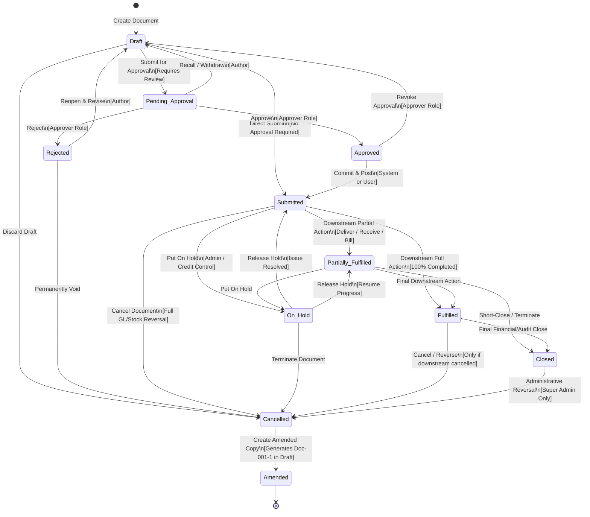
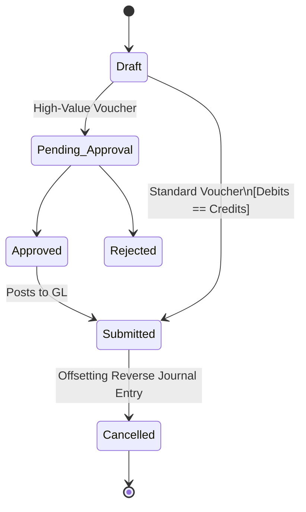
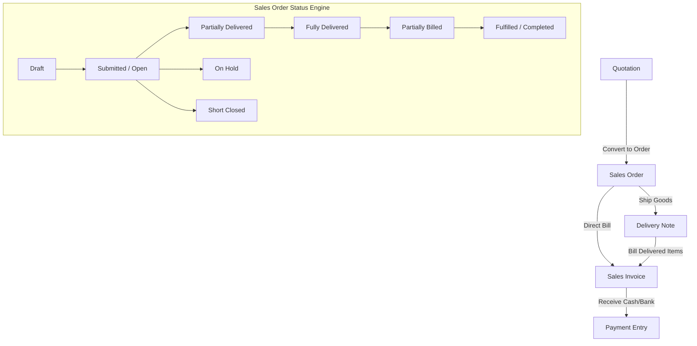
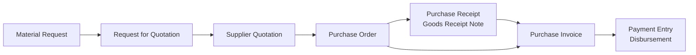
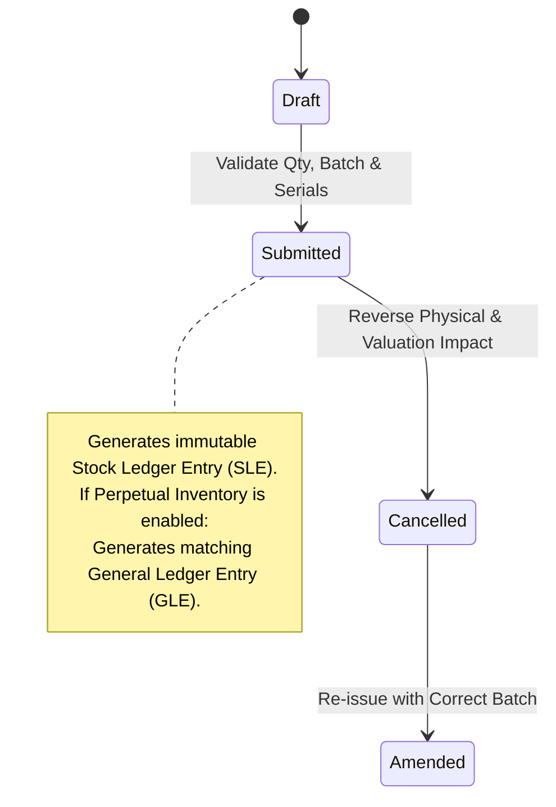
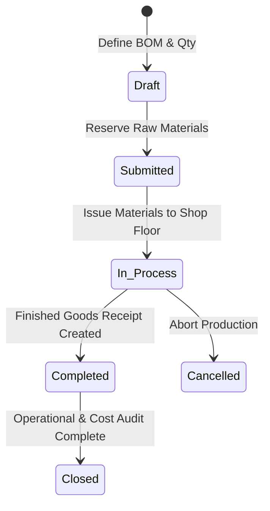
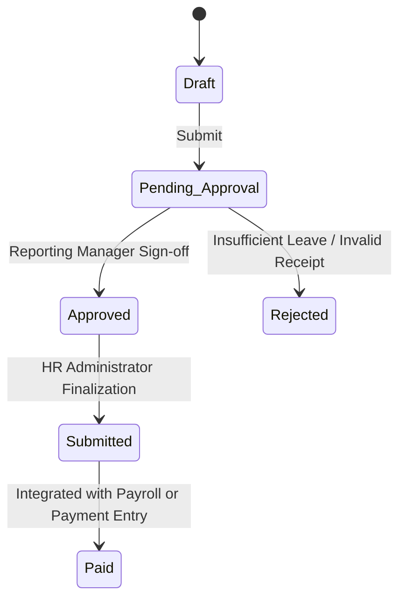

# VyaparSuite — Document Lifecycle & State Machine Architecture

> **Canonical System State Machine, Transition Rules, and Immutability Framework**  
> *Document Version: 1.0.0*  
> *Target Stack: Next.js (TypeScript), Tailwind CSS, PostgreSQL / Supabase*  
> *Architecture Pattern: Deterministic Finite State Machine (FSM) with Immutable Posting Ledgers*

---

## 1. Executive Summary & Core Philosophy

In VyaparSuite, all commercial, financial, inventory, and operational transactions are represented as **Documents** (DocTypes). To guarantee absolute auditability, statutory compliance (including Indian MCA Rule 3 audit trails), and financial ledger integrity, every document operates under a **Strictly Governed Finite State Machine (FSM)**.

### The Three Sacred Rules of Document State:
1. **Purity of State**: A document exists in exactly one state at any point in time. State transitions are atomic, validated, and logged to an unalterable audit trail.
2. **Post-Submission Immutability**: The instant a document transitions to `Submitted` (or downstream states), core transactional and financial fields become physically read-only at both the application API layer and database layer.
3. **Rectification by Reversal, Never Deletion**: Accounting and inventory ledgers are append-only. Rectification of an error requires a formal cancellation (generating equal-and-opposite counter entries) and an optional Amendment document.

---

## 2. Standard Document States

VyaparSuite defines **11 standard lifecycle states**. While specific document types may bypass certain operational states, all states adhere to the canonical semantics below:

| State Code | State Name | Operational Meaning | Editable? | Posts to GL? | Posts to Stock? |
| :--- | :--- | :--- | :---: | :---: | :---: |
| `DRAFT` | **Draft** | Document is being authored or edited. Not yet legally or operationally binding. | **Yes** (All fields) | No | No |
| `PENDING_APPROVAL` | **Pending Approval** | Author has submitted for review. Locked for author; awaiting authorized approver. | **No** (Locked) | No | No |
| `APPROVED` | **Approved** | Document has passed internal authorization rules; ready for operational submission. | **No** | No | No |
| `SUBMITTED` | **Submitted** | Document is finalized, legally binding, and committed. Permanent financial/stock impact occurs here. | **No** (Strict) | **Yes** | **Yes** |
| `PARTIALLY_FULFILLED`| **Partially Fulfilled**| Downstream fulfillment (delivery, billing, or receipt) has begun but is incomplete. | **No** | Active | Active |
| `FULFILLED` | **Fulfilled** | Downstream requirements (100% delivered, received, or billed) have been completed. | **No** | Active | Active |
| `CLOSED` | **Closed** | Order or document lifecycle concluded either naturally or manually by an administrator. | **No** | Active | Active |
| `REJECTED` | **Rejected** | Approver rejected the document during `PENDING_APPROVAL`. Returned to Draft or closed. | **No** | No | No |
| `ON_HOLD` | **On Hold** | Temporarily frozen by management (e.g., credit limit breach, dispute, investigation). | **No** | Suspended | Suspended |
| `CANCELLED` | **Cancelled** | Document is officially voided. System automatically posts complete offsetting reversal entries. | **No** (Terminal) | **Reversed** | **Reversed** |
| `AMENDED` | **Amended** | Archived historical state of an original document that has been replaced by a new revision. | **No** (Historical) | Historical | Historical |

---

## 3. Comprehensive Universal State Transition Diagram

The following Mermaid state diagram visualizes the universal document lifecycle and permissible paths:



---

## 4. State Transition Rules Matrix

Every state transition requires strict prerequisites, permission roles, and validation hooks:

| Source State | Trigger Action | Target State | Permitted Roles | Required Validations | Automatic Side Effects |
| :--- | :--- | :--- | :--- | :--- | :--- |
| `DRAFT` | `SUBMIT_FOR_APPROVAL`| `PENDING_APPROVAL` | Document Creator, Sales Rep, Buyer | Schema validation, mandatory fields filled, line items > 0. | Approval task created; push notification sent to designated approver. |
| `DRAFT` | `DIRECT_SUBMIT` | `SUBMITTED` | Role with `submit` permission without approval threshold | Same as above + fiscal period open, credit check passes, stock check passes. | Ledger entries posted (`gl_entries`, `stock_ledger_entries`), numbering locked. |
| `DRAFT` | `DELETE_DRAFT` | *Purged* | Document Creator, Manager | Document was never submitted; no downstream links exist. | Audit log records deletion of unsubmitted draft. |
| `PENDING_APPROVAL`| `APPROVE` | `APPROVED` | Approver, Branch Manager, Finance Controller | Approver user ID != Document Creator (four-eyes principle), within approval limit. | Status updated; audit stamp logged; ready for submission event. |
| `PENDING_APPROVAL`| `REJECT` | `REJECTED` | Approver, Branch Manager | Rejection reason comment mandatory (minimum 10 characters). | Notification sent to creator with rejection explanation. |
| `PENDING_APPROVAL`| `RECALL` | `DRAFT` | Document Creator | Document not yet acted upon by approver. | Approval workflow cancelled; document unlocked for author. |
| `APPROVED` | `SUBMIT` | `SUBMITTED` | System Worker or Submitter | Final balance check, inventory availability re-verified. | Financial & inventory ledgers committed; outbound webhooks fired. |
| `SUBMITTED` | `PARTIAL_EXECUTE` | `PARTIALLY_FULFILLED`| System Worker (Triggered by downstream doc) | Valid downstream transaction (e.g. Delivery Note delivered 40/100 units). | Fulfilled quantity/amount counters updated on parent document lines. |
| `PARTIALLY_FULFILLED`| `COMPLETE_EXECUTE`| `FULFILLED` | System Worker (Downstream transaction) | Remaining line item quantity/amount equals zero. | Parent document marked complete; alert sent to account owner. |
| `SUBMITTED` or `PARTIALLY_FULFILLED`| `PUT_ON_HOLD` | `ON_HOLD` | Credit Manager, Operations Lead, Admin | Justification reason required; no active in-flight warehouse dispatch. | Prevents creation of further child documents (invoices, receipts, delivery). |
| `ON_HOLD` | `RELEASE_HOLD` | Previous State (`SUBMITTED` or `PARTIAL`) | Credit Manager, Operations Lead, Admin | Hold condition resolved (e.g. overdue invoice cleared). | Restores eligibility for child document creation. |
| `SUBMITTED` | `CANCEL` | `CANCELLED` | Document Owner, Manager, Finance Controller | Downstream documents must be cancelled first; fiscal period open; statutory window valid. | Reverse GL entries created; reverse Stock Ledger entries created; IRN cancelled. |
| `CANCELLED` | `AMEND` | `AMENDED` (Original) -> `DRAFT` (Copy) | Roles with create permission | Document is currently in `CANCELLED` state. | Clones data into new document with revision identifier (`DOC-00123-1`). |

---

## 5. Required Validations by Transition

To ensure transactional safety, the VyaparSuite Validation Pipeline executes five mandatory validation suites before any state mutation is committed:

```
[ Inward Document ]
       │
       ▼
1. Structural & Schema Validation (Data types, UUIDs, non-empty arrays)
       │
       ▼
2. Organizational & Boundary Validation (Company ID match, active fiscal year)
       │
       ▼
3. Financial Balancing & Currency Validation (Debits == Credits, FX precision)
       │
       ▼
4. Physical Inventory & Capacity Validation (Stock >= Qty if negative stock disallowed)
       │
       ▼
5. Statutory & Regulatory Validation (GSTIN format, Place of Supply, TDS thresholds)
       │
       ▼
[ Atomic DB Commit + Ledger Posting ]
```

### 5.1 Financial Balance Validation (Double-Entry Law)
For any financial voucher (Journal Entry, Sales Invoice, Purchase Invoice, Payment Entry):
$$\sum \text{Debit Amount (Base Currency)} - \sum \text{Credit Amount (Base Currency)} = 0.00$$
- VyaparSuite tolerates zero imbalance. Rounding differences must be explicitly allocated to a designated `Round-Off Account` configured in Company Setup.

### 5.2 Stock & Warehouse Availability Validation
- If the target warehouse does not permit negative inventory (`allow_negative_stock = false`), the system executes a pessimistic row lock (`SELECT FOR UPDATE`) on the `stock_balance` projection.
- If $\text{Available Stock} - \text{Requested Outward Qty} < 0$, the transition to `SUBMITTED` is rejected with an `InsufficientStockException`.

### 5.3 Fiscal Period & Lock Date Enforcement
- A document cannot be submitted, cancelled, or back-dated into a closed fiscal period or a date prior to the `Accounts Freeze Date` set by the Chief Financial Officer.

### 5.4 Statutory Compliance & e-Invoicing Pre-Checks
- If the company is subject to Indian GST e-Invoicing:
  - Document Date cannot be older than 30 days from current date (or current GSTN regulatory threshold).
  - Supplier and Customer GSTINs must conform to Indian checksum algorithms.
  - HSN/SAC codes must exist in the Master Statutory Tariff Table with at least 6 digits for turnovers > ₹5 Crore.

---

## 6. Document Types & Lifecycle Variations

Different business documents have specialized sub-lifecycles. Below are the six core lifecycle families:

### 6.1 Financial Documents (Journal Entry, Payment Entry)

Financial vouchers have no concept of fulfillment or shipping. They move immediately from Draft to Submitted, posting instantaneous double-entry ledger impact.



- **Special Invariants**:
  - `Journal Entry`: Cannot have empty accounts; base debits must equal base credits to 2 decimal places (or configured currency scale).
  - `Payment Entry`: Must link to either an outstanding invoice allocation or a designated Advance Account.
  - **Cancellation Effect**: Cancelling a Payment Entry automatically unlinks the payment from allocated invoices, restoring their outstanding balances.

---

### 6.2 Sales Documents (The Quote-to-Cash Chain)

The Sales lifecycle spans five distinct document types, each handing off operational fulfillment:

```
[ Quotation ] ──► [ Sales Order ] ──► [ Delivery Note ] ──► [ Sales Invoice ] ──► [ Payment Entry ]
   (Offer)          (Commitment)       (Stock Relief)        (Receivable & Tax)      (Cash Inflow)
```



- **Fulfillment Calculation**:
  - $\% \text{ Delivered} = \frac{\sum \text{Delivered Qty across all active Delivery Notes}}{\text{Order Qty}} \times 100$
  - $\% \text{ Billed} = \frac{\sum \text{Billed Qty across all active Sales Invoices}}{\text{Order Qty}} \times 100$
  - A Sales Order reaches `FULFILLED` only when both $\% \text{ Delivered} \ge 100\%$ and $\% \text{ Billed} \ge 100\%$.

---

### 6.3 Purchase Documents (The Procure-to-Pay Chain)

The Procurement chain manages outward demand, vendor selection, receipt of goods, and bill settlement:



- **Special Invariants**:
  - `Purchase Receipt` creates Stock Ledger Entries (positive accretion) and credits `Stock Received But Not Billed` (interim liability).
  - `Purchase Invoice` debits `Stock Received But Not Billed` and credits `Accounts Payable (Creditors)`.
  - 3-Way Matching: System compares `PO Rate`, `Receipt Quantity`, and `Invoice Billed Amount`. Any variance exceeding configurable tolerance (e.g., ±2%) blocks submission until approved by a Purchasing Manager.

---

### 6.4 Stock Documents (Receipt, Issue, Transfer, Adjustment)

Stock entries govern the physical movement and financial valuation of inventory:



- **Stock Document Types**:
  - `Material Receipt`: Positive stock entry into warehouse (Opening balance, gifted stock, found items).
  - `Material Issue`: Negative stock entry (Scrap, internal consumption, samples).
  - `Material Transfer`: Atomic debit to source warehouse and credit to destination warehouse. Zero net company valuation change.
  - `Stock Reconciliation`: Overrides current tracked quantity and rate to match physical inventory audit. Automatically calculates adjustment delta.

---

### 6.5 Manufacturing Documents (Work Order, Job Card)

Manufacturing governs multi-stage conversion of raw materials into finished assemblies:



- **Work Order Invariants**:
  - Submitting a Work Order reserves raw materials (updates `Projected Stock`).
  - Stage 1: Stock Entry `Material Transfer for Manufacture` transfers raw stock from Main Store to WIP Warehouse.
  - Stage 2: Stock Entry `Manufacture` consumes raw materials from WIP at actual FIFO rates and produces finished goods into Finished Goods Store at $\text{Raw Material Cost} + \text{Operation Labor Cost} + \text{Overheads}$.

---

### 6.6 HR Documents (Leave Application, Expense Claim)

HR documents focus on multi-tier human approval workflows and optional financial reimbursement:



- **Special Invariants**:
  - `Leave Application`: Validates leave balance in real-time. If unallocated or negative, flags for Loss of Pay (LOP).
  - `Expense Claim`: Upon approval and submission, generates an Accounts Payable voucher crediting the Employee Payable Account and debiting travel/operating expense accounts.

---

## 7. The Amendment Workflow

When an error is discovered in a document that has already been `SUBMITTED`, traditional database editing is strictly prohibited to maintain ledger sanctity. VyaparSuite provides the **Immutable Amendment Workflow**:

```
[ Step 1: Original Doc ] ──────► [ Step 2: Cancel Original ] ──────► [ Step 3: Amend Action ]
  Doc: INV-2026-0042                Original marked 'CANCELLED'.       Original marked 'AMENDED'.
  Status: SUBMITTED                 Offsets posted to GL/Stock.       New Draft created:
                                                                       Doc: INV-2026-0042-1
                                                                       amended_from = 'INV-2026-0042'
                                                                                │
                                                                                ▼
                                                                     [ Step 4: Submit Amendment ]
                                                                       INV-2026-0042-1 -> SUBMITTED
                                                                       New GL/Stock entries posted.
```

### 7.1 Amendment Numbering Convention
- Original: `SO-2026-0089`
- 1st Revision: `SO-2026-0089-1`
- 2nd Revision: `SO-2026-0089-2`
- Maximum 99 revisions per parent document.

### 7.2 Database Model for Amendments
Every amendable table contains:
```sql
ALTER TABLE sales_invoices ADD COLUMN amended_from VARCHAR(64) NULL REFERENCES sales_invoices(document_number);
ALTER TABLE sales_invoices ADD COLUMN revision_number INT DEFAULT 0;
```
When an amendment draft is generated:
1. All line items, terms, and metadata are deep-copied.
2. The field `amended_from` is populated with the prior document's exact `document_number`.
3. The previous document's state permanently transitions from `CANCELLED` to `AMENDED`.
4. The audit trail explicitly links both documents, enabling auditors to view the exact side-by-side diff between revisions.

---

## 8. Cancellation Rules & Reversal Mechanics

Cancellation is a destructive operation from a commercial standpoint, but an additive operation in accounting.

### 8.1 Cancellation Eligibility Constraints
A document CANNOT be cancelled if any of the following conditions exist:
1. **Downstream Dependencies Exist**: A Sales Order cannot be cancelled if an active Delivery Note or Sales Invoice is in `SUBMITTED` state. The downstream documents must be cancelled first (strict bottom-up unwinding).
2. **Statutory Time Limit Expired**: Under Indian GST, an e-Invoice IRN can only be cancelled via the NIC portal within **24 hours** of generation. After 24 hours, the document *cannot* be cancelled in VyaparSuite; the business is statutorily required to issue a formal **Credit Note** (GST Section 34).
3. **Closed Accounting Period**: A voucher dated in a locked financial period cannot be cancelled. A rectification journal entry must be issued in the current period.
4. **Reconciled Bank Transaction**: A payment voucher that has already been verified and locked against a bank statement cannot be cancelled until unlinked from the Bank Clearance tool.

### 8.2 Ledger Reversal Engine
When a document is cancelled, VyaparSuite never deletes the existing rows in `gl_entries` or `stock_ledger_entries`. Instead, the Reversal Engine posts **Offsetting Counter-Entries**:

```typescript
// Reversal Ledger Entry Specification
export interface ReversalGLEntry {
  originalVoucherType: string;
  originalVoucherNo: string;
  reversalVoucherNo: string;
  account: string;
  debit: number;   // Exactly equal to original credit
  credit: number;  // Exactly equal to original debit
  postingDate: string; // Current date or original date depending on period policy
  isReversal: true;
  remarks: `Cancellation Reversal of ${originalVoucherNo}`;
}
```

- In stock ledgers, if the original entry posted `+50 units at ₹200`, the cancellation entry immediately posts `-50 units at ₹200`, restoring the bin balance and recalculating valuation rates deterministically.

---

## 9. Inviolable Immutability Rules

Once a document transitions out of `DRAFT` into `SUBMITTED`, `PARTIALLY_FULFILLED`, `FULFILLED`, or `CLOSED`, strict field immutability is enforced.

### 9.1 Immutable Fields (Application & DB Trigger Locked)
The following fields can **NEVER** be updated after submission under any circumstance:
- `company_id`
- `posting_date` / `transaction_date`
- `party_id` (Customer / Supplier / Employee)
- `currency` and `exchange_rate`
- Line items (`item_id`, `qty`, `rate`, `uom`, `discount`, `tax_template`)
- Total amount, base net amount, total taxes, round-off amount
- Account mappings (`debit_to`, `credit_to`, `income_account`, `expense_account`)
- Warehouse assignments

### 9.2 Mutable Fields (Permitted Post-Submission Edits)
Certain non-accounting operational fields may be modified post-submission by users with the `Document Editor` role:
- `shipping_address` / `contact_phone` (Before goods dispatch)
- `customer_purchase_order_number` (PO reference updates)
- `internal_notes` / `public_remarks`
- `tags` and `color_labels`
- `assigned_to` (Task/User owner)
- File attachments (Proof of delivery, inspection sheets)

### 9.3 Database Enforcement Trigger
In addition to TypeScript API validation, PostgreSQL triggers enforce immutability at the storage layer:

```sql
CREATE OR REPLACE FUNCTION enforce_document_immutability()
RETURNS TRIGGER AS $$
BEGIN
    IF OLD.status IN ('SUBMITTED', 'PARTIALLY_FULFILLED', 'FULFILLED', 'CLOSED', 'CANCELLED', 'AMENDED') THEN
        -- Verify core financial fields have not changed
        IF (NEW.company_id <> OLD.company_id OR
            NEW.posting_date <> OLD.posting_date OR
            NEW.party_id <> OLD.party_id OR
            NEW.base_grand_total <> OLD.base_grand_total OR
            NEW.currency <> OLD.currency) THEN
            RAISE EXCEPTION 'CRITICAL: Invariant violation. Submitted documents cannot have their core financial fields modified. Document % is immutable.', OLD.document_number;
        END IF;
    END IF;
    RETURN NEW;
END;
$$ LANGUAGE plpgsql;
```

---

> **Lifecycle Sign-off**:  
> VyaparSuite Document Lifecycle and State Machine specification is complete, providing mathematical rigor, auditable double-entry guarantees, and production-grade state governance across all 30 modules.
