# VyaparSuite ERP - Master Entity-Relationship (ER) Architecture

> **Document Version**: 1.0.0  
> **Target Release**: VyaparSuite v1.0.0 Enterprise Architecture  
> **Database Engine**: PostgreSQL 16+ / Supabase Relational Schema  
> **Multi-Tenancy Standard**: Shared Database, Tenant Isolation via PostgreSQL Row-Level Security (RLS)  
> **Schema Standard**: 3NF Normalized, Strict Referential Integrity, Foreign Keys with Restricted Cascades  

---

## Architecture Overview & ER Design Principles

VyaparSuite enforces a relational data architecture optimized for multi-tenant enterprise resource planning. All entity definitions adhere to the following design standards:

1. **Multi-Tenant Isolation**: Every operational and master table incorporates a mandatory, non-nullable `tenant_id` column protected by PostgreSQL Row-Level Security (RLS) policies.
2. **Immutable Financial & Stock Ledgers**: Financial General Ledger entries (`ACC_GL_ENTRY`) and Stock Ledger entries (`INV_STOCK_LEDGER_ENTRY`) are append-only. Mutation or deletion triggers database-level rollback exceptions. Reversals are executed strictly through offsetting inverse postings.
3. **Auditability & Optimistic Concurrency**: Every document and master record carries immutable audit fields (`created_at`, `created_by`, `updated_at`, `updated_by`) and a concurrency version token (`version` integer) for optimistic locking.
4. **Three-Tier Document Lifecycle**: Transaction documents implement uniform lifecycle states: `draft` (editable), `submitted` (locked & ledger-posted), `cancelled` (reversal entries generated), and `amended` (forked into a new revision).

---

## 1. Core & Organization Setup Domain

The Core and Setup domain establishes the tenant containment boundary, legal operating companies, organizational hierarchy, branches, cost centers, fiscal years, and document numbering series.

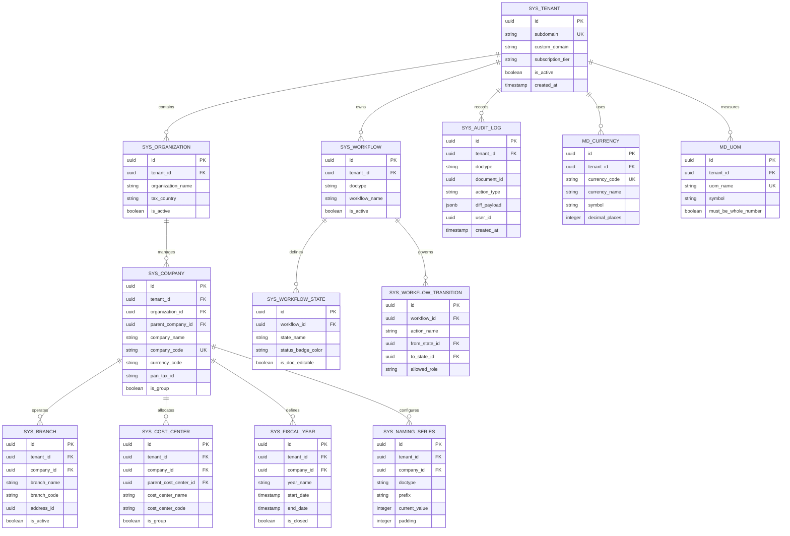

---

## 2. Authentication, Authorization & Security Domain

Manages cryptographic user identities, role-based access control (RBAC), attribute-based permission predicates, API access keys, and security activity monitoring.

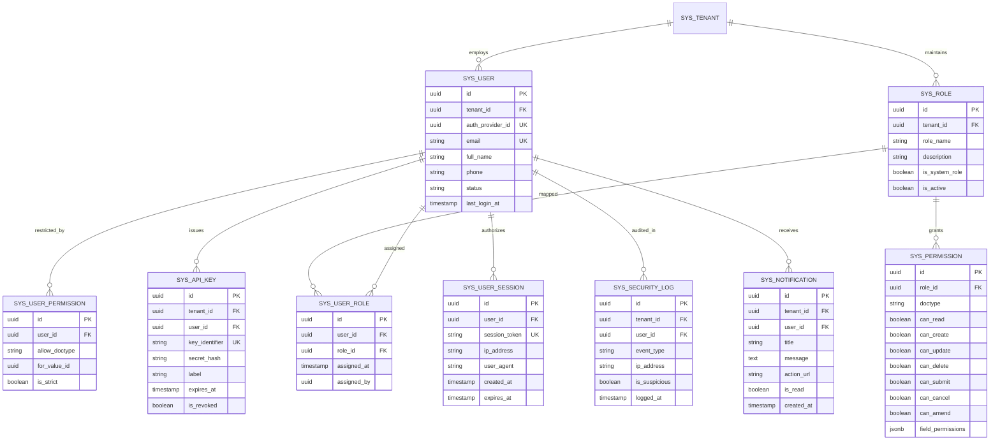

---

## 3. CRM & Lead Management Domain

Governs prospect acquisition, lead scoring, pipeline opportunity progression, multi-party contacts, polymorphic addresses, and communication logs.

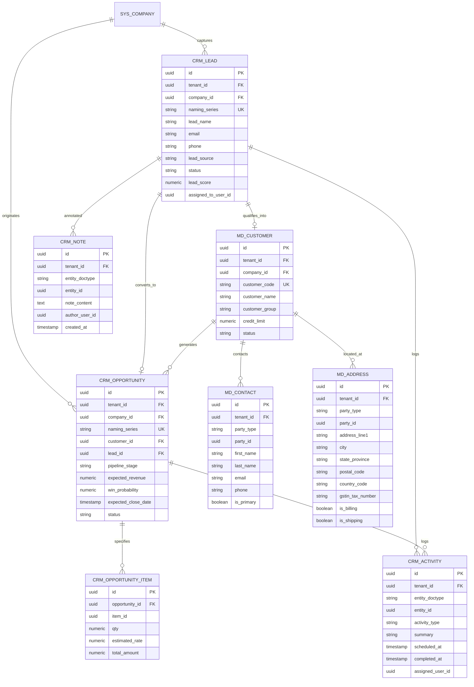

---

## 4. Sales Order & Fulfillment Domain

Captures sales quotations, committed sales orders, fulfillment delivery notes, and customer billing linkages with stock and general ledgers.

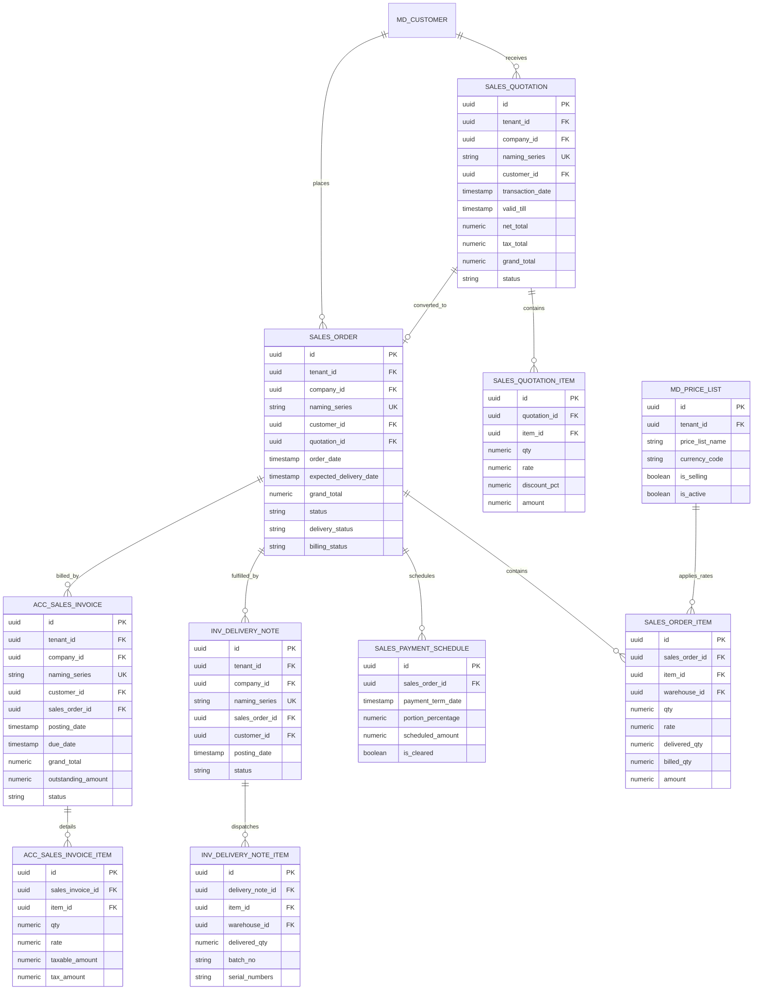

---

## 5. Purchase & Procurement Domain

Enforces procurement demand pipelines from internal Material Requests through Requests for Quotation (RFQ), Supplier Quotations, Purchase Orders, Goods Receipts (GRN), and Vendor Bills.

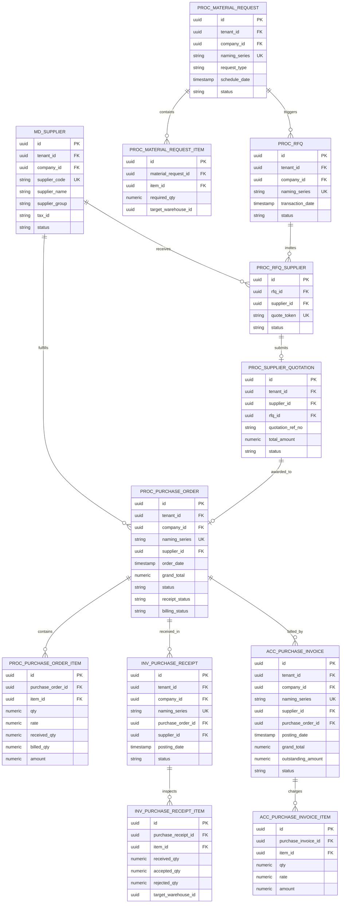

---

## 6. Inventory & Stock Ledger Domain

Implements real-time inventory management, immutable stock ledger tracking, valuation calculation (FIFO and Moving Average), serial numbering, and batch lifecycle tracking.

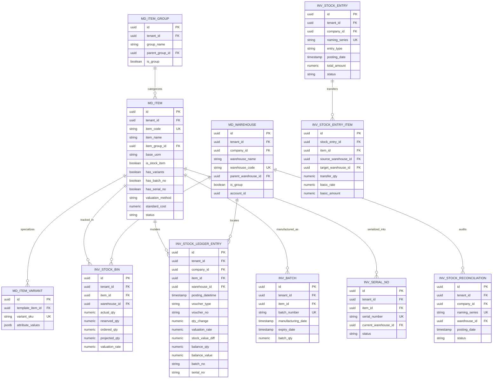

---

## 7. Accounting & Double-Entry General Ledger Domain

Maintains mathematical financial integrity via balanced double-entry General Ledger postings, multi-tier Charts of Accounts, Journal Vouchers, and Payment Allocations.

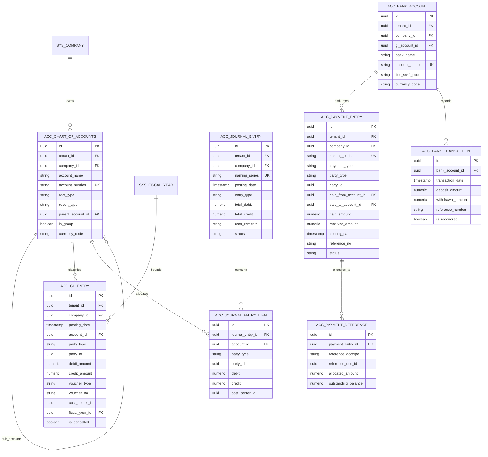

---

## 8. India GST & Statutory Compliance Domain

Ensures full compliance with the Indian Goods and Services Tax framework, automating tax rate determination, HSN/SAC categorizations, e-Invoicing (IRP IRN), and e-Way Bills.

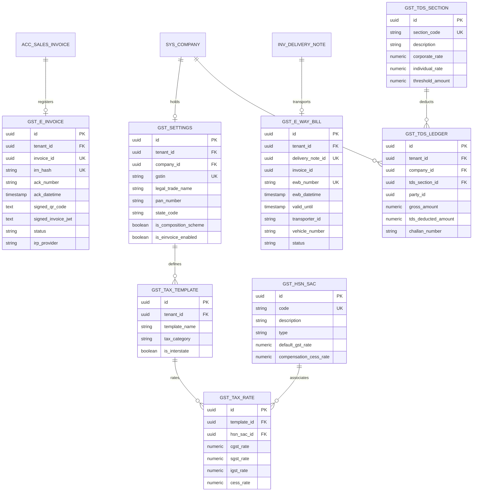

---

## 9. Manufacturing & Asset Management Domain

Captures production operations: multi-level Bills of Materials (BOM), workstation capacities, routing schedules, job cards, quality inspection audits, and fixed asset depreciation.

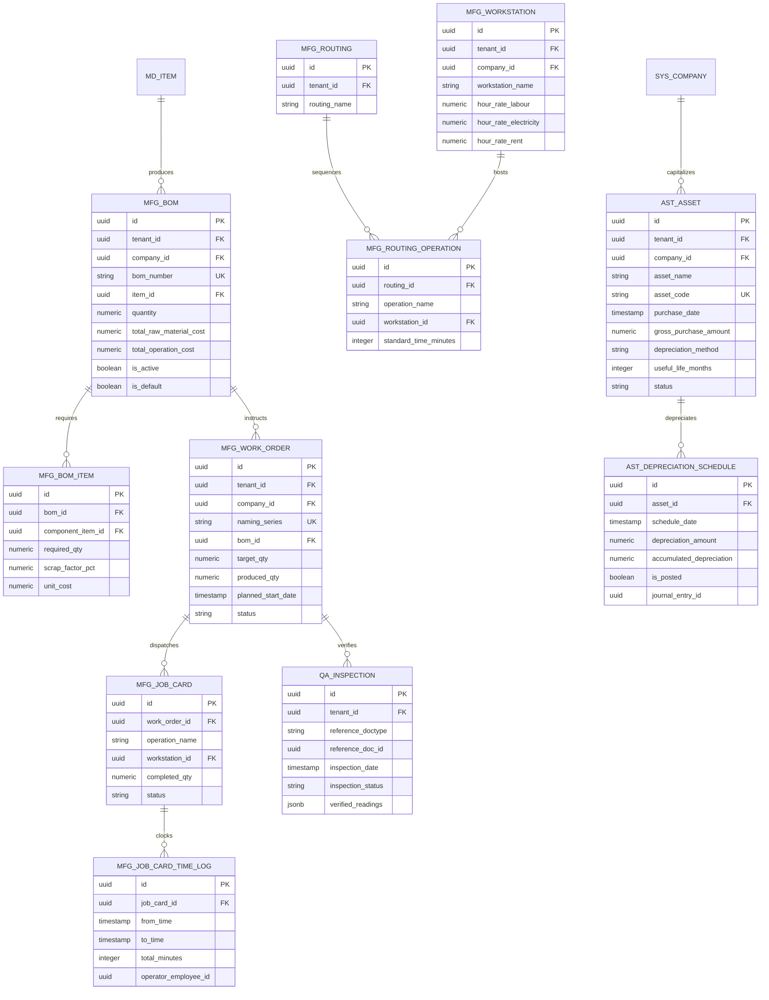

---

## 10. HRMS & Payroll Domain

Models human capital operations: departmental hierarchies, designations, employee master profiles, shift rosters, biometric attendance, leaves, salary structures, and automated payroll runs.

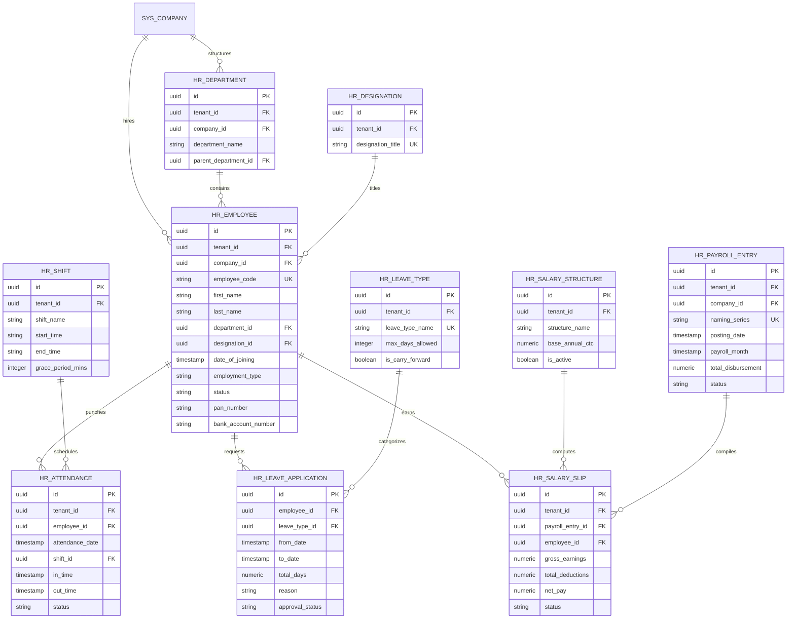

---

## 11. Projects, Timesheets & Customer Support Domain

Supports services delivery: projects with Work Breakdown Structures (WBS), billable timesheet submissions, customer helpdesk ticketing, and Service Level Agreement (SLA) fulfillment.

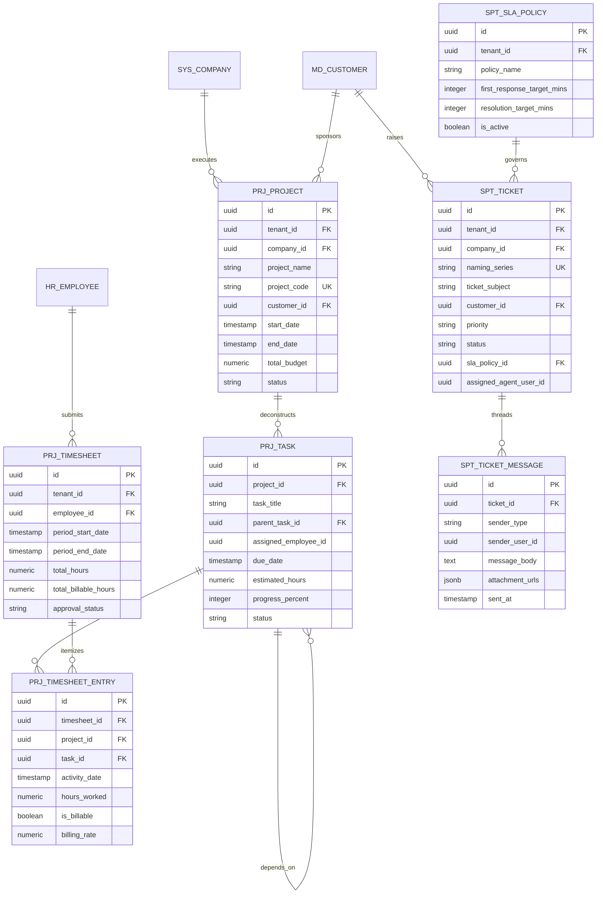

---

## 12. Master Enterprise Cross-Reference Diagram

The master cross-reference diagram illustrates how primary transaction anchors connect across modules—from Master Data to CRM, Sales, Procurement, Inventory, Manufacturing, Projects, Human Resources, and General Ledger Accounting.

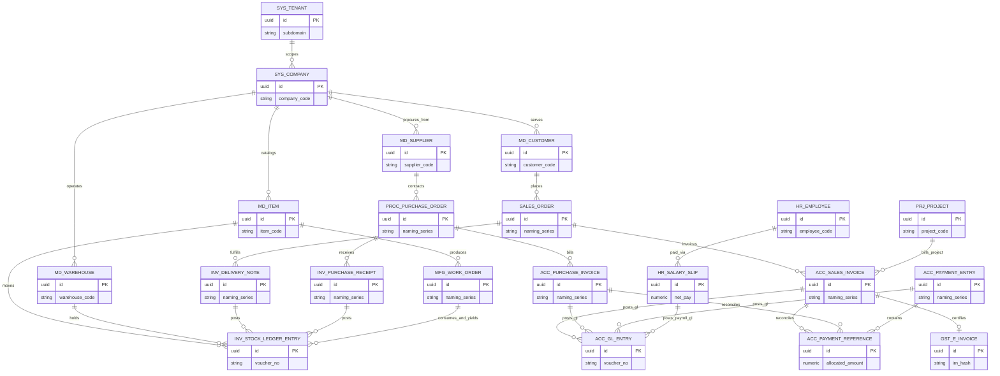

---

## 13. Data Integrity & Constraint Standards

1. **Foreign Key Integrity**:
   * All relations linking transactional documents to master entities enforce `ON DELETE RESTRICT` or `ON DELETE NO ACTION`. Deleting master records with active historical transactions is strictly prohibited.
   * Child line items (e.g., `SALES_ORDER_ITEM` linked to `SALES_ORDER`) enforce `ON DELETE CASCADE` only when the parent document is in `draft` status.
2. **Numeric Precision Standards**:
   * All currency amounts are stored as `numeric(18, 4)` in the database and rendered as `numeric(18, 2)` according to currency configuration.
   * Quantities are stored as `numeric(18, 4)` to support fractional weights, volumes, and bulk conversions without rounding error.
3. **Optimistic Locking**:
   * All state transitions and document updates check `WHERE id = :id AND version = :expected_version` to prevent concurrent write collisions.
4. **Tenant Isolation Enforcement**:
   * Every SQL query automatically injects `WHERE tenant_id = current_setting('app.current_tenant_id')` enforced transparently by PostgreSQL Row-Level Security policies.
