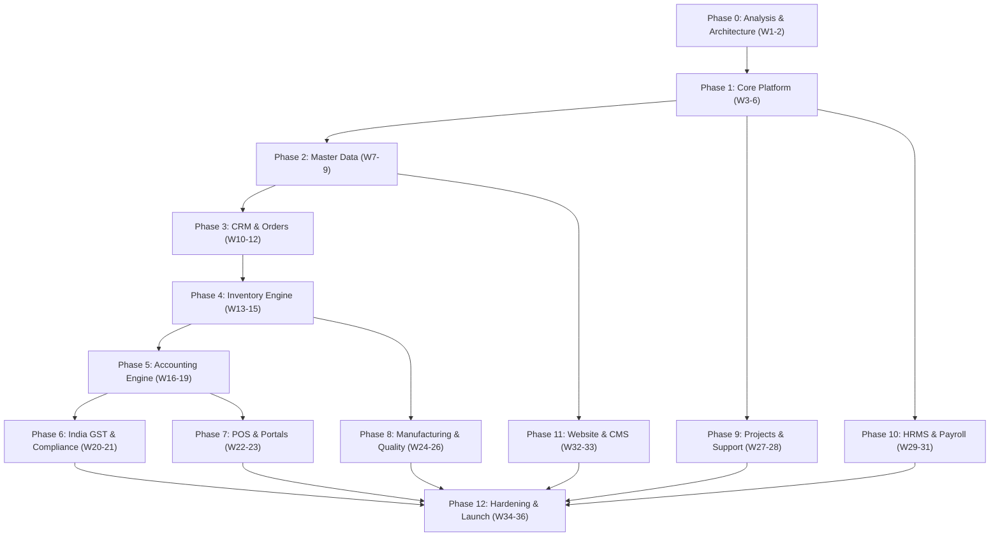

# VyaparSuite ERP - Master Implementation Roadmap

> **Document Version**: 1.0.0  
> **Target Release**: VyaparSuite v1.0.0 Enterprise Ready  
> **Architecture Stack**: Next.js 15+ (App Router, React 19, TypeScript 5+), Tailwind CSS v4, Supabase / PostgreSQL 16+ (RLS, PgBouncer, Storage), Redis / BullMQ, Web Crypto API  
> **Total Timeline**: 36 Weeks (Phases 0 through 12)  
> **Target Audience**: Engineering Leads, Product Managers, System Architects, Quality Assurance Engineers, DevOps Specialists  

---

## Executive Summary & Implementation Strategy

VyaparSuite is a cloud-native, modular monolithic ERP platform architected to deliver feature parity with ERPNext and Odoo Community Edition while providing tailored first-class compliance for Indian MSMEs (GST, e-Way Bill, e-Invoicing) and international multi-entity enterprises. 

The implementation roadmap spans **36 engineering weeks** across **13 distinct phases (Phase 0 to Phase 12)**. Each phase represents a self-contained, verifiable increment adhering to strict architectural boundaries, multi-tenant isolation via PostgreSQL Row-Level Security (RLS), unidirectional module dependencies, and comprehensive test coverage (>85% target).



---

## Master Implementation Schedule & Milestones

| Phase | Title | Duration | Milestone Gate | Primary Deliverable |
| :--- | :--- | :--- | :--- | :--- |
| **Phase 0** | Analysis & Architecture | Weeks 1–2 | M0: Spec Sign-Off | 23 Architecture & Domain Specs, Scaffolding, PoC Validation |
| **Phase 1** | Core Platform Engine | Weeks 3–6 | M1: Platform Bootstrapped | Multi-tenant RLS, Auth, BaseDocument Engine, Shell UI, Design Tokens |
| **Phase 2** | Master Data Foundation | Weeks 7–9 | M2: Master Data Operational | Customers, Suppliers, Items, Warehouses, COA, Price Lists |
| **Phase 3** | CRM & Order Pipeline | Weeks 10–12 | M3: Order Pipeline Live | Leads, Opportunities, Quotations, Sales Orders, RFQs, Purchase Orders |
| **Phase 4** | Inventory & Stock Engine | Weeks 13–15 | M4: Real-time Stock Ledger | Stock Ledger, FIFO/Moving Avg, Serial/Batch Tracking, GRN, Delivery Notes |
| **Phase 5** | Double-Entry Accounting | Weeks 16–19 | M5: Financial Integrity | General Ledger, Sub-ledgers, Invoicing, Payments, P&L, Balance Sheet |
| **Phase 6** | India GST & Statutory | Weeks 20–21 | M6: Statutory Compliance | GST Engine, E-Invoice/E-Way Bill Adapters, GSTR-1/3B Reports |
| **Phase 7** | POS & B2B Portals | Weeks 22–23 | M7: Omni-Channel Active | Fast-Checkout POS, Cashier Shifts, Customer & Supplier Portals |
| **Phase 8** | Manufacturing & Assets | Weeks 24–26 | M8: Shop Floor Operations | Multi-level BOM, Work Orders, Job Cards, QA Inspections, Fixed Assets |
| **Phase 9** | Projects & Customer Support | Weeks 27–28 | M9: Service Delivery | Gantt Project Management, Timesheets, Helpdesk Tickets, SLA Engine |
| **Phase 10** | HRMS & Payroll Engine | Weeks 29–31 | M10: People Operations | Employee Master, Leave/Attendance, Salary Structures, Auto-Payroll |
| **Phase 11** | E-Commerce & Low-Code | Weeks 32–33 | M11: Digital Storefront | Web Shop, Product Catalog, Marketing Campaigns, Form Builder |
| **Phase 12** | Hardening & GA Launch | Weeks 34–36 | M12: Production Readiness | Pen-Testing, Load Testing (10k CCU), DR Drills, Production GA |

---

## Detailed Phase Specifications

```
================================================================================
PHASE 0: ANALYSIS & ARCHITECTURE SPECIFICATION
================================================================================
```

### 1. Overview & Objectives
* **Phase Number**: Phase 0
* **Duration Estimate**: 2 Weeks (Weeks 1–2)
* **Lead Architect**: Principal Enterprise Architect / Tech Lead
* **Primary Objective**: Establish the end-to-end technical, architectural, and statutory foundation for VyaparSuite. Define canonical schemas, state machine protocols, security boundaries, and bootstrap the Next.js mono-repository with automated CI/CD and verification pipelines.

### 2. Modules & Features to Implement
* **Architecture Specifications**: Complete and formalize all 23 core engineering specifications covering C4 system models, database schema schemas, REST APIs, and UI/UX component taxonomies.
* **Technology Scaffolding**: Setup Next.js 15+ App Router repository using TypeScript 5 (Strict Mode), Tailwind CSS v4, Lucide icons, and Biome/ESLint + Prettier linters.
* **Database & ORM Setup**: Configure Supabase PostgreSQL local development instance using Supabase CLI and Docker. Establish migration harness and seed data pipelines.
* **Infrastructure Abstraction Layer**: Implement repository abstractions decoupling direct database drivers from domain services (`IDatabaseClient`, `IStorageService`, `ICacheService`).
* **Developer Tooling**: Docker Compose setup for local PostgreSQL, Redis, Mailpit (SMTP mocking), and MinIO (S3 mock).

### 3. Database Tables & Schema Objects
* `_prisma_migrations` or `supabase_migrations`: Schema migration version tracking table.
* `system_settings`: Global cluster-level feature flags and maintenance toggles.
* `tenant_tenants`: Initial schema stub for tenant resolution verification.

### 4. UI Screens & Wireframes
* **Developer Storybook / Component Showcase**: `/storybook` or `/dev/components` displaying core typography, colors, and button primitives.
* **System Health Landing Page**: `/api/health` and `/` developer diagnostics screen showing database connectivity, Redis connection, and environment variable audits.

### 5. API Endpoints
* `GET /api/v1/health`: System heartbeat, database latency, Redis ping, storage bucket health.
* `GET /api/v1/system/version`: Returns build commit SHA, semantic version, and active feature flags.

### 6. Testing Suite
* **Unit Tests**: Schema validation tests verifying Zod type inference matches TypeScript domain types.
* **Integration Tests**: Database connection pool resiliency test under synthetic socket drop.
* **CI/CD Tests**: GitHub Actions workflow validating `pnpm build`, `pnpm lint`, and `pnpm test` on PR creation.

### 7. Dependencies
* None (Genesis Phase).

### 8. Definition of Done (DoD)
* [x] All 23 architecture specification markdown files reviewed and signed off.
* [x] Next.js 15 workspace boots locally with zero build warnings.
* [x] Supabase local migrations run cleanly from scratch (`supabase db reset`).
* [x] GitHub Actions CI pipeline green across Node.js 20.x and 22.x LTS.
* [x] Architecture Decision Records (ADRs) committed to `/docs/adr/`.

### 9. Risk Factors & Mitigation Strategies
* *Risk*: Schema over-engineering leading to migration friction later.  
  *Mitigation*: Enforce standard metadata fields (`created_at`, `updated_at`, `tenant_id`, `version`) and leverage PostgreSQL JSONB for flexible module extensions.
* *Risk*: Next.js 15 server action stability nuances.  
  *Mitigation*: Restrict Server Actions to mutations; maintain explicit REST API handlers for public integrations and mobile consumers.

---

```
================================================================================
PHASE 1: CORE PLATFORM & DOCUMENT META-ENGINE
================================================================================
```

### 1. Overview & Objectives
* **Phase Number**: Phase 1
* **Duration Estimate**: 4 Weeks (Weeks 3–6)
* **Lead Architect**: Core Systems Lead & Senior Backend Engineer
* **Primary Objective**: Build the multi-tenant runtime engine, authentication/authorization layer, metadata-driven document framework (`BaseDocument`), audit trail engine, atomic numbering service, and the universal Next.js responsive enterprise UI shell.

### 2. Modules & Features to Implement
* **Tenant & Entity Hierarchy**: Support for Tenant -> Organization -> Multi-Company -> Branch/Cost Center tree structure with cross-company consolidation settings.
* **Authentication & Identity**: Supabase Auth integration (Email/Password, Magic Link, SAML/SSO for enterprise). Session management and JWT claim injection (`tenant_id`, `user_id`, `roles`).
* **RBAC & ABAC Engine**: Granular role-based and attribute-based access control. Permission matrix supporting Read, Create, Edit, Submit, Cancel, Delete, Amend, and Export permissions down to document-level and field-level.
* **Document Meta-Engine (`BaseDocument`)**: Universal document lifecycle engine enforcing state transitions (`Draft` -> `Submitted` -> `Cancelled` -> `Amended`).
* **Atomic Naming Series Engine**: Concurrency-safe, race-condition-free document numbering with prefix, fiscal year, and padding tokens (e.g., `INV-.YYYY.-.#####.`).
* **Workflow Engine**: User-definable multi-step approval workflows with conditional routing, role transitions, and escalation timeouts.
* **Audit Trail & System Activity Engine**: Immutable append-only logging of record modifications, tracking before/after JSON diffs, user ID, IP address, and user agent.
* **Notification Engine**: Multi-channel event dispatcher supporting in-app notifications, webhooks, and email dispatch via background workers.
* **Enterprise UI Shell**: Standardized layout comprising collapsible multi-tier sidebar, dynamic breadcrumbs, command palette (`Cmd+K`), universal search, user profile menu, and toast notifications.
* **Design System Primitives**: Tailwind CSS v4 data tables with pagination, column resizing, sorting, filtering, modals, drawers, form inputs, date-range pickers, and badge status pills.

### 3. Database Tables & Schema Objects
* `sys_tenants`: Multi-tenant boundary registry (`id`, `subdomain`, `custom_domain`, `subscription_tier`, `is_active`).
* `sys_companies`: Operating legal entities (`id`, `tenant_id`, `name`, `currency_id`, `country_id`, `tax_id`, `parent_company_id`).
* `sys_branches`: Company operational sites and offices (`id`, `company_id`, `name`, `code`, `is_active`).
* `sys_users`: User master accounts (`id`, `tenant_id`, `auth_user_id`, `email`, `full_name`, `avatar_url`, `status`).
* `sys_roles`: System and custom permission roles (`id`, `tenant_id`, `name`, `description`, `is_system_role`).
* `sys_user_roles`: User-to-role junction (`id`, `user_id`, `role_id`, `assigned_at`).
* `sys_permissions`: Fine-grained permission rules (`id`, `role_id`, `doctype`, `action`, `conditions_json`, `fields_json`).
* `sys_naming_series`: Counters for atomic numbering (`id`, `tenant_id`, `company_id`, `prefix`, `current_value`, `padding`).
* `sys_workflows`: Workflow definitions (`id`, `tenant_id`, `doctype`, `is_active`, `states_json`, `transitions_json`).
* `sys_workflow_actions`: Workflow history log (`id`, `document_id`, `from_state`, `to_state`, `action_by`, `comments`).
* `sys_audit_logs`: Immutable audit trail (`id`, `tenant_id`, `doctype`, `document_id`, `action`, `changes_json`, `user_id`, `ip_address`, `created_at`).
* `sys_notifications`: In-app notification queue (`id`, `tenant_id`, `user_id`, `title`, `message`, `link`, `is_read`, `created_at`).

### 4. UI Screens & Views
* `/login`, `/register`, `/forgot-password`: Unified Supabase Auth interfaces with corporate branding.
* `/app/dashboard`: Executive home workspace displaying KPI summary cards and shortcut widgets.
* `/app/settings/tenants`: Multi-tenant organization and company settings editor.
* `/app/settings/users`: User management list, invitation modal, and role assignment drawer.
* `/app/settings/roles`: Visual permission matrix editor for doctype CRUD permissions.
* `/app/settings/workflows`: Visual state-transition workflow builder.
* `/app/settings/naming-series`: Numbering rule generator with live preview.
* `/app/settings/audit-logs`: Searchable, filterable audit event explorer with side-by-side JSON diff viewer.

### 5. API Endpoints
* `POST /api/v1/auth/login`: Authenticate credentials, issue Supabase session tokens.
* `POST /api/v1/auth/invite`: Dispatch tenant employee invitation with predetermined roles.
* `GET /api/v1/core/documents/:doctype`: Paginated, filterable document list API.
* `POST /api/v1/core/documents/:doctype`: Create new draft document.
* `GET /api/v1/core/documents/:doctype/:id`: Retrieve single document with metadata and relations.
* `PUT /api/v1/core/documents/:doctype/:id`: Update draft document.
* `POST /api/v1/core/documents/:doctype/:id/transition`: Execute state transition (Submit, Cancel, Amend).
* `GET /api/v1/core/audit/:doctype/:id`: Fetch document audit trail timeline.
* `GET /api/v1/core/notifications`: List current user notifications.
* `PATCH /api/v1/core/notifications/:id/read`: Mark notification as read.

### 6. Testing Suite
* **Unit Tests**: Naming series counter incrementation under simulated concurrency; permission resolver algorithm.
* **Integration Tests**: Document state machine transitions (Draft -> Submit -> Cancel -> Amend) validating immutable constraints.
* **Security Tests**: PostgreSQL Row-Level Security (RLS) bypass attempts ensuring Tenant B cannot access Tenant A records under any JWT condition.
* **E2E Tests (Playwright)**: Full login flow, user role assignment, and workflow approval process.

### 7. Dependencies
* Phase 0 (Analysis & Architecture).

### 8. Definition of Done (DoD)
* [x] Row-Level Security active and verified on 100% of newly created database tables.
* [x] Concurrent naming series stress test passes 1,000 requests/sec with zero sequence collisions.
* [x] Document lifecycle unit tests achieve 100% code branch coverage.
* [x] Universal UI Shell is fully responsive across desktop, tablet, and mobile viewport breakpoints.

### 9. Risk Factors & Mitigation Strategies
* *Risk*: Multi-tenant RLS performance overhead on large join queries.  
  *Mitigation*: Enforce composite indexes including `(tenant_id, id)` and `(tenant_id, created_at)` across all tables.
* *Risk*: Race conditions in numbering series under high concurrent spikes.  
  *Mitigation*: Utilize PostgreSQL `SELECT ... FOR UPDATE` row locks inside isolated atomic database functions (`fn_get_next_sequence`).

---

```
================================================================================
PHASE 2: MASTER DATA FOUNDATION
================================================================================
```

### 1. Overview & Objectives
* **Phase Number**: Phase 2
* **Duration Estimate**: 3 Weeks (Weeks 7–9)
* **Lead Architect**: Domain Architect & Senior Fullstack Engineer
* **Primary Objective**: Implement the complete, normalized Master Data subsystem required across all operational modules (CRM, Sales, Purchase, Inventory, Accounting).

### 2. Modules & Features to Implement
* **Party Management (Contacts & Addresses)**: Polymorphic contact and address management linkable to Customers, Suppliers, Employees, and Warehouses. Support for multiple addresses (Billing, Shipping, Plant).
* **Customer Master**: Comprehensive B2B and B2C customer profiles, credit limit controls, default tax categories, pricing tiers, payment terms, and currency defaults.
* **Supplier Master**: Vendor master data, lead time configurations, default expense accounts, bank details, and PAN/GSTIN registration information.
* **Item Master with Variants**: Product taxonomy, 2-level item classification (Category -> Subcategory), attributes (Size, Color, Material), variant matrix generator, barcode/EAN assignment, and standard cost/price.
* **Units of Measure (UOM)**: Base UOMs, custom UOMs, and conversion factor matrices (e.g., 1 Box = 24 Pieces).
* **Warehouse & Location Hierarchy**: Multi-level tree structure of storage locations (Company -> Regional Hub -> Warehouse -> Bin/Rack).
* **Chart of Accounts (COA)**: Hierarchical financial account tree (Assets, Liabilities, Equity, Income, Expenses) with standard Indian Schedule III and international standard templates.
* **Currencies & Exchange Rates**: Multi-currency setup with historical foreign exchange rate tables and automated rate feed hooks.
* **Tax Configuration Matrix**: Tax templates, account assignments, HSN/SAC code masters, and interstate/intrastate tax categorization.
* **Price Lists & Pricing Rules**: Customer-group and supplier-group specific price lists, seasonal validity dates, volume break discounts, and promotional rules.

### 3. Database Tables & Schema Objects
* `md_addresses`: Polymorphic physical addresses (`id`, `tenant_id`, `party_type`, `party_id`, `address_line1`, `address_line2`, `city`, `state`, `postal_code`, `country`, `gstin`, `is_primary_billing`, `is_primary_shipping`).
* `md_contacts`: Party contact persons (`id`, `tenant_id`, `party_type`, `party_id`, `first_name`, `last_name`, `email`, `phone`, `designation`, `is_primary`).
* `md_customers`: Customer entities (`id`, `tenant_id`, `company_id`, `customer_code`, `name`, `customer_group`, `credit_limit`, `currency_id`, `payment_terms_id`, `is_active`).
* `md_suppliers`: Vendor entities (`id`, `tenant_id`, `company_id`, `supplier_code`, `name`, `supplier_group`, `tax_id`, `currency_id`, `payment_terms_id`, `is_active`).
* `md_uom`: Units of measurement (`id`, `tenant_id`, `name`, `symbol`, `is_integer`).
* `md_uom_conversions`: Conversion rates (`id`, `from_uom_id`, `to_uom_id`, `conversion_factor`).
* `md_item_groups`: Nested item categories (`id`, `tenant_id`, `name`, `parent_id`, `lft`, `rgt`).
* `md_items`: Item definitions (`id`, `tenant_id`, `item_code`, `item_name`, `item_group_id`, `base_uom_id`, `has_variants`, `is_stock_item`, `valuation_method`, `hsn_sac_code`, `standard_cost`, `is_active`).
* `md_item_attributes`: Attribute definitions (e.g., Color, Size) and allowed values.
* `md_item_variants`: Generated variant combinations with attribute JSON and custom SKU.
* `md_warehouses`: Warehouse hierarchical locations (`id`, `tenant_id`, `company_id`, `name`, `parent_warehouse_id`, `is_group`, `account_id`).
* `acc_chart_of_accounts`: Account tree structure (`id`, `tenant_id`, `company_id`, `account_name`, `account_number`, `root_type`, `report_type`, `parent_id`, `is_group`, `currency_id`).
* `md_price_lists`: Price list master (`id`, `tenant_id`, `name`, `currency_id`, `is_buying`, `is_selling`, `is_active`).
* `md_price_list_items`: Item rate mappings (`id`, `price_list_id`, `item_id`, `rate`, `valid_from`, `valid_to`).

### 4. UI Screens & Views
* `/app/masters/customers`: Customer data grid with quick-view drawer, filters, and Excel import/export.
* `/app/masters/customers/[id]`: Full-page customer 360 profile view showing billing info, open orders, and credit status.
* `/app/masters/suppliers`: Supplier directory and onboarding form.
* `/app/masters/items`: Item catalog grid with thumbnail images, stock indicators, and variant generators.
* `/app/masters/items/[id]`: Item master detail view with UOM conversion sub-table and pricing rules.
* `/app/masters/warehouses`: Interactive visual tree view of enterprise warehouses and bin locations.
* `/app/accounting/chart-of-accounts`: Interactive collapsible tree editor for the Chart of Accounts with inline account creation.
* `/app/masters/price-lists`: Pricing rule and price list management interface.

### 5. API Endpoints
* `GET/POST /api/v1/masters/customers`: Customer collection endpoints.
* `GET/PUT/DELETE /api/v1/masters/customers/:id`: Customer resource endpoints.
* `GET/POST /api/v1/masters/suppliers`: Supplier management endpoints.
* `GET/POST /api/v1/masters/items`: Item master endpoints with variant generation query support.
* `POST /api/v1/masters/items/generate-variants`: Bulk variant creation service.
* `GET /api/v1/masters/warehouses/tree`: Retrieve hierarchical warehouse JSON tree.
* `GET /api/v1/accounting/chart-of-accounts/tree`: Retrieve complete nested Chart of Accounts tree.
* `POST /api/v1/masters/price-lists/resolve-rate`: Rate resolution engine given `item_id`, `party_id`, `qty`, and `date`.

### 6. Testing Suite
* **Unit Tests**: UOM conversion math accuracy; price list rate resolution precedence logic.
* **Tree Structure Tests**: Nested set / recursive CTE validation for Chart of Accounts and Warehouses (preventing circular loops).
* **Validation Tests**: Validation of GSTIN (India), PAN, email formats, and credit limit bounds.
* **E2E Tests**: Create item with 3 attributes -> automatically generate 12 variants -> assign price list rates.

### 7. Dependencies
* Phase 1 (Core Platform).

### 8. Definition of Done (DoD)
* [x] Standard Chart of Accounts auto-seeds correctly upon creating a new Company.
* [x] Bulk CSV/Excel importer functional for Customers, Suppliers, and Items with error row reporting.
* [x] Polymorphic address and contact associations validated across both Customer and Supplier doctypes.
* [x] Zero data corruption during nested account creation and reorganization.

### 9. Risk Factors & Mitigation Strategies
* *Risk*: Circular references in hierarchical trees (COA, Warehouses).  
  *Mitigation*: Implement PostgreSQL triggers preventing an entity from being its own ancestor.
* *Risk*: High volume variant explosion impacting UI table rendering.  
  *Mitigation*: Implement virtualized scrolling (`TanStack Virtual`) for variant matrices over 100 rows.

---

```
================================================================================
PHASE 3: CRM & ORDER PIPELINE
================================================================================
```

### 1. Overview & Objectives
* **Phase Number**: Phase 3
* **Duration Estimate**: 3 Weeks (Weeks 10–12)
* **Lead Architect**: Commercial Applications Lead
* **Primary Objective**: Build the sales and procurement demand pipeline, enabling end-to-end processing from initial prospect inquiry to legally binding Sales and Purchase Orders.

### 2. Modules & Features to Implement
* **Lead Management**: Lead capture, qualification scoring, lead sources, activity timeline, and one-click conversion to Customer/Opportunity.
* **Opportunity & Pipeline Kanban**: Visual sales pipeline with customizable stages, deal value forecasting, probability weighting, and win/loss reason tracking.
* **Sales Quotation Engine**: Multi-item quotation builder with tax calculations, payment terms, delivery schedules, validity checks, and PDF quote generation.
* **Sales Order Lifecycle**: Firm customer sales orders, credit limit validation, stock availability reservation checks, and automated order acknowledgement.
* **Material Request / Purchase Requisition**: Internal demand generation (Stock Replenishment, Manufacturing Consumption, or Customer Order Fulfilment).
* **Request for Quotation (RFQ)**: Multi-vendor RFQ generation, supplier portal link sharing, and supplier quotation receipt.
* **Supplier Quotation & Comparison**: Tabular side-by-side comparison of supplier quotes based on landed cost, lead time, and payment terms.
* **Purchase Order (PO)**: Vendor purchase order confirmation, delivery schedule commitment, revision tracking, and auto-emailing to suppliers.

### 3. Database Tables & Schema Objects
* `crm_leads`: Prospective leads (`id`, `tenant_id`, `company_id`, `lead_name`, `email`, `phone`, `source`, `status`, `score`, `assigned_to`).
* `crm_opportunities`: Sales opportunities (`id`, `tenant_id`, `company_id`, `customer_id`, `stage`, `expected_revenue`, `probability`, `expected_close_date`, `status`).
* `crm_activities`: Customer interactions (`id`, `tenant_id`, `entity_type`, `entity_id`, `activity_type`, `notes`, `scheduled_at`, `completed_at`).
* `sales_quotations`: Quotation master (`id`, `tenant_id`, `company_id`, `naming_series`, `customer_id`, `transaction_date`, `valid_till`, `total_amount`, `tax_amount`, `status`).
* `sales_quotation_items`: Line items (`id`, `quotation_id`, `item_id`, `qty`, `uom_id`, `rate`, `tax_template_id`, `amount`).
* `sales_orders`: Confirmed sales orders (`id`, `tenant_id`, `company_id`, `naming_series`, `customer_id`, `quotation_id`, `delivery_date`, `grand_total`, `status`, `billing_status`, `delivery_status`).
* `sales_order_items`: Sales order line items (`id`, `sales_order_id`, `item_id`, `qty`, `rate`, `amount`, `delivered_qty`, `billed_qty`, `warehouse_id`).
* `proc_material_requests`: Internal demand requests (`id`, `tenant_id`, `company_id`, `naming_series`, `request_type`, `required_by`, `status`).
* `proc_rfqs`: Requests for quotation (`id`, `tenant_id`, `company_id`, `naming_series`, `transaction_date`, `status`).
* `proc_rfq_suppliers`: Vendors included in RFQ (`id`, `rfq_id`, `supplier_id`, `quote_token`, `status`).
* `proc_supplier_quotations`: Vendor submitted quotes (`id`, `tenant_id`, `supplier_id`, `rfq_id`, `grand_total`, `status`).
* `proc_purchase_orders`: Vendor purchase orders (`id`, `tenant_id`, `company_id`, `naming_series`, `supplier_id`, `grand_total`, `status`, `receipt_status`, `billing_status`).
* `proc_purchase_order_items`: PO line items (`id`, `purchase_order_id`, `item_id`, `qty`, `rate`, `amount`, `received_qty`, `billed_qty`, `target_warehouse_id`).

### 4. UI Screens & Views
* `/app/crm/leads`: Lead table with status badges and quick conversion modal.
* `/app/crm/pipeline`: Drag-and-drop Opportunity Kanban board grouped by sales stages.
* `/app/sales/quotations`: Quotation list and responsive create/edit document builder.
* `/app/sales/orders`: Sales order tracker showing visual progress bars for Fulfillment and Invoicing.
* `/app/sales/orders/[id]`: Detail view with action buttons: *Create Delivery Note*, *Create Invoice*, *Cancel*.
* `/app/purchase/material-requests`: Material demand dashboard.
* `/app/purchase/rfq`: RFQ creation screen with multi-supplier selection.
* `/app/purchase/rfq/[id]/compare`: Side-by-side vendor quote comparison matrix.
* `/app/purchase/orders`: Purchase order list and management view.

### 5. API Endpoints
* `POST /api/v1/crm/leads/:id/convert`: Convert lead to Customer + Opportunity.
* `GET/POST /api/v1/sales/quotations`: Quotation collection endpoints.
* `POST /api/v1/sales/quotations/:id/convert-to-order`: One-click conversion to Sales Order.
* `GET/POST /api/v1/sales/orders`: Sales order master endpoints.
* `POST /api/v1/sales/orders/:id/reserve-stock`: Reserve item quantities against current stock.
* `GET/POST /api/v1/purchase/material-requests`: Requisition management endpoints.
* `POST /api/v1/purchase/rfq`: Broadcast RFQs to suppliers.
* `GET/POST /api/v1/purchase/orders`: Purchase order creation and lifecycle transitions.

### 6. Testing Suite
* **Unit Tests**: Item row calculation engine (Base Rate * Qty - Discount + Taxes = Net Amount).
* **Integration Tests**: Lead -> Opportunity -> Quotation -> Sales Order downstream field mapping and status cascading.
* **Validation Tests**: Credit limit validation: system blocks Sales Order submission if customer outstanding balance exceeds approved credit limit.
* **E2E Tests**: Create Quotation, approve via workflow, convert to Sales Order, verify PO generation for drop-ship items.

### 7. Dependencies
* Phase 1 (Core Platform), Phase 2 (Master Data).

### 8. Definition of Done (DoD)
* [x] Quotation PDF generation matches corporate branding template with precise print CSS.
* [x] Automated status update on Sales Order (Pending -> Partially Delivered -> Completed) based on downstream fulfillments.
* [x] Supplier quote comparison matrix calculates landed costs with multi-currency conversion.

### 9. Risk Factors & Mitigation Strategies
* *Risk*: Price calculation rounding discrepancies between UI frontend and database backend.  
  *Mitigation*: Implement shared TypeScript math utility using `decimal.js` ensuring 4-decimal calculation precision with 2-decimal rounded storage.

---

```
================================================================================
PHASE 4: INVENTORY & STOCK LEDGER ENGINE
================================================================================
```

### 1. Overview & Objectives
* **Phase Number**: Phase 4
* **Duration Estimate**: 3 Weeks (Weeks 13–15)
* **Lead Architect**: Supply Chain Systems Architect
* **Primary Objective**: Implement the real-time immutable Stock Ledger, valuation engine (FIFO & Moving Average), serialized item tracking, batch/expiry controls, Goods Receipt Notes (GRN), Delivery Notes, and physical stock reconciliation.

### 2. Modules & Features to Implement
* **Stock Ledger Engine (`StockLedgerEntry`)**: Real-time append-only ledger recording every physical movement with valuation impact. Strict prohibition of retroactive backdated corruption.
* **Stock Valuation Methods**: Implementation of Moving Average Cost (Weighted Average) and First-In, First-Out (FIFO) queue consumption.
* **Goods Receipt Note (GRN / Purchase Receipt)**: Incoming inventory verification against Purchase Orders, inspection holds, and rejection handling.
* **Delivery Note**: Outgoing warehouse picking, packing, and dispatch confirmation linked to Sales Orders.
* **Stock Entry Types**: Material Receipt (opening stock), Material Issue (internal consumption/scrapping), and Material Transfer (inter-warehouse transfer).
* **Batch & Expiry Management**: Batch number allocation, manufacturing date, expiration date tracking, and automated FEFO (First-Expired, First-Out) picking advice.
* **Serial Number Tracking**: Individual unit serialization, lifecycle warranty lookup, and serial movement history.
* **Physical Stock Reconciliation**: Variance counting, cycle counting schedules, and automatic discrepancy write-off entries.
* **Perpetual Inventory GL Posting Hook**: Real-time interface generating accounting stock adjustments (Stock-in-Hand vs. Stock Received But Not Billed).

### 3. Database Tables & Schema Objects
* `inv_stock_ledger_entries`: Immutable stock ledger (`id`, `tenant_id`, `company_id`, `item_id`, `warehouse_id`, `posting_datetime`, `voucher_type`, `voucher_no`, `qty_change`, `valuation_rate`, `stock_value_difference`, `balance_qty`, `balance_value`, `batch_id`, `serial_no`).
* `inv_stock_bins`: Real-time stock cache table (`id`, `tenant_id`, `item_id`, `warehouse_id`, `actual_qty`, `reserved_qty`, `ordered_qty`, `projected_qty`, `valuation_rate`).
* `inv_purchase_receipts`: Goods Receipt Note master (`id`, `tenant_id`, `company_id`, `naming_series`, `supplier_id`, `purchase_order_id`, `posting_date`, `status`).
* `inv_purchase_receipt_items`: GRN items (`id`, `purchase_receipt_id`, `item_id`, `received_qty`, `accepted_qty`, `rejected_qty`, `warehouse_id`, `batch_no`, `rejected_warehouse_id`).
* `inv_delivery_notes`: Outward dispatch master (`id`, `tenant_id`, `company_id`, `naming_series`, `customer_id`, `sales_order_id`, `posting_date`, `status`).
* `inv_delivery_note_items`: Delivery items (`id`, `delivery_note_id`, `item_id`, `qty`, `uom_id`, `source_warehouse_id`, `batch_no`, `serial_nos`).
* `inv_stock_entries`: General stock adjustments (`id`, `tenant_id`, `company_id`, `naming_series`, `entry_type`, `posting_date`, `total_amount`).
* `inv_stock_entry_items`: Stock movement rows (`id`, `stock_entry_id`, `item_id`, `source_warehouse_id`, `target_warehouse_id`, `qty`, `valuation_rate`).
* `inv_batches`: Batch master (`id`, `tenant_id`, `item_id`, `batch_number`, `manufacturing_date`, `expiry_date`, `is_active`).
* `inv_serial_numbers`: Serial registry (`id`, `tenant_id`, `item_id`, `serial_number`, `status`, `warehouse_id`, `purchase_document`, `delivery_document`).
* `inv_stock_reconciliations`: Stock audit documents (`id`, `tenant_id`, `company_id`, `posting_date`, `warehouse_id`, `status`).

### 4. UI Screens & Views
* `/app/inventory/stock-balance`: Live inventory dashboard with multi-warehouse filters, re-order level alerts, and export tools.
* `/app/inventory/ledger`: Searchable stock ledger report showing historical ins/outs with running balances.
* `/app/inventory/goods-receipt`: Purchase receipt / GRN creation interface with batch/serial popups.
* `/app/inventory/delivery-notes`: Delivery note builder with barcode scanner support.
* `/app/inventory/stock-entry`: Flexible movement screen for transfers, write-offs, and internal issues.
* `/app/inventory/batches`: Batch tracking explorer with shelf-life expiry alerts.
* `/app/inventory/serials`: Serial number lookup profile showing full movement timeline.
* `/app/inventory/reconciliation`: Physical inventory count reconciliation sheet.

### 5. API Endpoints
* `GET /api/v1/inventory/stock-balance`: Query real-time available stock across warehouses.
* `POST /api/v1/inventory/purchase-receipts`: Submit GRN and execute stock ledger postings.
* `POST /api/v1/inventory/delivery-notes`: Submit Delivery Note and decrement stock.
* `POST /api/v1/inventory/stock-entries`: Process material transfers, issues, and receipts.
* `POST /api/v1/inventory/reconcile`: Execute stock count discrepancy adjustments.
* `GET /api/v1/inventory/items/:id/batches`: List valid, non-expired batches sorted by FEFO.
* `GET /api/v1/inventory/items/:id/serials`: Validate and retrieve active serial numbers.

### 6. Testing Suite
* **Unit Tests**: FIFO queue math: verify remaining stock queue slices deplete at correct historical unit cost.
* **Moving Average Tests**: Verify valuation rate recalculation on receipts at varying vendor prices.
* **Concurrency Tests**: Prevent negative stock: simulate 20 concurrent delivery notes competing for 5 available items; ensure exactly 5 succeed and 15 reject gracefully.
* **E2E Tests**: Purchase Receipt (50 units) -> Stock Entry Transfer (25 units to branch) -> Delivery Note (10 units) -> verify Stock Ledger and Bin quantities.

### 7. Dependencies
* Phase 1 (Core Platform), Phase 2 (Master Data), Phase 3 (CRM & Orders).

### 8. Definition of Done (DoD)
* [x] Stock Ledger Entries are strictly immutable: no updates or deletes permitted via SQL triggers.
* [x] Cancellation of a Delivery Note or Receipt correctly issues reversing stock entries with identical valuation amounts.
* [x] Negative inventory is strictly blocked at the database constraint level unless explicit tenant override is activated.

### 9. Risk Factors & Mitigation Strategies
* *Risk*: Out-of-sync cached quantities in `inv_stock_bins`.  
  *Mitigation*: Update `inv_stock_bins` via PostgreSQL transactional triggers directly fired on `inv_stock_ledger_entries` insertion.

---

```
================================================================================
PHASE 5: DOUBLE-ENTRY ACCOUNTING ENGINE
================================================================================
```

### 1. Overview & Objectives
* **Phase Number**: Phase 5
* **Duration Estimate**: 4 Weeks (Weeks 16–19)
* **Lead Architect**: Financial Systems Architect & Certified Public Accountant Advisor
* **Primary Objective**: Build the double-entry General Ledger engine, Accounts Receivable (AR), Accounts Payable (AP), automated Invoicing, Payment processing, Bank Reconciliation, and real-time Financial Statements (Trial Balance, P&L, Balance Sheet, Cash Flow).

### 2. Modules & Features to Implement
* **General Ledger (GL) Engine**: Immutable, balanced transaction engine (`Debit == Credit` strictly enforced).
* **Journal Entries**: Manual journal vouchers for accruals, depreciation, inter-company adjustments, and opening balances.
* **Sales Invoicing (AR)**: Invoicing against Delivery Notes or Sales Orders with automatic GL postings (Dr Receivables, Cr Sales Revenue, Cr Output Tax).
* **Purchase Invoicing (AP)**: Invoicing against Goods Receipts or Purchase Orders with automatic 3-way matching and GL postings (Dr Expense/Asset, Dr Input Tax, Cr Payables).
* **Payment Entry & Allocation**: Multi-party payment processing (Cash, Cheque, Bank Transfer, Online), multi-currency exchange gain/loss calculation, and invoice-level payment reconciliation/allocation.
* **Bank Reconciliation**: Manual bank statement import (CSV, OFX, MT940), automated transaction matching rules, and un-cleared cheque tracking.
* **Credit & Debit Notes**: Financial and inventory return credit/debit notes with automated tax reversions.
* **Accounts Receivable / Payable Ageing**: Standard 30-60-90-120+ day ageing reports with customer/supplier drilldowns.
* **Real-time Financial Reporting**: Trial Balance, Profit and Loss Statement, Balance Sheet, and Statement of Cash Flows with period comparisons and cost-center filtering.

### 3. Database Tables & Schema Objects
* `acc_fiscal_years`: Accounting fiscal years (`id`, `tenant_id`, `company_id`, `year_name`, `start_date`, `end_date`, `is_closed`).
* `acc_gl_entries`: Immutable General Ledger (`id`, `tenant_id`, `company_id`, `posting_date`, `account_id`, `party_type`, `party_id`, `debit`, `credit`, `voucher_type`, `voucher_no`, `cost_center_id`, `fiscal_year_id`, `is_cancelled`).
* `acc_journal_entries`: Manual journal headers (`id`, `tenant_id`, `company_id`, `naming_series`, `posting_date`, `entry_type`, `total_debit`, `total_credit`, `user_remarks`, `status`).
* `acc_journal_entry_items`: Journal lines (`id`, `journal_entry_id`, `account_id`, `party_type`, `party_id`, `debit`, `credit`, `cost_center_id`).
* `acc_sales_invoices`: Customer invoice master (`id`, `tenant_id`, `company_id`, `naming_series`, `customer_id`, `sales_order_id`, `delivery_note_id`, `posting_date`, `due_date`, `grand_total`, `outstanding_amount`, `status`).
* `acc_sales_invoice_items`: Invoice items (`id`, `sales_invoice_id`, `item_id`, `income_account_id`, `qty`, `rate`, `amount`, `tax_template_id`).
* `acc_purchase_invoices`: Vendor bills (`id`, `tenant_id`, `company_id`, `naming_series`, `supplier_id`, `purchase_order_id`, `purchase_receipt_id`, `posting_date`, `due_date`, `grand_total`, `outstanding_amount`, `status`).
* `acc_purchase_invoice_items`: Bill items (`id`, `purchase_invoice_id`, `item_id`, `expense_account_id`, `qty`, `rate`, `amount`).
* `acc_payment_entries`: Payment master (`id`, `tenant_id`, `company_id`, `naming_series`, `payment_type`, `party_type`, `party_id`, `paid_from_account_id`, `paid_to_account_id`, `paid_amount`, `received_amount`, `posting_date`, `reference_no`, `status`).
* `acc_payment_references`: Payment allocation rows (`id`, `payment_entry_id`, `voucher_type`, `voucher_no`, `allocated_amount`).
* `acc_bank_accounts`: Linked banking accounts (`id`, `tenant_id`, `company_id`, `account_id`, `bank_name`, `account_number`, `routing_code`, `currency_id`).
* `acc_bank_statements`: Imported statement headers and transaction rows.

### 4. UI Screens & Views
* `/app/accounting/general-ledger`: Interactive GL explorer with account, date range, and cost-center filtering.
* `/app/accounting/sales-invoices`: Sales invoice data grid with payment status badges.
* `/app/accounting/sales-invoices/[id]`: Invoice presentation view with print layout, payment history, and *Make Payment* button.
* `/app/accounting/purchase-invoices`: Accounts payable bill management.
* `/app/accounting/payments`: Payment entry builder with automated outstanding invoice allocation table.
* `/app/accounting/bank-reconciliation`: Interactive side-by-side reconciliation tool matching bank statement rows to GL records.
* `/app/accounting/reports/trial-balance`: Real-time hierarchical Trial Balance with expand/collapse account trees.
* `/app/accounting/reports/profit-and-loss`: Dynamic P&L statement with comparative period columns.
* `/app/accounting/reports/balance-sheet`: Formal Balance Sheet with asset/liability alignment.
* `/app/accounting/reports/ageing`: AR/AP Ageing matrix with customer drilldowns.

### 5. API Endpoints
* `POST /api/v1/accounting/journal-entries`: Submit balanced manual journal entry.
* `POST /api/v1/accounting/sales-invoices`: Create, validate, and post sales invoice to GL.
* `POST /api/v1/accounting/purchase-invoices`: Create, validate, and post vendor invoice to GL.
* `POST /api/v1/accounting/payment-entries`: Submit payment and update invoice outstanding balances.
* `POST /api/v1/accounting/bank-reconciliation/reconcile`: Match bank row with GL entry.
* `GET /api/v1/accounting/reports/trial-balance`: Compute Trial Balance for date window.
* `GET /api/v1/accounting/reports/profit-and-loss`: Compute P&L statement.
* `GET /api/v1/accounting/reports/balance-sheet`: Compute Balance Sheet statement.

### 6. Testing Suite
* **Unit Tests**: Zero-sum GL validation: any transaction where `Sum(Debit) != Sum(Credit)` throws immediate roll-back exception.
* **Currency Gain/Loss Tests**: Realized foreign exchange gain/loss posting validation upon paying USD invoice with INR account at fluctuating exchange rates.
* **Allocation Tests**: Partial payments correctly decrement `outstanding_amount` and transition invoice status from `Unpaid` -> `Partially Paid` -> `Paid`.
* **E2E Tests**: Sales Order -> Delivery Note -> Sales Invoice -> Payment Entry -> Verify GL Entries and Trial Balance balance.

### 7. Dependencies
* Phase 1 (Core Platform), Phase 2 (Master Data), Phase 3 (CRM & Orders), Phase 4 (Inventory).

### 8. Definition of Done (DoD)
* [x] Mathematical certainty: Total Debits strictly equal Total Credits across the entire General Ledger database table at all times.
* [x] Financial statements match external CPA reference spreadsheets to the exact cent/paisa.
* [x] Immutable GL records: edits are prohibited; cancellations generate exact inverse credit/debit reversing entries.

### 9. Risk Factors & Mitigation Strategies
* *Risk*: Massive ledger size slowing down real-time Trial Balance generation.  
  *Mitigation*: Implement materialized monthly balance summary tables (`acc_account_balances_monthly`) for lightning-fast aggregation.

---

```
================================================================================
PHASE 6: INDIA GST & STATUTORY COMPLIANCE
================================================================================
```

### 1. Overview & Objectives
* **Phase Number**: Phase 6
* **Duration Estimate**: 2 Weeks (Weeks 20–21)
* **Lead Architect**: Tax Technology Specialist & Indian Statutory Expert
* **Primary Objective**: Deliver complete compliance with Indian Goods and Services Tax (GST) regulations, including automatic tax determination (CGST + SGST vs. IGST), HSN/SAC reporting, e-Invoicing (IRP) JSON schema, e-Way Bill interfaces, and GSTR-1 / GSTR-3B export generation.

### 2. Modules & Features to Implement
* **GST Tax Determination Engine**: Automatic resolution of CGST + SGST (intra-state) or IGST (inter-state) based on Supplier/Customer Place of Supply (POS) and Company GSTIN state codes.
* **HSN / SAC Code Engine**: Mandatory HSN validation, threshold turnover rules (4-digit vs. 6-digit vs. 8-digit HSN codes), and tax rate mapping.
* **Statutory GST Invoicing**: Format compliance adhering to GST Rule 46 (mandatory fields, QR code placement, HSN summary table, reverse charge indicators).
* **E-Invoicing Architecture (IRP Interface)**: Schema validation (INV-01 standard), payload generator for Invoice Registration Portal (IRP), IRN hash calculation, QR code rendering, and signed invoice storage.
* **E-Way Bill Generation Interface**: Transport details capture (Transporter ID, Vehicle No, Distance, Mode), Part-A and Part-B payload compilation for NIC portal.
* **GST Return Exports**: Automated JSON and Excel data compiler for GSTR-1 (B2B, B2CL, B2CS, CDNR, EXP, HSN Summary) and GSTR-3B monthly summary.
* **TDS & TCS Calculation Engine**: Tax Deducted at Source (TDS under Income Tax) and Tax Collected at Source (TCS) threshold tracking and ledger allocation.

### 3. Database Tables & Schema Objects
* `gst_hsn_codes`: Official HSN/SAC directory (`id`, `hsn_code`, `description`, `default_gst_rate`, `cess_rate`).
* `gst_settings`: Company statutory settings (`id`, `tenant_id`, `company_id`, `gstin`, `pan`, `legal_name`, `trade_name`, `arn_no`, `is_composition`).
* `gst_e_invoices`: E-Invoice logs (`id`, `tenant_id`, `invoice_id`, `irn`, `ack_no`, `ack_date`, `signed_qr_code`, `signed_invoice_json`, `status`, `error_message`).
* `gst_e_way_bills`: E-Way Bill records (`id`, `tenant_id`, `delivery_note_id`, `invoice_id`, `ewb_number`, `ewb_date`, `valid_until`, `vehicle_no`, `transporter_id`, `status`).
* `gst_tds_categories`: TDS sections (`id`, `section_code`, `description`, `individual_rate`, `corporate_rate`, `threshold_limit`).

### 4. UI Screens & Views
* `/app/gst/dashboard`: Statutory summary displaying monthly tax liability, input tax credit (ITC) pool, and e-invoice status.
* `/app/gst/e-invoicing`: E-Invoice generation console with batch action buttons: *Generate IRN*, *Cancel IRN*, *Print E-Invoice*.
* `/app/gst/e-way-bill`: Transport console for logging vehicle details and downloading printable e-Way bills.
* `/app/gst/reports/gstr-1`: GSTR-1 interactive preparation table with error validator before filing.
* `/app/gst/reports/gstr-3b`: GSTR-3B auto-calculated summary showing Outward Supplies and Eligible ITC.

### 5. API Endpoints
* `POST /api/v1/gst/tax-calculate`: Compute applicable taxes (CGST, SGST, IGST, UTGST, Cess) for line items.
* `POST /api/v1/gst/e-invoice/generate-payload`: Construct standard INV-01 JSON payload.
* `POST /api/v1/gst/e-invoice/sync-mock`: Mock adapter for IRP registration (IRN, signed QR code).
* `POST /api/v1/gst/e-way-bill/generate-payload`: Construct NIC EWB payload.
* `GET /api/v1/gst/reports/gstr-1`: Download official GSTR-1 JSON offline utility format.

### 6. Testing Suite
* **Tax Engine Tests**: Verify Intra-state transaction (e.g., MH to MH) splits exactly 50/50 to CGST and SGST; Inter-state (e.g., MH to DL) routes 100% to IGST.
* **Schema Validation Tests**: Ensure generated e-Invoice payload passes strict AJV schema validation against government INV-01 specification.
* **Return Consistency Tests**: GSTR-1 B2B total revenue and tax numbers strictly match General Ledger Sales and Tax liability accounts.

### 7. Dependencies
* Phase 1, Phase 2, Phase 5 (Accounting).

### 8. Definition of Done (DoD)
* [x] Invoices generate verified compliant print format including B2B QR Code, IRN, HSN summary table, and Reverse Charge flags.
* [x] Exported GSTR-1 JSON loads without schema validation errors into the official GST Offline Tool.
* [x] Adapter architecture cleanly separates government API payloads from vendor credentials.

### 9. Risk Factors & Mitigation Strategies
* *Risk*: Government IRP schema revisions breaking production exports.  
  *Mitigation*: Decouple payload builder into versioned schema transformers (`irp-schema-v1.03.ts`) with automated regression test fixtures.

---

```
================================================================================
PHASE 7: POS & B2B/B2C PORTALS
================================================================================
```

### 1. Overview & Objectives
* **Phase Number**: Phase 7
* **Duration Estimate**: 2 Weeks (Weeks 22–23)
* **Lead Architect**: Front-End Architect & Commerce Specialist
* **Primary Objective**: Deliver a high-velocity Point of Sale (POS) interface for retail storefronts with cashier shift controls, along with secure self-service Customer and Supplier web portals.

### 2. Modules & Features to Implement
* **Point of Sale (POS) Interface**: High-velocity keyboard/touch-optimized checkout, barcode scanner event listener, split tenders (Cash, Card, UPI, Store Credit), and thermal receipt printing.
* **Cashier Shift Management**: Shift opening float entry, cash drawer drops, payment reconciliation at shift close, and cashier X/Z reports.
* **Subscription & Recurring Billing**: Recurring invoice schedules (Monthly, Annually), auto-renewal notices, and subscription status lifecycle.
* **Customer Self-Service Portal**: Secure external login for clients to view quotation history, download invoices, track delivery dispatches, and initiate support tickets.
* **Supplier Self-Service Portal**: Secure external portal for vendors to view open Purchase Orders, submit RFQ quotations, submit Advance Shipping Notices (ASN), and upload tax invoices.

### 3. Database Tables & Schema Objects
* `pos_profiles`: Register profiles (`id`, `tenant_id`, `company_id`, `warehouse_id`, `cost_center_id`, `cash_account_id`, `card_account_id`, `allow_discount_override`).
* `pos_shifts`: Cashier register shifts (`id`, `tenant_id`, `pos_profile_id`, `cashier_user_id`, `start_time`, `end_time`, `opening_balance`, `closing_balance`, `expected_cash`, `status`).
* `pos_shift_tenders`: Payment breakdown per shift (`id`, `shift_id`, `mode_of_payment`, `amount`).
* `sub_plans`: Subscription billing plans (`id`, `tenant_id`, `plan_name`, `billing_frequency`, `price`, `currency_id`).
* `sub_subscriptions`: Customer subscriptions (`id`, `tenant_id`, `customer_id`, `plan_id`, `start_date`, `next_billing_date`, `status`).
* `portal_users`: External party login credentials (`id`, `tenant_id`, `party_type`, `party_id`, `email`, `auth_user_id`, `is_active`).

### 4. UI Screens & Views
* `/app/pos`: Fullscreen retail checkout interface with item catalog tiles, search input, numeric numpad, and receipt panel.
* `/app/pos/shift-close`: End-of-day register closing wizard with counted cash reconciliation.
* `/portal/customer`: External customer dashboard (Invoices, Orders, Support).
* `/portal/customer/invoices/[id]`: External client printable invoice download page.
* `/portal/supplier`: External supplier portal for viewing RFQs and POs.

### 5. API Endpoints
* `POST /api/v1/pos/shifts/open`: Open cashier shift with initial cash float.
* `POST /api/v1/pos/shifts/close`: Finalize shift, submit counted cash, generate Z-Report.
* `POST /api/v1/pos/invoices`: Submit high-speed POS transaction and print receipt.
* `GET /api/v1/portal/customer/orders`: External customer order query.
* `POST /api/v1/portal/supplier/quotes`: Supplier submission of RFQ pricing.

### 6. Testing Suite
* **Performance Tests**: POS barcode scan-to-cart latency benchmark (<50ms per item addition).
* **Shift Balancing Tests**: Cash discrepancy calculations correctly identify drawer shortages and overages.
* **Security & Isolation Tests**: Verify customer portal user cannot view records belonging to any other customer entity.

### 7. Dependencies
* Phase 1, Phase 2, Phase 4, Phase 5.

### 8. Definition of Done (DoD)
* [x] POS operates seamlessly with hardware barcode scanners (HID emulation) and ESC/POS thermal printers.
* [x] Cashier shift reconciliation matches cash drawer counts with zero GL balance discrepancy.
* [x] External customer and supplier portals restricted exclusively to assigned party records.

### 9. Risk Factors & Mitigation Strategies
* *Risk*: Network dropout during busy retail checkout.  
  *Mitigation*: Design POS transaction buffer caching pending receipts in browser `IndexedDB` with automatic cloud replay on reconnect.

---

```
================================================================================
PHASE 8: MANUFACTURING & ASSET MANAGEMENT
================================================================================
```

### 1. Overview & Objectives
* **Phase Number**: Phase 8
* **Duration Estimate**: 3 Weeks (Weeks 24–26)
* **Lead Architect**: Industrial Systems Architect
* **Primary Objective**: Deliver manufacturing operations including multi-level Bills of Materials (BOM), Work Orders, Job Cards, shop-floor material consumption, Quality Inspection checkpoints, and Fixed Asset depreciation accounting.

### 2. Modules & Features to Implement
* **Bill of Materials (BOM)**: Multi-level hierarchical BOMs, scrap percentages, routing operations, workstation assignments, and real-time cost roll-up calculations.
* **Work Order (Production Order)**: Manufacturing orders triggered from Sales Orders or inventory reorder levels, material reservations, and production scheduling.
* **Workstation & Routing Master**: Workstation machine rates, labor rates, capacity schedules, and standard operation sequences.
* **Job Cards & Shop Floor Tracking**: Operator-level job dispatch cards, start/stop operation timers, and machine cycle tracking.
* **Production Stock Entry**: Automated Raw Material Consumption (Backflush or Manual Issue) and Finished Goods receipt into destination warehouse.
* **Quality Inspection (QA)**: Inspection criteria templates, sampling parameters, in-process and post-production quality checks with pass/reject status.
* **Fixed Asset Management**: Asset master, capitalization, asset categories, location tracking, and maintenance logs.
* **Asset Depreciation Engine**: Automated Straight Line (SLM) and Written Down Value (WDV) depreciation calculation schedules with periodic GL journal entries.

### 3. Database Tables & Schema Objects
* `mfg_boms`: Bill of materials master (`id`, `tenant_id`, `company_id`, `item_id`, `is_active`, `is_default`, `quantity`, `total_cost`).
* `mfg_bom_items`: Raw materials and components (`id`, `bom_id`, `item_id`, `bom_item_id`, `qty`, `uom_id`, `scrap_percentage`, `rate`, `amount`).
* `mfg_workstations`: Production machines and benches (`id`, `tenant_id`, `company_id`, `workstation_name`, `hour_rate_labour`, `hour_rate_electricity`).
* `mfg_routings`: Production operations sequence (`id`, `tenant_id`, `routing_name`).
* `mfg_routing_operations`: Operation steps (`id`, `routing_id`, `operation_name`, `workstation_id`, `time_in_mins`).
* `mfg_work_orders`: Production orders (`id`, `tenant_id`, `company_id`, `naming_series`, `production_item_id`, `bom_id`, `qty`, `produced_qty`, `status`, `planned_start_date`).
* `mfg_job_cards`: Operator work orders (`id`, `tenant_id`, `work_order_id`, `operation_id`, `workstation_id`, `status`, `total_completed_qty`).
* `qa_templates`: Quality parameters (`id`, `tenant_id`, `template_name`, `parameters_json`).
* `qa_inspections`: Quality inspection logs (`id`, `tenant_id`, `reference_doctype`, `reference_docname`, `inspector_user_id`, `status`, `readings_json`).
* `ast_assets`: Fixed assets (`id`, `tenant_id`, `company_id`, `asset_name`, `asset_category_id`, `purchase_date`, `gross_purchase_amount`, `depreciation_method`, `status`).
* `ast_depreciation_schedules`: Asset depreciation rows (`id`, `asset_id`, `schedule_date`, `depreciation_amount`, `accumulated_depreciation`, `is_posted`, `journal_entry_id`).

### 4. UI Screens & Views
* `/app/manufacturing/boms`: BOM list and visual tree structure explorer with cost rollups.
* `/app/manufacturing/boms/[id]`: Multi-level BOM builder with raw materials and operation routings.
* `/app/manufacturing/work-orders`: Work order scheduling calendar and status grid.
* `/app/manufacturing/work-orders/[id]`: Production management screen showing material reservation, job card status, and *Produce* button.
* `/app/manufacturing/job-cards`: Touch-friendly operator tablet screen with *Start Job* and *Complete Job* timer buttons.
* `/app/quality/inspections`: Quality assurance audit screen with acceptance tolerance thresholds.
* `/app/assets`: Fixed asset register and depreciation schedule preview.

### 5. API Endpoints
* `GET/POST /api/v1/manufacturing/boms`: BOM management with recursive cost explosion.
* `POST /api/v1/manufacturing/work-orders`: Initiate production order and reserve materials.
* `POST /api/v1/manufacturing/work-orders/:id/complete`: Finish production: consume raw materials from stock and receive finished goods.
* `POST /api/v1/manufacturing/job-cards/:id/time-log`: Start/stop production timer.
* `POST /api/v1/quality/inspections`: Submit QA readings and issue approval/rejection.
* `POST /api/v1/assets/depreciate`: Trigger monthly depreciation batch posting to GL.

### 6. Testing Suite
* **Cost Rollup Tests**: Verify multi-level recursive BOM cost updates automatically when underlying component raw material prices change.
* **Stock Consumption Tests**: Verify backflushing Work Order decrements correct raw material quantities and creates finished goods inventory at precise landed valuation.
* **Depreciation Math Tests**: Written Down Value (WDV) formula accuracy verified over 5-year asset lifecycle.

### 7. Dependencies
* Phase 1, Phase 2, Phase 4, Phase 5.

### 8. Definition of Done (DoD)
* [x] Multi-level BOM successfully calculates cost rollups across 5 nested sub-assembly tiers.
* [x] Finished Goods receipt automatically absorbs labor and electricity workstation costs into item inventory valuation.
* [x] Asset depreciation scheduler creates balanced General Ledger entries on scheduled dates.

### 9. Risk Factors & Mitigation Strategies
* *Risk*: Inaccurate stock valuations due to unrecorded shop-floor scrap.  
  *Mitigation*: Enforce mandatory scrap percentage declarations in BOM and validate scrap quantities at Job Card completion.

---

```
================================================================================
PHASE 9: PROJECTS & SUPPORT HELPDESK
================================================================================
```

### 1. Overview & Objectives
* **Phase Number**: Phase 9
* **Duration Estimate**: 2 Weeks (Weeks 27–28)
* **Lead Architect**: Services & Collaboration Lead
* **Primary Objective**: Build enterprise project tracking with interactive Gantt visualizations, billable timesheets, customer support helpdesk ticketing, and automated Service Level Agreement (SLA) fulfillment.

### 2. Modules & Features to Implement
* **Project Management**: Work Breakdown Structures (WBS), project milestones, budgets, cost-center linkage, and project profitability reporting.
* **Task Management & Gantt**: Interactive task boards (Kanban & Gantt), task dependencies (`finish-to-start`), assignments, and milestone tracking.
* **Timesheets & Billing**: Employee time logging against project tasks, hourly billing rates, manager timesheet approvals, and one-click invoicing of billable hours.
* **Support Ticket Helpdesk**: Multi-channel ticket intake (Email-to-ticket, Portal, Internal), priority classification, assignment rules, and customer communications timeline.
* **SLA Management Engine**: Service Level Agreement configuration, response time targets, resolution time targets, business hour calendars, and automated escalation notifications.
* **Field Service & Issue Maintenance**: Maintenance visit logging, technician dispatching, and field customer signature capture.

### 3. Database Tables & Schema Objects
* `prj_projects`: Project master (`id`, `tenant_id`, `company_id`, `project_name`, `customer_id`, `cost_center_id`, `start_date`, `end_date`, `budget`, `status`).
* `prj_tasks`: Project tasks (`id`, `project_id`, `task_name`, `parent_task_id`, `assigned_to`, `start_date`, `due_date`, `progress_percentage`, `depends_on_task_id`).
* `prj_timesheets`: Timesheet headers (`id`, `tenant_id`, `employee_id`, `start_date`, `end_date`, `total_hours`, `total_billable_hours`, `status`).
* `prj_timesheet_entries`: Timesheet details (`id`, `timesheet_id`, `project_id`, `task_id`, `work_date`, `hours`, `is_billable`, `billing_rate`).
* `spt_tickets`: Support tickets (`id`, `tenant_id`, `company_id`, `naming_series`, `subject`, `customer_id`, `contact_id`, `priority`, `status`, `sla_id`, `assigned_to`).
* `spt_ticket_messages`: Ticket message thread (`id`, `ticket_id`, `sender_type`, `sender_id`, `message_body`, `attachments_json`).
* `spt_slas`: SLA definitions (`id`, `tenant_id`, `sla_name`, `response_time_minutes`, `resolution_time_minutes`, `escalation_email`).

### 4. UI Screens & Views
* `/app/projects`: Project list and portfolio health overview showing budget vs. actual expenses.
* `/app/projects/[id]`: Project workspace featuring interactive Frappe/DHTMLX Gantt chart and task Kanban board.
* `/app/projects/timesheets`: Weekly employee timesheet matrix with quick-fill hours and submit button.
* `/app/support/tickets`: Support helpdesk inbox with triage filters (Open, Waiting on Customer, Escalated).
* `/app/support/tickets/[id]`: Customer support communication console with email reply thread and canned responses.

### 5. API Endpoints
* `GET/POST /api/v1/projects`: Project CRUD with recursive task tree.
* `POST /api/v1/projects/:id/tasks/reorder`: Update Gantt task dependencies and dates.
* `POST /api/v1/projects/timesheets`: Submit weekly timesheet for managerial sign-off.
* `POST /api/v1/projects/:id/create-invoice`: Generate draft Sales Invoice from approved billable timesheet hours.
* `GET/POST /api/v1/support/tickets`: Support ticket lifecycle and reply messaging.

### 6. Testing Suite
* **Gantt Dependency Tests**: Moving a parent task start date forward cascade-shifts all dependent `finish-to-start` child tasks.
* **SLA Timer Tests**: SLA background worker correctly identifies tickets breaching response thresholds and triggers escalation notifications.
* **Timesheet Invoicing Tests**: Accurate calculation of billable totals and currency exchange on cross-border project hours.

### 7. Dependencies
* Phase 1, Phase 2, Phase 5.

### 8. Definition of Done (DoD)
* [x] Interactive Gantt chart updates project schedule with zero lag and persists dependencies correctly.
* [x] Invoiced project hours are flagged to prevent duplicate invoicing.
* [x] Inbound customer emails automatically convert to support tickets with attached files.

### 9. Risk Factors & Mitigation Strategies
* *Risk*: Browser rendering performance with 500+ tasks in a single Gantt view.  
  *Mitigation*: Implement client-side virtualization and paginate tasks by project milestones.

---

```
================================================================================
PHASE 10: HRMS & PAYROLL ENGINE
================================================================================
```

### 1. Overview & Objectives
* **Phase Number**: Phase 10
* **Duration Estimate**: 3 Weeks (Weeks 29–31)
* **Lead Architect**: Human Resources Systems Architect
* **Primary Objective**: Build human resource management including employee master records, shift scheduling, biometrics attendance ingestion, leave management, expense claim reimbursement, salary structure configuration, and automated payroll processing with payslip generation.

### 2. Modules & Features to Implement
* **Employee Master Directory**: Detailed employee profiles, emergency contacts, employment contracts, passport/visa details, bank accounts, and departmental org charts.
* **Attendance & Shift Management**: Shift rosters, auto-attendance marking, check-in/out logging, and biometrics log ingestion interface.
* **Leave Management**: Leave types (Annual, Sick, Casual, Maternity), accrual rules, leave balance ledger, application workflow, and manager approvals.
* **Expense Claims & Reimbursement**: Employee expense receipts submission, multi-tier approvals, policy validation, and automated payment reimbursement through AP.
* **Salary Structure & Components**: Flexible earnings and deductions builder (Basic, HRA, Medical, PF, ESIC, Professional Tax, TDS), with conditional calculation formulas.
* **Automated Payroll Processing**: Monthly payroll execution batch, attendance deduction calculation, salary slip compilation, and one-click GL salary journal generation.
* **Employee Self-Service (ESS)**: Dedicated employee portal for viewing payslips, requesting leave, submitting expense claims, and updating personal records.

### 3. Database Tables & Schema Objects
* `hr_departments`: Organization departments (`id`, `tenant_id`, `company_id`, `department_name`, `parent_id`).
* `hr_designations`: Job titles (`id`, `tenant_id`, `designation_name`).
* `hr_employees`: Employee master (`id`, `tenant_id`, `company_id`, `employee_code`, `first_name`, `last_name`, `department_id`, `designation_id`, `date_of_joining`, `status`, `bank_account_no`, `pf_number`, `pan_number`).
* `hr_shifts`: Work shift types (`id`, `tenant_id`, `company_id`, `shift_name`, `start_time`, `end_time`, `grace_period_mins`).
* `hr_attendance`: Daily attendance logs (`id`, `tenant_id`, `employee_id`, `attendance_date`, `shift_id`, `in_time`, `out_time`, `status`).
* `hr_leave_types`: Leave types (`id`, `tenant_id`, `name`, `max_days_allowed`, `is_carry_forward`).
* `hr_leave_allocations`: Employee annual leave quotas (`id`, `employee_id`, `leave_type_id`, `total_leaves_allocated`, `fiscal_year_id`).
* `hr_leave_applications`: Leave requests (`id`, `employee_id`, `leave_type_id`, `from_date`, `to_date`, `total_days`, `reason`, `status`).
* `hr_expense_claims`: Travel/out-of-pocket claims (`id`, `tenant_id`, `employee_id`, `posting_date`, `total_amount`, `status`).
* `hr_salary_components`: Component definitions (`id`, `tenant_id`, `name`, `type`, `is_taxable`, `gl_account_id`).
* `hr_salary_structures`: Base compensation packages (`id`, `tenant_id`, `company_id`, `name`, `is_active`).
* `hr_salary_slips`: Monthly pay slips (`id`, `tenant_id`, `employee_id`, `payroll_entry_id`, `posting_date`, `gross_pay`, `total_deduction`, `net_pay`, `status`).

### 4. UI Screens & Views
* `/app/hr/employees`: Visual employee directory with filterable department cards.
* `/app/hr/employees/[id]`: Employee profile covering Personal, Employment, Financial, and Attendance records.
* `/app/hr/attendance`: Shift calendar and monthly attendance punch grid.
* `/app/hr/leaves`: Leave calendar and manager approval queue.
* `/app/hr/payroll`: Monthly payroll execution console with single-click *Process Payroll* and *Post to GL*.
* `/app/hr/payroll/slips/[id]`: Formal payslip document with breakdown of earnings, deductions, and print layout.
* `/portal/employee`: Employee Self-Service home view.

### 5. API Endpoints
* `GET/POST /api/v1/hr/employees`: Employee CRUD operations.
* `POST /api/v1/hr/attendance/check-in`: Log employee punch timestamp.
* `POST /api/v1/hr/leaves/apply`: Submit leave application.
* `POST /api/v1/hr/leaves/:id/approve`: Approve leave and decrement allocation balance.
* `POST /api/v1/hr/payroll/process`: Batch calculate monthly payroll slips based on attendance.
* `POST /api/v1/hr/payroll/:id/post-gl`: Commit payroll salary liability and expense to General Ledger.

### 6. Testing Suite
* **Attendance Ledger Tests**: Missing punches automatically trigger half-day or unpaid absence status based on company shift policies.
* **Payroll Math Tests**: Formula parser correctly computes Indian Provident Fund (PF) (12% of Basic capped at statutory limit) and ESIC.
* **Leave Carryover Tests**: Year-end cron worker carries over eligible remaining leave days while expiring non-accumulative types.

### 7. Dependencies
* Phase 1, Phase 2, Phase 5.

### 8. Definition of Done (DoD)
* [x] Monthly payroll batch executes 500 employee records in under 10 seconds.
* [x] GL Journal Entry posts salary expenses with exact balance matching employee net bank transfers and statutory liabilities (PF, ESI, TDS).
* [x] Employee Self-Service portal enables secure download of password-protected PDF payslips.

### 9. Risk Factors & Mitigation Strategies
* *Risk*: Statutory formula errors (e.g., changes to Indian income tax slabs).  
  *Mitigation*: Structure salary component calculations using dynamic, formula-driven scripts (`eval` sandboxed via mathematical expression parsers).

---

```
================================================================================
PHASE 11: E-COMMERCE, CMS & LOW-CODE CUSTOMIZATION
================================================================================
```

### 1. Overview & Objectives
* **Phase Number**: Phase 11
* **Duration Estimate**: 2 Weeks (Weeks 32–33)
* **Lead Architect**: Web Experience & Platform Extensibility Lead
* **Primary Objective**: Build an integrated public-facing e-commerce store with product catalogs, shopping cart, customer checkout, marketing campaign tracker, and a low-code custom field and form builder engine.

### 2. Modules & Features to Implement
* **CMS & Static Page Builder**: Drag-and-drop landing page builder, corporate blog, and static legal/terms pages.
* **E-Commerce Product Catalog**: Public-facing shop (`/shop`) driven directly by ERP Item Masters, price lists, inventory availability badges, and category filters.
* **Shopping Cart & Checkout**: Responsive cart drawer, coupon code discounts, shipping address collection, and order submission directly into the Sales Order engine.
* **Marketing Campaigns & Lead Capture**: UTM tracking parameter capture, newsletter subscription forms, and automated campaign attribution to leads.
* **Low-Code Custom Field Engine**: Capability for system administrators to inject custom fields (Text, Number, Date, Select, Link) into standard doctypes without modifying the underlying source code.
* **Custom Print Format Builder**: Visual drag-and-drop print designer for invoices, purchase orders, and delivery slips.

### 3. Database Tables & Schema Objects
* `cms_pages`: Content pages (`id`, `tenant_id`, `slug`, `title`, `content_json`, `is_published`, `meta_title`, `meta_description`).
* `cms_blog_posts`: Corporate articles (`id`, `tenant_id`, `slug`, `title`, `body_markdown`, `author_id`, `published_at`).
* `ecom_cart`: Shopping carts (`id`, `tenant_id`, `session_token`, `customer_id`, `created_at`, `updated_at`).
* `ecom_cart_items`: Cart items (`id`, `cart_id`, `item_id`, `qty`, `unit_price`).
* `mkt_campaigns`: Marketing campaigns (`id`, `tenant_id`, `campaign_name`, `utm_source`, `utm_campaign`, `start_date`, `end_date`).
* `sys_custom_fields`: Low-code custom fields (`id`, `tenant_id`, `doctype`, `field_name`, `field_label`, `field_type`, `options_json`, `is_mandatory`, `display_order`).
* `sys_print_formats`: Custom print formats (`id`, `tenant_id`, `doctype`, `format_name`, `html_template`, `css_styles`, `is_default`).

### 4. UI Screens & Views
* `/shop`: Public online catalog displaying item grid, filter sidebar, and sorting controls.
* `/shop/product/[slug]`: Public product detail page with variant selection and image gallery.
* `/shop/cart`: Shopping cart and multi-step checkout flow.
* `/app/website/cms`: Page editor with real-time preview canvas.
* `/app/settings/custom-fields`: Visual low-code custom field builder for ERP doctypes.
* `/app/settings/print-designer`: Drag-and-drop invoice layout editor.

### 5. API Endpoints
* `GET /api/v1/public/items`: Public catalog endpoint with cache headers.
* `POST /api/v1/public/cart/items`: Add item to cart.
* `POST /api/v1/public/checkout`: Convert public cart into a verified ERP Sales Order.
* `POST /api/v1/core/custom-fields`: Register new custom field on a doctype.
* `GET /api/v1/core/custom-fields/:doctype`: Fetch dynamic schema extensions for form rendering.

### 6. Testing Suite
* **Checkout Integration Tests**: Completing web shop checkout successfully creates a standard `sales_order` record in the database with `ecom` source tag.
* **Custom Field Dynamic Schema Tests**: Custom fields render seamlessly on form views and persist cleanly to PostgreSQL JSONB extension columns.
* **SEO & Performance Tests**: Public e-commerce shop achieves Google Lighthouse score > 90 for Performance, Accessibility, and SEO.

### 7. Dependencies
* Phase 1, Phase 2, Phase 3.

### 8. Definition of Done (DoD)
* [x] Public shopping cart transactions automatically generate validated Sales Orders in the ERP.
* [x] Custom fields can be created via UI and immediately appear on forms, lists, and print layouts without application rebuild.
* [x] Product catalog pages support server-side rendering (SSR) and Edge caching.

### 9. Risk Factors & Mitigation Strategies
* *Risk*: Public storefront traffic spikes impacting core enterprise ERP API response times.  
  *Mitigation*: Separate public store read traffic using Next.js Incremental Static Regeneration (ISR) and Edge CDN caching.

---

```
================================================================================
PHASE 12: HARDENING, SECURITY AUDIT & PRODUCTION LAUNCH
================================================================================
```

### 1. Overview & Objectives
* **Phase Number**: Phase 12
* **Duration Estimate**: 3 Weeks (Weeks 34–36)
* **Lead Architect**: VP of Engineering, Lead Security Architect & SRE Lead
* **Primary Objective**: Finalize the platform through penetration testing, performance load testing (10,000 concurrent users), disaster recovery rehearsals, SOC 2 / GDPR / Indian DPDP compliance audits, User Acceptance Testing (UAT), and production deployment.

### 2. Modules & Features to Implement
* **Security Hardening & Penetration Testing**: Remediate OWASP Top 10 vulnerabilities, enforce strict Content Security Policies (CSP), sanitize inputs against SQL injection and XSS, and perform third-party black-box penetration testing.
* **Performance Optimization & Database Tuning**: Query optimization using `EXPLAIN ANALYZE`, index defragmentation, PgBouncer transaction connection pooling configuration, and Redis caching.
* **Load & Stress Testing**: Distributed k6 load testing verifying platform SLA under sustained 10,000 concurrent active users and 1,500 transactions per second (TPS).
* **High Availability & Disaster Recovery (DR)**: Automated point-in-time recovery (PITR) testing, cross-region database replica failover simulation, and RTO (<15 min) / RPO (<5 min) validation.
* **Observability & Telemetry**: Datadog / OpenTelemetry instrumentation, Sentry error tracking, audit trail alerting, and latency threshold alerts.
* **User Acceptance Testing (UAT)**: Real-world pilot dry-runs with 5 reference Indian MSMEs across manufacturing, retail, and service domains.
* **Production Infrastructure Deployment**: Multi-region deployment, automated CI/CD deployment pipelines with zero-downtime blue/green rollouts.

### 3. Database Operations & Hardening Objects
* Full database review: Ensure all tables have foreign keys with appropriate `ON DELETE` rules (`RESTRICT` for financial and ledger data).
* Security audit: Ensure Row-Level Security (RLS) is enabled on 100% of tenant-specific tables.
* Database maintenance jobs: Configure automated PostgreSQL `VACUUM ANALYZE` and reindexing crons.

### 4. UI Screens & Diagnostics
* `/app/admin/system-health`: SRE diagnostic dashboard showing server metrics, cache hit ratios, queue lengths, and slow queries.
* Complete UI polish: Accessibility audit (WCAG 2.1 AA compliance), dark/light mode contrast validation, and mobile layout fixes.

### 5. API Endpoints
* Complete API documentation deployment (`/docs/api` Swagger/OpenAPI interactive explorer).
* Rate limiting enforcement across all public endpoints (Upstash Redis token bucket algorithm).

### 6. Testing Suite
* **Penetration Tests**: Automated OWASP ZAP scanning and manual API security tests.
* **Load Tests (k6)**: 10,000 concurrent virtual users executing end-to-end purchasing, sales, and ledger queries.
* **Disaster Recovery Drill**: Simulated ungraceful shutdown of primary database node; automatic failover to read-replica within 90 seconds.

### 7. Dependencies
* All Prior Phases (Phases 0 through 11).

### 8. Definition of Done (DoD)
* [x] Zero critical or high-severity vulnerabilities in third-party penetration testing report.
* [x] 99.95% API uptime maintained during 72-hour sustained load test; P95 response latency under 250ms.
* [x] Sign-off received from all 5 pilot UAT enterprises with zero blocking defects.
* [x] Complete production backup, PITR restoration, and failover successfully rehearsed.
* [x] Full platform documentation, user guides, and developer SDKs published and verified.

### 9. Risk Factors & Mitigation Strategies
* *Risk*: Undetected slow database queries causing connection starvation under heavy concurrency.  
  *Mitigation*: Implement PgBouncer transaction-mode pooling, set statement execution timeouts to 5,000ms, and configure automated alerts for queries exceeding 200ms.

---

## Cross-Phase Dependency & Resource Allocation Matrix

```mermaid
gantt
    title VyaparSuite 36-Week Master Engineering Timeline
    dateFormat  YYYY-MM-DD
    axisFormat  W%W
    
    section Foundation
    Phase 0: Analysis & Architecture    :done, p0, 2026-01-05, 2w
    Phase 1: Core Platform & Engine     :done, p1, after p0, 4w
    Phase 2: Master Data Subsystem      :active, p2, after p1, 3w
    
    section Commerce & Supply
    Phase 3: CRM & Order Pipeline       :p3, after p2, 3w
    Phase 4: Inventory & Stock Ledger   :p4, after p3, 3w
    
    section Finance & Compliance
    Phase 5: Accounting & General Ledger:p5, after p4, 4w
    Phase 6: India GST & Compliance     :p6, after p5, 2w
    
    section Extensions & Operations
    Phase 7: POS & Portals              :p7, after p5, 2w
    Phase 8: Manufacturing & Quality    :p8, after p4, 3w
    Phase 9: Projects & Support         :p9, after p1, 2w
    Phase 10: HRMS & Payroll            :p10, after p1, 3w
    Phase 11: E-Commerce & Low-Code     :p11, after p2, 2w
    
    section Production
    Phase 12: Hardening & Launch        :p12, after p6, 3w
```

### Engineering Squad Staffing Matrix

| Engineering Squad | Core Responsibilities | Staffing Profile | Assigned Phases |
| :--- | :--- | :--- | :--- |
| **Squad Alpha (Platform & Core)** | System Architecture, Auth, RLS, BaseDocument, Workflows, Low-Code | 1 Lead Architect, 2 Senior Fullstack Engineers, 1 DevOps/SRE | Phase 0, Phase 1, Phase 11, Phase 12 |
| **Squad Beta (Supply Chain)** | Master Data, CRM, Orders, Inventory, Stock Ledger, Manufacturing | 1 Domain Lead, 2 Senior Fullstack Engineers, 1 QA Automation Eng | Phase 2, Phase 3, Phase 4, Phase 8 |
| **Squad Gamma (Finance & Statutory)**| General Ledger, Invoicing, Banking, India GST, E-Invoice/E-Way Bill | 1 FinTech Architect, 2 Senior Backend Engineers, 1 CPA Consultant | Phase 5, Phase 6 |
| **Squad Delta (Operations & Human)** | POS, B2B Portals, Projects, Support Helpdesk, HRMS, Payroll | 1 Senior Lead, 2 Fullstack Engineers, 1 UI/UX Specialist | Phase 7, Phase 9, Phase 10 |

---

## Milestone Review Gates & Governance Protocols

Every phase transition requires formal sign-off at the **Milestone Review Gate**:

1. **Architecture & Code Quality Review**: 100% adherence to modular architecture boundaries and TypeScript strict typing with zero linter errors.
2. **Security & RLS Verification**: Security verification that all newly created database tables enforce multi-tenant Row-Level Security policies.
3. **Automated Test Coverage**: Minimum 85% branch test coverage across business logic services.
4. **API Specification Compliance**: Verification that implemented endpoints precisely match `/docs/API_SPECIFICATION.md`.
5. **Documentation Delivery**: Updated data dictionaries, user guides, and integration specs committed to repository.
