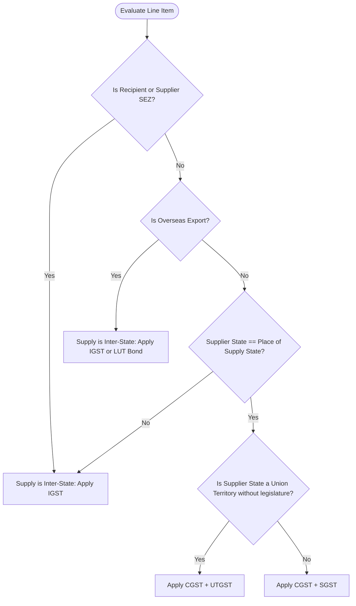
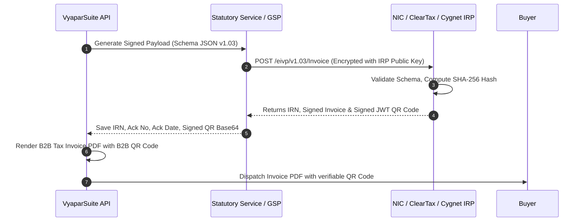

# VyaparSuite: Indian Statutory Compliance Specification
**Standard:** Goods and Services Tax (GST), Income Tax (TDS/TCS), E-Invoicing & E-Way Bill Architecture  
**Target Architecture:** Next.js, TypeScript, PostgreSQL (Supabase), Statutory Microservice Bridge  
**Version:** 1.0.0

---

## 1. Overview and Statutory Framework

VyaparSuite is architected to provide first-class statutory compliance for enterprises operating in the Republic of India. The engine strictly adheres to the provisions of:
* Central Goods and Services Tax Act, 2017 (CGST Act)
* Integrated Goods and Services Tax Act, 2017 (IGST Act)
* State/Union Territory Goods and Services Tax Acts (SGST/UTGST Acts)
* Goods and Services Tax (Compensation to States) Act, 2017 (GST Cess)
* Income Tax Act, 1961 (specifically Sections 194C, 194J, 194Q, 194I, 206C(1H))

---

## 2. GST Tax Engine Architecture

The tax calculation engine evaluates transaction lines using immutable tax templates driven by HSN/SAC code, Place of Supply (POS), recipient registration category, and transaction nature.

### 2.1 Tax Components and Split Rules
The engine decomposes tax into four primary tax components:
1. **Central GST (CGST):** Levied by Central Govt on intra-state supplies.
2. **State GST (SGST):** Levied by State Govt on intra-state supplies.
3. **Union Territory GST (UTGST):** Levied in Union Territories without legislatures (Andaman & Nicobar Islands, Chandigarh, Dadra and Nagar Haveli and Daman and Diu, Ladakh, Lakshadweep).
4. **Integrated GST (IGST):** Levied on inter-state supplies, imports, and SEZ units.
5. **GST Compensation Cess:** Levied on specified luxury and demerit goods (e.g., motor vehicles, aerated drinks, tobacco) calculated either as `ad valorem` percentage, specific rate per unit, or hybrid.

### 2.2 Mathematical Calculation Models

Let:
* $A_{taxable} = \text{Item Amount} - \text{Line Discount} + \text{Pro-rata Header Charges}$
* $R_{gst} = \text{Applicable GST Slab Rate (e.g., 5\%, 12\%, 18\%, 28\%)}$
* $R_{cess} = \text{Applicable Cess Rate \%}$
* $C_{spec} = \text{Specific Cess per Unit Qty}$

$$\text{For Intra-State Transactions (State of Supplier} == \text{Place of Supply):}$$
$$R_{cgst} = \frac{R_{gst}}{2}, \quad R_{sgst} = \frac{R_{gst}}{2}$$
$$\text{Tax}_{cgst} = \text{Round}\left(A_{taxable} \times \frac{R_{cgst}}{100}, 2\right)$$
$$\text{Tax}_{sgst} = \text{Round}\left(A_{taxable} \times \frac{R_{sgst}}{100}, 2\right)$$
$$\text{Tax}_{igst} = 0.00$$

$$\text{For Inter-State Transactions (State of Supplier} \neq \text{Place of Supply):}$$
$$\text{Tax}_{cgst} = 0.00, \quad \text{Tax}_{sgst} = 0.00$$
$$\text{Tax}_{igst} = \text{Round}\left(A_{taxable} \times \frac{R_{gst}}{100}, 2\right)$$

$$\text{GST Cess Formula (Hybrid):}$$
$$\text{Tax}_{cess} = \text{Round}\left(A_{taxable} \times \frac{R_{cess}}{100}, 2\right) + (\text{Qty} \times C_{spec})$$

---

## 3. Place of Supply (POS) Engine & Inter/Intra Determination

The determination of tax applicability is strictly determined by comparing the **State Code of the Supplier's Dispatch Location** against the statutory **Place of Supply (POS)** according to Sections 10, 11, 12, and 13 of the IGST Act.

### 3.1 Place of Supply Decision Matrix

| Supply Type | Section (IGST Act) | Statutory Rule | Determined POS |
| :--- | :--- | :--- | :--- |
| **Goods (Movement involved)** | Section 10(1)(a) | Location of goods at the time movement terminates for delivery to recipient. | Delivery/Ship-To Address State Code. |
| **Goods (Bill To - Ship To)** | Section 10(1)(b) | Deemed receipt by the third party on whose direction goods are moved. | Third Party (Bill-To) Address State Code. |
| **Goods (No movement)** | Section 10(1)(c) | Location of goods at the time of delivery to the recipient. | Site Location State Code. |
| **Goods (Assembly/Installation)**| Section 10(1)(d) | Location where goods are assembled or installed. | Assembly/Installation Site State. |
| **Services (B2B - Registered)** | Section 12(2)(a) | Location of registered recipient. | Recipient GSTIN State Code. |
| **Services (B2B - Immovable Prop)**| Section 12(3) | Location of the immovable property / construction site. | Property Physical Location State. |
| **Services (B2C - Unregistered)** | Section 12(2)(b) | Location of recipient on record, else supplier location. | Recipient Billing Address State. |
| **Exports (Goods/Services)** | Section 16 | Export of Goods or Services outside India. | `96-Other Countries` (Treated as Inter-State). |
| **SEZ Developer / SEZ Unit** | Section 7(5)(b) | Supply to or by a Special Economic Zone developer or unit. | Always Inter-State (IGST applicable regardless of physical state). |

### 3.2 Determination Logic Flowchart


---

## 4. Reverse Charge Mechanism (RCM)

Under Section 9(3) & 9(4) of the CGST Act, statutory liability to pay GST shifts from the supplier to the recipient for notified categories.

### 4.1 Notified Reverse Charge Categories Supported
1. **Goods Transport Agency (GTA) Services:** 5% RCM without ITC or 12% forward charge.
2. **Legal Services:** Advocate / Arbitral Tribunal services supplied to business entities.
3. **Sponsorship Services:** Rendered to any body corporate or partnership firm.
4. **Director Services:** Remuneration / fees paid to independent company directors.
5. **Security Services:** Security personnel provided to a registered person by non-corporate entities.
6. **Recovery Agent Services:** Provided to banking / NBFC institutions.

### 4.2 Accounting Treatment for RCM
When `is_reverse_charge: true`:
1. On Sales Invoice: Tax is calculated for reporting but **not added** to the invoice receivable balance. Output tax is flagged with `rcm_payable_by_recipient: true`.
2. On Purchase Invoice:
   * Tax is computed on taxable value.
   * Self-invoicing requirement generated under Section 31(3)(f).
   * Double entry posted to ledger:
     * Dr. Input Tax Credit - RCM (Asset)
     * Cr. GST Liability - RCM (Payable in Cash via Electronic Cash Ledger)
   * Note: RCM liability cannot be discharged by utilizing existing ITC; it must be paid in cash in the current tax period, and claimed as credit in the same/subsequent return.

---

## 5. Input Tax Credit (ITC) Engine

ITC claims are regulated under Section 16 and Section 17 of the CGST Act. The system categorizes every inward line item into an explicit ITC eligibility state.

### 5.1 ITC Classification Codes
* `G`: **Eligible as Inputs** (Raw materials, trading stock, operational consumables)
* `S`: **Eligible as Input Services** (Freight, cloud hosting, audit fees)
* `C`: **Eligible as Capital Goods** (Plant & machinery, servers, office equipment)
* `B`: **Ineligible Blocked Credit (Section 17(5))**
* `N`: **Ineligible - Non-business / Exempt Supplies**

### 5.2 Section 17(5) Blocked Credit Engine
Transactions matching the following criteria are automatically blocked from ITC entitlement and routed to expense accounts:
* Motor vehicles for transportation of persons having approved seating capacity $\le 13$ persons (unless used for further supply, passenger transport, or driving school).
* Food and beverages, outdoor catering, beauty treatment, health services, life & health insurance (unless obligatory under employee safety statute).
* Club, health, and fitness center memberships.
* Travel benefits extended to employees on vacation (LTC/LTA).
* Works contract services for construction of immovable property (except plant & machinery).
* Goods lost, stolen, destroyed, written off, or disposed of by way of gift or free samples.

---

## 6. HSN/SAC Classification and Compliance Rules

* **HSN (Harmonized System of Nomenclature):** Applied to goods (2 to 8 digits).
* **SAC (Services Accounting Code):** Applied to services (6 digits, always begins with `99`).

### 6.1 Digit Length Rules (Statutory Thresholds)
* Aggregate Annual Turnover (AATO) up to ₹5 Crore:
  * B2B Invoices: Minimum **4 digits** mandatory.
  * B2C Invoices: 4 digits optional.
* Aggregate Annual Turnover (AATO) above ₹5 Crore:
  * All Invoices (B2B, B2C, Export): Minimum **6 digits** mandatory.
  * Chemical, pharmaceutical, and notified luxury items: **8 digits** mandatory.

---

## 7. Statutory Document Types

VyaparSuite implements distinct numbering series, schemas, and statutory validation for every Indian invoice document class:

| Document Type | Code | Rule / Section | Mandatory Details Required |
| :--- | :--- | :--- | :--- |
| **Tax Invoice** | `INV` | Sec 31, Rule 46 | Supplier & Recipient GSTIN, HSN/SAC, Rates, QR Code (IRN for e-invoice), POS. |
| **Bill of Supply** | `BOS` | Sec 31(3)(c), Rule 49 | Issued by Composition dealers or for wholly exempt supplies. Cannot charge GST. |
| **Delivery Challan** | `CHL` | Rule 55 | Goods sent for job work, exhibition, demo, or transport in semi-knocked down state. |
| **Credit Note** | `CRN` | Sec 34(1) | Issued for sales return, discount after supply, or rate deficiency. Links to original invoice. |
| **Debit Note** | `DBN` | Sec 34(3) | Issued for upward price revision or additional charges. Links to original invoice. |
| **Receipt Voucher** | `RCV` | Sec 31(3)(d) | Issued upon receipt of advance for goods/services. Calculates advance GST. |
| **Payment Voucher** | `PMV` | Sec 31(3)(g) | Issued when paying unregistered suppliers under RCM. |
| **Self Invoice** | `SLF` | Sec 31(3)(f) | Self-generated invoice for purchases liable to RCM from unregistered vendors. |

---

## 8. E-Invoicing (IRN) Architecture & IRP Integration

Mandatory for businesses with AATO exceeding ₹5 Crore in any preceding financial year from 2017-18 onwards.

### 8.1 Invoice Registration Portal (IRP) Flow


### 8.2 IRN Hash Computation Algorithm
The Invoice Reference Number (IRN) is a unique 64-character hexadecimal SHA-256 hash computed deterministically from:
$$\text{Input String} = \text{SupplierGSTIN} + \text{FinYear} + \text{DocType} + \text{DocNumber}$$
$$\text{IRN} = \text{SHA256}(\text{Input String})$$
* Example: `27AABCU9603R1ZM2026-27INV00142` $\rightarrow$ `3fa85f64-5717-4562-b3fc-2c963f66afa6...`

### 8.3 Signed B2B Dynamic QR Code Elements
The signed QR code returned by IRP encodes a cryptographic JSON payload containing:
1. `GSTIN of Supplier`
2. `GSTIN of Recipient`
3. `Invoice Number`
4. `Date of Generation of Invoice`
5. `Invoice Value (Grand Total)`
6. `Number of Line Items`
7. `HSN Code of Primary Item`
8. `Unique IRN (Invoice Reference Number)`
9. `IRP Digital Signature (X.509 RSA PKCS#1)`

---

## 9. E-Way Bill (EWB) System Architecture

Required under Rule 138 of CGST Rules for consignment of goods having consignment value $> ₹50,000$ (or state-notified threshold, e.g., ₹1,00,000 for intra-state Delhi/Maharashtra).

### 9.1 Consignment Value Calculation
$$\text{Consignment Value} = \text{Taxable Value} + \text{CGST} + \text{SGST} + \text{IGST} + \text{Cess} - \text{Exempt Supplies}$$

### 9.2 EWB Components
* **Part-A (Consignment Details):**
  * GSTIN of Supplier & Recipient
  * Place of Delivery (PIN Code mandatory)
  * Invoice / Challan Number & Date
  * HSN Code & Value of Goods
  * Reason for Transportation (Supply, Export, Job work, Sales Return, Exhibition)
* **Part-B (Transport Details):**
  * Transporter ID (GSTIN or TRANSIN)
  * Mode of Transport: `1` (Road), `2` (Rail), `3` (Air), `4` (Ship)
  * Vehicle Number (for Road) / RR Number (for Rail) / Airway Bill No.

### 9.3 Validity Distance Formula
* **Normal Cargo:** 1 day for every 200 km or part thereof.
* **Over Dimensional Cargo (ODC) / Multimodal involving Ship:** 1 day for every 20 km or part thereof.
* **Extension Window:** EWB can be extended 8 hours before or 8 hours after expiry.

---

## 10. GSTR-1 Data Model and Export Engine

VyaparSuite transforms transactional documents into the exact schema required for direct GSTR-1 offline tool JSON import or direct API filing.

### 10.1 GSTR-1 Output Table Mapping
| Table No. | Section Description | VyaparSuite Filter Query |
| :--- | :--- | :--- |
| **4A, 4B, 4C, 6B, 6C** | **B2B Invoices** | Registered recipients (`gst_category != 'Unregistered'`), within India or SEZ. |
| **5A, 5B** | **B2C (Large) Invoices** | Unregistered recipients, inter-state supply, invoice value $> ₹2,50,000$. |
| **7** | **B2C (Small) Invoices** | Unregistered recipients (all intra-state, or inter-state $\le ₹2,50,000$), aggregated by POS and rate. |
| **9B** | **Credit / Debit Notes (Registered)** | Credit/Debit notes issued to registered parties (CDNR). |
| **9B** | **Credit / Debit Notes (Unregistered)**| Credit/Debit notes issued to B2CL unregistered parties (CDNUR). |
| **6A** | **Exports** | Export of goods/services with or without payment of tax (`EXPWP` / `EXPWOP`). |
| **8** | **Nil Rated, Exempt & Non-GST** | Inward/Outward supplies exempt under notification or non-GST (Petroleum/Alcohol). |
| **11A, 11B** | **Advances Received & Adjusted** | Tax on advances received during period and advances adjusted against invoices. |
| **12** | **HSN Summary of Outward Supplies** | Line items grouped by HSN code, UOM, total quantity, total taxable value, CGST, SGST, IGST, Cess. |
| **13** | **Documents Issued** | Serial number range of invoices, credit notes, debit notes, delivery challans, and cancelled counts. |

---

## 11. GSTR-3B Auto-Computation Worksheet

GSTR-3B is a monthly summary return aggregating liabilities and ITC. VyaparSuite compiles this worksheet dynamically from the General Ledger and Tax Register.

### 11.1 GSTR-3B Summary Table Mapping

```markdown
Table 3.1: Details of Outward Supplies and Inward Supplies Liable to Reverse Charge
├── 3.1(a) Outward taxable supplies (other than zero rated, nil rated and exempted)
│   └── Taxable Value | IGST | CGST | SGST/UTGST | Cess
├── 3.1(b) Outward taxable supplies (zero rated) [Exports + SEZ]
├── 3.1(c) Other outward supplies (Nil rated, exempted)
├── 3.1(d) Inward supplies (liable to reverse charge) [Purchases under Sec 9(3)]
└── 3.1(e) Non-GST outward supplies

Table 3.2: Inter-State Supplies Made to Unregistered Persons, Composition Dealers & UIN Holders
└── Split of 3.1(a) by Place of Supply State Code

Table 4: Eligible Input Tax Credit (ITC)
├── 4(A) ITC Available (whether in full or part)
│   ├── (1) Import of Goods
│   ├── (2) Import of Services
│   ├── (3) Inward supplies liable to reverse charge (other than 1 & 2 above)
│   ├── (4) Inward supplies from ISD (Input Service Distributor)
│   └── (5) All other ITC (Normal vendor purchases)
├── 4(B) ITC Reversed
│   ├── (1) As per rules 38, 42 and 43 of CGST Rules and section 17(5)
│   └── (2) Others
└── 4(C) Net ITC Available = 4(A) - 4(B)
```

---

## 12. TDS Under GST (Section 51) and Income Tax

### 12.1 GST TDS (Section 51)
* **Applicability:** Government departments, local authorities, and public sector undertakings making payment to a supplier where total contract value exceeds ₹2,50,000 (excluding tax).
* **Rate:** 2% (1% CGST + 1% SGST for intra-state, 2% IGST for inter-state).
* **Exemption:** No deduction if supplier location and POS are in State A, while recipient is registered in State B.

### 12.2 Income Tax TDS (Section 194Q)
* **Applicability:** Buyer whose turnover $> ₹10$ Crore in preceding FY, purchasing goods from a resident seller exceeding ₹50 Lakhs in current FY.
* **Rate:** 0.1% on purchase value exceeding ₹50 Lakhs (5% if seller PAN is invalid/absent).
* **Calculation:** Applies strictly on the taxable value excluding GST if GST is separately charged.

---

## 13. TCS Engine (Tax Collected at Source)

### 13.1 E-Commerce Operators (Section 52 GST)
* Operators collecting payments on behalf of third-party suppliers collect Net TCS at 1% (0.5% CGST + 0.5% SGST or 1% IGST) on net value of taxable supplies.

### 13.2 Section 206C(1H) Income Tax TCS
* **Applicability:** Seller whose turnover $> ₹10$ Crore receives aggregate payment $> ₹50$ Lakhs from a buyer during the financial year.
* **Rate:** 0.1% on receipt amount exceeding ₹50 Lakhs (inclusive of GST).
* **Conflict Hierarchy:** If Section 194Q applies to the buyer, Section 206C(1H) does not apply to the seller.

---

## 14. Special Regimes: Composition, SEZ, and Exports

### 14.1 Composition Scheme (Section 10)
* Businesses with turnover $\le ₹1.5$ Crore (₹75 Lakhs for Special Category States).
* Cannot issue Tax Invoice; must issue **Bill of Supply** with text: *"Composition taxable person, not eligible to collect tax on supplies"*.
* Tax Rates (Paid out of pocket, not billed to customer):
  * Manufacturers & Traders: 1% of turnover.
  * Restaurants: 5% of turnover.
  * Service Providers (Sec 10(2A)): 6% of turnover.
* Inward supplies: Cannot claim any Input Tax Credit.

### 14.2 Special Economic Zones (SEZ) & 100% EOU
* Treated as Inter-State supplies under Section 7(5)(b) of the IGST Act, even if situated in the same state.
* Two Modalities:
  1. **SEZ with payment of IGST:** Supplier charges IGST and claims refund from DGFT/GSTN.
  2. **SEZ without payment of IGST:** Requires Letter of Undertaking (LUT) or Bond, zero tax charged.

### 14.3 Export of Goods and Services
* Deemed Zero-Rated Supply (Section 16 IGST Act).
* Options:
  * Export under LUT (Form GST RFD-11): No tax charged.
  * Export on Payment of IGST: IGST billed and automatically refunded upon customs shipping bill confirmation (ICEGATE sync).
* Mandatory fields: Currency, Exchange Rate, Shipping Bill Number, Port Code, Foreign Inward Remittance Certificate (FIRC) reference.

---

## 15. GST Data Validation Algorithms

### 15.1 GSTIN Checksum Validation (Mod-36 Algorithm)
A Goods and Services Tax Identification Number (GSTIN) is a 15-character alphanumeric code structured as:
* Characters 1-2: State Code (01 to 38, 97, 99)
* Characters 3-12: Permanent Account Number (PAN) of the entity
* Character 13: Entity number of the same PAN holder within the state (1-9, A-Z)
* Character 14: Default character `'Z'`
* Character 15: Mod-36 Checksum digit

#### TypeScript Implementation:
```typescript
export function validateGSTIN(gstin: string): boolean {
  if (!gstin || gstin.length !== 15) return false;
  const gstinRegex = /^[0-9]{2}[A-Z]{5}[0-9]{4}[A-Z]{1}[1-9A-Z]{1}Z[0-9A-Z]{1}$/;
  if (!gstinRegex.test(gstin)) return false;

  const chars = "0123456789ABCDEFGHIJKLMNOPQRSTUVWXYZ";
  let factor = 1;
  let sum = 0;

  for (let i = 0; i < 14; i++) {
    const codePoint = chars.indexOf(gstin[i]);
    let digit = codePoint * factor;
    factor = factor === 1 ? 2 : 1;
    digit = Math.floor(digit / 36) + (digit % 36);
    sum += digit;
  }

  const remainder = sum % 36;
  const checkCodePoint = (36 - remainder) % 36;
  const checkChar = chars[checkCodePoint];

  return gstin[14] === checkChar;
}
```

### 15.2 PAN Format Validation
* Pattern: `^[A-Z]{3}[PCHFATBLJG]{1}[A-Z]{1}[0-9]{4}[A-Z]{1}$`
* 4th character denotes entity status:
  * `P`: Individual
  * `C`: Company
  * `H`: Hindu Undivided Family (HUF)
  * `F`: Partnership Firm / LLP
  * `A`: Association of Persons (AOP)
  * `T`: Trust

---

## 16. Automated Verification Test Suite

The following concrete test cases validate mathematical precision, statutory compliance, and edge-case handling in the GST engine.

```typescript
import { describe, it, expect } from "vitest";
import { calculateTaxes, determinePlaceOfSupply, validateGSTIN } from "./gst-engine";

describe("Indian Statutory Compliance Engine Tests", () => {

  it("TC-GST-01: Intra-State B2B Transaction (Maharashtra to Maharashtra) at 18%", () => {
    const lineItem = {
      qty: 10,
      rate: 1000.00,
      discount_amount: 1000.00, // Net = 9,000.00
      gst_rate: 18.0
    };
    const supplierState = "27"; // Maharashtra
    const recipientState = "27"; // Maharashtra
    const isSEZ = false;

    const result = calculateTaxes({ lineItem, supplierState, recipientState, isSEZ });

    expect(result.taxable_value).toBe(9000.00);
    expect(result.cgst_rate).toBe(9.0);
    expect(result.cgst_amount).toBe(810.00);
    expect(result.sgst_rate).toBe(9.0);
    expect(result.sgst_amount).toBe(810.00);
    expect(result.igst_amount).toBe(0.00);
    expect(result.grand_total).toBe(10620.00);
  });

  it("TC-GST-02: Inter-State B2B Transaction (Karnataka to Tamil Nadu) at 28% + Cess", () => {
    const lineItem = {
      qty: 2,
      rate: 50000.00,
      discount_amount: 0.00,
      gst_rate: 28.0,
      cess_rate: 12.0,
      cess_specific_per_unit: 1000.00
    };
    const supplierState = "29"; // Karnataka
    const recipientState = "33"; // Tamil Nadu
    const isSEZ = false;

    const result = calculateTaxes({ lineItem, supplierState, recipientState, isSEZ });

    expect(result.taxable_value).toBe(100000.00);
    expect(result.cgst_amount).toBe(0.00);
    expect(result.sgst_amount).toBe(0.00);
    expect(result.igst_rate).toBe(28.0);
    expect(result.igst_amount).toBe(28000.00);
    // Cess = (100,000 * 12%) + (2 * 1000) = 12,000 + 2,000 = 14,000
    expect(result.cess_amount).toBe(14000.00);
    expect(result.grand_total).toBe(142000.00);
  });

  it("TC-GST-03: SEZ Developer Supply within same state treated as Inter-State (IGST)", () => {
    const lineItem = { qty: 1, rate: 200000.00, discount_amount: 0.00, gst_rate: 18.0 };
    const supplierState = "27"; // Maharashtra
    const recipientState = "27"; // SEZ located in Maharashtra
    const isSEZ = true;

    const result = calculateTaxes({ lineItem, supplierState, recipientState, isSEZ });

    expect(result.cgst_amount).toBe(0.00);
    expect(result.sgst_amount).toBe(0.00);
    expect(result.igst_amount).toBe(36000.00);
  });

  it("TC-GST-04: Union Territory Intra-Supply applies UTGST instead of SGST", () => {
    const lineItem = { qty: 5, rate: 2000.00, discount_amount: 0.00, gst_rate: 18.0 };
    const supplierState = "04"; // Chandigarh (UT without legislature)
    const recipientState = "04";
    const isSEZ = false;

    const result = calculateTaxes({ lineItem, supplierState, recipientState, isSEZ });

    expect(result.cgst_amount).toBe(900.00);
    expect(result.utgst_amount).toBe(900.00);
    expect(result.sgst_amount).toBe(0.00);
    expect(result.igst_amount).toBe(0.00);
  });

  it("TC-GST-05: Mod-36 GSTIN Checksum Validation", () => {
    // Valid GSTINs
    expect(validateGSTIN("27AABCU9603R1ZM")).toBe(true);
    expect(validateGSTIN("29AABCS1429B1ZB")).toBe(true);
    // Tampered checksum character
    expect(validateGSTIN("27AABCU9603R1ZX")).toBe(false);
    // Invalid length
    expect(validateGSTIN("27AABCU9603R1Z")).toBe(false);
  });

  it("TC-GST-06: Reverse Charge (RCM) Accounting Flagging", () => {
    const lineItem = { qty: 1, rate: 10000.00, discount_amount: 0.00, gst_rate: 5.0 };
    const isRCM = true;

    const result = calculateTaxes({ lineItem, supplierState: "27", recipientState: "27", isSEZ: false, isRCM });

    expect(result.taxable_value).toBe(10000.00);
    expect(result.cgst_amount).toBe(250.00);
    expect(result.sgst_amount).toBe(250.00);
    // On invoice receivable, customer pays only taxable base
    expect(result.invoice_receivable_total).toBe(10000.00);
    expect(result.rcm_liability_amount).toBe(500.00);
  });
});
```
