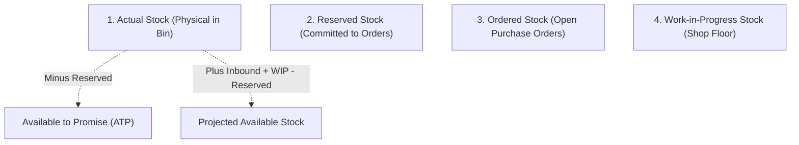

# VyaparSuite — Inventory Posting Matrix & Stock Ledger Mechanics

> **Canonical Perpetual Inventory Engine, Valuation Algorithms, and Stock Ledger Specification**  
> *Document Version: 1.0.0*  
> *Target Stack: Next.js (TypeScript), PostgreSQL / Supabase, Node.js*  
> *Compliance: Ind AS 2 / IAS 2 (Inventories), Perpetual Double-Entry Integration, GST Delivery Challans*

---

## 1. Executive Summary & Inventory Architecture

VyaparSuite implements an **Immutable, Perpetual Inventory Engine**. Every physical receipt, movement, consumption, or dispatch of goods creates atomic, unalterable rows in the **Stock Ledger Entries (`stock_ledger_entries`)** table.

### 1.1 Core Principles of the Stock Engine
1. **Append-Only Ledger**:
   Stock balances are never modified by direct `UPDATE` queries on historical rows. Every movement appends a new row to `stock_ledger_entries`.
2. **Perpetual Inventory Integration**:
   Every stock transaction that alters company inventory asset valuation automatically generates a corresponding balanced pair of General Ledger Entries (GLE) in real-time:
   $$\Delta \text{Stock Asset Value (Balance Sheet)} = \Delta \text{Expense / Interim Clearing / Revenue Contra}$$
3. **Deterministic Valuation**:
   The engine natively supports two international valuation algorithms:
   - **FIFO (First-In, First-Out)**: Stock consumed/dispatched is costed using the valuation layer of the oldest available inward receipt.
   - **Moving Average Rate (Weighted Average)**: Unit cost is recalculated dynamically upon every inward receipt:
     $$\text{New Valuation Rate} = \frac{(\text{Current Qty} \times \text{Current Rate}) + (\text{Inward Qty} \times \text{Incoming Rate})}{\text{Current Qty} + \text{Inward Qty}}$$

---

## 2. Inventory Transaction Matrix (Scenarios 1 to 20)

Below is the definitive matrix detailing how each operational document posts to the Stock Ledger and General Ledger.

---

### Scenario 1: Purchase Receipt (Goods Receipt Note / GRN)
**Trigger**: Physical inward receipt of goods at warehouse loading dock from supplier.  
**Source / Target Warehouse**: None $\rightarrow$ Target Store (e.g., `Raw Materials Store - TC`).

| Dimension | Specification |
| :--- | :--- |
| **Quantity Change ($\Delta Q$)** | **Positive (+)** (Accretes physical stock) |
| **Valuation Method** | FIFO / Moving Average |
| **Valuation Rate Source** | Purchase Order Accepted Rate + Allocated Inward Freight/Customs (Landed Cost) |
| **Stock Ledger Impact** | Appends inward layer to FIFO queue with incoming rate and batch/serial linkages. |
| **GL Impact (Perpetual)** | **Debit**: `Stock in Hand (Asset)` <br> **Credit**: `Stock Received But Not Billed (Liability)` |
| **Special Conditions** | If rejected items exist, they are routed to a virtual `Quarantine Warehouse` with zero valuation until returned. |

---

### Scenario 2: Purchase Return (Debit Note / Return Challan)
**Trigger**: Returning rejected or surplus items back to the vendor after GRN submission.  
**Source / Target Warehouse**: Source Store $\rightarrow$ None (Vendor).

| Dimension | Specification |
| :--- | :--- |
| **Quantity Change ($\Delta Q$)** | **Negative (-)** (Relieves physical stock) |
| **Valuation Method** | FIFO / Moving Average |
| **Valuation Rate Source** | Original Purchase Receipt Inward Rate |
| **Stock Ledger Impact** | Consumes inventory from specified inward batch; removes FIFO layer. |
| **GL Impact (Perpetual)** | **Debit**: `Stock Received But Not Billed (Liability)` <br> **Credit**: `Stock in Hand (Asset)` |
| **Special Conditions** | If original GRN was already invoiced, GL offset debits `Accounts Payable (Creditors)` directly. |

---

### Scenario 3: Sales Delivery Note
**Trigger**: Outward shipment and dispatch of sold goods to a customer.  
**Source / Target Warehouse**: Source Store (e.g., `Finished Goods Store`) $\rightarrow$ None (Customer).

| Dimension | Specification |
| :--- | :--- |
| **Quantity Change ($\Delta Q$)** | **Negative (-)** (Relieves physical stock) |
| **Valuation Method** | FIFO / Moving Average |
| **Valuation Rate Source** | Current Inventory Valuation Rate (Oldest FIFO layer cost or current Moving Average) |
| **Stock Ledger Impact** | Deducts quantity; consumes batches/serials; records COGS valuation. |
| **GL Impact (Perpetual)** | **Debit**: `Cost of Goods Sold (Expense)` <br> **Credit**: `Stock in Hand (Asset)` |
| **Special Conditions** | Blocked if `allow_negative_stock = false` and stock is insufficient. Unlocks Sales Order reserved qty. |

---

### Scenario 4: Sales Return (Customer Return / Delivery Note Return)
**Trigger**: Inward receipt of goods returned by a customer due to damage or cancellation.  
**Source / Target Warehouse**: None (Customer) $\rightarrow$ Target Warehouse (e.g., `Returns Store` or `Main Store`).

| Dimension | Specification |
| :--- | :--- |
| **Quantity Change ($\Delta Q$)** | **Positive (+)** (Restores physical stock) |
| **Valuation Method** | FIFO / Moving Average |
| **Valuation Rate Source** | Original Delivery Note Outward Cost Rate (prevents artificial profit distortion) |
| **Stock Ledger Impact** | Re-inserts stock layer at historical COGS rate. |
| **GL Impact (Perpetual)** | **Debit**: `Stock in Hand (Asset)` <br> **Credit**: `Cost of Goods Sold (Expense Reversal)` |
| **Special Conditions** | If goods are returned damaged, they must be received into `Damaged Goods Store` and written down. |

---

### Scenario 5: Stock Entry — Material Receipt
**Trigger**: Manual inward stock adjustment (e.g., found items, gift samples, unlinked inward).  
**Source / Target Warehouse**: None $\rightarrow$ Target Warehouse.

| Dimension | Specification |
| :--- | :--- |
| **Quantity Change ($\Delta Q$)** | **Positive (+)** |
| **Valuation Method** | FIFO / Moving Average |
| **Valuation Rate Source** | User-defined standard purchase rate or item master valuation rate |
| **Stock Ledger Impact** | Creates new inward FIFO layer. |
| **GL Impact (Perpetual)** | **Debit**: `Stock in Hand (Asset)` <br> **Credit**: `Stock Adjustment Account (Expense Contra / Equity)` |
| **Special Conditions** | Mandatory reason code and manager authorization required. |

---

### Scenario 6: Stock Entry — Material Issue
**Trigger**: Manual outward stock consumption (e.g., internal R&D sampling, trade marketing samples).  
**Source / Target Warehouse**: Source Warehouse $\rightarrow$ None.

| Dimension | Specification |
| :--- | :--- |
| **Quantity Change ($\Delta Q$)** | **Negative (-)** |
| **Valuation Method** | FIFO / Moving Average |
| **Valuation Rate Source** | Current Valuation Rate of Source Warehouse |
| **Stock Ledger Impact** | Consumes oldest FIFO layers; depletes physical bin balance. |
| **GL Impact (Perpetual)** | **Debit**: `Cost Center Expense (e.g., Marketing / R&D Expense)` <br> **Credit**: `Stock in Hand (Asset)` |
| **Special Conditions** | Cost Center is mandatory for expense attribution. |

---

### Scenario 7: Stock Entry — Material Transfer (Standard)
**Trigger**: Moving goods between two warehouses within the same company.  
**Source / Target Warehouse**: Source Warehouse $\rightarrow$ Target Warehouse.

| Dimension | Specification |
| :--- | :--- |
| **Quantity Change ($\Delta Q$)** | Source: **Negative (-)** \| Target: **Positive (+)** (Net Company $\Delta Q = 0$) |
| **Valuation Method** | FIFO / Moving Average |
| **Valuation Rate Source** | Valuation Rate of Source Warehouse transferred intact to Target Warehouse |
| **Stock Ledger Impact** | Two SLE entries created: Outward from Source, Inward into Target. |
| **GL Impact (Perpetual)** | **Debit**: `Stock in Hand (Target Warehouse Asset)` <br> **Credit**: `Stock in Hand (Source Warehouse Asset)` |
| **Special Conditions** | Net financial impact across company is 0.00 unless inter-warehouse transport costs are capitalized. |

---

### Scenario 8: Stock Entry — Material Transfer for Manufacturing
**Trigger**: Transferring raw materials from General Stores to Production Floor.  
**Source / Target Warehouse**: `Raw Materials Store` $\rightarrow$ `Work in Progress (WIP) Warehouse`.

| Dimension | Specification |
| :--- | :--- |
| **Quantity Change ($\Delta Q$)** | Source: **Negative (-)** \| Target: **Positive (+)** |
| **Valuation Method** | FIFO / Moving Average |
| **Valuation Rate Source** | Raw Material FIFO layer rate |
| **Stock Ledger Impact** | Moves inventory layers into WIP location. |
| **GL Impact (Perpetual)** | **Debit**: `Work-in-Progress (Asset)` <br> **Credit**: `Stock in Hand - Raw Materials (Asset)` |
| **Special Conditions** | Linked directly to parent `Work Order` ID. Stock cannot be used for any other job. |

---

### Scenario 9: Manufacturing — Material Consumption
**Trigger**: Physical conversion and consumption of raw materials on the shop floor.  
**Source / Target Warehouse**: `WIP Warehouse` $\rightarrow$ None (Consumed).

| Dimension | Specification |
| :--- | :--- |
| **Quantity Change ($\Delta Q$)** | **Negative (-)** (Depletes WIP inventory) |
| **Valuation Method** | FIFO / Moving Average |
| **Valuation Rate Source** | Actual FIFO rate of items in WIP |
| **Stock Ledger Impact** | Removes raw material layers from WIP bin. |
| **GL Impact (Perpetual)** | Handled within the composite Manufacturing Stock Entry (see Scenario 10). |
| **Special Conditions** | Backflush mechanism can automatically calculate consumption based on finished quantity $\times$ BOM. |

---

### Scenario 10: Manufacturing — Finished Goods Receipt
**Trigger**: Receipt of completed finished assemblies into finished goods storage.  
**Source / Target Warehouse**: None $\rightarrow$ `Finished Goods Store`.

| Dimension | Specification |
| :--- | :--- |
| **Quantity Change ($\Delta Q$)** | **Positive (+)** |
| **Valuation Method** | FIFO / Moving Average |
| **Valuation Rate Source** | $\text{Unit Cost} = \frac{\sum \text{Raw Materials Consumed} + \text{Operation Labor} + \text{Factory Overhead}}{\text{Finished Goods Produced Qty}}$ |
| **Stock Ledger Impact** | Adds new finished goods layer at composite unit cost. |
| **GL Impact (Perpetual)** | **Debit**: `Stock in Hand - Finished Goods (Asset)` <br> **Credit**: `Work-in-Progress (Asset)` <br> **Credit**: `Labor / Overhead Absorbed (Expense Contra)` |
| **Special Conditions** | Assigns new manufactured Batch ID and Serial Numbers. |

---

### Scenario 11: Manufacturing — Scrap Entry
**Trigger**: Inevitable production loss, metal trimmings, or chemical residue generated during manufacturing.  
**Source / Target Warehouse**: None $\rightarrow$ `Scrap Warehouse`.

| Dimension | Specification |
| :--- | :--- |
| **Quantity Change ($\Delta Q$)** | **Positive (+)** |
| **Valuation Method** | Moving Average / Fixed Scrap Rate |
| **Valuation Rate Source** | Estimated Net Realizable Scrap Rate |
| **Stock Ledger Impact** | Creates inward layer in Scrap Warehouse. |
| **GL Impact (Perpetual)** | **Debit**: `Stock in Hand - Scrap (Asset)` <br> **Credit**: `Work-in-Progress (Asset)` (Reduces net cost of primary finished product) |
| **Special Conditions** | If scrap has zero commercial value, quantity is tracked with 0.00 valuation rate. |

---

### Scenario 12: Stock Reconciliation (Physical vs Book Adjustment)
**Trigger**: Periodic audit where physical count differs from system balance.  
**Source / Target Warehouse**: Target Warehouse undergoing count.

| Dimension | Positive Adjustment (Physical > Book) | Negative Adjustment (Physical < Book) |
| :--- | :--- | :--- |
| **Quantity Change ($\Delta Q$)** | **Positive (+)** | **Negative (-)** |
| **Valuation Rate Source** | Specified physical valuation rate | Current system valuation rate |
| **Stock Ledger Impact** | Accretes stock delta | Consumes stock delta |
| **GL Impact (Perpetual)** | **Debit**: `Stock in Hand` <br> **Credit**: `Stock Adjustment` | **Debit**: `Stock Adjustment (Loss)` <br> **Credit**: `Stock in Hand` |
| **Special Conditions** | Freezes warehouse during reconciliation; recalculates valuation rate. |

---

### Scenario 13: Opening Stock Entry
**Trigger**: Initial data migration during platform go-live.  
**Source / Target Warehouse**: None $\rightarrow$ Designated Opening Warehouse.

| Dimension | Specification |
| :--- | :--- |
| **Quantity Change ($\Delta Q$)** | **Positive (+)** |
| **Valuation Method** | FIFO layer seed / Initial Moving Average |
| **Valuation Rate Source** | Audited Historical Closing Balance Rate |
| **Stock Ledger Impact** | Establishes Day-Zero baseline FIFO layers. |
| **GL Impact (Perpetual)** | **Debit**: `Stock in Hand (Asset)` <br> **Credit**: `Temporary Opening Balancing Account (Equity)` |
| **Special Conditions** | Must occur prior to any commercial posting; verified against opening trial balance. |

---

### Scenario 14: Repack Entry (Assembly / Disassembly of Kits)
**Trigger**: Repackaging bulk product into consumer retail packs (or unpacking kits).  
**Source / Target Warehouse**: Source Store $\rightarrow$ Target Store (can be same warehouse).

| Dimension | Specification |
| :--- | :--- |
| **Quantity Change ($\Delta Q$)** | Bulk Component: **Negative (-)** \| Packaged Items: **Positive (+)** |
| **Valuation Method** | FIFO / Moving Average |
| **Valuation Rate Source** | Consumed bulk cost + Packaging materials cost + Repack labor fee |
| **Stock Ledger Impact** | Depletes bulk raw materials; adds packaged inventory units. |
| **GL Impact (Perpetual)** | **Debit**: `Stock in Hand - Retail Packs (Asset)` <br> **Credit**: `Stock in Hand - Bulk (Asset)` <br> **Credit**: `Packaging Material Stock (Asset)` |
| **Special Conditions** | Total output valuation must equal total input valuation. |

---

### Scenario 15: Subcontracting / Job Work Receipt
**Trigger**: Receiving processed goods back from a third-party job worker.  
**Source / Target Warehouse**: `Subcontractor Warehouse` $\rightarrow$ `Finished Goods Store`.

| Dimension | Specification |
| :--- | :--- |
| **Quantity Change ($\Delta Q$)** | Raw Stock: **Negative (-)** \| Finished Component: **Positive (+)** |
| **Valuation Method** | FIFO / Moving Average |
| **Valuation Rate Source** | $\text{Unit Valuation} = \text{Consumed Raw Material Rate} + \text{Job Work Service Charge}$ |
| **Stock Ledger Impact** | Relieves raw materials from supplier location; receives finished parts. |
| **GL Impact (Perpetual)** | **Debit**: `Stock in Hand (Finished Goods)` <br> **Credit**: `Stock in Hand (Subcontractor Location)` <br> **Credit**: `Stock Received But Not Billed (Job Work Charges)` |
| **Special Conditions** | Generates Indian GST Annexure / Form 57F4 compliance tracking record. |

---

### Scenario 16: POS Invoice (Immediate Deduction)
**Trigger**: Direct retail counter sale completed on POS terminal.  
**Source / Target Warehouse**: `Retail Store POS Counter` $\rightarrow$ None (Walk-in Customer).

| Dimension | Specification |
| :--- | :--- |
| **Quantity Change ($\Delta Q$)** | **Negative (-)** (Instantaneous physical reduction) |
| **Valuation Method** | FIFO / Moving Average |
| **Valuation Rate Source** | Current Inventory Valuation Rate |
| **Stock Ledger Impact** | Atomic SLE appended without requiring intermediate Delivery Note. |
| **GL Impact (Perpetual)** | Integrated into composite POS sales posting: <br> **Debit**: `Cost of Goods Sold (Expense)` <br> **Credit**: `Stock in Hand (Asset)` |
| **Special Conditions** | Offline POS sync pushes batched SLEs sequentially upon reconnect. |

---

### Scenario 17: Goods in Transit (Multi-Day Inter-Branch Movement)
**Trigger**: Long-distance stock shipment between distant branches.  
**Step 1 (Dispatch)**: Source Warehouse $\rightarrow$ `In-Transit Warehouse`.  
**Step 2 (Arrival)**: `In-Transit Warehouse` $\rightarrow$ Destination Warehouse.

| Step | Qty Impact | GL Impact (Perpetual) |
| :--- | :--- | :--- |
| **Step 1: Dispatch** | Source: **(-)**, Transit: **(+)** | **Debit**: `Stock in Transit (Asset)` <br> **Credit**: `Stock in Hand - Source (Asset)` |
| **Step 2: Receipt** | Transit: **(-)**, Destination: **(+)** | **Debit**: `Stock in Hand - Destination (Asset)` <br> **Credit**: `Stock in Transit (Asset)` |

> **Audit Control**: Goods remain on company balance sheet during transport under `Stock in Transit`. Prevents inventory "disappearing" while on trucks.

---

### Scenario 18: Packing / Unpacking Workflow
**Trigger**: Assembly of custom shipment crates or bundling promotional gift baskets.  
**Source / Target Warehouse**: Packing Area $\rightarrow$ Finished Goods Store.

| Dimension | Specification |
| :--- | :--- |
| **Quantity Change ($\Delta Q$)** | Components: **Negative (-)** \| Packaged Bundle: **Positive (+)** |
| **Valuation Rate Source** | Summed cost of items + corrugated box + protective bubble wrap + labor |
| **Stock Ledger Impact** | Atomic consumption and creation. |
| **GL Impact (Perpetual)** | Capitalizes packaging supplies into finished bundle inventory asset. |

---

### Scenario 19: Damaged / Expired Stock Write-Off
**Trigger**: Disposal of spoiled food ingredients, expired pharmaceuticals, or broken goods.  
**Source / Target Warehouse**: `Quarantine / Damaged Warehouse` $\rightarrow$ None.

| Dimension | Specification |
| :--- | :--- |
| **Quantity Change ($\Delta Q$)** | **Negative (-)** |
| **Valuation Rate Source** | Exact historical valuation rate of the expired batch |
| **Stock Ledger Impact** | Depletes batch; closes batch record. |
| **GL Impact (Perpetual)** | **Debit**: `Inventory Loss / Scrap Write-Off (Expense)` <br> **Credit**: `Stock in Hand (Asset)` |
| **Special Conditions** | Under Indian GST Section 17(5)(h), goods lost, destroyed, or written off require mandatory **reversal of Input Tax Credit (ITC)**. System automatically posts ITC reversal entry. |

---

### Scenario 20: Cycle Count Adjustment (ABC Continuous Auditing)
**Trigger**: Daily or weekly rolling cycle count of high-value Class A items.  
**Source / Target Warehouse**: Target Bin.

| Dimension | Specification |
| :--- | :--- |
| **Quantity Change ($\Delta Q$)** | Delta ($\text{Counted} - \text{Book}$) |
| **Valuation Method** | Moving Average / FIFO |
| **Stock Ledger Impact** | Posts micro-adjustment SLE with audit tag `CycleCountAudit`. |
| **GL Impact (Perpetual)** | Minor rounding/variance posted to `Inventory Discrepancy Account`. |
| **Special Conditions** | Operates without shutting down whole warehouse operations. |

---

## 3. Valuation Engine: FIFO & Moving Average Mechanics

### 3.1 FIFO Valuation Layer Mechanics
Under FIFO, the system maintains a linked array of inward valuation layers for each Item-Warehouse pair:
```typescript
export interface FIFOLayer {
  receiptDocType: string;
  receiptDocNo: string;
  postingDate: string;
  qtyRemaining: number;
  unitRate: number;
}
```

```
[ Inward Queue ] ──► Layer 1: 50 units @ ₹100  (Received Jan 10)
                 ──► Layer 2: 30 units @ ₹120  (Received Jan 15)
                 ──► Layer 3: 40 units @ ₹115  (Received Jan 20)

[ Dispatch Request: 70 units ]
  Step 1: Exhaust Layer 1 -> 50 units @ ₹100 = ₹5,000
  Step 2: Take 20 units from Layer 2 -> 20 units @ ₹120 = ₹2,400
  Layer 2 Remaining: 10 units @ ₹120
  Total Outward Cost = ₹7,400 (Effective Unit Rate = ₹105.71)
```

#### Ripple Recalculation on Back-Dated Entries
If a user with administrative override inserts a back-dated inward receipt, the FIFO queue must maintain historical integrity. The engine executes a **Ripple Recalculation Worker**:
1. Locks the Item-Warehouse record.
2. Identifies all subsequent outward SLEs chronologically after the back-dated timestamp.
3. Re-runs the FIFO consumption sequence.
4. Generates GL adjustment difference entries between historical recorded COGS and recalculated COGS.

---

### 3.2 Moving Average Rate Engine
When configured for Moving Average:
```typescript
export function calculateMovingAverageRate(
  currentQty: number,
  currentValuationRate: number,
  inwardQty: number,
  inwardRate: number
): number {
  if (currentQty + inwardQty <= 0) return currentValuationRate;
  
  const currentTotalValue = Math.max(0, currentQty * currentValuationRate);
  const inwardTotalValue = inwardQty * inwardRate;
  
  return (currentTotalValue + inwardTotalValue) / (currentQty + inwardQty);
}
```

---

## 4. Batch & Serial Tracking Framework

### 4.1 Batch Tracking Rules
- **Batch Record**: Stores `batch_id`, `item_id`, `manufacturing_date`, `expiry_date`, and `supplier_batch_no`.
- **FIFO Within Batch**: Multiple receipts of the same batch merge into that batch's valuation pool.
- **Expiry Enforcement**: Delivery Notes and POS Invoices are strictly blocked from selecting expired batches.
- **Quarantine Auto-Transfer**: Batches reaching `expiry_date - 15 days` trigger an alert; expired batches are automatically flagged as non-reservable.

### 4.2 Serial Number Tracking Rules
- **Serial Record**: Represents an individual physical asset unit with unique alphanumeric identifier `serial_no`.
- **Status Lifecycle**: `Active (In Store) -> Reserved -> Delivered (Customer) -> Scrapped -> Returned`.
- **Individual Cost Layer**: High-value serial items track their specific inward purchase invoice cost rather than pooled average cost.
- **Warranty Tracking**: Serial record stores warranty start date and end date calculated from customer delivery date.

---

## 5. Stock Balance & Availability Calculations

VyaparSuite continuously computes four distinct dimensions of stock:



### 5.1 Mathematical Formulations

#### 1. Available to Promise (ATP)
$$\text{ATP} = \text{Physical On-Hand Stock} - \text{Reserved Stock (Confirmed Sales Orders & Work Orders)}$$
- Sales Orders check ATP in real-time. If $\text{Requested Qty} > \text{ATP}$, the order cannot be confirmed for immediate dispatch without creating a production or purchase request.

#### 2. Projected Stock
$$\text{Projected Stock} = \text{Physical Stock} + \text{Inward POs} + \text{Inward Work Orders} - \text{Committed Sales Orders}$$
- Used by Material Requirements Planning (MRP) to compute automated re-order triggers.

---

## 6. Negative Stock Prevention & Concurrency Architecture

### 6.1 Absolute Prevention Policy
Under default production configuration:
$$\text{Bin Balance} \ge 0 \quad (\forall \, \text{Warehouse}, \text{Item})$$

### 6.2 Concurrency Row-Level Locking
To prevent race conditions where two simultaneous transactions attempt to deplete the last 10 units:
```sql
-- Executed inside the atomic posting transaction
BEGIN;

-- Acquire exclusive pessimistic lock on Item Bin
SELECT current_qty, valuation_rate 
FROM stock_balances 
WHERE item_id = $1 AND warehouse_id = $2 
FOR UPDATE;

-- Application checks if current_qty - outward_qty < 0
-- If negative, abort with rollback
-- If valid, insert SLE and update stock_balances
INSERT INTO stock_ledger_entries (item_id, warehouse_id, qty_change, ...) VALUES (...);
UPDATE stock_balances SET current_qty = current_qty - outward_qty WHERE ...;

COMMIT;
```

---

## 7. Stock Value Reconciliation with General Ledger

In a healthy perpetual ERP, the inventory balance sheet accounts must exactly match the physical stock ledger valuation:

$$\sum \text{Stock in Hand GL Accounts (Base Currency)} \equiv \sum_{\text{Items, Warehouses}} (\text{Actual Qty} \times \text{Valuation Rate})$$

### 7.1 Common Causes of Variance & Prevention
| Cause of Variance | VyaparSuite Architectural Safeguard |
| :--- | :--- |
| **Manual Direct Journal Entry** to Stock GL Account | Stock GL Accounts are flagged `is_system_controlled = true`. Manual journal vouchers are strictly rejected unless accompanied by a Stock Reconciliation voucher. |
| **Back-Dated Transactions** altering valuation | The Ripple Recalculation Engine automatically computes and posts valuation variance adjusting entries. |
| **Sub-penny Floating Point Rounding** | Financial math uses arbitrary precision `NUMERIC(18, 4)`. Minor rounding pennies are swept into `Stock Adjustment Rounding Expense`. |

### 7.2 Automated Reconciliation Verification Query
```sql
SELECT 
    gl.warehouse_account,
    gl.gl_balance,
    sle.stock_valuation,
    (gl.gl_balance - sle.stock_valuation) AS variance
FROM (
    SELECT account AS warehouse_account, SUM(debit - credit) AS gl_balance
    FROM gl_entries
    WHERE account_category = 'Stock Asset'
    GROUP BY account
) gl
JOIN (
    SELECT warehouse_id, SUM(current_qty * valuation_rate) AS stock_valuation
    FROM stock_balances
    GROUP BY warehouse_id
) sle ON sle.warehouse_id = gl.warehouse_account;
```
Any non-zero variance triggers an automated system diagnostic notification to the Finance Controller.

---

> **Inventory Matrix Sign-off**:  
> VyaparSuite Inventory Posting Matrix and Stock Ledger specification is exhaustive, mathematically sound, supports both FIFO and Moving Average, and guarantees complete synchronization between warehouse bins and financial statements.
