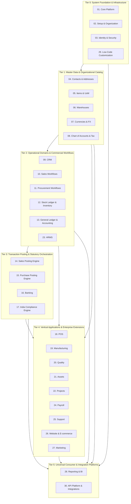

# VyaparSuite — Module Dependency Map & Architecture Topology

> **Canonical System Architectural Blueprint & Dependency Graph**  
> *Document Version: 1.0.0*  
> *Target Stack: Next.js (TypeScript), Tailwind CSS, PostgreSQL / Supabase, Node.js*  
> *Architecture Pattern: Modular Monolith with Event-Driven Posting & Strict Domain Decoupling*

---

## 1. Executive Summary & Purpose

VyaparSuite is architected as a **Clean Modular Monolith**. While deployed as a unified runtime to maximize operational simplicity, performance, and developer ergonomics, it enforces strict domain boundaries, explicit module contracts, and unidirectional dependency flows.

This document serves as the canonical map of VyaparSuite's **30 core modules**. It formally specifies:
1. The exact dependency topology for all 30 system modules.
2. The architectural classification tiers (Tier 0 Foundation through Tier 5 Cross-Cutting).
3. The chronological implementation sequence strictly aligned with Roadmap Phases 0 through 12.
4. Mathematical verification of Directed Acyclic Graph (DAG) properties, ensuring zero circular dependencies.
5. Contractual boundary rules and decoupling mechanisms (e.g., Domain Events, Posting Intermediaries).

---

## 2. The 30 System Modules Specification

Every module in VyaparSuite encapsulates a cohesive business domain, with its own database schema prefix, repository interfaces, domain service logic, and UI view components.

| Module ID | Module Code | Module Name | Architectural Boundary & Core Responsibility |
| :--- | :--- | :--- | :--- |
| **01** | `core` | **Core Platform** | Base infrastructure, logging, telemetry, tenant resolver, metadata catalog, base entity models, DB transaction runner. |
| **02** | `setup` | **Setup & Organization** | Tenant configuration, Company hierarchy, Branches, Cost Centers, Fiscal Years, Global numbering series. |
| **03** | `iam` | **Identity & Security** | User authentication (Supabase Auth), RBAC/ABAC role permissions, PostgreSQL Row-Level Security (RLS) policies, session management. |
| **04** | `contacts` | **Contacts & Addresses** | Unified party directory: Customers, Suppliers, Partners, billing/shipping physical addresses, contact persons. |
| **05** | `items` | **Items & UoM** | Product and Service master records, Units of Measure (UoM), conversions, item groups, barcoding specifications. |
| **06** | `warehouses`| **Warehouses** | Physical and virtual storage locations, warehouse tree hierarchies, bins, transit warehouses. |
| **07** | `currencies`| **Currencies & FX** | Currency codes (ISO 4217), multi-currency precision formatting, historical and real-time exchange rate tables. |
| **08** | `tax_setup` | **Chart of Accounts & Tax Setup** | Five-root COA trees, Tax categories, Tax templates (GST, VAT), withholding tax rule tables. |
| **09** | `crm` | **CRM** | Lead generation, Sales Opportunities, Pipelines, Customer interaction logging, quotation requests. |
| **10** | `sales` | **Sales** | Commercial sales lifecycle: Quotations, Proforma Invoices, Sales Orders, pricing rules, customer discount schedules. |
| **11** | `procure` | **Procurement** | Purchasing lifecycle: Purchase Requisitions, Requests for Quotation (RFQ), Supplier Quotation comparison, Purchase Orders. |
| **12** | `inventory` | **Stock Ledger & Inventory** | Physical inventory tracking, Stock Ledger Entries (SLE), FIFO/Moving Average valuation engine, Batch & Serial number control. |
| **13** | `accounting`| **General Ledger & Accounting** | Immutable double-entry General Ledger (`gl_entries`), Journal Entries, Cash Accounts, Financial Ledger balances. |
| **14** | `post_sales`| **Sales Posting** | Orchestration engine coordinating Sales Invoices, Delivery Notes, Accounts Receivable (AR), Revenue GL, and Stock relief. |
| **15** | `post_pur` | **Purchase Posting** | Orchestration engine coordinating Purchase Invoices, Purchase Receipts, Accounts Payable (AP), Expense/Asset GL, and Stock accretion. |
| **16** | `banking` | **Banking** | Bank accounts, statement imports (MT940, CSV), rule-based bank reconciliation, electronic fund transfers (NEFT/RTGS). |
| **17** | `compliance`| **India Compliance** | Statutory India Engine: GST e-Invoicing (IRN/QR), e-Way Bills, GSTR reporting, TDS/TCS computation, MCA unalterable audit trails. |
| **18** | `pos` | **Point of Sale (POS)** | High-throughput retail terminal, offline-first IndexedDB sync, register shift management, multi-tender split payments. |
| **19** | `mfg` | **Manufacturing** | Multi-level Bill of Materials (BOM), Work Centers, Routing operations, Work Orders, Production planning (MRP). |
| **20** | `quality` | **Quality Control** | Inward, In-process, and Outward Quality Inspections (QI), parameter thresholds, Non-Conformance Reports (NCR). |
| **21** | `assets` | **Fixed Assets** | Fixed Asset Register, capitalization, depreciation schedules (SLM, WDV), maintenance logs, asset disposal gain/loss. |
| **22** | `projects` | **Projects** | Project WBS, task hierarchies, timesheets, job costing, percentage-of-completion progress billing. |
| **23** | `hrms` | **HRMS** | Employee master files, department/designation structures, attendance tracking, biometric sync, leave application & approval. |
| **24** | `payroll` | **Payroll** | Salary structures, component earnings/deductions, Indian statutory compliance (PF, ESIC, PT), payslips, bank disbursement files. |
| **25** | `support` | **Support & Helpdesk** | Multi-channel support tickets, Service Level Agreements (SLA), agent assignments, issue resolution, customer portal. |
| **26** | `ecom` | **Website & E-commerce**| Public B2B/B2C catalog, customer portal, web cart checkout, payment gateway hooks, automatic Sales Order creation. |
| **27** | `marketing` | **Marketing Automation**| Audience segmentation (RFM), multi-channel email/SMS/WhatsApp campaigns, campaign ROI tracking linked to Sales Orders. |
| **28** | `reporting` | **Reporting & BI** | Universal BI engine: Balance Sheet, P&L, Trial Balance, Stock Balance, AR/AP Aging, cross-module pivot tables. |
| **29** | `lowcode` | **Low-Code Customization** | Dynamic metadata studio: Custom Fields, Custom DocTypes, Client Scripts, Print Format Designer, Workflow Visualizer. |
| **30** | `api` | **API Platform & Integrations** | OpenAPI 3.0 REST/GraphQL gateways, outbound webhook dispatcher, third-party logistics/payment connectors. |

---

## 3. Architectural Tiering & Topology

To preserve strict layered decoupling, modules are categorized into six structural tiers:



---

## 4. Complete Module Dependency Matrix

The following table explicitly defines all **Direct Dependencies**, **Transitive Dependencies**, and **Downstream Dependents** for every module in the platform.

| ID | Module Name | Direct Dependencies | Transitive Dependencies | Downstream Dependents |
| :--- | :--- | :--- | :--- | :--- |
| **01** | **Core Platform** | *None (Self-contained root)* | *None* | ALL Modules (02 through 30) |
| **02** | **Setup & Organization** | 01 (Core) | *None* | 03, 04, 05, 06, 07, 08, 09, 10, 11, 12, 13, 22, 23, 25, 28, 30 |
| **03** | **Identity & Security** | 01 (Core), 02 (Setup) | *None* | 04, 09, 10, 11, 23, 25, 28, 30 |
| **04** | **Contacts & Addresses** | 01 (Core), 02 (Setup), 03 (Identity) | *None* | 09, 10, 11, 25, 27, 28, 30 |
| **05** | **Items & UoM** | 01 (Core), 02 (Setup) | *None* | 10, 11, 12, 19, 20, 21, 25, 26, 28, 30 |
| **06** | **Warehouses** | 01 (Core), 02 (Setup) | *None* | 10, 11, 12, 28, 30 |
| **07** | **Currencies & FX** | 01 (Core), 02 (Setup) | *None* | 08, 10, 11, 12, 13, 28, 30 |
| **08** | **COA & Tax Setup** | 01 (Core), 02 (Setup), 07 (Currencies) | *None* | 10, 11, 13, 17, 28, 30 |
| **09** | **CRM** | 01, 02, 03, 04 (Contacts) | *None* | 10, 27, 28, 30 |
| **10** | **Sales** | 01, 02, 03, 04, 05, 06, 07, 08, 09 (CRM) | *None* | 14, 17, 18, 26, 28, 30 |
| **11** | **Procurement** | 01, 02, 03, 04, 05, 06, 07, 08 | *None* | 15, 17, 28, 30 |
| **12** | **Stock Ledger & Inv.** | 01, 02, 05 (Items), 06 (Warehouses), 07 (Currencies) | *None* | 14, 15, 18, 19, 20, 28, 30 |
| **13** | **GL & Accounting** | 01, 02, 07 (Currencies), 08 (COA & Tax) | *None* | 14, 15, 16, 17, 18, 19, 21, 22, 24, 28, 30 |
| **14** | **Sales Posting** | 10 (Sales), 12 (Inventory), 13 (Accounting) | 01, 02, 03, 04, 05, 06, 07, 08, 09 | 28, 30 |
| **15** | **Purchase Posting** | 11 (Procurement), 12 (Inventory), 13 (Accounting) | 01, 02, 03, 04, 05, 06, 07, 08 | 28, 30 |
| **16** | **Banking** | 13 (Accounting) | 01, 02, 07, 08 | 28, 30 |
| **17** | **India Compliance** | 08 (Tax Setup), 10 (Sales), 11 (Procurement), 13 (Accounting) | 01, 02, 03, 04, 05, 06, 07, 09 | 28, 30 |
| **18** | **POS** | 10 (Sales), 12 (Inventory), 13 (Accounting) | 01, 02, 03, 04, 05, 06, 07, 08, 09 | 28, 30 |
| **19** | **Manufacturing** | 05 (Items), 12 (Inventory), 13 (Accounting) | 01, 02, 06, 07, 08 | 20, 28, 30 |
| **20** | **Quality Control** | 05 (Items), 12 (Inventory), 19 (Manufacturing) | 01, 02, 06, 07, 08, 13 | 28, 30 |
| **21** | **Assets** | 05 (Items), 13 (Accounting) | 01, 02, 07, 08 | 28, 30 |
| **22** | **Projects** | 01 (Core), 02 (Setup), 13 (Accounting) | 07, 08 | 28, 30 |
| **23** | **HRMS** | 01 (Core), 02 (Setup), 03 (Identity) | *None* | 24, 28, 30 |
| **24** | **Payroll** | 13 (Accounting), 23 (HRMS) | 01, 02, 03, 07, 08 | 28, 30 |
| **25** | **Support** | 01 (Core), 02 (Setup), 03 (Identity), 04 (Contacts), 05 (Items) | *None* | 28, 30 |
| **26** | **Website & E-com** | 05 (Items), 10 (Sales) | 01, 02, 03, 04, 06, 07, 08, 09 | 28, 30 |
| **27** | **Marketing** | 04 (Contacts), 09 (CRM) | 01, 02, 03 | 28, 30 |
| **28** | **Reporting & BI** | ALL (01 through 27, 29, 30) | All transited | *None (Terminal Consumer)* |
| **29** | **Low-Code Custom.** | 01 (Core Platform) | *None* | 28, 30 |
| **30** | **API Platform** | ALL (01 through 29) | All transited | *None (Terminal Consumer)* |

---

## 5. Comprehensive Mermaid Dependency Flowchart

The following diagram details every directed dependency edge between modules:

```mermaid
flowchart TD
    %% Base Nodes
    M01["01. Core Platform"]
    M02["02. Setup & Organization"]
    M03["03. Identity & Security"]
    M04["04. Contacts & Addresses"]
    M05["05. Items & UoM"]
    M06["06. Warehouses"]
    M07["07. Currencies & FX"]
    M08["08. COA & Tax Setup"]
    M09["09. CRM"]
    M10["10. Sales"]
    M11["11. Procurement"]
    M12["12. Stock Ledger & Inventory"]
    M13["13. General Ledger & Accounting"]
    M14["14. Sales Posting"]
    M15["15. Purchase Posting"]
    M16["16. Banking"]
    M17["17. India Compliance"]
    M18["18. POS"]
    M19["19. Manufacturing"]
    M20["20. Quality"]
    M21["21. Assets"]
    M22["22. Projects"]
    M23["23. HRMS"]
    M24["24. Payroll"]
    M25["25. Support"]
    M26["26. Website & E-commerce"]
    M27["27. Marketing"]
    M28["28. Reporting & BI"]
    M29["29. Low-Code Customization"]
    M30["30. API Platform"]

    %% Core Foundation Tier
    M01 --> M02
    M01 --> M03
    M01 --> M29
    M02 --> M03

    %% Master Data Tier
    M01 --> M04
    M02 --> M04
    M03 --> M04

    M01 --> M05
    M02 --> M05

    M01 --> M06
    M02 --> M06

    M01 --> M07
    M02 --> M07

    M01 --> M08
    M02 --> M08
    M07 --> M08

    %% Operational Tier 2
    M01 --> M09
    M02 --> M09
    M03 --> M09
    M04 --> M09

    M01 --> M10
    M02 --> M10
    M03 --> M10
    M04 --> M10
    M05 --> M10
    M06 --> M10
    M07 --> M10
    M08 --> M10
    M09 --> M10

    M01 --> M11
    M02 --> M11
    M03 --> M11
    M04 --> M11
    M05 --> M11
    M06 --> M11
    M07 --> M11
    M08 --> M11

    M01 --> M12
    M02 --> M12
    M05 --> M12
    M06 --> M12
    M07 --> M12

    M01 --> M13
    M02 --> M13
    M07 --> M13
    M08 --> M13

    M01 --> M23
    M02 --> M23
    M03 --> M23

    %% Posting & Statutory Tier 3
    M10 --> M14
    M12 --> M14
    M13 --> M14

    M11 --> M15
    M12 --> M15
    M13 --> M15

    M13 --> M16

    M08 --> M17
    M10 --> M17
    M11 --> M17
    M13 --> M17

    %% Vertical Tier 4
    M10 --> M18
    M12 --> M18
    M13 --> M18

    M05 --> M19
    M12 --> M19
    M13 --> M19

    M05 --> M20
    M12 --> M20
    M19 --> M20

    M05 --> M21
    M13 --> M21

    M01 --> M22
    M02 --> M22
    M13 --> M22

    M13 --> M24
    M23 --> M24

    M01 --> M25
    M02 --> M25
    M03 --> M25
    M04 --> M25
    M05 --> M25

    M05 --> M26
    M10 --> M26

    M04 --> M27
    M09 --> M27

    %% Universal Tier 5
    M14 -.-> M28
    M15 -.-> M28
    M16 -.-> M28
    M17 -.-> M28
    M18 -.-> M28
    M19 -.-> M28
    M20 -.-> M28
    M21 -.-> M28
    M22 -.-> M28
    M24 -.-> M28
    M25 -.-> M28
    M26 -.-> M28
    M27 -.-> M28

    M14 -.-> M30
    M15 -.-> M30
    M18 -.-> M30
    M19 -.-> M30
    M20 -.-> M30
    M21 -.-> M30
    M22 -.-> M30
    M24 -.-> M30
    M25 -.-> M30
    M26 -.-> M30
    M27 -.-> M30
    M28 -.-> M30
    M29 -.-> M30
```



---

## 6. Implementation Sequence Aligned with Phases 0–12

To ensure zero technical deadlocks and deliver continuous business value, modules must be implemented strictly according to the phase roadmap defined in the Product Vision.

```mermaid
gantt
    title Module Rollout Across Engineering Phases
    dateFormat  X
    axisFormat  Phase %x

    section Phase 0: Foundation
    M01 Core Platform & Framework     :p0_1, 0, 1
    M02 Setup & Organization Trees    :p0_2, 0, 1
    M03 Identity & Supabase RLS       :p0_3, 0, 1
    M29 Low-Code Customization Studio :p0_4, 0, 1

    section Phase 1: Masters & Catalog
    M07 Currencies & FX Rates         :p1_1, after p0_1, 1
    M08 COA & Tax Setup               :p1_2, after p0_1, 1
    M04 Contacts & Addresses          :p1_3, after p0_1, 1
    M05 Items & UoM                   :p1_4, after p0_1, 1
    M06 Warehouses                    :p1_5, after p0_1, 1

    section Phase 2: Double-Entry Accounting
    M13 General Ledger & Accounting   :p2_1, after p1_2, 1
    M16 Banking & Reconciliation      :p2_2, after p2_1, 1

    section Phase 3: Procurement & AP
    M11 Procurement Workflows         :p3_1, after p2_1, 1
    M15 Purchase Posting Engine       :p3_2, after p3_1, 1

    section Phase 4: Sales & AR
    M09 CRM Opportunities & Leads     :p4_1, after p1_3, 1
    M10 Sales Workflows               :p4_2, after p4_1, 1
    M14 Sales Posting Engine          :p4_3, after p4_2, 1

    section Phase 5: MVP Gateway
    M28 Reporting (Core Financials)   :crit, p5_1, after p4_3, 1

    section Phase 6: India Compliance
    M17 India Compliance (GST/e-Inv)  :p6_1, after p5_1, 1

    section Phase 7: Advanced Inventory
    M12 Stock Ledger & Valuation      :p7_1, after p6_1, 1

    section Phase 8: Retail POS
    M18 Point of Sale Terminal        :p8_1, after p7_1, 1

    section Phase 9: Manufacturing & QA
    M19 Manufacturing & BOM           :p9_1, after p8_1, 1
    M20 Quality Management            :p9_2, after p9_1, 1

    section Phase 10: Assets & Projects
    M21 Fixed Assets                  :p10_1, after p9_1, 1
    M22 Project Job Costing           :p10_2, after p10_1, 1

    section Phase 11: HR & Payroll
    M23 HRMS Core                     :p11_1, after p10_2, 1
    M24 Indian Payroll Engine         :p11_2, after p11_1, 1

    section Phase 12: Ecosystem & Extensibility
    M25 Support Desk                  :p12_1, after p11_2, 1
    M26 Website & E-commerce          :p12_2, after p12_1, 1
    M27 Marketing Automation          :p12_3, after p12_2, 1
    M30 Universal API Platform        :p12_4, after p12_3, 1
```



### Detailed Phase-to-Module Mapping

#### Phase 0: System Foundation, Core Framework, Tenancy & Identity
- **Modules Implemented**: `01. Core Platform`, `02. Setup & Organization`, `03. Identity & Security`, `29. Low-Code Customization`.
- **Primary Deliverables**: Next.js App Router scaffolding, Supabase multi-tenant Row Level Security (RLS) policies, metadata catalog for DocTypes, system event dispatcher, dynamic custom fields engine.

#### Phase 1: Master Data, Organizations, Currencies & Chart of Accounts
- **Modules Implemented**: `07. Currencies & FX`, `08. Chart of Accounts & Tax Setup`, `04. Contacts & Addresses`, `05. Items & UoM`, `06. Warehouses`.
- **Primary Deliverables**: Hierarchical tree structures for Company, Branch, Cost Center, and Warehouses; multi-currency exchange tables; root Account categories; Customer and Supplier entity models.

#### Phase 2: Double-Entry General Ledger, Journal Entries & Bank Accounts
- **Modules Implemented**: `13. General Ledger & Accounting`, `16. Banking`.
- **Primary Deliverables**: Immutable `gl_entries` table, manual Journal Entry posting with balanced debit/credit validation, Bank Account registers, and statement import reconcilers.

#### Phase 3: Procurement & Vendor Accounts Payable (AP)
- **Modules Implemented**: `11. Procurement`, `15. Purchase Posting`.
- **Primary Deliverables**: Material Request -> RFQ -> Purchase Order -> Purchase Invoice lifecycle, automated accounts payable (AP) accrual, and vendor payment matching.

#### Phase 4: Sales, Invoicing & Accounts Receivable (AR)
- **Modules Implemented**: `09. CRM`, `10. Sales`, `14. Sales Posting`.
- **Primary Deliverables**: Lead -> Opportunity -> Quotation -> Sales Order -> Sales Invoice lifecycle, customer accounts receivable (AR) ledger entries, and payment receipts.

#### Phase 5: Financial Statements & Core MVP Gateway
- **Modules Implemented**: `28. Reporting & BI (Sub-slice: Core Financials)`.
- **Primary Deliverables**: Production-grade Trial Balance, Balance Sheet, Profit & Loss Statement, and Cash Flow statement with real-time drill-down to underlying GL vouchers.

#### Phase 6: India Statutory Tax Engine
- **Modules Implemented**: `17. India Compliance`.
- **Primary Deliverables**: Autonomous GST engine (CGST/SGST/IGST calculation), NIC API integration for IRN e-Invoicing, e-Way Bill generation, GSTR-1/GSTR-3B extracts, and MCA audit trails.

#### Phase 7: Advanced Inventory, Warehouses, Batch & Serial Tracking
- **Modules Implemented**: `12. Stock Ledger & Inventory (Full Valuation Engine)`.
- **Primary Deliverables**: Immutable `stock_ledger_entries`, FIFO and Moving Average perpetual inventory valuation, Batch/Lot tracking, Serial Number tracking, Stock Reconciliation.

#### Phase 8: Point of Sale (POS) & Retail Engine
- **Modules Implemented**: `18. POS`.
- **Primary Deliverables**: High-speed offline-first POS interface, IndexedDB sync with server, cash drawer reconciliation, barcode scanning, split tenders.

#### Phase 9: Manufacturing & Quality Control
- **Modules Implemented**: `19. Manufacturing`, `20. Quality Control`.
- **Primary Deliverables**: Multi-level Bill of Materials (BOM), Work Orders, routing operations, shop-floor job cards, scrap accounting, Inward/In-process Quality Inspections (QI).

#### Phase 10: Fixed Assets & Project Job Costing
- **Modules Implemented**: `21. Fixed Assets`, `22. Projects`.
- **Primary Deliverables**: Fixed Asset register, SLM/WDV automated monthly depreciation posting, Project Work Breakdown Structures (WBS), billable timesheets, project job costing.

#### Phase 11: HRMS, Attendance & Indian Payroll Engine
- **Modules Implemented**: `23. HRMS`, `24. Payroll`.
- **Primary Deliverables**: Employee lifecycle directory, biometric attendance ingestion, leave management, configurable salary structures with statutory Indian deductions (PF, ESIC, PT), payslips.

#### Phase 12: Low-Code Studio, Workflow, Support, E-commerce, Marketing & Open API
- **Modules Implemented**: `25. Support & Helpdesk`, `26. Website & E-commerce`, `27. Marketing Automation`, `28. Reporting & BI (Enterprise Suite)`, `30. API Platform & Integrations`.
- **Primary Deliverables**: Customer helpdesk tickets, B2B wholesale customer portal, RFM campaign engine, universal cross-module pivot analytics, public OpenAPI 3.0 developer gateway.

---

## 7. Circular Dependency Analysis & Verification

A foundational design requirement of VyaparSuite is that its module topology forms a **Strictly Directed Acyclic Graph (DAG)**. 

### 7.1 Mathematical Topological Sort Verification

Let $G = (V, E)$ be the directed graph where $V$ is the set of 30 modules $\{M_{01}, M_{02}, \dots, M_{30}\}$ and $E$ is the set of directed dependency edges $(M_i, M_j)$ representing "$M_i$ depends on $M_j$".

A valid topological ordering requires that for every directed edge $(M_i, M_j)$, the dependency $M_j$ appears **strictly before** $M_i$ in the ordering ($j < i$).

**Verified Topological Sequence:**
1. `M01: core` (indegree 0)
2. `M02: setup` (depends only on 01)
3. `M03: iam` (depends only on 01, 02)
4. `M29: lowcode` (depends only on 01)
5. `M07: currencies` (depends only on 01, 02)
6. `M08: tax_setup` (depends only on 01, 02, 07)
7. `M04: contacts` (depends only on 01, 02, 03)
8. `M05: items` (depends only on 01, 02)
9. `M06: warehouses` (depends only on 01, 02)
10. `M09: crm` (depends only on 01, 02, 03, 04)
11. `M10: sales` (depends only on 01, 02, 03, 04, 05, 06, 07, 08, 09)
12. `M11: procure` (depends only on 01, 02, 03, 04, 05, 06, 07, 08)
13. `M12: inventory` (depends only on 01, 02, 05, 06, 07)
14. `M13: accounting` (depends only on 01, 02, 07, 08)
15. `M14: post_sales` (depends only on 10, 12, 13)
16. `M15: post_pur` (depends only on 11, 12, 13)
17. `M16: banking` (depends only on 13)
18. `M17: compliance` (depends only on 08, 10, 11, 13)
19. `M18: pos` (depends only on 10, 12, 13)
20. `M19: mfg` (depends only on 05, 12, 13)
21. `M20: quality` (depends only on 05, 12, 19)
22. `M21: assets` (depends only on 05, 13)
23. `M22: projects` (depends only on 01, 02, 13)
24. `M23: hrms` (depends only on 01, 02, 03)
25. `M24: payroll` (depends only on 13, 23)
26. `M25: support` (depends only on 01, 02, 03, 04, 05)
27. `M26: ecom` (depends only on 05, 10)
28. `M27: marketing` (depends only on 04, 09)
29. `M28: reporting` (terminal sink: reads all upstream ledgers)
30. `M30: api` (terminal consumer: orchestrates all modules)

**Result**: $\forall (M_i, M_j) \in E$, $Index(M_j) < Index(M_i)$. No back-edges exist. The graph is **100% acyclic**.

---

### 7.2 Classic ERP Pitfalls & How VyaparSuite Prevents Them

In legacy systems (such as early Frappe/ERPNext or Openbravo), several circular traps routinely compromised architecture. VyaparSuite explicitly avoids them through architectural boundaries:

```
[ Pitfall 1: Sales <--> Stock Ledger Circularity ]
  Legacy: Sales Invoice directly calls Stock Ledger, and Stock Ledger looks up Sales Invoice price.
  VyaparSuite Solution: Decoupled via Dedicated Intermediary 'Sales Posting Engine' (M14). 
  Sales (M10) and Stock Ledger (M12) never import each other directly.

[ Pitfall 2: HRMS <--> Accounting / Payroll Circularity ]
  Legacy: Employee master has direct foreign key to GL Account; GL Account has Employee default.
  VyaparSuite Solution: HRMS (M23) contains zero accounting logic. 
  Payroll (M24) acts as the bridge, depending downstream on both HRMS and Accounting (M13).

[ Pitfall 3: Invoicing <--> Indian GST Engine Circularity ]
  Legacy: Invoice model imports GST engine; GST engine imports Invoice model to stamp IRN.
  VyaparSuite Solution: Unidirectional pipeline. Sales Invoice emits an immutable event. 
  India Compliance (M17) intercepts the event, calls NIC IRP, and stamps IRN/QR via audited compliance log.

[ Pitfall 4: Manufacturing <--> Inventory Valuation Deadlock ]
  Legacy: BOM references finished item valuation; Inventory valuation depends on BOM explosion.
  VyaparSuite Solution: Inventory (M12) tracks historical raw material cost; 
  Manufacturing (M19) consumes stock via standard Stock Ledger Entries at current FIFO rate and writes finished goods at summed actual cost.
```

---

## 8. Cross-Module Communication & Decoupling Contracts

To maintain modular hygiene within a single database and codebase:

1. **Database Schema Separation**:
   Each module owns its table namespace prefix:
   - `core_*` (Core Platform)
   - `setup_*` (Setup & Company)
   - `iam_*` (Identity & Roles)
   - `crm_*` (CRM)
   - `sales_*` (Sales)
   - `procure_*` (Procurement)
   - `stock_*` (Inventory & Warehousing)
   - `gl_*` (General Ledger & COA)
   - `mfg_*` (Manufacturing)
   - `hrms_*` & `payroll_*` (Human Resources)

2. **No Cross-Domain Foreign Key Mutations**:
   A module may reference the primary key UUID of another module (e.g., `sales_orders.customer_id -> contacts_parties.id`), but it can **never** execute an `UPDATE` or `DELETE` statement against another module's table.

3. **Event-Driven Posting**:
   When a transactional document is submitted (e.g., a Sales Invoice), it emits a domain event:
   ```typescript
   export interface DocumentSubmittedEvent<T> {
     tenantId: string;
     companyId: string;
     doctype: string;
     documentId: string;
     payload: T;
     submittedBy: string;
     submittedAt: string;
   }
   ```
   Posting engines (`post_sales`, `post_pur`) subscribe to these events within atomic database transactions, generating the required `gl_entries` and `stock_ledger_entries`.

4. **Terminal Reporting & API Isolation**:
   Modules 28 (`reporting`) and 30 (`api`) act as pure consumers. They read normalized or materialized ledger projections across any module, but no business module ever takes a dependency on the Reporting or API layer.

---

> **Architectural Sign-off**:  
> VyaparSuite Module Dependency Topology is verified, mathematically acyclic, and ready to guide implementation from Phase 0 to Phase 12.
