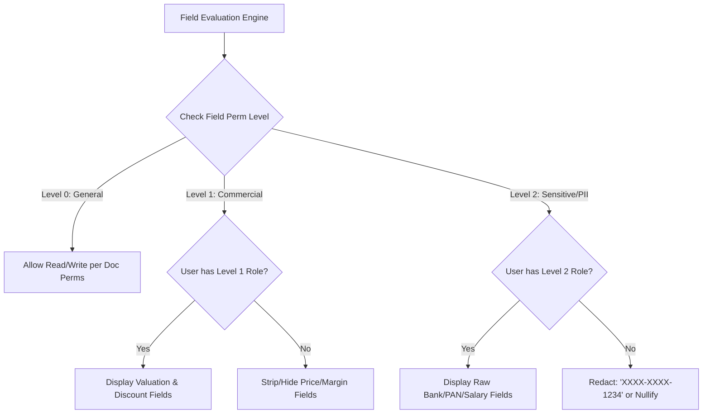
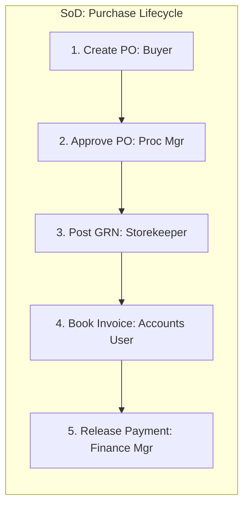
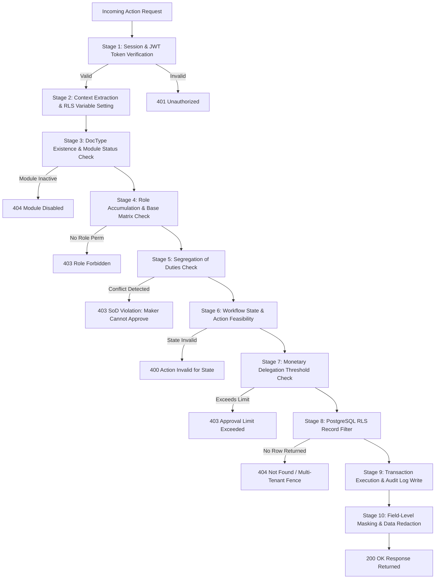

# VyaparSuite — Security, Authorization & Permission Matrix

> **Enterprise Role-Based (RBAC), Attribute-Based (ABAC), and Row-Level Security (RLS) Specification**  
> *Document Version: 1.0.0*  
> *Status: Approved & Canonical Architecture*  
> *Classification: Technical Architecture & Implementation Guide*

---

## 1. Executive Summary & Authorization Philosophy

VyaparSuite implements an enterprise-grade, defense-in-depth security and authorization architecture. Unlike consumer applications that rely on naive boolean flags (e.g., `is_admin`), or legacy systems that depend solely on application-layer checks, VyaparSuite enforces security across three synchronized architectural tiers:

1. **Database Row Level Security (PostgreSQL RLS)**: Foundational data isolation at the storage engine layer. No user query—regardless of frontend manipulation or application bugs—can penetrate tenant, company, or branch security boundaries.
2. **Metadata-Driven Application RBAC/ABAC**: Context-aware role assignments determining operational capabilities (Create, Read, Update, Submit, Cancel, Amend, Delete, Print, Email, Export, Import, Report) across all document types.
3. **Dynamic Field-Level Masking & Segregation of Duties (SoD)**: Cryptographic-level field-level redaction (e.g., hiding procurement costs from sales agents, masking PAN/Aadhaar/PII) coupled with maker-checker constraints ensuring strict compliance with internal control frameworks (SOX, Indian Companies Act 2013, ISO 27001).

```
                      ┌───────────────────────────────────────────────┐
                      │             Incoming Request / API            │
                      └───────────────────────┬───────────────────────┘
                                              │
                                              ▼
                      ┌───────────────────────────────────────────────┐
                      │    Layer 1: Edge & Session Authentication    │
                      │       (Supabase Auth JWT, MFA, Device)        │
                      └───────────────────────┬───────────────────────┘
                                              │
                                              ▼
                      ┌───────────────────────────────────────────────┐
                      │  Layer 2: Application RBAC & Workflow Engine  │
                      │     (Role Resolution, DocType Permissions,    │
                      │      Maker-Checker / SoD, Action Validation)  │
                      └───────────────────────┬───────────────────────┘
                                              │
                                              ▼
                      ┌───────────────────────────────────────────────┐
                      │  Layer 3: Attribute & Context Filtering       │
                      │     (Company, Branch, Warehouse, Territory)   │
                      └───────────────────────┬───────────────────────┘
                                              │
                                              ▼
                      ┌───────────────────────────────────────────────┐
                      │  Layer 4: PostgreSQL Row Level Security (RLS) │
                      │  (SET LOCAL app.user_id, company_id, tenant)  │
                      └───────────────────────┬───────────────────────┘
                                              │
                                              ▼
                      ┌───────────────────────────────────────────────┐
                      │ Layer 5: Field Masking & Redaction Serializer │
                      │  (Strip Cost, Mask PAN/PII before response)   │
                      └───────────────────────────────────────────────┘
```

---

## 2. Default Standard Roles (The 25 Core Roles)

VyaparSuite ships with 25 standard, pre-configured roles that map to modern organizational hierarchies, MSME operational functions, and corporate governance standards.

| # | Role Identifier | Display Name | Domain | Hierarchy Level | Primary Responsibilities & Scope |
|---|---|---|---|---|---|
| 1 | `system_manager` | System Manager | Platform / IT | 100 (Executive) | Platform configuration, system integrations, backup management, global settings, doctype schema studio, role maintenance. |
| 2 | `workspace_admin` | Workspace Administrator | Operations / IT | 90 (Admin) | Tenant-wide user provisioning, branch setup, company master configuration, permission assignment, audit log inspection. |
| 3 | `auditor` | Compliance & Internal Auditor | Governance | 80 (Oversight) | Comprehensive read-only access to all financial ledgers, tax filings, audit trails, and statutory logs. Cannot alter or mutate records. |
| 4 | `cfo` | Chief Financial Officer | Finance | 85 (C-Suite) | Fiscal year closings, balance sheet approvals, large write-offs, credit limit overrides, financial policy configuration. |
| 5 | `finance_manager` | Finance Manager / Accounts Head | Finance | 70 (Department Head)| General ledger supervision, journal voucher approvals, payment approvals, bank reconciliation verification, tax filings. |
| 6 | `accounts_user` | Accounts User / Senior Accountant| Finance | 50 (Operational) | Invoicing, bill booking, payment entry preparation, credit note creation, voucher drafting. |
| 7 | `accounts_assistant` | Accounts Assistant / Data Clerk | Finance | 30 (Clerical) | Data entry for vendor invoices, receipt drafting, customer master lookup. Cannot submit or cancel financial records. |
| 8 | `tax_officer` | Tax & Statutory Officer | Compliance | 60 (Specialist) | GST returns (GSTR-1, 3B, 9), TDS computation, e-Way Bill and e-Invoice reconciliation, tax audit file generation. |
| 9 | `sales_manager` | Sales Manager / Commercial Head | Sales & CRM | 70 (Department Head)| Pipeline governance, discount threshold approvals, customer credit approvals, quota management, team territory oversight. |
| 10 | `sales_user` | Sales Executive / Representative | Sales & CRM | 40 (Operational) | Lead generation, opportunity conversion, quotation preparation, sales order generation within assigned territory. |
| 11 | `pos_cashier` | Point of Sale (POS) Cashier | Retail / Counter| 20 (Frontline) | Counter sales, cash drawer shifts, split tender receipts, barcode scanning, offline register synchronization. |
| 12 | `procurement_manager`| Procurement Manager / Buyer Head | Procurement | 70 (Department Head)| Supplier master governance, RFQ sign-off, purchase order authorizations up to policy threshold, vendor scorecards. |
| 13 | `purchase_user` | Purchase Officer / Buyer | Procurement | 40 (Operational) | Purchase requisition processing, RFQ generation, purchase order creation, vendor quotation entry. |
| 14 | `inventory_manager` | Inventory & Logistics Manager | Supply Chain | 70 (Department Head)| Multi-warehouse stock control, inventory revaluation approvals, scrap write-offs, stock reconciliation authorizations. |
| 15 | `warehouse_user` | Warehouse Supervisor / Storekeeper| Supply Chain | 30 (Frontline) | Goods receipt (GRN) posting, delivery note dispatch, stock transfers, pick-pack-ship operations, bin replenishment. |
| 16 | `manufacturing_manager`| Plant Head / Production Manager | Manufacturing | 70 (Department Head)| Work order releases, BOM engineering sign-offs, production scheduling, shop floor routing optimization. |
| 17 | `production_supervisor`| Production Supervisor / Operator | Manufacturing | 40 (Operational) | Job card execution, material transfer for manufacture, scrap recording, finished goods quantity confirmation. |
| 18 | `quality_inspector` | Quality Assurance Inspector | Quality | 45 (Specialist) | Inward material inspection, in-process testing, final pre-dispatch Quality Inspection (QI), Non-Conformance Reports (NCR). |
| 19 | `maintenance_engineer` | Maintenance & Asset Engineer | Assets & Plant | 40 (Specialist) | Fixed asset servicing logs, preventive maintenance scheduling, machine breakdown ticketing, calibration tracking. |
| 20 | `hr_manager` | HR Director / People Ops Head | Human Resources | 70 (Department Head)| Organization structure, salary structure formulation, leave policy enforcement, final payroll sign-off, disciplinary cases. |
| 21 | `hr_user` | HR Specialist / Payroll Officer | Human Resources | 45 (Operational) | Employee onboarding, attendance reconciliation, leave balance tracking, monthly payroll batch preparation, expense vetting. |
| 22 | `employee_self_service`| Employee (Self-Service Portal) | General Staff | 10 (Employee) | Personal profile viewing, leave application, expense claim submission, payslip download, attendance check-in. |
| 23 | `project_manager` | Project Manager / Delivery Lead | Projects | 65 (Department Head)| Project budget definition, milestone tracking, timesheet approval, task assignment, job costing review. |
| 24 | `support_manager` | Customer Support Lead / Helpdesk | Customer Support| 70 (Department Head)| Ticket assignment rules, SLA configuration, customer escalation resolution, knowledge base article publishing. |
| 25 | `support_agent` | Support Agent / Helpdesk Rep | Customer Support| 35 (Operational) | Ticket troubleshooting, customer communication, bug reporting, warranty claim validation. |

---

## 3. Comprehensive Document Type Permission Matrix

In VyaparSuite, permissions are specified along 12 discrete operational vectors:
- **C (Create)**: Ability to initiate and instantiate a new record in `Draft` state.
- **R (Read)**: Ability to view records and their standard fields.
- **W (Write)**: Ability to edit/update mutable fields while in an editable state.
- **S (Submit)**: Ability to finalize a draft into an immutable `Submitted` ledger state.
- **X (Cancel)**: Ability to formally cancel a submitted document (creating reversing entries).
- **A (Amend)**: Ability to generate an amended revision (e.g., `INV-00124-1`) from a cancelled record.
- **D (Delete)**: Ability to physically purge draft records (strictly forbidden on submitted records).
- **P (Print)**: Ability to render and download standard print formats / PDFs.
- **E (Email)**: Ability to dispatch documents directly to customers/vendors via the communication engine.
- **EXP (Export)**: Ability to bulk-export records to CSV/Excel (heavily audited).
- **IMP (Import)**: Ability to bulk-upload records via CSV/XLSX data import.
- **REP (Report)**: Ability to view aggregated reports and analytical cubes derived from this DocType.

### 3.1 Financial Accounting & General Ledger

| DocType | Role Name | C | R | W | S | X | A | D | P | E | EXP | IMP | REP |
|---|---|---|---|---|---|---|---|---|---|---|---|---|---|
| **General Ledger Voucher** | System Manager | - | ✓ | - | - | - | - | - | ✓ | - | ✓ | - | ✓ |
| | CFO | - | ✓ | - | - | - | - | - | ✓ | ✓ | ✓ | - | ✓ |
| | Finance Manager | - | ✓ | - | - | - | - | - | ✓ | ✓ | ✓ | - | ✓ |
| | Accounts User | - | ✓ | - | - | - | - | - | ✓ | - | - | - | ✓ |
| | Auditor | - | ✓ | - | - | - | - | - | ✓ | - | ✓ | - | ✓ |
| | Other Roles | - | - | - | - | - | - | - | - | - | - | - | - |
| **Journal Entry** | System Manager | ✓ | ✓ | ✓ | ✓ | ✓ | ✓ | ✓ | ✓ | ✓ | ✓ | ✓ | ✓ |
| | CFO | ✓ | ✓ | ✓ | ✓ | ✓ | ✓ | - | ✓ | ✓ | ✓ | - | ✓ |
| | Finance Manager | ✓ | ✓ | ✓ | ✓ | ✓ | ✓ | - | ✓ | ✓ | ✓ | ✓ | ✓ |
| | Accounts User | ✓ | ✓ | ✓* | - | - | - | ✓* | ✓ | - | - | - | ✓ |
| | Accounts Assistant | ✓ | ✓ | ✓* | - | - | - | - | ✓ | - | - | - | - |
| | Auditor | - | ✓ | - | - | - | - | - | ✓ | - | ✓ | - | ✓ |
| **Sales Invoice** | CFO | ✓ | ✓ | ✓ | ✓ | ✓ | ✓ | - | ✓ | ✓ | ✓ | - | ✓ |
| | Finance Manager | ✓ | ✓ | ✓ | ✓ | ✓ | ✓ | - | ✓ | ✓ | ✓ | ✓ | ✓ |
| | Accounts User | ✓ | ✓ | ✓* | ✓ | - | ✓ | ✓* | ✓ | ✓ | ✓ | - | ✓ |
| | Sales Manager | - | ✓ | - | - | - | - | - | ✓ | ✓ | ✓ | - | ✓ |
| | Sales User | ✓ | ✓* | ✓* | - | - | - | ✓* | ✓ | ✓ | - | - | - |
| | Auditor | - | ✓ | - | - | - | - | - | ✓ | - | ✓ | - | ✓ |
| **Purchase Invoice** | CFO | ✓ | ✓ | ✓ | ✓ | ✓ | ✓ | - | ✓ | ✓ | ✓ | - | ✓ |
| | Finance Manager | ✓ | ✓ | ✓ | ✓ | ✓ | ✓ | - | ✓ | ✓ | ✓ | ✓ | ✓ |
| | Accounts User | ✓ | ✓ | ✓* | ✓ | - | ✓ | ✓* | ✓ | ✓ | ✓ | - | ✓ |
| | Procurement Manager | - | ✓ | - | - | - | - | - | ✓ | - | - | - | ✓ |
| | Purchase User | ✓ | ✓* | ✓* | - | - | - | ✓* | ✓ | - | - | - | - |
| | Auditor | - | ✓ | - | - | - | - | - | ✓ | - | ✓ | - | ✓ |
| **Payment Entry** | CFO | ✓ | ✓ | ✓ | ✓ | ✓ | ✓ | - | ✓ | ✓ | ✓ | - | ✓ |
| | Finance Manager | ✓ | ✓ | ✓ | ✓ | ✓ | ✓ | - | ✓ | ✓ | ✓ | - | ✓ |
| | Accounts User | ✓ | ✓ | ✓* | ✓* | - | - | ✓* | ✓ | ✓ | - | - | ✓ |
| | Accounts Assistant | ✓ | ✓ | ✓* | - | - | - | - | ✓ | - | - | - | - |
| | POS Cashier | ✓ | ✓* | - | ✓* | - | - | - | ✓ | - | - | - | - |
| | Auditor | - | ✓ | - | - | - | - | - | ✓ | - | ✓ | - | ✓ |
| **Bank Reconciliation** | CFO | ✓ | ✓ | ✓ | ✓ | - | - | - | ✓ | - | ✓ | - | ✓ |
| | Finance Manager | ✓ | ✓ | ✓ | ✓ | - | - | - | ✓ | - | ✓ | ✓ | ✓ |
| | Accounts User | ✓ | ✓ | ✓ | - | - | - | - | ✓ | - | - | ✓ | ✓ |
| | Auditor | - | ✓ | - | - | - | - | - | ✓ | - | ✓ | - | ✓ |

*\*Note: `*` indicates permission is subject to workflow state (e.g., Write/Delete allowed only in `Draft` state) or ownership restrictions.*

---

### 3.2 Sales, CRM & Commercial Operations

| DocType | Role Name | C | R | W | S | X | A | D | P | E | EXP | IMP | REP |
|---|---|---|---|---|---|---|---|---|---|---|---|---|---|
| **Lead / Prospect** | Sales Manager | ✓ | ✓ | ✓ | - | - | - | ✓ | ✓ | ✓ | ✓ | ✓ | ✓ |
| | Sales User | ✓ | ✓* | ✓* | - | - | - | - | ✓ | ✓ | - | ✓ | ✓ |
| | Support Agent | ✓ | ✓ | ✓ | - | - | - | - | - | - | - | - | - |
| | Workspace Admin | ✓ | ✓ | ✓ | - | - | - | ✓ | ✓ | ✓ | ✓ | ✓ | ✓ |
| **Customer Master** | CFO / Finance Mgr | ✓ | ✓ | ✓ | - | - | - | - | ✓ | ✓ | ✓ | ✓ | ✓ |
| | Sales Manager | ✓ | ✓ | ✓ | - | - | - | - | ✓ | ✓ | ✓ | ✓ | ✓ |
| | Sales User | ✓ | ✓ | ✓* | - | - | - | - | ✓ | ✓ | - | - | ✓ |
| | Accounts User | ✓ | ✓ | ✓ | - | - | - | - | ✓ | - | - | - | ✓ |
| | Auditor | - | ✓ | - | - | - | - | - | - | - | ✓ | - | ✓ |
| **Quotation** | Sales Manager | ✓ | ✓ | ✓ | ✓ | ✓ | ✓ | ✓* | ✓ | ✓ | ✓ | ✓ | ✓ |
| | Sales User | ✓ | ✓* | ✓* | ✓* | - | ✓* | ✓* | ✓ | ✓ | - | - | ✓ |
| | Accounts User | - | ✓ | - | - | - | - | - | ✓ | - | - | - | ✓ |
| **Sales Order** | Sales Manager | ✓ | ✓ | ✓ | ✓ | ✓ | ✓ | - | ✓ | ✓ | ✓ | ✓ | ✓ |
| | Sales User | ✓ | ✓* | ✓* | - | - | - | ✓* | ✓ | ✓ | - | - | ✓ |
| | Accounts User | - | ✓ | - | - | - | - | - | ✓ | - | - | - | ✓ |
| | Warehouse User | - | ✓ | - | - | - | - | - | ✓ | - | - | - | - |
| | Production Supervisor| - | ✓ | - | - | - | - | - | ✓ | - | - | - | - |
| **Delivery Note** | Warehouse User | ✓ | ✓ | ✓ | ✓ | - | - | ✓* | ✓ | - | - | - | ✓ |
| | Inventory Manager | ✓ | ✓ | ✓ | ✓ | ✓ | ✓ | - | ✓ | ✓ | ✓ | - | ✓ |
| | Sales User | - | ✓* | - | - | - | - | - | ✓ | ✓ | - | - | ✓ |
| | Accounts User | - | ✓ | - | - | - | - | - | ✓ | - | - | - | ✓ |
| **POS Invoice** | POS Cashier | ✓ | ✓* | ✓* | ✓ | - | - | - | ✓ | ✓ | - | - | - |
| | Sales Manager | ✓ | ✓ | ✓ | ✓ | ✓ | ✓ | - | ✓ | ✓ | ✓ | - | ✓ |
| | Accounts User | - | ✓ | - | - | - | - | - | ✓ | - | ✓ | - | ✓ |

---

### 3.3 Procurement, Inventory & Supply Chain

| DocType | Role Name | C | R | W | S | X | A | D | P | E | EXP | IMP | REP |
|---|---|---|---|---|---|---|---|---|---|---|---|---|---|
| **Supplier / Vendor** | Procurement Manager | ✓ | ✓ | ✓ | - | - | - | - | ✓ | ✓ | ✓ | ✓ | ✓ |
| | Purchase User | ✓ | ✓ | ✓* | - | - | - | - | ✓ | ✓ | - | - | - |
| | Finance Manager | ✓ | ✓ | ✓ | - | - | - | - | ✓ | - | ✓ | - | ✓ |
| | Accounts User | - | ✓ | - | - | - | - | - | ✓ | - | - | - | ✓ |
| | Auditor | - | ✓ | - | - | - | - | - | - | - | ✓ | - | ✓ |
| **Material Request** | Employee (Self-Serv)| ✓ | ✓* | ✓* | ✓ | - | - | ✓* | ✓ | - | - | - | - |
| | Production Supervisor| ✓ | ✓ | ✓ | ✓ | - | - | ✓* | ✓ | - | - | - | - |
| | Purchase User | - | ✓ | ✓ | - | - | - | - | ✓ | - | - | - | ✓ |
| | Procurement Manager | - | ✓ | ✓ | ✓ | ✓ | ✓ | - | ✓ | - | ✓ | - | ✓ |
| | Inventory Manager | - | ✓ | ✓ | ✓ | ✓ | ✓ | - | ✓ | - | ✓ | - | ✓ |
| **Purchase Order** | Procurement Manager | ✓ | ✓ | ✓ | ✓ | ✓ | ✓ | - | ✓ | ✓ | ✓ | ✓ | ✓ |
| | Purchase User | ✓ | ✓* | ✓* | - | - | - | ✓* | ✓ | ✓ | - | - | ✓ |
| | CFO | - | ✓ | - | ✓ | ✓ | ✓ | - | ✓ | ✓ | ✓ | - | ✓ |
| | Accounts User | - | ✓ | - | - | - | - | - | ✓ | - | - | - | ✓ |
| **Purchase Receipt (GRN)**| Warehouse User | ✓ | ✓ | ✓ | ✓ | - | - | ✓* | ✓ | - | - | - | ✓ |
| | Inventory Manager | ✓ | ✓ | ✓ | ✓ | ✓ | ✓ | - | ✓ | ✓ | ✓ | - | ✓ |
| | Quality Inspector | - | ✓ | ✓* | - | - | - | - | ✓ | - | - | - | - |
| | Purchase User | - | ✓ | - | - | - | - | - | ✓ | - | - | - | ✓ |
| **Stock Entry (Transfer)**| Warehouse User | ✓ | ✓ | ✓ | ✓ | - | - | ✓* | ✓ | - | - | - | ✓ |
| | Inventory Manager | ✓ | ✓ | ✓ | ✓ | ✓ | ✓ | - | ✓ | ✓ | ✓ | ✓ | ✓ |
| | Production Supervisor| ✓ | ✓* | ✓* | ✓ | - | - | - | ✓ | - | - | - | - |
| **Stock Reconciliation**| Inventory Manager | ✓ | ✓ | ✓ | ✓ | ✓ | ✓ | - | ✓ | - | ✓ | ✓ | ✓ |
| | Finance Manager | - | ✓ | - | ✓ | ✓ | - | - | ✓ | - | ✓ | - | ✓ |
| | Warehouse User | ✓ | ✓* | ✓* | - | - | - | - | ✓ | - | - | - | - |
| | Auditor | - | ✓ | - | - | - | - | - | ✓ | - | ✓ | - | ✓ |
| **Landed Cost Voucher** | Accounts User | ✓ | ✓ | ✓ | - | - | - | ✓* | ✓ | - | - | - | - |
| | Finance Manager | ✓ | ✓ | ✓ | ✓ | ✓ | ✓ | - | ✓ | - | ✓ | - | ✓ |
| | Inventory Manager | - | ✓ | - | - | - | - | - | ✓ | - | - | - | ✓ |

---

### 3.4 Manufacturing, Quality & Maintenance

| DocType | Role Name | C | R | W | S | X | A | D | P | E | EXP | IMP | REP |
|---|---|---|---|---|---|---|---|---|---|---|---|---|---|
| **Bill of Materials (BOM)**| Manufacturing Manager| ✓ | ✓ | ✓ | ✓ | ✓ | ✓ | - | ✓ | ✓ | ✓ | ✓ | ✓ |
| | Production Supervisor| - | ✓ | - | - | - | - | - | ✓ | - | - | - | - |
| | Inventory Manager | - | ✓ | - | - | - | - | - | ✓ | - | - | - | ✓ |
| | Finance Manager | - | ✓ | - | - | - | - | - | ✓ | - | ✓ | - | ✓ |
| **Work Order / Prod Order**| Manufacturing Manager| ✓ | ✓ | ✓ | ✓ | ✓ | ✓ | - | ✓ | - | ✓ | - | ✓ |
| | Production Supervisor| ✓ | ✓ | ✓ | ✓* | - | - | - | ✓ | - | - | - | ✓ |
| | Warehouse User | - | ✓ | - | - | - | - | - | ✓ | - | - | - | - |
| **Job Card** | Production Supervisor| ✓ | ✓ | ✓ | ✓ | - | - | - | ✓ | - | - | - | ✓ |
| | Manufacturing Manager| ✓ | ✓ | ✓ | ✓ | ✓ | - | ✓ | ✓ | - | ✓ | - | ✓ |
| **Quality Inspection (QI)**| Quality Inspector | ✓ | ✓ | ✓ | ✓ | ✓ | ✓ | - | ✓ | ✓ | ✓ | - | ✓ |
| | Manufacturing Manager| - | ✓ | - | - | - | - | - | ✓ | - | ✓ | - | ✓ |
| | Inventory Manager | - | ✓ | - | - | - | - | - | ✓ | - | ✓ | - | ✓ |
| **Maintenance Schedule** | Maintenance Engineer | ✓ | ✓ | ✓ | ✓ | - | - | - | ✓ | - | ✓ | - | ✓ |
| | Manufacturing Manager| ✓ | ✓ | ✓ | ✓ | ✓ | - | - | ✓ | - | ✓ | - | ✓ |

---

### 3.5 Human Resources, Payroll & Self-Service

| DocType | Role Name | C | R | W | S | X | A | D | P | E | EXP | IMP | REP |
|---|---|---|---|---|---|---|---|---|---|---|---|---|---|
| **Employee Master** | HR Manager | ✓ | ✓ | ✓ | - | - | - | - | ✓ | ✓ | ✓ | ✓ | ✓ |
| | HR User | ✓ | ✓ | ✓* | - | - | - | - | ✓ | ✓ | - | - | ✓ |
| | Employee (Self) | - | ✓* | ✓* | - | - | - | - | - | - | - | - | - |
| | Finance Manager | - | ✓ | - | - | - | - | - | - | - | ✓ | - | ✓ |
| | Auditor | - | ✓ | - | - | - | - | - | - | - | ✓ | - | ✓ |
| **Leave Application** | Employee (Self) | ✓ | ✓* | ✓* | ✓ | ✓* | - | ✓* | ✓ | - | - | - | - |
| | HR User | ✓ | ✓ | ✓ | ✓ | ✓ | - | - | ✓ | - | ✓ | - | ✓ |
| | HR Manager | ✓ | ✓ | ✓ | ✓ | ✓ | - | ✓ | ✓ | - | ✓ | - | ✓ |
| **Salary Structure** | HR Manager | ✓ | ✓ | ✓ | ✓ | ✓ | ✓ | - | ✓ | - | ✓ | - | ✓ |
| | CFO | - | ✓ | - | ✓ | - | - | - | ✓ | - | ✓ | - | ✓ |
| | HR User | - | ✓ | - | - | - | - | - | - | - | - | - | - |
| **Payroll Entry** | HR Manager | ✓ | ✓ | ✓ | ✓ | ✓ | ✓ | - | ✓ | - | ✓ | - | ✓ |
| | HR User | ✓ | ✓ | ✓ | - | - | - | - | ✓ | - | - | - | - |
| | Finance Manager | - | ✓ | - | ✓ | ✓ | - | - | ✓ | - | ✓ | - | ✓ |
| | CFO | - | ✓ | - | ✓ | ✓ | - | - | ✓ | - | ✓ | - | ✓ |
| **Salary Slip** | HR User | ✓ | ✓ | ✓ | ✓ | - | - | - | ✓ | ✓ | ✓ | - | ✓ |
| | HR Manager | ✓ | ✓ | ✓ | ✓ | ✓ | ✓ | - | ✓ | ✓ | ✓ | - | ✓ |
| | Employee (Self) | - | ✓* | - | - | - | - | - | ✓ | - | - | - | - |
| **Expense Claim** | Employee (Self) | ✓ | ✓* | ✓* | ✓ | - | - | ✓* | ✓ | - | - | - | - |
| | HR User | - | ✓ | ✓ | - | - | - | - | ✓ | - | - | - | ✓ |
| | HR Manager | - | ✓ | ✓ | ✓ | ✓ | - | - | ✓ | - | ✓ | - | ✓ |
| | Accounts User | - | ✓ | - | ✓ | - | - | - | ✓ | - | - | - | ✓ |
| | Finance Manager | - | ✓ | - | ✓ | ✓ | - | - | ✓ | - | ✓ | - | ✓ |

---

## 4. Field-Level Permission Matrix & Dynamic Data Masking

Field-level permissions enforce granular control inside a document. While a user may have access to a record, specific sensitive fields are hidden or masked based on security clearance and organizational role.

### 4.1 Permission Levels Architecture

VyaparSuite classifies DocType attributes into three distinct Permission Levels:
- **Level 0 (Standard Operational)**: General fields accessible to any user with record-level Read/Write permission (e.g., Item Name, Customer Name, Quantity, UOM).
- **Level 1 (Commercial & Financial)**: Pricing, valuation rates, margins, discount percentages, and credit limits.
- **Level 2 (Statutory, PII & Executive Governance)**: Bank accounts, Aadhaar, PAN, internal net cost, gross margin analysis, salary breakdowns, and cryptographic approval hashes.



### 4.2 Explicit Field-Level Redaction Matrix

| DocType | Field Identifier | Field Label | Perm Level | Allowed Roles (Read/Write) | Fallback for Unauthorized Roles |
|---|---|---|---|---|---|
| **Item** | `valuation_rate` | Valuation / Unit Cost | Level 1 | `finance_manager`, `cfo`, `inventory_manager`, `auditor` (Read Only) | Field entirely stripped from API JSON response; rendered as `---` in UI. |
| **Item** | `standard_cost` | Standard Cost | Level 1 | `finance_manager`, `procurement_manager`, `cfo` | Completely omitted from search dropdowns and detail views. |
| **Sales Order Item** | `margin_rate_or_amount` | Gross Profit Margin | Level 1 | `sales_manager`, `finance_manager`, `cfo` | Omitted from line item grid. Sales users see only selling rate & total. |
| **Customer** | `credit_limit` | Approved Credit Limit | Level 1 | `finance_manager`, `cfo`, `sales_manager` (Read) | Read-only for Sales User; editable only by Finance Manager / CFO. |
| **Customer** | `pan` / `gstin` | PAN / Tax Identification | Level 2 | `tax_officer`, `accounts_user`, `finance_manager`, `auditor` | Masked in standard views: `ABCDE****F` unless user has compliance role. |
| **Supplier** | `bank_account_no` | Bank Account Number | Level 2 | `finance_manager`, `accounts_user`, `cfo` | Masked for general users: `******8921`. Full view requires MFA re-authentication. |
| **Employee** | `ctc` / `basic_salary` | Total CTC / Base Pay | Level 2 | `hr_manager`, `cfo`, `auditor` (Read) | Omitted. Unauthorized API calls return `403 Field Permission Denied`. |
| **Employee** | `aadhaar_number` | National ID / Aadhaar | Level 2 | `hr_manager`, `tax_officer` | Masked as `XXXX-XXXX-4512` in all logs, exports, and operational UIs. |
| **Payment Entry** | `cheque_reference_no` | Check / UTR Reference | Level 0 | `accounts_user`, `finance_manager`, `cfo` | Editable in draft; locked post-submission. |

---

## 5. Record-Level Rules & Attribute-Based Access Control (ABAC)

Record-level rules determine *which specific instances* of a DocType an authorized user can inspect or modify. VyaparSuite achieves this through dynamic attributes attached to user profiles.

### 5.1 Territorial and Regional Boundaries

Sales and distribution teams are strictly confined to their authorized commercial jurisdictions:
- **Sales User (`sales_user`)**:
  - `WHERE territory IN (SELECT territory_id FROM user_territories WHERE user_id = auth.uid())`
  - A sales executive assigned to "Maharashtra - North" cannot view Leads, Customers, Quotations, or Sales Orders belonging to "Maharashtra - South" or "Karnataka", unless explicitly granted multi-territorial permissions.
- **Sales Manager (`sales_manager`)**:
  - Inherits territorial permissions hierarchically. A Regional Manager for "Western India" automatically accesses all subordinate territories.

### 5.2 Departmental & Employee Data Siloing

In HRMS, Project Management, and Operations, data is compartmentalized by organizational hierarchy:
- **Employee Self-Service**:
  - `WHERE employee_id = (SELECT id FROM employees WHERE user_id = auth.uid())`
  - Standard employees can only view their own Salary Slips, Attendance records, Leave Applications, and Expense Claims.
- **Department Head / Supervisor**:
  - `WHERE department_id = (SELECT department_id FROM employees WHERE user_id = auth.uid()) OR supervisor_id = auth.uid()`
  - Managers can read and approve documents submitted by their direct reports.

### 5.3 Confidentiality Toggles (`is_confidential`)

High-stakes corporate records feature an explicit `is_confidential` boolean:
- Documents marked `is_confidential = true` (e.g., C-Suite employment contracts, legal litigation provisions, M&A project expenses) are automatically filtered out from general managerial roles (`hr_user`, `accounts_user`, `project_manager`).
- Visible exclusively to users with `cfo`, `hr_manager`, or `system_manager` roles who possess explicit clearance in `user_confidential_clearances`.

---

## 6. Financial Delegation of Authority & Approval Limit Matrix

To balance operational velocity with fiduciary safety, financial authorizations are stepped according to transaction monetary values.

```
┌─────────────────────────────────────────────────────────────────────────────┐
│                           PURCHASE ORDER THRESHOLDS                         │
│                                                                             │
│  ₹0 ─────────── ₹50,000 ─────────── ₹5,00,000 ───────── ₹50,00,000 ────────▶ │
│    Tier 1: Buyer         Tier 2: Purchase Mgr    Tier 3: CFO       Tier 4:  │
│    (Self-Approve)         (Dept Sign-Off)      (Executive Appr)   Board/CEO │
└─────────────────────────────────────────────────────────────────────────────┘
```

### 6.1 Monetary Approval Limit Matrix

| Functional Workflow | Approval Tier | Monetary Threshold (INR) | Primary Approver Role | Secondary / Escalation Role |
|---|---|---|---|---|
| **Purchase Order** | Tier 1 (Low Value) | Up to ₹50,000 | `purchase_user` (Senior Buyer) | `procurement_manager` |
| | Tier 2 (Standard) | ₹50,001 to ₹5,00,000 | `procurement_manager` | `finance_manager` |
| | Tier 3 (High Value) | ₹5,00,001 to ₹50,00,000 | `cfo` | `workspace_admin` / Managing Director |
| | Tier 4 (Capital / Critical)| > ₹50,00,000 | Board of Directors / CEO | CFO + Managing Director Dual Sign-off |
| **Payment Entry** | Tier 1 (Petty Cash/Ops) | Up to ₹25,000 | `accounts_user` (Senior Acct) | `finance_manager` |
| | Tier 2 (Operational) | ₹25,001 to ₹5,00,000 | `finance_manager` | `cfo` |
| | Tier 3 (Treasury) | > ₹5,00,000 | `cfo` | CFO + MD Dual Electronic Signature |
| **Expense Claim** | Tier 1 (Routine) | Up to ₹10,000 | Direct Department Head | `hr_user` |
| | Tier 2 (Substantial) | ₹10,001 to ₹50,000 | `hr_manager` | `finance_manager` |
| | Tier 3 (Executive/Travel) | > ₹50,000 | `finance_manager` | `cfo` |
| **Sales Commercial Discount**| Tier 1 (Standard) | Up to 5.0% | `sales_user` (Self-Approve) | `sales_manager` |
| | Tier 2 (Managerial) | 5.1% to 15.0% | `sales_manager` | `finance_manager` |
| | Tier 3 (Commercial Head) | 15.1% to 25.0% | Commercial Director / Head | `cfo` |
| | Tier 4 (Special Exception) | > 25.0% | `cfo` + Managing Director | Board Approval required if gross margin < 0 |
| **Bad Debt / Stock Write-Off**| Tier 1 (Minor Scrap) | Up to ₹25,000 | `finance_manager` + `inventory_mgr` | `cfo` |
| | Tier 2 (Material Loss) | ₹25,001 to ₹5,00,000 | `cfo` | Managing Director |
| | Tier 3 (Extraordinary Loss)| > ₹5,00,000 | Audit Committee / Board | Statutory Auditor notification mandatory |

---

## 7. Multi-Company, Branch & Warehouse Restriction Rules

VyaparSuite’s data architecture enforces a strict four-level physical and organizational hierarchy:

```
Tenant (PostgreSQL Logical Instance / Schema)
   └── Company (Distinct Legal Entity / CIN / PAN / Tax Registration)
        └── Branch / Cost Center (GSTIN / Physical Operating Site)
             └── Warehouse / Virtual Location (Stock Custody Point)
```

### 7.1 Company Isolation Rules
- **Cross-Company Access**: Users must be explicitly granted membership in a Company via `user_company_access`.
- **Default Company Context**: When a user logs in, their active company context is established via JWT claim `current_company_id`.
- **Consolidated Viewing**: Only users with the `cfo`, `auditor`, or `workspace_admin` role can execute multi-company consolidated trial balances or inter-company ledger matching.
- **Inter-Company Invoicing**: An inter-company transaction creates two balanced documents (e.g., Sales Invoice in Company A and Purchase Invoice in Company B) linked by a shared transaction hash; users with access to only one company cannot alter the counterpart voucher.

### 7.2 Branch & Cost Center Restrictions
- Every transactional document must carry a mandatory `branch_id`.
- **User Branch Binding**:
  - Operational users (`pos_cashier`, `warehouse_user`, `accounts_assistant`) are pinned to a single home branch (`user.default_branch_id`). They cannot view or create transactions for other branches.
  - Regional managers (`sales_manager`, `finance_manager`) can be bound to multiple branches via `user_branch_permissions`.
  - Database RLS automatically inserts `branch_id = ANY(current_setting('app.allowed_branches')::uuid[])` into all queries.

### 7.3 Warehouse Custody & Transfer Restrictions
- Warehouses represent physical custodial responsibility for inventory.
- **Stock Movement Rules**:
  - Storekeepers (`warehouse_user`) assigned to "Raw Materials Warehouse A" can create Goods Receipts and dispatch material against verified Work Orders from Warehouse A only.
  - They are prevented from issuing stock out of "Finished Goods Warehouse B".
  - **In-Transit Warehouses**: Stock transfers between two physical warehouses must transit through an interim `In-Transit Warehouse`. Stock is credited out of Warehouse A and debited into In-Transit; the receiving storekeeper at Warehouse B must formally acknowledge receipt to complete the transfer into Warehouse B.

---

## 8. Segregation of Duties (SoD) & Conflict of Interest Controls

Segregation of Duties (SoD) prevents fraud, malfeasance, and catastrophic clerical errors by ensuring that no single individual possesses end-to-end control over critical transactional lifecycles.



### 8.1 Incompatible Role Matrix (Toxic Role Combinations)

The identity engine prevents a single user identity from holding mutually conflicting roles simultaneously:

| Primary Assigned Role | Incompatible Conflicting Role | Regulatory / Operational Risk | Enforcement Mechanism |
|---|---|---|---|
| `accounts_user` | `pos_cashier` | Cash manipulation without independent reconciliation. | Hard identity constraint in `user_roles`. |
| `procurement_manager` | `warehouse_user` | Phantom purchase orders coupled with fake stock receipts. | Automatic role assignment rejection. |
| `sales_user` | `accounts_user` | Creating fictitious sales invoices to meet commission quotas. | Database exclusion constraint. |
| `finance_manager` | `auditor` | Compromised audit independence; auditing one's own books. | Audit committee compliance violation flag. |
| `hr_user` (Payroll) | `finance_manager` (Disbursement) | Ghost employee creation with direct bank disbursement approval. | Hard system block; dual sign-off enforced. |
| `warehouse_user` | `quality_inspector` | Bypassing incoming quality checks to accept defective goods. | Role assignment validation trigger. |

### 8.2 In-Document Maker-Checker Constraints (The Four-Eyes Principle)

Even when a manager possesses the technical role to approve a document, VyaparSuite enforces document-level maker-checker constraints:

1. **Creator-Approver Segregation**:
   - `CONSTRAINT check_maker_not_checker CHECK (submitted_by != created_by)`
   - The user who created or prepared a draft document (e.g., Purchase Order, Payment Entry, Journal Entry, Expense Claim) is mathematically prohibited from submitting or approving it, even if they hold an approval role.
2. **Master Data vs. Transactional Execution**:
   - The user who updates a Supplier's Bank Details or Customer's Credit Limit cannot execute or approve payments to that supplier or sales orders for that customer within a 24-hour cooling-off window.
3. **Stock Reconciler Independence**:
   - Physical inventory audits and stock reconciliation write-offs must be executed by an independent stock auditor or `inventory_manager`, never by the storekeeper (`warehouse_user`) responsible for the daily bin count.

---

## 9. Comprehensive Permission Resolution Algorithm

When a user triggers an action (e.g., `POST /api/v1/purchase-order/PO-2026-00421/submit`), VyaparSuite evaluates the request through a deterministic, ten-stage permission resolution pipeline.



### 9.1 Resolution Algorithm (Pseudocode Specification)

```typescript
/**
 * VyaparSuite Deterministic Permission Evaluation Engine
 */
export async function evaluateDocumentPermission(
  ctx: RequestContext,
  docType: string,
  docId: string | null,
  action: ActionType, // 'create' | 'read' | 'write' | 'submit' | 'cancel' | 'amend' | 'delete'
  payload?: Record<string, any>
): Promise<PermissionDecision> {
  // STAGE 1: Verify Session, Authenticity, and MFA Status
  if (!ctx.user || !ctx.user.isActive) {
    return { allowed: false, statusCode: 401, reason: "Invalid or inactive session." };
  }
  if (ctx.requiresMfa && !ctx.isMfaVerified) {
    return { allowed: false, statusCode: 403, reason: "MFA challenge verification required." };
  }

  // STAGE 2: Verify Active Module Status
  const isModuleActive = await moduleRegistry.isDocTypeEnabled(ctx.tenantId, docType);
  if (!isModuleActive) {
    return { allowed: false, statusCode: 404, reason: `Module for DocType ${docType} is disabled.` };
  }

  // STAGE 3: Accumulate Role-Based Permissions (Additive Union)
  const userRoles = await identityService.getUserRoles(ctx.tenantId, ctx.userId);
  const matrixRules = await permissionMatrix.getRulesForDocType(docType, userRoles);
  
  const hasBasePermission = matrixRules.some(rule => rule[action] === true);
  if (!hasBasePermission) {
    return { allowed: false, statusCode: 403, reason: `No role grants '${action}' on '${docType}'.` };
  }

  // If operation is DocType-wide Create and no docId exists yet, skip record-specific checks
  if (action === 'create' && !docId) {
    return { allowed: true, statusCode: 200 };
  }

  // STAGE 4: Retrieve Document within RLS Session Context
  // Context executes with PostgreSQL session variables:
  // SET LOCAL app.tenant_id = ctx.tenantId;
  // SET LOCAL app.user_id = ctx.userId;
  // SET LOCAL app.company_id = ctx.companyId;
  const doc = await documentRepository.findById(docType, docId, ctx);
  if (!doc) {
    return { allowed: false, statusCode: 404, reason: "Document does not exist or access denied by RLS." };
  }

  // STAGE 5: Workflow State Machine Feasibility Check
  const stateCheck = workflowEngine.canPerformAction(docType, doc.status, action);
  if (!stateCheck.valid) {
    return { allowed: false, statusCode: 400, reason: stateCheck.message };
  }

  // STAGE 6: Segregation of Duties (SoD) Validation
  if (action === 'submit' || action === 'approve') {
    if (doc.created_by === ctx.userId) {
      const allowSelfApproval = await config.get('allow_self_approval_under_msme_mode', false);
      if (!allowSelfApproval) {
        return { 
          allowed: false, 
          statusCode: 403, 
          reason: "Segregation of Duties Violation: Document creator cannot approve/submit this record." 
        };
      }
    }
  }

  // STAGE 7: Delegation of Authority & Monetary Approval Limits
  if (action === 'submit' || action === 'approve') {
    const docTotalAmount = doc.total_amount || doc.grand_total || 0;
    if (docTotalAmount > 0) {
      const userMaxLimit = await approvalMatrix.getMaxApprovalLimit(ctx.userId, docType);
      if (docTotalAmount > userMaxLimit) {
        return { 
          allowed: false, 
          statusCode: 403, 
          reason: `Document amount ₹${docTotalAmount} exceeds your maximum approval limit of ₹${userMaxLimit}.` 
        };
      }
    }
  }

  // STAGE 8: Attribute-Based Record Filters (Branch, Territory, Warehouse)
  if (doc.branch_id && !ctx.allowedBranches.includes(doc.branch_id)) {
    return { allowed: false, statusCode: 403, reason: "Access denied: record belongs to another branch." };
  }
  if (doc.territory_id && !ctx.allowedTerritories.includes(doc.territory_id)) {
    return { allowed: false, statusCode: 403, reason: "Access denied: record belongs to another territory." };
  }

  // STAGE 9: Permission Granted
  return { allowed: true, statusCode: 200 };
}
```

### 9.2 Post-Query Field Masking Serializer

Before any document payload is returned to the client, the serialization layer executes field filtering:

```typescript
export function sanitizeDocumentFields<T extends Record<string, any>>(
  doc: T, 
  docType: string, 
  userRoles: string[]
): Partial<T> {
  const schema = docTypeSchemaRegistry.get(docType);
  const sanitized = { ...doc };

  for (const field of schema.fields) {
    // Level 1: Commercial / Cost data
    if (field.permLevel === 1) {
      const canReadL1 = userRoles.some(r => ['cfo', 'finance_manager', 'inventory_manager', 'procurement_manager'].includes(r));
      if (!canReadL1) {
        delete sanitized[field.name];
      }
    }
    // Level 2: Sensitive Statutory / PII / Salary
    if (field.permLevel === 2) {
      const canReadL2 = userRoles.some(r => ['cfo', 'hr_manager', 'tax_officer'].includes(r));
      if (!canReadL2) {
        if (field.maskPattern) {
          sanitized[field.name] = applyMask(sanitized[field.name], field.maskPattern);
        } else {
          delete sanitized[field.name];
        }
      }
    }
  }

  return sanitized;
}
```

---

## 10. Audit Logging & Non-Repudiation

In strict alignment with Indian Ministry of Corporate Affairs (MCA) Rule 3 requirements and global corporate compliance:
- Every permission evaluation resulting in a state mutation or approval is immutably logged into `audit_trail_entries`.
- Log records record: `timestamp` (UTC atomic clock), `tenant_id`, `company_id`, `user_id`, `ip_address`, `session_id`, `doctype`, `doc_id`, `action`, `previous_state`, `new_state`, and a `sha256_hash` chaining back to the previous audit entry.
- Direct database mutation or truncation of the audit trail is physically blocked by PostgreSQL database triggers and append-only table policies.
