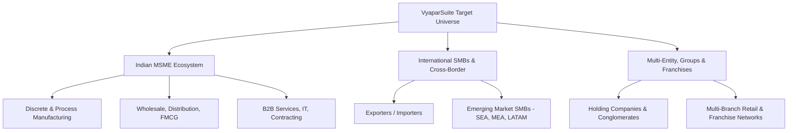
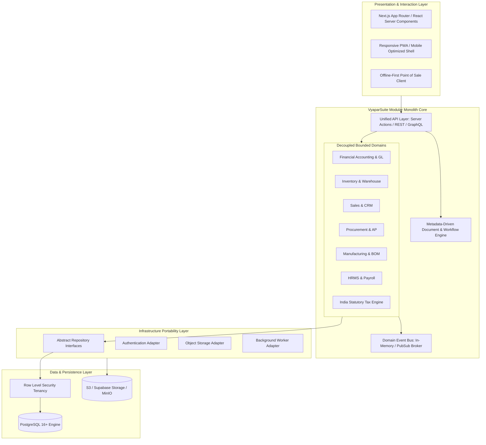
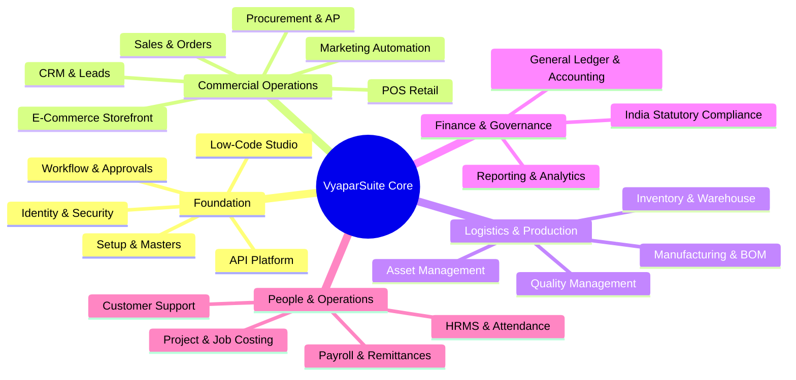

# VyaparSuite — Product Vision & Architectural Manifesto

> **Democratizing Enterprise-Grade Business Management for Indian MSMEs and Global Enterprises**  
> *Document Version: 1.0.0*  
> *Status: Approved & Canonical*  
> *Author: Core Architecture & Product Engineering Group*

---

## 1. Product Name & Identity

### 1.1 Name & Etymology
**VyaparSuite** derives its identity from the Sanskrit and Hindi root word **"Vyapar" (व्यापार)**, meaning *trade, commerce, business, transaction, and industry*. 

VyaparSuite is conceived not merely as software, but as the foundational operating system for commercial enterprise. It embodies the speed, pragmatism, and resourcefulness of traditional commerce, supercharged with modern cloud architecture, type-safe engineering, and double-entry mathematical rigor.

### 1.2 Product Identity & Core Positioning
VyaparSuite is an **original, open-source, production-grade, modular Enterprise Resource Planning (ERP) platform**. Built from the ground up on modern web standards (Next.js, TypeScript, Tailwind CSS, PostgreSQL/Supabase), VyaparSuite bridges the historical chasm between rigid, dated legacy ERPs and expensive, opaque SaaS platforms.

```
       [ Legacy Monoliths ]                  [ VyaparSuite ]                  [ Proprietary Big-Tech ]
  (ERPNext, Tally, Openbravo)          Modern, Open-Source, Fast,         (SAP S/4HANA, NetSuite, Odoo Ent)
  Heavy, Python/MariaDB, Dated UX      Type-Safe, Modular Monolith        Astronomical TCO, Vendor Lock-in
```

VyaparSuite is **not a fork, wrapper, or cosmetic skin** over ERPNext or Odoo. It is an independent, ground-up ERP architecture engineered to overcome the technical debt, scaling ceilings, and usability flaws inherent in first- and second-generation open-source ERP systems.

---

## 2. Mission Statement

> **"To democratize enterprise-grade business management for Micro, Small, and Medium Enterprises (MSMEs) worldwide by delivering a lightning-fast, modular, and mathematically rigorous ERP platform that is accessible to a five-person trading firm, yet capable of scaling to a multi-national conglomerate."**

Every business deserves software that respects its operational agility, guarantees financial truth, operates with consumer-grade speed, and never holds its data hostage behind paywalls or proprietary formats.

---

## 3. Target Market & Ideal Customer Profiles (ICPs)

VyaparSuite is architected specifically to cater to underserved mid-market and growing commercial entities, with first-class specialization for the Indian commercial ecosystem and native capability for international multi-currency trade.



### 3.1 Primary Segment: Indian MSMEs (Manufacturing, Trading, Services)
India represents over 63 million MSMEs contributing nearly 30% of the nation's GDP. Despite rapid digitization (UPI, GSTN, e-Invoicing), the vast majority remain trapped in single-user desktop accounting software (Tally, Busy) or struggle with heavy, unstable self-hosted platforms.

- **Manufacturing (Discrete & Process)**: Engineering workshops, plastics, auto components, textiles, chemicals, food processing. Needs multi-level Bill of Materials (BOM), sub-contracting/job work, batch tracking, scrap management, and accurate landed cost calculation.
- **Wholesale & Distribution**: FMCG, pharmaceuticals, electronics, building materials. Demands high-speed order processing, credit control, batch/expiry enforcement, multi-warehouse logistics, and automated GST reconciliation.
- **B2B & Professional Services**: IT consulting, facilities management, engineering services. Requires milestone billing, project time-tracking, expense allocation, and statutory withholding (TDS).

### 3.2 Secondary Segment: International SMBs & Emerging Markets
Small and medium businesses in Southeast Asia, the Middle East, Africa, and Latin America face similar structural problems: global solutions (NetSuite, SAP Business One) are cost-prohibitive, while local software lacks modern APIs and modularity.
- **Characteristics**: 10 to 500 employees, $1M to $50M annual revenue.
- **Needs**: Multi-currency transactions, customizable VAT/tax engines, flexible charts of accounts (COA), multi-language capability, and modern REST/GraphQL APIs.

### 3.3 Tertiary Segment: Multi-Company Groups, Franchises, and Conglomerates
- **Holding Companies & Subsidiaries**: Business groups operating multiple legal entities requiring isolated ledgers, distinct tax registrations, inter-company transactions, and consolidated group financial statements.
- **Franchise & Retail Chains**: Centralized procurement and inventory distribution supplying independent or company-owned retail outlets with local point-of-sale (POS) operations.

---

## 4. Core Value Propositions

### 4.1 Production-Grade Double-Entry Accounting with Native Indian Compliance
Accounting is the nervous system of any true ERP. VyaparSuite does not compromise on accounting purity:
- **Strict Double-Entry**: Every transaction translates to immutable debits and credits. No "soft" balance modifications or arbitrary ledger adjustments.
- **Built-in India Stack**: Native support for Goods and Services Tax (GST), electronic invoicing (e-Invoice via NIC/IRP), electronic waybills (e-Way Bill), Tax Deducted at Source (TDS), Tax Collected at Source (TCS), and Ministry of Corporate Affairs (MCA) mandated audit trail logging.
- **Real-Time Financial Statements**: Instantaneous Trial Balance, Profit & Loss, Balance Sheet, and Cash Flow generation without batch compilation delays.

### 4.2 Modular Architecture: Activate Only What You Need
Legacy ERPs force users into an overwhelming "all-or-nothing" paradigm. VyaparSuite adopts an app-store mental model:
- Start with simple Invoicing and Contact Management on Day 1.
- Activate Inventory and Warehousing on Month 2.
- Activate Manufacturing, Quality Control, and Payroll as operational complexity warrants.
- **Zero Inactive Clutter**: Menus, fields, doctypes, and database queries dynamically adapt to only enabled modules.

### 4.3 Modern UX: Faster and Cleaner than ERPNext, Easier than Odoo
- **Sub-100ms Interactions**: Built on Next.js App Router and optimized React Server Components.
- **Keyboard-First Design**: Complete document entry (invoices, journal entries, purchase orders) operable entirely via keyboard shortcuts without touching a mouse.
- **Progressive Disclosure**: High-density operational forms that hide edge-case configurations until required, eliminating visual fatigue.
- **Responsive & Omni-Channel**: Flawless execution across desktop workstations, shop-floor tablets, and mobile devices.

### 4.4 Enterprise Tenancy: Multi-Company, Multi-Branch, Multi-Warehouse, Multi-Currency from Day Zero
Multi-entity capabilities are baked into the core data model, not retrofitted as an afterthought:
- Unlimited legal entities (companies) within a single tenant.
- Shared or isolated Chart of Accounts per company.
- Multi-branch operational isolation with centralized financial rollups.
- Real-time exchange rate conversions and unrealized/realized forex gain/loss calculations.

### 4.5 Self-Hostable Sovereignty with Cloud-First Convenience
- **True Infrastructure Portability**: Zero lock-in. Run on our managed cloud (Supabase/Vercel) or deploy on self-hosted infrastructure (bare metal, Docker Compose, Kubernetes, AWS, Hetzner, DigitalOcean) using PostgreSQL.
- **Database-Level Isolation**: Native PostgreSQL Row Level Security (RLS) ensures bulletproof tenant and organizational data separation.

### 4.6 Sustainable Open-Source Model
- **Open-Core Purity**: The entire core ERP (Accounting, Sales, Purchase, Inventory, Manufacturing, HR, CRM) is genuinely free and open-source under a business-friendly, permissive or copyleft license (AGPLv3 / Apache 2.0 dual options for ecosystem sanity).
- **Commercial Sustainability**: Revenue generated via enterprise hosting, SLA support, marketplace add-ons, and certified implementation partner networks—never by crippling core accounting functionality behind an artificial paywall.

---

## 5. Competitive Positioning

```
                         High Architectural Modernity (TypeScript / Next.js / Edge)
                                            │
                                            │        ★ VyaparSuite
                                            │
                                            │
        ERPNext                             │
  (Python / MariaDB / Frappe)               │
                                            │
────────────────────────────────────────────┼────────────────────────────────────────────
Low Enterprise Rigor                        │                        High Enterprise Rigor
(Incomplete Core)                           │                        (Auditable Double-Entry)
                                            │
                     Odoo Community         │        Odoo Enterprise
                (Paywalled Accounting)      │        (Proprietary / Expensive)
                                            │
                                            │
                                            │        Tally Prime / SAP B1
                                            │        (Proprietary / Legacy Desktop)
                                            │
                         Low Architectural Modernity (Legacy Python / Desktop C++)
```

### 5.1 Deep-Dive Comparative Matrix

| Feature / Dimension | **VyaparSuite** | **ERPNext (Frappe)** | **Odoo Community** | **Tally Prime** | **Zoho One / Books** |
| :--- | :--- | :--- | :--- | :--- | :--- |
| **Core Architecture** | Next.js, TypeScript, PostgreSQL | Python, MariaDB, Frappe JS | Python, PostgreSQL, OWL | Proprietary C++ Desktop | Proprietary Java/Cloud |
| **User Experience (UX)** | Clean, Modern, Instant, Sub-100ms | Monolithic Desk, Form-heavy | App-style, cluttered | Keyboard-fast, dated TUI | Modern, click-heavy |
| **Double-Entry Accounting** | Native, Auditable, Immutable | Native, Complete | Heavily Crippled (Paywalled) | Native, unstructured | Native, Cloud-locked |
| **Indian GST / e-Invoice** | Native, First-Class Engine | Good, via India Compliance App | Requires expensive 3rd party apps | Native, traditional | Native, Cloud-locked |
| **Licensing** | Open-Source Core | Open-Source (GPLv3) | Open-Core (Artificial Paywall) | Proprietary License | Proprietary SaaS |
| **Multi-Company / Multi-Branch** | Native Day 0 Architecture | Native | Available, limited in Community | Limited / Group company | Requires multi-org add-on |
| **Developer Ecosystem** | Modern TypeScript / Node.js | Python / Frappe (Niche DSL) | Python / Odoo ORM (Niche) | TDL (Niche / Closed) | Deluge (Proprietary) |
| **Deployment Model** | Managed Cloud or Docker / K8s | Self-hosted or Frappe Cloud | Self-hosted or Odoo.sh | On-premise desktop | Pure SaaS (No self-host) |
| **API & Headless** | OpenAPI 3.0, GraphQL, Webhooks | REST API (Frappe-bound) | XML-RPC / JSON-RPC | OLE / ODBC / XML (Clunky) | Proprietary REST |

### 5.2 Strategic Critique: ERPNext vs. VyaparSuite
*Why not just use or contribute to ERPNext?*
- **Frappe Framework Friction**: Frappe is an idiosyncratic, Python-based full-stack framework with its own ORM, routing, and templating engine. The global talent pool of TypeScript/Next.js developers is roughly 50x larger than Frappe developers.
- **Database Limitations**: ERPNext historically favors MariaDB over PostgreSQL, limiting access to PostgreSQL's world-class JSON capabilities, Row Level Security, pgvector, and rich extension ecosystem.
- **Monolithic Setup & Maintenance**: Running bench, Redis queues, Celery workers, and Node socket servers on Python 3 introduces operational friction for standard DevOps teams.
- **Dated Desk Paradigm**: ERPNext’s Desk UI feels like enterprise software designed in 2014. VyaparSuite provides a consumer-grade, modern React experience with fluid page transitions, instant search, and zero full-page reloads.

### 5.3 Strategic Critique: Odoo Community vs. VyaparSuite
*Why not just use Odoo Community?*
- **The "Accounting Paywall" Trap**: Odoo intentionally removed General Ledger, Bank Reconciliation, Trial Balance, and P&L from Odoo Community to force businesses into Odoo Enterprise. This makes Odoo Community non-viable for any serious business without third-party hacks.
- **Predatory Pricing Ladder**: Odoo Enterprise pricing escalates dramatically as user counts and apps grow, creating customer resentment.
- **VyaparSuite’s Answer**: Complete, enterprise-grade double-entry accounting is, and will forever remain, 100% free and open-source in VyaparSuite.

---

## 6. Architecture Philosophy & Technical Principles

VyaparSuite rejects both over-engineered microservices and tangled spaghetti monoliths. Instead, it is built as a **Clean Modular Monolith**.



### 6.1 Clean Domain-Driven Bounded Contexts
- Modules do **not** perform direct cross-domain SQL queries or mutate foreign tables.
- Communication between domains occurs through **explicit domain service interfaces** or asynchronous **Domain Events** (e.g., `SalesInvoiceSubmittedEvent` triggers `LedgerPostService` and `StockDeductionService`).
- Any module can be disabled or detached without crashing the system.

### 6.2 Infrastructure-Agnostic Core (Repository & Port-Adapter Pattern)
- The application business logic has zero direct dependencies on proprietary cloud vendor SDKs.
- Persistence is mediated through repository interfaces. Supabase is the primary initial provider, but the core can seamlessly target vanilla PostgreSQL, AWS Aurora, or Neon.

### 6.3 Event-Driven Business Actions
- Critical actions produce immutable domain events.
- Guarantees eventual consistency for heavy downstream jobs (e.g., PDF generation, e-Invoice transmission, webhook dispatches) without blocking interactive user requests.

### 6.4 Metadata-Driven Document Framework (Doctype Engine)
- Documents (Invoices, Quotations, Items, Customers) are backed by declarative schemas.
- Custom fields, validation rules, calculated fields, and workflow states can be configured at runtime without requiring schema migrations or code recompilation.

---

## 7. Technical Stack Summary

```
┌─────────────────────────────────────────────────────────────────────────┐
│                             FRONTEND                                    │
│  Next.js 14+ (App Router) │ React 18/19 │ TypeScript 5+ │ Tailwind CSS  │
│  Shadcn UI / Radix Primitives │ TanStack Table & Query │ Lucide Icons   │
└─────────────────────────────────────────────────────────────────────────┘
                                   │
┌─────────────────────────────────────────────────────────────────────────┐
│                             BACKEND                                     │
│  Next.js Server Actions & Route Handlers │ Node.js / Edge Runtime       │
│  Zod Schema Validation │ Drizzle ORM / Native SQL Queries               │
└─────────────────────────────────────────────────────────────────────────┘
                                   │
┌─────────────────────────────────────────────────────────────────────────┐
│                      PERSISTENCE & SECURITY                             │
│  PostgreSQL 16+ │ Supabase Auth & Storage │ Row Level Security (RLS)    │
│  pgvector (Semantic Search) │ pg_stat_statements (Audit & Performance)  │
└─────────────────────────────────────────────────────────────────────────┘
                                   │
┌─────────────────────────────────────────────────────────────────────────┐
│                      DEVOPS & DEPLOYMENT                                │
│  Docker & Docker Compose │ Vercel Platform │ GitHub Actions CI/CD       │
│  Self-Hosted Kubernetes Helm Charts (Production Target)                 │
└─────────────────────────────────────────────────────────────────────────┘
```

- **Frontend & App Framework**: Next.js (TypeScript) utilizing App Router, React Server Components for optimal SSR performance, Tailwind CSS for systematic utility styling, and accessible Radix UI primitives.
- **State & Data Fetching**: TanStack Table for virtualization and high-density data grids; Server Actions for transactional RPC calls with optimistic UI updates.
- **Database & Identity**: PostgreSQL 16+ managed via Supabase (Auth, RLS, Storage, Realtime). Row Level Security guarantees multi-tenant and multi-company isolation at the engine level.
- **Abstraction Layer**: Strict TypeScript repository interfaces decoupling database calls from vendor-specific drivers.

---

## 8. Comprehensive Module Blueprint (The 22 Modules)

VyaparSuite is organized into 22 cohesive modules spanning the entire operational continuum of an enterprise:



### Module 1: Setup & Master Data
- Central management of Company profiles, multi-branch hierarchies, fiscal years, currencies, and global measurement units (UOM).
- Global Chart of Accounts (COA) templates: Indian Schedule III, Standard International, Manufacturing COA, Services COA.
- Global numbering series (naming series) engine supporting dynamic prefixes, fiscal year tokens, and zero-padded counters.

### Module 2: Identity, Access & Security
- Multi-tenant authentication with Multi-Factor Authentication (MFA/TOTP).
- Hybrid Role-Based Access Control (RBAC) and Attribute-Based Access Control (ABAC).
- Field-level permissions (e.g., hide cost prices or margin calculations from sales agents).
- Immutable audit log tracking every user login, record read, record creation, modification, and deletion.

### Module 3: CRM & Lead Management
- Omnichannel lead ingestion (Web forms, WhatsApp, Email, CSV imports).
- Visual Kanban deal pipelines with customizable qualification stages.
- Lead scoring, interaction logging (calls, meetings, notes), and seamless one-click conversion to Customer and Quotation.

### Module 4: Sales & Order Management
- Quotation to Sales Order to Delivery Note to Sales Invoice lifecycle.
- Complex pricing engine: customer price lists, tiered volume discounts, promotional discount rules, and currency conversion.
- Customer credit limit enforcement and payment term scheduling (e.g., 30% advance, 70% against delivery).
- Customer self-service portal for viewing statements, outstanding invoices, and tracking delivery status.

### Module 5: Procurement & Vendor Management
- Material Requisition (MR) to Request for Quotation (RFQ) to Vendor Quotation Comparison.
- Purchase Orders (PO), Goods Receipt Notes (GRN / Purchase Receipt), and Purchase Invoices.
- Landed Cost Vouchers: allocate freight, customs duties, and insurance proportionally across received inventory items by value, quantity, or weight.
- Comprehensive vendor performance scoring (lead time, quality acceptance rate, price variance).

### Module 6: Inventory & Warehouse Management
- Multi-warehouse hierarchical tree (Central Hub, Regional Hubs, Retail Stores, Transit Warehouses).
- Strict stock valuation: FIFO (First-In, First-Out) and Moving Weighted Average.
- Serial number tracking and Batch/Lot tracking with manufacturing and expiry date enforcement.
- Stock transfers, inter-warehouse movements, stock reconciliation, and automated reorder point alerts.

### Module 7: Financial Accounting & General Ledger
- Complete double-entry General Ledger (GL) posting engine.
- Journal Entries (manual, recurring, foreign exchange revaluation, opening balances).
- Accounts Receivable (AR) and Accounts Payable (AP) aging analysis with credit aging buckets (0-30, 31-60, 61-90, 90+ days).
- Automated bank reconciliation with support for OFX/CSV statement ingestion and rule-based matching.
- Real-time Balance Sheet, Profit & Loss Statement, Trial Balance, and Cash Flow (Direct & Indirect).

### Module 8: India Statutory Compliance & Tax Engine
- Comprehensive GST engine: CGST, SGST, IGST, UTGST, and GST Cess calculation.
- Direct API integration with Invoice Registration Portal (IRP/NIC) for automated IRN generation, Signed QR Code embedding, and e-Invoice PDF creation.
- Direct e-Way Bill generation with vehicle number tracking, distance validation, and consolidated e-Way Bill generation.
- GSTR-1, GSTR-3B, and GSTR-9 summary generation and JSON export compliant with the GSTN portal.
- Tax Deducted at Source (TDS) and TCS engine with section-wise thresholds (194C, 194J, 194Q, 206C) and Form 16A preparation.
- MCA-mandated Audit Trail (Rule 3 of Companies Accounts Rules) with tamper-evident version history and unalterable change logs.

### Module 9: Point of Sale (POS)
- Modern, touch-optimized retail counter interface.
- Offline-first architecture: record sales without internet connectivity and sync bidirectionally upon reconnection.
- High-speed barcode scanner integration, weighing scale serial connectivity, and thermal receipt printer support (ESC/POS).
- Shift management, cash drawer reconciliation, petty cash tracking, and split-payment methods (Cash, Card, UPI, Store Credit).

### Module 10: Manufacturing & Production
- Multi-level Bill of Materials (BOM) with nested sub-assemblies, scrap percentages, and operational labor cost estimation.
- Work Centers and Routing definitions with capacity planning and hourly cost tracking.
- Production Orders, Material Transfer for Manufacture, and Finished Goods Receipt.
- Sub-contracting / Job Work lifecycle: sending raw materials to third-party vendors and receiving finished components with 57F4 challan tracking.

### Module 11: Quality Management
- Inspection Criteria and Sampling Plans for Inward Raw Materials, In-Process Production, and Final Pre-Dispatch inspection.
- Quality Inspection (QI) documents with parameter-based pass/fail tolerance thresholds.
- Non-Conformance Reports (NCR), quarantine warehouse transfers, and Corrective & Preventive Actions (CAPA) tracking.

### Module 12: Fixed Asset Management & Depreciation
- Complete asset register tracking acquisition cost, capitalization date, location, custodian, and serial numbers.
- Automated depreciation engine supporting Straight Line Method (SLM) and Written Down Value (WDV) compliant with Indian Companies Act / IT Act.
- Asset repair, maintenance log, asset revaluation, and asset scrapping/sale with automatic gain/loss journal entries.

### Module 13: Project Management & Job Costing
- Project Work Breakdown Structures (WBS), milestones, Gantt charts, and task management.
- Employee and contractor timesheets with billable vs. non-billable hour allocation.
- Project budget tracking: real-time comparison of estimated vs. actual expenses (labor, materials, direct purchases).
- Milestone and percentage-of-completion progress billing.

### Module 14: Human Resource Management (HRMS)
- Employee lifecycle management: onboarding, personal file, documents, asset allocation, performance reviews, offboarding.
- Attendance tracking: biometric machine API integration, geofenced mobile check-ins, shift scheduling, and overtime rules.
- Leave management: customizable leave policies (Privilege, Casual, Sick, Maternity), accruals, balances, and multi-tier approval workflows.

### Module 15: Payroll & Statutory Remittances
- Configurable salary structures: Basic, HRA, Special Allowance, Conveyance, Performance Bonuses, and deductions.
- Native Indian statutory deductions: Provident Fund (PF / EPFO), Employee State Insurance (ESIC), Professional Tax (state-specific slabs), and Labour Welfare Fund (LWF).
- Automated salary slip generation, batch bank disbursement file exports (NEFT/RTGS format), and Form 16 / tax computation preview.

### Module 16: Customer Support & Helpdesk
- Multi-channel support ticketing (Email-to-ticket, web portal, API).
- Service Level Agreement (SLA) management with automated breach alerts and escalation paths.
- Ticket assignment rules, internal agent notes, customer satisfaction (CSAT) surveys, and public/internal Knowledge Base.

### Module 17: Website & E-Commerce Storefront
- Built-in headless storefront syncing directly with the Inventory and Item catalog.
- B2B customer portal: specific wholesale pricing, credit-limit checkout, and bulk order upload.
- Payment gateway integrations (Razorpay, Stripe, Cashfree, UPI QR) and automated sales invoice generation upon checkout.

### Module 18: Marketing Automation & Campaigns
- Customer segmentation based on purchase history, RFM (Recency, Frequency, Monetary) metrics, and geography.
- Email, SMS, and WhatsApp marketing campaigns with template variable substitution.
- Campaign conversion tracking and attribution linked directly to Quotations and Sales Orders.

### Module 19: Workflow & Approval Engine
- Visual state machine builder for any document type (Draft, Pending Approval, Approved, Rejected, Cancelled).
- Multi-level, conditional approval hierarchies (e.g., PO > ₹1,00,000 requires VP Approval; PO > ₹10,00,000 requires CFO Approval).
- Notification engine dispatching alerts via in-app notification center, email, Slack, and WhatsApp.

### Module 20: Reporting & Business Intelligence
- Interactive, drill-down financial reports: click any figure in the Balance Sheet to trace down to the underlying General Ledger vouchers.
- Pivot table analysis engine for sales, inventory velocity, and purchasing trends.
- Automated scheduled report delivery via email (PDF, Excel, CSV) to executive stakeholders.

### Module 21: Low-Code Customization & Studio
- Schema customization: add custom fields (Text, Number, Date, Select, Link) to any core document without database downtime.
- Client Script and Server Script capabilities for custom business validations and dynamic form behavior.
- Custom Print Format designer: drag-and-drop or HTML/Tailwind templates for invoices, purchase orders, and delivery slips.

### Module 22: API Platform & Integrations
- Comprehensive OpenAPI 3.0 documented REST and GraphQL endpoints for all entities.
- Outbound webhooks triggered on document state changes with retry queues and signature validation.
- Native connector hooks for logistics aggregators (Shiprocket, Delhivery), messaging (Twilio, Gupshup), and banking (Open Banking APIs).

---

## 9. Design Principles (The 12 Tenets of VyaparSuite)

Every line of code and user interface decision in VyaparSuite is governed by twelve inviolable tenets:

### Tenet 1: Immutable Ledgers & Strict Accounting Purity
Once a financial or inventory transaction is submitted, it is physically **immutable**. It cannot be deleted or secretly edited. Rectification requires a formal cancellation, debit note, credit note, or reverse journal entry. The ledger is a sacred historical record.

### Tenet 2: Absolute Data Integrity & Transactional Consistency
All cross-table operations (e.g., Invoicing impacting Sales, Accounts Receivable, Inventory, and Tax Ledgers) must execute within atomic database transactions (`BEGIN ... COMMIT`). Partial failures are strictly impossible.

### Tenet 3: Multi-Layer Security with Database-Enforced Row Level Security
Security is never left purely to application-level `if` statements. Tenancy isolation, company boundaries, and branch restrictions are enforced at the database layer via **PostgreSQL Row Level Security (RLS)**. Even if an application bug occurs, unauthorized data can never be read or written.

### Tenet 4: Tamper-Evident Auditability & Statutory Traceability
Every mutation logs the exact user ID, timestamp, IP address, previous state, and new state. Compliant with the strictest global audit standards and Indian MCA rules, history cannot be truncated or disabled.

### Tenet 5: Progressive Disclosure UX
Forms must never intimidate users. An invoice form initially presents only the essential fields (Customer, Item, Qty, Rate). Advanced configurations (Warehouse Overrides, Project Allocations, Tax Exceptions, Cost Centers) remain tucked away behind expandable sections, revealing complexity only when demanded.

### Tenet 6: Keyboard-First Operation & High-Throughput Entry
Data entry clerks process hundreds of vouchers daily. Every common workflow must support full keyboard operation:
- `Cmd/Ctrl + S` to save
- `Cmd/Ctrl + Enter` to submit
- `Tab` navigation across grids
- Quick-search selectors with typeahead filtering

### Tenet 7: Sub-100ms Performance & Zero Full-Page Reloads
Navigation between modules, filtering 50,000 ledger rows, or rendering dashboard charts must execute in under 100 milliseconds. UI states are preserved, transitions are fluid, and data fetching is optimized with server caching and edge distribution.

### Tenet 8: Responsive & Cross-Device Parity
A warehouse supervisor inspecting stock on a tablet, a CEO approving high-value purchases on a mobile phone, and an accountant entering vouchers on a dual-monitor desktop workstation must all experience an interface tailored to their viewport without broken layouts or lost capabilities.

### Tenet 9: Offline-Resilience for Critical Edge Operations
Retail counters and warehouse docks cannot halt when internet connectivity flickers. The POS and mobile stock count modules are engineered offline-first, leveraging local client storage (IndexedDB) with deterministic conflict-resolution synchronization upon reconnection.

### Tenet 10: Modularity & Strict Domain Decoupling
Modules must maintain strict boundaries. A bug or change in the HRMS module must never risk breaking the Invoicing or Inventory module. Dependencies must flow unidirectionally through published interfaces.

### Tenet 11: Zero Vendor Lock-in & Data Portability
Users own their data completely. VyaparSuite provides one-click raw database exports, standard SQL dumps, and standardized JSON/CSV data extraction for every entity at any time.

### Tenet 12: Global Core with Deep Local Excellence
The core system is engineered for global trade (multi-currency, flexible COA, UTC timestamps), but features deep, uncompromised localized implementations for specific statutory environments (starting with the full Indian GST/TDS/e-Invoice ecosystem).

---

## 10. Release Strategy & Phased Implementation Roadmap

VyaparSuite adopts an uncompromising, phase-gated engineering methodology. Each phase must achieve 100% functional completeness, strict test coverage, and documentation before work commences on the subsequent phase.

```mermaid
gantt
    title VyaparSuite Engineering Roadmap (Phases 0 to 12)
    dateFormat  X
    axisFormat  Phase %x

    section Foundation & Core MVP
    Phase 0 - Foundation, Tenancy, Auth & Framework :active, p0, 0, 1
    Phase 1 - Master Data, Organizations & Currencies :p1, after p0, 1
    Phase 2 - Double-Entry General Ledger & Accounts  :p2, after p1, 1
    Phase 3 - Procurement & Accounts Payable (AP)    :p3, after p2, 1
    Phase 4 - Sales, Invoicing & Receivables (AR)    :p4, after p3, 1
    Phase 5 - Financial Statements [MVP GATEWAY]     :crit, p5, after p4, 1

    section Statutory, Inventory & Retail
    Phase 6 - India Statutory Tax & e-Invoicing      :p6, after p5, 1
    Phase 7 - Advanced Inventory, Batches & Serials  :p7, after p6, 1
    Phase 8 - Point of Sale (POS) & Retail Engine    :p8, after p7, 1

    section Manufacturing, Enterprise & Scale
    Phase 9 - Manufacturing (BOM, MRP) & QA          :p9, after p8, 1
    Phase 10 - Fixed Assets & Project Costing        :p10, after p9, 1
    Phase 11 - HRMS, Attendance & Indian Payroll     :p11, after p10, 1
    Phase 12 - Low-Code Studio, Workflow & Open API  :p12, after p11, 1
```



### Phase Details

#### Phase 0: System Foundation, Core Framework, Tenancy & Identity
- Next.js App Router scaffolding with TypeScript and Tailwind CSS.
- PostgreSQL schema setup with Supabase Auth and multi-tenant RLS policies.
- Base metadata engine (Doctype abstraction, custom field schema tables, audit log infrastructure).
- Global layout: Command palette (`Cmd + K`), sidebar navigation, user preferences.

#### Phase 1: Master Data, Organizations, Currencies & Chart of Accounts
- Company, Branch, Cost Center, and Warehouse hierarchical trees.
- Currency master with real-time and manual exchange rate registers.
- Chart of Accounts (COA) tree builder with root categories (Asset, Liability, Equity, Income, Expense).
- Customer and Supplier master records with tax identification, credit limits, and billing/shipping addresses.

#### Phase 2: Double-Entry General Ledger, Journal Entries & Bank Accounts
- Immutable General Ledger (`gl_entries`) table and double-entry transaction manager.
- Manual Journal Entry creation with balanced debit/credit validation.
- Bank Account master, Cash Account management, and Bank Statement import interface.
- Opening balance entry tool for migrating legacy accounting books.

#### Phase 3: Procurement & Vendor Accounts Payable (AP)
- Purchase Requisition and Request for Quotation (RFQ).
- Purchase Order (PO) with status tracking (Draft, Submitted, Partially Received, Completed).
- Goods Receipt Note (Purchase Receipt) with stock integration.
- Purchase Invoice, payment scheduling, vendor credit notes, and AP aging report.

#### Phase 4: Sales, Invoicing & Accounts Receivable (AR)
- Quotation and Proforma Invoice generation.
- Sales Order management with stock availability checking.
- Delivery Note with automated inventory relief.
- Sales Invoice with tax calculation, customer payment allocation, and AR aging report.

#### Phase 5: Financial Statements & Reporting [THE MVP GATEWAY]
> [!IMPORTANT]
> **MVP Milestone Gate**: Phases 0 through 5 constitute the core Minimum Viable Product. Upon completion of Phase 5, a business can operate legitimate, auditable double-entry accounting.
- Interactive Trial Balance with date filtering and zero-balance suppression.
- Profit & Loss Statement (Income Statement) with gross margin and net profit calculation.
- Balance Sheet with real-time assets, liabilities, and retained earnings calculation.
- Cash Flow Statement (Direct and Indirect methods).

#### Phase 6: India Statutory Tax Engine (GST, TDS/TCS, e-Invoice, e-Way Bill)
- Automated GST determination engine (Inter-state IGST vs. Intra-state CGST+SGST).
- NIC API connector for automated IRN, signed QR code, and e-Invoice PDF creation.
- e-Way Bill generation with vehicle movement tracking.
- GSTR-1, GSTR-3B JSON generation and MCA-compliant unalterable audit trails.

#### Phase 7: Advanced Inventory, Warehouses, Batch & Serial Tracking
- Item master with variant matrix (Size, Color, Material).
- Batch and Lot tracking with manufacturing and expiration date enforcement.
- Individual Serial Number tracking across the entire supply chain.
- Stock reconciliation, stock write-off, and physical inventory counting audits.

#### Phase 8: Point of Sale (POS) & Retail Billing
- Touchscreen and barcode-driven quick-billing POS terminal.
- Offline-first cache utilizing browser IndexedDB with automatic reconciliation on reconnect.
- Multi-tender payment capture (Cash, Card, UPI, Customer Credit).
- Shift opening, cash declaration, mid-day drops, and shift closing reports.

#### Phase 9: Manufacturing (BOM, MRP, Work Orders) & Quality Control
- Multi-level Bill of Materials (BOM) with operations, scrap, and explosion cost calculation.
- Work Order lifecycle and Material Consumption tracking.
- Sub-contracting / Job-work challan management.
- Quality Inspection checkpoints (Inward, In-process, Outward).

#### Phase 10: Fixed Assets, Depreciation & Project Job Costing
- Fixed Asset Register with maintenance logs.
- Automated monthly/annual depreciation posting (SLM and WDV).
- Project Task breakdowns, Timesheet logging, and Project Profitability dashboards.

#### Phase 11: HRMS, Time-Tracking & Indian Payroll Engine
- Employee directory, onboarding, and organizational chart.
- Shift scheduling, leave management, and biometric/API attendance ingestion.
- Indian Payroll: salary structures, automated deductions (PF, ESIC, PT), payslip distribution, and bank payout files.

#### Phase 12: Low-Code Studio, Workflow Engine, Public API Platform & Ecosystem
- Drag-and-drop Custom Field, Form, and Print Format designer.
- Visual state machine Workflow Builder with multi-step approval conditions.
- Production-grade OpenAPI 3.0 public API gateway, Webhook manager, and developer documentation portal.

---

## 11. Success Criteria & Key Performance Indicators (KPIs)

The success and architectural fitness of VyaparSuite is measured across four distinct, quantifiable dimensions:

### 11.1 System Performance & Latency Benchmarks
- **Page Load & TTFB**: P95 Time to First Byte (TTFB) < 150ms globally; complete page render < 800ms on standard 4G broadband.
- **Transaction Processing**: Ledger posting transactions committed and confirmed in < 50ms for documents containing up to 100 line items.
- **Report Generation**: Trial Balance and P&L across 100,000 journal entries generated in < 1.5 seconds without pre-aggregated snapshot hacks.

### 11.2 Usability & Workflow Efficiency
- **Data Entry Velocity**: A standard 5-line Sales Invoice or Journal Entry completed in < 30 seconds using only keyboard inputs.
- **Onboarding Velocity**: A new company set up with initial Chart of Accounts, fiscal year, and first invoice generated in < 10 minutes.
- **Error Reduction**: Built-in validation eliminates 100% of unbalanced journal entries and negative inventory anomalies (when strict stock is enabled).

### 11.3 Architectural Health & Code Quality
- **Test Coverage**: > 85% automated test coverage across accounting, inventory valuation, and statutory tax calculation routines.
- **Modularity Score**: Zero circular dependencies between domain modules; 100% of inter-module communications routed through documented domain interfaces or event bus.
- **Strict Typing**: Zero `any` types in TypeScript business logic; strict runtime validation via Zod on all API and server action boundaries.

### 11.4 Regulatory Compliance & Accuracy
- **Zero Calculation Discrepancies**: 100% mathematical parity with official GSTN portal calculations, e-Invoice IRP schemas, and standard Indian accounting standards (Ind AS).
- **100% MCA Audit Trail Pass**: Complete tamper-evident logging satisfying Section 134(5) and Rule 3 of the Companies (Accounts) Rules, verified by independent audit simulations.

---

## 12. Explicit Non-Goals (What VyaparSuite Is NOT)

To maintain sharp focus and avoid the bloated pitfalls of failed enterprise projects, VyaparSuite explicitly rejects the following:

### 1. NOT a Direct Clone or Cosmetic Wrapper of ERPNext / Odoo
VyaparSuite does not intend to replicate Frappe's Python runtime or Odoo's Python/XML-RPC framework. We are not porting legacy code. We are engineering a modern, type-safe Next.js and PostgreSQL architecture from first principles.

### 2. NOT a Disposable Demo, Toy Project, or UI Shell
VyaparSuite is not a flashy portfolio piece, frontend-only template, or dashboard mockup. Every form, table, ledger entry, and button connects to genuine, resilient database transactions backed by double-entry mathematics.

### 3. NOT a Rent-Seeking Open-Core Ecosystem
We will never release an open-source ERP whose accounting is intentionally broken or crippled to extort users into upgrading to an "Enterprise Edition." If an accounting feature is standard in business, it belongs in the open core.

### 4. NOT an Over-Engineered Microservices Sprawl
We explicitly reject breaking VyaparSuite into 30 independently deployed microservices requiring Kubernetes service meshes, Kafka clusters, and massive cloud infrastructure for a 50-person company. VyaparSuite is proudly a **modular monolith**: simple to deploy, maintain, test, and debug on modest infrastructure.

### 5. NOT a Fluffy "No-Code" Sandbox for Non-Accountants to Break Financial Truth
While VyaparSuite offers low-code customization (custom fields, custom print formats, workflows), it does **not** allow arbitrary UI-driven overrides that violate double-entry integrity, bypass debit/credit equality, or delete historical ledgers. Financial truth is non-negotiable.

---

## 13. Summary & The Path Forward

VyaparSuite represents a generational leap in open-source business software. By combining modern web engineering, relentless dedication to financial integrity, native Indian statutory compliance, and a clean modular design, VyaparSuite empowers growing enterprises to run their entire business with clarity, sovereignty, and velocity.

> *"Great businesses are built on accurate numbers, swift execution, and total operational clarity. VyaparSuite is the foundation upon which those businesses are built."*
