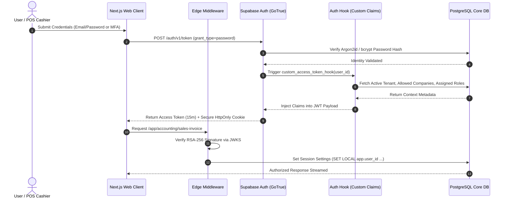
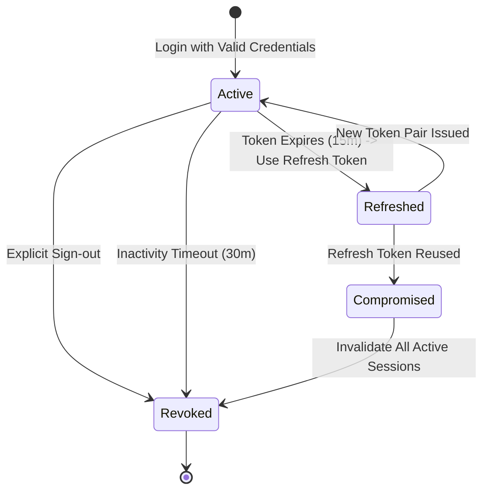
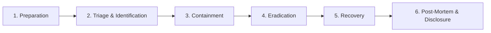

# VyaparSuite — Enterprise Security Architecture & Governance Model

> **Comprehensive Security Specification: Authentication, Multi-Tier Authorization, Row Level Security, Cryptography, OWASP Hardening, and Statutory Compliance**  
> *Document Version: 1.0.0*  
> *Status: Approved & Canonical Architecture*  
> *Classification: Enterprise Security & Compliance Standard*

---

## 1. Executive Summary & Zero-Trust Architecture

VyaparSuite enforces a **Zero-Trust Security Architecture** across all application, network, data persistence, and administrative boundaries. In an enterprise ERP environment managing critical financial records, payroll data, supply chain transactions, and statutory tax filings, security cannot be treated as an afterthought or relegated purely to frontend guards.

The platform assumes that perimeter defenses can be breached; therefore, every request—whether originating from a browser client, a Point of Sale (POS) terminal, a background worker, or a third-party webhook—is strictly authenticated, contextually authorized, and cryptographically verified.

```
┌─────────────────────────────────────────────────────────────────────────────┐
│                       ZERO-TRUST DEFENSE PIPELINE                           │
│                                                                             │
│ [Edge & WAF] ──▶ [Gateway / Next.js] ──▶ [Zod Validation] ──▶ [RBAC/ABAC]   │
│ (Cloudflare/TLS)  (CORS, Rate Limits)    (Type Sanitization)   (Maker-Checker)│
│                                                                    │        │
│                                                                    ▼        │
│ [Audit Log] ◀── [Field Masking] ◀── [PostgreSQL RLS] ◀── [Repository Call] │
│ (MCA Rule 3)     (PII Redaction)     (Tenant/Company Fence)  (Drizzle Param)│
└─────────────────────────────────────────────────────────────────────────────┘
```

---

## 2. Authentication Architecture (Supabase Auth + Enterprise Session Layer)

Authentication in VyaparSuite combines Supabase Auth (backed by PostgreSQL's `gotrue` engine) with an application-level identity session pipeline.



### 2.1 Identity Verification & Password Security
- **Hashing Standard**: Passwords are hashed using **Argon2id** (or `bcrypt` with work factor 12) with unique cryptographic salts. Passwords never touch application memory in plaintext.
- **Password Policy**: Minimum 12 characters, requiring uppercase, lowercase, numeric digits, and special characters. Automated check against the HaveIBeenPwned API (via k-anonymity hash ranges) prevents compromised passwords.

### 2.2 Multi-Factor Authentication (MFA / TOTP)
- **Mandatory MFA**: Enforced for all users possessing elevated administrative or financial roles (`system_manager`, `workspace_admin`, `cfo`, `finance_manager`, `tax_officer`).
- **Standard**: RFC 6238 Time-based One-Time Password (TOTP) compatible with Google Authenticator, Microsoft Authenticator, and 1Password.
- **Step-Up Authentication**: Triggered when a user initiates high-risk actions (e.g., modifying bank account details, executing tax return submissions, or issuing emergency credit limit overrides).

### 2.3 Custom JWT Claims Injection via Auth Hooks
Upon successful authentication, a database trigger function (`custom_access_token_hook`) enriches the standard Supabase JWT with operational context:

```json
{
  "sub": "b2c8f824-7128-4f81-a953-e5e3478950d4",
  "iss": "https://api.vyaparsuite.io/auth/v1",
  "exp": 1775836800,
  "tenant_id": "9d90a59b-5134-4061-9c6f-6fbe8353c7c2",
  "current_company_id": "c1a08467-f703-4318-b22f-d8fe6a94a021",
  "default_branch_id": "a4d32a89-9132-4467-bc18-289bca7e8e12",
  "roles": ["accounts_user", "tax_officer"],
  "allowed_companies": [
    "c1a08467-f703-4318-b22f-d8fe6a94a021",
    "e9d8c7b6-a5f4-4321-9876-123456abcdef"
  ],
  "is_mfa_verified": true
}
```

---

## 3. Multi-Layer Authorization Model (RLS + RBAC + ABAC + Field Masking)

Authorization is implemented as a strict, multi-stage filtration pipeline:

```
Request ──▶ [Layer 1: Edge RBAC] ──▶ [Layer 2: App ABAC & SoD] ──▶ [Layer 3: PostgreSQL RLS] ──▶ [Layer 4: Field Masking]
```

### 3.1 Layer 1: Application-Level Role-Based Access Control (RBAC)
- Checked before executing business logic. Evaluates whether the user's assigned roles permit the requested action (`Create`, `Read`, `Write`, `Submit`, `Cancel`, `Delete`) on the specified DocType.
- Configured in the declarative Permission Matrix.

### 3.2 Layer 2: Attribute-Based Access Control (ABAC) & Segregation of Duties (SoD)
- Evaluates dynamic context:
  - **Monetary Limits**: Validates whether document `grand_total` is within the user's authorization threshold.
  - **Maker-Checker Validation**: Verifies `current_user.id != doc.created_by` for submit/approval operations.
  - **Operational Boundaries**: Confirms document `branch_id` and `territory_id` match the user's authorized scope.

### 3.3 Layer 3: Database Row Level Security (PostgreSQL RLS)
Row Level Security is the foundation of VyaparSuite's data isolation. RLS policies are executed inside the database engine itself for every `SELECT`, `INSERT`, `UPDATE`, and `DELETE`.

```sql
-- Enable RLS unconditionally on all business tables
ALTER TABLE sales_invoices ENABLE ROW LEVEL SECURITY;
ALTER TABLE sales_invoices FORCE ROW LEVEL SECURITY;

-- Production RLS Policy for Sales Invoices
CREATE POLICY rls_sales_invoices ON sales_invoices
    AS RESTRICTIVE
    FOR ALL
    USING (
        -- 1. Hard Tenant Isolation
        tenant_id = (current_setting('app.current_tenant_id', true))::uuid
        AND
        -- 2. Legal Company Boundary
        company_id = (current_setting('app.current_company_id', true))::uuid
        AND
        -- 3. Branch-Level Authorization
        (
            branch_id = ANY(string_to_array(current_setting('app.allowed_branches', true), ',')::uuid[])
            OR
            current_setting('app.is_multi_branch_admin', true) = 'true'
        )
    );
```

### 3.4 Layer 4: Field-Level Masking & Data Redaction
Before API responses are returned to the client, the serialization layer intercepts document payloads and redacts restricted attributes:
- **Level 1 (Cost / Valuation)**: Stripped for non-executive and non-finance roles.
- **Level 2 (Statutory / PII)**: PAN masked as `ABCDE****F`, Bank Accounts masked as `******8921`, Aadhaar masked as `XXXX-XXXX-1234`.

---

## 4. Defense-in-Depth Strategy (The 6 Concentric Rings)

| Defense Layer | Security Mechanism | Threat Addressed | Verification Method |
|---|---|---|---|
| **1. Edge & Network** | Cloudflare Enterprise WAF, TLS 1.3 only, HSTS Preloaded, DDoS Shielding | volumetric DDoS, SYN floods, brute force, outdated cipher suites | Qualys SSL Labs A+ rating, WAF simulated attack testing |
| **2. API Gateway & Middleware** | Strict CORS, Rate Limiting (Redis Token Bucket), CSRF double-submit cookies, CSP Headers | Cross-Site Scripting (XSS), Clickjacking, API scraping, Session Hijacking | Mozilla Observatory A+ rating, automated penetration testing |
| **3. Application Logic** | Zod runtime schema validation, finite state machines, maker-checker enforcement | Parameter tampering, mass assignment, business logic bypass | Unit tests, state transition fuzzing |
| **4. Data Access Layer** | Drizzle ORM parameterized queries, zero raw string SQL interpolation | SQL Injection (SQLi), blind SQLi, ORM leakage | SonarQube SAST, automated static query analysis |
| **5. Database Engine** | PostgreSQL Row Level Security (RLS), append-only audit tables, column pgcrypto | Privilege escalation, multi-tenant data cross-contamination | RLS automated bypass test suites |
| **6. Infrastructure & Storage** | Isolated VPC, private subnets, encrypted EBS (AES-256), zero public DB endpoints | Network eavesdropping, server compromise, physical drive theft | AWS CIS Benchmark compliance scans |

---

## 5. Strict Input Validation & Type Safety Architecture (Zod Schemas)

Every incoming API payload and Server Action parameter must pass strict runtime schema validation via Zod before touching application services.

```typescript
import { z } from 'zod';

/**
 * Universal Production Schema for Sales Invoice Creation
 */
export const SalesInvoiceItemSchema = z.object({
  item_code: z.string().min(1).max(64),
  quantity: z.number().positive("Quantity must be greater than zero"),
  rate: z.number().nonnegative("Rate cannot be negative"),
  discount_percentage: z.number().min(0).max(100).default(0),
  tax_code: z.string().regex(/^GST_(0|5|12|18|28)$/, "Invalid GST tax code"),
  warehouse_id: z.string().uuid("Invalid Warehouse UUID")
});

export const CreateSalesInvoiceSchema = z.object({
  company_id: z.string().uuid("Invalid Company UUID"),
  branch_id: z.string().uuid("Invalid Branch UUID"),
  customer_id: z.string().uuid("Invalid Customer UUID"),
  posting_date: z.string().regex(/^\d{4}-\d{2}-\d{2}$/, "Format must be YYYY-MM-DD"),
  due_date: z.string().regex(/^\d{4}-\d{2}-\d{2}$/, "Format must be YYYY-MM-DD"),
  currency: z.string().length(3).default("INR"),
  items: z.array(SalesInvoiceItemSchema).min(1, "Invoice must contain at least one line item"),
  remarks: z.string().max(500).optional()
}).strict(); // Prevents unauthorized property injection (mass-assignment)
```

- **Universal `.strict()` Enforcement**: Disallows extraneous parameters, entirely preventing mass-assignment attacks.
- **Type Coercion Safeguards**: Never silently coerce invalid types; failures reject immediately with structured 422 HTTP responses.

---

## 6. API Security, Rate Limiting & Gateway Controls

### 6.1 Authentication Protocols
1. **Interactive UI Sessions**: Short-lived JWT (15-min) with cryptographically secure, HttpOnly, SameSite=Strict cookies.
2. **Machine-to-Machine (M2M) API Integrations**: Cryptographic API Keys formatted as `vyp_live_[32 random alphanumeric characters]`.
   - Stored in the database as **SHA-256 hashes**. The plaintext key is shown only once at creation time.
   - Tied to granular scopes (e.g., `invoices:create`, `stock:read`).

### 6.2 Rate Limiting Architecture
Rate limiting is executed at the edge using Upstash Redis with a sliding window token bucket algorithm:

| Endpoint Category | Window Size | Rate Limit | Action on Breach |
|---|---|---|---|
| **Public / Auth Endpoints** (`/api/auth/*`) | 60 seconds | 10 requests / IP | 429 Too Many Requests + 15 min exponential IP backoff |
| **General Authenticated UI** (`/api/v1/*`) | 60 seconds | 300 requests / User | 429 Too Many Requests |
| **High-Volume Machine APIs** (`/api/v1/pos/*`) | 60 seconds | 1,200 requests / Key | 429 Too Many Requests |
| **Report Generation & Large Exports** | 60 seconds | 5 requests / User | 429 Too Many Requests + Cooldown Queue |

### 6.3 Webhook Ingress & Egress Security
- **Inbound Webhooks** (e.g., Razorpay, Stripe, India NIC):
  - HMAC-SHA256 signature validation via header `X-Vyapar-Signature`.
  - Timestamp drift verification: payloads with timestamps exceeding 300 seconds are rejected to eliminate replay attacks.
- **Outbound Webhooks**:
  - Signed with tenant-specific secret keys using HMAC-SHA256.
  - Exponential backoff retry queue (1m, 5m, 15m, 1h) with circuit breaker disabling crashing subscriber endpoints.

---

## 7. Session Management & Token Lifecycle



1. **Short-Lived Access Tokens**: Lifetime restricted to 15 minutes to minimize exposure in the event of memory capture.
2. **Rotating Single-Use Refresh Tokens**:
   - Every refresh request exchanges a refresh token for a brand-new token pair.
   - **Reuse Detection**: If an old refresh token is submitted again, the system recognizes a token theft attempt, immediately revokes all sessions belonging to the user family, and triggers a high-severity security alert.
3. **Session Revocation Kill-Switch**:
   - Administrators can immediately terminate any active session via `/app/security/sessions`.
   - Changing a user's password or revoking a role immediately purges all associated active tokens from the session cache.

---

## 8. Audit Logging & Non-Repudiation Strategy (MCA Rule 3 Compliance)

In strict accordance with the **Companies (Accounts) Rules, 2014 (Rule 3)** mandated by the Ministry of Corporate Affairs (MCA), Government of India:
- Every financial transaction and master data modification records an unalterable audit trail.
- The audit feature cannot be disabled, edited, or bypassed by any system administrator.

### 8.1 Cryptographic Chained Audit Table

```sql
CREATE TABLE audit_trail_entries (
    id UUID PRIMARY KEY DEFAULT gen_random_uuid(),
    sequence_number BIGSERIAL NOT NULL,
    tenant_id UUID NOT NULL REFERENCES tenants(id),
    company_id UUID NOT NULL REFERENCES companies(id),
    user_id UUID NOT NULL,
    ip_address INET NOT NULL,
    user_agent TEXT,
    doctype VARCHAR(64) NOT NULL,
    doc_id UUID NOT NULL,
    action VARCHAR(32) NOT NULL, -- 'INSERT', 'UPDATE', 'CANCEL', 'APPROVE'
    diff_payload JSONB NOT NULL,  -- {"field": {"old": x, "new": y}}
    previous_hash VARCHAR(64) NOT NULL,
    current_hash VARCHAR(64) NOT NULL,
    created_at TIMESTAMPTZ DEFAULT clock_timestamp() NOT NULL
);

-- Database Rule: Physically prevent UPDATE and DELETE on audit trail
CREATE RULE prevent_audit_update AS ON UPDATE TO audit_trail_entries DO INSTEAD NOTHING;
CREATE RULE prevent_audit_delete AS ON DELETE TO audit_trail_entries DO INSTEAD NOTHING;
```

### 8.2 Cryptographic Hash Calculation
Each record's `current_hash` is calculated via SHA-256 over:
$$\text{Hash}_n = \text{SHA256}(\text{Hash}_{n-1} + \text{Timestamp} + \text{UserID} + \text{DocType} + \text{DocID} + \text{DiffJSON})$$
This creates an unalterable cryptographic chain where any external attempt to mutate historical records breaks downstream verification hashes.

---

## 9. Data Encryption Architecture

### 9.1 Encryption in Transit
- **Enforced Protocol**: TLS 1.3 only (TLS 1.0, 1.1, and 1.2 disabled).
- **Cipher Suites**: `TLS_AES_256_GCM_SHA384`, `TLS_CHACHA20_POLY1305_SHA256`.
- **HTTP Strict Transport Security (HSTS)**:
  `Strict-Transport-Security: max-age=63072000; includeSubDomains; preload`

### 9.2 Encryption at Rest
- **Storage Layer**: Physical database volumes and S3 storage buckets are encrypted using **AES-256** via AWS KMS / Cloud KMS with customer-managed keys.
- **Application Column-Level Encryption (CLE)**:
  - Highly sensitive fields (Aadhaar number, Bank Account Numbers, OAuth Refresh Tokens) are additionally encrypted before storage using PostgreSQL `pgcrypto` with AES-256-GCM.
  - Encryption keys are loaded into server memory via KMS at startup and never stored inside the database itself.

---

## 10. Multi-Tenant & Multi-Company Isolation Guarantees

### 10.1 Tenant Isolation Model
VyaparSuite utilizes a **Logical Multi-Tenancy with Hard Database-Enforced Row Level Security** model:
- All tenants share the highly optimized, scalable database cluster.
- Every transactional table includes an indexed `tenant_id` column.
- Row Level Security ensures that even if an engineer writes `SELECT * FROM sales_invoices;`, the database engine internally rewrites the query execution plan to include `WHERE tenant_id = 'current-tenant-uuid'`. Cross-tenant data leakage is physically impossible.

### 10.2 Company & Branch Boundaries within a Tenant
- A single tenant can operate multiple legal corporate entities (`companies`).
- General Ledgers, Bank Accounts, and Tax Registrations are strictly isolated per company.
- Inter-company transactions are recorded as two distinct, balancing vouchers linked by a cryptographic transaction token.

---

## 11. Secure Coding Guidelines & Engineering Standards

All contributors to VyaparSuite must adhere to the following mandatory engineering standards:

1. **Strict TypeScript Compilation**:
   - `"strict": true`, `"noImplicitAny": true`, `"exactOptionalPropertyTypes": true`.
   - Use of `any` is strictly prohibited and fails CI pipeline linting.
2. **Zero Raw SQL String Interpolation**:
   - Direct string concatenation (e.g., `db.execute('SELECT * FROM users WHERE id = ' + id)`) is strictly rejected.
   - All queries must utilize Drizzle ORM query builders or tagged template literals with parameterized inputs.
3. **Information Disclosure Prevention**:
   - Production error responses must never expose stack traces, database table names, or internal error messages.
   - Standardized error format: `{ "error": { "code": "NOT_FOUND", "message": "The requested resource does not exist.", "requestId": "req_..." } }`.
4. **Secret Management**:
   - Zero secrets or tokens in source code repositories.
   - Validated at build time using `@t3-oss/env-nextjs`.

---

## 12. Comprehensive OWASP Top 10 Mitigation Matrix

| OWASP Vulnerability | Architecture Risk | VyaparSuite Engineering Defense |
|---|---|---|
| **A01: Broken Access Control** | Unauthorized record access, tenant bypass | PostgreSQL Row Level Security (RLS) + Application RBAC + Maker-Checker constraints. |
| **A02: Cryptographic Failures** | Data breach of PII or passwords | TLS 1.3 in transit; AES-256 at rest; Column-level `pgcrypto` for PAN/Aadhaar; Argon2id password hashing. |
| **A03: Injection (SQL / XSS)** | Malicious SQL payloads, script injection | Drizzle ORM parameterized queries; React automatic JSX escaping; DOMPurify for rich text. |
| **A04: Insecure Design** | Flawed approval logic, race conditions | Deterministic finite state machines; database row locking (`FOR UPDATE`) on balance mutations. |
| **A05: Security Misconfiguration** | Exposed admin ports, default credentials | Immutable Docker containers; zero default accounts; automated CIS benchmark scanning. |
| **A06: Vulnerable Components** | Third-party npm dependency CVEs | Daily Dependabot / Snyk vulnerability scans; automated PR blocking for CVEs with CVSS >= 7.0. |
| **A07: Identification Failures** | Credential stuffing, session hijacking | Supabase Auth MFA/TOTP; 15-minute access token lifespan; rotating refresh tokens with reuse detection. |
| **A08: Software / Data Integrity** | Tampered code deployment, malicious updates| Signed Git commits; GitHub Actions CI/CD with branch protection rules; Subresource Integrity (SRI). |
| **A09: Logging Failures** | Undetected intrusion, untracked modifications | MCA Rule 3 chained SHA-256 audit logs; real-time security event telemetry sent to SIEM. |
| **A10: Server-Side Request Forgery** | Attacking internal metadata services | Outbound webhooks restricted to public IP ranges; private IP ranges (RFC 1918) blocked by firewall. |

---

## 13. Security Testing & Quality Assurance Pipeline

Security verification is integrated directly into the automated CI/CD deployment lifecycle:

```
[Git Commit] ──▶ [SAST (SonarQube)] ──▶ [SCA (Snyk)] ──▶ [ZAP DAST] ──▶ [Pen-Test Gate]
```

1. **Static Application Security Testing (SAST)**:
   - Automated SonarQube and ESLint security rules run on every pull request.
2. **Software Composition Analysis (SCA)**:
   - Automated Snyk scans of all `package.json` dependencies. Builds fail if critical vulnerabilities exist.
3. **Dynamic Application Security Testing (DAST)**:
   - Automated OWASP ZAP scans run against staging environments nightly to test for injection, header leakage, and CORS defects.
4. **Independent Penetration Testing**:
   - Annual third-party grey-box penetration testing conducted by certified CREST/OSCP security firms.
5. **Responsible Disclosure & Bug Bounty**:
   - Public `security.txt` file and managed Bug Bounty program with defined SLAs for remediation.

---

## 14. Incident Response Plan Outline (SIRT Protocol)

In the event of a suspected or confirmed security event, the VyaparSuite Security Incident Response Team (SIRT) follows a six-phase lifecycle:



### 14.1 Severity Classification & Response SLA
- **P1 - Critical (Target Response: < 15 minutes)**: Active data breach, cross-tenant RLS bypass, remote code execution. Immediate executive escalation; system enters defensive maintenance mode if necessary.
- **P2 - High (Target Response: < 1 hour)**: Unauthorized privilege escalation within a tenant, broken authentication on secondary endpoints.
- **P3 - Medium (Target Response: < 8 hours)**: Ineffective rate limiting, non-sensitive information leakage.
- **P4 - Low (Target Response: < 24 hours)**: Cosmetic security header misconfiguration, low-impact bugs.

### 14.2 Statutory Breach Notification
In compliance with the **Indian Digital Personal Data Protection Act (DPDP Act 2023)** and global data protection regulations, any personal data breach will be formally communicated to the Data Protection Board of India and affected data principals within **72 hours** of confirmation.

---

## 15. Statutory & Regulatory Compliance Framework

VyaparSuite is architected to guarantee compliance across critical national and international frameworks:

1. **Indian Companies Act, 2013 (MCA Rule 3 - Accounts Rules)**:
   - Feature-level verification: unalterable audit trails, recording of every entry modification, timestamped chronological sequencing, retention of logs for a minimum of 8 statutory fiscal years.
2. **Goods and Services Tax (GST) & e-Invoice Security**:
   - Compliant with National Informatics Centre (NIC) and Goods and Services Tax Network (GSTN) encryption guidelines.
   - Signed QR Code validation and cryptographic verification of IRN hashes.
3. **Digital Personal Data Protection Act, 2023 (DPDP Act - India)**:
   - Purpose limitation, explicit consent logging, rights of Data Principals to access and correct personal data, automated data erasure workflows upon contract termination.
4. **SOC 2 Type II & ISO/IEC 27001 Readiness**:
   - Strict adherence to the Trust Services Criteria (Security, Availability, Processing Integrity, Confidentiality, Privacy).
