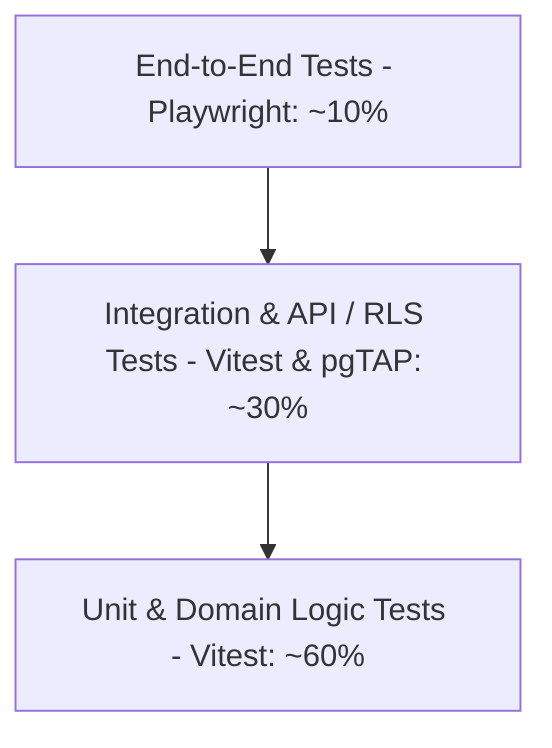

# VyaparSuite Comprehensive Test Strategy & Quality Assurance Architecture
**Target Platform:** Next.js (TypeScript), Supabase (PostgreSQL, Auth, RLS, Storage), Node.js  
**Test Frameworks:** Vitest (Unit/Integration), Playwright (E2E), Supabase CLI Test Helpers (`pgTAP`, Supabase Local Containers)  
**Version:** 1.0.0

---

## 1. Testing Pyramid & Philosophy

VyaparSuite enforces a rigorous quality engineering framework modeled on the classical test automation pyramid, tailored for financial, ERP, and statutory software systems where data corruption or accounting discrepancy is unacceptable.



### 1.1 Distribution Guidelines
1. **Unit Tests (60%):** Pure business logic, statutory tax formulas, currency conversions, roundings, state transition validations, inventory valuation algorithms (FIFO/Moving Average). Fast execution (< 5ms per test), zero network dependencies.
2. **Integration Tests (30%):** Database atomic transactions, Supabase Row Level Security (RLS) policies, Next.js Server Actions, REST API endpoints, General Ledger double-entry integrity, Stock Ledger Entry updates.
3. **End-to-End Tests (10%):** Complete user journeys in real browser sessions (Playwright): Multi-step document approval workflows, Point-of-Sale (POS) offline sync, invoice PDF rendering, import/export streaming.

---

## 2. Test Tooling and Stack Configuration

| Test Level | Tool / Library | Execution Context | Primary Objective |
| :--- | :--- | :--- | :--- |
| **Unit Testing** | Vitest, TypeScript | Local Node.js / In-memory | Millisecond verification of pure domain algorithms and mathematical models. |
| **Database & RLS** | Supabase CLI, `pgTAP`, `supabase-test-helpers` | Dockerized PostgreSQL | Assert multi-tenant data isolation, security policies, triggers, and stored procedures. |
| **Integration / API** | Vitest, Supertest, Next.js Test Env | Local Supabase Instance | HTTP request/response validation, auth headers, status codes, idempotency. |
| **End-to-End (E2E)** | Playwright Test | Headless Chromium, Firefox, WebKit | UI form state, modal interactions, PDF preview, document state changes. |
| **Performance / Load**| k6 | Ephemeral test containers | Throughput benchmarks for GSTR reporting, bulk posting, concurrent checkout. |
| **Mocking / Fixtures** | Fishery, `@faker-js/faker` | Test runners | Type-safe, deterministic mock data generation. |

---

## 3. Test Categories and Execution Architecture

### 3.1 Unit Tests (Domain & Mathematical Logic)
* **Scope:** Tax calculation engine (CGST/SGST/IGST/UTGST/Cess), currency exchange rounding, unit conversions (e.g., Kgs to MT, Boxes to NOS), payment schedule calculations, depreciation schedule algorithms.
* **Requirements:** Deterministic, zero external database calls, 100% path branch coverage.

### 3.2 Integration Tests (Database & REST APIs)
* **Scope:** Verifies that API endpoints conform to RFC specifications, database foreign keys cascade properly, and atomic database functions (e.g., `submit_sales_invoice()`) complete or abort cleanly without orphan records.
* **Atomic Rollback:** Each integration test suite executes within a PostgreSQL transaction wrapped with `BEGIN` and `ROLLBACK` to keep the test environment pristine.

### 3.3 Permission & Row-Level Security (RLS) Tests
Multi-tenancy in VyaparSuite relies entirely on PostgreSQL RLS. Every table has policies enforcing `tenant_id = auth.jwt() ->> 'tenant_id'`.
* **Testing Tool:** `supabase-test-helpers` and `pgTAP`.
* **Sample RLS Test Scenario:**
```sql
BEGIN;
SELECT plan(3);

-- Create Tenant A and Tenant B users
SELECT tests.create_supabase_user('user_tenant_a', 'tenant_a@vyapar.com', '{"tenant_id": "ten_A"}');
SELECT tests.create_supabase_user('user_tenant_b', 'tenant_b@vyapar.com', '{"tenant_id": "ten_B"}');

-- Insert record as Tenant A
SELECT tests.authenticate_as('user_tenant_a');
INSERT INTO sales_invoice (id, customer_name, grand_total) VALUES ('sinv_101', 'Tenant A Customer', 5000);

-- Verify Tenant A can see their invoice
SELECT results_eq(
    'SELECT count(*)::int FROM sales_invoice WHERE id = ''sinv_101''',
    ARRAY[1],
    'Tenant A can view its own invoice'
);

-- Authenticate as Tenant B
SELECT tests.authenticate_as('user_tenant_b');

-- Verify Tenant B CANNOT see Tenant A's invoice
SELECT results_eq(
    'SELECT count(*)::int FROM sales_invoice WHERE id = ''sinv_101''',
    ARRAY[0],
    'Tenant B cannot view Tenant A invoice across tenant boundary'
);

SELECT * FROM finish();
ROLLBACK;
```

### 3.4 Accounting & General Ledger Tests
Financial consistency is non-negotiable.
* **Golden Invariant:** For every submitted voucher (Sales Invoice, Purchase Invoice, Payment Entry, Journal Entry), the sum of debits MUST exactly equal the sum of credits in the `gl_entry` table:
  $$\sum \text{Debit} - \sum \text{Credit} = 0.00 \quad (\pm 0.0001 \text{ tolerance})$$
* **Immutability Invariant:** GL entries for submitted vouchers cannot be updated (`UPDATE` operations raise a PostgreSQL exception). Reversal requires a cancellation voucher with inverted debits and credits.

### 3.5 Inventory & Stock Valuation Tests
* **Negative Stock Prevention:** If `allow_negative_stock` is false, submitting a delivery note or stock issue that brings warehouse balance below zero must throw `ERR_NEGATIVE_STOCK_DISALLOWED`.
* **FIFO / Moving Average Valuation:** Ensure stock balance and stock valuation rate recalculate accurately on retroactive stock entries and goods returns.

### 3.6 Workflow & Lifecycle State Tests
* Test that draft documents can transition to submitted, but submitted documents cannot be directly edited.
* Test that cancelling a document cancels linked downstream transactions or raises an error if dependencies exist (e.g., cannot cancel Sales Order if Delivery Note is submitted).

### 3.7 Regression Tests
Automated suite of historical bug reproductions (e.g., fractional paise rounding discrepancy in multi-tax line invoices).

### 3.8 Performance Tests (k6)
* Benchmark: Report API must stream 50,000 GL ledger rows within 1.5 seconds.
* Benchmark: Bulk document creation API must ingest 500 invoices/sec without database deadlock.

---

## 4. Test Data Strategy: Factories, Fixtures, and Seeding

We employ `@thoughtbot/fishery` with `@faker-js/faker` to build type-safe, composable document factories.

### 4.1 Sample Document Factory
```typescript
import { Factory } from "fishery";
import { faker } from "@faker-js/faker";

export interface SalesInvoiceItem {
  item_code: string;
  qty: number;
  rate: number;
  amount: number;
  hsn_sac: string;
  gst_rate: number;
}

export interface SalesInvoicePayload {
  tenant_id: string;
  customer_id: string;
  posting_date: string;
  doc_status: number;
  items: SalesInvoiceItem[];
  grand_total: number;
}

export const salesInvoiceFactory = Factory.define<SalesInvoicePayload>(() => {
  const qty = 2;
  const rate = 1000;
  const amount = qty * rate;
  const gst_rate = 18;
  const grand_total = amount + (amount * (gst_rate / 100));

  return {
    tenant_id: "ten_test_" + faker.string.alphanumeric(8),
    customer_id: "cust_" + faker.string.alphanumeric(8),
    posting_date: new Date().toISOString().split("T")[0],
    doc_status: 0, // Draft
    items: [
      {
        item_code: "ITEM-" + faker.commerce.product(),
        qty,
        rate,
        amount,
        hsn_sac: "84713010",
        gst_rate
      }
    ],
    grand_total
  };
});
```

---

## 5. CI/CD Pipeline Integration

Our CI pipeline runs on GitHub Actions on every pull request, enforcing zero tolerance for regressions.

```yaml
name: Continuous Integration & Verification Suite

on:
  push:
    branches: [main, develop]
  pull_request:
    branches: [main]

jobs:
  lint-and-typecheck:
    name: Lint & Typecheck
    runs-on: ubuntu-latest
    steps:
      - uses: actions/checkout@v4
      - uses: actions/setup-node@v4
        with:
          node-version: 20
          cache: 'npm'
      - run: npm ci
      - run: npm run lint
      - run: npm run typecheck

  unit-and-accounting-tests:
    name: Vitest Unit & Domain Suite
    runs-on: ubuntu-latest
    steps:
      - uses: actions/checkout@v4
      - uses: actions/setup-node@v4
        with:
          node-version: 20
          cache: 'npm'
      - run: npm ci
      - run: npx vitest run --coverage --reporter=verbose
      - name: Verify Coverage Thresholds
        run: |
          npx vitest --coverage.statements=85 --coverage.branches=80 --coverage.functions=85

  database-rls-tests:
    name: Supabase RLS & DB Triggers
    runs-on: ubuntu-latest
    steps:
      - uses: actions/checkout@v4
      - uses: supabase/setup-cli@v1
      - run: supabase start
      - run: supabase test db

  e2e-playwright-tests:
    name: Playwright E2E Suite
    runs-on: ubuntu-latest
    steps:
      - uses: actions/checkout@v4
      - uses: actions/setup-node@v4
        with:
          node-version: 20
          cache: 'npm'
      - run: npm ci
      - run: npx playwright install --with-deps
      - run: npm run build
      - run: npx playwright test
      - uses: actions/upload-artifact@v4
        if: failure()
        with:
          name: playwright-report
          path: playwright-report/
```

---

## 6. Code Coverage Requirements

* **Global Line Coverage:** $\ge 85\%$
* **Core Accounting Engine (`packages/core-accounting`):** $100\%$ Statement, Branch, and Function coverage.
* **Statutory GST/TDS Engine (`packages/compliance-india`):** $100\%$ Statement and Branch coverage.
* **RLS Policies:** 100% of tenant-aware tables must have automated negative cross-tenant read/write tests.

---

## 7. Critical Business Scenarios Catalog (50+ Specific Test Cases)

Below is the definitive catalog of 52 critical test cases that must be executed and pass before any release to staging or production.

### Category A: Financial Accounting & General Ledger (TC-ACC-01 to TC-ACC-10)
1. **TC-ACC-01:** Submit Sales Invoice with multiple tax line items; verify sum of debit entries in Accounts Receivable exactly equals credit entries in Sales Accounts + CGST/SGST Accounts.
2. **TC-ACC-02:** Attempt manual `UPDATE` or `DELETE` on a row in `gl_entry`; verify database trigger aborts transaction with `ERR_GL_IMMUTABLE`.
3. **TC-ACC-03:** Cancel a submitted Sales Invoice; verify offsetting reversal GL entries are created with inverted debit/credit values and identical posting dates.
4. **TC-ACC-04:** Multi-currency Sales Invoice: Invoicing customer in USD with conversion rate 83.50; verify Accounts Receivable ledger posts in local currency (INR) and exchange gain/loss ledger accounts are hit upon payment entry realization.
5. **TC-ACC-05:** Payment Entry allocation against multiple invoices: Apply ₹100,000 payment across three outstanding invoices (₹40,000, ₹30,000, ₹30,000); verify outstanding balances on all three invoices become zero.
6. **TC-ACC-06:** Overpayment handling: Customer pays ₹60,000 against a ₹50,000 invoice; verify ₹50,000 is allocated to invoice and ₹10,000 unallocated balance is credited to Customer Advance liability account.
7. **TC-ACC-07:** Journal Entry validation: Verify submission fails with `ERR_UNBALANCED_JOURNAL` if `Sum(Debit) != Sum(Credit)`.
8. **TC-ACC-08:** Fiscal Year Closing: Verify closing entries clear nominal (income/expense) accounts to Retained Earnings without altering balance sheet asset/liability accounts.
9. **TC-ACC-09:** Cost Center validation: Enforce mandatory Cost Center on all P&L account entries when company configuration `require_cost_center_on_pl: true`.
10. **TC-ACC-10:** Bank Reconciliation statement generation: Verify statement matches cleared dates against bank feed import without updating book GL balances.

### Category B: Stock Ledger & Inventory Valuation (TC-INV-01 to TC-INV-10)
11. **TC-INV-01:** Moving Average Valuation: Receive 10 units @ ₹100, then 10 units @ ₹120; issue 5 units; verify outgoing valuation rate is exactly ₹110.00 and remaining stock value is ₹1,650.00.
12. **TC-INV-02:** FIFO Valuation: Receive Batch A (10 units @ ₹100) and Batch B (10 units @ ₹150); issue 12 units; verify COGS equals (10 * 100) + (2 * 150) = ₹1,300.00.
13. **TC-INV-03:** Negative Stock Block: Attempt Delivery Note for 15 units when current warehouse balance is 10 units; verify operation fails with `ERR_NEGATIVE_STOCK`.
14. **TC-INV-04:** Warehouse Transfer: Transfer 5 units from Warehouse A to Warehouse B; verify stock ledger entry decrements A, increments B, and total company stock value remains constant.
15. **TC-INV-05:** Perpetual Inventory GL Posting: Submit Delivery Note; verify automated GL entry: Dr. Cost of Goods Sold, Cr. Stock in Hand.
16. **TC-INV-06:** Batch Expiration: Attempt to submit Delivery Note selecting an expired batch; verify validation rejects transaction with `ERR_BATCH_EXPIRED`.
17. **TC-INV-07:** Serial Number Uniqueness: Attempt to receive or transfer a serial number that is already active in another warehouse; verify uniqueness constraint violation.
18. **TC-INV-08:** Stock Reconciliation Adjustment: Reconcile physical count from 100 units to 95 units; verify 5 units reduction posts to Stock Adjustment Expense account.
19. **TC-INV-09:** Purchase Return (Debit Note) Valuation: Return 2 units of previously received goods; verify stock ledger decrements at original receipt valuation rate.
20. **TC-INV-10:** Backdated Stock Entry Re-valuation: Post a backdated stock receipt at higher rate; verify subsequent stock ledger entries and COGS values are automatically recalculated in cascading sequence.

### Category C: Indian GST & Statutory Compliance (TC-GST-01 to TC-GST-10)
21. **TC-GST-01:** Intra-State POS Determination: Supplier in Maharashtra (27), Ship-to in Maharashtra (27); verify 9% CGST and 9% SGST applied.
22. **TC-GST-02:** Inter-State POS Determination: Supplier in Maharashtra (27), Ship-to in Gujarat (24); verify 18% IGST applied.
23. **TC-GST-03:** SEZ Zero-Rated Supply: Supplier in Maharashtra (27), Recipient in SEZ Pune (27); verify treated as inter-state supply with IGST or LUT.
24. **TC-GST-04:** Reverse Charge Mechanism (RCM) Purchase: Create GTA service purchase bill for ₹10,000; verify invoice liability is ₹10,000, and self-invoice creates Dr. ITC-RCM ₹500, Cr. GST-Payable-RCM ₹500.
25. **TC-GST-05:** Blocked Credit (Sec 17(5)): Create purchase invoice for employee personal health insurance; verify ITC is flagged as `ineligible` and tax amount capitalized to insurance expense.
26. **TC-GST-06:** E-Way Bill Auto-Trigger: Submit delivery note with consignment value ₹52,000; verify system enforces mandatory Transporter ID and Vehicle Number.
27. **TC-GST-07:** E-Invoice IRN Generation: Submit B2B invoice for tenant with turnover > ₹5 Cr; verify payload conforms to NIC JSON schema v1.03 and stores signed QR code.
28. **TC-GST-08:** GSTR-1 Table 4A/B2B Classification: Verify registered customer invoices appear in B2B table, while unregistered invoices > ₹2.5 Lakh inter-state appear in Table 5 (B2CL).
29. **TC-GST-09:** Section 194Q TDS Deduction: Purchase from vendor exceeding ₹50 Lakhs threshold in current FY; verify 0.1% TDS is automatically computed and deducted from vendor net payable.
30. **TC-GST-10:** Section 206C(1H) TCS Collection: Customer collection exceeds ₹50 Lakhs; verify 0.1% TCS is added to invoice total.

### Category D: Sales and Accounts Receivable (TC-SAL-01 to TC-SAL-06)
31. **TC-SAL-01:** Customer Credit Limit Enforcement: Customer has ₹1,00,000 credit limit and ₹80,000 outstanding; attempt to submit new Sales Order for ₹30,000; verify system blocks submission.
32. **TC-SAL-02:** Quotation to Sales Order Conversion: Convert quotation with 5 line items; verify line quantities, pricing rules, and item descriptions transfer without deviation.
33. **TC-SAL-03:** Sales Order Reserved Stock: Submit Sales Order for 10 units; verify `reserved_qty` increments on stock balance, preventing allocation to another customer.
34. **TC-SAL-04:** Delivery Note against Sales Order: Dispatch 6 of 10 ordered units; verify Sales Order status updates to `Partially Delivered`.
35. **TC-SAL-05:** Sales Invoice against Delivery Note: Invoice the 6 delivered units; verify Sales Order billing status updates to `Partially Billed`.
36. **TC-SAL-06:** Sales Return / Credit Note: Issue Credit Note for 2 damaged units; verify stock increments back to warehouse and customer receivable is credited.

### Category E: Procurement and Accounts Payable (TC-PUR-01 to TC-PUR-06)
37. **TC-PUR-01:** Purchase Order Approval Workflow: PO exceeding ₹5,00,000 requires two-tier approval (Manager + Director); verify PO cannot be submitted until both sign-offs complete.
38. **TC-PUR-02:** Three-Way Matching: Inward bill received with rate ₹150 vs PO rate ₹100; verify system halts invoice creation with `ERR_PO_RATE_VARIANCE_EXCEEDED`.
39. **TC-PUR-03:** Goods Receipt Note Partial Acceptance: Inspect 100 received units; accept 90 units, reject 10 units; verify 90 units enter Main Warehouse and 10 units move to Rejected Warehouse.
40. **TC-PUR-04:** Supplier Advance Payment: Record ₹50,000 advance to supplier; link subsequent Purchase Invoice; verify advance is cleanly deducted from invoice balance.
41. **TC-PUR-05:** Vendor Bill Hold / Dispute: Flag Purchase Invoice as `Disputed`; verify Payment Entry creation is blocked until hold flag is cleared by Accounts Manager.
42. **TC-PUR-06:** Purchase Order Expiry: Verify background cron job transitions unfulfilled POs past expiration date to `Expired` state.

### Category F: Multi-Tenancy, Security, and RBAC (TC-SEC-01 to TC-SEC-05)
43. **TC-SEC-01:** Cross-Tenant Data Isolation: User of Tenant A sends API request with ID of Tenant B invoice; verify HTTP 404/403 returned, zero data revealed.
44. **TC-SEC-02:** Role-Based Access Restriction: User with role "Warehouse User" attempts to submit a "Journal Entry"; verify request rejected with HTTP 403 Forbidden.
45. **TC-SEC-03:** API Key Revocation: Revoke an active API key; verify immediate rejection with HTTP 401 on subsequent calls.
46. **TC-SEC-04:** Idempotency Key Replay: Send identical POST request twice with same `Idempotency-Key`; verify second request returns cached response without creating duplicate database row.
47. **TC-SEC-05:** Field-Level Permission: User with "Sales Officer" role queries customer endpoint; verify bank account and PAN details are redacted in response.

### Category G: Performance and Resiliency (TC-PERF-01 to TC-PERF-05)
48. **TC-PERF-01:** High Concurrency Order Placement: Simulate 100 concurrent requests trying to purchase the last 5 units of stock; verify exactly 5 succeed, 95 fail gracefully with out-of-stock message, zero negative balance.
49. **TC-PERF-02:** Bulk Invoice Ingestion: Ingest 1,000 invoices via `/api/v1/bulk/execute` in `all_or_none` mode; inject 1 invalid tax calculation at row 999; verify complete rollback.
50. **TC-PERF-03:** General Ledger Query Scale: Execute General Ledger report spanning 250,000 historical postings; verify query completes under 1.8 seconds with index utilization.
51. **TC-PERF-04:** Storage File Upload Limit: Attempt to upload 50MB attachment to invoice; verify system blocks upload at edge enforcing configured 10MB quota.
52. **TC-PERF-05:** Network Interruption Recovery: Kill database connection midway during invoice submit transaction; verify PostgreSQL rollback leaves database in completely consistent state without partial GL entries.

---

## 8. Module Testing Checklist

Before deploying any feature branch or module release, engineers must certify against the following testing checklist:

- [ ] **Data Model & Schema:**
  - [ ] Migration script runs up and down cleanly.
  - [ ] Every table has `tenant_id` foreign key with index.
  - [ ] RLS policies enabled and verified with positive & negative tenant tests.
- [ ] **State Machine & Lifecycle:**
  - [ ] Draft (`doc_status: 0`) allows updates.
  - [ ] Submitted (`doc_status: 1`) is read-only.
  - [ ] Cancel (`doc_status: 2`) reverses ledgers and prevents further edits.
  - [ ] Amend creates draft copy linked to cancelled parent.
- [ ] **Accounting Invariance:**
  - [ ] All generated GL entries balance (`Debits == Credits`).
  - [ ] Cost centers assigned to all P&L lines.
- [ ] **Statutory & Tax:**
  - [ ] GST components split correctly (CGST/SGST vs IGST).
  - [ ] GSTIN and PAN checksums validated.
  - [ ] HSN/SAC length enforced per turnover rules.
- [ ] **Security & Observability:**
  - [ ] No unhandled exceptions or 500 errors.
  - [ ] Audit log entry created with user ID, timestamp, and diff payload.
  - [ ] Idempotency key supported on all write mutations.
