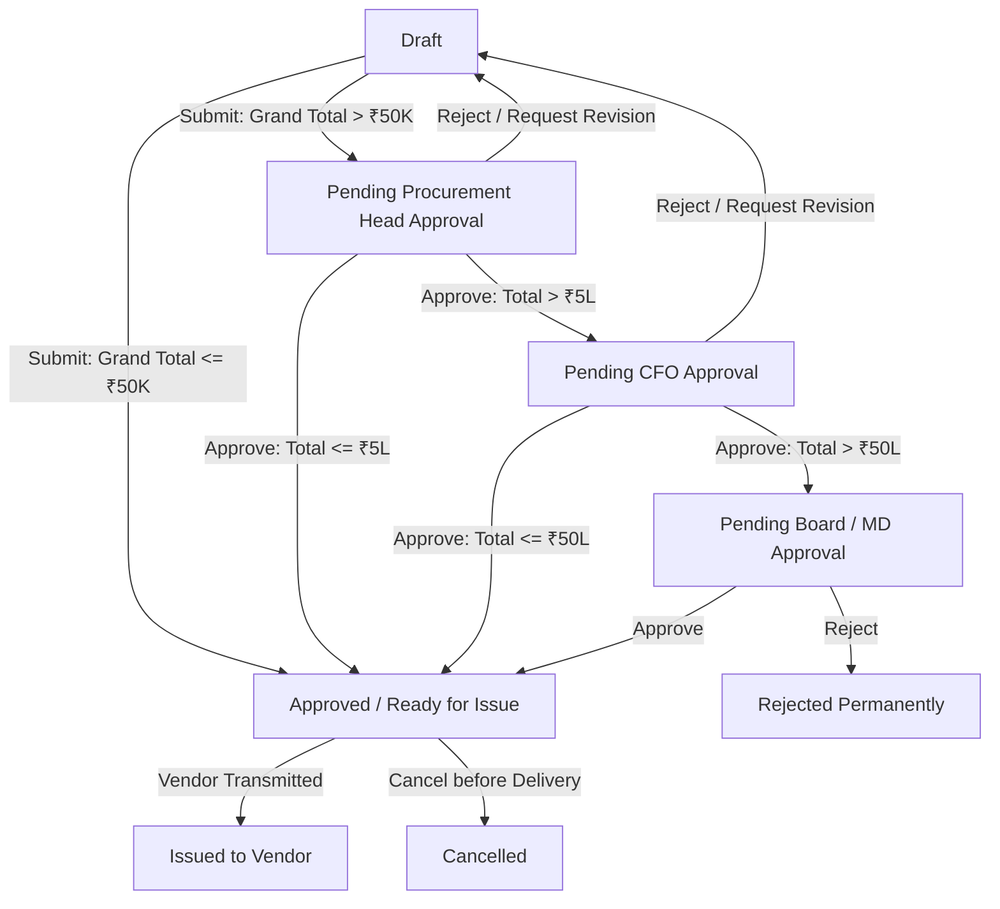
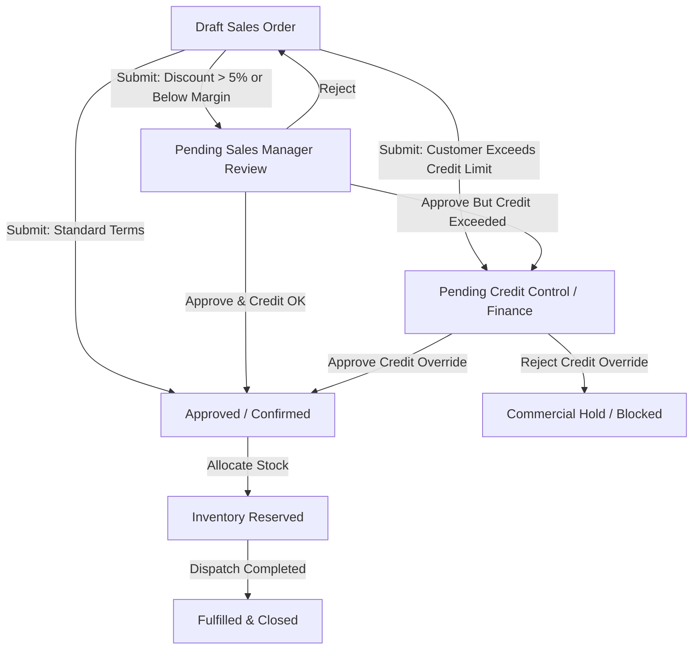
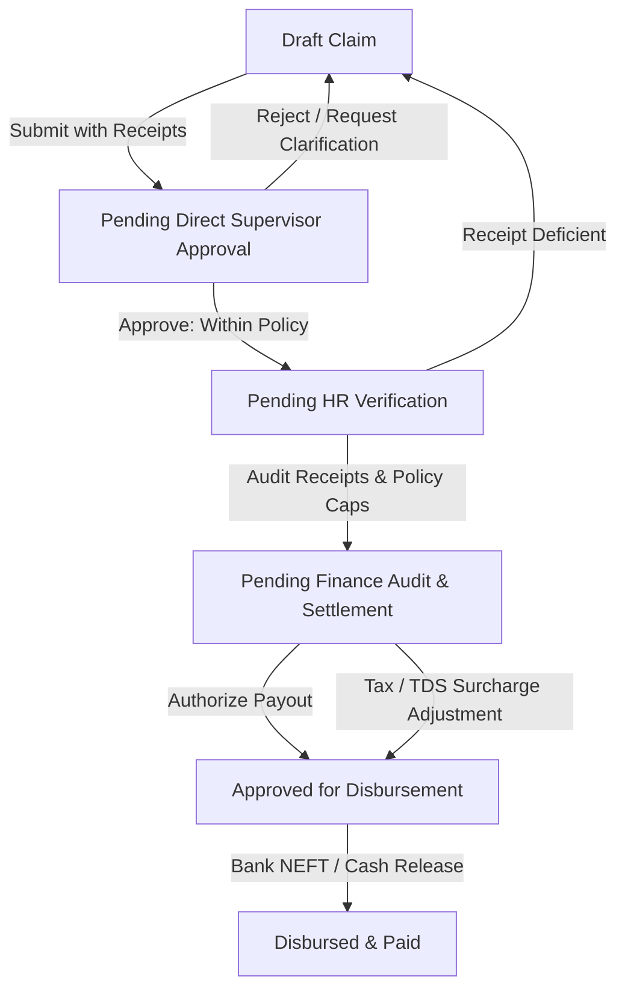
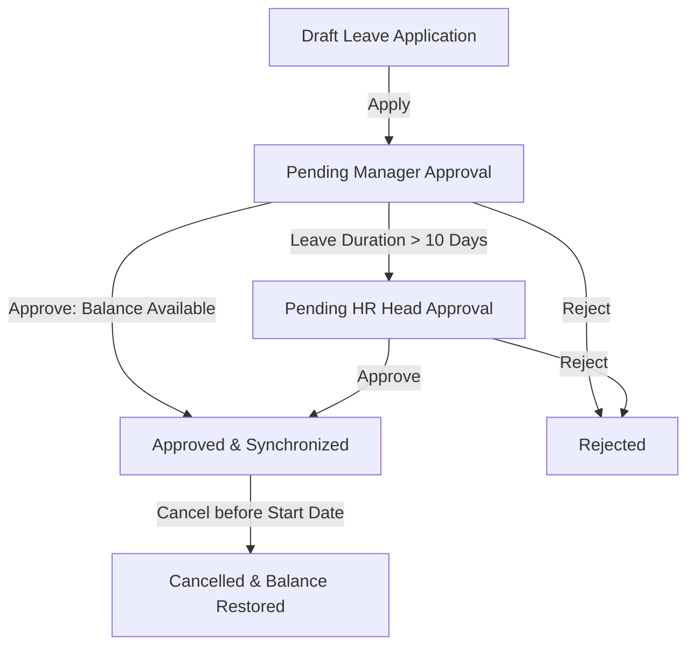
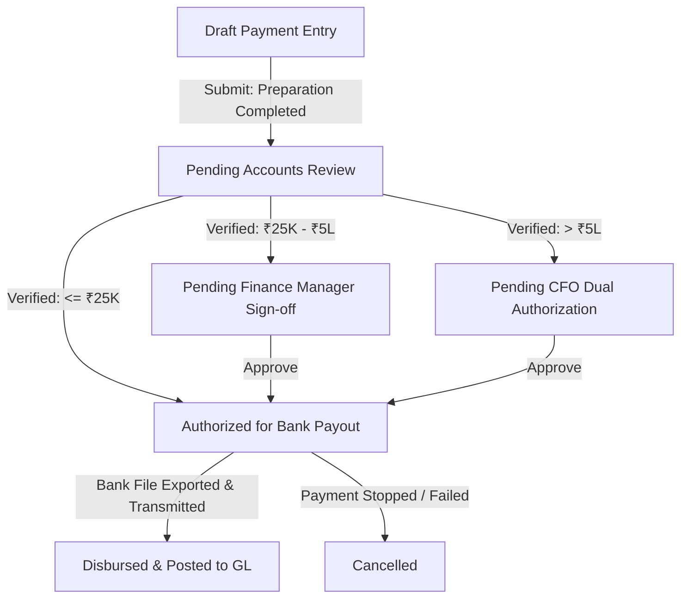
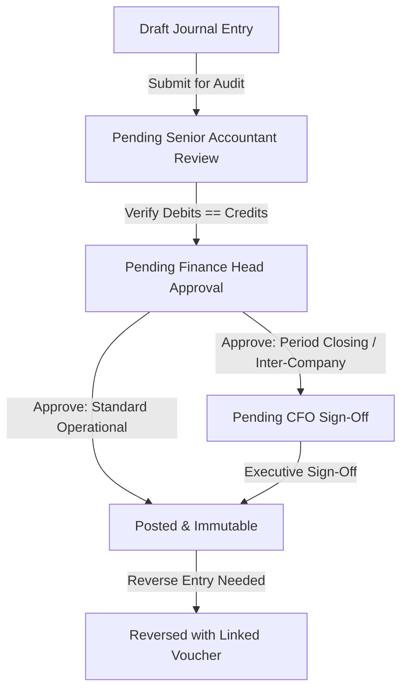
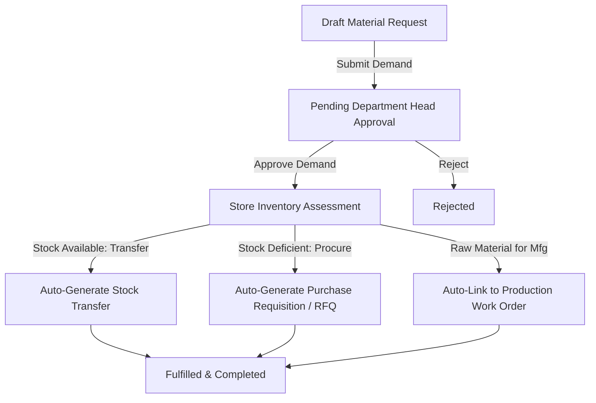
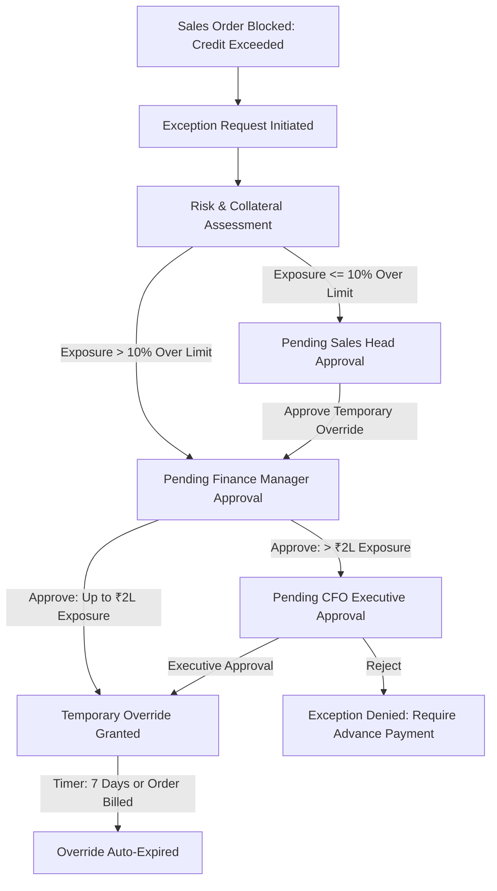

# VyaparSuite — Workflow & Approval Engine Specification

> **Deterministic State Machines, Approval Hierarchies, Notification Pipelines, and SLA Escalation Rules**  
> *Document Version: 1.0.0*  
> *Status: Approved & Canonical Architecture*  
> *Classification: Technical Architecture & Implementation Guide*

---

## 1. Workflow Engine Architecture & Core Principles

VyaparSuite’s workflow engine is designed as a **deterministic, event-driven finite state machine (FSM)**. Every business-critical document transitions through strictly governed lifecycles, guaranteeing organizational compliance, maker-checker segregation, and zero unauthorized ledger postings.

### 1.1 Architectural Pillars
1. **Immutable State Transitions**: State transitions execute atomically inside database transactions. A document cannot enter an intermediate or corrupted state.
2. **Dynamic Guard Conditions**: Transitions are governed by runtime expressions evaluating document metadata (e.g., `grand_total`, `discount_percentage`, `credit_days_overdue`, `department`).
3. **Automated Maker-Checker Enforcement**: An approver cannot approve a document they initiated (`doc.created_by != current_user.id`), eliminating conflicts of interest.
4. **Non-Blocking Asynchronous Side Effects**: Heavy downstream side effects (e.g., PDF generation, bank file export, WhatsApp dispatch, ledger postings) are offloaded to background event queues.
5. **Time-Aware SLA & Escalation Engine**: Automated background monitors track transition latency. If an approver fails to act within the configured SLA window, the workflow triggers automated escalations.

```
┌─────────────────────────────────────────────────────────────────────────────┐
│                            STATE MACHINE TOPOLOGY                           │
│                                                                             │
│  [ DRAFT ] ──(Submit)──▶ [ PENDING APPROVAL ] ──(Approve)──▶ [ APPROVED ]   │
│      ▲                          │                                 │         │
│      │                          ├──(Reject)────▶ [ REJECTED ]      │         │
│      │                          │                                 │         │
│      └───(Send Back)────────────┘                       (Cancel / Amend)    │
│                                                                   │         │
│                                                                   ▼         │
│                                                             [ CANCELLED ]   │
└─────────────────────────────────────────────────────────────────────────────┘
```

---

## 2. Standard Workflow 1: Purchase Order Approval (Amount-Based, Multi-Level)

The Purchase Order (PO) workflow governs commercial procurement, enforcing tiered approval thresholds based on total financial commitment.

### 2.1 State Transition Diagram



### 2.2 Detailed Specification Table

| Transition ID | Current State | Target State | Trigger Action | Allowed Roles | Guard Conditions | Side Effects & Actions | Notification Target | SLA / Escalation |
|---|---|---|---|---|---|---|---|---|
| `PO-T01` | `Draft` | `Approved` | `Submit` | `purchase_user` (Senior Buyer) | `doc.grand_total <= 50000` AND `doc.is_budget_approved == true` | Locks document; generates PDF; creates vendor commitment ledger entry. | Procurement Lead (Info) | Immediate |
| `PO-T02` | `Draft` | `Pending_HOD` | `Submit` | `purchase_user` | `doc.grand_total > 50000` | Locks editable fields; freezes draft pricing; routes to HOD queue. | `procurement_manager` | SLA: 24h. Escalates to CFO at 24h. |
| `PO-T03` | `Pending_HOD` | `Approved` | `Approve` | `procurement_manager` | `doc.grand_total <= 500000` AND `current_user.id != doc.created_by` | Cryptographically signs PO; authorizes GRN generation against PO. | Buyer, Accounts Dept | Immediate |
| `PO-T04` | `Pending_HOD` | `Pending_CFO` | `Approve` | `procurement_manager` | `doc.grand_total > 500000` | Verifies line-item specs; records HOD intermediate approval stamp. | `cfo`, Finance Ops | SLA: 24h. Escalates to MD at 48h. |
| `PO-T05` | `Pending_HOD` | `Draft` | `Send_Back` | `procurement_manager` | Reason mandatory (`comment.length >= 15`) | Unlocks draft fields; records rejection critique in comment log. | PO Creator (High Priority) | Immediate |
| `PO-T06` | `Pending_CFO` | `Approved` | `Approve` | `cfo` | `doc.grand_total <= 5000000` | Validates fiscal budget allocation; signs authorization voucher. | Buyer, Supplier, Treasury | Immediate |
| `PO-T07` | `Pending_CFO` | `Pending_Board` | `Approve` | `cfo` | `doc.grand_total > 5000000` | Flags as Capital / Board-level commitment; compiles executive brief. | Board of Directors, CEO | SLA: 48h. Reminder at 24h. |
| `PO-T08` | `Pending_Board`| `Approved` | `Approve` | `workspace_admin` (Board Delegate) / CEO | Unanimous or majority board sign-off in audit log | Unlocks transmission to vendor; activates milestone tracking. | Buyer, CFO, Legal | Immediate |
| `PO-T09` | Any Pending | `Rejected` | `Reject` | Current Tier Approver | Valid cancellation reason code provided | Closes requisition linkage; releases earmarked department budget. | PO Creator, Requisitioner | Immediate |
| `PO-T10` | `Approved` | `Cancelled` | `Cancel` | `procurement_manager`, `cfo` | `doc.delivered_quantity == 0` AND `doc.billed_amount == 0` | Reverses commitment entry; voids tax registration bindings. | Vendor, Finance, Stores | Immediate |

---

## 3. Standard Workflow 2: Sales Order Approval Workflow

The Sales Order (SO) workflow evaluates customer credit exposure, gross profit margins, promotional discounts, and physical inventory reservations.

### 3.1 State Transition Diagram



### 3.2 Detailed Specification Table

| Transition ID | Current State | Target State | Trigger Action | Allowed Roles | Guard Conditions | Side Effects & Actions | Notification Target | SLA / Escalation |
|---|---|---|---|---|---|---|---|---|
| `SO-T01` | `Draft` | `Confirmed` | `Submit` | `sales_user` | `doc.max_discount <= 5%` AND `customer.outstanding + doc.grand_total <= customer.credit_limit` AND `doc.gross_margin >= 15%` | Locks pricing; executes soft inventory allocation; enables Delivery Note creation. | Customer (Email confirmation), Warehouse | Immediate |
| `SO-T02` | `Draft` | `Pending_Sales_Mgr`| `Submit` | `sales_user` | `doc.max_discount > 5%` OR `doc.gross_margin < 15%` | Flags non-standard pricing; routes to Sales Manager dashboard. | `sales_manager` | SLA: 4h. Escalates to Sales VP at 8h. |
| `SO-T03` | `Draft` | `Pending_Credit` | `Submit` | `sales_user` | `customer.outstanding + doc.grand_total > customer.credit_limit` OR `customer.overdue_invoices > 0` | Suspends dispatch release; generates credit exposure audit packet. | `finance_manager`, Credit Controller | SLA: 8h. Escalates to CFO at 24h. |
| `SO-T04` | `Pending_Sales_Mgr`| `Confirmed` | `Approve_Discount` | `sales_manager` | `doc.max_discount <= 15%` AND Customer credit is verified | Stamps discount authorization hash; triggers inventory allocation. | Sales Rep, Customer | Immediate |
| `SO-T05` | `Pending_Sales_Mgr`| `Pending_CFO` | `Escalate_Discount`| `sales_manager` | `doc.max_discount > 15%` | Routes to CFO for strategic pricing exception. | `cfo`, Sales Director | SLA: 12h. |
| `SO-T06` | `Pending_Credit`| `Confirmed` | `Approve_Credit`| `finance_manager`, `cfo` | Temporary credit extension documented with valid reason | Releases delivery hold; flags invoice for expedited collection. | Sales Rep, Dispatch Team | Immediate |
| `SO-T07` | `Pending_Credit`| `On_Hold` | `Reject_Credit` | `finance_manager` | Unsettled overdue balances persist | Freezes order; prevents stock allocation; requests advance payment. | Customer, Sales Rep | Immediate |
| `SO-T08` | `Confirmed` | `Cancelled` | `Cancel` | `sales_manager`, `workspace_admin` | `doc.delivered_quantity == 0` | Releases reserved inventory back to available stock; cancels delivery tasks. | Warehouse, Customer | Immediate |

---

## 4. Standard Workflow 3: Expense Claim Approval Workflow

The Expense Claim workflow manages employee reimbursements, petty cash distributions, and official corporate travel expenses.

### 4.1 State Transition Diagram



### 4.2 Detailed Specification Table

| Transition ID | Current State | Target State | Trigger Action | Allowed Roles | Guard Conditions | Side Effects & Actions | Notification Target | SLA / Escalation |
|---|---|---|---|---|---|---|---|---|
| `EXP-T01` | `Draft` | `Pending_Supervisor` | `Submit` | `employee_self_service` | All line items have attached receipts (`receipt_urls.length == items.length`) | Freezes claim items; routes to employee's reporting manager. | Direct Supervisor | SLA: 48h. Reminder at 24h. Escalates to Dept Head at 48h. |
| `EXP-T02` | `Pending_Supervisor` | `Pending_HR` | `Approve` | `employee_supervisor` (ABAC Role) | `current_user.id != doc.employee_user_id` | Verifies travel/business justification; endorses claim authenticity. | HR Operations | SLA: 48h. |
| `EXP-T03` | `Pending_Supervisor` | `Draft` | `Clarification_Requested` | `employee_supervisor` | Feedback notes entered | Returns claim to employee; unlocks line items for document re-upload. | Employee | Immediate |
| `EXP-T04` | `Pending_HR` | `Pending_Finance` | `Verify_Policy` | `hr_user`, `hr_manager` | Amounts match daily per-diem policy; GSTIN on vouchers verified | Flags allowable vs non-allowable tax items; queues for payment release. | Finance AP Desk | SLA: 24h. |
| `EXP-T05` | `Pending_Finance` | `Approved` | `Authorize_Payment` | `finance_manager`, `accounts_user` | Total within manager's payment approval limit | Generates Journal Voucher (`Dr Expense A/c, Cr Employee Payable A/c`). | Employee, Payroll Specialist | Immediate |
| `EXP-T06` | `Approved` | `Paid` | `Disburse` | `accounts_user`, `finance_manager` | Linked to Payment Entry or included in Monthly Payroll batch | Marks voucher settled; dispatches remittance advice to employee. | Employee (SMS / WhatsApp) | Immediate |

---

## 5. Standard Workflow 4: Leave Application Workflow

Governs employee paid time off, sick leave, privilege leave, and statutory maternity/paternity leaves in accordance with Indian labor laws and corporate policy.

### 5.1 State Transition Diagram



### 5.2 Detailed Specification Table

| Transition ID | Current State | Target State | Trigger Action | Allowed Roles | Guard Conditions | Side Effects & Actions | Notification Target | SLA / Escalation |
|---|---|---|---|---|---|---|---|---|
| `LEV-T01` | `Draft` | `Pending_Manager` | `Apply` | `employee_self_service` | `leave_balance >= requested_days` AND `start_date <= end_date` | Pre-reserves leave balance; blocks employee attendance calendar. | Reporting Manager | SLA: 24h. Auto-escalates to HR Manager at 48h. |
| `LEV-T02` | `Pending_Manager` | `Approved` | `Approve` | `employee_supervisor` | `requested_days <= 10` AND `current_user.id != doc.employee_user_id` | Deducts days from Leave Allocation Ledger; marks attendance as "On Leave". | Employee, Team Calendar | Immediate |
| `LEV-T03` | `Pending_Manager` | `Pending_HR` | `Approve_Long_Leave`| `employee_supervisor` | `requested_days > 10` OR `leave_type IN ('Maternity', 'Paternity', 'Sabbatical')` | Forwards to HR Ops for statutory document verification. | `hr_manager` | SLA: 48h. |
| `LEV-T04` | `Pending_HR` | `Approved` | `Approve` | `hr_manager` | Mandatory statutory forms verified | Finalizes allocation deduction; issues formal HR approval record. | Employee, Reporting Manager | Immediate |
| `LEV-T05` | Any Pending | `Rejected` | `Reject` | Supervisor / HR Manager | Justification provided in remarks | Unfreezes reserved leave balance; restores normal working schedule. | Employee (Email notification) | Immediate |
| `LEV-T06` | `Approved` | `Cancelled` | `Cancel` | Employee (if future dated) / HR Manager | `current_date < start_date` | Restores deducted leave units to employee ledger; resets calendar. | Employee, Supervisor | Immediate |

---

## 6. Standard Workflow 5: Payment Entry Workflow

Controls treasury payouts, vendor disbursements, advance payments, and customer refunds. High-security maker-checker governance prevents unauthorized bank remittances.

### 6.1 State Transition Diagram



### 6.2 Detailed Specification Table

| Transition ID | Current State | Target State | Trigger Action | Allowed Roles | Guard Conditions | Side Effects & Actions | Notification Target | SLA / Escalation |
|---|---|---|---|---|---|---|---|---|
| `PAY-T01` | `Draft` | `Pending_Audit` | `Submit_For_Review` | `accounts_assistant`, `accounts_user` | Bank details verified; invoices reconciled; amount > 0 | Freezes line allocations; runs anti-fraud account number validation. | Senior Accountant | SLA: 8h. |
| `PAY-T02` | `Pending_Audit` | `Authorized` | `Approve_Small` | `accounts_user` (Senior) | `doc.paid_amount <= 25000` AND `current_user.id != doc.created_by` | Generates payment instruction token; queues in daily disbursement batch. | Treasury Desk | SLA: 4h. |
| `PAY-T03` | `Pending_Audit` | `Pending_Finance_Mgr`| `Endorse` | `accounts_user` | `doc.paid_amount > 25000` | Verifies 3-way match (PO, GRN, Invoice); attaches voucher checklist. | `finance_manager` | SLA: 8h. Escalates to CFO at 16h. |
| `PAY-T04` | `Pending_Finance_Mgr`| `Authorized` | `Approve` | `finance_manager` | `doc.paid_amount <= 500000` | Signs digital approval payload; confirms bank liquidity sufficiency. | Treasury, AP Team | Immediate |
| `PAY-T05` | `Pending_Finance_Mgr`| `Pending_CFO` | `Approve` | `finance_manager` | `doc.paid_amount > 500000` | Endorses large cash outflow; routes to Executive Treasury. | `cfo` | SLA: 12h. Escalates to MD at 24h. |
| `PAY-T06` | `Pending_CFO` | `Authorized` | `Executive_Approve` | `cfo` | Dual MFA verification completed | Signs cryptographic authorization hash; unlocks Open Banking API push. | Finance Head, Treasury | Immediate |
| `PAY-T07` | `Authorized` | `Disbursed` | `Confirm_Bank_Execution`| System Open Banking Webhook / Treasury User | Bank UTR / Transaction Reference number provided | Posts General Ledger Voucher: `Dr Party A/c, Cr Bank A/c`. | Beneficiary (Vendor/Customer), AP Desk | Immediate |
| `PAY-T08` | Any Pending | `Draft` | `Send_Back` | Reviewer / Approver | Defect notes entered | Unlocks voucher for modification; notifies preparer. | Payment Preparer | Immediate |

---

## 7. Standard Workflow 6: Journal Entry Workflow

Governs non-cash financial adjustments, accruals, depreciation postings, inter-company reconciliations, and opening balance imports.

### 7.1 State Transition Diagram



### 7.2 Detailed Specification Table

| Transition ID | Current State | Target State | Trigger Action | Allowed Roles | Guard Conditions | Side Effects & Actions | Notification Target | SLA / Escalation |
|---|---|---|---|---|---|---|---|---|
| `JV-T01` | `Draft` | `Pending_Review` | `Submit` | `accounts_user`, `accounts_assistant` | `sum(debit) == sum(credit)` AND `fiscal_period.is_open == true` | Locks line items; validates cost center tagging and account currency parity. | Senior Accountant | SLA: 12h. |
| `JV-T02` | `Pending_Review` | `Pending_HOD` | `Verify` | `accounts_user` (Senior) | All line descriptions provided; supporting audit documentation linked | Validates statutory accounting standards compliance; routes to HOD. | `finance_manager` | SLA: 12h. |
| `JV-T03` | `Pending_HOD` | `Posted` | `Approve_Post` | `finance_manager` | `current_user.id != doc.created_by` AND `doc.entry_type NOT IN ('Opening Entry', 'Inter-Company', 'Exchange Revaluation')` | Immutably writes General Ledger transactions; updates account balances; generates MCA audit hash. | Accounts Team, Auditor | Immediate |
| `JV-T04` | `Pending_HOD` | `Pending_CFO` | `Approve_Close` | `finance_manager` | `doc.entry_type IN ('Opening Entry', 'Inter-Company', 'Exchange Revaluation')` OR `doc.total_debit > 2500000` | Escalates high-risk or financial-statement-altering entries to CFO. | `cfo` | SLA: 24h. |
| `JV-T05` | `Pending_CFO` | `Posted` | `Final_Post` | `cfo` | Fiscal closing verification completed | Writes GL entries; locks fiscal period if closing voucher. | Finance Ops, Statutory Auditor | Immediate |
| `JV-T06` | `Posted` | `Reversed` | `Create_Reversal` | `finance_manager`, `cfo` | Current date is within allowed reversal window | Generates mirrored reversing journal entry linked to original voucher. | Finance Team, Auditor | Immediate |

---

## 8. Standard Workflow 7: Material Request Workflow

Manages operational internal demands for stock, including store transfers, purchase requisitions, and shop-floor manufacturing issues.

### 8.1 State Transition Diagram



### 8.2 Detailed Specification Table

| Transition ID | Current State | Target State | Trigger Action | Allowed Roles | Guard Conditions | Side Effects & Actions | Notification Target | SLA / Escalation |
|---|---|---|---|---|---|---|---|---|
| `MR-T01` | `Draft` | `Pending_Dept_Head`| `Submit` | All Employees / Supervisors | Line items > 0 AND Required-By Date >= Current Date | Freezes requisition lines; assigns requisition serial number. | Department Head | SLA: 12h. Escalates to Operations Manager at 24h. |
| `MR-T02` | `Pending_Dept_Head`| `Store_Check` | `Approve` | Department Head / Supervisor | Purpose justification verified | Evaluates central vs branch warehouse stock availability across nodes. | Storekeeper (`warehouse_user`) | SLA: 8h. |
| `MR-T03` | `Store_Check` | `Auto_Transfer` | `Allocate_Stock` | `warehouse_user`, `inventory_manager` | `purpose == 'Material Transfer'` AND `available_stock >= requested_qty` | Automatically drafts Stock Transfer Entry; reserves physical warehouse bin. | Requesting Branch Storekeeper | Immediate |
| `MR-T04` | `Store_Check` | `Auto_RFQ` | `Request_Purchase` | `warehouse_user`, `inventory_manager` | `available_stock < requested_qty` OR `purpose == 'Purchase'` | Auto-populates Purchase Requisition in Procurement queue; sets priority. | Purchasing Team (`purchase_user`) | Immediate |
| `MR-T05` | `Store_Check` | `Auto_WorkOrder` | `Issue_To_Mfg` | `production_supervisor` | `purpose == 'Manufacture'` | Generates shop floor pick list for Work Order; allocates raw materials. | Assembly Station Lead | Immediate |
| `MR-T06` | In Progress | `Fulfilled` | `Close_Requisition`| System Trigger / Storekeeper | Linked transfer/purchase receipt completed 100% | Closes requisition status; releases tracking flags. | Requisitioner | Immediate |

---

## 9. Standard Workflow 8: Customer Credit Limit Override Workflow

Governs emergency commercial exceptions where a customer’s sales order exceeds authorized credit limits or when an invoice is overdue, preventing order stagnation while controlling bad-debt risk.

### 9.1 State Transition Diagram



### 9.2 Detailed Specification Table

| Transition ID | Current State | Target State | Trigger Action | Allowed Roles | Guard Conditions | Side Effects & Actions | Notification Target | SLA / Escalation |
|---|---|---|---|---|---|---|---|---|
| `CRE-T01` | `Blocked_Order` | `Pending_Risk` | `Request_Override` | `sales_user`, `sales_manager` | Valid commercial justification and repayment commitment attached | Freezes sales order in `Pending Credit Approval`; generates customer exposure sheet. | Credit Controller / Risk Analyst | SLA: 4h. |
| `CRE-T02` | `Pending_Risk` | `Pending_Finance_Head`| `Endorse_Risk` | Credit Controller / Risk Analyst | Past repayment track record analyzed; Post-Dated Cheques (PDC) logged | Recommends temporary limit increase or single-order waiver. | `finance_manager` | SLA: 4h. Escalates to CFO at 8h. |
| `CRE-T03` | `Pending_Finance_Head`| `Exception_Granted` | `Authorize_Waiver` | `finance_manager` | `total_exposure <= 200000` OR `variance_percentage <= 15%` | Unblocks blocked Sales Order; sets temporary override expiry timer (default 7 days). | Sales Rep, Dispatch Team | Immediate |
| `CRE-T04` | `Pending_Finance_Head`| `Pending_CFO` | `Escalate_Large_Risk`| `finance_manager` | `total_exposure > 200000` OR Customer has overdue invoices > 60 days | Formulates executive credit risk briefing; requires CFO sign-off. | `cfo` | SLA: 8h. |
| `CRE-T05` | `Pending_CFO` | `Exception_Granted` | `Executive_Waiver` | `cfo` | Dual authorization logged; Director of Sales informed | Issues temporary legal credit waiver; unlocks order processing. | Sales Rep, Customer Accounts | Immediate |
| `CRE-T06` | Any Pending | `Exception_Rejected`| `Reject` | Risk Analyst / Finance Head / CFO | Incurred credit risk unacceptable | Freezes order permanently; requires 100% advance payment via Proforma Invoice. | Sales Rep, Customer | Immediate |
| `CRE-T07` | `Exception_Granted` | `Expired` | `Auto_Expire` | System Cron Job | Expiry date elapsed OR Sales Order fully invoiced | Revokes temporary credit headroom; restores baseline credit limit. | Credit Controller, Sales Manager | Immediate |

---

## 10. Technical Architecture & Database Schema

Workflows are managed via five core relational tables in the database:

```sql
-- 1. Workflow Definitions
CREATE TABLE workflows (
    id UUID PRIMARY KEY DEFAULT gen_random_uuid(),
    tenant_id UUID NOT NULL REFERENCES tenants(id) ON DELETE CASCADE,
    doctype VARCHAR(64) NOT NULL,
    workflow_name VARCHAR(128) NOT NULL,
    is_active BOOLEAN DEFAULT TRUE,
    created_at TIMESTAMPTZ DEFAULT clock_timestamp(),
    updated_at TIMESTAMPTZ DEFAULT clock_timestamp(),
    CONSTRAINT uq_workflow_doctype UNIQUE (tenant_id, doctype)
);

-- 2. Workflow States
CREATE TABLE workflow_states (
    id UUID PRIMARY KEY DEFAULT gen_random_uuid(),
    workflow_id UUID NOT NULL REFERENCES workflows(id) ON DELETE CASCADE,
    state_name VARCHAR(64) NOT NULL,
    is_initial_state BOOLEAN DEFAULT FALSE,
    is_terminal_state BOOLEAN DEFAULT FALSE,
    doc_status INT NOT NULL, -- 0: Draft, 1: Submitted, 2: Cancelled
    color_code VARCHAR(16) DEFAULT '#6B7280',
    CONSTRAINT uq_workflow_state UNIQUE (workflow_id, state_name)
);

-- 3. Workflow Transitions
CREATE TABLE workflow_transitions (
    id UUID PRIMARY KEY DEFAULT gen_random_uuid(),
    workflow_id UUID NOT NULL REFERENCES workflows(id) ON DELETE CASCADE,
    current_state VARCHAR(64) NOT NULL,
    next_state VARCHAR(64) NOT NULL,
    action_label VARCHAR(64) NOT NULL,
    allowed_role VARCHAR(64) NOT NULL,
    condition_expr TEXT, -- SQL / JSONLogic expression: e.g. "grand_total <= 50000"
    sla_hours INT DEFAULT 24,
    escalation_role VARCHAR(64),
    created_at TIMESTAMPTZ DEFAULT clock_timestamp()
);

-- 4. Workflow Action Logs (Immutable Audit Trail)
CREATE TABLE workflow_action_logs (
    id UUID PRIMARY KEY DEFAULT gen_random_uuid(),
    tenant_id UUID NOT NULL REFERENCES tenants(id) ON DELETE CASCADE,
    doctype VARCHAR(64) NOT NULL,
    doc_id UUID NOT NULL,
    previous_state VARCHAR(64) NOT NULL,
    next_state VARCHAR(64) NOT NULL,
    action VARCHAR(64) NOT NULL,
    performed_by UUID NOT NULL REFERENCES auth.users(id),
    comments TEXT,
    payload_snapshot JSONB,
    sha256_hash VARCHAR(64) NOT NULL,
    created_at TIMESTAMPTZ DEFAULT clock_timestamp()
);

-- 5. Workflow Active SLA Timers
CREATE TABLE workflow_sla_timers (
    id UUID PRIMARY KEY DEFAULT gen_random_uuid(),
    tenant_id UUID NOT NULL REFERENCES tenants(id) ON DELETE CASCADE,
    doctype VARCHAR(64) NOT NULL,
    doc_id UUID NOT NULL,
    current_state VARCHAR(64) NOT NULL,
    assigned_role VARCHAR(64) NOT NULL,
    expires_at TIMESTAMPTZ NOT NULL,
    is_escalated BOOLEAN DEFAULT FALSE,
    escalation_notified_at TIMESTAMPTZ,
    created_at TIMESTAMPTZ DEFAULT clock_timestamp()
);
```

### 10.1 Background SLA Monitor Worker (Scheduled Cron)
- Every 15 minutes, a serverless background cron worker inspects `workflow_sla_timers`:
  - `SELECT * FROM workflow_sla_timers WHERE expires_at < NOW() AND is_escalated = FALSE;`
  - For each breached record:
    1. Sets `is_escalated = TRUE` and records `escalation_notified_at = NOW()`.
    2. Identifies the `escalation_role` from `workflow_transitions`.
    3. Dispatches high-priority notification to supervisors and adds escalation banner to the document in the UI.
    4. Records SLA breach metric in BI reporting tables.
